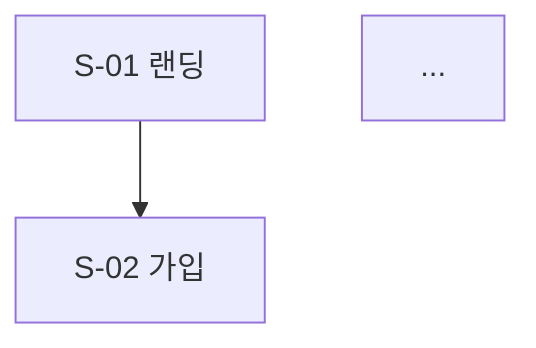

# UX 플로우 & 화면 명세

목표는 구현자가 이 문서만 보고 "어떤 화면이 있고, 각 화면이 무슨 데이터를 보여주며, 어디로 이어지는지" 알 수 있게 하는 것이다. 시각 디자인은 범위 밖이다.

## 작성 순서

1. PRD의 MVP 관통 경로를 먼저 플로우로 그린다. 이것이 뼈대다.
2. IA(화면 계층과 내비게이션)를 정한다.
3. 각 화면 명세를 쓴다. 데이터 필드는 data-architect에게 이름을 확인한다.
4. 나머지 Must/Should 기능의 플로우를 추가한다.
5. 엣지 상태를 화면마다 채운다.

## 도메인 설계 포인트

- **온보딩 = 최대 이탈 지점.** 빈 프로필로는 P2·P3가 동작하지 않는다. "최소 입력으로 첫 가치를 보는" 경로(예: 이력서 업로드 → 자동 채움 확인 → 바로 JD 분석)를 설계하고, 단계 수를 적는다.
- **AI 대기 시간.** 인사이트 생성·면접 피드백은 수 초~수십 초 걸린다. 각 AI 화면에 응답 방식을 명시한다: 스트리밍(채팅, 피드백 텍스트) / 진행 표시 후 완료(구조화 분석) / 백그라운드 + 알림(이력서 파싱 등 긴 작업).
- **근거 표시.** 인사이트·피드백 화면에는 "이 판단의 근거가 된 내 경력 항목 / JD 문장"을 보여줄 자리를 둔다. 신뢰의 핵심이다.
- **AI 결과 편집.** AI가 구조화한 경력은 사용자가 확인·수정할 수 있어야 한다. 자동 저장 vs 확인 후 저장을 명시한다.
- **모의 면접 세션.** 진행 중 이탈 시 이어하기 가능 여부, 세션 종료 후 리포트 화면을 정의한다.

## 문서 템플릿

```markdown
# Resumate 유저 플로우 & 화면 명세 v{N}

## 1. IA
(Mermaid graph 또는 들여쓰기 트리. 화면 ID 표기)

## 2. 핵심 플로우
### FL-01 온보딩 → 첫 인사이트 (MVP 관통 경로)

- 단계 수: N / 관련 기능: F-P1-01, F-P2-01

## 3. 화면 명세
### S-{번호} {화면명}
- 목적:
- 관련 기능: F-P1-01
- 진입 경로: / 이탈 경로:
| 구성 요소 | 표시/입력 데이터 (entity.field) | 액션 | 비고 |
- AI 응답 방식: 스트리밍 / 진행 후 완료 / 백그라운드 / 해당 없음
- 상태: 빈 상태 / 로딩 / 에러 / 정상

## 4. 기능 ↔ 화면 매트릭스
| 기능 ID | 화면 ID |
## 5. 결정 필요 목록
## 6. 변경 기록
```

## 품질 기준

- PRD의 모든 Must 기능은 매트릭스에서 최소 한 화면에 매핑된다. 매핑이 없으면 기능이 빠진 것이다.
- 데이터 필드는 `entity.field` 형식으로 쓰고, entity는 데이터 모델의 테이블명(복수형 snake_case)을 그대로 쓴다(예: `experiences.company_name`). 자유 서술("회사 정보")은 리뷰에서 매칭할 수 없다.
- 화면 ID(`S-{번호}`)·플로우 ID(`FL-{번호}`)는 바꾸지 않는다.
- 모든 AI 화면에 로딩·에러 상태가 정의되어 있다. AI 호출은 실패할 수 있다.
