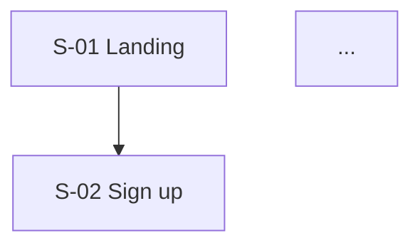

# UX Flows & Screen Specs

The goal: an implementer can read only this document and know which screens exist, what data each one shows, and where each one leads. Visual design is out of scope.

## Order of work

1. Draw the PRD's MVP path as a flow first. That's the skeleton.
2. Define the IA (screen hierarchy and navigation).
3. Write each screen spec. Confirm data field names with data-architect.
4. Add flows for the remaining Must/Should features.
5. Fill in edge states for every screen.

## Domain design points

- **Onboarding = the biggest drop-off point.** P2 and P3 don't work on an empty profile. Design a path where the user sees first value with minimal input (e.g. upload resume → confirm auto-filled data → straight to JD analysis), and state the number of steps.
- **AI wait time.** Generating insights and interview feedback takes seconds to tens of seconds. State the response mode on every AI screen: streaming (chat, feedback text) / progress then complete (structured analysis) / background + notification (long jobs like resume parsing).
- **Showing evidence.** Insight and feedback screens need a place to show "the experience items / JD sentences this judgment is based on". It's the core of trust.
- **Editing AI output.** Users must be able to review and edit experience data that the AI structured. State whether it auto-saves or saves after confirmation.
- **Mock interview sessions.** Define whether a session can be resumed after leaving mid-way, and the post-session report screen.

## Document template

Write the document in Korean; translate the headings below.

```markdown
# Resumate User Flows & Screen Specs v{N}

## 1. IA
(Mermaid graph or indented tree, with screen IDs)

## 2. Core flows
### FL-01 Onboarding → first insight (MVP path)

- Steps: N / Related features: F-P1-01, F-P2-01

## 3. Screen specs
### S-{number} {screen name}
- Purpose:
- Related features: F-P1-01
- Entry points: / Exit points:
| Component | Displayed/input data (entity.field) | Action | Notes |
- AI response mode: streaming / progress then complete / background / n/a
- States: empty / loading / error / normal

## 4. Feature ↔ screen matrix
| Feature ID | Screen IDs |
## 5. Decisions needed
## 6. Change log
```

## Quality bar

- Every Must feature in the PRD maps to at least one screen in the matrix. A missing mapping means a missing feature.
- Write data fields as `entity.field`, where entity is the data model's table name as-is (plural snake_case, e.g. `experiences.company_name`). Free-form descriptions ("company info") can't be matched during review.
- Screen IDs (`S-{number}`) and flow IDs (`FL-{number}`) never change.
- Every AI screen defines loading and error states. AI calls can fail.
