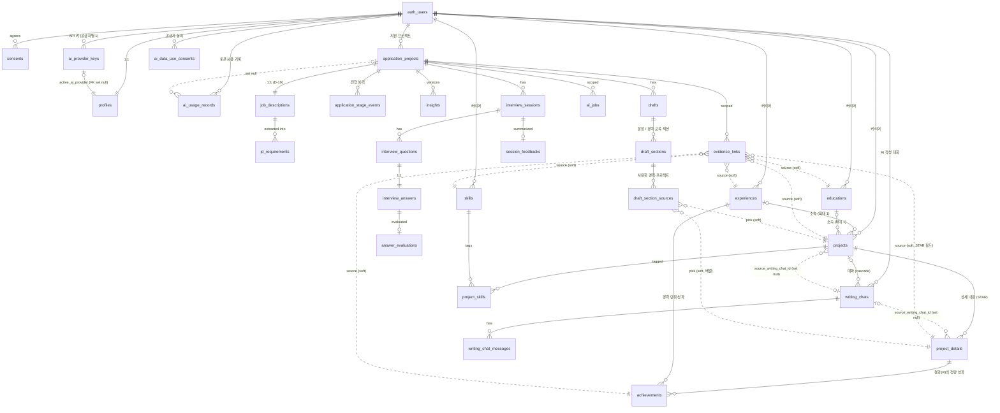

# Resumate 데이터 모델 v4.2

> 작성: data-architect / 기준 입력: `_workspace/01_product-planner_prd.md` (**PRD v4.3**, BYOK), `_workspace/02_ux-planner_flows.md` (**화면 명세 v5.3**), `_workspace/02_ai-feature-designer_ai-spec.md` (**AI 명세 v4.3**), `_workspace/00_input/brief-2026-11-05.md` (백엔드 구현 반영 부분 재실행), `planning-decisions-2026-11-05.md` (사용자 확정 A1~A24), `spec-gaps-summary.md`, `product-context.md`
> 상태: **v4.2 — 백엔드 구현 반영(2026-11-05)**: 사용자 확정 12건(A3, A5, A6, A8, A17~A24)과 구현이 정한 쓰기 경로·내부 컬럼·RPC 세부(spec-gaps B DM 전체)를 문서에 옮겼다. 구현이 정한 값(C)은 `[가정]`으로 둔다(4.5). ★ 표시 확정은 이미 구현된 백엔드도 후속 슬라이스에서 고쳐야 한다. / **v4.1a** (BYOK 리뷰 라운드 2: R-38 잔여, R-45) / **v4.1** (BYOK 리뷰 라운드 1: R-38, R-40, R-43, UB-2 (b) 반영) / **v4 (BYOK)** — 사용자 API 키·활성 공급자·공급자별 데이터 사용 동의·토큰 사용 미터 반영, 운영자 사용량 원장 삭제. 이전: v3.2a (확인 패스 R-35 반영) / v3.2 (리뷰 라운드 2 반영: R-27, R-28, R-29, R-13 잔여 / 사용자 결정 2026-10-24 반영: U-2, U-5, U-8, U-9 등, 8장). **문서만 작성했다. 마이그레이션·SQL은 적용하지 않았다.** `[가정]`·`[결정 필요]`·`[보류]` 항목은 확정이 아니다.
> 이 문서의 테이블·컬럼명이 **확정명**이다. v4.2에서 새로 생긴 이름은 11.5절에 정리했다. UX v5·AI v4 문서와 다른 이름은 11장 `요청 회신`에 old → new로 정리했다. 버전별 변경은 10장.
> 표기: "프로젝트"(`projects`)는 커리어의 업무 단위. 지원 건 단위는 문서·데이터에서 **"지원 프로젝트"**(`application_projects`), 메뉴 라벨 **"기업 JD 관리"**, 화면 표기 **"기업 JD"**, JD 원문(`job_descriptions.raw_text`)은 화면에서 **"공고 원문"**(PRD D-20, UX D-UX-10). "상세 내용"(`project_details`)은 프로젝트 아래 STAR 기록. "AI 작성 대화"(`writing_chats`)는 커리어 채팅(`chat_threads`, Should)과 다르다.

---

## 0. 설계 원칙과 핵심 결정

| # | 결정 | 이유 |
|---|------|------|
| DM-1 | 모든 사용자 데이터 테이블은 `user_id ... references auth.users(id) on delete cascade` | 탈퇴 시 전체 파기의 안전망. **v4.2**: 실제 탈퇴는 RPC가 public 데이터를 명시적으로 지운 뒤 서버가 auth 사용자를 지운다(6.1 F-COM-05, 4.5) |
| DM-2 | 부모–자식은 복합 FK `(parent_id, user_id)` | 소유자 혼합 차단 |
| DM-3 | 열거값은 `text + CHECK` | 기획 중 값 변경이 잦다 |
| DM-4 | 년-월은 `date`(1일 고정) | 정렬·기간·연도 묶음 계산 |
| DM-5 | AI 결과는 jsonb + `schema_version`, 재생성은 새 행(자소서 문항은 덮어쓰기) | |
| DM-6 | 근거는 `evidence_links`에만 | 삭제 시 인용문 일괄 삭제 |
| DM-7 | 근거·근거 선택은 soft reference | "원본 삭제됨" 표시 |
| DM-8 | 커리어 데이터 자동 저장은 본 테이블 `status = 'draft'` | |
| DM-9 (v4 개정) | AI 실행은 `ai_jobs`, **토큰 사용 기록은 `ai_usage_records`**(호출 1회 = 1행, 예상 비용은 버전 관리되는 `ai_price_tables`로 기록 시점 계산). 운영자 비용 통제용 예약·차감·무료 한도는 없다 | PRD v4 D-17 재정의, D-34 |
| **DM-16 (v4)** | **사용자 API 키는 앱 수준 봉투 암호화 + 외부 KMS로 저장하고, 어떤 DB 역할도 원문을 볼 수 없다.** 복호화는 작업 실행 시점 서버 메모리에서만, 실행 중인 작업에 묶인 전용 함수로만 암호문을 꺼낸다(2.11) | NFR-KEY-01~09, D-29 |
| **DM-17 (v4)** | **활성 공급자 1개**(`profiles.active_ai_provider`, 키 행에 FK). 작업은 실행 시점 공급자·등급을 `ai_jobs`에 기록하고(같은 행 다시 시도는 그 시점 활성 값으로 갱신, 2.9.1 A1), 모든 AI 결과 행에 `provider`·`model`을 남긴다 | D-28, F-AI-03 |
| DM-10 | RAG·pgvector 미사용 | |
| DM-11 | 커리어 테이블과 지원 프로젝트 테이블 분리, 둘 사이는 soft reference뿐 | |
| DM-12 | 지원 프로젝트 하위 결과의 소유 키는 `application_project_id` 하나 | D-19 (a) 전제 |
| DM-13 (v3 개정) | **커리어 데이터 쓰기는 사용자 세션에서만.** AI 작업용 DB 역할 `app_ai_writer`는 커리어 테이블을 읽기만 한다. AI 작성 대화의 "저장"·"폼으로 전환"은 AI 호출이 없는 **사용자 확정 동작**이며 사용자 세션 RPC로 실행한다(3.3절) | NFR-AI-05 v3 |
| **DM-14 (v3)** | **커리어 계층: 경력 / 교육 > 프로젝트 > 상세 내용(STAR) > 정량 성과.** 연도는 저장하지 않는 보기 계층(D-22) | PRD v3 F-P1-09, 14, 15 |
| **DM-15 (v3)** | **AI 작성 대화의 출처(필드별 발화)는 `writing_chats.structured_draft` 안에 둔다. `evidence_links`에는 넣지 않는다** | 커리어 데이터를 만드는 과정의 기록이며, 저장 후의 근거 원본은 커리어 항목 자체다(AI 명세 AI-12 동의) |

### 공통 컬럼
`id` uuid PK / `user_id` (DM-1) / `created_at` / `updated_at`(트리거, 모든 근거 원본 테이블 필수). 예외는 표에 명시.

### AI 출력 공통 메타
`ai_job_id`, `schema_version`, `prompt_version`, **`provider`**(v4: `openai` / `gemini` / `anthropic`), `model`, **`model_tier`**(v4: `light` / `default` / `heavy`), **`connection_tier`**(v4: `free` / `paid`), `input_hash`(v4: 공급자·모델 포함), `career_snapshot_hash`, `validation_report`, `usage`.
- v4 적용 테이블: `insights`, `drafts`, **`draft_sections`**(문항 단위 재생성이 다른 공급자로 실행될 수 있어 섹션에도), `interview_questions`, `answer_evaluations`, `session_feedbacks`, **`writing_chat_messages`**(assistant 행), `chat_messages`(Should). JD 요건 추출은 `job_descriptions.extraction_provider` / `extraction_model`(2.6). 결과 배지(F-AI-03 (3), F-AI-09)가 이 값을 읽는다. 면접 세션의 공급자는 **`interview_sessions`의 4개 비정규화 컬럼**으로 둔다(v4.1, R-40, 아래 2.7).
- `usage` jsonb는 결과 행 단위 합계(표시용)로 남기고, 미터의 원천은 `ai_usage_records`다.
- **결과 테이블 내부 컬럼 (v4.2, 구현 반영)** — 화면·명세에는 노출하지 않는다.
  - `ai_job_id`는 soft가 아니라 **복합 FK `(ai_job_id, user_id) → ai_jobs on delete set null (ai_job_id)`**. 다른 사용자 작업 지정을 막고, 작업 90일 정리 때 null이 된다.
  - **`run_generation`** integer: `insights`, `drafts`, `draft_sections`, `interview_questions`, `answer_evaluations`, `session_feedbacks`. 이 행을 쓴 실행 세대(`ai_jobs.run_generation`, 2.9.1). 수동 재시도(같은 행 다시 시도)에서 **공급자·등급이 작업에 기록된 값과 다르면 `step_outputs`를 비우고, 그 작업이 이미 저장한 결과 행도 모두 다시 열어 새 결과로 덮어쓴다**(면접 질문·답변 평가·종합 등, 리뷰 R-63 리더 판단). **같으면 이전 세대에서 실패한 행만 다시 연다.** 어느 쪽이든 늦게 도착한 이전 세대의 완료는 `stale_run`으로 버린다.
  - `drafts`·`draft_sections`의 **`completed_at`**(결과 시각).
  - `interview_sessions`의 `question_job_id`·`question_run_generation`·`evaluation_job_id`·`evaluation_run_generation`(A.12).
- **결과 쓰기는 소유·세대 검사 RPC로만**(5장). 결과 jsonb 안의 별칭 참조는 UUID 키로 바꿔 저장한다(`requirement_ids`, `project_id`, `question_ids` 등, AI C-3).

---

## 1. ERD



- 실선 = FK, 점선 = soft reference 또는 set null 참조. 커리어 → 지원 프로젝트 방향 FK 없음(v2와 같음).
- 비사용자 테이블(`policy_versions`, `ai_price_tables`, `ai_disclosures`, `ai_providers`, `account_deletion_logs`)과 Should 테이블(`chat_threads`, `chat_messages`, `result_ratings`, `ai_suggestions`)은 생략.

---

## 2. 테이블 정의

### 2.1 계정·동의
- `profiles`: v2와 같음. `career_data_updated_at` 트리거 대상에 `educations`, `project_details` 추가(7개 테이블: experiences, educations, projects, project_details, achievements, skills, project_skills).
- `consents` / `policy_versions`: v2와 같음. 국외 이전 항목에 AI 작성 대화 추가(NFR-PRV-03 v3)는 정책 버전 갱신 → 재동의로 처리, 스키마 영향 없음.

### 2.2 커리어 — 공통 규칙

- `experiences`, `educations`, `projects`, `project_details`, `achievements`는 `status text not null default 'draft' CHECK in ('draft','complete')`. 서버가 저장마다 다시 계산하고, 필수 필드는 `CHECK (status = 'draft' OR (필수 필드 not null))`로 강제한다(draft 행에서는 필수 컬럼 nullable).
- **완료 판정 (v3)**

  | 테이블 | complete 조건 | 판정 위치 |
  |--------|---------------|-----------|
  | experiences | `company_name`, `start_month`, (`job_rank` 또는 `job_position`) | 저장 시 + CHECK |
  | educations | `institution_name`, `education_type`, `start_month` | 저장 시 + CHECK |
  | project_details | `title`, `situation`, `action` | 저장 시 + CHECK |
  | **projects** | `name`, `role` **+ 이 프로젝트의 `complete` 상세 내용 ≥ 1** | 자식 의존이라 CHECK로 표현 불가 → `project_details` insert/update/delete 트리거가 부모 `projects.status`를 다시 계산. CHECK는 필드 조건만 강제 |
  | achievements | `description` 또는 (`metric_name` and (`value_before` or `value_after`)) | 저장 시 + CHECK |

- **`achievements.kind` 계산식 (v4.2, 구현 반영)**: generated stored. `metric_name`이 있고 `value_before`·`value_after` 중 하나라도 있으면 `quantitative`, 아니면 `qualitative`.
- **`skills.normalized_name` 규칙 (v4.2, 구현 반영)**: 앞뒤 공백 제거 → 연속 공백 1칸 → 소문자. 표기 차이(`React.js` / `React`)는 합치지 않는다 `[가정]`.
- **길이 제한 (v4.2)**: `experiences.company_name`·`job_rank`·`job_position`·`department`, `projects.name`·`role`, `achievements.metric_name`·`unit`·`description`은 DB CHECK 없이 서버 입력 검사로만 제한한다. 대화 패치는 이름·역할 100자, 지표명 200자, 단위 50자 `[가정]`(4.5).

- **AI 경력 팩·데이터 최소 기준 포함 규칙**: `complete` 행만. `draft` 부모(경력·교육·프로젝트·상세 내용)의 자식은 `complete`여도 제외(v2 확인 1을 교육·상세 내용까지 확장).
- **쓰기 주체**: 사용자 세션(RLS)만. `app_ai_writer`는 select만(3.3절).

### 2.3 커리어 테이블

#### experiences (v2와 같음)
`status`, `company_name`, `start_month`, `end_month`, `is_current`, `job_rank`, `job_position`, `department`, `employment_type`, `summary`. 인덱스 `(user_id, start_month desc)`, `(user_id) where status = 'draft'`.

#### educations (v3 신설)
- 설명: 학위 과정 또는 교육 과정(부트캠프·사내외 교육). 관련 기능: F-P1-14 / 요청: ux S-08·S-34 요청 1, ai C-1

| 컬럼 | 타입 | 제약 | 설명 |
|------|------|------|------|
| `status` | text | 공통 규칙 | |
| `institution_name` | text | complete 시 필수, ≤ 100자 | 학교·교육기관명 |
| `education_type` | text | complete 시 필수, CHECK in (`degree`, `course`) | 학위 과정 / 교육 과정 |
| `program_name` | text | null, ≤ 100자 | 전공·과정명 |
| `start_month` | date | complete 시 필수, 1일 고정 | |
| `end_month` | date | null, `>= start_month` | |
| `enrollment_status` | text | null, CHECK in (`enrolled`, `graduated`, `completed`, `dropped_out`, `on_leave`), `CHECK (enrollment_status <> 'enrolled' OR end_month IS NULL)` | 재학·수강 중 / 졸업 / 수료 / 중퇴 / 휴학 |
| `description` | text | null, ≤ 2,000자 | |

- **학점·성적 컬럼 없음**(NFR-PRV-01 v3). 자격증 `[보류]`.
- `unique (id, user_id)`. RLS 4개 동작 본인(사용자 세션). 인덱스 `(user_id, start_month desc)`, `(user_id) where status = 'draft'`.

#### projects (v3 개정)

| 컬럼 | 타입 | 제약 | 설명 |
|------|------|------|------|
| `status` | text | 공통 규칙 (완료 = 필드 + complete 상세 내용 ≥ 1) | |
| `experience_id` | uuid | null, 복합 FK → `experiences on delete set null (experience_id)` | |
| `education_id` | uuid | **v3 신설**, null, 복합 FK → `educations on delete set null (education_id)` | |
| — | — | `CHECK (num_nonnulls(experience_id, education_id) <= 1)` | 경력 / 교육 / 없음 중 하나 |
| `name` | text | complete 시 필수 | |
| `role` | text | complete 시 필수 | 본인 역할 |
| `summary` | text | **v3 신설**, null, ≤ 200자 | 한 줄 요약 |
| `start_month`, `end_month` | date | null | |
| `team_size` | smallint | null | |
| `source_writing_chat_id` | uuid | **v3 신설**, null, FK → `writing_chats on delete set null` | 이 행을 만든 AI 작성 대화("출처 대화 보기") |

- **v3 삭제**: `contribution`(→ `project_details.action` 등 STAR), `team_context`(→ `project_details.situation`). D-AI-05 해소.
- 인덱스 `(user_id, experience_id)`, `(user_id, education_id)`, `(user_id, start_month desc)`.

#### project_details (v3 신설)
- 설명: 프로젝트 아래 STAR 에피소드. 프로젝트당 여러 개(D-23 (b)). 관련 기능: F-P1-15, F-P1-04 / 요청: ux S-08·S-10·S-35 요청 2, ai C-1(`DET-n`)

| 컬럼 | 타입 | 제약 | 설명 |
|------|------|------|------|
| `project_id` | uuid | 복합 FK → `projects on delete cascade` | |
| `status` | text | 공통 규칙 | |
| `title` | text | complete 시 필수, ≤ 100자 | |
| `situation` | text | complete 시 필수, ≤ 2,000자 | 상황 S (배경·팀 구성, 기존 "팀·배경") |
| `task` | text | null, ≤ 2,000자 | 과제 T |
| `action` | text | complete 시 필수, ≤ 2,000자 | 행동 A (본인이 직접 한 일, 기존 "기여 내용") |
| `result` | text | null, ≤ 2,000자 | 결과 R 서술. 정량 성과는 `achievements.project_detail_id` |
| `learnings` | text | null, ≤ 2,000자 | 화면 표시명 **"회고 및 배운 점"**(사용자 결정 U-2, 2026-10-24). 컬럼명은 `learnings` 유지. **사용자의 회고** — AI는 사실 근거로 쓰지 않음(NFR-AI-06, AI V-8) |
| `sort_order` | smallint | not null, `unique (project_id, sort_order)` 지연 검사 | 프로젝트 안 순서 |
| `source_writing_chat_id` | uuid | null, FK → `writing_chats on delete set null` | |

- `unique (id, user_id)`. RLS 4개 동작 본인(사용자 세션). 인덱스 `(project_id, sort_order)`, `(user_id) where status = 'draft'`.
- 트리거: insert/update(status)/delete 시 부모 `projects.status` 재계산 + `profiles.career_data_updated_at` 갱신.

#### achievements (v3 개정, D-24 (b))

| 컬럼 | 변경 |
|------|------|
| `project_detail_id` | **v3 신설**, null, 복합 FK → `project_details on delete cascade`. **v2 `project_id` 대체** |
| `experience_id` | 유지 (경력 단위 성과: 연간 평가·수상) |
| — | `CHECK (num_nonnulls(project_detail_id, experience_id) = 1)` |
| `metric_name`, `value_before`, `value_after`, `unit`, `description`, `kind`(generated), `status` | 유지 |
| `source_writing_chat_id` | **v3 신설**, null, FK → `writing_chats on delete set null` |

- **v3 삭제**: `project_id`. 마이그레이션 시점에 기존 데이터가 없으므로 변환 규칙은 두지 않는다(planning only).
- 인덱스 `(user_id, project_detail_id)`, `(user_id, experience_id)`.

#### skills / project_skills (v2와 같음)

### 2.4 연도 보기 (D-22 (b)) — 저장하지 않는다

- 연도는 **컬럼·테이블로 저장하지 않는다.** 화면이 읽을 때 계산한다.
  - 경력·교육: `extract(year from start_month)` ~ `extract(year from coalesce(end_month, 현재월))`의 모든 연도에 표시(재직·재학 중이면 올해까지).
  - 프로젝트: `extract(year from coalesce(projects.start_month, 소속 경력·교육의 start_month))` 한 해. 소속도 기간도 없으면 "연도 미정"(UX 가정 수용, PRD 확인 대기).
  - 독립 프로젝트는 그 해의 "기타 프로젝트" 묶음.
- 지원 장치: 새 컬럼 없음. 기존 인덱스 `(user_id, start_month desc)`(experiences, educations, projects)로 충분하다(사용자당 수십 행). 서버가 한 번에 읽어 메모리에서 묶는다. 필요하면 읽기 전용 뷰 `career_year_entries`(security invoker, `user_id`, `year`, `entity_type`, `entity_id`)를 둘 수 있으나 MVP는 앱 계산을 권고 `[가정]`.
- 접힘 상태는 브라우저 저장(UX 가정), DB 없음.

### 2.5 AI 작성 대화 (v3 신설, F-P1-13)

#### writing_chats
- 설명: 프로젝트 1건을 AI와 대화하며 정리하는 세션. 관련 기능: F-P1-13, F-P1-06 / 요청: ux S-08·S-10·S-36 요청 5, ai AI-12

| 컬럼 | 타입 | 제약 | 설명 |
|------|------|------|------|
| `mode` | text | not null, CHECK in (`new_project`, `augment_project`) | 새 프로젝트 / 기존 프로젝트 보강 |
| `project_id` | uuid | null, 복합 FK → `projects on delete cascade` | 보강 대상, 또는 저장·폼 전환으로 만들어진 프로젝트. `new_project`는 저장 전 null. **프로젝트를 지우면 대화도 삭제**(NFR-PRV-06) |
| `experience_id` | uuid | null, FK → `experiences on delete set null` | 정해 둔 소속 경력 |
| `education_id` | uuid | null, FK → `educations on delete set null` | 정해 둔 소속 교육 |
| — | — | `CHECK (num_nonnulls(experience_id, education_id) <= 1)` | |
| `status` | text | not null default `active`, CHECK in (`active`, `saved`, `handed_off`, `abandoned`) + 전이 검사 트리거(아래) | 진행 중 / 저장 완료 / 폼으로 전환 / 그만둠 |
| `structured_draft` | jsonb | not null default `'{}'` | 정리 결과(아래 형식). 저장 전 커리어 데이터가 아니며 팩에 들어가지 않는다 |
| `message_count` | smallint | not null default 0, **`CHECK (message_count BETWEEN 0 AND 40)`**(v4: D-34 확정). 메시지 추가 RPC가 행 잠금 후 사전 검사 | **사용자 + AI 메시지 합계, 시작 인사 제외**(v4.2 A5, 아래). 상한 40(품질·안전 목적, D-34) |
| `last_extracted_sequence` | smallint | not null default 0 (v4.2, 구현 반영) | 정리(extract) 호출이 마지막으로 반영한 사용자 메시지 `sequence`. 그 뒤의 사용자 발화가 다음 정리·다시 보내기 대상(AI-12 "미처리 발화"). 화면 노출 없음 |
| `last_activity_at` | timestamptz | not null default now() | "작성 중인 AI 대화" 정렬 |
| `saved_at` | timestamptz | null | |
| `return_target` | jsonb | null | **v3.2 신설 (U-5)**: 데이터 부족 게이트에서 시작한 대화의 복귀 대상 `{application_project_id, feature, params, created_at}`. `feature` ∈ `insight` / `career_description` / `cover_letter` / `job_interview`, `params`는 화면 설정(예: `{question_count: 5}`, 자소서 `draft_id`). soft reference(지원 프로젝트가 지워지면 무시). 저장·폼 전환 후 화면이 읽고 복귀하면 null로 비움 |

- **`structured_draft` 형식** (AI 명세 형식 채택, 출처는 메시지 UUID):

```json
{
  "schema_version": 1,
  "project": {
    "name": { "value": "결제 플랫폼 성능 개선", "origin": "ai", "source_message_ids": ["uuid"], "source_quotes": ["…"], "review": "ok", "reviewed_at": null },
    "summary": { "value": "…", "origin": "ai", "source_message_ids": ["uuid"], "source_quotes": ["…"], "review": "accepted", "reviewed_at": "2026-10-24T10:00:00Z" },
    "role": { "value": "백엔드 리드", "origin": "user_edit", "source_message_ids": [], "source_quotes": [], "review": "ok", "reviewed_at": null }
  },
  "affiliation_suggestion": { "type": "experience", "id": "uuid", "source_message_ids": ["uuid"] },
  "details": [
    {
      "detail_key": "D1",
      "existing_detail_id": null,
      "fields": { "title": { … }, "situation": { … }, "task": { … }, "action": { … }, "result": { … }, "learnings": { … } },
      "achievements": [ { "metric_name": { … }, "value_before": { … }, "value_after": { … }, "unit": { … } } ]
    }
  ],
  "skills": [ { "value": "Kafka", "source_message_ids": ["uuid"], "source_quotes": ["…"] } ],
  "clarifications": [ { "kind": "actor_ambiguous", "field": "action", "detail_key": "D1" } ],
  "sensitive_flags_count": 0
}
```
  - 필드 객체: `value`, `origin`(`ai` / `user_edit`), `source_message_ids`(uuid[], **`role = 'user'` 메시지만**, AI V-9a), `source_quotes`, `review`, `reviewed_at`.
  - **`review` 값 (v3.2, R-27·T-18)**: `ok`(AI가 검증 통과로 낸 값 또는 사용자 직접 입력) / `needs_review`(V-9e, 사용자 확인 전) / **`accepted`**(사용자가 수락). **거절**하면 `value = null`, `review = 'ok'`, `reviewed_at` 기록(빈 필드가 되어 다음 턴에 다시 질문됨). 수락·거절은 사용자 세션의 `apply_structured_draft_patch`로 `structured_draft`에 저장되므로 **대화를 이어 해도 유지**된다. `accepted` 필드는 이후 AI 패치가 덮어쓰지 않는다.
  - **쓰는 값 규칙**: 저장·폼 전환은 `review in ('ok','accepted')`이고 `value`가 있는 필드만 쓴다. **`needs_review` 필드는 두 RPC 모두 쓰지 않는다.**
  - `existing_detail_id`: `augment_project`에서 기존 상세 내용의 빈 필드를 채울 때.
  - **필드 키 = 저장 대상 컬럼명**(v3.1 명확화): `project`의 키는 `name`, `role`, `summary`, `start_month`, `end_month`, `team_size`. **소속(`experience_id`/`education_id`)은 `structured_draft`에 두지 않는다**(v3.2, R-28·T-19) — 확정 소속의 단일 원천은 `writing_chats.experience_id` / `education_id` 컬럼. `affiliation_suggestion`은 AI 제안일 뿐이며, 사용자가 [연결]하면 RPC `set_writing_chat_affiliation`이 컬럼을 채우고 제안을 지우고, [아니요]면 제안만 지운다. 값 형식은 컬럼 타입을 따른다 — `start_month`/`end_month`는 `'YYYY-MM'` 문자열(저장 시 1일 date), `team_size`는 정수, 정량 성과 `value_before`/`value_after`는 숫자. 스킬은 `project`가 아니라 최상위 `skills[]`. AI 출력의 `period`·`skills` 패치는 서버가 이 키로 바꿔 넣는다(AI-12 매핑은 R-02로 ai-feature-designer가 정리).
  - 민감정보로 걸러진 내용은 저장하지 않는다(개수만, NFR-PRV-05).
  - **구현이 더한 키 (v4.2)**: 정량 성과 원소의 `achievement_key`(사용자 수정·수락 대상 지정용), `clarifications[]`의 `existing_detail_id`. 사용자가 값을 비우면(`value: null`) 그 필드 객체를 지운다(거절과 달리 `reviewed_at`을 남기지 않음). 패치 jsonb 모양은 구현 노트(`S4/02_db-engineer_notes.md` "패치 계약")를 따른다.
  - 소속 제안 거절은 저장하지 않는다(**확정 2026-11-05 (사용자), A15**). 같은 제안이 다시 나올 수 있고, 파이프라인이 확정 소속을 보고 거른다. 보강 모드에서는 소속 제안 자체를 거부한다(`affiliation_not_editable`).
- **메시지 상한 규칙 (확정 2026-11-05 (사용자), A5 ★)**:
  - `message_count`는 사용자 메시지와 AI 응답 메시지를 센다. **시작 인사(대화 시작 때 넣는 고정 문구 assistant 메시지, `ai_job_id` null, `sequence = 1`)는 세지 않는다.**
  - 사용자 메시지는 `message_count ≤ 38`일 때만 받는다(그 답 자리 확보). 그래서 마지막 사용자 메시지가 39번째, 그 답이 40번째가 되어 실제 최대가 40이고, 화면 "n / 40"이 40에 닿는다.
  - 상한 직전 턴의 응답은 마지막 안내를 한다(`begin_assistant_message`의 `is_final`).
  - 기존 구현(인사 포함, 실제 최대 39)은 후속 슬라이스에서 고친다.
- **상태 전이 (확정 2026-11-05 (사용자), A6 ★)**:

  | 전이 | 주체 | 조건 |
  |------|------|------|
  | `active → saved` | `save_writing_chat` | 3.3 |
  | `active → handed_off` | `hand_off_writing_chat` | 3.3 |
  | `active → abandoned` | 사용자(그만두기) | — |
  | **`abandoned → active`** (재개) | **사용자 동작**(S-08 "그만둔 AI 대화"·S-10 대화 기록의 [다시 이어 하기], 진입점은 UX S-08·S-10 기준. 리뷰 R-53) | 행이 남아 있는 동안. 미연결 대화는 90일 자동 정리 전까지(3.4). 재개 시 `last_activity_at = now()` `[가정]` |

  - `saved`·`handed_off`는 되돌릴 수 없다(저장 후 대화는 읽기 전용, D-27 (a)). 그 밖 전이는 트리거가 거부한다.
  - 재개는 AI 호출·사용 기록이 없다. 재개한 대화의 메시지 상한은 이어서 센다.
- **`structured_draft`는 RPC로만 바꾼다 (v3.2, R-29)** — `apply_structured_draft_patch(writing_chat_id, patch jsonb)`:
  - 호출 주체: **AI 턴 = `app_ai_writer`**(턴 처리 서버, 검증 V-9 통과분), **사용자 수정·수락·거절 = 사용자 세션**(미리보기 서버 액션). 행위자는 인자가 아니라 호출 역할로 판정한다(AI 패치는 `origin = 'ai'`, 사용자 패치는 `origin = 'user_edit'` 또는 review 변경).
  - 공통: 행 잠금(`select … for update`), `status = 'active'`인 대화만, 결과를 같은 트랜잭션에서 저장하고 `last_activity_at` 갱신.
  - AI 패치 규칙: `origin = 'user_edit'`이거나 `review = 'accepted'`인 필드는 덮어쓰지 않는다. `source_message_ids`가 이 대화의 `role = 'user'` 메시지가 아니면 거부(V-9a 재확인).
  - **V-9h 보장 (AI·사용자 공통)**: `augment_project`에서 `existing_detail_id`가 가리키는 기존 `project_details` 행의 해당 컬럼, 또는 대상 `projects` 행의 해당 컬럼이 **이미 채워져 있으면 그 필드 패치를 거부**한다(기존 값 보호). `save_writing_chat`의 "빈 필드에만" 규칙이 최종 방어로 남는다.
  - 사용자 패치 규칙: 필드 값 수정(→ `origin = 'user_edit'`, `review = 'ok'`), `needs_review` → `accepted` / 거절. 소속은 이 RPC가 아니라 `set_writing_chat_affiliation`.
- v4: `usage_event_id` 컬럼 **삭제**(차감 개념 폐기, D-34). 대화의 토큰 사용은 `ai_usage_records.ai_job_id` → `ai_jobs`(`writing_chat_turn`, `target_id` = 대화)로 찾는다.
- 쓰기 주체 요약 (**v4.2: 구현대로 좁힘**): 대화 시작, 사용자 메시지 추가, assistant 메시지 시작·완료, 정리 완료 표시(`last_extracted_sequence`), `message_count`·`last_activity_at` 갱신은 모두 **소유 검사를 하는 security definer RPC**로만 쓴다. `app_ai_writer`와 사용자 모두 `writing_chats`·`writing_chat_messages`에 직접 insert/update 권한이 없다. 예외는 사용자 세션의 `status`(위 전이 규칙), `return_target` 직접 update뿐이다. `apply_structured_draft_patch`(AI = `app_ai_writer`, 사용자 = 사용자 세션), `set_writing_chat_affiliation`, 저장·전환 RPC는 그대로. **`structured_draft` 컬럼에 대한 직접 update 권한은 누구에게도 주지 않는다.**
- RLS: select/delete 본인. insert·update는 위 RPC와 제한 컬럼만. `service_role`은 select·delete만(90일 정리).
- 죽은 스트리밍 턴: assistant 행이 `streaming`인데 2분 넘게 갱신이 없거나 그 턴 작업이 끝났으면 죽은 턴으로 보고, 새 턴 시작 때 `failed`로 닫는다. 살아 있는 턴이 있으면 새 사용자 메시지는 `turn_in_progress`로 거부한다(구현 반영).
- 인덱스: `(user_id) where status = 'active'`, `(user_id, project_id)`.

#### writing_chat_messages

| 컬럼 | 타입 | 제약 | 설명 |
|------|------|------|------|
| `writing_chat_id` | uuid | 복합 FK → `writing_chats on delete cascade` | |
| `sequence` | smallint | not null, `unique (writing_chat_id, sequence)` | 화면 "내 답변 #n"은 사용자 메시지만 다시 번호 매김 |
| `role` | text | not null, CHECK in (`user`, `assistant`) | |
| `content` | text | not null, ≤ 4,000자 `[가정]` | |
| `status` | text | not null default `done`, CHECK in (`streaming`, `done`, `failed`) | AI 응답 실패 턴 "다시 보내기" |
| `ai_job_id` | uuid | null (soft) | assistant 메시지를 만든 턴 작업. 시작 인사(고정 문구)는 null — 메시지 상한에서 빠지는 행(A5) |

- 공통 컬럼 중 `updated_at`은 streaming → done 전환에만 쓰인다.
- RLS: select 본인. user 메시지 insert는 RPC `append_writing_chat_message`(security definer + 소유 검사, 상한 검사 + `message_count` 증가를 한 트랜잭션). assistant 메시지 insert/update는 `app_ai_writer`가 부르는 definer RPC(`begin_assistant_message` / `finish_assistant_message`). 직접 insert/update·개별 delete 없음(대화 삭제로만).
- 시작 인사 문구는 고정 상수(모드별 2종 + 무료 등급이면 서비스 개선 사용 안내 1문장) `[가정]`. 공급자별 고지 문구와의 일치는 UX S-36·법무(D-39) 확인 대상.

### 2.6 지원 프로젝트 (AP + ST)

#### application_projects (v3 개정)

| 컬럼 | 변경 |
|------|------|
| `name`, `name_source`(user/ai/default), `deadline`, `memo`, `last_activity_at`, `duplicated_from_id` | v2와 같음 |
| `application_status` | **v3 삭제**(F-AP-07 폐기) → `stage` |
| `stage` | **v3 신설**, not null default `before_apply`, CHECK in (`before_apply`, `document`, `assignment`, `job_interview`, `culture_fit_interview`, `closed`) — 지원 전 / 서류 전형 / 과제 전형 / 직무 인터뷰 전형 / 컬처핏 전형 / 전형 종료 |
| `stage_outcome` | **v3 신설**, null, CHECK in (`passed`, `failed`), `CHECK (stage = 'closed' OR stage_outcome IS NULL)` — 최종 합격 / 불합격. null + closed = "결과 미기록" |
| `stage_changed_at` | **v3 신설**, not null default now() — 보드 열 안 정렬(D-26 (a) 최근 이동순) |

- `stage`·`stage_outcome`·`stage_changed_at`은 **직접 update 권한을 주지 않고** RPC로만 바꾼다(이력 누락 방지, 아래).
- 인덱스: `(user_id, stage, stage_changed_at desc)` (보드), 기존 `(user_id, last_activity_at desc)`, `(user_id, deadline)`.
- 복제(F-AP-09 Could)·신규 생성 시 `stage = 'before_apply'`, 생성 이벤트 기록.

#### application_stage_events (v3 신설, F-ST-05)
- 설명: 전형 단계·결과 변경 이력. 화면에 보이지 않아도 MVP부터 쌓는다. 불변.

| 컬럼 | 타입 | 제약 | 설명 |
|------|------|------|------|
| `application_project_id` | uuid | 복합 FK → `application_projects on delete cascade` | 지원 프로젝트와 함께 삭제(F-AP-05) |
| `event_type` | text | not null, CHECK in (`created`, `stage_changed`, `outcome_changed`) | |
| `from_stage` | text | null | `created`면 null |
| `to_stage` | text | not null | |
| `from_outcome` | text | null | 종료에서 나가며 지워진 결과도 여기 남는다(D-UX-12) |
| `to_outcome` | text | null | |
| `created_at` | timestamptz | | 이동 시각. `updated_at` 없음(불변) |

- RLS: select 본인. insert는 RPC만(security definer, `auth.uid()` 소유 검사). update·delete 없음(연쇄만).
- 인덱스: `(application_project_id, created_at)`.
- **RPC `move_application_stage(application_project_id, to_stage, outcome default null)`** (한 트랜잭션):
  1. `to_stage = stage`이면 아무것도 하지 않음(이벤트 없음).
  2. 현재 `closed`이고 `to_stage <> 'closed'`이면 `stage_outcome = null`(D-UX-12 (a) 권고. 화면이 사전 확인).
  3. `to_stage = 'closed'`이고 `outcome`이 주어지면 함께 기록.
  4. `stage`, `stage_changed_at = now()`, `last_activity_at` 갱신 → `stage_changed` 이벤트 insert(이전·새 결과 포함).
  5. 반환: 새 상태 + `interview_prompt`(`to_stage`가 `job_interview`/`culture_fit_interview`이고 **실제로 이동했을 때만**, `{interview_type, in_progress_session_id, in_progress_session}`) — C-14 팝업용. **AI 호출·사용량 없음.**
     - **v4.2 (구현 반영)**: `in_progress_session` = `{session_id, interview_type, answered_count, question_count, generation_status, last_activity_at}` 또는 null. 작성 중 세션은 유형과 무관하게 지원 프로젝트당 1개라 옮긴 열 유형과 다를 수 있다(UX C-14 반영 대상).
  - `closed → closed` + outcome은 1단계대로 아무것도 하지 않는다(결과 기록은 `set_application_outcome`).
- **RPC `set_application_outcome(application_project_id, outcome)`**: `stage = 'closed'`일 때만, `outcome_changed` 이벤트.

#### job_descriptions / jd_requirements (v2와 같음 + v4 변경)
- **v4 키 없는 JD (D-30)**: 키 없이 만들면 `extraction_status = 'pending'`(= 추출 전, 키 없음 포함), 이름은 사용자 입력(`name_source = 'user'`) 또는 기본 이름 "새 기업 JD (날짜)"(`name_source = 'default'`). 키를 연결한 뒤 그 JD의 첫 AI 기능(또는 "요건 정리하기")이 AI-01을 먼저 실행하고, `name_source`가 `default`면 AI 추출값으로 바꾼다(→ `ai`). 키 연결 시 기존 JD 일괄 추출은 하지 않는다.
- **v4 신설**: `job_descriptions.extraction_provider`, `extraction_model`(요건 탭 공급자 배지, `ai_jobs` 90일 정리 후에도 유지).
- **v4.2 (구현 반영)**
  - AI 쓰기 경로: `app_ai_writer`는 `application_projects`·`job_descriptions`·`jd_requirements`를 직접 update하지 않고 `begin_jd_extraction` / `apply_jd_extraction` / `fail_jd_extraction`(security definer + 소유 검사)만 부른다. `application_projects`는 컬럼 단위로 읽고 `memo`는 읽지 못한다(메모는 AI 입력 아님 `[가정]`).
  - 기본 이름: "새 기업 JD (YYYY-MM-DD)"(지원 프로젝트 생성일 KST, `name_source = 'default'`). 키 없이 회사명·포지션명을 둘 다 입력했으면 "회사명 – 포지션명"(`user`, 앞 100자). 추출 실패 때도 `fail_jd_extraction`이 같은 규칙으로 null 이름을 채운다 `[가정]`.
  - `jd_extraction` 작업이 성공하지 못하고 끝나면(멈춤 처리 포함) 트리거가 그 작업으로 `running`인 JD를 `failed`로 바꾸고 대체 이름을 넣는다.
  - 길이 상한(4.5) `[가정]`.

### 2.7 인사이트·서류·면접 (v2와 같음, 변경분만)

| 테이블 | v3 변경 |
|--------|---------|
| insights | 없음 |
| drafts | 없음 (`options.included_*`에 `included_education_ids` 키 추가) |
| draft_sections | `section_kind` CHECK에 **`education`** 추가(경력기술서 교육 섹션, AI-03). `experience_id`(soft) 옆에 **`education_id`**(soft) 추가 |
| draft_section_sources | **`education_id`**(soft, 교육 소속 프로젝트·교육만 선택) 추가, **`project_detail_ids`** uuid[] 추가(그 문항에서 실제 사용한 상세 내용). CHECK: `num_nonnulls(experience_id, education_id, project_id) >= 1` 그리고 `num_nonnulls(experience_id, education_id) <= 1` |
| interview_sessions | **v4.1 신설**: `question_provider`, `question_model`(질문 일괄 생성 작업의 공급자·모델, 생성 성공 시 기록) / `evaluation_provider`, `evaluation_model`(채점 작업 공급자·모델, 채점 시작 시 기록). 질문 생성과 채점은 별도 작업이라 활성 공급자가 바뀌면 서로 다를 수 있다. **세션 목록 "실행 공급자" 열**: 채점이 시작된 세션은 `evaluation_provider`, 그 전(작성 중)은 `question_provider`를 보이고, 둘이 다르면 "질문 {question_provider} · 채점 {evaluation_provider}"로 둘 다 표시. 재채점은 `evaluation_*`를 덮어쓴다. 원천은 각 작업의 `ai_jobs.provider`(90일 뒤 정리되므로 세션에 복사) |
| interview_questions / answers / answer_evaluations / session_feedbacks | 없음 (F-ST-04 팝업은 세션을 만들지 않는다) |

**v4.2 변경 (2026-11-05)**

| 테이블 | 변경 |
|--------|------|
| drafts | `options.tone` 값 = **`concise`(간결) / `detailed`(상세)**. 화면 기본 선택은 `concise`(UX S-17). DB는 null을 허용하고 **null은 `concise`로 처리**한다 — 생성 프롬프트와 `input_hash`에서 null을 `concise`로 정규화해 "간결 선택"과 "값 없음"이 같은 출력·같은 해시가 되게 한다(리더 판단 2026-11-05, 리뷰 R-54. 정규화 위치는 `[가정]`). 그 밖 값은 저장하지 않는다(**확정 2026-11-05 (사용자), A17**). `options.selection_origin` 3값(`insight` / `ai_ranking` / `user`) 유지 — AI-11 기본 선택이 실패하면 대체 선택 없이 체크 없는 상태에서 사용자가 고르고 `user`로 저장(**확정 2026-11-05 (사용자), A23 ★**). `ai_ranking`이면 `options.ranking`은 그 지원 프로젝트에서 가장 최근 성공한 `draft_source_ranking` 작업 출력을 복사(지금 팩에 없는 프로젝트 제외) `[가정]`. 자소서 초안의 `provider`·`model`·`model_tier`·`connection_tier`·`prompt_version`은 **마지막으로 생성 완료된 문항** 값 `[가정]`. 자소서 초안 `status` 계산(4.5) |
| drafts / draft_sections | **저장하지 않는 AI 출력 (확정 2026-11-05 (사용자), A21)**: 경력기술서 `omitted`·`notes_for_user`, 자소서 `notes_for_user`·`char_adjust_needed`는 컬럼을 두지 않는다. 생성 직후 스트림(`validated`)으로만 화면에 간다. 글자 수 경고는 `draft_sections.validation_report.char_adjust_needed`에 남는다 |
| interview_sessions | **`question_validation_report`** jsonb null, **`question_usage`** jsonb null 신설 (**확정 2026-11-05 (사용자), A22 ★**) — 질문 세트 단위 검증 기록(구성 규칙 경고 `composition_relaxed`·`composition_unmet` 등)과 세트 생성 사용량 합계. 질문 세트 확정 RPC(`complete_interview_questions`)가 쓴다. 질문 행의 AI 메타는 그대로 질문마다 |
| interview_sessions | 내부 컬럼 `question_job_id`, `question_run_generation`, `evaluation_job_id`, `evaluation_run_generation`(작업 FK는 복합 `(…, user_id)` `on delete set null`). `data_sufficiency` **not null**(생성 RPC가 서버 판정값을 항상 넣음). 구현 반영 |
| interview_answers | 그만둔(`abandoned`) 세션의 답변은 미제출이어도 편집 불가(**확정 2026-11-05 (사용자), A8**, A.13) |

- 세션 목록 "실행 공급자"는 `interview_sessions.provider`가 아니라 위 v4.1 규칙(`evaluation_*` / `question_*` / 둘 다)이다(UX S-20 반영 대상).

- `draft_section_sources.project_detail_ids`의 원본 삭제: 배열 원소 단위 soft 표시가 어려우므로 삭제 트리거가 해당 ID를 배열에서 빼고 `source_deleted_at`은 프로젝트·경력·교육 삭제 때만 기록한다. 상세 내용 단위 "원본 삭제됨"은 같은 문항의 `evidence_links`(source_type `project_detail`)가 표시한다.

### 2.8 근거 (evidence_links)

| 항목 | v3 |
|------|----|
| `source_type` | CHECK에 **`education`**, **`project_detail`** 추가 → `profile`, `experience`, `education`, `project`, `project_detail`, `achievement`, `skill`, `jd_requirement`, `jd_sentence`, `interview_answer`, `user_note` |
| `source_field` | `project_detail`: `title`, `situation`, `task`, `action`, `result`, `learnings` / `education`: `institution_name`, `program_name`, `education_type`, `enrollment_status`, `period`, `description` / `project`: `name`, `role`, `team_size`, `summary`, `period`(v2의 `contribution`, `team_context` 제거) |
| 회고 근거 표시 | 별도 플래그 컬럼 없음. **`source_type = 'project_detail' AND source_field = 'learnings'`**이면 화면이 "회고 및 배운 점" 칩으로 표시(UX 요청 3 회신, U-2). V-8 검사는 저장 전에 끝난다 |
| `source_snapshot_at` | `project_detail`은 상세 내용 행의 `updated_at`(필드 단위 아님 — 다른 STAR 필드 수정도 "변경됨"이 될 수 있음 `[가정]`, v1 4.3과 같은 한계) |
| `writing_chat_message` | **넣지 않는다**(DM-15). AI 명세 C-3 표의 `writing_chat_message`는 `structured_draft` 안 출처로만 쓴다 |

- 삭제 트리거 대상 테이블에 `educations`, `project_details` 추가.

**v4.2 (구현 반영)**

| 항목 | 규칙 |
|------|------|
| 근거 저장 직전 원본 삭제 | 팩을 만든 뒤 저장 전에 원본이 지워지면 삭제 트리거가 이미 지나갔다. **insert 트리거**가 원본 행이 없으면 `quote = null`, `source_deleted_at = now()`로 저장한다("원본 삭제됨"). 다른 사용자·다른 지원 프로젝트 원본이면 `invalid_evidence_source`로 거부 |
| `user_note` | `source_id` = 메모가 있는 문항의 **`draft_sections.id`**. 같은 지원 프로젝트가 아니면 거부, 문항이 없으면 "원본 삭제됨". 인용은 저장 시점 문장 |
| `interview_answer` | `source_id` = **`interview_answers.id`**, 같은 지원 프로젝트의 답변만. **`source_field`는 null**(CHECK). 답변 삭제 시 "원본 삭제됨" 트리거. AI-06 등급·강점의 답변 인용도 이 근거 행으로 남는다(`criteria.<key>`, `strengths.<n>`) |
| `jd_sentence` | `source_locator {sid, start, end}`는 그 문장 범위 안의 부분 구간 허용(오프셋 JS UTF-16) |
| 소유자별 허용 출처 | 인사이트 = 커리어 7종(`profile` 포함) + `jd_requirement`·`jd_sentence`. 경력기술서 = 커리어 7종만. 직무 면접 질문·경력기술서·`job_competency` 문항은 `project_detail.learnings` 근거를 RPC가 거부(V-8 DB 방어) |
| 쓰기 주체 | **결과 저장 RPC 안에서만**(소유·세대 검사). `app_ai_writer`의 직접 INSERT 권한 없음(5장, A24) |

### 2.9 AI 작업·사용량 미터 (v4 BYOK)

> v4: 운영자 비용 통제 개념(`usage_events`의 예약·차감·해제, `usage_limits`의 무료 한도, 대화 월 한도)은 **삭제**했다(D-34). 남는 것은 사용자 화면의 **사용량 미터**(F-AI-07)를 위한 호출 단위 토큰 기록과 가격표다. 품질·안전 목적 제한(D-34 유지분)은 2.9.4.

#### 2.9.1 ai_jobs (v4 개정)

| 컬럼 | v4 변경 |
|------|---------|
| `job_type` | CHECK에 **`key_verification`** 추가(F-AI-01·02 확인 호출도 같은 실행·기록 경로). 전체: `jd_extraction`, `insight`, `career_description`, `draft_source_ranking`, `cover_letter`, `interview_questions`, `interview_evaluation`, `writing_chat_turn`, `key_verification`, (Should) `writing_assist`, `chat_reply` |
| `provider` | **신설**, not null, CHECK in (`openai`, `gemini`, `anthropic`). **실행 시작 시점의 활성 공급자**. 진행 중(`running`)에는 바뀌지 않는다(F-AI-03 (2): 공급자 변경은 다음 실행부터). 같은 행 다시 시도(`failed → queued`)는 다음 실행이므로 그 시점 활성 공급자로 갱신한다(2.9.1, **A1 변경**) |
| `model_tier` | **신설**, CHECK in (`light`, `default`, `heavy`) |
| `connection_tier` | **신설**, CHECK in (`free`, `paid`). 시작 시점 키의 등급. 무료면 순차 실행 경로(AI C-12) |
| `retry_count` | **v3 `attempt_count` 이름 변경**. 공급자 원인(1·6)과 시스템 원인 자동 재시도 합계 |
| `next_run_at` | **신설**, timestamptz null. 재시도·순차 단계의 다음 실행 예약 시각(스케줄러 내부용). 함수 안에서 기다리지 않는다(AI C-12) |
| `retry_wait_total_ms` | **v4.1a 신설**, integer not null default 0. 작업 전체의 재시도 대기 누적(ms). 함수 실행이 여러 번에 나뉘어도 합산되며, 120초(AI C-12 작업당 상한) 이상이면 더 재시도하지 않고 마지막 원인으로 종료 |
| `progress` | `{stage, done, total, waiting_retry_until}` — `waiting_retry_until`(신설 키)은 재시도 대기 중 화면 "한도 대기 중 n초"용 |
| `error_code` | CHECK 값 교체(AI C-11.1 + 아래 1개): 공급자 원인 `rate_limited`, `daily_quota_exhausted`, `billing_required`, `key_invalid`, `model_not_available`, `provider_unavailable`, `input_too_long`, `safety_blocked` / 키 상태 `key_missing`(**v4 신설**: 실행 중 키가 삭제되어 복호화할 키가 없음) / 시스템 `schema_invalid`, `timeout`, `stalled`, `canceled`, `insufficient_data`, `not_a_jd`. **삭제**: `model_unavailable`(→ `model_not_available`), `refused`(→ `safety_blocked`) |
| `error_category` | generated stored, **값 재정의**(AI C-11.1): `provider_limit`(rate_limited, daily_quota_exhausted) / `user_account`(billing_required, key_invalid, key_missing, model_not_available) / `transient`(provider_unavailable) / `input`(input_too_long, safety_blocked, insufficient_data, not_a_jd) / `system`(schema_invalid, timeout, stalled, canceled). 운영 실패율(PRD 6.6)은 `provider_limit`·`user_account`를 뺀다 |
| `failure_cause` | **신설, generated stored** — 화면 F-AI-08 7원인: `rate_limited` / `daily_quota_exhausted` / `billing_required` / `key_invalid` / `model_not_available` / `provider_unavailable` / `input_rejected`(input_too_long, safety_blocked). 그 외 코드는 null(시스템 원인 → ST-AI-FAILED 문구는 `error_category`) |
| `quota_resets_at` | **신설**, timestamptz null. `daily_quota_exhausted`일 때 공급자 일일 한도 초기화 시각(UTC 저장, 화면은 KST 변환, AI C-11.2 규칙) |
| `retry_after` | **신설**, timestamptz null. 최종 실패가 `rate_limited`·`provider_unavailable`일 때 사용자에게 안내할 "이 시각 이후 다시 시도" |
| `input_hash` | 재사용 해시에 **`provider`·`model` 포함**(C-6 v4). 인덱스 `(user_id, application_project_id, job_type, provider, input_hash) where status = 'succeeded'` |
| 키 | **작업 행에 키(원문·암호문)를 두지 않는다.** 실행 단계마다 2.11.2 경로로 받아 복호화(NFR-KEY-03) |
| `output` | v3과 같음(`draft_source_ranking` 전용) |
| `step_outputs` | **v4.2 (구현 반영)**, jsonb not null default `'{}'`. 단계 이름 → 완료된 단계 결과(AI C-6 "완료 단계 보존, 실패 단계부터 재실행"). `_meta`에 무료 등급 부분 결과(`partials`)·수동 재시도 대기 기준(`waitBase`, `retries`)을 둔다. `app_ai_writer`만 읽고 쓴다(사용자 select 권한 없음 — 검증 전 출력이 있을 수 있음). 보관은 작업과 같은 90일 |
| `run_generation` | **v4.2 (구현 반영)**, integer 내부 컬럼. 실행 세대. 수동 재시도·멈춤 처리 뒤 되살아난 이전 실행기가 결과를 덮어쓰지 못하게 한다. `retry_count`(재시도 횟수 누계, 화면·명세용)와 별개. 화면 노출 없음 |
| `target_type` | **v4.2 (구현 반영)** 값: `writing_chat`(`writing_chat_turn`, 이때 `application_project_id is null` CHECK), `application_project`(`insight`, `draft_source_ranking`), `job_description`(`jd_extraction`), `draft`(`career_description` — api가 먼저 만든 초안 id를 넣고 `begin_career_description`이 그 id로 초안을 만든다), `draft_section`(`cover_letter`), `interview_session`(`interview_questions`, `interview_evaluation`). `key_verification`의 대상은 키 행 `[가정]` |

- **동시 실행 1개 (D-34 유지)**: `unique (user_id, job_type, target_type, target_id) where status in ('queued','running')`. `insight`처럼 대상이 지원 프로젝트인 작업은 `target_type = 'application_project'`.
  - **v4.2**: 경력기술서 생성은 **지원 프로젝트당 진행 중 1개**를 별도 부분 unique 인덱스(`ai_jobs_career_description_in_flight_key`, `(user_id, application_project_id) where job_type = 'career_description' and status in ('queued','running')`)로 막는다. 위반은 API 409 `career_description_in_progress`.
- **상태 전이 (v4.2, 구현 반영)**: 트리거가 검사한다. `succeeded`·`canceled`는 종료(되돌릴 수 없음). `failed → queued`만 허용(수동 재시도 = 같은 행, `error_code`·`finished_at`을 비우고 `run_generation` 증가. `provider`·`model`·`model_tier`·`connection_tier`는 활성 값으로 갱신하고, 기록된 값과 다르면 `step_outputs`를 비우고 그 작업이 저장한 결과 행도 모두 다시 열며, 같으면 `step_outputs`를 유지하고 실패한 결과 행만 다시 연다 — 아래 A1 변경·R-63). 그 밖은 `invalid_ai_job_transition`.
- **"다시 시도"의 공급자 — 모든 다시 시도·재실행 = 활성 공급자 (v4.2, 확정 2026-11-05 (사용자, A1 변경))**: 같은 행 다시 시도를 포함해 **모든 재실행은 다시 시도를 누른 시점의 활성 공급자·등급으로 돈다.** 앞의 리뷰 R-48 리더 해석(같은 행 다시 시도 = 처음 공급자)은 폐기한다. 진행 중(`running`) 작업만 시작한 공급자로 끝까지 간다(공급자 변경은 다음 실행부터 — 다시 시도는 다음 실행이다).

  | 경우 | 해당 동작 | 작업 행 | 공급자·등급 |
  |------|-----------|---------|-------------|
  | (1) **같은 행 다시 시도** | 공용 라우트 `POST /api/ai-jobs/{id}/retry`(7장). 비동기 작업 `insight`, `interview_questions`, `interview_evaluation`의 `failed` 행(입력 원인 실패 제외 — 아래 R-69) | 같은 행 `failed → queued`(위 상태 전이). **`provider`·`model`·`model_tier`·`connection_tier`를 활성 값으로 갱신**. 활성 공급자·등급이 기록된 값과 **다르면 `step_outputs`를 비우고 처음 단계부터** 다시 실행하며, **그 작업이 이미 저장한 결과 행도 모두 다시 열어 새 결과로 덮어쓴다**(면접 질문·답변 평가·종합 등 — 한 결과가 두 공급자의 출력으로 섞이지 않게, 리뷰 R-63 리더 판단). **같으면 `step_outputs` 유지**(완료 단계 건너뜀)하고 **실패한 행만 다시 연다** — 리더 판단 | **현재 활성 공급자·등급**. 결과 행의 `provider`·`model`·`model_tier`·`connection_tier`와 `interview_sessions.question_*`/`evaluation_*`도 이 실행 값으로 기록(2.7). 거부 코드는 2.11.7 경로 ② |
  | (2) **새 작업 시작** | **인사이트 "다시 생성"**(F-P2-07, 새 `insight` 작업 행 + 새 `insights` 버전 행 `version_no + 1`, 성공하면 `is_latest`가 새 버전으로 옮겨 이전 인사이트를 대체하고 이전 버전 행은 남음 — A.8 버전 규칙, 리뷰 R-65), 요청 범위 작업(`jd_extraction`, 서류 3종 `draft_source_ranking`·`career_description`·`cover_letter`)의 다시 생성(같은 생성 라우트를 다시 부름), 면접 **"다시 채점"**·**"남은 질문 다시 만들기"**(begin RPC가 같은 세션을 다시 열고 새 `interview_evaluation`/`interview_questions` 작업, spec-gaps S8 ④), AI 작성 대화 "다시 보내기"(새 턴 작업) | 새 행(이전 실패 행은 그대로 남음) | **현재 활성 공급자·등급**. 결과 메타는 새 작업 값으로 기록(면접은 `evaluation_*`/`question_*`를 덮어씀, 2.7). 거부 코드는 인사이트 다시 생성·다시 채점·남은 질문 다시 만들기 = 2.11.7 경로 ①, 요청 범위 작업(요건 추출·서류 3종) = 경로 ⑤(리뷰 R-75) |

  - 두 경우 모두 공급자는 같다(활성). 차이는 작업 행을 새로 만드느냐, 같은 행을 다시 여느냐(`run_generation` 증가)뿐이다.
  - **같은 행 다시 시도 대상이 아닌 작업 (409 `ai_job_not_retryable`, 리뷰 R-69, 구현 42f7611과 같음)**: 경우 (1)의 공용 라우트는 아래 작업을 받지 않는다.
    - **요청 범위 작업 유형**: `jd_extraction`, `draft_source_ranking`, `career_description`, `cover_letter`, `key_verification`, `writing_chat_turn`(그리고 생산자가 아직 없는 Should 값 `writing_assist`·`chat_reply`). 각 생성 라우트를 다시 부른다(경우 (2)).
    - **입력 원인 실패**(`error_category = 'input'`): `input_too_long`, `safety_blocked`, `insufficient_data`, `not_a_jd`. 같은 입력으로 같은 행을 다시 돌리면 같은 원인으로 실패하므로, 입력을 고친 뒤 **새 실행**(인사이트 "다시 생성", 면접은 해당 실행 버튼 — 경우 (2))으로 간다. 작업 상태 응답의 다시 시도 미리보기(배지)도 이 작업에는 오지 않는다.
    - **`failed`가 아닌 종료 행**(`succeeded`·`canceled`)과 `error_code`가 없는 행, 결과 대상(인사이트의 지원 프로젝트·면접 세션)이 없어진 행.
    - `queued`/`running` 행은 거부하지 않고 그 작업을 따라간다(202 `inProgress: true`).
  - **경로 ② 전체 판정 순서**(구현 `retryJob`·`retry_ai_job` 기준, 2.11.7): 작업 없음 404 `not_found` → 작업이 진행 중이면 그 작업을 따라감(202 `inProgress`) → **`ai_job_not_retryable`(연결 게이트보다 먼저)** → `key_missing` → `key_invalid` → `ai_consent_required` → `ai_connection_changed` → 같은 대상의 다른 작업이 진행 중이면(진행 중 unique 위반) 그 작업을 따라감(202 `inProgress`). 경쟁으로 RPC가 행을 옮기지 못했으면(`requeued: false`) 그 사이 진행 중이 된 경우 따라가고, 아니면 `ai_job_not_retryable`.
  - **결과 행 다시 열기 — RPC 동작 (리뷰 R-63 리더 판단, R-70 구현 반영)**: 공급자·등급 비교와 결과 행 다시 열기는 **`retry_ai_job` 안에서** 작업 행 갱신(`failed → queued`)과 **같은 트랜잭션**으로 한다(잠금 순서 `application_projects` → `interview_sessions` → `ai_jobs`).
    - **다르면**(활성 공급자 또는 등급이 작업 행 값과 다름, `restarted = true`): 그 작업(`ai_job_id`)이 쓴 결과 행을 새 `run_generation`으로 바로 다시 연다. 다시 연 행에는 새 공급자 메타를 기록한다(다시 실패해도 새 공급자가 보임).
      - `insight`: 그 작업의 `failed` `insights` 행 → `generating`.
      - `interview_questions`: 세션이 이 작업의 진행 중 세션이고 `generation_status <> 'ready'`이면, 세션에 저장된 질문 중 **답변이 비어 있는(`draft` + 공백뿐) 질문을 지우고**(빈 답변은 연쇄 삭제, 근거는 소유자 트리거) `generation_status = 'generating'`으로 되돌린 뒤 새로 만든다 `[가정]`. 질문 생성이 끝나기 전에는 답변을 편집할 수 없어 실제로는 저장 질문 전부가 지워진다.
      - `interview_evaluation`: 세션이 `evaluation_failed`/`evaluating`이면 이 작업의 `answer_evaluations` 전부(성공이던 평가 포함, 상태 조건 없음) → `pending`, `session_feedbacks` 메타 갱신, 세션 `evaluating`, `interview_sessions.evaluation_provider`·`evaluation_model`도 새 값.
      - **이미 끝난 결과 묶음은 그대로 둔다** `[가정]`: 인사이트 `ready`, 질문 `generation_status = 'ready'`, 채점 완료 세션. `complete_*`는 성공했는데 작업 행 완료만 실패한 경우에만 생긴다.
      - 해당 행의 `evidence_links`는 새 결과를 저장하는 `complete_*` 안에서 교체한다.
    - **같으면**: `step_outputs` 유지(단계 출력·`_meta.partials`), `_meta`만 새 실행 값. 이전 세대에서 실패한 행만 `begin_*`/`save_*`/`complete_*`가 실행 중에 다시 연다(세대 검사, 기존 방식). 성공 행은 그대로.
    - `complete_*`는 세대 검사로 **이번 세대로 다시 열린 행만** 덮어쓴다. 이전 세대 실행기의 늦은 완료는 `stale_run`으로 버린다. 결과 행·`interview_sessions.question_*`/`evaluation_*`의 공급자 메타는 이번 실행 값으로 기록한다(2.7).
    - 새 작업인 면접 "다시 채점"(A9)은 이 규칙과 별개로 평가 성공이 없는 답변만 다시 평가한다(답변마다 공급자 메타가 달라질 수 있음, A.12).
  - 경우 (1)에서 호출당 재시도 횟수·120초 대기 예산은 새로 시작하고, `retry_count`·`retry_wait_total_ms` 컬럼은 작업 전체 누계로 계속 는다.
  - `input_hash`는 `provider`·`model`을 포함하므로(위) 공급자가 바뀐 다시 시도는 이전 해시로 재사용되지 않는다. 구현(42f7611): `retry_ai_job`이 공급자나 모델이 바뀌면 `input_hash`를 null로 비우고, 실행기가 새 값을 쓸 수 있다(`app_ai_writer`의 `input_hash` update) `[가정]`.
  - 화면: "처음 실행한 {공급자}로 다시 해요"·"실패한 작업의 다시 시도는 원래 공급자로" 안내는 없앤다. 다시 시도 버튼 옆 배지는 활성 공급자를 보이고, 작업에 기록된 공급자와 다르면 "{활성 공급자}로 처음부터 다시 해요"를 붙인다(UX C-20·S-40 담당).
  - **구현됨 (backend R2, 42f7611, 2026-11-06)**: 활성 공급자·등급으로 작업 행 메타 갱신, 다르면 `step_outputs` 비움과 결과 행 다시 열기(위 RPC 동작), 경로 ② 판정 순서와 `ai_connection_changed`(2.11.7), 공급자 변경을 `failed → queued` 밖에서 막는 가드 트리거(R-63, R-71, 11.5).
- 실행 단계마다 RPC **`check_ai_run_allowed(ai_job_id)`**(`app_ai_writer`, security definer)로 키·동의를 다시 확인한다. 동의 필요면 `key_missing`, 키 무효면 `key_invalid`로 끝난다(공급자 호출·사용 기록 0). 경로별 코드는 2.11.7.
- 보관 90일(v3과 같음). 정리 때 결과 행의 `ai_job_id`는 FK `set null`로 비워진다(그 행의 `updated_at`도 바뀐다 `[가정]`).

#### 2.9.2 ai_usage_records (v4 신설, F-AI-07, D-17 재정의, D-33)

- 설명: **공급자 호출 1회(재시도 각 시도 포함) = 1행.** 공급자가 보고한 토큰과 기록 시점 가격표로 계산한 예상 비용. 콘텐츠(프롬프트·응답)는 없다. 차감·예약 개념 없음.

| 컬럼 | 타입 | 제약 | 설명 |
|------|------|------|------|
| `occurred_at` | timestamptz | not null | 호출 완료 시각 |
| `period_month` | date | not null | 달력 월 KST 1일 (`date_trunc('month', occurred_at at time zone 'Asia/Seoul')`) |
| `feature` | text | not null, CHECK in (`jd_extraction`, `insight`, `career_description`, `cover_letter`, `interview_questions`, `interview_evaluation`, `writing_chat`, `key_verification`, `writing_assist`, `chat_reply`) | 미터 표시 기능. AI-11 기본 선택은 `career_description`, 자소서 글자 수 보정은 `cover_letter`에 포함 |
| `job_type` | text | not null | `ai_jobs.job_type`과 같은 값 |
| `ai_job_id` | uuid | null (soft) | 작업은 90일 뒤 정리되지만 기록은 남는다 |
| `call_key` | text | null | 작업 안 단계(예: `insight.match.2`, `writing_chat.turn.7.extract`) |
| `application_project_id` | uuid | null, 복합 FK → `application_projects on delete set null (application_project_id)` | 지원 프로젝트를 지워도 기록은 남는다(PRD 요청 2) |
| `provider` | text | not null, CHECK in (`openai`, `gemini`, `anthropic`) | |
| `model` | text | not null | 실제 호출 모델 ID |
| `model_tier` | text | not null, CHECK in (`light`, `default`, `heavy`) | |
| `connection_tier` | text | not null, CHECK in (`free`, `paid`) | 호출 시점 등급 |
| `input_tokens` | integer | not null default 0 | 캐시되지 않은 입력 |
| `cached_input_tokens` | integer | not null default 0 | 캐시 읽기 |
| `cache_write_tokens` | integer | not null default 0 | 캐시 쓰기(Claude) |
| `output_tokens` | integer | not null default 0 | 사고 토큰 포함 |
| `reasoning_tokens` | integer | null | 그중 사고 토큰(공급자가 따로 보고할 때, 표시용) |
| `usage_source` | text | not null, CHECK in (`provider_reported`, `unavailable`) | 실패 응답에 토큰 정보가 없으면 `unavailable` + 토큰 0 |
| `outcome` | text | not null, CHECK in (`succeeded`, `failed`) | 실패도 토큰이 보고되면 집계(F-AI-07 (7)) |
| `error_code` | text | null | `outcome = 'failed'`일 때 `ai_jobs.error_code`와 같은 값 |
| `price_table_version` | text | not null | 계산에 쓴 가격표 |
| `estimated_cost_usd` | numeric(12,6) | not null | AI C-13 식. 기록 시점 값, 가격표가 바뀌어도 다시 계산하지 않음. 무료 등급도 유료 환산 값 |

- 공통 컬럼 중 `updated_at` 없음(불변).
- 동일 입력 재사용으로 호출하지 않은 경우는 기록하지 않는다.
- RLS: select 본인. insert는 `app_ai_writer`(작업 실행 경로)만. **`app_ai_writer`도 본인 행 select**(v4.2, 구현 반영: 무료 등급 호출 간격용 마지막 `occurred_at` 조회, `insert … returning`). update·delete 없음(보관 정리·탈퇴만).
- 인덱스: `(user_id, period_month, feature)`, `(user_id, period_month, provider)`.
- **보관: 13개월** `[가정]`(월 선택 조회와 1년 추세 여유). v4.2: 13개월 = **이번 KST 달을 포함한 13개 달**(`period_month < 이번 KST 달 1일 − 12개월`이면 삭제), 매일 보관 크론이 같은 기준으로 지운다 `[가정]`(4.5). 키를 지워도 남는다(콘텐츠 없음). 탈퇴 시 삭제.
- 가격표에 없는 모델의 호출은 `price_table_version = 'unpriced'`, `estimated_cost_usd = 0`으로 기록 `[가정]`.
- 지원 프로젝트 삭제와 겹쳐 FK 위반이 나면 `application_project_id = null`로 다시 넣는다(4.1 "기록 유지"와 같은 결과).

#### 2.9.3 ai_price_tables (v4 신설, 비사용자 참조 테이블)

| 컬럼 | 타입 | 설명 |
|------|------|------|
| `id` | uuid | PK, `user_id` 없음 |
| `version` | text | 가격표 버전(예: `2026-10-26.1`). `unique (version, provider, model)` |
| `effective_from` | date | 적용 시작일. 기록 시 `effective_from <= 오늘`인 최신 버전 사용 |
| `provider` | text | `openai` / `gemini` / `anthropic` |
| `model` | text | 모델 ID |
| `input_usd_per_mtok` | numeric(10,4) | 100만 토큰당 입력 단가 |
| `cached_input_usd_per_mtok` | numeric(10,4) null | 캐시 읽기 단가 |
| `cache_write_usd_per_mtok` | numeric(10,4) null | 캐시 쓰기 단가(Claude) |
| `output_usd_per_mtok` | numeric(10,4) | 출력 단가(사고 토큰 포함) |
| `long_context_threshold_tokens` | integer null | 장문 구간 시작 토큰 수(있는 모델만) |
| `long_context_input_usd_per_mtok` / `long_context_output_usd_per_mtok` | numeric(10,4) null | 장문 구간 단가 |
| `long_context_cached_input_usd_per_mtok` | numeric(10,4) null | **v4.2 (구현 반영)**: 장문 구간 캐시 읽기 단가(OpenAI 등) |
| `long_context_cache_write_usd_per_mtok` | numeric(10,4) null | **v4.2 (구현 반영)**: 장문 구간 캐시 쓰기 단가(Claude Haiku 등) |
| `source_checked_at` | date | 공급자 가격 페이지 확인일(화면 "기준일") |

- 비용 계산: 입력이 `long_context_threshold_tokens`를 넘으면 `long_context_*` 단가를 쓰고, 장문 캐시 단가가 null이면 일반 캐시 단가를 쓴다(AI C-13 식 반영 대상).

- RLS: select 인증 사용자 전체. 쓰기 운영자만. 행은 고치지 않고 새 버전을 추가한다(과거 기록의 기준 보존).

#### 2.9.4 품질·안전 제한 (D-34 유지분의 데이터 표현)

| 제한 | 데이터 표현 |
|------|-------------|
| AI 작성 대화 메시지 상한 40(사용자 + AI 합계, **시작 인사 제외** — A5) | **`writing_chats.message_count` `CHECK (message_count <= 40)`**(D-34 확정, PRD 요청 7) + RPC `append_writing_chat_message` 사전 검사(`message_count ≤ 38`일 때만 사용자 메시지 접수, 2.5) |
| 입력 길이 상한 | 각 컬럼 길이 CHECK(공고 원문 50,000자, 문항 메모 300자, 답변 5,000자, 메시지 4,000자) |
| 지원 프로젝트당 작성 중 면접 세션 1개 | `interview_sessions` partial unique(v2와 같음) |
| 같은 대상 같은 AI 작업 동시 1개 | `ai_jobs` partial unique(2.9.1) |
| 동일 입력 재사용 | `input_hash`(공급자·모델 포함) 인덱스 |
| 서버 남용 방지 요청 제한 | DB 밖(앱·엣지 미들웨어). 사용자에게 "한도"로 노출하지 않음 `[가정: 수치]` |

#### 2.9.5 월 집계 RPC `get_ai_usage_summary(period_month date default 이번 달 KST, include_previous boolean default false)`

- security invoker(본인 RLS). 반환:

```json
{
  "period_month": "2026-10-01",
  "as_of": "2026-10-26T09:00:00Z",
  "totals": { "input_tokens": 0, "cached_input_tokens": 0, "cache_write_tokens": 0, "output_tokens": 0, "estimated_cost_usd": 0, "calls": 0, "failed_calls": 0 },
  "by_feature": [ { "feature": "insight", "input_tokens": 0, "output_tokens": 0, "estimated_cost_usd": 0, "calls": 0 } ],
  "by_provider": [ { "provider": "gemini", "connection_tier": "free", "input_tokens": 0, "output_tokens": 0, "estimated_cost_usd": 0, "calls": 0 } ],
  "price_table_versions": [ { "version": "2026-10-26.1", "source_checked_at": "2026-10-26" } ]
}
```
- `by_provider`는 공급자·등급별로 나눠 무료 등급을 "청구되지 않을 수 있음(유료 환산)"으로 표시할 수 있게 한다(F-AI-07 (5)).
- `price_table_versions`는 그 달 기록에 쓰인 버전 목록(화면 "가격표 버전·기준일").
- **v4.1 (UB-2 (b) `[가정]`)**: 기본 응답은 **요청한 달의 기능별(`by_feature`) + 공급자별(`by_provider`)** 과 합계만이다. 지난달 비교는 기본 응답에서 뺐고, `include_previous = true`일 때만 `"previous_month": {period_month, estimated_cost_usd, input_tokens, output_tokens}`를 더한다(화면이 쓰지 않으면 인자를 넘기지 않으면 된다). 다른 달은 `period_month` 인자로 조회한다.

### 2.10 Should·운영
- `chat_threads`/`chat_messages`(AI-09): v2와 같음. AI 작성 대화와 **별도 테이블**. `chat_messages`(assistant)에도 AI 출력 공통 메타(v4 `provider`·`model_tier` 포함).
- `ai_suggestions`(AI-08, Should): `target_type`에 `project_detail` 포함.
- `account_deletion_logs`: v2와 같음.

### 2.11 AI 연결 (v4 BYOK 신설, F-AI-01~09, NFR-KEY-01~09)

#### 2.11.1 ai_provider_keys

- 설명: 사용자별 공급자 API 키. **사용자당 공급자별 1개**(최대 3개, F-AI-01 (1)).

| 컬럼 | 타입 | 제약 | 설명 |
|------|------|------|------|
| `provider` | text | not null, CHECK in (`openai`, `gemini`, `anthropic`), `unique (user_id, provider)` | |
| `connection_tier` | text | not null, CHECK in (`free`, `paid`) | 사용자가 고른 등급(F-AI-04 (2), Gemini 기본 `free`). 바꾸려면 재동의 |
| `key_ciphertext` | bytea | not null | **봉투 암호화된 키**(AES-256-GCM). `anon`·`authenticated`·`app_ai_writer`·`app_key_reader`·`service_role`은 컬럼 select 권한 없음. **v4.2 문구 정정**: Postgres 기본 역할 `pg_read_all_data`의 구성원(Supabase 플랫폼 역할 `supabase_read_only_user`, `supabase_etl_admin`), 테이블 소유자, 슈퍼유저는 컬럼 grant와 무관하게 읽을 수 있다. 이 역할들도 **KEK(외부 KMS) 없이는 암호문만** 본다 — 출시 전 KMS 전환(B-2)이 이 보호의 전제다 |
| `key_nonce` | bytea | not null | GCM nonce |
| `wrapped_dek` | bytea | not null | 키마다 무작위 데이터 키(DEK)를 외부 KMS의 마스터 키(KEK)로 감싼 값 |
| `kek_id` | text | not null | 사용한 KEK 식별자·버전(교체 대비) |
| `encryption_version` | smallint | not null default 1 | 암호화 형식 버전 |
| `key_last4` | text | not null, 4자 | 화면 표시용 마지막 4자리 |
| `status` | text | not null, CHECK in (`valid`, `invalid`, `needs_check`) | 유효 / 무효(401·403) / 확인 필요(검증 중 일시 오류·한도) |
| `last_verified_at` | timestamptz | null | 마지막 검증 성공 시각 |
| `last_failure_cause` | text | null, CHECK in (2.9.1 `failure_cause` 7값) | 마지막 실패 원인(설정 화면 표시) |
| `last_failure_at` | timestamptz | null | |

- `unique (user_id, provider)` + `unique (id, user_id)`.
- **화면 조회 컬럼**(컬럼 권한 grant): `id`, `provider`, `connection_tier`, `key_last4`, `status`, `last_verified_at`, `last_failure_cause`, `last_failure_at`, `created_at`, `updated_at`. 암호 컬럼 4개(`key_ciphertext`, `key_nonce`, `wrapped_dek`, `kek_id`)는 `authenticated`·`anon`·`app_ai_writer`에 **grant 없음**.
- **v4.2 (구현 반영)**: 이 목록에 `user_id`가 없어 `authenticated`는 `select *`를 할 수 없다. **화면·서버는 뷰 `ai_provider_keys_public`(security invoker, 위 메타 컬럼만, 본인 행)을 쓴다.** `delete_provider_key`는 `provider`로만 거르고 본인 범위는 RLS에 맡긴다. 운영자(`service_role`)는 `user_id`를 포함한 메타 컬럼 select만 가진다.
- pgTAP이 앱·API 역할의 암호 컬럼 권한 0과, 우회 가능한 플랫폼 역할 목록을 고정한다(새 구성원이 생기면 실패).

#### 2.11.2 암호화 방식 권고와 복호화 경로

**권고: 애플리케이션 수준 봉투 암호화 + 외부 KMS.** (Supabase Vault 대신)

| 기준 | Supabase Vault | **앱 봉투 암호화 + 외부 KMS (권고)** |
|------|----------------|--------------------------------------|
| DB 사본만으로 복원 불가 (NFR-KEY-02) | 루트 키가 DB 밖이라 충족 | KEK가 KMS에만 있어 충족 |
| 운영자 원문 접근 금지 (NFR-KEY-07) | 복호화가 DB 안(`vault.decrypted_secrets`)에서 일어나 권한 있는 DB 역할·SQL 콘솔로 원문 조회 가능 | 복호화가 앱 서버 메모리에서만. DB 역할을 다 가져도 암호문뿐. KMS 호출 권한은 서버 실행 계정에만 |
| 감사 | DB 로그 | KMS 복호화 호출이 모두 감사 로그에 남음(호출당 `user_id`·`ai_job_id` 문맥) |
| 키 교체 | Vault 재암호화 | `kek_id` 버전으로 DEK만 다시 감쌈(키 원문 재암호화 불필요) |

- 구현 방향: 키 등록 시 서버가 DEK를 만들고 원문을 AES-256-GCM으로 암호화(AAD = `user_id || provider || key 행 id`, 행 바꿔치기 방지), DEK를 KMS로 감싼다. 원문·DEK는 즉시 메모리에서 지운다. KMS는 클라우드 KMS(예: AWS KMS / GCP KMS) `[가정: 공급사는 구현 시 선택]`. KMS 도입 전 임시안은 Vercel 암호화 환경 변수의 마스터 키(권한 분리가 약하므로 출시 전 KMS로 전환) `[가정]`.
- **복호화 경로 (작업 실행 시점, NFR-KEY-03)**:
  1. 작업 실행기(Route Handler·`after()` 단계)는 `app_ai_writer`와 **별개 DB 역할 `app_key_reader`** 로 연결해 security definer 함수 **`get_provider_key_secret(ai_job_id)`** 만 호출할 수 있다. `app_key_reader`는 이 함수 실행 권한 외에 아무 테이블 권한도 없다.
  2. 함수는 `ai_jobs` 행이 `status = 'running'`이고 `heartbeat_at`이 최근(예: 2분 이내)이며, 그 작업의 `user_id`·`provider`와 일치하는 키 행이 있을 때만 `{key_id, key_ciphertext, key_nonce, wrapped_dek, kek_id, encryption_version}`를 돌려준다(v4.2: AAD 계산용 `key_id` 추가). 다른 사용자·다른 공급자·끝난 작업은 거부(NFR-KEY-08 격리).
     - **v4.2 (구현 반영) 거부와 키 없음의 구분**: 작업 조건(본인·running·heartbeat 2분 이내) 불충족 → 오류 `P0001 key_not_available`. 작업은 정상인데 그 공급자 키 행이 없으면 **0행** → 앱이 `key_missing`.
  3. 서버가 KMS로 DEK를 풀고 원문을 복호화해 그 단계의 공급자 호출에만 쓰고 버린다. 큐·작업 행·로그에 키를 싣지 않는다.
  4. 키 행이 없으면(실행 중 삭제) 작업은 `error_code = 'key_missing'`으로 끝나고 입력은 보존(D-36).
  - 탈퇴로 작업 행이 지워지면 heartbeat가 lost가 되고 복호화도 거부된다.
- 등록·교체·다시 확인도 같은 경로: 서버 액션이 `ai_jobs`(`job_type = 'key_verification'`)를 만들고 실행한다. 등록·교체는 사용자가 막 보낸 원문으로 검증한 뒤 **2.11.3 `save_provider_key`의 `valid` / `limited` 규칙**에 따라 저장한다: 2단계까지 성공이면 `valid`, 인증은 통과했지만 2단계가 `rate_limited`·`daily_quota_exhausted`·`provider_unavailable`이면 `limited`로 저장(`status = 'needs_check'`), `key_invalid`·`billing_required`·`model_not_available`이면 저장하지 않는다(F-AI-01 (2)).

#### 2.11.3 키 관련 RPC

> **v4.2 실행 주체 변경 (확정 2026-11-05 (사용자), A19 ★)**: `save_provider_key`·`record_provider_key_check`는 **서버 전용 역할에서 실행**한다. 서버(Server Action)가 사용자 세션을 확인한 뒤 서버 전용 역할로 연결해 **`p_user_id`를 넘긴다**. `authenticated`·`anon`에는 execute 권한이 없어 브라우저가 사용자 JWT로 직접 부를 수 없다(검증 없는 암호문 저장·상태 임의 변경 차단). 서버 전용 역할은 `service_role` 연결을 쓴다 `[가정]`(전용 역할 분리는 구현 선택). `delete_provider_key`·`set_active_ai_provider`는 사용자 세션 그대로(암호문·검증 결과를 받지 않음).

| RPC | 실행 주체 | 동작 |
|-----|-----------|------|
| `save_provider_key(p_user_id, p_key_id, provider, connection_tier, key_ciphertext, key_nonce, wrapped_dek, kek_id, p_encryption_version default 1, key_last4, disclosure_version, verification_result, p_failure_cause)` (`verification_result` ∈ `valid` / `limited`) | **v4.2: 서버 전용 역할**, security definer + `p_user_id` 소유 검사 | 검증 후 호출. **v4.2 인자 (구현 반영)**: `p_key_id`는 서버가 만든 키 행 id(AAD에 들어가므로 저장 전에 정함, 교체 시 기존 id 유지), `p_failure_cause`는 `limited`일 때 `rate_limited` / `daily_quota_exhausted` / `provider_unavailable` 중 하나 필수·`valid`면 null, `p_encryption_version` 기본 1. 해당 공급자·등급의 유효한 `ai_data_use_consents`가 2.11.5 재동의 규칙을 통과하지 못하면 거부(F-AI-04 (4)). `valid` 저장은 새 키이므로 `last_failure_*`를 비운다. "첫 키" = 활성 공급자가 null일 때 저장되는 키. insert 또는 교체(같은 행 덮어쓰기). **저장 규칙 (v4.1, R-38)**: 검증 1단계(인증) 통과 + 2단계 성공 → `status = 'valid'`, `last_verified_at = now()`. 1단계 통과 + 2단계가 `rate_limited`·`daily_quota_exhausted`·`provider_unavailable` → **`status = 'needs_check'`로 저장**, `last_failure_cause`·`last_failure_at` 기록, `last_verified_at = null`(키 자체는 쓸 수 있으므로 활성화 허용, AI 실행 시 같은 원인이면 F-AI-08 안내). `key_invalid`·`billing_required`·`model_not_available`는 저장하지 않는다(F-AI-01 (2)). 첫 키면 `profiles.active_ai_provider` 설정(F-AI-01 (5)) |
| `record_provider_key_check(p_user_id, provider, result_status, failure_cause)` | **v4.2: 서버 전용 역할**, security definer + `p_user_id` 소유 검사 | "다시 확인" 결과로 `status`, `last_verified_at` / `last_failure_*`만 갱신. v4.2: `result_status` ∈ (`valid`, `failed`), `failed`면 `failure_cause`는 `input_rejected`를 뺀 6값 중 하나. 성공은 `status`·`last_verified_at`만 바꾸고 실패 기록(`last_failure_*`)은 이력으로 남긴다. **규칙 (v4.1)**: 성공 → `valid`, `last_verified_at = now()` / `key_invalid` → `invalid` / `rate_limited`·`daily_quota_exhausted`·`provider_unavailable`·`billing_required`·`model_not_available` → `needs_check` + `last_failure_cause`(이미 저장된 키는 지우지 않음). `needs_check` 키는 다음 성공 실행 또는 다시 확인 성공 시 `valid`로 돌아간다 |
| **`mark_provider_key_invalid(ai_job_id, failure_cause)`** | `app_ai_writer`, security definer | AI 요청: 작업이 `key_invalid`로 실패하면 그 작업의 `user_id`·`provider` 키 행을 `status = 'invalid'`, `last_failure_cause = 'key_invalid'`, `last_failure_at`으로만 바꾼다. **암호 컬럼을 읽지 않는다**(NFR-KEY-09). `billing_required`·`daily_quota_exhausted` 등은 `last_failure_*`만 갱신하고 `status`는 유지. v4.2: 작업이 키 원인 6값(`rate_limited`, `daily_quota_exhausted`, `billing_required`, `key_invalid`, `model_not_available`, `provider_unavailable`) 중 하나로 **최종 실패**할 때만 부른다(자동 재시도 중간에는 부르지 않음) |
| **`record_provider_key_success(p_ai_job_id)`** (v4.2, 구현 반영) | `app_ai_writer`, security definer | 성공 실행으로 `needs_check → valid` 되돌림. 작업이 본인 것이고 `running`/`succeeded`이며 키가 `needs_check`일 때만 `status = 'valid'`, `last_verified_at = now()`. 암호 컬럼을 읽지 않는다 |
| `delete_provider_key(provider)` | 서버 액션(사용자 세션), security invoker | 행 **즉시 hard delete**(NFR-KEY-06). 활성 공급자였으면 FK로 `profiles.active_ai_provider = null`(자동 전환 없음, F-AI-02 (3)). 그 공급자의 현재 동의 행에 `withdrawn_at` 기록. 진행 중 작업은 다음 단계에서 `key_missing` 실패 |
| `set_active_ai_provider(provider)` | 서버 액션(사용자 세션) | 등록된 키가 있는 공급자만(FK가 보장) |
| **`check_ai_run_allowed(p_ai_job_id)`** (v4.2, 구현 반영) | `app_ai_writer`, security definer | 실행 단계마다 그 작업의 공급자 키 존재·`invalid` 아님·키 현재 등급의 동의가 2.11.5 규칙을 통과하는지 확인. 확인 오류면 닫힌 실패(`stalled`). 동의 필요 → `key_missing`, 키 무효 → `key_invalid`(작업 `error_code`, 2.11.7 경로 ③) |

- **등급 변경 (v4.2, 구현 반영)**: 별도 RPC 없이 "다시 확인" 경로로 처리한다 — 새 등급 동의 확인 → 저장된 키를 실행 시점 경로로 복호화해 검증 → `valid`/`limited`면 같은 행 id로 다시 암호화해 `save_provider_key`(이전 등급 동의 철회는 RPC가 함). 검증 실패면 등급은 그대로 두고 `record_provider_key_check`로 상태만 갱신. 사용자는 키를 다시 붙여넣지 않는다.
- 키 검증 작업(`key_verification`)의 사용 기록은 2단계 생성 호출만 1행(실패 포함). 작업 상태: 등록·교체·등급 변경에서 저장했으면 `succeeded`, 아니면 `failed` + 원인. "다시 확인"은 `valid`만 `succeeded` `[가정]`.

#### 2.11.4 profiles.active_ai_provider (v4 신설, D-28)

| 컬럼 | 타입 | 제약 | 설명 |
|------|------|------|------|
| `active_ai_provider` | text | null, CHECK in (`openai`, `gemini`, `anthropic`), 복합 FK `(id, active_ai_provider) → ai_provider_keys(user_id, provider) on delete set null (active_ai_provider)` | 사용자당 1개. 키가 없으면 null = AI 잠금(F-AI-06). FK라 키가 없는 공급자는 고를 수 없다 |

- 별도 `ai_settings` 테이블은 두지 않는다(값 하나뿐, `profiles` 1:1과 같은 수명).

#### 2.11.5 ai_data_use_consents (v4 신설, F-AI-04, D-32, NFR-PRV-03·04)

| 컬럼 | 타입 | 제약 | 설명 |
|------|------|------|------|
| `provider` | text | not null, CHECK in 3값 | |
| `connection_tier` | text | not null, CHECK in (`free`, `paid`) | |
| `disclosure_version` | text | not null | `ai_disclosures.version` |
| `free_tier_acknowledged` | boolean | not null default false, `CHECK (connection_tier <> 'free' OR free_tier_acknowledged)` | 무료 등급 별도 체크(학습·사람 검토 가능성 고지, F-AI-04 (3)) |
| `agreed_at` | timestamptz | not null default now() | |
| `withdrawn_at` | timestamptz | null | 키 삭제·등급 변경·사용자 철회 시 |

- 동의 1회 = 1행(`consents`와 같은 원칙), 재동의는 새 행.
- **재동의 판정(서버) — v4.2 통일 (확정 2026-11-05 (사용자), A20 ★)**: 키 등록·등급 변경과 AI 실행이 **같은 규칙**을 쓴다.
  1. `(provider, connection_tier)`의 최신 `withdrawn_at is null` 동의 행이 없으면 동의 필요.
  2. 있으면, 그 행의 `disclosure_version`보다 뒤에 시행된(`effective_at <= now()`) `ai_disclosures` 버전 중 **`requires_reconsent = true`인 버전이 하나라도 있을 때만** 재동의 필요. `requires_reconsent = false`인 새 버전은 등록도 실행도 막지 않는다.
  - 검사 위치: 등록 = `save_provider_key`(DB), 실행 = 시작 Route Handler + 단계마다 `check_ai_run_allowed`(DB). 기존 구현(등록 때 "현재 버전과 정확히 일치")은 후속 슬라이스에서 고친다.
  - 동의 철회 시 그 공급자·등급의 queued/running 작업에 취소를 요청한다(queued는 시작 전, running은 다음 heartbeat에서 중단).
- RLS: select/insert 본인. update는 `withdrawn_at`만(사용자 세션). delete 없음(탈퇴 연쇄).
- 보유: `consents`와 같다 — 탈퇴 시 삭제, 파기 증빙은 `account_deletion_logs`(비식별)만(D-DM-02 (b)).

#### 2.11.6 ai_disclosures / ai_providers (v4 신설, 비사용자 참조 테이블)

| 테이블 | 컬럼 | 용도 |
|--------|------|------|
| `ai_disclosures` | `provider`, `connection_tier`, `version`, `effective_at`, `requires_reconsent`, `requires_free_tier_ack`, `document_path`(고지 전문), `terms_checked_at` | F-AI-04 고지 문구 버전 관리(D-10 공급자·등급별 약관 확인 결과) |
| `ai_providers` | `provider`(PK), `display_order`, `is_available`(D-38 출시 게이트: 평가 통과 전 false = "준비 중"), `is_recommended`(Gemini `[가정]`), `dashboard_url`, `billing_url`, `key_guide_version`, `key_guide_checked_at` | 연결 화면 목록·가이드 버전(F-AI-05 (3))·F-AI-08 대시보드 링크 |

- RLS: select 전체(인증 사용자, `ai_disclosures`는 비로그인 처리방침 열람용으로 anon도). 쓰기 운영자.
- 초기값 (v4.2, 구현 반영) `[가정]`: `ai_disclosures` 6행(3 공급자 × 2 등급) `version = 'v2026-10-29'`, `effective_at` = 배포 즉시 유효(2026-10-28 00:00 KST), `document_path = '/policies/ai/{provider}/{tier}/{version}'`. 실제 문구는 법무 확인(D-39) 후 확정.

---

#### 2.11.7 AI 연결 게이트 거부 코드 — 경로별 한 곳 정리 (v4.2, 리뷰 R-49)

> 같은 상황(키 없음·동의 필요·키 무효)이라도 응답이 나가는 경로에 따라 코드가 다르다. 다른 절(2.9.1, 2.11.3, 7장)은 이 표를 가리킨다. UX C-20은 이 코드명을 따른다.

| 경로 | 응답 형태 | 키 없음 | **동의 필요**(2.11.5 규칙) | 키 무효 |
|------|-----------|---------|-----------------------------|---------|
| ① 새 작업 시작(작업 행 만들기 전, 생성·시작 Route Handler) | HTTP 409, 작업 행 없음 | `ai_not_connected`(활성 공급자 없음) `[가정]` | `ai_consent_required` `[가정]` ★ — 화면은 보통 C-21로 먼저 동의를 받으므로(S-40·FL-20) 서버에서 걸리는 경우는 드물다 | `key_invalid` |
| ② **같은 행 다시 시도** `POST /api/ai-jobs/{id}/retry`(2.9.1 경우 (1)) | HTTP 409, 작업 행 바꾸지 않음(`failed` 유지) | `key_missing`(**활성 공급자**의 키가 없음 — 화면 "AI 연결 필요") | **`ai_consent_required`** — **활성 공급자·활성 키 현재 등급**의 동의를 본다(A20 규칙) | `key_invalid`(활성 키 무효 — 키 교체) |
| ③ 실행 중 단계 확인 `check_ai_run_allowed`(비동기 실행기) | 작업 `failed`, `ai_jobs.error_code` | `key_missing` | **`key_missing`**(`error_code` CHECK에 동의 값이 없음. `failure_cause` null → 화면 "AI 연결하기" 잠금) | `key_invalid` |
| ④ AI 작성 대화 턴(SSE) | `error` 이벤트 1개, 사용자 메시지 저장 안 함 | `key_missing` | **`key_missing`** | `key_invalid` |
| ⑤ **요청 범위 작업 시작**(2026-11-06 추가) — JD 요건 추출(AI-01, 동기), 서류 3종 AI-11·AI-03·AI-04(동기·SSE) | 요건 추출: HTTP 200 응답 안 `failed` / 서류 3종: 동기 응답 또는 SSE `error` 이벤트 | `key_missing` | **`key_missing`** | `key_invalid` |

- **규칙**: 동의 필요를 **별도 코드 `ai_consent_required`로 내는 곳은 HTTP 409로 바로 거부하는 경로(①·②)뿐**이다. 작업 행이나 응답·스트림 안에서 끝나는 경로(③·④·⑤)는 `key_missing`으로 합친다(⑤는 현재 구현과 같음, 2026-11-06 리더 판단). ②도 ①처럼 **활성 공급자·등급** 기준이다(A1 변경, 2026-11-05 후속) — 화면은 `ai_consent_required`를 받으면 **활성 공급자·등급**으로 C-21을 연다(작업에 기록된 옛 `provider`·`connection_tier`가 아님. UX C-20 행 추가 대상).
- **경로 ② 판정 순서**(2026-11-06, 2026-11-06 재검토 R-69로 전체 순서 보강 — 구현 42f7611과 같음): 작업 없음 404 `not_found` → 진행 중(`queued`/`running`)이면 그 작업을 따라감(202 `inProgress`) → **`ai_job_not_retryable`**(요청 범위 작업 유형, 입력 원인 실패 `input_too_long`/`safety_blocked`/`insufficient_data`/`not_a_jd`, `failed`가 아닌 행 — 2.9.1. **연결 게이트보다 먼저** 본다) → `key_missing` → `key_invalid` → `ai_consent_required` → `ai_connection_changed` → 같은 대상의 다른 작업이 진행 중이면 그 작업을 따라감(202). 앞에서 걸리면 뒤는 보지 않는다. 게이트 4개는 실행기가 먼저 보고 `retry_ai_job`이 행 잠금 아래에서 다시 본다.
- **경로 ② `ai_connection_changed`**(HTTP 409, 2026-11-06 추가 — 사용자가 판단 위임 → 리더 판단): 서버가 활성 공급자·등급을 읽은 뒤 작업 행에 기록하기 전에 사용자가 공급자나 등급을 바꾼 경우. 서버는 한 번 다시 읽어 재호출하고, 그래도 어긋날 때만 이 코드를 낸다. 작업 행은 `failed` 그대로이고, 사용자가 다시 시도하면 풀린다. 화면 문구는 UX C-20 "다시 시도 거부" 행.
- `ai_consent_required`·`ai_not_connected`·`ai_job_not_retryable`·`ai_connection_changed`는 API 응답 코드이며 `ai_jobs.error_code` 값이 아니다(CHECK 목록 변경 없음).
- ①의 코드(`ai_not_connected`, 동의 필요 `ai_consent_required`, `key_invalid`)는 spec-gaps S3a `[가정]`을 따른 것이고, 구현(42f7611 `startJob`)도 이 표와 같다(R-71).
- **화면이 동의 필요를 미리 아는 방법 (2026-11-06 재검토 R-67, 리더 판단 (a) `[가정]` — 사용자 확인 권장, 백엔드 후속 ★)**: 경로 ③·④·⑤는 동의 필요를 `key_missing`으로 합치므로 응답만으로는 화면이 C-21(동의)로 보낼 수 없다. 그래서 `get_data_readiness().ai_connection.consent_required`(6장)를 둔다 — 활성 공급자·활성 키 등급에 대해 2.11.5 규칙으로 (재)동의가 필요하면 true. 화면은 실행 전에 이 값이 true면 **활성 공급자·등급으로 C-21을 먼저 연다**(UX C-18/C-20·S-40 담당). 서버 코드는 바꾸지 않는다(경로 ③·④·⑤는 그대로 `key_missing`, 동의를 받기 전에 실행되거나 사이에 고지가 바뀐 경우의 대비).

## 3. 쟁점 정리 (v3 확정안)

### 3.1 결과 소유 키 — v2와 같음 (`application_project_id`, D-19 (a) 전제)

### 3.2 성과 연결 (D-24 (b))
- 정량 성과는 **상세 내용의 결과(R)** 또는 **경력**에 정확히 하나 연결. 프로젝트 직속 성과는 없앤다(수치는 항상 에피소드 맥락을 가진다).
- 수치 가드(AI V-5)는 `achievements`의 구조화 값을 쓰고, `learnings`에만 있는 숫자는 사실로 인정하지 않는다(AI 규칙, 스키마 영향 없음).

### 3.3 AI 작성 대화의 "저장" 경로 (NFR-AI-05, DM-13)

| 동작 | AI 호출 | 실행 주체 | 쓰는 테이블 |
|------|---------|-----------|-------------|
| 대화 턴 (사용자 발화 → 응답 + 정리 패치) | 있음 | 사용자 메시지 insert = 사용자 세션 RPC / 응답·패치 = `app_ai_writer` | `writing_chat_messages`, `writing_chats.structured_draft` 등, `ai_jobs`, `ai_usage_records` — **커리어 테이블 없음** |
| 미리보기 필드 직접 수정·`needs_review` 수락/거절 | 없음 | 사용자 세션 RPC `apply_structured_draft_patch` | `writing_chats.structured_draft` (`review = 'accepted'` 저장 → 이어 하기에도 유지) |
| 소속 확정 ([연결] / [아니요] / 직접 선택) | 없음 | 사용자 세션 RPC `set_writing_chat_affiliation(writing_chat_id, experience_id, education_id)` | `writing_chats.experience_id` / `education_id`, `structured_draft.affiliation_suggestion` 제거 |
| **저장** | 없음 | **사용자 세션 RPC `save_writing_chat(writing_chat_id)`** (security invoker → RLS 적용. v3.2: `accepted_review_paths` 인자 삭제 — 수락 상태는 `structured_draft`에서 읽음) | `projects`, `project_details`, `achievements`, `skills`, `project_skills` + `writing_chats.status = 'saved'`, `project_id`, `saved_at` |
| **폼으로 전환** (D-UX-11 (a)) | 없음 | 사용자 세션 RPC `hand_off_writing_chat(writing_chat_id)` | 같은 테이블에 정리 결과를 쓰고 `status`는 완료 판정대로(대부분 `draft`) + `writing_chats.status = 'handed_off'`, `project_id`. **`needs_review` 필드는 옮기지 않는다**(저장과 같은 규칙) |

- 근거: "저장"은 사용자가 확인 다이얼로그에서 확정하는 동작이고 모델 출력이 아니라 사용자가 검토한 `structured_draft`를 옮긴다. 그래서 AI 역할에 커리어 쓰기 권한을 주지 않고도 저장할 수 있다. AI 작업 코드 경로에는 커리어 쓰기 권한이 끝까지 없다.
- `save_writing_chat`·`hand_off_writing_chat` 공통 규칙(v3.2): `review in ('ok','accepted')`이고 값이 있는 필드만 쓴다. `needs_review` 필드는 쓰지 않는다(T-18). `augment_project`는 기존 행의 **빈 필드에만** 쓰고 새 상세 내용은 insert(`existing_detail_id` 지정분). 생성·수정한 행에 `source_writing_chat_id`. 완료 판정은 2.2절 규칙. 스킬은 `normalized_name`으로 기존 스킬에 연결. **소속 = `writing_chats.experience_id` / `education_id`**(T-19). 둘 다 null이면 독립 프로젝트. `augment_project`는 기존 프로젝트의 소속을 바꾸지 않는다.
- 저장 후 대화는 보관(D-27 (a)), 읽기 전용. 같은 프로젝트에 새 보강 대화는 새 `writing_chats` 행.
- v4.2 (구현 반영): `save_writing_chat`·`hand_off_writing_chat`은 security invoker(커리어 쓰기는 사용자 RLS)이고, 마지막 대화 상태 변경만 내부 definer 헬퍼가 한다.

### 3.4 AI 작성 대화 보관 (D-27, PIPA)

- **확정 (사용자 결정 U-9, 2026-10-24)**: 프로젝트에 묶인 대화는 계속 보관하고 대화만 따로 삭제할 수 있다(D-27 (a)). 묶이지 않은 대화의 90일 자동 삭제는 `[가정]` 유지.

| 경우 | 처리 |
|------|------|
| 사용자가 "대화만 삭제" | `writing_chats` 행 삭제 → 메시지 연쇄 삭제, 커리어 행의 `source_writing_chat_id`는 null. 저장한 커리어 데이터는 그대로 |
| 프로젝트 삭제 | `writing_chats.project_id` FK cascade로 그 프로젝트의 대화 삭제 |
| 저장 전 대화(`project_id` null)로 남은 경우 | `active`·`abandoned` 상태로 **마지막 활동 후 90일이 지나면 자동 삭제** `[가정]` (D-DM-08, 사용자 결정 U-9에서 `[가정]` 유지). 사용자에게 S-08 "작성 중인 AI 대화"에서 남은 기간 안내(남은 일수는 0~90으로 자름). 기준은 "90일보다 오래됨"(정확히 90일은 남김), 턴 작업이 queued/running인 대화는 건너뛴다 |
| **그만둔 대화 재개 (v4.2, A6)** | `abandoned` 대화는 **자동 정리 전까지 사용자가 다시 이어 할 수 있다**(`abandoned → active`, 2.5). 재개하면 `last_activity_at`이 갱신되어 90일 기준도 다시 시작한다 `[가정]`. 정리된 뒤에는 재개할 수 없다(행 없음). 프로젝트에 묶인 `augment_project` 대화는 자동 정리 대상이 아니므로 대화·프로젝트를 지우기 전까지 재개 가능 |
| 탈퇴 | DM-1 연쇄 |
| 로그 | 대화 원문은 로그·`ai_jobs`에 남기지 않는다(NFR-PRV-09) |
| 국외 이전 | 대화 내용은 LLM 처리 대상(NFR-PRV-03 v3 고지) |

- D-27 (b)(저장 후 30일 자동 삭제)로 바뀌면 `saved_at + 30일` 배치 삭제만 추가하면 된다.

### 3.5 이름 충돌 확정 (UX v4 vs AI v3)

| 대상 | UX v4 | AI v3 | 확정 | 근거 |
|------|-------|-------|------|------|
| 교육 구분 | `education_type` | `education_kind` | `education_type` | `employment_type`과 같은 패턴 |
| 교육 상태 | `enrollment_status` | `education_status` | `enrollment_status` | `status`(draft/complete)와 혼동 방지 |
| 정리 결과 | `structured_draft` | `draft_result` | `structured_draft` | PRD 용어집 "정리 결과 / Structured Draft" |
| 대화 대상 프로젝트 | `project_id` | `target_project_id` | `project_id` | FK 명명 규칙(`{table}_id`). cascade 대상임이 이름에서 보인다 |
| 대화 소속 | `target_experience_id` / `target_education_id` | `affiliation_type` / `affiliation_id` | `experience_id` / `education_id` | 다형 참조 대신 실제 FK(set null), `projects`와 같은 모양 |
| 대화 모드 | `new_project` / `enrich_project` | `new_project` / `augment_project` | `augment_project` | AI 동작 정의(빈 필드만 채움)를 따름 |
| 대화 상태 | active / saved / abandoned | active / saved / handed_off / closed | active / saved / **handed_off** / **abandoned** | 폼 전환은 별도 상태가 필요(AI), "그만둠"은 면접 세션과 같은 말(UX) |
| 대화 활동 시각 | `last_message_at` | `last_activity_at` | `last_activity_at` | 다른 테이블과 같은 이름 |
| 메시지 순서 | `sequence` | `seq` | `sequence` | `interview_questions.sequence`와 같음 |
| 근거 선택 상세 내용 | — | `detail_ids` | `project_detail_ids` | 테이블명과 일치 |
| 소속 일괄 처리 파라미터 | `experience_mode`(일반화 질문) | — | `affiliation_mode` | 경력·교육 공통 |

---

## 4. 삭제·보유 정책

### 4.1 개별 삭제 (v3)

| 삭제 대상 | 함께 삭제 (cascade) | 유지 / set null | 근거 처리 |
|-----------|---------------------|-----------------|-----------|
| 경력 | 경력 단위 성과. `affiliation_mode = 'delete_projects'`면 소속 프로젝트(→ 상세 내용 → 정량 성과, 태그, 대화) | 기본: 소속 프로젝트 독립으로 남김. `writing_chats.experience_id` set null | 트리거 |
| **교육** | `affiliation_mode = 'delete_projects'`면 소속 프로젝트(하위 전체) | 기본: 독립으로 남김. `writing_chats.education_id` set null | 트리거 |
| 프로젝트 | **상세 내용 → 그 정량 성과**, `project_skills`(고아 태그 스킬 정리), **그 프로젝트의 `writing_chats` → 메시지** | | 트리거 |
| **상세 내용** | 그 정량 성과 | 부모 프로젝트 `status` 재계산(마지막 complete 상세 내용이면 프로젝트가 `draft`로) | 트리거 |
| 성과 / 스킬 | v2와 같음 | | 트리거 |
| **AI 작성 대화** | 메시지 | 커리어 행의 `source_writing_chat_id` null | 없음(근거 원본 아님) |
| 지원 프로젝트 | v2 목록 + **`application_stage_events`** | `ai_usage_records`(`application_project_id`만 null) | owner와 함께 |
| **API 키** (v4) | — (행 hard delete, 복구 불가) | `profiles.active_ai_provider` null(FK), 그 공급자 현재 동의에 `withdrawn_at`. **기존 AI 결과·사용 기록은 유지**(D-36). 진행 중 작업은 `key_missing`으로 종료, 입력 보존 | — |

### 4.2 커리어 항목 삭제의 지원 프로젝트 영향 (F-COM-04, D-UX-08 (a) 기본)

- **모드 값 (v4.2, UX C-05와 같음)**: `affiliation_mode` ∈ (`keep_projects` 기본, `delete_projects`), `result_mode` ∈ (`keep_results` 기본, `delete_results`).
- **`get_deletion_impact(entity_type, entity_id, affiliation_mode)`**
  - `entity_type`: `experience`, `education`, `project`, `project_detail`, `achievement`, `skill`, `writing_chat`.
  - 반환: `cascade`(하위 종류별 개수: projects, project_details, achievements, project_skills, writing_chats), `affected_results.by_application_project[]`(`{application_project_id, name, insights, drafts, draft_sections, interview_sessions}`), `writing_chat`이면 `{ message_count, linked_saved_rows }`만(결과 영향 없음).
  - **`cascade` 집계 (v4.2)**: 삭제 대상 자신은 세지 않는다(하위만). 고아 태그 스킬 자동 삭제분도 세지 않는다(키 목록에 skills 없음).
  - 집계 대상: 삭제될 행 전체(연쇄분 포함)를 가리키는 `evidence_links`(`source_type` in experience/education/project/project_detail/achievement/skill) + `draft_section_sources`(experience_id/education_id/project_id/project_detail_ids).
  - **결과 영향 집계 (v4.2, 구현 반영)** — 한 값이라도 0보다 큰 지원 프로젝트만, 이름순:

    | 키 | 세는 것 |
    |----|---------|
    | `insights` | 삭제 대상을 근거로 단 인사이트 버전 수(같은 인사이트의 근거 여러 개는 1) |
    | `drafts` | 삭제 대상을 근거로 단 블록이 있거나 **섹션 머리글이 삭제 대상 경력·교육인** 경력기술서 문서 수 |
    | `draft_sections` | 근거 또는 근거 선택(`draft_section_sources`의 경력·교육·프로젝트·상세 내용 배열)이 삭제 대상에 걸린 자소서 문항 수 |
    | `interview_sessions` | 삭제 대상을 근거로 단 질문·평가·종합이 있는 면접 세션 수 `[가정]` |
- **`delete_career_item(entity_type, entity_id, affiliation_mode, result_mode)`**: v2와 같은 결과 단위. `writing_chat`은 `result_mode` 무시. **`delete_results` 범위 (v4.2, 구현 반영)**:
  - 인사이트: 해당 버전 삭제. latest가 지워지면 남은 `ready` 중 `version_no`가 가장 큰 행을 latest로 올린다(없으면 latest 없음).
  - 경력기술서: 문서 삭제.
  - 자소서 문항: 생성 결과·편집본·근거·선택 목록·AI 메타를 지우고 `source_selection_mode = 'ai'`로 되돌린다(문구·메모·글자 수·`generation_no`는 유지).
  - 면접 세션: 세션 삭제(진행 중 질문·채점 작업에 취소 요청).
  - 영향받는 진행 중 작업에는 취소를 요청하고, 초기화된 대상에 늦게 도착한 완료는 `stale_run`으로 버린다(실행은 `canceled`).
- 상세 내용 삭제가 프로젝트를 `draft`로 되돌리면, 그 프로젝트를 근거로 한 결과의 근거 칩은 "변경됨"이 된다(프로젝트 `updated_at` 갱신).

### 4.3 탈퇴 전 삭제 범위 집계 (UX 요청 9)
- **별도 함수 `get_account_deletion_summary()`**: 커리어(경력, 교육, 프로젝트, 상세 내용, 정량 성과, 스킬, AI 작성 대화) / 기업 JD(지원 프로젝트 수, 인사이트, 초안, 면접 세션, 전형 이력) / **AI 연결(v4: 등록 키 수, 데이터 사용 동의 수, 토큰 사용 기록 수)** 개수. `get_deletion_impact`와 반환 모양·목적(결과 영향 vs 전체 개수)이 달라 분리.

### 4.4 보유 기간

| 데이터 | 보유 |
|--------|------|
| 커리어(교육·상세 내용 포함), 지원 프로젝트·결과·전형 이력, 근거, 동의 이력 | 탈퇴 또는 개별 삭제까지 |
| AI 작성 대화 (저장·폼 전환된 것) | 프로젝트 삭제·대화 삭제·탈퇴까지 (D-27 (a), **U-9 확정**) |
| AI 작성 대화 (프로젝트와 연결 안 된 것) | 마지막 활동 후 90일 `[가정]` (D-DM-08) |
| `ai_jobs` | 90일 / `ai_usage_records` **13개월** `[가정]`(D-DM-09) / `account_deletion_logs` 3년 비식별 / 백업 ≤ 30일 |
| **API 키** (v4) | 키 삭제 또는 탈퇴 즉시 hard delete. 백업 안의 암호문은 백업 보관(≤ 30일) 뒤 소멸하며, KMS 없이는 복원 불가(NFR-KEY-02·06) |
| **AI 데이터 사용 동의** (v4) | `consents`와 같음(탈퇴 시 삭제, 비식별 파기 증빙만) |

### 4.5 구현이 정한 DB·보관·탈퇴 값 (v4.2, 모두 `[가정]`)

> 명세에 없어 백엔드 구현이 정한 값이다. 확인만 필요하며, 바꾸면 새 마이그레이션으로 반영한다.

**탈퇴 (F-COM-05)**

| 항목 | 값 |
|------|----|
| 순서 | `delete_account` RPC가 한 트랜잭션에서 `user_id`가 있는 public 테이블 전체와 `profiles`를 **명시적으로** 지운다(대화는 id 순서로 먼저 잠근 뒤 메시지 삭제) → 서버가 `auth.users`를 지운다. `auth.users` 연쇄는 안전망(`profiles`에서는 아무것도 연쇄되지 않음) |
| 진행 중 작업 | 취소 표시 없이 행째 삭제. 실행기는 heartbeat lost로 멈추고 키 복호화도 거부된다 |
| 파기 증빙 | `account_deletion_logs.subject_hash` = HMAC-SHA256(서버 비밀값, `"account:" + user id`), 소문자 hex 64자 CHECK, unique. 로그 행은 RPC 마지막에 한 번 insert(`requested_at`·`db_deleted_at` 함께). 같은 hash로 다시 부르면 첫 행 유지(멱등). 재가입 추적에는 쓰지 않는다. 비밀값이 없으면 아무것도 지우지 않고 실패 |
| auth 삭제 실패 | public 데이터는 이미 없고 세션은 남는다. 같은 RPC는 멱등으로 통과하고 auth 삭제만 다시 한다(이미 없는 auth 사용자는 성공). 재진입 경로는 UX FL-07·S-25(A7), 서버 판정(`get_account_deletion_state`)은 6.1 |
| 교착 | 대화 턴 완료(메시지 → 대화)·다른 탭 커리어 자동 저장(커리어 → `profiles`)과 겹치면 `40P01` 가능. 롤백되며 api가 1회 재시도 |

**보관 정리 크론**

| 항목 | 값 |
|------|----|
| 일정 | 보관 정리 매일 03:00 KST, 작업 안전망 매일 02:00 KST(Hobby 플랜 하루 1회. 작업 재개 주 경로는 화면 상태 폴링) |
| 배치 | 정리 RPC 1회 최대 `p_limit`(기본 5,000, 1~50,000)행, 잠긴 행은 건너뜀(`skip locked`). 꽉 차면 같은 실행에서 최대 4번 이어 부름 |
| `ai_usage_records` | 이번 KST 달 포함 13개 달 보관(2.9.2) |
| `ai_jobs` | 90일. 정리 때 결과 행 `ai_job_id`가 `set null` |
| 미연결 AI 작성 대화 | 마지막 활동 후 "90일보다 오래됨", 진행 중 턴 있는 대화 제외(3.4) |

**초기값·길이 상한**

| 영역 | 값 |
|------|----|
| 정책 버전 (A.2) | `policy_versions` 3종 `version = '2026-10-01'`, `document_path = '/policies/{type}/{version}'`. 선택 동의는 `privacy` 버전을 따른다. 실제 문서·시행일은 출시 전 확정(D-10) |
| AI 고지 (2.11.6) | 6행 `v2026-10-29`, 배포 즉시 유효 |
| AI 작성 대화 패치 | 이름·역할 100자, 지표명 200자, 단위 50자, 스킬 50자 |
| JD | 회사명·포지션명 200자, 요건 500자·200개, 요건 키워드 1~100자, `detected_language` 1~16자, 해시 ≤ 128자 |
| 인사이트·근거 | 근거 원소 ≤ 2,000개, `item_key` ≤ 200자, `quote` ≤ 2,000자, `source_label` ≤ 300자, `prompt_version`·`model` ≤ 200자 |
| 서류 | 자소서 시드 문항 글자 수 1,000자·공백 포함, 문항 ≤ 10개, 문구 ≤ 1,000자, 글자 수 제한 1~10,000, 사용자 근거 선택 ≤ 5개, 블록 ≤ 500개·블록 텍스트 ≤ 5,000자·`block_id` `[A-Za-z0-9_.:-]{1,64}`, 섹션 ≤ 30개, 상세 id ≤ 20·요건 id ≤ 50 |
| 자소서 초안 `status` 계산 | 생성 중 문항(진행 중 작업 기준) 있음 → `generating` / 모두 `ready` → `ready` / `failed`·`ready` 섞임 → `partially_failed` / `failed`만(생성 전 포함) → `failed` / 그 밖 → `composing`. ready 초안에 문항을 추가하면 `composing` |
| 면접 | 질문·의도 1~1,000자, `good_answer_signals` 0~10개(각 ≤ 300자), `focus_criteria` 4키 중 0~4개, 대상·보완 요건 각 ≤ 20, `weak_requirement_ids` ≤ 50, `score_method_version` ≤ 100자. "응답됨" = 공백 아닌 글자가 있음 |

---

## 5. RLS·권한 방향

| 테이블 | select | insert | update | delete |
|--------|--------|--------|--------|--------|
| experiences / **educations** / projects / **project_details** / achievements / skills / project_skills | 본인 | 사용자 세션 | 사용자 세션 | 사용자 세션 (`delete_career_item` 권장) |
| **writing_chats** | 본인 | definer RPC(대화 시작) | `structured_draft`는 **RPC `apply_structured_draft_patch`만**(AI 턴 = `app_ai_writer`, 사용자 수정·수락 = 사용자 세션). 소속은 `set_writing_chat_affiliation`(사용자 세션). 사용자 세션 직접 update: `status`(전이 규칙, `abandoned → active` 포함 — A6), `return_target`. **v4.2: `message_count`·`last_activity_at`·`last_extracted_sequence`는 definer RPC만**(`app_ai_writer` 직접 update 없음) | 본인 |
| **writing_chat_messages** | 본인 | **v4.2: definer RPC만** — user = `append_writing_chat_message`(사용자 세션), assistant = `begin_assistant_message`(`app_ai_writer`) | definer RPC만(`finish_assistant_message`, `app_ai_writer`) | 연쇄만 |
| application_projects | 본인 | RPC | 본인(`name`, `deadline`, `memo`). **`stage`·`stage_outcome`·`stage_changed_at`은 RPC만**. v4.2: AI 쪽 `name`·`name_source`·`last_activity_at`은 `apply_jd_extraction` / `fail_jd_extraction`만 | 본인 |
| **application_stage_events** | 본인 | RPC만 | 없음 | 연쇄만 |
| job_descriptions / jd_requirements | 본인 | RPC(`create_application_project`), 요건은 추출 RPC | v4.2: AI 쪽은 `begin/apply/fail_jd_extraction`만 | 연쇄만 |
| 결과 테이블 (insights, drafts, draft_sections, draft_section_sources, interview_*, answer_evaluations, session_feedbacks) | 본인(면접 질문 비공개 컬럼 제외) | **v4.2: 소유·세대 검사 definer RPC만**(`begin_*` / `complete_*` / `fail_*` / `save_*`) | 같음. 사용자 편집은 사용자 세션의 해당 컬럼·RPC(F-DOC-04 편집본, F-DOC-08 근거 선택, 답변 `answer_text`) | 본인(지원 프로젝트·세션·초안 단위) |
| **evidence_links** | 본인 | **v4.2: 결과 저장 RPC 안에서만**. `app_ai_writer` 직접 INSERT 없음(A24) | 삭제 트리거만(원본 삭제 표시) | 연쇄·결과 삭제만 |
| **ai_provider_keys** (v4) / 뷰 **`ai_provider_keys_public`** (security invoker, 메타 컬럼만) | 본인, **메타 컬럼만**(암호 컬럼 grant 없음, `user_id`도 없음). 화면·서버는 뷰 `ai_provider_keys_public` 사용 | RPC `save_provider_key`(**v4.2: 서버 전용 역할**) | RPC(`save_provider_key` 교체·`record_provider_key_check` = **서버 전용 역할**, `mark_provider_key_invalid`·`record_provider_key_success` = `app_ai_writer`) | RPC `delete_provider_key`(사용자 세션) |
| **ai_data_use_consents** (v4) | 본인 | 사용자 세션 | `withdrawn_at`만 | 연쇄만 |
| **ai_usage_records** (v4) | 본인. v4.2: `app_ai_writer`도 본인 행 | `app_ai_writer` | 없음 | 보관 정리·탈퇴만 |
| `ai_price_tables` / `ai_disclosures` / `ai_providers` (v4) | 인증 사용자(`ai_disclosures`는 anon 포함) | 운영자 | 운영자 | 운영자 |
| 그 밖 | v2와 같음 | | | |

- **`app_ai_writer` 권한 (v4.2 개정, 구현 반영)**
  - 읽기: 커리어 7개 테이블 select, `application_projects`(컬럼 단위, `memo` 제외), `job_descriptions`·`jd_requirements`, 결과 테이블, `evidence_links`, `ai_jobs`, `ai_usage_records`(본인 행).
  - 직접 쓰기: **`ai_jobs`**(상태·진행·`step_outputs` 등, 전이 트리거 적용), **`ai_usage_records` insert**. 그 밖 테이블에는 직접 insert/update 권한이 없다.
  - **RPC로만 쓰기**: 대화(`apply_structured_draft_patch`, `begin_assistant_message`, `finish_assistant_message` 등), JD 추출(`begin/apply/fail_jd_extraction`), 결과(`begin_*`·`complete_*`·`fail_*`), 근거(결과 RPC 안), 키 상태(`mark_provider_key_invalid`, `record_provider_key_success`), 실행 게이트(`check_ai_run_allowed`). 모든 쓰기 RPC는 security definer + 소유 검사 + 실행 세대(`run_generation`) 검사.
  - **`evidence_links` 직접 INSERT 권한 제거 (확정 2026-11-05 (사용자), A24 ★)**: 쓰는 코드가 없고, 직접 INSERT는 세대 검사를 거치지 않는다. 모든 근거는 소유·세대 검사 RPC로만 저장한다. 기존 컬럼 grant는 후속 마이그레이션에서 회수.
  - **`ai_provider_keys` 테이블 권한 없음**(암호문은 `app_key_reader`의 `get_provider_key_secret`으로만, 2.11.2).
- **서버 전용 역할 (v4.2, A19 ★)**: `save_provider_key`·`record_provider_key_check` 실행 권한. 서버가 세션 확인 뒤 `p_user_id`를 넘긴다. `authenticated`·`anon` execute 없음.
- **`app_key_reader` (v4 신설 역할)**: `get_provider_key_secret(ai_job_id)` 실행 권한만. 테이블 권한 없음. 작업 실행 서버만 이 역할로 연결한다.
- 운영자 SQL 역할·`pg_read_all_data` 구성원도 KEK 없이는 `ai_provider_keys` 암호문만 본다(KMS 권한이 서버 실행 계정에만 있음, NFR-KEY-07, 2.11.1 v4.2 문구). `application_stage_events`·`application_projects.stage*` 쓰기 없음(보드는 AI와 무관).
- RPC 실행 주체: `save_writing_chat`, `hand_off_writing_chat`, `delete_career_item`은 security invoker(사용자 RLS). **v4.2: `append_writing_chat_message`는 security definer + 소유 검사**(invoker면 사용자에게 메시지 직접 insert·`message_count` update를 열어야 해서 상한을 우회할 수 있음). `move_application_stage`, `set_application_outcome`은 security definer + 소유 검사(이벤트 insert를 사용자에게 직접 열지 않기 위해).
- `service_role`: 보관 정리·탈퇴 RPC, 서버 전용 키 RPC. 대화 테이블은 select·delete만.
- Storage: v2와 같음(MVP 버킷 없음).

---

## 6. 데이터 최소 기준 판정 — `get_data_readiness()` (v3)

```json
{
  "counts": {
    "complete_experiences": 1, "complete_educations": 1,
    "complete_projects": 0, "projects_without_complete_detail": 1,
    "complete_project_details": 0, "draft_project_details": 1,
    "draft_experiences": 0, "draft_educations": 0, "draft_projects": 1,
    "profile_filled": true
  },
  "draft_item_ids": { "experiences": [], "educations": [], "projects": ["uuid"], "project_details": ["uuid"] },
  "features": {
    "insight":       { "ready": false, "missing": ["complete_project"], "hints": ["complete_project_detail"], "next_action": "writing_chat", "suggested_mode": "augment_project", "suggested_project_id": "uuid" },
    "draft":         { "ready": false, "missing": ["complete_project"], "hints": ["complete_project_detail"], "next_action": "writing_chat", "suggested_mode": "augment_project", "suggested_project_id": "uuid" },
    "job_interview": { "ready": false, "missing": ["complete_project"], "hints": ["complete_project_detail"], "next_action": "writing_chat", "suggested_mode": "augment_project", "suggested_project_id": "uuid" },
    "culture_fit_interview": { "ready": true, "data_sufficiency": "thin" }
  }
}
```

v4.2 `project_fields` 예(이름·역할이 빠진 draft 프로젝트):

```json
{ "ready": false, "missing": ["complete_project"], "hints": ["project_fields"], "next_action": "form", "suggested_project_id": "uuid" }
```

- `next_action` / `suggested_mode` / `suggested_project_id`는 `ready = false`일 때만 온다. `next_action` ∈ `writing_chat` / `form`, `suggested_mode` ∈ `new_project` / `augment_project`, `suggested_project_id`는 `augment_project`일 때(완료 상세 내용이 없는 프로젝트)와 **v4.2 `project_fields` + `form`일 때**(이름·역할이 빠진 프로젝트)만. `ready = true`면 세 키 모두 생략.
- **기능 키 매핑 (readiness ↔ `writing_chats.return_target.feature`)**: 키 이름은 바꾸지 않고 매핑으로 둔다. 서류는 두 종류가 같은 기준(D-01)이라 readiness는 `draft` 하나로 판정하고, 복귀는 어느 화면으로 갈지 알아야 하므로 세분한다.

  | readiness `features` 키 | `return_target.feature` |
  |--------------------------|--------------------------|
  | `insight` | `insight` |
  | `draft` | `career_description` 또는 `cover_letter` (시작한 화면 기준) |
  | `job_interview` | `job_interview` |
  | `culture_fit_interview` | (복귀 없음 — 게이트 없음) |
- **D-01 v3**: `complete_experiences ≥ 1` **그리고** `complete_projects ≥ 1`. complete 프로젝트 = 이름·역할 + complete 상세 내용 ≥ 1, 팩 포함 규칙(부모가 draft면 제외) 적용. 소속은 경력·교육·없음 모두 센다. **교육만 있고 경력이 없으면 미충족**(`missing: ["complete_experience"]`).
- `missing` 값: `complete_experience`, `complete_project`. `hints` 값: `complete_project_detail`(완료 상세 내용이 없어 프로젝트가 미완료인 경우 — 화면 문구용), **`project_fields`**(v4.2, 아래), `profile`(참고).
- **`project_fields` (확정 2026-11-05 (사용자), A18 ★)**: complete 상세 내용은 있는데 `name` 또는 `role`이 비어 `draft`인 프로젝트가 있으면 `hints`에 `project_fields`를 넣고 **`next_action = "form"`, `suggested_project_id` = 그 프로젝트**(여럿이면 최근 수정순 1건)를 준다. `suggested_mode`는 주지 않는다. 화면은 S-10 프로젝트 폼을 연다(UX C-09). 대화가 필요 없는 폼 입력이라 AI 연결이 없어도 같은 값을 준다.
- **`next_action` 판정 순서 (v4.2)**:
  1. `missing`에 `complete_experience` → `form`, `suggested_*` 없음.
  2. `project_fields` 대상 프로젝트가 있음 → `form` + `suggested_project_id`(위).
  3. 활성 공급자 없음 또는 `key_status = 'invalid'` → `form`, `suggested_*` 없음. `needs_check`는 실행 허용이라 4로 간다.
  4. complete 상세 내용이 없는 프로젝트가 있음 → `writing_chat` + `augment_project` + `suggested_project_id`.
  5. 그 밖 → `writing_chat` + `new_project`.
- **세부 규칙 (v4.2, 구현 반영)**
  - `form`이면 `suggested_mode`·`suggested_project_id`를 넣지 않는다 — **예외는 `project_fields`**(`suggested_project_id`만).
  - `missing`·`hints`는 항상 둔다(ready면 `missing: []`). `hints: ["profile"]`은 ready여도 붙인다(참고용). 세 기능(insight / draft / job_interview)은 같은 객체.
  - `projects_without_complete_detail`은 포함 규칙(소속 경력·교육이 draft면 제외)을 적용해 세고, `suggested_project_id`도 그 안에서 최근 수정순 1건.
  - **`profile_filled`** = `desired_job_title`(공백 아님) / `total_years_of_experience` / `interested_industries`(비지 않음) 중 하나라도 있음. `display_name`은 AI 입력이 아니어서 제외. `data_sufficiency = thin`의 "프로필 있음"도 같은 기준. 희망 정보는 판정·강점의 근거가 아니라 문맥 참고일 뿐이다(AI C-3 V-4, A10).
- `data_sufficiency` (AI C-1 v3 정의): `ok` = D-01 충족 / `thin` = 미충족이지만 프로필 또는 complete 경력·교육·상세 내용 존재 / `none` = 없음.
- `draft_item_ids`에 **상세 내용 ID 포함**(UX 요청 8 회신).
- 같은 판정을 AI Route Handler가 다시 확인(v2와 같음). AI-12·AI-08은 판정 대상 아님.
- **v4 AI 연결 상태**: 반환 최상위에 `"ai_connection": {"active_provider": "gemini" | null, "key_status": "valid" | "invalid" | "needs_check" | null, "connection_tier": "free" | "paid" | null}`를 더한다. 활성 공급자가 없거나 `key_status = 'invalid'`이면 `next_action`은 **`form`**(키 없으면 폼 입력 안내, brief 3차·PRD 3.3, v4.2 판정 순서 3). AI 기능 자체의 잠금(F-AI-06)은 화면이 `ai_connection`으로 판단한다.
- **`ai_connection.consent_required`** boolean | null (2026-11-06 재검토 R-67, 리더 판단 (a) `[가정]` — 사용자 확인 권장, 백엔드 후속 ★): 활성 공급자의 `(provider, 활성 키 connection_tier)`에 2.11.5 재동의 규칙으로 동의가 필요하면 `true`(동의 행 없음, 또는 동의 뒤에 시행된 `requires_reconsent = true` 고지 있음). 판정은 `check_ai_run_allowed`·`retry_ai_job`과 같은 함수를 쓴다(구현 `private.ai_consent_allows_run`). 활성 공급자가 없으면 `null`. `key_status`와 따로 계산한다.
  - 예: `"ai_connection": {"active_provider": "gemini", "key_status": "valid", "connection_tier": "free", "consent_required": true}`
  - 화면: true면 AI 실행 버튼(요건 추출·서류 3종·인사이트·면접·AI 작성 대화·다시 시도)이 실행 전에 활성 공급자·등급으로 C-21을 연다. 경로 ③·④·⑤의 `key_missing`이 동의 필요 때문인지 화면이 구분하는 근거도 이 값이다(2.11.7).
  - `next_action` 판정 순서(위)는 바꾸지 않는다 `[가정]` — 동의는 C-21 한 번으로 풀리므로 폼으로 돌리지 않는다.
- **데이터 부족 → AI 작성 대화 → 복귀 (사용자 결정 U-5, 2026-10-24)**:
  1. 기능(인사이트·경력기술서·자소서·직무 면접)에서 `ready = false`이면 화면은 단순 차단 대신 **"AI와 대화하며 채우기"**로 이끈다. `features.{feature}`에 `next_action: "writing_chat"`과 `suggested_mode`(`new_project` — 완료 프로젝트가 없을 때 / `augment_project` + `suggested_project_id` — 프로젝트는 있으나 complete 상세 내용이 없을 때)를 함께 돌려준다. `missing`에 `complete_experience`가 있으면 경력은 폼 입력이 필요하므로 `next_action: "form"`(F-P1-16 경력 대화 작성은 Could).
  2. 대화 시작 시 `writing_chats.return_target`에 `{application_project_id, feature, params}`를 저장한다(v3.2 신설 컬럼). **DB에 두는 이유**: 대화는 여러 번에 나눠 이어 할 수 있어(F-P1-06) 브라우저 세션만으로는 복귀 대상이 사라진다. 일반 폼 경유 복귀(C-10)는 기존처럼 브라우저 저장.
  3. 저장(`save_writing_chat`)·폼 전환 후 화면이 `get_data_readiness()`를 다시 불러 `ready = true`면 `return_target`으로 돌아가고 컬럼을 비운다. 아직 미달이면 C-10 배너에 남은 항목을 보여 준다.
  4. AI 결과는 여전히 complete 데이터가 있어야 생성된다(게이트 기준 D-01 v3는 그대로). 정리 결과(`structured_draft`)는 저장 전에는 기준에 세지 않는다.
  5. 컬처핏 면접 예외(데이터 없이 허용)는 `[가정]` 유지(U-5 리더 해석).

---

## 6.1 기능 ↔ 테이블·RPC 매트릭스 (PRD v3 5.1 Must 전체, R-26)

> R = 읽기, W = 쓰기. 저장 데이터가 없는 기능은 "없음(보기)". 커리어 테이블 쓰기는 모두 사용자 세션, AI 결과 쓰기는 `app_ai_writer`(5장).

| 기능 ID | 테이블 (R / W) | RPC·함수 |
|---------|----------------|----------|
| F-P1-01 기본 프로필 | R/W `profiles` | — |
| F-P1-02 경력 | R/W `experiences` | `delete_career_item` |
| F-P1-03 프로젝트 | R/W `projects`(+`education_id`, `summary`) | `delete_career_item` |
| F-P1-04 정량 성과 | R/W `achievements`(`project_detail_id` / `experience_id`) | `delete_career_item` |
| F-P1-05 스킬 | R/W `skills`, `project_skills` | — |
| F-P1-06 자동 저장·이어하기 | W 커리어 5개 테이블 `status = 'draft'`, R `writing_chats`(active, abandoned), W `writing_chats.status`(v4.2 재개 `abandoned → active`) | — (트리거: 상태 재계산, `career_data_updated_at`, 대화 상태 전이) |
| F-P1-09 연도 계층 보기 | R `experiences`, `educations`, `projects`, `project_details`, `achievements`, `skills` | 없음(앱에서 연도 계산, 2.4) |
| F-P1-13 AI 작성 대화 | W `writing_chats`(+`return_target`), `writing_chat_messages`, `ai_jobs`(`writing_chat_turn`), `ai_usage_records`; 저장 시 W `projects`, `project_details`, `achievements`, `skills`, `project_skills` | `append_writing_chat_message`, `apply_structured_draft_patch`, `set_writing_chat_affiliation`, `save_writing_chat`, `hand_off_writing_chat` |
| F-P1-14 교육 | R/W `educations` | `delete_career_item`(`affiliation_mode`) |
| F-P1-15 상세 내용 (STAR + 배운 점) | R/W `project_details`, `achievements` | `delete_career_item` |
| F-AP-01 지원 프로젝트 만들기 | W `application_projects`(`stage = before_apply`), `job_descriptions`, `application_stage_events`(`created`); AI-01 W `jd_requirements`, `ai_jobs` | `create_application_project` |
| F-AP-02 목록 | R `application_projects`, `job_descriptions`, `insights`, `drafts`, `interview_sessions` | — |
| F-AP-03 허브 | R 위 + `profiles.career_data_updated_at`, `ai_jobs` | — |
| F-AP-05 삭제 | W `application_projects` delete(하위 전체 + `application_stage_events` 연쇄) | — |
| F-AP-06 데이터 부족 안내 → AI 작성 대화 → 복귀 (U-5) | R 커리어 테이블(집계); W `writing_chats.return_target` | `get_data_readiness`(`next_action`, `suggested_mode`) |
| F-ST-01 보드 | R `application_projects`(`stage`, `stage_outcome`, `stage_changed_at`, `deadline`), `job_descriptions`, `insights`, `drafts`, `interview_sessions` | — |
| F-ST-02 단계 이동 | W `application_projects`, `application_stage_events` | `move_application_stage` |
| F-ST-03 전형 결과 | W `application_projects.stage_outcome`, `application_stage_events` | `move_application_stage`(outcome 인자), `set_application_outcome` |
| F-ST-04 인터뷰 전형 팝업 | R `interview_sessions`(작성 중 세션) — 세션·사용량 쓰기 없음 | `move_application_stage` 반환값 `interview_prompt` |
| F-ST-05 전형 이력 기록 | W `application_stage_events` | `move_application_stage`, `set_application_outcome`, `create_application_project` |
| F-P2-01 JD 등록 | W `job_descriptions` | `create_application_project` |
| F-P2-02 요건 추출 확인 | R/W `job_descriptions`(`extraction*`), `jd_requirements`, `ai_jobs` | — |
| F-P2-04 인사이트 | R 커리어(팩), `jd_requirements`; W `insights`, `evidence_links`, `ai_jobs`, `ai_usage_records` | `get_data_readiness` |
| F-P2-05 근거 확인 | R `evidence_links` + 원본 테이블 | — |
| F-P2-09 보완점 → 커리어 | R `insights`; 이동 후 W 커리어 테이블 또는 `writing_chats` | — |
| F-DOC-01 경력기술서 | R 커리어(팩), `jd_requirements`, `insights`; W `drafts`, `draft_sections`, `evidence_links`, `ai_jobs`(+`draft_source_ranking` `output`), `ai_usage_records` | `get_data_readiness` |
| F-DOC-02 자소서 문항·초안 | W `drafts`(composing, 기본 3문항 시드), `draft_sections`, `evidence_links`, `ai_jobs`, `ai_usage_records` | — |
| F-DOC-03 근거·자리 표시 | R `draft_sections`(블록 `placeholders`, `flags`), `evidence_links` | — |
| F-DOC-04 편집·복사 | W `draft_sections.edited_content`, `drafts.edited_at`, `first_copied_at` | — |
| F-DOC-08 사용한 경력·프로젝트 | R/W `draft_section_sources`, `draft_sections`(`source_selection_mode`, `sources_modified_at`, `generation_no`) | — |
| F-DOC-09 문항 메모 | R/W `draft_sections.user_note` | — |
| F-P3-01 면접 준비 | R `interview_sessions`, `get_data_readiness`; W `interview_sessions`, `ai_jobs`, `ai_usage_records` | `get_data_readiness` |
| F-P3-02 질문 일괄 생성 | W `interview_questions`, `interview_answers`(빈 행), `evidence_links`, `ai_jobs`, `interview_sessions.question_validation_report`·`question_usage`(v4.2) | `complete_interview_questions` |
| F-P3-03 답변 작성·일괄 제출 | W `interview_answers.answer_text`, `interview_sessions` | `submit_interview_session` |
| F-P3-04 이어 쓰기 | R `interview_sessions`, `interview_questions`(공개 컬럼), `interview_answers` | — |
| F-P3-06 점수·평가 | W `answer_evaluations`, `session_feedbacks`, `evidence_links`, 점수 슬롯(`interview_answers.score_*`, `interview_sessions.score_*`), `ai_jobs` | — |
| F-P3-07 세션 기록 | R 위 테이블; W `interview_sessions.result_viewed_at` | — |
| F-P3-13 컬처핏 데이터 부족 허용 | R `interview_sessions.data_sufficiency` | `get_data_readiness`(`culture_fit_interview`) |
| F-P3-15 모의 면접 메뉴 | R `interview_sessions` + `application_projects.name` (필터 `application_project_id`, `interview_type`, `status`) | — |
| F-COM-01 가입·로그인 | W `auth.users`, `profiles`(가입 트리거) | — |
| F-COM-02 동의 | R `policy_versions`; W `consents` | — |
| F-COM-03 AI 학습 미사용 고지 | R `policy_versions` | 없음(보기) |
| F-COM-04 개별 삭제 | 커리어 테이블, `evidence_links`, `draft_section_sources`, 결과 테이블, `writing_chats` | `get_deletion_impact`, `delete_career_item` |
| F-COM-05 탈퇴 | **v4.2**: RPC가 public 데이터(사용자 테이블 전체 + `profiles`)를 명시적으로 삭제하고 `account_deletion_logs` insert → 서버가 `auth.users` 삭제(연쇄는 안전망, 4.5). 약관 동의 게이트 없이 로그인만 확인. **탈퇴 미완료 판정**은 표 아래 | `get_account_deletion_summary`, `delete_account`, **`get_account_deletion_state`**(v4.2 `[가정]` ★) |
| F-COM-10 왼쪽 메뉴 | 없음(보기) | — |
| **F-AI-01 키 등록** (v4) | R `ai_providers`, `ai_disclosures`; W `ai_provider_keys`, `ai_jobs`(`key_verification`), `ai_usage_records`(`key_verification`), `profiles.active_ai_provider`(첫 키) | `save_provider_key`(v4.2 서버 전용 역할), `get_provider_key_secret` |
| **F-AI-02 교체·다시 확인·삭제** | W `ai_provider_keys`, `ai_jobs`, `ai_usage_records`, `ai_data_use_consents.withdrawn_at` | `save_provider_key`, `record_provider_key_check`(v4.2 서버 전용 역할), `record_provider_key_success`, `delete_provider_key` |
| **F-AI-03 활성 공급자** | R/W `profiles.active_ai_provider`; 결과 행 `provider`·`model` 기록 | `set_active_ai_provider` |
| **F-AI-04 데이터 사용 고지·동의** | R `ai_disclosures`; W `ai_data_use_consents` | — |
| **F-AI-05 Gemini 무료 키 가이드** | R `ai_providers`(`is_recommended`, `key_guide_version`) | 없음(보기) |
| **F-AI-06 AI 잠금 상태** | R `profiles.active_ai_provider`, `ai_provider_keys`(메타) | `get_data_readiness`(`ai_connection`) |
| **F-AI-07 사용량 미터** | R `ai_usage_records`, `ai_price_tables` | `get_ai_usage_summary` |
| **F-AI-08 한도·오류 안내** | R `ai_jobs`(`failure_cause`, `quota_resets_at`, `retry_after`, `error_category`), `ai_providers`(대시보드 링크); W `ai_provider_keys.status`·`last_failure_*` | `mark_provider_key_invalid` |
| **F-AI-09 공급자·등급 배지** | R 결과 행 `provider`·`model`·`connection_tier`, `ai_provider_keys` | — |

- 확인: Must 기능 중 대응 테이블·RPC가 없는 것은 F-COM-03, F-COM-10뿐이며 둘 다 저장 데이터가 필요 없다.
- **탈퇴 미완료 상태의 서버 판정 (v4.2, A7·리뷰 R-50, `[가정]` ★ 백엔드 후속)**
  - 상태: `delete_account` RPC가 public 데이터(`profiles`·동의 포함)를 지우고 `account_deletion_logs` 행을 넣은 뒤, 서버의 `auth.users` 삭제만 실패한 상태. 로그인 세션은 남는다(4.5 "auth 삭제 실패").
  - 판정 기준: **로그인한 auth 사용자에게 `profiles` 행이 없고, `account_deletion_logs`에 그 사용자의 `subject_hash` 행이 있으면 탈퇴 미완료**. `delete_account`는 한 트랜잭션이라 "public 일부만 지워짐"은 없고, 로그 행은 그 트랜잭션 마지막에 들어가므로 로그 행 = public 삭제 완료다.
  - 신규 가입자와의 구분: 신규 가입자는 가입 트리거로 `profiles`가 있고 동의 행만 없다 → 동의 게이트(S-03)로 간다. "동의 없음"만으로는 판정하지 않는다. `profiles`도 로그도 없으면 가입 트리거 누락(비정상)으로 보고 오류 로그 + 일반 오류 화면 `[가정]`.
  - 재가입과의 구분: `subject_hash`는 auth user id로 만들므로 탈퇴가 끝난 뒤 같은 이메일로 다시 가입하면 새 id → 다른 hash라 걸리지 않는다(재가입 추적에 쓰지 않는 원칙 유지, 4.5).
  - RPC: **`get_account_deletion_state(p_user_id)`** → `active`(`profiles` 있음) / `deletion_incomplete`(`profiles` 없음 + 로그 있음) / `profile_missing`(둘 다 없음). 실행 주체는 **서버 전용 역할**(security definer, A19와 같은 방식으로 서버가 세션의 user id를 넘김) — 사용자는 `account_deletion_logs`를 select할 수 없고 HMAC 서버 비밀값을 브라우저에 두지 않는다. hash 계산은 `delete_account`와 같은 함수·같은 비밀값을 쓴다.
  - 호출 시점: 로그인 직후·대시보드 레이아웃의 세션 확인에서 **`profiles` 행이 없을 때만** 부른다(정상 사용자는 매 요청 HMAC 계산 없음). `deletion_incomplete`면 동의 게이트보다 먼저 S-25 "탈퇴 마무리"(UX FL-07·S-25, A7)로 보낸다. 거기서 `delete_account`를 다시 부르면 멱등으로 통과하고 auth 삭제만 다시 한다(4.5).

## 7. API 경계 초안 (v3 변경분)

| 작업 | 방식 | 읽기/쓰기 | 화면 |
|------|------|-----------|------|
| 커리어 계층 조회(연도 묶음) | Server Component (앱에서 연도 계산) | R: experiences, educations, projects, project_details, achievements, skills, writing_chats(active) | S-08 |
| 교육·상세 내용 자동 저장 | Server Action (status 재계산, 상세 내용은 부모 프로젝트 재계산 트리거) | W: educations, project_details, achievements | S-34, S-35, S-11 |
| 상세 내용 순서 변경 | Server Action | W: project_details.sort_order | S-10 |
| **AI 작성 대화 시작** | Server Action (사용자 세션): `writing_chats` insert(데이터 부족 게이트에서 왔으면 `return_target` 포함) + 고정 시작 인사 assistant 메시지(AI 없음). v4: 활성 키 확인만(차감 없음) | W: writing_chats, writing_chat_messages | S-36, C-09 |
| 소속 확정 | Server Action → RPC `set_writing_chat_affiliation` | W: writing_chats | S-36 |
| 미리보기 수정·검토 수락/거절 | Server Action → RPC `apply_structured_draft_patch` (사용자 세션) | W: writing_chats.structured_draft | S-36 |
| **대화 턴** | Route Handler `POST /api/writing-chats/{id}/turns` (SSE: `reply_delta` → `reply_done` → `draft_patch` → `draft_flags` → `turn_done`). ① 사용자 세션 RPC `append_writing_chat_message`(상한 40 검사) ② `app_ai_writer`로 extract·reply 실행(유료 등급 병렬, 무료 등급 응답 → 정리 순차, AI C-12), 단계마다 `get_provider_key_secret`, V-9 검증 후 `apply_structured_draft_patch` ③ 호출마다 `ai_usage_records` insert | W: writing_chat_messages, writing_chats, ai_jobs(`writing_chat_turn`), ai_usage_records | S-36 |
| 미리보기 필드 수정·검토 수락 | Server Action (`origin = 'user_edit'`) | W: writing_chats.structured_draft | S-36 |
| **저장** | Server Action → RPC `save_writing_chat(writing_chat_id)` (사용자 세션, 수락 상태는 `structured_draft`에서 읽음) | W: projects, project_details, achievements, skills, project_skills, writing_chats | S-36 → S-10 |
| **폼으로 전환** | Server Action → RPC `hand_off_writing_chat` (사용자 세션) | 같음 | S-36 → S-10/S-35 |
| 대화 그만두기 / **재개(v4.2, A6)** / 대화만 삭제 | Server Action (`status` `active → abandoned` / `abandoned → active`, 전이 트리거) | W: writing_chats | S-08, S-10, S-36 |
| 데이터 최소 기준 | RPC `get_data_readiness` | | C-09, C-10 |
| 커리어 삭제 영향 / 삭제 | RPC `get_deletion_impact` / `delete_career_item` (`affiliation_mode`, `result_mode`) | | C-05 |
| **보드 조회** | Server Component | R: application_projects(stage, stage_outcome, stage_changed_at, deadline), job_descriptions, insights(유무), drafts(수), interview_sessions(수·작성 중) | S-39 |
| **단계 이동** | Server Action → RPC `move_application_stage` (낙관적 반영, 실패 시 원위치) | W: application_projects, application_stage_events | S-39, S-13, S-31 (C-12, C-14) |
| **결과 기록** | Server Action → RPC `set_application_outcome` | 같음 | C-13 |
| 전형 이력 (Should) | Server Component | R: application_stage_events | S-38 |
| 모의 면접 전체 세션 | Server Component | R: interview_sessions(+ application_projects.name), 필터 `application_project_id`, `interview_type`, `status` | S-37 |
| 탈퇴 범위 | RPC `get_account_deletion_summary` (v4: 키·동의·사용 기록 수 포함) | | S-25 |
| **AI 연결 화면** (v4) | Server Component | R: `ai_providers`, `ai_disclosures`, `ai_provider_keys`(메타), `ai_data_use_consents`, `profiles.active_ai_provider` | S-24 > AI 연결 |
| **키 등록·교체** (v4) | Server Action: 동의 insert → 원문으로 `key_verification` 작업(동기, 키 원문은 요청 메모리에만) → 성공 시 서버에서 키 행 id를 정하고 봉투 암호화 → **서버 전용 역할**로 RPC `save_provider_key(p_user_id, p_key_id, …)` (v4.2, A19) | W: `ai_data_use_consents`, `ai_jobs`, `ai_usage_records`, `ai_provider_keys`, `profiles` | AI 연결 |
| **다시 확인 / 등급 변경** (v4) | Server Action → `key_verification` 작업(`get_provider_key_secret`) → **서버 전용 역할**로 `record_provider_key_check(p_user_id, …)`. 등급 변경은 검증 통과 시 같은 행 id로 재암호화해 `save_provider_key`(2.11.3) | W: `ai_jobs`, `ai_usage_records`, `ai_provider_keys`, `ai_data_use_consents` | AI 연결 |
| **키 삭제 / 활성 공급자 변경** (v4) | Server Action → `delete_provider_key` / `set_active_ai_provider` | W: `ai_provider_keys`, `profiles`, `ai_data_use_consents` | AI 연결 |
| **사용량 미터** (v4) | Server Component → RPC `get_ai_usage_summary(period_month)` | R: `ai_usage_records`, `ai_price_tables` | 사용량 미터 화면 |
| **AI 실행 공통** (v4) | 모든 AI Route Handler: 활성 공급자·키 상태·동의 확인(**v4.2: 2.11.5 통일 규칙 — 동의 후 시행된 `requires_reconsent` 버전이 있을 때만 재동의**) → `ai_jobs`(provider·tier 기록, 실행 중 고정) → 단계마다 `check_ai_run_allowed` + `get_provider_key_secret` → 공급자 호출 → `ai_usage_records` insert → 결과는 소유·세대 검사 RPC로 저장 → 성공이면 `record_provider_key_success`, 키 원인 최종 실패면 `mark_provider_key_invalid` → 실패 시 `error_code`·`quota_resets_at`·`retry_after` | | 전체 |
| **실패 작업 다시 시도** (v4.2) | **경우 (1) 같은 행**: `POST /api/ai-jobs/{id}/retry`, 같은 행 `failed → queued`, **다시 시도 시점의 활성 공급자·등급으로**(A1 변경) — 작업 행 `provider`·`model`·`model_tier`·`connection_tier` 갱신, 다르면 `step_outputs` 비우고 그 작업이 저장한 결과 행(면접 질문·답변 평가·종합 등) 모두 다시 열어 덮어씀, 같으면 `step_outputs` 유지·실패한 행만 다시 엶(R-63). 결과 행 다시 열기는 `retry_ai_job` 안에서(R-70). 거부 코드는 2.11.7 경로 ②(활성 공급자 기준) — 다시 시도 대상 아님 409 `ai_job_not_retryable`(요청 범위 작업 유형, 입력 원인 실패 `input_too_long`/`safety_blocked`/`insufficient_data`/`not_a_jd`, `failed`가 아닌 행 — 연결 게이트보다 먼저, R-69), 키 없음 409 `key_missing`, 무효 409 `key_invalid`, 동의 필요 409 `ai_consent_required`, 준비 중 연결이 바뀜 409 `ai_connection_changed`(서버가 한 번 다시 읽은 뒤에도 어긋날 때만, 행 `failed` 유지). 진행 중이면 202 `inProgress`로 그 작업을 따라감. 판정 순서는 2.11.7. **경우 (2) 새 작업**: 인사이트 "다시 생성"(F-P2-07, 인사이트 생성 라우트를 다시 불러 새 `insight` 작업·새 버전, R-65), 요청 범위 작업의 다시 생성, 면접 "다시 채점"·"남은 질문 다시 만들기"는 각 생성·시작 라우트를 다시 불러 새 작업 행을 만들고 현재 활성 공급자로 돈다(거부 코드는 인사이트·면접 = 2.11.7 경로 ①, 요청 범위 작업 = 경로 ⑤, R-75). 두 경우 모두 활성 공급자, 구분은 2.9.1 | W: ai_jobs | 전체 |
| 정기 배치 (v4 추가) | `ai_usage_records` 13개월 정리, 재시도 예약 스케줄러(`next_run_at`) — v4.2: 작업 재개 주 경로는 화면 상태 폴링, 크론은 안전망(4.5) | | — |
| 정기 배치 (추가) | Vercel Cron: 연결 안 된 AI 작성 대화 90일 정리 | writing_chats | — |
| 그 밖 | v2와 같음 | | |

---

## 8. 결정 필요

| ID | 질문 | 권고 | 담당 / 상태 |
|----|------|------|-------------|
| D-DM-08 | 프로젝트와 연결되지 않은 AI 작성 대화의 보관 | 마지막 활동 후 90일 자동 삭제 | **`[가정]` 유지** (사용자 결정 U-9) |
| D-27 | 대화 기록 보관 | (a) 프로젝트에 묶어 보관, 대화만 삭제 가능 | **확정** (U-9) |
| D-UX-11 | 폼으로 전환 시 draft 저장 | (a) — `hand_off_writing_chat`, 미수락 `needs_review` 제외(T-18) | **확정** (T-6) |
| D-UX-12 | 종료에서 나갈 때 결과 삭제 | (a) — 이전 결과는 `application_stage_events.from_outcome`에 남음 | **확정** (T-7) |
| 보강 대화 차감 | — | **v4 폐기**: 차감 개념 없음(D-34). 대화 월 한도(U-8 10회)도 BYOK 결정으로 대체 | 폐기 |
| 연도 미정 묶음 | 소속·기간 모두 없는 프로젝트 | 스키마 영향 없음(앱 계산) | **확정** (T-2) |
| `message_count` 상한 CHECK | 40 | **v4: CHECK 추가**(D-34에서 상한 확정). v4.2: 시작 인사 제외(A5) | **확정** |
| **D-DM-09** (v4 신규) | `ai_usage_records` 보관 | 13개월 | product-planner `[가정]` |
| **D-DM-10** (v4 신규) | 키 암호화 방식 | 앱 수준 봉투 암호화 + 외부 KMS(Vault 비권고, 2.11.2) | product-planner·구현 단계 |
| D-28, D-29, D-30, D-33, D-34, D-36, D-37 (v4) | 활성 공급자 1개 / 서버 암호화 저장 / 키 없는 JD pending / 미터 계산 / 운영비 개념 폐기·품질 제한 유지 / 키 삭제 시 결과 유지 / 무료 등급 재시도 | 스키마 반영(2.9, 2.11) | **확정** (PRD v4) |
| D-32 일부, D-39 | 등급 사용자 선택·고지 문구 / 법적 성격 | 동의 테이블이 공급자·등급·고지 버전별로 수용 | `[가정]` / 법무 |
| D-14, D-16 | 점수 산식·미응답 반영 | 스키마는 점수 슬롯만(산식 없음). D-16 (b) `[가정]` 유지 | **사용자 정의 대기** (U-1) |
| D-25 | 전형 결과 종류 | `stage_outcome` = `passed` / `failed` | **확정** (U-3) |
| 사용자 결정 일괄 (2026-10-24) | U-2 "회고 및 배운 점"(표시명, 컬럼 `learnings` 유지) / U-4 메뉴 4개 / U-5 데이터 부족 → AI 작성 대화 → 복귀(6장) / U-6 JD 필수·교체 불가(D-19, DM-12 전제 확정) / U-7 면접 유형 `job`·`culture_fit` / U-8 대화 한도 10(**v4에서 폐기**, D-34) / U-9 묶인 대화 계속 보관 / U-10 D-02·04·05·06·09·10·11·17·18 확정 | **확정** |
| **사용자 결정 일괄 (2026-11-05)** | A3 동의 재동의 현행 유지 / A5 메시지 40 = 사용자 + AI, 시작 인사 제외 / A6 그만둔 대화 재개 / A8 그만둔 세션 답변 편집 불가 / A15 소속 제안 거절 미저장 / A17 `tone` = `concise`·`detailed` / A18 hint `project_fields` / A19 키 RPC 서버 전용 역할 / A20 재동의 규칙 통일 / A21 서류 안내 미저장 / A22 세션 `question_validation_report`·`question_usage` / A23 AI-11 대체 선택 없음(`user`) / A24 `evidence_links` 직접 INSERT 제거 | 2.5, 2.7, 2.11, 5장, 6장, A.2, A.9, A.12, A.13 반영 | **확정 2026-11-05 (사용자)**. ★(A5, A6, A18, A19, A20, A22, A23, A24)는 백엔드 후속 수정 |
| 구현이 정한 값 | 탈퇴 순서·파기 증빙, 보관 크론 기준, 초기 정책·고지 버전, 길이 상한 | 4.5 | `[가정]` (확인만) |
| 해소 | D-DM-06 (a), D-DM-07 무차감, D-AI-05 (STAR로 해소), D-AI-07~09 | PRD v3 9.2 | — |

### 8.1 리뷰 통합 결정 목록 중 데이터 모델 소관 회신 (v3.1, v3.2 갱신)

| 리뷰 # | 질문 | 데이터 모델 답 |
|--------|------|----------------|
| **T-18** (v3.2) | 검토 필요 필드 수락 상태 저장과 저장·전환 규칙 | `structured_draft` 필드 `review = 'accepted'`(+ `reviewed_at`)로 저장, 거절은 값 비움. 저장·전환 모두 `needs_review`는 쓰지 않음. `save_writing_chat`의 `accepted_review_paths` 인자 삭제 (2.5, 3.3) |
| **T-19** (v3.2) | 확정 소속의 위치 | `writing_chats.experience_id` / `education_id` 단일 원천, `structured_draft.project`에서 소속 키 제거, RPC `set_writing_chat_affiliation` (2.5, 3.3) |


| 리뷰 # | 질문 | 데이터 모델 답 |
|--------|------|----------------|
| T-6 | 폼으로 전환 시 draft 저장 | **(a)로 확정(데이터 측)**. `hand_off_writing_chat`이 사용자 확인 후 커리어 테이블에 쓰고(완료 판정대로, 대부분 `draft`), `writing_chats.status = 'handed_off'`, `project_id`를 채운다. 이 RPC는 v3부터 정의돼 있어 추가 변경 없음 |
| T-7 | 종료에서 다른 열로 옮길 때 결과 | **(a)로 확정(데이터 측)**. `move_application_stage`가 `stage_outcome = null`로 만들고 이전 값은 `application_stage_events.from_outcome`에 남는다 |
| T-10 (CHECK 시점) | `message_count` 상한을 언제 CHECK로 둘까 | **상한 확정 후 CHECK.** 그전엔 RPC 검사만(2.5, R-25). 나머지 사용량 세부(첫 턴 성공 시 차감, 보강 대화 1회, 40 = 합계, 한도 도달 시 이어 하기·저장·전환 허용)는 2.9 규칙표와 같다 — product-planner가 PRD 6.4 문구만 맞추면 된다. **v4 폐기**: 차감·대화 한도 부분은 BYOK로 폐기(D-34), CHECK ≤ 40은 v4에서 추가(2.9.4) |
| T-16 | 완료 조건·D-01 v3 | **데이터 측 정의 확정**: 상세 내용 = `title` + `situation` + `action`, 프로젝트 = `name` + `role` + complete 상세 내용 ≥ 1(트리거), D-01 = complete 경력 ≥ 1 + complete 프로젝트 ≥ 1, 교육만으론 미충족(2.2, 6장). PRD `[가정]` 태그 해제는 product-planner |
| T-17 | 민감정보로 걸러진 발화의 원문 | **(a) 원문 보관을 데이터 측 권고로 확정**. `writing_chat_messages.content`는 사용자가 쓴 그대로 보관하고(가림 처리 컬럼·작업 없음), `structured_draft`에는 옮기지 않는다(개수만). 사용자는 대화만 따로 삭제할 수 있다(3.4). (b)로 바뀌면 `content` 마스킹 작업 + `redacted_at` 컬럼이 필요 |
| T-2 | 연도 미정 묶음 | 스키마 영향 없음(앱 계산, 2.4). 권고 (b) + "연도 미정"을 그대로 구현 가능 |
| T-9 | 답변란 여는 시점 / 점수 준비 중 표시 | 이미 반영: 답변 update RLS가 `generation_status = 'ready'`를 요구(A.13), 점수 슬롯 `score_status = 'pending_method'`(A.12) |

- U-9 확정(묶인 대화 계속 보관), D-DM-08(미연결 대화 90일)은 `[가정]` 유지.
- R-13 확정에 따라 머리글 표기를 고쳤다(v3.2).

---

## 9. 테이블 목록 (v3)

- MVP 사용자 테이블 **29** (v4: `usage_events` 삭제, `ai_provider_keys`·`ai_data_use_consents`·`ai_usage_records` 추가): profiles, consents, experiences, **educations**, projects, **project_details**, achievements, skills, project_skills, **writing_chats**, **writing_chat_messages**, application_projects, **application_stage_events**, job_descriptions, jd_requirements, insights, drafts, draft_sections, draft_section_sources, interview_sessions, interview_questions, interview_answers, answer_evaluations, session_feedbacks, evidence_links, ai_jobs, **ai_usage_records**, **ai_provider_keys**, **ai_data_use_consents**
- Should 4: chat_threads, chat_messages, result_ratings, ai_suggestions
- 참조·운영 5: policy_versions, **ai_price_tables**, **ai_disclosures**, **ai_providers**, account_deletion_logs (v4: `usage_limits` 삭제)
- 뷰 1: **`ai_provider_keys_public`** (`ai_provider_keys`의 메타 컬럼만, security invoker — 본인 행만)
- 보류: resume_files

---

## 10. 변경 이력

| 버전 | 날짜 | 변경 내용 |
|------|------|-----------|
| v1 | 2026-10-23 | 최초 작성. PRD v1·UX v1·AI v1 통합 |
| v2 | 2026-10-23 | PRD v2·UX v3·AI v2. `application_projects`(JD 1:1), 결과 소유 키 `application_project_id`, `draft_section_sources`, 면접 일괄 방식·점수 슬롯, D-17 사용량, `app_ai_writer` |
| v3 | 2026-10-23 | **PRD v3·UX v4·AI v3.** (1) **`educations` 신설**, `projects.education_id` + 소속 최대 1 CHECK, `projects.summary`, `contribution`·`team_context` 삭제. (2) **`project_details` 신설**(STAR + `learnings`, 여러 개), 프로젝트 완료 = complete 상세 내용 ≥ 1(트리거 재계산). (3) **`achievements.project_detail_id`**가 `project_id` 대체(D-24 (b)). (4) 연도 보기는 저장하지 않음(앱 계산, 기존 `start_month` 인덱스). (5) **`writing_chats` / `writing_chat_messages` 신설**, `structured_draft`(필드별 출처 메시지), 저장·폼 전환은 사용자 세션 RPC(`app_ai_writer`는 커리어 쓰기 없음 유지), `source_writing_chat_id`(projects, project_details, achievements), 대화만 삭제·프로젝트 연쇄·미연결 대화 90일(D-DM-08). (6) **지원 현황**: `application_projects.stage`·`stage_outcome`·`stage_changed_at`, `application_status` 삭제, **`application_stage_events` 신설**, `move_application_stage`·`set_application_outcome` RPC. (7) 사용량 `writing_chat`, `ai_jobs.job_type` `writing_chat_turn`. (8) 근거 `source_type` `education`·`project_detail`, STAR `source_field`. (9) `draft_sections.section_kind` `education`, `draft_section_sources.education_id`·`project_detail_ids`. (10) `get_data_readiness` v3, `get_deletion_impact`·`delete_career_item` 대상 확장(`affiliation_mode`로 일반화), `get_account_deletion_summary` 신설 |
| v3.1 | 2026-10-23 | 리뷰 라운드 1 반영. R-25: `writing_chats.message_count` 제약을 "RPC `append_writing_chat_message` 검사, 상한 확정 시 CHECK"로 통일(2.5·8장). R-26: 6.1절 기능 ↔ 테이블·RPC 매트릭스 신설(PRD v3 5.1 Must 전체). 2.5 `structured_draft.project` 필드 키 = 컬럼명·값 형식 명확화(R-02 지원, 이름 변경 없음). 8.1절 팀 해결 결정 회신(T-6, T-7, T-10, T-16, T-17, T-2, T-9). **이름 변경 없음** |
| v3.2 | 2026-10-24 | 리뷰 라운드 2 + 사용자 결정 반영. **R-27/T-18**: `structured_draft` 필드 `review`에 `accepted` 추가 + `reviewed_at`, 거절 = 값 비움, 저장·폼 전환 모두 미수락 `needs_review` 제외, `save_writing_chat`의 `accepted_review_paths` 인자 삭제. **R-28/T-19**: 확정 소속 = `writing_chats.experience_id`/`education_id`만, `structured_draft.project`에서 소속 키 제거, RPC `set_writing_chat_affiliation` 신설. **R-29**: `apply_structured_draft_patch` 호출 주체(AI 턴 = `app_ai_writer`, 사용자 = 사용자 세션)·규칙(`user_edit`·`accepted` 비덮어쓰기, V-9h 기존 값 보호), `structured_draft` 직접 update 금지. **R-13**: 머리글 표기(지원 프로젝트 / 기업 JD 관리 / 기업 JD / 공고 원문). **U-2** `learnings` 표시명 "회고 및 배운 점". **U-5** `writing_chats.return_target` 신설, `get_data_readiness`에 `next_action`·`suggested_mode`. **U-8** `usage_limits.writing_chat` = 10. **U-9** D-27 (a) 확정, D-DM-08 `[가정]` 유지. 확정 결정 표시(8장) |
| v3.2a | 2026-10-24 | 확인 패스 R-35: `get_data_readiness` 예시에 `next_action`·`suggested_mode`·`suggested_project_id` 추가, readiness 키 `draft` ↔ `return_target.feature`(`career_description`/`cover_letter`) 매핑 표, 머리글 기준 입력 버전(PRD v3.2, UX v4.2, AI v3.2), 2.8 "(본인 회고 표시)" 삭제. **이름 변경 없음** |
| **v4** | 2026-10-26 | **BYOK (PRD v4·UX v5·AI v4).** (1) **`ai_provider_keys` 신설**(공급자별 1개, 봉투 암호화 + 외부 KMS, 암호 컬럼 grant 없음, `app_key_reader` + `get_provider_key_secret(ai_job_id)`로 실행 시점 복호화, RPC `save_provider_key`·`record_provider_key_check`·`mark_provider_key_invalid`·`delete_provider_key`·`set_active_ai_provider`). (2) **`profiles.active_ai_provider`**(키 FK, set null). (3) **`ai_data_use_consents`** + 참조 `ai_disclosures`·`ai_providers`. (4) **`ai_usage_records`·`ai_price_tables` 신설, `get_ai_usage_summary`**. (5) **삭제**: `usage_events`, `usage_limits`, `writing_chats.usage_event_id`, 예약·차감·해제·무료 한도. (6) `writing_chats.message_count` CHECK ≤ 40(D-34). (7) `ai_jobs`: `provider`·`model_tier`·`connection_tier`, `attempt_count` → `retry_count`, `next_run_at`, `progress.waiting_retry_until`, `error_code` 교체(+`key_missing`), `error_category` 5값, `failure_cause`(generated 7값), `quota_resets_at`, `retry_after`, `job_type` `key_verification`, 동시 실행 1개 partial unique, 재사용 해시에 공급자·모델. (8) AI 출력 공통 메타에 `provider`·`model_tier`·`connection_tier`(+ `draft_sections`, `writing_chat_messages`), `job_descriptions.extraction_provider`/`extraction_model`. (9) 키 없는 JD `pending`·`default` 이름. (10) readiness `ai_connection`, 탈퇴 집계에 키·동의·사용 기록. (11) 11장 v4 회신·rename U5-1~U5-14 / A4-1~A4-12 |
| v4.1 | 2026-10-26 | BYOK 리뷰 라운드 1. **R-40**: `interview_sessions.question_provider`·`question_model`·`evaluation_provider`·`evaluation_model` 신설, 세션 목록 "실행 공급자" 표시 규칙. **R-38**: 검증 중 429·일일 한도·장애면 `needs_check`로 저장(`save_provider_key` 인자 `verification_result`), `record_provider_key_check` 상태 규칙. **R-43**: 3.3 "(1회 차감)" 삭제, T-10 행 "v4 폐기" 주석. **UB-2 (b) `[가정]`**: `get_ai_usage_summary` 기본 응답 = 요청 월 기능별 + 공급자별, 지난달 비교는 `include_previous` 인자로 선택. **이름 변경 없음**(신규 컬럼 4개, RPC 인자 2개 추가) |
| v4.1a | 2026-10-27 | BYOK 리뷰 라운드 2. R-38 잔여: 2.11.2 등록 저장 문구를 2.11.3 `valid`/`limited` 규칙으로 정렬. R-45: `ai_jobs.retry_wait_total_ms` 신설(재시도 대기 누적, 120초 상한), `save_provider_key` 시그니처에 `verification_result` 추가, `ai_provider_keys_public` 뷰를 5장·9장에 명시. **이름 변경 없음** |
| **v4.2** | 2026-11-05 | **백엔드 구현 반영(2026-11-05)** (PRD v4.3·UX v5.3·AI v4.3). **사용자 확정**: A3(A.2 재동의 판정), A5(시작 인사 제외 40, 2.5·2.9.4), A6(`abandoned → active` 재개, 2.5·3.4·7장), A8(A.13 그만둔 세션 답변 편집 불가), A15(소속 제안 거절 미저장), A17(`options.tone` `concise`/`detailed`), A18(hint `project_fields` + `form` + `suggested_project_id`, 판정 순서, 6장), A19(`save_provider_key`·`record_provider_key_check` 서버 전용 역할 + `p_user_id`), A20(재동의 규칙 통일, 2.11.5), A21(서류 안내 미저장), A22(`interview_sessions.question_validation_report`·`question_usage`), A23(대체 선택 없음 → `user`), A24(`app_ai_writer` `evidence_links` 직접 INSERT 제거). **구현 반영(B)**: 쓰기 경로를 definer RPC로 좁힘(대화·지원 프로젝트·JD·결과·근거, 5장), `app_ai_writer`의 `ai_usage_records` 본인 select, `ai_jobs.step_outputs`·`run_generation`·`target_type` 값·상태 전이·경력기술서 프로젝트당 1개 인덱스, `check_ai_run_allowed`, 가격표 `long_context_cached_input_usd_per_mtok`·`long_context_cache_write_usd_per_mtok`, `save_provider_key` 인자 `p_key_id`·`p_failure_cause`·`p_encryption_version`, `record_provider_key_success`, `get_provider_key_secret`의 `key_id`·`key_not_available`, 뷰 `ai_provider_keys_public` 사용 이유, 2.11.1 암호 컬럼 문구 정정, 결과 테이블 내부 컬럼(`run_generation`, `completed_at`, 세션 작업 컬럼, `ai_job_id` 복합 FK), `writing_chats.last_extracted_sequence`, `interview_prompt.in_progress_session`, 근거 규칙(`user_note`·`interview_answer`, 저장 직전 원본 삭제, 소유자별 허용 출처), 4.2 모드 값·집계·초기화 범위, S2 규칙(`kind`, `normalized_name`, `profile_filled`, readiness 세부), 6.1 탈퇴 표현. **구현 값(C)**: 4.5 신설 `[가정]`. **이름 변경 없음**(신규 이름은 11.5). **리뷰 R-48·R-49·R-50·R-53·R-54 반영**: 2.9.1 다시 시도 경우 구분(같은 행 / 새 작업), 2.11.7 연결 게이트 거부 코드 경로별 표(`ai_consent_required`는 HTTP 409 경로만), 6.1 탈퇴 미완료 판정 `get_account_deletion_state` `[가정]` ★, 2.5 재개 진입점 UX 기준, `tone` null = `concise`. **A1 변경(사용자, 2026-11-05 후속) 반영**: 모든 다시 시도·재실행 = 활성 공급자(R-48 리더 해석 "같은 행 = 처음 공급자" 폐기). 같은 행 다시 시도 때 `ai_jobs.provider`·`model`·`model_tier`·`connection_tier` 활성 값으로 갱신, 다르면 `step_outputs` 비움(0장 DM-17, 2.9.1 `provider`·상태 전이·다시 시도 표, 2.11.7 경로 ②, 7장, 11.1 표, 11.5). **리뷰 R-63·R-65 반영**: R-63 공급자·등급이 다른 같은 행 다시 시도는 그 작업이 저장한 결과 행도 모두 다시 열어 덮어씀(같으면 실패 행만) — 0장 결과 테이블 내부 컬럼, 2.9.1 상태 전이·표·RPC 동작·★, 7장, 11.5 ★. R-65 인사이트 "다시 생성"을 2.9.1 (2)·7장 새 작업 목록에 추가. R-62 DM 몫: 11.5 해소 항목 표시. **2026-11-06 추가(사용자가 판단 위임 → 리더 판단)**: 2.11.7 경로 ② `ai_connection_changed`(409)·판정 순서, 경로 ⑤ 요청 범위 작업 시작(동의 필요 = `key_missing`). **2026-11-06 재검토 반영**(리뷰 재검토 라운드 1, 버전 유지): R-67 리더 판단 (a) `[가정]` ★ — readiness `ai_connection.consent_required` 추가(6장, 2.11.7, 11.5). R-69 `ai_job_not_retryable` 대상을 구현에 맞춤(요청 범위 작업 유형·입력 원인 실패·`failed` 아닌 행) + 경로 ② 전체 판정 순서(not-retryable이 게이트보다 먼저, 2.9.1·2.11.7·7장). R-70 결과 행 다시 열기 주체 `begin_*` → `retry_ai_job`(같은 트랜잭션), 끝난 결과 묶음 제외 `[가정]`·질문 삭제 후 재생성 `[가정]`·`input_hash` 비움(2.9.1). R-71 2.9.1·11.5·2.11.7 ① ★를 "구현됨 (42f7611)"으로. R-72 7장 retry 행·11.5 표에 `ai_connection_changed`·경로 ⑤ 추가. 이름 변경 없음 |

---

## 11. 요청 회신 (v4 BYOK, v4.2 추가)

> v3까지의 요청(UX v4 9건, AI v3 제안, 리뷰 라운드 1·2)은 모두 닫혔다. 그 rename 기록(U4-1~U4-12, A3-1~A3-12, V32-1~V32-4)은 10장 변경 이력과 이전 판에 있다. 아래는 v4 BYOK 요청만이다.

### 11.1 product-planner (PRD v4 요청 7건)

| # | 요청 | 확정 |
|---|------|------|
| 1 | AI 연결 테이블 | `ai_provider_keys`(2.11.1), `profiles.active_ai_provider`(2.11.4), `ai_data_use_consents`(2.11.5). 키 원문은 어떤 역할로도 select 불가(봉투 암호화 + 외부 KMS, 2.11.2). 키 삭제·탈퇴 시 즉시 hard delete |
| 2 | 사용량 기록 재정의 | `usage_events`·`usage_limits`·예약/차감/해제 **삭제**, `ai_usage_records`(호출 1회 = 1행, 2.9.2)로 대체. 지원 프로젝트 삭제 시 `application_project_id`만 null, 기록 유지. 달력 월 KST |
| 3 | 가격표 | `ai_price_tables`(버전·적용 시작일·공급자·모델·단가, 2.9.3). 기록은 계산 당시 `price_table_version`을 남김 |
| 4 | 결과의 실행 공급자·모델 | AI 출력 공통 메타에 `provider`, `model_tier`, `connection_tier` 추가(`model`은 기존) — insights, drafts, draft_sections, interview_questions, answer_evaluations, session_feedbacks, writing_chat_messages, chat_messages + `job_descriptions.extraction_provider`/`extraction_model` |
| 5 | `ai_jobs` | 작업 행에 키 없음(2.11.2 실행 시점 복호화). `failure_cause`(F-AI-08 7원인, generated), `error_category` 재정의로 사용자 키·한도 원인(`provider_limit`·`user_account`)과 시스템 원인 구분. `provider`·`model_tier`·`connection_tier`는 실행 시작 시점 활성 값(실행 중 고정, 같은 행 다시 시도 때 활성 값으로 갱신 — A1 변경) |
| 6 | 키 없는 지원 프로젝트 | `name_source = 'default'`(또는 사용자 입력 `user`), `extraction_status = 'pending'` = 추출 전(키 없음 포함). 첫 AI 기능이 요건 추출을 먼저 실행하고, 이름이 `default`면 AI 추출값으로 채움(→ `ai`) |
| 7 | 메시지 상한 CHECK, 동의 이력 보관 | `writing_chats.message_count` **`CHECK (message_count <= 40)` 추가**(D-34 확정). `ai_data_use_consents`는 `consents`와 같은 보유(탈퇴 시 삭제, 파기 증빙은 비식별 `account_deletion_logs`만, D-DM-02 (b)) |

### 11.2 ux-planner (UX v5 요청 9건)

| # | 요청 | 확정 |
|---|------|------|
| 1 | 키 | `ai_provider_keys` 확정. 화면은 메타 컬럼만(컬럼 권한) 또는 뷰 `ai_provider_keys_public`. `tier`만 이름 변경(아래) |
| 2 | 활성 공급자 | `profiles.active_ai_provider`(별도 `ai_settings` 없음). 키 삭제 시 FK `on delete set null`로 null, 자동 전환 없음 |
| 3 | 동의 이력 | `ai_data_use_consents`(`provider`, `connection_tier`, `disclosure_version`, `free_tier_acknowledged`, `agreed_at`, `withdrawn_at`) + 고지 버전 테이블 `ai_disclosures`. 재동의 판정은 서버(2.11.5) |
| 4 | 토큰 사용 기록 | `ai_usage_records` 확정(필드 일부 이름 변경, 아래). 월 집계 `get_ai_usage_summary(period_month)`(기능별·공급자별·지난달 비교, 2.9.5). `writing_chats.usage_event_id`는 **삭제**(대화의 사용량은 `ai_usage_records.ai_job_id` → `ai_jobs.target_id`로 찾음) |
| 5 | 가격표 | `ai_price_tables` 확정(컬럼 추가: `cache_write_usd_per_mtok`, 장문 구간 3개, `source_checked_at`). 화면 기준일 = `source_checked_at` |
| 6 | 실행 공급자 | `ai_provider`/`ai_model` 대신 AI 출력 공통 메타의 **`provider`** / **`model`**(아래) |
| 7 | 실패 원인 | `ai_jobs.failure_cause`(generated, 7값) + `quota_resets_at` + `retry_after` 확정. 값 2개 이름 변경(아래). `error_code`는 세부 코드, `error_category`는 시스템 원인 문구용, `failure_cause`는 F-AI-08 안내용. 키 무효 판정 시 `mark_provider_key_invalid`가 `ai_provider_keys.status = 'invalid'` |
| 8 | 키 없는 JD | 맞다: `name_source = 'default'`, `extraction_status = 'pending'` |
| 9 | 탈퇴 집계 | `get_account_deletion_summary()`에 `ai_provider_keys` 수, `ai_data_use_consents` 수, `ai_usage_records` 수 추가 |

**UX v5 rename 목록 (old → new)**

| # | UX v5 표기 | 확정 |
|---|------------|------|
| U5-1 | `ai_provider_keys.tier` | `ai_provider_keys.connection_tier` |
| U5-2 | `ai_data_use_consents.tier` | `ai_data_use_consents.connection_tier` |
| U5-3 | `ai_usage_records.tier` | `ai_usage_records.connection_tier` (+ `model_tier` 추가) |
| U5-4 | `ai_usage_records.feature` 값 `key_verification` | 그대로 확정 (AI 쪽이 바뀜) |
| U5-5 | `ai_usage_records.succeeded` (boolean) | `ai_usage_records.outcome` (`succeeded` / `failed`) + `error_code` |
| U5-6 | (없음) | `ai_usage_records.cache_write_tokens`, `reasoning_tokens`, `usage_source`, `occurred_at`, `job_type`, `call_key`, `model_tier` 추가 |
| U5-7 | `ai_price_tables` 단가 컬럼 | 이름 그대로(`input_usd_per_mtok`, `output_usd_per_mtok`, `cached_input_usd_per_mtok`) + `cache_write_usd_per_mtok`, `long_context_*`, `source_checked_at` 추가 |
| U5-8 | `insights.ai_provider` / `ai_model` (그 밖 결과 테이블·`writing_chat_messages` 포함) | `provider` / `model` (+ `model_tier`, `connection_tier`) |
| U5-9 | `ai_jobs.failure_cause` 값 `invalid_key` | `key_invalid` |
| U5-10 | `ai_jobs.failure_cause` 값 `model_unavailable` | `model_not_available` |
| U5-11 | `ai_provider_keys.last_failure_cause` 값 | `failure_cause`와 같은 7값(위 두 값 변경 반영) |
| U5-12 | `writing_chats.usage_event_id` | 삭제 |
| U5-13 | ST-AI-FAILED의 `error_category` 3범주(v3) | `error_category` 5값(`provider_limit` / `user_account` / `transient` / `input` / `system`), 공급자 원인 안내는 `failure_cause` |
| U5-14 | (없음) | `ai_provider_keys.last_failure_at`, `error_code = 'key_missing'`(실행 중 키 삭제 → F-AI-06 잠금 안내) |

UX 제안 중 그 밖의 이름(`ai_provider_keys`·`provider` 값·`key_last4`·`status` 값·`last_verified_at`·`last_failure_cause`, `profiles.active_ai_provider`, `ai_data_use_consents` 나머지 컬럼, `ai_usage_records`·`input_tokens`·`output_tokens`·`cached_input_tokens`·`estimated_cost_usd`·`price_table_version`·`period_month`·`application_project_id`·`ai_job_id`, `get_ai_usage_summary`, `ai_price_tables`·`version`·`effective_from`, `quota_resets_at`, `retry_after`)은 그대로 확정.

### 11.3 ai-feature-designer (AI v4 제안)

| 대상 | 확정 |
|------|------|
| 사용량 기록 | `ai_usage_records` 확정. 필드 2개 이름 변경(아래), 나머지 C-13 그대로 |
| 가격표 | `ai_price_tables` 확정, 단가 컬럼에 `_usd_` 단위 표기(아래) + 장문 구간 단가 2개 추가 |
| 공급자 값 | `provider` (`openai` / `gemini` / `anthropic`), `model_tier` (`light` / `default` / `heavy`), `connection_tier` (`free` / `paid`) 제안대로 |
| AI 출력 공통 메타 | `provider`, `model_tier` 제안대로 + `connection_tier`도 추가 |
| `ai_jobs` | `provider`·`model_tier`·`connection_tier`, `retry_count`, `next_run_at`, `progress.waiting_retry_until`, `error_code` 신규 값, `error_category` 5값 제안대로. 추가: `failure_cause`(generated, UX용), `quota_resets_at`, `retry_after`, `error_code = 'key_missing'`, `job_type = 'key_verification'` |
| 동일 입력 재사용 | `input_hash`에 `provider`·`model`, 인덱스 `(user_id, application_project_id, job_type, provider, input_hash)` 제안대로 |
| 키 상태 갱신 | **`mark_provider_key_invalid(ai_job_id, failure_cause)`** (security definer, `app_ai_writer` 실행, 암호 컬럼 미접근) |
| 요건 추출 대기 | 제안대로 `extraction_status = 'pending'` |

**AI v4 rename 목록 (old → new)**

| # | AI v4 표기 | 확정 |
|---|------------|------|
| A4-1 | `ai_usage_records.meter_feature` | `ai_usage_records.feature` |
| A4-2 | `meter_feature` 값 `key_validation` | `key_verification` (`last_verified_at`과 같은 동사) |
| A4-3 | `ai_price_tables.input_per_mtok` | `input_usd_per_mtok` |
| A4-4 | `ai_price_tables.cached_input_per_mtok` | `cached_input_usd_per_mtok` |
| A4-5 | `ai_price_tables.cache_write_per_mtok` | `cache_write_usd_per_mtok` |
| A4-6 | `ai_price_tables.output_per_mtok` | `output_usd_per_mtok` |
| A4-7 | (없음) 장문 구간 단가 | `long_context_input_usd_per_mtok`, `long_context_output_usd_per_mtok` 추가 (`long_context_threshold_tokens`는 그대로) |
| A4-8 | (v3 데이터 모델) `ai_jobs.attempt_count` | `ai_jobs.retry_count` (AI 제안 수용) |
| A4-9 | (없음) | `ai_jobs.failure_cause`(generated, 7값: `rate_limited`, `daily_quota_exhausted`, `billing_required`, `key_invalid`, `model_not_available`, `provider_unavailable`, `input_rejected`), `quota_resets_at`, `retry_after` 추가 |
| A4-10 | (없음) | `error_code = 'key_missing'`(category `user_account`, `failure_cause` null), `job_type = 'key_verification'` 추가 |
| A4-11 | AI 출력 공통 메타 `provider`, `model_tier` | 그대로 + `connection_tier` 추가 |
| A4-12 | `writing_chats.usage_event_id` 대체 | 삭제(대체 컬럼 없음, `ai_usage_records.ai_job_id`로 연결) |

AI 제안 중 그 밖의 이름(`ai_usage_records` 나머지 필드 `occurred_at`·`period_month`·`provider`·`model`·`model_tier`·`connection_tier`·`job_type`·`ai_job_id`·`call_key`·`application_project_id`·`input_tokens`·`cached_input_tokens`·`cache_write_tokens`·`output_tokens`·`reasoning_tokens`·`usage_source`·`outcome`·`error_code`·`price_table_version`·`estimated_cost_usd`, `ai_price_tables.version`·`effective_from`·`provider`·`model`·`long_context_threshold_tokens`·`source_checked_at`, `error_code` 신규 값 전부, `error_category` 5값, `next_run_at`, `waiting_retry_until`)은 그대로 확정.

### 11.4 product-planner에게 (v4)
1. **D-DM-09 (신규)**: `ai_usage_records` 보관 13개월 `[가정]` 확인 부탁(콘텐츠 없음, 미터는 이번 달·지난달만 표시).
2. **D-DM-10 (신규)**: 키 암호화를 "앱 수준 봉투 암호화 + 외부 KMS"로 권고한다(Supabase Vault는 DB 안 복호화라 NFR-KEY-07 "운영자 원문 접근 금지"를 보장하기 어렵다). KMS 공급사 선택은 구현 단계.
3. 키를 지울 때 그 공급자의 현재 데이터 사용 동의에 `withdrawn_at`을 기록한다(다시 연결하면 재동의) `[가정]`.

### 11.5 v4.2 (백엔드 구현 반영, 2026-11-05)

**새 이름 (rename 없음, 다른 문서가 이 이름을 쓴다)**

| 이름 | 위치 | 참조할 문서 |
|------|------|-------------|
| readiness `hints` 값 `project_fields` | 6장 | UX C-09 (S-10 프로젝트 폼 열기) |
| `interview_sessions.question_validation_report`, `question_usage` | 2.7, A.12 | AI AI-05 저장 |
| `writing_chats.status` 전이 `abandoned → active` | 2.5 | PRD F-P1-06·F-P1-13, UX S-08·S-36 |
| `drafts.options.tone` ∈ `concise` / `detailed` | 2.7, A.9 | AI AI-03, UX S-17 |
| `ai_price_tables.long_context_cached_input_usd_per_mtok`, `long_context_cache_write_usd_per_mtok` | 2.9.3 | AI C-13 비용 식 |
| `ai_jobs.step_outputs`, `run_generation`, `target_type` 값 | 2.9.1 | AI C-6 |
| RPC `record_provider_key_success`, `check_ai_run_allowed`, `save_provider_key`의 `p_user_id`·`p_key_id`·`p_failure_cause`·`p_encryption_version`, `record_provider_key_check`의 `p_user_id` | 2.11.3 | AI C-10.5·C-11 |
| `get_provider_key_secret` 반환 `key_id`, 오류 `key_not_available` | 2.11.2 | AI C-11 |
| `interview_prompt.in_progress_session` | 2.6 | UX C-14 |
| `delete_career_item` 모드 값 `keep_results`/`delete_results`, `keep_projects`/`delete_projects` | 4.2 | UX C-05 (이미 같음) |
| API 거부 코드 `ai_consent_required`(HTTP 409 경로만), `ai_not_connected`, `ai_job_not_retryable` — 경로별 표 | 2.11.7 | UX C-20 (`ai_consent_required` 행 → C-21), AI C-11.4 (리뷰 R-49) |
| API 거부 코드 `ai_connection_changed`(HTTP 409, 경로 ②만, 2026-11-06) — 경로 ② 판정 순서 `ai_job_not_retryable` → `key_missing` → `key_invalid` → `ai_consent_required` → `ai_connection_changed` | 2.9.1, 2.11.7 ② | UX C-20 "다시 시도 거부" 행, AI C-11.4 (리뷰 R-68·R-69·R-72) |
| `ai_job_not_retryable` 대상 확대 표기: 요청 범위 작업 유형 + 입력 원인 실패(`input_too_long`, `safety_blocked`, `insufficient_data`, `not_a_jd`) + `failed`가 아닌 행 (구현과 같음, 이름 변경 없음) | 2.9.1, 2.11.7 ② | UX C-20 `input_rejected`·"다시 시도 거부" 행 (리뷰 R-69) |
| 경로 ⑤ 요청 범위 작업 시작(JD 요건 추출·서류 3종): 키 없음·동의 필요 `key_missing`, 무효 `key_invalid` / 추출 HTTP 200 안 `failed`, 서류 동기 응답 또는 SSE `error` (2026-11-06) | 2.11.7 ⑤ | UX C-20, AI C-11.4 경우 ② (리뷰 R-68·R-72) |
| readiness `ai_connection.consent_required` boolean \| null (2026-11-06 재검토, 리더 판단 (a) `[가정]` ★) | 6장, 2.11.7 | UX C-18·C-20·S-40 (true면 실행 전 활성 공급자·등급으로 C-21), PRD F-AI-03 (2) (리뷰 R-67) |
| RPC `get_account_deletion_state(p_user_id)` → `active` / `deletion_incomplete` / `profile_missing` `[가정]` | 6.1 | UX FL-07·S-25 재진입 (리뷰 R-50) |
| 같은 행 다시 시도 규칙(A1 변경): 활성 공급자·등급으로 `ai_jobs` 메타 갱신, 다르면 `step_outputs` 비우고 그 작업의 결과 행 전부 다시 엶(R-63), 같으면 실패 행만 — 이름 변경 없음 | 2.9.1, 2.11.7 ② | UX C-20·S-40, AI C-11.4·AI-06 |

**다른 문서에 알릴 점 (해당 문서 담당이 고친다)**
- UX: S-36 "n / 40"은 시작 인사를 빼고 40까지 간다(A5). S-20 실행 공급자는 `evaluation_*`/`question_*` 규칙(2.7). C-09 `project_fields`. 서류 안내(`omitted` 등)는 다시 열면 보이지 않는다(A21).
- AI: C-13 비용 식에 장문 캐시 단가 2개. AI-05 세트 단위 검증 기록은 세션 컬럼에 저장. 결과 jsonb의 별칭 참조는 UUID 키로 저장(0장).
- PRD: F-AI-04 재동의 규칙 통일(A20)은 2.11.5와 같다. D-DM-08(미연결 대화 90일)은 `[가정]` 유지 — 재개(A6)는 그 기간 안에서만.
- 백엔드 후속(★): A5 상한 계산, A6 전이 허용, A18 hint, A19 실행 역할·인자, A20 판정, A22 컬럼, A23 대체 선택 제거, A24 grant 회수. 리뷰 반영분: 탈퇴 미완료 판정 RPC `get_account_deletion_state`(6.1, R-50), `tone` null → `concise` 정규화(2.7, R-54). **2026-11-06 재검토 R-67 (★ 신규)**: `get_data_readiness().ai_connection.consent_required` 추가(6장, 2.11.5 규칙, `check_ai_run_allowed`와 같은 판정).
- **구현됨 (backend R2, 42f7611, 2026-11-06, 리뷰 R-71)** — 더 이상 후속 아님: **A1 변경** 같은 행 다시 시도를 활성 공급자·등급으로 실행하고 `ai_jobs` 공급자 메타 갱신, 공급자·등급이 다르면 `step_outputs` 비움, 다시 시도 라우트의 키·동의 확인(409 `key_missing`/`key_invalid`/`ai_consent_required`)을 활성 공급자 기준으로, `ai_connection_changed`(2.9.1, 2.11.7 ②). **R-63** 공급자·등급이 다르면 `retry_ai_job`이 그 작업이 쓴 결과 행을 새 세대로 다시 열고 `complete_*`가 덮어씀(같으면 실패 행만, 2.9.1 RPC 동작 — 세부는 R-70 반영). 경로 ① 코드(`ai_not_connected`·`ai_consent_required`·`key_invalid`)도 표와 같음(R-49 확인분 해소).
- **(해소, 2026-11-05 A1 변경 확인)** A1 변경·리뷰 R-49 연관(각 담당이 고친다): UX C-20·S-40에서 "처음 실행한 {공급자}로 다시 해요"·"다시 시도는 원래 공급자로" 문구를 없애고, 다시 시도 배지는 활성 공급자(다르면 "{활성 공급자}로 처음부터 다시 해요"). C-20에 `ai_consent_required` 행 추가(활성 공급자·등급으로 C-21). AI C-11.4·AI-06도 모든 다시 시도 = 활성 공급자로.

---

## 부록 A. v2에서 바뀌지 않은 테이블의 전체 정의

> 본문에서 "v2와 같음"으로 줄인 테이블의 컬럼 정의다. v3 변경분(본문 2장)은 여기에 이미 반영했다. 공통 컬럼(`id`, `user_id`, `created_at`, `updated_at`)과 AI 출력 공통 메타는 생략.

### A.1 profiles
| 컬럼 | 타입 | 제약 / 설명 |
|------|------|-------------|
| `id` | uuid | PK, FK `auth.users(id) on delete cascade` (`user_id` 없음) |
| `display_name` | text | null, ≤ 50자, AI에 보내지 않음 |
| `desired_job_title` | text | null, ≤ 100자 |
| `total_years_of_experience` | smallint | null, 0..50 |
| `interested_industries` | text[] | not null default `'{}'` |
| `career_data_updated_at` | timestamptz | 커리어 7개 테이블 변경 시 트리거 갱신 |
| `active_ai_provider` | text | **v4**: null, CHECK in (`openai`, `gemini`, `anthropic`), 복합 FK `(id, active_ai_provider) → ai_provider_keys(user_id, provider) on delete set null (active_ai_provider)` |
| `last_active_at`, `inactivity_notice_sent_at` | timestamptz | 장기 미접속(D-11) |
- RLS: select/update 본인, insert 가입 트리거, delete 없음.

### A.2 consents / policy_versions
| 테이블 | 컬럼 |
|--------|------|
| consents | `consent_type` CHECK in (`terms`, `privacy_required`, `cross_border_transfer`, `service_improvement`, `marketing`), `policy_version`, `agreed` boolean, `agreed_at`, `withdrawn_at`, `user_agent_hash`. 동의 1회 = 1행, 철회는 `withdrawn_at`, 재동의는 새 행. RLS select/insert 본인, update는 선택 동의의 `withdrawn_at`만 |
| policy_versions | `policy_type`(terms/privacy/cross_border_transfer), `version`, `effective_at`, `requires_reconsent`, `document_path`. 비사용자, 전체 select. 초기값 4.5 `[가정]` |

- **재동의 판정 (확정 2026-11-05 (사용자), A3 — 현행 유지)**
  - **선택 동의**(`service_improvement`, `marketing`)는 정책 버전이 바뀌어도 다시 묻지 않는다. 이전 선택 동의는 버전과 무관하게 유효(철회 전까지). 동의 게이트(`get_consent_status().needs_consent`)에 영향 없음. 선택 동의는 `privacy` 버전을 따른다 `[가정]`.
  - **필수 동의**(`terms`, `privacy_required`, `cross_border_transfer`)는 동의한 버전보다 뒤이고 지금 시행 중인 버전 중 **하나라도 `requires_reconsent = true`면** 재동의 필요(중간 버전을 건너뛴 경우도 잡는다). AI 고지 재동의(2.11.5)와 같은 모양이다.

### A.3 experiences
`status`, `company_name`(complete 필수), `start_month`(complete 필수, 1일 고정), `end_month`(≥ start), `is_current`(true면 end_month null), `job_rank`, `job_position`(둘 중 하나 complete 필수), `department`, `employment_type` CHECK in (`full_time`, `contract`, `freelance`, `intern`, `other`), `summary`(≤ 2,000자). `unique (id, user_id)`.

### A.4 skills / project_skills
| 테이블 | 컬럼 |
|--------|------|
| skills | `name`(≤ 50자), `normalized_name`(`unique (user_id, normalized_name)`), `is_manual` boolean, `proficiency` CHECK in (`basic`, `practical`, `expert`) Could. `status` 없음. 고아 태그 스킬(`is_manual = false`, 연결 0) 자동 삭제 |
| project_skills | PK `(project_id, skill_id)`, `user_id`, `created_at`. 양쪽 복합 FK cascade |

### A.5 application_projects (v3 반영 전체)
`name`(≤ 100자, null = 추출 대기), `name_source` CHECK in (`user`, `ai`, `default`), `deadline` date, `memo`(≤ 2,000자, Should), `stage`, `stage_outcome`, `stage_changed_at`(본문 2.6), `last_activity_at`, `duplicated_from_id`(FK set null, Could). `unique (id, user_id)`. insert는 RPC `create_application_project`.

### A.6 job_descriptions
`application_project_id`(unique, 복합 FK cascade, 변경 불가), `raw_text`(1~50,000자, 변경 불가), `raw_text_hash`, `sentences` jsonb `[{sid, text, start, end}]`, `detected_language`, `company_name`, `company_name_source`(user/ai), `position_title`, `position_title_source`(user/ai), `extraction_status` CHECK in (`pending`(추출 전·키 없음 포함), `running`, `succeeded`, `failed`), `extraction` jsonb, `extraction_job_id`, `extraction_provider`, `extraction_model`(v4), `tech_keywords` jsonb `[{keyword, source_sids}]`, `requirements_hash`. delete 정책 없음(지원 프로젝트 연쇄만).

### A.7 jd_requirements
`job_description_id`(복합 FK cascade), `category` CHECK in (`responsibility`, `required`, `preferred`), `content`, `keywords` text[], `importance` CHECK in (`high`, `normal`), `source_sids` text[], `sort_order`, `origin` CHECK in (`ai`, `user`), `is_user_edited`.

### A.8 insights
`application_project_id`(복합 FK cascade), `version_no`(`unique (application_project_id, version_no)`), `is_latest`(ready 행만), `status` CHECK in (`generating`, `ready`, `failed`), `result` jsonb(evidence 제거, `item_key`), `match_stage_result` jsonb, `requirements_hash`, `completed_at` + AI 메타. 인덱스 `unique (application_project_id) where is_latest`, `(user_id, application_project_id, input_hash) where status = 'ready'`.

### A.9 drafts
`application_project_id`, `insight_id`(FK set null), `draft_type` CHECK in (`career_description`, `cover_letter`), `title`, `status` CHECK in (`composing`, `generating`, `ready`, `partially_failed`, `failed`), `options` jsonb(`included_experience_ids`, `included_education_ids`, `included_project_ids`, `project_order`, `selection_origin` in insight/ai_ranking/user, `ranking`, `tone` in `concise`/`detailed` 또는 null — null은 `concise`로 처리, 2.7 v4.2 표), `edited_at`, `first_copied_at`, `regenerated_from_id`(FK set null), `completed_at`, `run_generation`(내부) + AI 메타.
- v4.2 (**확정 2026-11-05 (사용자)**): `tone` 값 2개(A17). `selection_origin`에 대체 값 없음 — AI-11 실패 시 사용자가 직접 고르고 `user`(A23). `omitted`·`notes_for_user` 컬럼 없음(A21). 경력기술서 생성은 지원 프로젝트당 진행 중 1개(2.9.1). 생성 실패 초안은 블록 없이 `failed`, 다시 시도는 새 초안 행(A4, AI-03).

### A.10 draft_sections (v3 반영 전체)
`draft_id`(cascade), `sort_order`(unique per draft), `section_kind` CHECK in (`experience`, `education`, `standalone_projects`, `cover_letter_question`), `experience_id`(soft), `education_id`(soft), `heading`, `question_text`, `template_key` CHECK in (`motivation`, `job_competency`, `future_plan`), `char_limit`, `count_basis` CHECK in (`with_spaces`, `without_spaces`), `user_note`(≤ 300자), `source_selection_mode` CHECK in (`ai`, `user`), `sources_modified_at`, `generation_no`, `question_class` CHECK in (`motivation`, `job_competency`, `future_plan`, `experience_story`), `status` CHECK in (`pending`, `generating`, `ready`, `failed`), `ai_content` jsonb(블록: `block_id`, `block_kind` in header/summary/role_line/bullet/paragraph, `project_id`, `text`, `requirement_ids`, `placeholders`, `flags`, `generated_by`, `user_modified`), `edited_content` jsonb, `ai_char_count`, `correction_applied`, `validation_report`, `completed_at`, `run_generation`(내부). 자소서 생성 시 기본 3문항 시드.
- v4.2: `notes_for_user`·`char_adjust_needed` 컬럼 없음 — 글자 수 경고는 `validation_report.char_adjust_needed`로만 남는다(**확정 2026-11-05 (사용자), A21**). 생성 중 문항은 문구·글자 수·메모·근거 선택·편집 저장을 막는다(`section_generating`).

### A.11 draft_section_sources (v3 반영 전체)
`draft_section_id`(cascade), `application_project_id`(cascade), `experience_id`(soft), `education_id`(soft), `project_id`(soft), `project_detail_ids` uuid[], `role` CHECK in (`primary`, `supporting`), `origin` CHECK in (`ai`, `user`), `rationale`(≤ 300자), `reuse_reason`, `requirement_ids` uuid[], `sort_order`, `source_label`, `source_deleted_at`. CHECK `num_nonnulls(experience_id, education_id, project_id) >= 1`, `num_nonnulls(experience_id, education_id) <= 1`.

### A.12 interview_sessions
`application_project_id`, `insight_id`(set null), `source_session_id`(set null), `interview_type` not null 기본값 없음 CHECK in (`job`, `culture_fit`), `question_count` CHECK in (3, 5, 7) default 5, `data_sufficiency` not null CHECK in (`ok`, `thin`, `none`), `weak_requirement_ids` uuid[], `status` CHECK in (`in_progress`, `evaluating`, `completed`, `evaluation_failed`, `abandoned`), `generation_status` CHECK in (`generating`, `ready`, `failed`), `answered_count`, `unanswered_count`, `submitted_at`, `completed_at`, `result_viewed_at`, `abandoned_at`, `last_activity_at`, `career_snapshot_hash`, 점수 슬롯 `score_status`(pending_method/scored/not_scored), `score_value`, `score_max`, `score_method_version`, `score_rationale`, `score_counted_count`. `unique (application_project_id) where status = 'in_progress'`. v4.1: `question_provider`, `question_model`, `evaluation_provider`, `evaluation_model`.
- **v4.2**: **`question_validation_report`** jsonb null, **`question_usage`** jsonb null — 질문 세트 단위 검증 기록·사용량(**확정 2026-11-05 (사용자), A22 ★**). 내부 컬럼 `question_job_id`, `question_run_generation`, `evaluation_job_id`, `evaluation_run_generation`.
- **v4.2 다시 채점·결과 확인 표식 (확정 2026-11-05 (사용자), A9 — 구현과 같음)**: 다시 채점은 평가 성공이 없는 응답 답변만 다시 평가하고 종합(`session_feedbacks`)은 항상 다시 만든다(이전 result는 행에 남고 `pending`). 다시 채점이 시작되면 `score_status`·`completed_at`·`result_viewed_at`을 비운다. `result_viewed_at`은 `completed`일 때만 기록한다(채점 중·채점 실패 화면을 열어도 "새 결과" 표식 유지). `completed`인데 다시 할 답변이 없으면 `interview_evaluation_not_needed`. 응답 0개 제출은 `completed` + `not_scored`(채점 작업 없음).
- 세션 삭제 트리거가 그 세션 대상 queued/running 질문·채점 작업에 취소를 요청한다. 그만두기는 질문 생성 작업만 취소 요청.

### A.13 interview_questions / interview_answers / answer_evaluations / session_feedbacks
| 테이블 | 컬럼 |
|--------|------|
| interview_questions | `session_id`, `sequence`(unique per session), `source_kind` CHECK in (`project_deep_dive`, `requirement_fit`, `gap_probe`, `collaboration`, `conflict`, `failure_growth`, `values`, `org_adaptation`, `motivation_career`), `anchor` CHECK in (`experience`, `jd`, `general`), `question_text`, `intent`, `focus_criteria` text[], `target_requirement_ids`, `target_gap_requirement_ids`, `good_answer_signals` jsonb, `copied_from_question_id` + AI 메타. 비공개 컬럼은 클라이언트 grant 없음 |
| interview_answers | `session_id`, `question_id`(unique), `answer_text`(≤ 5,000자), `status` CHECK in (`draft`, `submitted`, `unanswered`), 점수 슬롯 `score_status`(pending_method/scored/unanswered/not_scored, 제출 전 null), `score_value`, `score_max`, `score_method_version`, `score_rationale`. update는 `status = 'draft'` + 미제출 + 생성 완료 + **세션 `status = 'in_progress'`**일 때 `answer_text`만(**v4.2 확정 2026-11-05 (사용자), A8**: 그만둔 세션은 미제출이어도 편집 불가. RLS로 막아 조건 밖 update는 0행) |
| answer_evaluations | `session_id`, `answer_id`(unique), `status` CHECK in (`pending`, `succeeded`, `failed`), `result` jsonb(criteria, strengths, improvements, intent_reveal, model_answer, consistency_notes, answer_quotes) + AI 메타. v4.2: `consistency_notes` 원소는 result에 `{text, answer_quotes}`, 근거는 `evidence_links`(`consistency_notes.<n>`) |
| session_feedbacks | `session_id`(unique), `status` CHECK in (`pending`, `succeeded`, `failed`), `result` jsonb(headline, overall_strengths, overall_weaknesses, next_practice, criteria_summary, unanswered_note) + AI 메타 |

### A.14 evidence_links (v3 반영 전체)
`application_project_id`(복합 FK cascade), `owner_type` CHECK in (`insight`, `draft_section`, `interview_question`, `answer_evaluation`, `session_feedback`, `chat_message`), `owner_id`(soft), `item_key`(초안 `block_id`, 그 밖 점 경로), `sort_order`, `source_type`(본문 2.8 목록), `source_id`(soft), `source_locator`, `source_field`, `quote`(원본 삭제 시 null), `quote_adjusted`, `source_snapshot_at`, `source_deleted_at`, `source_label`. 인덱스 `(owner_type, owner_id)`, `(user_id, source_type, source_id)`, `(application_project_id)`. v4.2: insert 트리거(저장 직전 원본 삭제 → "원본 삭제됨"), `user_note`·`interview_answer` 출처 규칙, 직접 INSERT 권한 없음(2.8, 5장).

### A.15 ai_jobs (v4 반영 전체)
`job_type` CHECK in (`jd_extraction`, `insight`, `career_description`, `draft_source_ranking`, `cover_letter`, `interview_questions`, `interview_evaluation`, `writing_chat_turn`, `key_verification`, `writing_assist`, `chat_reply`), `application_project_id`(null 허용, cascade), `target_type`, `target_id`, `provider`(openai/gemini/anthropic, 실행 시작 시 활성 값 — 실행 중 고정, 같은 행 다시 시도 때 갱신), `model_tier`(light/default/heavy), `connection_tier`(free/paid), `status` CHECK in (`queued`, `running`, `succeeded`, `failed`, `canceled`), `progress` jsonb `{stage, done, total, waiting_retry_until}`, `params` jsonb, `retry_count`, `next_run_at`, `retry_wait_total_ms`(v4.1a), `error_code` CHECK in (`rate_limited`, `daily_quota_exhausted`, `billing_required`, `key_invalid`, `key_missing`, `model_not_available`, `provider_unavailable`, `input_too_long`, `safety_blocked`, `schema_invalid`, `timeout`, `stalled`, `canceled`, `insufficient_data`, `not_a_jd`), `error_category` generated(provider_limit/user_account/transient/input/system), `failure_cause` generated(rate_limited/daily_quota_exhausted/billing_required/key_invalid/model_not_available/provider_unavailable/input_rejected), `quota_resets_at`, `retry_after`, `input_hash`(공급자·모델 포함), `prompt_version`, `model`, `usage`, `output` jsonb(`draft_source_ranking` 전용), **`step_outputs`** jsonb(v4.2), **`run_generation`**(v4.2 내부), `heartbeat_at`, `cancel_requested_at`, `started_at`, `finished_at`. 키 없음. 동시 실행 1개 partial unique + 경력기술서 지원 프로젝트당 1개 인덱스(v4.2). `target_type` 값·상태 전이는 2.9.1. 보관 90일.

### A.16 AI 연결·사용량 (v4)
| 테이블 | 컬럼 |
|--------|------|
| ai_provider_keys | `provider`, `connection_tier`, `key_ciphertext`, `key_nonce`, `wrapped_dek`, `kek_id`, `encryption_version`, `key_last4`, `status`(valid/invalid/needs_check), `last_verified_at`, `last_failure_cause`, `last_failure_at`. `unique (user_id, provider)`. 암호 컬럼 grant 없음 (2.11) |
| ai_data_use_consents | `provider`, `connection_tier`, `disclosure_version`, `free_tier_acknowledged`, `agreed_at`, `withdrawn_at` |
| ai_usage_records | `occurred_at`, `period_month`, `feature`, `job_type`, `ai_job_id`, `call_key`, `application_project_id`(set null), `provider`, `model`, `model_tier`, `connection_tier`, `input_tokens`, `cached_input_tokens`, `cache_write_tokens`, `output_tokens`, `reasoning_tokens`, `usage_source`, `outcome`, `error_code`, `price_table_version`, `estimated_cost_usd`. 불변, 13개월 |
| ai_price_tables | `version`, `effective_from`, `provider`, `model`, `input_usd_per_mtok`, `cached_input_usd_per_mtok`, `cache_write_usd_per_mtok`, `output_usd_per_mtok`, `long_context_threshold_tokens`, `long_context_input_usd_per_mtok`, `long_context_output_usd_per_mtok`, `long_context_cached_input_usd_per_mtok`(v4.2), `long_context_cache_write_usd_per_mtok`(v4.2), `source_checked_at` (비사용자) |
| ai_disclosures / ai_providers | 2.11.6 (비사용자) |
| ~~usage_events / usage_limits~~ | **v4 삭제** (D-34) |

### A.17 Should·운영
| 테이블 | 컬럼 |
|--------|------|
| chat_threads | `application_project_id`(cascade), `rolling_summary`, `summary_updated_at` |
| chat_messages | `thread_id`(cascade), `role` CHECK in (`user`, `assistant`), `content`, `status` CHECK in (`streaming`, `done`, `failed`) + AI 메타 |
| result_ratings | `target_type`(insight/draft/answer_evaluation/session_feedback), `target_id`, `rating`(up/down), `reason`(≤ 500자), `prompt_version`, `model`. unique per target |
| ai_suggestions | `target_type`(project_detail 등), `target_id`, `decision`(accepted/edited/rejected), `prompt_version`, `model` |
| account_deletion_logs | `subject_hash`, `requested_at`, `db_deleted_at`, `storage_deleted_at`, `reason`(user_request/inactivity). 3년, 비식별 |
