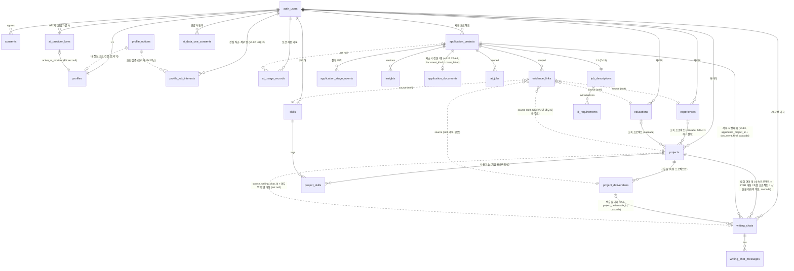

# Resumate 데이터 모델 v4.15

> 작성: data-architect / 기준 입력: **v4.15: `_workspace/00_input/planning-decisions-cover-letter-flow.md`(결정 사이클 `cover-letter-flow` — CF-1~CF-10 확정 2026-11-08 (사용자), 리더 판단 CF-A1~CF-A17 `[가정]`), 구현 확인 `supabase/migrations/20261107000100_w0_create_application_project_gate.sql`·`20261031000500_s5_jd_extraction_rpcs.sql`·`20261031000100_s5_application_projects.sql`(v4.13 서류 객체 `application_documents`·`start_document_writing_chat`은 `supabase/`·`src/`에 아직 없다 — 11.8 미배포 확인), main 병합 정합(2026-11-08) — v4.14(`remove-mock-interview`) 구현 `supabase/migrations/20261113003000_r14_remove_mock_interview.sql`·`_workspace/backend/R14/` 뒤에 놓는다, 함께 고치는 문서 PRD v4.17·UX v5.20·AI v4.15**, **v4.14: `_workspace/00_input/planning-decisions-remove-mock-interview.md`(RM-1~RM-3 확정 2026-11-08 (사용자), 후속 확정 RM-4·RM-5(2라운드, RM-A3 대체), 리더 판단 RM-A1·RM-A2·RM-A4·RM-A5 `[가정]`), 요청 `_workspace/remove-mock-interview/{prd,ux,ai}_requests.md`(data-architect 25건), 함께 고친 문서 PRD v4.16·UX v5.19·AI v4.14, 구현 확인(읽기만) `supabase/migrations/` 마지막 함수 정의·제약·트리거·정책·grant와 `supabase/tests/`, 법무 `docs/legal/` 4문서(리더 개정 2026-11-08)·`20261113002900_policy_versions_2026_11_08`**, **v4.13a: `_workspace/00_input/planning-decisions-cl-audit.md`(감사 사이클 `cl-audit` — 새 결정 없음, 열린 결정 CL-Q1·CLA-Q1~CLA-Q7은 전부 사용자 미답 `[결정 필요]`), 리뷰 `_workspace/03_spec-reviewer_review_cl-audit.md`(R-CLA-1~15), 감사 노트 `_workspace/cl-audit/dm_notes.md`(권고 1~26), CL-Q1 재산출 `_workspace/cl-audit/ai_cl-q1.md`**, **v4.13: `_workspace/00_input/planning-decisions-cover-letter-chat.md`(CL-1~CL-8 확정 2026-11-05 (사용자) + 2차 확정 CL-9·CL-10, 리더 판단 CL-A1~CL-A10 `[가정]`, 사용자가 미룬 CL-Q1 `[결정 필요]` — CL-Q2는 2026-11-08 (사용자) (a)로 확정 (v4.13a, cl-audit 권고 5)), 사전 조사 `_workspace/cover-letter-chat/touchpoints_dm.md`(편집 자리 D-1~D-92·열린 질문 Q-DM-1~11), 요청 `_workspace/cover-letter-chat/{ux,ai,prd}_requests.md`(data-architect 39건), 함께 고친 문서 PRD v4.15·UX v5.18·AI v4.13**, **v4.12a: `_workspace/backend/R13/03_backend-qa_report.md`(기획 정정 D1~D10)**, **v4.12: `_workspace/00_input/planning-decisions-settings-dialog.md`(SD-1~SD-6 확정 2026-11-05 (사용자), 리더 판단 SD-A1~SD-A19 `[가정]` — 3.1절 SD-A17·A18·A19 포함), 리뷰 라운드 2 `_workspace/03_spec-reviewer_review_settings-dialog.md`(R-SD-18·R-SD-22·R-SD-23), 함께 고친 문서 PRD v4.14·UX v5.17·AI v4.12, 요청 `_workspace/settings-dialog/{ux,ai}_requests.md`와 세 문서 끝 "다른 팀원에게 요청", 값 목록 초안 PRD 9.7**, **v4.11: `_workspace/00_input/planning-decisions-open-decisions.md`(열린 결정 48행, 확정 2026-11-05 (사용자) — DM 소관 OD-I6·I1·C6·L1·L2·P5·P11·P12·P13·D5·D6·D7), 배경 `_workspace/00_input/open-decisions-2026-11-04.md`, 함께 고친 문서 PRD v4.13·UX v5.13·AI v4.11, 구현 확인 `supabase/migrations/20261103000100_s8_interview_tables.sql`·`20261031000300_s5_application_project_fks.sql`·`20261109101500_r4_account_deletion.sql`, `src/server/services/application/write.ts`·`src/app/api/writing-chats/[id]/turns/route.ts`·`src/server/services/writing-chat/turn.ts`**, **v4.10: `_workspace/00_input/planning-decisions-ui-panel-doc.md`(UP-1~UP-13, 확정 2026-11-04 (사용자)), 구현(미커밋, 워크트리 `ai-chat-response-error-3f096a`) `src/components/career/star-proposal-fill.ts`·`ignored-classification.ts`·`src/components/common/doc-markdown-editor.tsx`, 마이그레이션 `20261113000300_r8_star_merged_proposal`(사용자 `set` null 경로 확인)**, **v4.9: `_workspace/backend/R8/01_plan.md`(STAR 합친 제안 RQ-5, 확정 2026-11-04 (사용자)), AI v4.9**, **v4.8: `_workspace/00_input/planning-decisions-education-name.md`(ED-1~ED-7, 확정 2026-11-04 (사용자)), 구현 PR #29·마이그레이션 `20261113000200_ui32_education_display_labels`, `_workspace/backend/UI32/06_db-engineer_notes.md`** / v4.5: `docs/planning/01-prd.md` PRD v4.6, `docs/planning/02-user-flows.md` 화면 명세 v5.6, `docs/planning/03-ai-features.md` AI 명세 v4.6, `_workspace/00_input/planning-decisions-project-add-figma.md`(PA-1~PA-4, 확정 2026-11-03 (사용자)), 요청 `_workspace/project-add-figma/{prd,ux,ai}_requests.md`, 리더 정렬 3건(2026-11-03)** / v4.4: `docs/planning/01-prd.md` PRD v4.5, `docs/planning/02-user-flows.md` 화면 명세 v5.5, `docs/planning/03-ai-features.md` AI 명세 v4.5, `_workspace/00_input/planning-decisions-career-redesign.md`(CR-1~CR-14)** / 이전: `_workspace/01_product-planner_prd.md` (PRD v4.3, BYOK), `_workspace/02_ux-planner_flows.md` (화면 명세 v5.3), `_workspace/02_ai-feature-designer_ai-spec.md` (AI 명세 v4.3), `_workspace/00_input/brief-2026-11-05.md` (백엔드 구현 반영 부분 재실행), `planning-decisions-2026-11-05.md` (사용자 확정 A1~A24), `spec-gaps-summary.md`, `product-context.md`
> 상태: **v4.15 — 자기소개서 관리 → 추가 → 작성 흐름 재설계(결정 사이클 `cover-letter-flow`, 2026-11-08)** · 짝 판: PRD v4.17 · UX v5.20 · AI v4.15. 바뀐 문장에 `(v4.15, CF-n)` / `(v4.15, CF-An)`. (1) **경력기술서 폐기**(CF-1·CF-A2) — `application_documents.document_kind`·`writing_chats.document_kind` CHECK를 **`cover_letter` 1값**으로 좁히고(컬럼은 남긴다) 지원 프로젝트당 정본 1행. `body.sections[]`·슬롯 `s_{n}`·`heading_label`·`section_order_proposal`·`document.source_ranking`(AI-11 경력기술서 기본 선택 `[가정]`)을 걷었다(2.5.0b·2.7.3). **11.8은 아직 배포 전이라 이 부분은 계획 수정이고 기존 행이 없다.** `ai_jobs.job_type`·사용량 `feature`의 `career_description`·`draft_source_ranking`은 과거 행 보존용으로 CHECK에 남기고 새 행을 만들지 않는다 `[가정]`(CF-A3). (2) **이관(11.8)** — ~~기존 경력기술서 초안 전부가 "이관하지 못한 행"이 된다(CF-A1, 7단계에서 되돌릴 수 없이 사라진다). `[결정 필요]` CLA-Q3이 넓어졌다.~~ **(CF-M1) 이관 없이 4단계 가드 + drop — 손실 0, CLA-Q3 (a)는 가드가 멈출 때의 기준** (v4.15, R-FIN-8). (3) **문항 최대 5개**(CF-5 ★ — 이전 10). ~~이미 6개 이상인 자소서의 이관은 `[결정 필요]` CF-DM-2.~~ (CF-M1) 이관 행이 없어 닫힘 (v4.15, R-FIN-8). (4) **답변 제목 `answer_title`**(CF-6·CF-A4, ≤ 100자, null) — 정본 `body.questions[]`와 제안 `draft`에 신설, 글자 수·`filled_slot_count`에서 뺀다 `[가정]`. (5) **마감일** — `deadline` date 그대로(CF-4), AI-01 출력 `deadline`을 `apply_jd_extraction`이 **값이 비어 있을 때만** 쓴다 ★(CF-2·CF-A5). (6) **이름 규칙 "{기업 명} 자기소개서"** ★(CF-9·CF-A7), **목록 정렬 `created_at desc`** — 인덱스 `(user_id, created_at desc)` 신설 ★(CF-A8). (7) **공고 URL** — `job_descriptions.source_url` 신설 ★, 생성 RPC `p_source_url`, 서버 가져오기 엔드포인트(AI 아님, 사용량 없음)(CF-10·CF-A15·CF-A16). (8) **"서류 수" 화면에서 사라짐**(CF-A14) — CLA-Q1·CLA-Q2 **해당 없음으로 닫음**, 보드 카드는 0~1 `[가정]`. (9) 자기소개서 화면의 단계 이동·면접 수 읽기 제거(CF-3) — 모의 면접은 MVP에서 제외됨(RM-1, v4.14 — 테이블·RPC 폐기는 11.9). (10) **요건 미리 보기 실행**(CF-A17 ★) — [다음]의 AI-01은 행 없는 작업(`ai_jobs.target_type = 'jd_preview'`, 대상·지원 프로젝트 null, 사용량 `application_project_id` null), 생성 RPC `p_preview_job_id`로 연결·적용(2.6.2). ~~새 `[결정 필요]` **CF-DM-2**(6문항 이상 기존 자소서)~~ CF-DM-2는 CF-M1로 닫혔다(해당 없음). CF-DM-1은 CF-A17로 닫았다. **사용자 확정 (병합 뒤, 2026-11-08)**: **CF-M1** — 옛 초안 이관 없이 가드 + drop(운영 DB 0행, CL-Q2 (a) 대체, 11.8 재작성, `migration_note` 삭제, CLA-Q4~CLA-Q7·CF-DM-2 닫힘), **CLA-Q3 = (a)**(가드가 멈출 때의 이관 기준으로만), **CL-Q1 = RAG 전까지 전체 팩**(스키마 영향 없음). 결정 대기 0건. 화면 번호 S-45(폐기)·S-31·S-17(폐기, CF-7)이 남은 문장은 과거 기록이며 화면 정본은 UX v5.20다. 백엔드 후속 ★는 **11.10**. **정렬 라운드(같은 판 v4.15)**: UX DM-1~DM-10·AI 요청 1~9 회신을 반영했다(10장 v4.15 행 끝, 새 결정 **CF-U1** — 2026-11-08 (사용자) (a) Q53-1 유지로 확정, CF-U2 기본값 800자·CF-U3 시안대로도 확정). / 이전: **v4.14 — AI 모의 면접 MVP 제외(결정 사이클 `remove-mock-interview`, 사용자 확정 RM-1~RM-3 + 후속 확정 RM-4·RM-5, 리더 판단 RM-A1·RM-A2·RM-A4·RM-A5 `[가정]`, 2026-11-08)**: 기준 PRD v4.16 · UX v5.19 · AI v4.14. 바뀐 문장에 `(v4.14, RM-n)` 표시. 제품 축은 **커리어 데이터 + 지원 프로젝트(JD 인사이트·서류)** 둘이다. (1) **면접 테이블 5개 폐기 ★ 파괴적**(RM-1·RM-3) — 테이블·RPC·트리거·정책·`app_ai_writer` grant 전부. A.12·A.13 번호는 비워 둔다. MVP 사용자 테이블 **27 → 22**(9장 — v4.13의 "28"은 셈 오류). (2) **지원 단계 4개**(RM-2) — `application_projects.stage`·`application_stage_events.from_stage`/`to_stage` CHECK = `before_apply`·`document`·`assignment`·`closed`, `move_application_stage` 반환에서 `interview_prompt` 삭제. 지금 면접 단계 행은 없다 — **이관 규칙 없이 있으면 멈추는 가드**(RM-4), 전형 이력의 면접 단계 값 행은 **삭제**(RM-5). (3) **열거 값 제거**(RM-A2) — `ai_jobs.job_type`·`ai_usage_records.job_type` 11 → **9**, `ai_usage_records.feature` CHECK 10 → **8**(MVP **6** + Should 2, 화면 **5행**), `evidence_links.source_type` −`interview_answer`, `owner_type` −3값, `writing_chats.return_target.feature` −`job_interview`(기존 대화는 `return_target`만 null). 기존 행은 drop 마이그레이션이 지운다. (4) **`get_data_readiness().features` = `insight`·`draft`**(RM-A5) — 응답에서 `data_sufficiency`가 사라진다(`ok`/`thin`은 AI-02 출력에 남고 `none`만 폐기). (5) **OD-I6 폐기**(PRD F-AP-05) — 지원 프로젝트를 지우면 하위가 전부 지워진다. `BEFORE DELETE` 트리거·복사 컬럼·`evidence_links.application_project_id` null 허용을 되돌린다(2.7.2). 삭제 영향·탈퇴 요약·커리어 삭제·장기 미접속 파기의 면접 분기 삭제(4장). (6) 백엔드 후속 ★·법무 `policy_versions` 새 행은 **11.9**, 회신은 끝의 "요청 회신"과 `_workspace/remove-mock-interview/dm_replies.md`. / **v4.13a — 감사 사이클 `cl-audit`(2026-11-08, `_workspace/00_input/planning-decisions-cl-audit.md`)** · 짝 판: PRD v4.15a · UX v5.18a · AI 명세 v4.13a (R-CLA-17): 문장 정정·정합·`[결정 필요]` 표기만 — **결정·테이블·컬럼·RPC 변경 없음**. 바뀐 문장에 `(v4.13a, R-CLA-n)` / `(v4.13a, cl-audit)`. (1) **관찰 기간 읽기 경로**(R-CLA-1, 권고 7·24) — `drafts`·`draft_sections` select RLS·grant를 11.8 7단계까지 유지하고 S-17 [초안 보기]용 최소 읽기 전용 조회를 남긴다(5장·2.7·11.8 (3)). (2) **CL-Q2 (a) 확정을 문장에 반영**(권고 1~8) — 낡은 `[결정 필요]` CL-Q2 표식을 걷고 7단계 착수 전제를 "전제 3개 + CLA-Q3~CLA-Q7 해소"로 적었다. (3) **되돌릴 수 없는 지점·사전 증거**(권고 9~13·16·17·19) — 2단계·코드 배포의 조건부 비가역, 3단계 jsonb 잔존, 코드 배포 확인 목록, 7단계 넘기 전 증거 5항목, 매핑 표 7단계까지 보관, 조립 실패 기준. (4) **이관 결과 상태**(권고 20~22) — `migration_note` 고정 어휘, 부분 이관 서류의 상태. (5) **열린 결정 표기** — CLA-Q3(권고 14·15)·CLA-Q4(권고 23, 6단계 `[가정]`과 충돌)·CLA-Q5(관찰 기간)·CLA-Q6(권고 18)·CLA-Q7(권고 25)을 해당 자리와 8장에 `[결정 필요]`로만 적었다. (6) 정합 — R-CLA-2(2.6.1), R-CLA-3(4.2 반환 키), R-CLA-12(11.8 번호 체계), R-CLA-14(PP-5), R-CLA-13(요청 회신 CL-A8 표식), CL-Q1 수치를 AI 명세 v4.13a 7장 정정값으로(8장·2.5.0b·2.9.4). / **v4.13 — 자기소개서 작성의 채팅형 전환(결정 사이클 `cover-letter-chat`, 사용자 확정 CL-1~CL-8 + 2차 확정 CL-9·CL-10, 리더 판단 CL-A1~CL-A10 `[가정]`, 2026-11-05)**: 기준 PRD v4.15 · UX v5.18 · AI v4.13. 바뀐 문장에 `(v4.13, {결정 ID})` 표시. (1) **서류 정본 테이블 `application_documents` 신설 ★**(2.7.3, CL-9) — 지원 프로젝트 × 서류 종류당 한 행, 본문·문항·블록을 `body` jsonb에, 문체를 `meta.tone`에 둔다. (2) **`drafts`·`draft_sections`·`draft_section_sources` 폐기 ★ 파괴적**(CL-3) — 컬럼별 행선지는 2.7.4 대응표, 이관은 11.8. (3) **`writing_chats` 확장 ★**(CL-1, 2.5) — `application_project_id`·`document_kind` 신설, `project_id` **not null 해제**, 대상 배타 CHECK 3개, 인덱스 1개, `start_document_writing_chat` 신설. (4) **`structured_draft` 서류 모양**(2.5.0, CL-3·CL-5·CL-9) — 대화에는 **제안만**, 슬롯은 `s_{n}`/`q_{n}`. (5) **서류 저장 RPC `save_application_document`**(2.5.1, CL-2). (6) **근거 ★**(CL-5, 2.8) — `evidence_links.owner_type`에 `application_document` 신설(`draft_section`은 CHECK에 남기고 insert 차단), `item_key` = `{slot}.blocks.{block_id}` / `{slot}.sources.{n}`. 사용자 세션 저장 RPC가 근거를 쓰는 첫 사례다. (7) **`composing` 폐기**(CL-A6, 2.7.1 Q53-7 절 폐기), 서류 수 셈법 = `filled_slot_count > 0`인 서류 수. (8) **`ai_jobs` ★**(2.9.1) — `job_type` `career_description`·`cover_letter`의 뜻이 "초안 1건 생성"에서 **"대화 턴 1회"**로 바뀌고 `target_type = 'writing_chat'`과 짝이 된다 → `application_project_id is null` CHECK **완화**, 경력기술서 진행 중 1개 인덱스 **폐기**. (9) 사용량은 **저장 `feature` 8값·표시 7행 묶음 그대로**(CL-A8) — 2.9.5의 "다음 사이클에 묶음이 또 바뀐다" 예고를 CL-A8(리더 판단 `[가정]`)대로 **'바꾸지 않음'**으로 고쳤다 (v4.13a, R-CLA-13). (10) `[결정 필요]`로 남긴 것: **CL-Q1**(턴마다 전체 팩 — 본문 기준 (b))·**CL-Q2**(이관 잔여 행) — **확정 2026-11-08 (사용자): (a) 운영자 덤프 + 관찰 기간 안내 뒤 drop**, 7단계 차단 해제. 백엔드 후속 ★는 **11.8**, 회신은 `_workspace/cover-letter-chat/dm_replies.md`. 이전: **v4.12a — 백엔드 R13 구현 피드백 반영(2026-11-05, 정정 D1~D10, `_workspace/backend/R13/03_backend-qa_report.md` "기획 문서 정정")**: 구현(PR #58)이 드러낸 문장 오류·누락만 고쳤다 — **결정·스키마 변경 없음**. 바뀐 문장에 `(v4.12a, Dn)`. D1 쌍 상한 잔여 문장을 **2쌍**으로(머리글·2.1.2 ②·7장 `too_many_job_interests` = 3쌍 이상·변경이력 `CHECK 1..2`), D2 `profile_job_interests` RLS에 update 없음(5장과 일치), D3 최종 학력 6칸 = **컬럼 7개**(기간 한 칸이 2컬럼), D4 6.2 "공개 RPC 없음" → **화면용 RPC 없음 · 서버 경로용 public 래퍼 `public.compute_total_experience_months(p_as_of)` 둠**, D5 `app_ai_writer`의 `profiles` grant = `id`·`career_data_updated_at`·`updated_at`, `active_ai_provider`는 사용자 세션·definer 게이트가 읽음(2.1.5·5장), D9 `ai_data_use` 잠정 값 `2026-11-05`와 "확정 시 새 행 추가" 규칙(2.1.3, 법무 확정은 `[결정 필요]`), D10 최종 학력 연월 `'YYYY-MM'` 전송·`p_values` 섹션 전체 덮어쓰기(2.1.1·7장). D6·D7(프롬프트 버전)은 AI v4.12a, D8은 UX v5.17a. 11.7에 구현 상태. 이전: **v4.12 — 새 설정 다이얼로그(결정 사이클 `settings-dialog`, 사용자 확정 SD-1~SD-6 + 리더 판단 SD-A1~SD-A19, 2026-11-05) · 리뷰 라운드 1·2 반영**: 기준 PRD v4.14 · UX v5.17 · AI v4.12. 바뀐 문장에 `(v4.12, {결정 ID})` 표시. (1) **`profiles` 내 정보 개정**(2.1.1 ★) — `total_years_of_experience`(SD-2)·`desired_job_title`(SD-A17) **삭제**, 새 컬럼 `job_search_status`·`interested_company_type`·**`interested_industry`**(현행 `interested_industries text[]` → 단일 선택)·최종 학력 6칸(`highest_education_*`), 관심 직군·직무 쌍은 **별도 테이블 `profile_job_interests`**(최대 3쌍 `[가정]`), 값 목록은 **참조 코드 테이블 `profile_options`**(DM-22). 섹션 저장 RPC **`save_profile_basics`**(기대 버전 `stale_write`). (2) 최종 학력은 `educations`와 **동기화하지 않는다**(SD-5, 2.1.1). (3) **`get_data_readiness().profile_filled`·`hints: "profile"` 삭제**(SD-A18 ★, 6장). (4) **`computed_total_months`는 저장 컬럼이 아니라 계산값** — 전용 함수 `private.compute_total_experience_months`(6.2 신설, AI C-1), `career_snapshot_hash`에 넣지 않는다. (5) **`get_ai_usage_summary` 응답 교체**(SD-A10 ★, 2.9.5) — `by_feature`·`by_provider` → **공급자 × 기능 교차**, `ai_usage_records`에 **`input_cost_usd`·`output_cost_usd` 신설 ★**(화면 비용 열 2개), 7행 묶음은 **표시 단계에서만**(SD-4·SD-A12). (6) `policy_versions.policy_type`에 **`ai_data_use` 추가**(D-UX-31, 2.1.3). (7) 선택 동의 토글 2개는 기존 `consents` 그대로(SD-A15, 2.1.4). (8) `evidence_links`의 `source_type = 'profile'`은 **기존 행 유지·새 행 차단**(SD-A19, 2.8). (9) 개선 요청은 **테이블 없음**(SD-3, 2.1.6). 백엔드 후속 ★는 11.7. **리뷰 라운드 1 반영**(판 번호 유지): R-SD-9 허용 출처 5종을 **모든 소유자**에 적용(2.8·11.7 #11 — 트리거와 RPC 목록 일치), R-SD-14 `document_path`를 `/policies/ai_data_use/{version}`으로(2.1.3·11.7 #10·9장 — 기존 `/policies/{type}/{version}` 규칙 유지). **리뷰 라운드 2 반영**(판 번호 v4.12 유지): **R-SD-18** — `profile_job_interests`의 중복 쌍 제약을 **`unique nulls not distinct (user_id, job_family, job_role)`**로 확정(기본 `NULLS DISTINCT`로는 "같은 직군 + 직무 비움" 쌍 2개가 통과한다)하고 저장 RPC 오류에 **`duplicate_job_interest`**(400)를 추가(2.1.2·7장·11.7 #3·#5 — 화면 문구는 ux-planner에게 요청). **R-SD-22** — 가격표 `version` 문자열을 AI C-13의 **`v{YYYY-MM-DD}`**(첫 버전 `v2026-10-28`)로 맞춤(2.9.3·2.9.5 응답 예시·11.7 #8). **R-SD-23** — `private.compute_total_experience_months`의 `p_as_of`에서 **기본값을 없애 필수 인자로** 하고 모든 호출자가 명시해 넘기도록 함(6.2·11.7 #7, 결정성 보장). 이전: **v4.11 — 열린 결정 일괄 확정(결정 사이클 open-decisions, 확정 2026-11-05 (사용자))**: 지원 프로젝트를 지워도 끝난(`completed`) 면접 기록은 남긴다 — `interview_sessions.application_project_id` null 허용 + 복합 FK `on delete set null (application_project_id)`, 복사 컬럼 `company_name_snapshot`·`position_title_snapshot`, 지원 프로젝트 `BEFORE DELETE` 트리거가 복사·비완료 세션 삭제, 남은 세션 읽기 전용(2.7.2, OD-I6 ★). D-14 점수 산식 `d14.v1`(가중 30·30·20·20, 미응답 0점) 서버 계산·백필 RPC `backfill_interview_scores`(A.12 점수 산식, OD-I1 ★ — (v4.11, R-OD-11) 위치 참조 A.12로). 페이지 저장 멱등 키 `p_client_id`(2.5.1, OD-C6 ★). `base_body_hash` 공백 정규화(2.5.0, OD-P5 ★). 답 없는 사용자 메시지 다시 보내기(7장, OD-P11 ★). 출시 KEK = env KEK `env-v1`(DM-16·2.11.1·2.11.2, OD-L1). AI 고지 `v2026-11-05`(2.11.6, OD-L2 ★). R5 구현 세부 확정(2.5·2.5.0·2.5.1·7장, OD-P12·P13). 백엔드 후속 ★는 11.6. 이전: **v4.10 — AI 패널·문서형 입력 UI 개정(결정 사이클 ui-panel-doc, UP-5·UP-6·UP-9, 확정 2026-11-04 (사용자))**: 분류 추천 행 [반영]은 사용자가 이미 고른 분류도 덮어쓴다(화면 판정, 기간은 빈 칸만 그대로), [무시] = 사용자 패치 `set` null(슬롯 유지, `rev` + 1) — 서버 "무시됨" 표식은 후속(11.5), 화면은 STAR 제안 직접 고치기(사용자 `edit` 패치)를 보내지 않는다(RPC 경로는 유지), STAR·본문은 문서형 편집기의 마크다운 문자열 그대로 저장(2.2). **테이블·컬럼·CHECK·RPC 변경 없음**. 이전: **v4.9 — STAR 합친 제안(RQ-5, 확정 2026-11-04 (사용자))**: 값이 있는 STAR 필드의 `op = set` = 기존 내용과 합친 교체 제안, `append`는 과거 초안 호환만, `apply_structured_draft_patch`의 `set → append` 낮춤 삭제(새 마이그레이션 1개, 비파괴). 저장 모양·`schema_version` 그대로(2.5·3.3, 10장). **v4.8 — 교육 표시 이름 반영(ED-2·ED-3·ED-6, 확정 2026-11-04 (사용자))**: 교육 표시 이름 = trim한 `program_name`(화면 "교육 명") → 비면 trim한 `institution_name`(화면 "운영 기관") → 둘 다 비면 null(화면 "이름 없는 교육")(2.3 educations). 교육 `education_type`·`enrollment_status`는 화면 입력이 아니고 앱이 정한다(2.3, (v4.8, ED-7), 설명만). 커리어 목록 응답 `name`(2.4·7장), 근거·출처 저장 라벨 `source_label`(2.7·2.8, 기존 행 백필), DB 헬퍼 `private.education_display_name`·`private.trim_js_whitespace`. 테이블·컬럼 변경 없음. 구현 PR #29 반영(11.4). 이전: **v4.8 — 독립 프로젝트 생성 시점 변경(D-UX-28, 확정 2026-11-04 (사용자))**: 독립 프로젝트 행은 C-23 이름 다이얼로그가 아니라 S-43 새 독립 프로젝트의 첫 저장 때 만든다(같은 사용자 세션 insert, 이름 + 프로젝트 정보를 한 번에). **스키마·RPC 변경 없음**. 이전 **v4.6 — 처리방침·이용약관 확정과 장기 미접속 파기 반영(PT-1·PT-3, 확정 2026-11-04 (사용자))**: `policy_versions` `2026-11-04`(4.5·A.2), 접속 기록 최대 1년·장기 미접속 파기(4.4·4.6), `last_active_at`·`inactivity_notice_sent_at` 용도 확정(A.1). 구현 PR #24·#25 반영. 이전: **v4.5 — 프로젝트 추가·산출물 상세 Figma 결정 반영(PA-1~PA-4)**: `writing_chats.project_deliverable_id`(산출물 대화, PA-1), S-10·S-44 **페이지 저장 RPC** `save_project_page`·`save_project_deliverable`(만들기·고치기 한 번에, 기대 버전 `p_expected_updated_at` → `stale_write`, 반영됨 기록 `p_applied_proposals`를 같은 트랜잭션에서, 기록 실패는 저장을 막지 않음 — PA-3), **`apply_writing_chat_proposal` 폐기**(반영 = 화면 폼 채우기), 산출물 대화 시작 `start_deliverable_writing_chat`, `structured_draft` 필드 `rev`·산출물 대화 모양(`target = project_deliverable`), V-9h·분류·기간의 DB 거부를 낮춤으로 완화, 초안 6회 `writing_chat_draft_limit_reached`, 삭제 영향에 산출물 대화. PA-2·PA-4는 스키마 변경 없음. 회신은 `_workspace/project-add-figma/dm_replies.md`, 백엔드 후속 ★는 11.3. / **v4.4 — 커리어 화면 재설계 반영(`_workspace/00_input/planning-decisions-career-redesign.md`, CR-1~CR-14, 확정 2026-11-02 (사용자))**: 기준 입력 PRD v4.5·UX v5.5·AI v4.5와 요청 `_workspace/career-redesign/{prd,ux,ai}_requests.md`. STAR를 `projects` 컬럼으로 합치고 `project_details`·`achievements` 폐기(DM-19), 소속 / 독립 프로젝트 구성 CHECK(DM-20), 분류 3종·`description`·`link_url`·`project_deliverables` 신설, `writing_chats`를 프로젝트 필수·`active`/`closed`·반영 RPC `apply_writing_chat_proposal`로 개정, 미연결 대화 90일 정리 폐기, 근거 `project_deliverable`, readiness `create_project`. 회신은 `_workspace/career-redesign/dm_replies.md`, 백엔드 후속은 11장. / **v4.3b — 가입 필수 동의에서 `cross_border_transfer` 제외(spec-gaps ⑲, A.2)** / **v4.3a — 요건 0개로 성공한 JD의 공고 원문 수정(Q53-11, 2.6.1)** / **v4.3 — UI v5.3 QA 사용자 결정 반영(`_workspace/00_input/planning-decisions-v53-qa.md`, Q53-1~9)**: 입력 원인으로 요건 추출에 실패한 JD의 공고 원문 수정(Q53-2, 2.6.1), 생성 RPC 게이트(Q53-1), 답변별 실패 원인·종합만 다시 정리(Q53-3·5), 경력기술서 중단(Q53-7), 실패 세션과 새 면접, 입력 원인 실패 세션의 새 결과 표식(Q53-10)(2.7.1). UX v5.4와 맞췄다. ★ 표시는 이미 구현된 백엔드도 고쳐야 한다. / **v4.2 — 백엔드 구현 반영(2026-11-05)**: 사용자 확정 12건(A3, A5, A6, A8, A17~A24)과 구현이 정한 쓰기 경로·내부 컬럼·RPC 세부(spec-gaps B DM 전체)를 문서에 옮겼다. 구현이 정한 값(C)은 `[가정]`으로 둔다(4.5). ★ 표시 확정은 이미 구현된 백엔드도 후속 슬라이스에서 고쳐야 한다. / **v4.1a** (BYOK 리뷰 라운드 2: R-38 잔여, R-45) / **v4.1** (BYOK 리뷰 라운드 1: R-38, R-40, R-43, UB-2 (b) 반영) / **v4 (BYOK)** — 사용자 API 키·활성 공급자·공급자별 데이터 사용 동의·토큰 사용 미터 반영, 운영자 사용량 원장 삭제. 이전: v3.2a (확인 패스 R-35 반영) / v3.2 (리뷰 라운드 2 반영: R-27, R-28, R-29, R-13 잔여 / 사용자 결정 2026-10-24 반영: U-2, U-5, U-8, U-9 등, 8장). **문서만 작성했다. 마이그레이션·SQL은 적용하지 않았다.** `[가정]`·`[결정 필요]`·`[보류]` 항목은 확정이 아니다.
> 이 문서의 테이블·컬럼명이 **확정명**이다. 문서 간 이름 차이(old → new)는 3.5~3.7 이름 확정 표에 정리했다. 버전별 변경은 10장.
> 표기: "프로젝트"(`projects`)는 커리어의 업무 단위로, 경력·교육 아래 **소속 프로젝트**(STAR 1개 = `projects`의 컬럼)와 소속 없는 **독립 프로젝트**(프로젝트 정보·내용·산출물)가 있다. "산출물"은 `project_deliverables`. 지원 건 단위는 문서·데이터에서 **"지원 프로젝트"**(`application_projects`), 메뉴 라벨 **"자기소개서 관리"**(v4.4, CR-12. 이전 "기업 JD 관리"), 화면 표기 **"자기소개서"**(v4.4 후속 CR-23 확정 — 이전 화면 표기 "기업 JD". 내부 이름 `application_projects`·`job_descriptions`·"지원 프로젝트"는 그대로), JD 원문(`job_descriptions.raw_text`)은 화면에서 **"공고 원문"**(PRD D-20, UX D-UX-10). v3의 "상세 내용"(`project_details`)은 v4.4에서 폐기했다. "AI 작성 대화"(`writing_chats`)는 커리어 채팅(`chat_threads`, Should)과 다르다.

---

## 0. 설계 원칙과 핵심 결정

| # | 결정 | 이유 |
|---|------|------|
| DM-1 | 모든 사용자 데이터 테이블은 `user_id ... references auth.users(id) on delete cascade` | 탈퇴 시 전체 파기의 안전망. **v4.2**: 실제 탈퇴는 RPC가 public 데이터를 명시적으로 지운 뒤 서버가 auth 사용자를 지운다(6.1 F-COM-05, 4.5) |
| DM-2 | 부모–자식은 복합 FK `(parent_id, user_id)` | 소유자 혼합 차단 |
| DM-3 | 열거값은 `text + CHECK` | 기획 중 값 변경이 잦다 |
| **DM-22 (v4.12, SD-A4·SD-Q2)** | **설정 "내 정보"의 선택 값 목록만 예외로 참조 코드 테이블 `profile_options`에 둔다**(DM-3의 `text + CHECK`를 쓰지 않는다). 저장은 안정적인 **코드 키**, 화면 문구는 코드 테이블의 `label` | ① 값이 7종 카테고리 합계 약 40개이고 **표시 문자열이 바뀔 전제**다(PRD 9.7 — "코드가 아니라 표시 문자열 + 안정적인 키로 관리"). ② 값 하나 추가·문구 수정마다 CHECK 재작성 마이그레이션이 필요해진다. ③ 관심 직군·직무는 **상하 관계**(직군 안의 직무)가 있어 CHECK로는 쌍 유효성을 검사할 수 없다. ④ 대가: 화면이 라벨을 함께 읽어야 하고(한 번의 추가 조회), 카테고리가 상수라 FK를 걸 수 없어 **검증 트리거 1개**가 필요하다(2.1.1) |
| DM-4 | 년-월은 `date`(1일 고정) | 정렬·기간·연도 묶음 계산 |
| DM-5 (**v4.13 개정, CL-3·CL-6**) | AI 결과는 jsonb + `schema_version`, 재생성은 새 행 | **서류(~~경력기술서·~~자소서 — (v4.15, CF-1) 경력기술서 폐기)는 이 규칙의 대상이 아니다** — 결과 행이 아니라 **대화의 제안**(`writing_chats.structured_draft`) + **사용자가 저장한 정본**(`application_documents`)이다(2.7.3). "재생성 = 새 행"도, "자소서 문항은 덮어쓰기"도 함께 폐기한다 |
| DM-6 | 근거는 `evidence_links`에만 | 삭제 시 인용문 일괄 삭제 |
| DM-7 | 근거·근거 선택은 soft reference | "원본 삭제됨" 표시 |
| DM-8 | 커리어 데이터 자동 저장은 본 테이블 `status = 'draft'` | |
| DM-9 (v4 개정) | AI 실행은 `ai_jobs`, **토큰 사용 기록은 `ai_usage_records`**(호출 1회 = 1행, 예상 비용은 버전 관리되는 `ai_price_tables`로 기록 시점 계산). 운영자 비용 통제용 예약·차감·무료 한도는 없다 | PRD v4 D-17 재정의, D-34 |
| **DM-16 (v4, v4.11 개정)** | **사용자 API 키는 앱 수준 봉투 암호화로 저장하고, 어떤 DB 역할도 원문을 볼 수 없다.** 복호화는 작업 실행 시점 서버 메모리에서만, 실행 중인 작업에 묶인 전용 함수로만 암호문을 꺼낸다(2.11). **(v4.11, OD-L1) 출시 시 KEK는 Vercel 암호화 환경 변수(`AI_KEY_KEK_BASE64`, `kek_id = 'env-v1'`)** — 운영자 1인이 관리하고 접근 범위 = Vercel 프로젝트 권한이다. DB 사본만으로는 여전히 복원할 수 없지만(KEK가 DB 밖), "운영자도 원문 불가·KMS 감사 로그"는 **출시 후 외부 KMS로 전환할 때** 충족한다. 전환은 `kek_id`로 DEK만 다시 감싼다(키 원문 재암호화 없음, 스키마 변경 없음). 전환 대상 후보 AWS KMS 서울 + Vercel OIDC `[가정]` | NFR-KEY-01~09, D-29, **확정 2026-11-05 (사용자), OD-L1** |
| **DM-17 (v4)** | **활성 공급자 1개**(`profiles.active_ai_provider`, 키 행에 FK). 작업은 실행 시점 공급자·등급을 `ai_jobs`에 기록하고(같은 행 다시 시도는 그 시점 활성 값으로 갱신, 2.9.1 A1), 모든 AI 결과 행에 `provider`·`model`을 남긴다 | D-28, F-AI-03 |
| DM-10 | RAG·pgvector 미사용 | |
| DM-11 | 커리어 테이블과 지원 프로젝트 테이블 분리, 둘 사이는 soft reference뿐 | |
| DM-12 | 지원 프로젝트 하위 결과의 소유 키는 `application_project_id` 하나. **(v4.13, CL-1·CL-3)** 새 `application_documents`와 **서류 작성 대화**(`writing_chats.application_project_id`)도 같은 키를 따른다 | D-19 (a) 전제 |
| DM-13 (v4.5 개정) | **커리어 데이터 쓰기는 사용자 세션에서만.** AI 작업용 DB 역할 `app_ai_writer`는 커리어 테이블을 읽기만 한다. **v4.5 (PA-3)**: AI 제안의 **[반영]은 화면이 폼을 채우는 동작**이라 DB를 쓰지 않고, 커리어 값은 사용자의 **"저장하기"**(사용자 세션 RPC `save_project_page` / `save_project_deliverable`, 2.5.1)만 바꾼다. "반영됨" 기록(`applied_at`)도 같은 저장 트랜잭션에서 남긴다. v4.4 `apply_writing_chat_proposal`(누르면 바로 DB 저장)은 폐기. **(v4.13, CL-2·CL-3) 서류 본문·문항 쓰기도 같은 원칙이다** — [반영]은 화면이 서류 폼을 채우는 동작이고, 서류 값은 사용자의 "저장하기"(`save_application_document`, 2.5.1)만 바꾼다. `app_ai_writer`는 `application_documents`를 **읽기만** 한다(5장, AI 회신 10) | NFR-AI-05, CR-5, PA-3, **CL-2·CL-3** |
| **DM-21 (v4.5, v4.13 확장)** | **전체 페이지(S-10·S-44, **(v4.13, CL-2)** ~~S-45·~~S-46 — (v4.15, R-CF-10) S-45 폐기)는 페이지 단위 저장 RPC 하나로 만들기·고치기를 함께 한다.** 행이 없으면 만들고(첫 "저장하기" 또는 첫 AI 메시지 직전의 자동 저장 — **(v4.15, R-CF-23) S-46은 첫 저장만**: 작성 상태는 정본 행이 있을 때만 열리고 자동 저장은 없다, 2.5.1), 있으면 고친다. 기대 버전(`updated_at`)이 다르면 `stale_write`로 거부한다 | PA-3, UX DM-1·2·6·8. 섹션 단위 update로는 "반영됨 기록과 저장을 한 트랜잭션"·"다른 곳에서 바뀜" 판정을 만들 수 없다. **(v4.13, CL-2)** 서류도 같다 — 자소서는 문항 ~~10개~~ **최대 5개**((v4.15, CF-5))를 **한 번에** 저장한다(문항별 저장으로 쪼개지 않는다, UX 회신 1·PRD 요청 11) |
| **DM-14 (v4.4 개정)** | **커리어 계층: 경력 / 교육 > 소속 프로젝트(STAR 1개), 그리고 독립 프로젝트 > 산출물.** 정량 성과·상세 내용 단계는 없다. 연도는 저장하지 않는 보기(시작 연도에 한 번, 2.4) | PRD v4.5 F-P1-03·09·15·17·18, CR-1·CR-2·CR-4·CR-11 |
| **DM-19 (v4.4)** | **STAR는 `projects`의 컬럼이다(`project_details` 1:1 테이블로 남기지 않는다)** | ① 프로젝트당 STAR 1개(CR-2)라 별도 행의 이점(여러 개·순서)이 없다. ② 1:1로 남기면 완료 판정이 두 단계(자식 트리거로 부모 재계산), 근거 `source_type` 2종, 삭제 트리거·readiness 카운트·RLS·복합 FK가 그대로 남아 복잡도만 는다. 합치면 완료 판정이 행 하나의 CHECK가 된다. ③ AI 명세 v4.5는 이미 STAR를 `PRJ-n`의 필드로 다루고 `DET-n`을 폐기했다. ④ 대가: 소속·독립 프로젝트 한쪽에서 쓰지 않는 컬럼이 생긴다 → DM-20 CHECK로 막는다. 필드 단위 "변경됨"은 `content_updated_at`(2.3)으로 보완 |
| **DM-20 (v4.4)** | **소속 프로젝트와 독립 프로젝트는 한 테이블. 구분은 소속 컬럼(`num_nonnulls(experience_id, education_id)`), 구성은 CHECK로 강제하고 둘 사이 전환은 막는다** | 두 종류는 이름·기간·근거 경로·삭제 규칙을 공유하고, 지원 프로젝트 쪽 참조(`draft_section_sources.project_id`, 근거 `project`, `drafts.options.included_project_ids`)가 하나라 테이블을 나누면 참조가 갈라진다. 구성이 다르므로(CR-7·CR-10) 쓰지 않는 컬럼은 CHECK로 비워 두고, 소속 ↔ 독립 전환은 거부(PRD F-P1-03 (7) `[가정]`) |
| **DM-15 (v3)** | **AI 작성 대화의 출처(필드별 발화)는 `writing_chats.structured_draft` 안에 둔다. `evidence_links`에는 넣지 않는다** | 커리어 데이터를 만드는 과정의 기록이며, 반영 후의 근거 원본은 커리어 항목(프로젝트 STAR) 자체다(AI 명세 AI-12 동의). v4.4: 반영한 STAR에는 필드 단위 출처를 남기지 않는다(MVP, UX D-11 회신). **(v4.13, CL-5) 서류 대화만 예외다** — 서류 본문은 커리어 데이터를 **인용한 결과물**이라 블록 근거·섹션(문항) 근거가 저장 때 `evidence_links` 행이 된다(2.8, AI 회신 14). 사실(`facts`)과 블록의 대화 출처(`source_fact_ids`·`source_body_quotes`)는 지금처럼 `structured_draft` 안에만 둔다 |
| **DM-18 (v4.3)** | **공고 원문은 만든 뒤 바꾸지 않는다(U-6·D-19). 예외는 입력 원인으로 요건 추출에 실패했거나 추출은 성공했는데 요건이 0개라서(Q53-11) 그 원문에서 나온 결과가 하나도 없는 JD뿐이고, RPC `update_failed_jd_raw_text`로만 바꾼다**(2.6.1) | 요건·근거의 문장 ID(`source_sids`, `jd_sentence`)가 원문에 묶여 있어 결과가 있으면 바꿀 수 없다. 결과가 없으면 깨질 것도 없다. 확정 2026-10-30 (사용자, Q53-2) |

### 공통 컬럼
`id` uuid PK / `user_id` (DM-1) / `created_at` / `updated_at`(트리거, 모든 근거 원본 테이블 필수). 예외는 표에 명시.

### AI 출력 공통 메타
`ai_job_id`, `schema_version`, `prompt_version`, **`provider`**(v4: `openai` / `gemini` / `anthropic`), `model`, **`model_tier`**(v4: `light` / `default` / `heavy`), **`connection_tier`**(v4: `free` / `paid`), `input_hash`(v4: 공급자·모델 포함), `career_snapshot_hash`, `validation_report`, `usage`.
- v4 적용 테이블: `insights`, ~~`drafts`·`draft_sections`~~(**v4.13 폐기 ★, CL-3** — 서류의 공급자·모델 메타는 `writing_chat_messages`(assistant 행)와 그 턴 작업이 가진다. 결과 배지 F-AI-09의 원천이 **제안 카드·메시지**로 바뀐다, AI 회신 18), **`writing_chat_messages`**(assistant 행), `chat_messages`(Should). JD 요건 추출은 `job_descriptions.extraction_provider` / `extraction_model`(2.6). 결과 배지(F-AI-03 (3), F-AI-09)가 이 값을 읽는다. (v4.14, RM-1) 면접 결과 테이블 3개와 세션의 공급자 비정규화 컬럼은 테이블과 함께 폐기.
- `usage` jsonb는 결과 행 단위 합계(표시용)로 남기고, 미터의 원천은 `ai_usage_records`다.
- **결과 테이블 내부 컬럼 (v4.2, 구현 반영)** — 화면·명세에는 노출하지 않는다.
  - `ai_job_id`는 soft가 아니라 **복합 FK `(ai_job_id, user_id) → ai_jobs on delete set null (ai_job_id)`**. 다른 사용자 작업 지정을 막고, 작업 90일 정리 때 null이 된다.
  - **`run_generation`** integer: `insights`, ~~`drafts`·`draft_sections`~~(**v4.13 폐기, CL-3** — 서류에는 결과 행이 없어 세대 검사 대상이 아니다). 이 행을 쓴 실행 세대(`ai_jobs.run_generation`, 2.9.1). 수동 재시도(같은 행 다시 시도)에서 **공급자·등급이 작업에 기록된 값과 다르면 `step_outputs`를 비우고, 그 작업이 이미 저장한 결과 행도 모두 다시 열어 새 결과로 덮어쓴다**(리뷰 R-63 리더 판단 — (v4.14, RM-1) 남는 대상은 인사이트). **같으면 이전 세대에서 실패한 행만 다시 연다.** 어느 쪽이든 늦게 도착한 이전 세대의 완료는 `stale_run`으로 버린다.
  - ~~`drafts`·`draft_sections`의 **`completed_at`**(결과 시각).~~ **(v4.13 폐기, CL-3)** — 결과 시각은 턴 작업의 `finished_at`이다.
- **결과 쓰기는 소유·세대 검사 RPC로만**(5장). 결과 jsonb 안의 별칭 참조는 UUID 키로 바꿔 저장한다(`requirement_ids`, `project_id` 등, AI C-3).

---

## 1. ERD



- 실선 = FK, 점선 = soft reference 또는 set null 참조. 커리어 → 지원 프로젝트 방향 FK 없음(v2와 같음).
- **v4.5 (PA-1)**: 산출물 대화는 `project_id`(부모 독립 프로젝트) + `project_deliverable_id`(대상 산출물)를 함께 가진다.
- **v4.13 (CL-1·CL-3)**: 대화 대상이 **세 가지**다 — ① `project_deliverable_id`가 있으면 **산출물**, ② 없고 `project_id`가 있으면 **소속 프로젝트 STAR**, ③ `application_project_id`가 있으면 **서류**(~~`document_kind`로 경력기술서 / 자소서~~ **(v4.15, CF-1) 자소서뿐** — `document_kind = 'cover_letter'`). `project_id`와 `application_project_id`는 **배타**이며 둘 중 정확히 하나가 채워진다(2.5). `drafts`·`draft_sections`·`draft_section_sources`는 폐기하고 서류 정본은 `application_documents` 한 행이다(2.7.3).
- **v4.4 (CR-2·CR-8·CR-11)**: `project_details`·`achievements`는 없다. STAR는 `projects`의 컬럼이다(DM-19). 산출물 `project_deliverables` 신설.
- **v4.14 (RM-1)**: 면접 세션·질문·답변·평가·종합 5개 테이블과 그 선을 지웠다. 지원 프로젝트 아래에 남는 것은 JD·요건·전형 이력·인사이트·서류·서류 대화·작업·근거다.
- **v4.12 (SD-A2·A3)**: 내 정보 값은 `profiles`의 컬럼 + `profile_job_interests`(쌍 최대 3)이고, 값 목록은 참조 테이블 `profile_options`다. 코드 검증은 FK가 아니라 트리거다(2.1.1). **`educations`와는 선이 없다**(SD-5).
- 비사용자 테이블(`policy_versions`, **`profile_options`**(v4.12), `ai_price_tables`, `ai_disclosures`, `ai_providers`, `account_deletion_logs`)과 Should 테이블(`chat_threads`, `chat_messages`, `result_ratings`, `ai_suggestions`)은 생략.

---

## 2. 테이블 정의

### 2.1 계정·동의
- `profiles`: 전체 정의는 A.1. **v4.4**: `career_data_updated_at` 트리거 대상은 **6개 테이블**(experiences, educations, projects, **project_deliverables**, skills, project_skills). `project_details`·`achievements`는 테이블과 함께 빠졌다. **(v4.12, SD-A2) 설정 "내 정보" 필드 개정은 2.1.1**(삭제 2개·신설 다수) — 새 필드는 `career_data_updated_at` 트리거 대상이 **아니다**(커리어 데이터가 아니다).
- `consents` / `policy_versions`: 전체 정의는 A.2. 국외 이전 항목에 AI 작성 대화 추가(NFR-PRV-03 v3)는 정책 버전 갱신 → 재동의로 처리, 스키마 영향 없음. **(v4.12, D-UX-31) `policy_versions.policy_type`에 `ai_data_use` 추가**(2.1.3), **선택 동의 토글 2개는 변경 없음**(2.1.4).

#### 2.1.1 설정 "내 정보" 필드 (v4.12, SD-2·SD-A2·SD-A4·SD-A17, PRD F-P1-01 ★)

설정 다이얼로그 계정 탭의 "내 정보"가 쓰는 값이다(S-04 폐기, 입력 자리는 여기 하나). **전부 nullable·선택 입력**이고 **어떤 게이트·완료 판정에도 쓰지 않는다**(PRD F-P1-01 (4), 6장 `profile_filled` 삭제). **AI 프롬프트에 보내지 않는다**(SD-6, 2.1.5).

**삭제하는 컬럼 (파괴적 ★)**

| 컬럼 | 결정 | 이유 |
|------|------|------|
| `total_years_of_experience` smallint | **삭제** (v4.12, SD-2) | 화면 입력·AI 입력에서 모두 빠졌다. 연차 요건 판정은 서버 계산 `computed_total_months` 하나로 한다(6.2, AI C-1) |
| `desired_job_title` text | **삭제** (v4.12, SD-A17) | 새 화면에 자유 입력 칸이 없고 관심 직군·직무 쌍이 그 자리를 대신한다. SD-6으로 AI에도 가지 않으므로 읽기 전용으로 남길 이유도 없다 |
| `interested_industries text[]` | **단일 선택 `interested_industry text`로 교체** (v4.12, SD-A4) | 화면이 셀렉트 한 칸이다. 배열을 두고 화면에서 1개로 제한하면 "2개 들어 있는 행"을 화면이 어떻게 보일지 영구히 분기해야 한다 |

**신설·개정 컬럼** (`profiles`, 전부 null 허용)

| 컬럼 | 타입 | 제약 / 상한 | 설명 |
|------|------|-------------|------|
| `job_search_status` | text | `profile_options` 카테고리 `job_search_status`의 코드 (검증 트리거) | 구직 상태. 값 목록 PRD 9.7 (1) `[결정 필요: 값 목록]` SD-Q2 |
| `interested_company_type` | text | 같음, 카테고리 `company_type` | 관심 기업군. PRD 9.7 (2) |
| `interested_industry` | text | 같음, 카테고리 `industry` | 관심 산업. **단일 선택**. PRD 9.7 (3) |
| `highest_education_school_name` | text | **≤ 100자** | 최종 학력 — 학교 명 |
| `highest_education_degree` | text | `profile_options` 카테고리 `degree` | 학위. PRD 9.7 (6) |
| `highest_education_status` | text | `profile_options` 카테고리 `graduation_status` | 졸업 상태. PRD 9.7 (7) |
| `highest_education_start_month` | date | 1일 고정 (DM-4) | 기간 시작 연월 |
| `highest_education_end_month` | date | 1일 고정, `CHECK (end IS NULL OR start IS NULL OR end >= start)` | 기간 종료 연월. 재학·휴학이면 비울 수 있다(상태와 교차 검증하지 않는다 — 졸업 상태는 자유롭게 고르는 값이다) |
| `highest_education_major` | text | **≤ 100자** | 전공 |
| `highest_education_gpa` | text | **≤ 20자**, 자유 입력 | 학점. 값 목록을 만들지 않는다(예: `3.8/4.5`, `상위 10%`) — PRD 9.7 열어 둔 점, UX 요청 1 |

- **(v4.12a, D10) 연월 전송 형식**: 기간 두 컬럼은 API·RPC에서 **`'YYYY-MM'` 문자열**로 오가고 저장은 그 달 1일(date)이다 — 커리어 연월(DM-4)과 같은 관행. `save_profile_basics`는 `^[0-9]{4}-(0[1-9]|1[0-2])$`만 받고, 조회는 date를 `'YYYY-MM'`로 잘라 돌려준다.
- **최종 학력을 평면 컬럼으로 두는 이유**: 칸이 6개(**컬럼 7개** — 기간 한 칸이 `start_month`·`end_month` 2컬럼, (v4.12a, D3))로 고정이고(화면 섹션 하나), 기간 정렬 CHECK·길이 CHECK를 그대로 쓸 수 있다. jsonb로 두면 같은 6칸에 `schema_version`과 앱 검증이 따라붙는다. 반복되지 않는 단일 묶음이라 별도 테이블도 두지 않는다.
- **이름 접두사 `highest_education_`**: 커리어의 `educations`와 읽는 사람이 헷갈리지 않게 한 눈에 "설정 전용 최종 학력"으로 읽히는 접두사를 쓴다(아래 동기화 금지 규칙).
- **`educations`와의 관계 (v4.12, SD-5 — 한 줄로 못 박는다)**: **`profiles.highest_education_*`와 `educations`는 서로 무관한 별개 값이다** — FK도, 트리거도, 백필도, 양방향 동기화도 두지 않고, 두 값이 달라도 DB·서버는 경고하지 않는다(화면 안내 문구만, UX F-P1-01a).
- **관심 직군·직무 쌍**: `profiles`에 두지 않고 **별도 테이블 `profile_job_interests`**(2.1.2).

**값 목록을 코드 테이블로 두는 결정 (DM-22)** — 참조 테이블 `profile_options` (비사용자, `user_id` 없음)

| 컬럼 | 타입 | 설명 |
|------|------|------|
| `category` | text | PK 일부. CHECK in (`job_search_status`, `company_type`, `industry`, `job_family`, `job_role`, `degree`, `graduation_status`) — **카테고리 목록만 CHECK**로 고정하고 값은 행으로 둔다 |
| `code` | text | PK 일부. 안정적인 키(snake_case, 예: `employed_open_to_offers`, `startup_seed_series_a`, `it_software_platform`, `bachelor`, `graduated`). **표시 문구가 바뀌어도 코드는 바꾸지 않는다** |
| `parent_code` | text | null. **카테고리 `job_role`만** 상위 직군 코드를 가진다(`(job_family, parent_code)` 행을 가리킨다, 검증 트리거). 그 밖 카테고리는 null |
| `label` | text | 화면 표시 문구(PRD 9.7) |
| `sort_order` | integer | 화면 표시 순서 |
| `is_active` | boolean | not null default true. **행을 지우지 않고 `false`로 내린다** — 이미 그 값을 고른 사용자 행이 깨지지 않게. 셀렉트 목록은 `is_active`만 보이고, 비활성 값을 가진 사용자에게는 저장된 값을 계속 보여 준다 |

- PK `(category, code)`. 인덱스 `(category, sort_order)`. RLS: select 인증 사용자 전체, 쓰기 운영자만.
- **FK를 걸지 않는 이유와 대신 두는 것**: `profiles.job_search_status`가 가리키는 카테고리는 **상수**라 FK 컬럼으로 넣을 수 없다(`(category, code)` 중 category를 컬럼으로 또 저장하면 테이블이 지저분해진다). 대신 `profiles`·`profile_job_interests`의 **저장 트리거 `private.validate_profile_options()`** 하나가 각 컬럼을 해당 카테고리에서 찾고 없으면 `invalid_profile_option`(400)으로 거부한다. `is_active = false`인 코드는 **새로 고를 때만** 거부하고(앱이 목록에서 주지 않음) 이미 저장된 같은 값을 다시 저장하는 것은 통과시킨다 `[가정]`.
- **시드**: PRD 9.7 초안 7종(구직 상태 7 · 기업군 9 · 산업 11 · 직군 8 · 직무 52 · 학위 8 · 졸업 상태 6)을 시드 마이그레이션으로 넣는다. **값 목록은 `[결정 필요]` SD-Q2**이므로 이 문서는 코드 키를 열거하지 않는다 — 확정된 라벨에서 `snake_case` 키를 만들고, 그 매핑 표를 시드 마이그레이션에 둔다(백엔드 후속 11.7).

**마이그레이션 방향·순서 (문서만. SQL은 쓰지 않는다)**

| 순서 | 내용 | 파괴성 |
|------|------|--------|
| ① | `profile_options` 생성 + 시드, `profile_job_interests` 생성, `profiles`에 새 컬럼 추가(전부 null 허용), 검증 트리거 | 비파괴 |
| ② | **`interested_industries` → `interested_industry` 백필**: 배열 원소가 **정확히 1개**이고 그 문자열이 새 `industry` 코드의 `label`과 **글자 그대로** 같을 때만 그 코드를 넣는다. 그 밖(0개·2개 이상·대응 없는 문자열)은 **null로 두고 사용자가 다시 고른다** — 임의 매핑 표를 만들어 뜻을 추측하지 않는다. 백필 결과 건수를 로그로 남긴다 | 비파괴(읽기만) |
| ③ | 읽는 코드 제거: `get_data_readiness`의 `profile_filled`(6장), 컨텍스트 팩 조회의 `profiles`(2.1.5), 서버·화면의 `desired_job_title`·`total_years_of_experience`·`interested_industries` 참조 | 코드만 |
| ④ | **`drop column total_years_of_experience, desired_job_title, interested_industries`** | **파괴적 ★** — ③ 배포가 끝난 뒤 별도 마이그레이션. 값은 복구되지 않는다(PRD·UX·AI 모두 쓰지 않기로 확정했고, 보존 요구가 없다) |

#### 2.1.2 profile_job_interests (v4.12 신설, SD-A3 `[가정]`)

관심 직군·직무 **쌍**을 담는다(**최대 2쌍** — 확정 2026-11-05 (사용자, SD-Q3 (가)), D-DM-14 닫힘).

| 컬럼 | 타입 | 제약 |
|------|------|------|
| `user_id` | uuid | not null, FK `auth.users(id) on delete cascade` (DM-1). **PK `(user_id, sort_order)`** |
| `sort_order` | smallint | not null, `CHECK (sort_order between 1 and 2)` — **상한을 PK·CHECK로 강제**해 트리거 없이 2쌍을 넘기지 못한다 (v4.12, SD-Q3 (가)) |
| `job_family` | text | not null. `profile_options` 카테고리 `job_family`의 코드 |
| `job_role` | text | null. 카테고리 `job_role`의 코드이고 **`parent_code = job_family`**여야 한다(검증 트리거). 직군만 고르고 직무를 비워 둔 상태를 허용한다(화면에서 직군을 먼저 고른다) |
| `created_at` | timestamptz | `updated_at` 없음(쌍은 고치지 않고 전체를 다시 쓴다) |

- **`unique nulls not distinct (user_id, job_family, job_role)`** — 같은 쌍을 두 번 담지 않는다 (v4.12, 리뷰 라운드 2 R-SD-18: `nulls not distinct`를 **반드시** 붙인다). Postgres unique의 기본값 `NULLS DISTINCT`로 두면 `job_role`이 null인 행끼리는 서로 다른 값으로 취급되어 **"같은 직군 + 직무 비움" 쌍 2개가 제약을 통과한다** — 직무를 비운 상태는 위 표에서 명시적으로 허용한 상태이므로 그대로 두면 UX S-24 ①의 "DB도 막는다"가 깨진다. 부분 unique 2개(`unique (user_id, job_family, job_role) where job_role is not null` + `unique (user_id, job_family) where job_role is null`)도 같은 결과지만 **쓰지 않는다**: `nulls not distinct`는 PG 15+ 문법이고 Supabase Postgres는 15 이상이므로 제약 하나로 끝나고, 위반 오류가 한 제약 이름으로 모여 RPC의 오류 매핑이 단순해진다.
- **중복 쌍은 RPC가 insert 전에 거부한다 — 오류 코드 `duplicate_job_interest`(400)** (v4.12, 리뷰 라운드 2 R-SD-18): 쌍 목록은 저장마다 전체 덮어쓰기이므로 **한 요청 안에 중복이 들어올 수 있다**. `save_profile_basics`가 받은 목록에서 `(job_family, job_role)` 중복(**null 직무끼리도 같은 값으로 본다** — 위 제약과 같은 판정)을 delete·insert 전에 찾아 `duplicate_job_interest`로 거부한다(7장 오류 목록). 제약은 동시 저장 등의 마지막 방어선이고, 제약 위반(23505)이 올라와도 **같은 코드로 변환해** 올린다(raw 23505를 화면에 올리지 않는다). 화면 문구는 UX S-24 ① 오류 표가 정한다.
- RLS: ~~select/insert/update/delete 전부 본인~~ **(v4.12a, D2) select·insert·delete 본인(`user_id = auth.uid()`), update 없음** — 쌍은 고치지 않고 전체를 다시 쓴다(아래 "쌍 전체 덮어쓰기", 5장 표와 같다). AI 역할(`app_ai_writer`)에는 **권한을 주지 않는다**(2.1.5).
- **쌍 전체 덮어쓰기** (UX 요청 1): 저장 RPC가 한 트랜잭션에서 `delete … where user_id = auth.uid()` → 받은 목록을 `sort_order` 1..n으로 insert 한다. 부분 수정 API는 두지 않는다.
- **별도 테이블로 둔 이유 (jsonb를 쓰지 않는 근거)**: ① 쌍의 **상하 관계 검증**(직무가 그 직군의 것인지)을 코드 테이블 조회로 한 곳에서 할 수 있다 — jsonb면 같은 검사를 앱이 들고 있어야 한다. ② 최대 2쌍·중복 금지·순서가 **PK와 unique로** 끝난다(jsonb면 CHECK 식이 길고 읽기 어렵다). ③ "서비스 안 추천"(PRD F-P1-01 (6))이 생기면 조인·집계 대상이 된다. ④ 대가: 내 정보 조회가 2쿼리가 되고, 저장이 delete + insert다 — 섹션 단위 저장(UX)과 모양이 맞아 문제가 되지 않는다.

#### 2.1.3 AI 데이터 처리 문서의 버전 원천 (v4.12, D-UX-31·SD-A13)

약관 탭의 [전문 확인] 4개(개인정보 처리방침 · 이용 약관 · 국외 이전 약관 · **AI 데이터 처리**)가 **모두 같은 모양**(`/policies/{type}` 문서 페이지 + "버전 {version} · 시행일 {effective_at}")으로 열려야 한다.

- **결정: `policy_versions`에 `policy_type = 'ai_data_use'` 행을 더한다.** CHECK 목록을 `terms` / `privacy` / `cross_border_transfer` / **`ai_data_use`**로 늘린다(비파괴). `document_path = '/policies/ai_data_use/{version}'`(**v4.12, R-SD-14** — 기존 3종과 같은 `/policies/{type}/{version}` 규칙을 그대로 따른다. 예외를 두지 않는다: 이 값은 링크가 아니라 기록용이고, 문서 페이지 주소는 버전 없는 `/policies/ai_data_use`다 — UX S-30의 괄호 설명과 같다), `requires_reconsent = false` 고정 `[가정]`.
- **(v4.12a, D9) 잠정 값과 바꾸는 법**: 법무 확인 전이라 백엔드 R13(`20261113002500`)이 **`version = '2026-11-05'`, `effective_at = 2026-11-05 00:00 KST`, `document_path = '/policies/ai_data_use/2026-11-05'`**를 잠정으로 넣었다(같은 날 시행된 `ai_disclosures v2026-11-05`·다른 세 문서와 맞춤). ~~`[결정 필요]` 법무 확정 값~~ **확정 2026-11-05 (사용자, decisions 3.23 R13-U2) — 이 값 그대로 출시**. 법무 확인 뒤 값이 달라지면 **그 행을 고치지 않고 새 버전 행을 추가한다** — `policy_versions`는 버전 이력이고(과거 행 보존 관행), `requires_reconsent = false`라 새 행이 동의 게이트·재동의에 영향을 주지 않는다.
- **`ai_disclosures`를 그대로 쓰지 않는 이유**: `ai_disclosures`는 **공급자 × 등급 6행**이라 "이 문서의 버전 하나"가 없다. 6행 중 무엇을 머리글에 보일지 화면이 정해야 하고(활성 공급자가 없으면 고를 수조차 없다), 버전 문자열 모양도 다른 세 문서(`2026-11-04`)와 `ai_disclosures`(`v2026-11-05`)가 다르다. 한편 **문서 본문의 공급자별 요약은 `ai_disclosures`에서 읽는다** — 페이지 = `policy_versions`의 머리글 + `ai_disclosures` 6행의 공급자·등급별 사실 표(AI C-7.1).
- **동의 종류는 늘리지 않는다**: 이 문서는 **고지 문서**이고 동의는 키 연결 때 공급자별로 받는다(`ai_data_use_consents`, 2.11.5). 따라서 **`consents.consent_type`에 `ai_data_use`를 더하지 않는다**(UX가 물은 점). `policy_versions`에만 값이 는다.
- 가입 필수 동의 게이트(`get_consent_status().needs_consent`)는 `terms`·`privacy_required`만 본다 — 새 `policy_type`이 게이트를 건드리지 않는다(A.2 재동의 판정 그대로).

#### 2.1.4 선택 동의 토글 2개 (v4.12, SD-A15 — 변경 없음, 확인)

- **기존 `consents`의 `service_improvement`(이용 패턴 기록 활용)·`marketing`(기능 업데이트, 소식 받기)에 그대로 붙는다.** 새 동의 종류·새 컬럼·새 테이블 없음.
- **토글 켜기** = `consents`에 **새 행 insert**(`consent_type`, `agreed = true`, `policy_version` = 그 시점 시행 중인 `privacy` 버전 `[가정]`, `agreed_at = now()`, `withdrawn_at = null`, `user_agent_hash`).
- **토글 끄기** = 그 종류의 **가장 최근 유효 행**(`withdrawn_at is null`)에 `withdrawn_at = now()` **update**. 행을 지우지 않는다(RLS update는 선택 동의의 `withdrawn_at`만 허용, A.2 그대로).
- **현재 토글 상태** = 그 종류의 가장 최근 행이 `agreed = true AND withdrawn_at is null`이면 켜짐. 껐다 켜면 새 행이 또 쌓인다(동의 이력이 그대로 남는 것이 의도).
- **필수 동의 기록은 약관 탭에 표시하지 않는다** (v4.12, SD-A14 — **확정 2026-11-05 (사용자, SD-Q3 (다))**): 약관 탭은 문서 4종과 선택 동의 2종만 읽는다. `terms`·`privacy_required` 동의 행을 **읽는 화면 경로는 없앤다**(데이터·RLS는 그대로 두고 동의 게이트·탈퇴 요약이 계속 쓴다). 동의 이력을 사용자가 서비스 안에서 볼 길이 사라지므로 **출시 전 법무 확인 권장**(PIPA 열람). 아래는 확정 전 서술이다.
- ~~남길 경우의 읽기 경로~~: 약관 탭이 `terms`·`privacy_required`의 **항목·동의 날짜**를 읽는 경로. 읽기 = `consents`의 그 사용자 행 select(본인 RLS) + `policy_versions` join. 데이터·RPC를 지우지 않는다. 사용자가 SD-A14를 확정해 표시를 없애더라도 **데이터는 그대로 둔다**(PIPA 동의 이력).

#### 2.1.5 `profiles`는 AI 입력 경로가 아니다 (v4.12, SD-6 — AI 요청 1)

- **컨텍스트 팩 조립 쿼리는 `profiles`를 읽지 않는다.** 빠지는 컬럼: `desired_job_title`·`interested_industries`·`total_years_of_experience`(이 셋은 컬럼 자체가 2.1.1로 삭제·교체)·`display_name`(원래 보내지 않았고 조회에서도 뺀다).
- **`profiles`·`profile_job_interests`에 어떤 컬럼을 더하든 AI 입력과는 무관하다.** 내 정보 값(구직 상태·관심 기업군·관심 산업·관심 직군·직무·최종 학력)은 **어떤 프롬프트에도 들어가지 않는다** — 화면 표시와 (서비스 안) 추천에만 쓴다. 다음 사이클에 "AI에도 넣자"가 조용히 생기지 않게 **이 줄을 데이터 모델에 둔다**(AI 요청 1).
- **권한으로도 막는다**: `app_ai_writer`에게 `profiles`의 내 정보 컬럼과 `profile_job_interests` **select 권한을 주지 않는다**(5장 컬럼 단위 grant 관행). ~~`profiles`에서 AI 실행 경로가 읽는 것은 `active_ai_provider`(게이트)와 `career_data_updated_at`뿐이다.~~ **(v4.12a, D5) 읽는 경로와 grant 목록을 나눠 적는다**: ① **`app_ai_writer`의 `profiles` select grant = `id`·`career_data_updated_at`·`updated_at`뿐**(백엔드 R13 `20261113002700`). ② **`active_ai_provider`는 `app_ai_writer` 경로가 읽지 않는다** — 사용자 세션(활성 공급자 조회)과 security definer 게이트 RPC(`check_ai_run_allowed` 등)만 읽으므로 AI 역할에 grant가 필요 없다(R13 이전부터 grant가 없었다).

#### 2.1.6 개선 요청 — 테이블 없음 (v4.12, SD-3, PRD F-COM-11)

- 설정 "개선 요청" 탭은 **외부 폼으로 나가는 링크 하나**다. 서비스가 **내용을 받지도, 보낸 내역을 보여 주지도 않는다**.
- 따라서 **테이블·컬럼·RPC를 두지 않는다.** 폼 주소는 **설정 상수(env 또는 앱 상수)**이고 DB에 두지 않는다 — 주소 하나를 위해 참조 테이블을 만들 이유가 없고, 주소가 정해지기 전에는 화면이 "준비 중"이다(`[결정 필요]` SD-Q1).
- 탈퇴·삭제 정책에 영향 없음(서비스 안에 데이터가 없다).

### 2.2 커리어 — 공통 규칙

- `experiences`, `educations`, `projects`는 `status text not null default 'draft' CHECK in ('draft','complete')`. 서버(트리거)가 저장마다 다시 계산하고, 필수 필드는 `CHECK (status = 'draft' OR (필수 필드 not null))`로 강제한다(draft 행에서는 필수 컬럼 nullable). `project_deliverables`에는 `status`가 없다(아래).
- **완료 판정 (v4.4, CR-2·CR-7·CR-10·CR-11, PRD F-P1-03 (6)·F-P1-15 (3)·F-P1-17 (4)·D-01 `[가정]`)**

  | 대상 | complete 조건 | 판정 위치 |
  |------|---------------|-----------|
  | experiences | `company_name`, `start_month`, (`job_rank` 또는 `job_position`) | 저장 시 + CHECK (변경 없음) |
  | educations | `institution_name`, `education_type`, `start_month` | 저장 시 + CHECK (변경 없음. `education_type`은 앱이 채운다 — 2.3, (v4.8, ED-7)) |
  | **소속 프로젝트** (`experience_id` 또는 `education_id` 있음) | `name` + `situation` + `action` (공백만 있는 값은 빈 값) | 저장 시 + CHECK. **자식 의존이 없어져 CHECK 하나로 표현된다**(v3의 상세 내용 트리거 폐기) |
  | **독립 프로젝트** (소속 없음) | `name` + `description`(프로젝트 내용) | 저장 시 + CHECK. **산출물은 완료 조건이 아니다**(PRD F-P1-17 (4)). AI 명세 v4.5 제안 "내용 **또는** 산출물"은 PRD를 따라 채택하지 않았다 `[가정]` |
  | project_deliverables | 상태 없음. `title`은 항상 필수, `body`는 빈 문자열 허용 | AI 팩 포함 여부는 부모 독립 프로젝트의 `complete`로 정한다 |

  - 분류 3종·기간·`is_current`·`role`·`link_url`·사용 기술은 완료 조건이 아니다(F-P1-19, CR-17).
  - v3의 `role` 조건(T-16)과 "complete 상세 내용 ≥ 1"은 폐기했다(CR-10, CR-2).
- **`skills.normalized_name` 규칙 (v4.2, 구현 반영)**: 앞뒤 공백 제거 → 연속 공백 1칸 → 소문자. 표기 차이(`React.js` / `React`)는 합치지 않는다 `[가정]`.
- **길이 제한**: `experiences.company_name`·`job_rank`·`job_position`·`department`, `projects.name`·`role`은 DB CHECK 없이 서버 입력 검사로만 제한한다(100자). STAR 5필드·`description`·`link_url`·산출물은 아래 표의 DB CHECK.
- **마크다운 저장 형식 (v4.10, UP-9)**: STAR 5필드(`situation`·`task`·`action`·`result`·`learnings`, S-10)와 산출물 `body`(S-44)는 문서형 편집기(쓰는 즉시 서식이 보이는 Notion식 편집기)가 내보내는 **마크다운 문자열을 그대로** 저장한다 — HTML·JSON 문서 모델로 바꿔 저장하지 않는다. 컬럼·타입·CHECK 변경 없음.
  - 지원 문법: 문단(Enter = 새 문단, `\n\n`), 목록(`-`·`1.`, Tab 들여쓰기 = 중첩 목록), 제목 h1~h3(`#`~`###`), 굵게·기울임·취소선(`~~`)·인라인 코드, 코드 블록(펜스), 인용(`>`), 링크(`[글자](URL)` — 화면은 클릭으로 열지 않고 자동 링크도 만들지 않는다), 표(GFM 파이프 표). 이 밖의 문법은 편집기가 만들지 않는다(DB는 검사하지 않음 — 텍스트일 뿐).
  - 글자는 그대로 저장한다: `&`·`<`를 HTML 엔티티로 바꾸지 않고, 단어 안 `_`를 이스케이프하지 않는다. **서식으로 읽힐 기호만** `\`로 이스케이프하고, **HTML 태그 시작 `<`(뒤가 영문자·`/`·`!`·`?`)만 엔티티 `&lt;`로** 저장한다(구현 `doc-markdown-editor.tsx`, AI C-1.1 — 정규화가 `&lt;`만 `<`로 되돌림). 과거 데이터(한 줄 바꿈 `\n`으로 나눈 글, v4.9 이전 원문 입력)는 이관하지 않고 그대로 읽는다.
  - 길이 상한(STAR 2,000자·`body` 20,000자, 2.3)은 **저장되는 마크다운 문자열**(기호 포함) 기준이다. 화면 글자 수·2,000자 하드 상한(UP-10)도 같은 문자열을 센다 `[가정]`.
  - AI 입력: 산출물 `body`는 이 문자열을 정규화 평문으로 바꿔 쓴다(AI C-1.1 — 취소선·인용·표·코드 포함). STAR 5필드는 원문 마크다운 그대로 들어가고, 검증(V-3·V-9c/d/e·V-9j)만 마크다운을 걷어낸 평문으로 비교한다((v4.10, UP-14), AI 0.v410, 구현 후속 11.5 #6). 근거 `evidence_links.source_locator`의 `{start, end}`는 정규화 평문이 아니라 **저장된 문자열**의 JS UTF-16 오프셋이다(2.8). 편집기가 같은 내용을 다른 기호로 다시 내보내면(예: 이스케이프) 문자열이 바뀌므로 기존 오프셋은 `content_updated_at`/`updated_at` "변경됨" 판정을 따른다(오프셋을 다시 계산하지 않음).
  - 독립 프로젝트 `description`(S-43)은 UP-9 범위가 아니다(입력 방식 기존 그대로, 저장은 같은 마크다운 텍스트).
- **AI 경력 팩·데이터 최소 기준 포함 규칙**: `complete` 행만. `draft` 부모(경력·교육)의 소속 프로젝트는 `complete`여도 제외. **산출물은 부모 독립 프로젝트가 `complete`일 때만** 들어간다(v4.4, PRD F-P1-18 (4)).
- **쓰기 주체**: 사용자 세션(RLS)만. `app_ai_writer`는 select만(5장).

### 2.3 커리어 테이블

#### experiences (v2와 같음)
`status`, `company_name`, `start_month`, `end_month`, `is_current`, `job_rank`, `job_position`, `department`, `employment_type`, `summary`(화면 "근무 내용", CR-13). 인덱스 `(user_id, start_month desc)`, `(user_id) where status = 'draft'`.

#### educations (v3 신설)
- 설명: 학위 과정 또는 교육 과정(부트캠프·사내외 교육). 관련 기능: F-P1-14 / 요청: ux S-08·S-34 요청 1, ai C-1

| 컬럼 | 타입 | 제약 | 설명 |
|------|------|------|------|
| `status` | text | 공통 규칙 | |
| `institution_name` | text | complete 시 필수, ≤ 100자 | 학교·교육기관명. **화면 라벨 "운영 기관 *"**(추가 모달·S-34 편집 공통, v4.8, ED-6). 필수·완료 판정은 변경 없음. 교육 명이 비면 표시 이름으로 쓴다(아래 "교육 표시 이름") |
| `education_type` | text | complete 시 필수, CHECK in (`degree`, `course`) | 학위 과정 / 교육 과정. **화면 입력이 아니다(v4.8, ED-7)** — 앱이 정한다: 새 교육 = `course`, 수정 때는 기존 값 유지(`add-career-dialog.tsx`). `degree`는 기존 데이터용으로 CHECK에 남지만 화면에서 만들 수 없다. 상세 보기에서도 숨김. 앱이 항상 채우므로 완료 판정(위 표)은 바뀌지 않는다 |
| `program_name` | text | null, ≤ 100자 | 전공·과정명. **화면 라벨 "교육 명"**(선택, 추가 모달·S-34 편집 공통, v4.8, ED-6 — 이전 S-34 편집 "전공/과정명", 피그마 "교육 직무" `[가정]`은 대체). 비어 있지 않으면 **교육 표시 이름**이 된다(v4.8, ED-2) |
| `start_month` | date | complete 시 필수, 1일 고정 | |
| `end_month` | date | null, `>= start_month` | |
| `enrollment_status` | text | null, CHECK in (`enrolled`, `graduated`, `completed`, `dropped_out`, `on_leave`), `CHECK (enrollment_status <> 'enrolled' OR end_month IS NULL)` | 재학·수강 중 / 졸업 / 수료 / 중퇴 / 휴학. **화면 입력이 아니다 — 앱이 기간에서 정한다(v4.8, ED-7, `add-career-dialog.tsx:175–178`)**: 진행 중 체크 → `enrolled`, 아니면 기존 값이 `enrolled`가 아닌 값(`graduated`·`completed`·`dropped_out`·`on_leave`)이면 유지, 없으면 종료 월이 있을 때 `completed`, 없으면 null. 위 `enrolled` ↔ `end_month` CHECK는 이 규칙으로 늘 지켜진다 |
| `description` | text | null, ≤ 2,000자 | 화면 "교육 내용"(CR-13) |

- **학점·성적 컬럼 없음**(NFR-PRV-01 v3). 자격증 `[보류]`.
- `unique (id, user_id)`. RLS 4개 동작 본인(사용자 세션). 인덱스 `(user_id, start_month desc)`, `(user_id) where status = 'draft'`.
- **교육 표시 이름 (v4.8, ED-2·ED-3)** — 저장하지 않는 계산 값. 컬럼 추가 없음.
  - 규칙: 앞뒤 공백을 지운 `program_name` → 비면 앞뒤 공백을 지운 `institution_name` → 둘 다 비면 **null**(화면이 "이름 없는 교육"으로 보인다. 저장 라벨에는 이 문구를 쓰지 않는다). 공백 집합은 JS `String.prototype.trim()`과 같다(U+3000 전각 공백·탭·줄바꿈·NBSP·BOM 포함, U+0085 제외).
  - 앱: `src/server/services/career/education-name.ts` `educationDisplayName(program_name, institution_name)`.
  - DB(v4.7 ★ 구현됨, `20261113000200`): `private.trim_js_whitespace(text)`(위 공백 집합으로 앞뒤 trim), `private.education_display_name(p_program_name, p_institution_name)`(위 규칙, null 가능). 둘 다 immutable·`search_path = ''`, public 실행 권한 회수 — 클라이언트·`app_ai_writer`가 직접 부르지 않고 라벨 빌더·트리거 안에서만 쓴다.
  - 적용: 커리어 목록 응답 `name`(2.4), S-08 목록 행·상세 제목·메뉴/삭제 확인 라벨, S-34 제목·브레드크럼, C-23·S-10/S-43 소속 목록·브레드크럼(UX 화면 명세, ED-2), **근거·출처 저장 라벨 `source_label`**(2.7·2.8).
  - 적용하지 않음(ED-4): AI 모델 입력. 컨텍스트 팩은 원본 필드 `institution_name`·`program_name`을 그대로 넣고, AI-03 교육 섹션 머리글(`draft_sections.heading`)은 "운영 기관 교육 명" 형식 그대로, AI-12 `affiliation`은 기관명 그대로. `prompt_version` 변경 없음. 근거 `source_field`의 `institution_name`·`program_name`(2.8)도 그대로다.

#### projects (v4.4 개정 — STAR 합침, 소속 / 독립 구분, CR-2·CR-7·CR-9·CR-10)

- 설명: 커리어의 업무 단위. **소속 프로젝트**(경력·교육 아래, STAR 1개 + 분류 3종)와 **독립 프로젝트**(소속 없음, 프로젝트 정보·내용 + 산출물·사용 기술)를 한 테이블에 두고, 어느 쪽인지는 소속 컬럼으로 정한다(DM-20). 관련 기능: F-P1-03, F-P1-13, F-P1-15, F-P1-17, F-P1-19 / 요청: ux D-1~D-5·D-13·D-17, ai 1·3·4·5·10, prd 1·3·4·6·8·10

| 컬럼 | 타입 | 제약 | 적용 | 설명 |
|------|------|------|------|------|
| `status` | text | 공통 규칙 | 공통 | 완료 조건은 2.2 표 |
| `experience_id` | uuid | null, 복합 FK → `experiences on delete cascade` (**v4.4: set null → cascade**, 아래) | 소속 | |
| `education_id` | uuid | null, 복합 FK → `educations on delete cascade` (v4.4) | 소속 | |
| — | — | `CHECK (num_nonnulls(experience_id, education_id) <= 1)` | | 경력 / 교육 / 없음(독립) 중 하나 |
| `name` | text | **v4.4: not null**, 공백 아님, ≤ 100자(서버) | 공통 | 독립 프로젝트는 ~~"커리어 추가 > 프로젝트"(C-23)에서 이름을 받고 만든다(CR-6)~~ → **(v4.7, D-UX-28)** S-43 새 독립 프로젝트의 첫 저장 때 이름과 프로젝트 정보를 함께 받아 만든다. **v4.5 (PA-3)**: 소속 프로젝트는 이름 다이얼로그 없이 빈 S-10에서 첫 "저장하기"(또는 첫 AI 메시지 직전 자동 저장) 때 `save_project_page`가 만든다. 이름이 비면 화면이 저장·첫 메시지를 막는다 — **임시 이름 없음**(리더 정렬 1, UX D-UX-25) |
| `start_month`, `end_month` | date | null, 1일 고정, `end_month >= start_month` | 공통 | |
| **`is_current`** | boolean | **v4.4 후속 신설(CR-22)**, not null default false, **`CHECK (NOT is_current OR end_month IS NULL)`** | 공통(소속·독립) | 화면 "진행 중" 체크. 체크하면 종료월 입력 비활성(경력 `is_current`와 같은 방식). 근거 필드(`content_updated_at` 갱신 대상, 기간 근거 `period`에 포함) |
| **`project_type`** | text | **v4.4 신설**, null, CHECK in (값 목록 아래) | 소속 | 화면 "프로젝트 종류"(카드 태그). 단일 선택 |
| **`experience_type`** | text | **v4.4 신설**, null, CHECK in (값 목록 아래) | 소속 | 화면 "경험 유형". 단일 선택 |
| **`competencies`** | text[] | **v4.4 신설**, not null default `'{}'`, 원소 CHECK(값 목록 아래), `cardinality(competencies) <= 3`, 중복 없음(`private.text_array_is_distinct` 불변 함수 CHECK) | 소속 | 화면 "역량". 복수 선택 최대 3(F-P1-19, **CR-17 확정**). 선택 순서를 저장 |
| **`situation`** | text | **v4.4 이동**(← `project_details`), null, ≤ 2,000자 | 소속 | 상황 S. 마크다운 텍스트 — **(v4.10, UP-9)** STAR 5필드 모두 문서형 편집기의 마크다운 문자열 그대로(2.2 "마크다운 저장 형식") |
| **`task`** | text | v4.4 이동, null, ≤ 2,000자 | 소속 | 화면 **"역할"**(Task, CR-2). 이 프로젝트에서 맡은 일 |
| **`action`** | text | v4.4 이동, null, ≤ 2,000자 | 소속 | 행동 A (본인이 직접 한 일) |
| **`result`** | text | v4.4 이동, null, ≤ 2,000자 | 소속 | 화면 **"결과/성과"**. 서술만(수치도 서술 안에, CR-11) |
| **`learnings`** | text | v4.4 이동, null, ≤ 2,000자 | 소속 | 화면 **"배운 점"**(CR-2, U-2 "회고 및 배운 점" 대체). 컬럼명은 그대로. **사용자의 회고** — AI는 사실 근거로 쓰지 않음(NFR-AI-06, AI V-8) |
| `role` | text | null, ≤ 100자(서버). **v4.4: 필수 해제, 독립 프로젝트 전용** | 독립 | 화면 "담당 업무"(CR-7). 소속 프로젝트에서는 쓰지 않는다(CR-10, 역할은 STAR `task`) |
| **`description`** | text | **v4.4 신설**, null, ≤ 5,000자 | 독립 | 화면 **"프로젝트 내용"**(긴 본문, 마크다운). v3 `summary`(≤ 200자 한 줄 요약)와 다른 컬럼 |
| **`link_url`** | text | **v4.4 신설**, null, ≤ 2,048자, `CHECK (link_url ~* '^https?://')` | 독립 | 화면 "Link". URL 1개 `[가정]`(F-P1-17 (2)). AI 팩·해시에 넣지 않는다(AI C-1) |
| `source_writing_chat_id` | uuid | null, FK → `writing_chats on delete set null` | 소속 | 이 프로젝트에 **마지막으로 반영한** AI 작성 대화. **v4.5**: `save_project_page`가 반영됨 기록에 성공한 대화로 쓴다(v4.4 `apply_writing_chat_proposal` 폐기). 이 컬럼만 바뀌는 update는 `updated_at`을 올리지 않는다(아래) |
| **`content_updated_at`** | timestamptz | **v4.4 신설**, not null default now() | 공통 | 근거가 될 수 있는 필드(`name`, 기간·`is_current`, STAR 5필드, `role`, `description`)가 바뀔 때만 트리거가 갱신. 근거 "변경됨" 판정용(2.8). 분류·`link_url`·`source_writing_chat_id`만 바뀌면 그대로 `[가정]` |

- **v4.4 삭제**: `summary`(한 줄 요약 — 소속 프로젝트에는 화면이 없고 독립 프로젝트는 `description`이 대신함, PRD F-P1-03 (5)), `team_size`(피그마에 없음, PRD `[가정]`). 팀·배경은 STAR `situation`에 쓴다.
- **소속 / 독립 구성 CHECK (DM-20)**:
  ```
  CHECK (num_nonnulls(experience_id, education_id) = 1
         OR (situation IS NULL AND task IS NULL AND action IS NULL AND result IS NULL AND learnings IS NULL
             AND project_type IS NULL AND experience_type IS NULL AND competencies = '{}'
             AND source_writing_chat_id IS NULL))            -- 독립 프로젝트에는 STAR·분류·대화가 없다
  CHECK (num_nonnulls(experience_id, education_id) = 0
         OR (role IS NULL AND description IS NULL AND link_url IS NULL))   -- 소속 프로젝트에는 담당 업무·내용·Link가 없다
  CHECK (status = 'draft' OR (CASE WHEN num_nonnulls(experience_id, education_id) = 1
                                   THEN situation IS NOT NULL AND action IS NOT NULL
                                   ELSE description IS NOT NULL END))
  ```
  공백만 있는 값은 트리거 `projects_set_status`가 빈 값으로 보고 `draft`로 둔다(v3와 같은 방식).
- **소속 변경 규칙 (PRD F-P1-03 (7) `[가정]`)**: 경력 ↔ 교육 사이 이동만 허용한다. 소속 ↔ 독립 전환은 update 트리거가 `project_scope_change_not_allowed`로 거부한다(구성이 달라 CHECK와도 충돌). 이동 대상 경력·교육은 같은 사용자 행(복합 FK).
- **부모 삭제 FK를 cascade로 바꾼 이유**: 경력·교육이 지워질 때 소속 프로젝트를 독립으로 남기면(set null) STAR가 있는 독립 프로젝트가 되어 위 CHECK에 걸린다. **함께 지운다 — 확정 2026-11-02 (사용자), CR-15(D-UX-22 (a))**. 삭제 확인 창에 함께 지워지는 프로젝트 수·대화를 보인다(`get_deletion_impact`의 `cascade.projects`·`cascade.writing_chats`, 4.2).
- **분류 값 목록 (v4.4, PRD F-P1-19 그대로 — 확정 2026-11-02 (사용자), CR-17. 영문 키는 데이터 모델 확정)** — 화면 표시명은 앱 상수, DB에는 키만:

  | 컬럼 | 키 → 표시명 |
  |------|-------------|
  | `project_type` | `new_build` 신규 구축 / `improvement` 개선·고도화 / `operation` 운영·유지보수 / `research` 분석·리서치 / `marketing` 마케팅·캠페인 / `process_improvement` 프로세스·조직 개선 / `migration` 전환·마이그레이션 / `coursework` 교육·학습 과제 / `other` 기타 |
  | `experience_type` | `impact` 성과 창출 / `problem_solving` 문제 해결 / `collaboration` 협업·갈등 조정 / `leadership` 주도·리딩 / `failure_recovery` 실패·극복 / `new_challenge` 새로운 시도 / `customer_facing` 고객·사용자 대응 |
  | `competencies` 원소 | `problem_solving` 문제 해결력 / `analysis` 분석력 / `planning` 기획력 / `execution` 실행력 / `communication` 커뮤니케이션 / `collaboration` 협업 / `leadership` 리더십 / `technical_expertise` 기술 전문성 / `customer_insight` 고객 이해 / `learning_agility` 학습 민첩성 |

  - `text + CHECK`(DM-3). 값 목록이 나중에 바뀌면 CHECK만 바꾼다(CR-17로 현재 목록 확정). 같은 키(`problem_solving` 등)가 두 컬럼에 있어도 컬럼이 달라 충돌하지 않는다.
  - AI 팩에는 표시명 문자열로 넣는다(AI C-1.2). 근거 `source_field` 허용값이 아니다(2.8). `career_snapshot_hash` 포함 필드다(AI C-1).
- **기간 표시 (C-25, PRD F-P1-03 (3), v4.4 후속 CR-22)**: "(N년 N개월)"은 **저장하지 않고 앱이 계산**한다(뷰 없음). 개월 수 = (끝 달 − `start_month`)의 달 수 + 1(양 끝 달 포함).
  | 상태 | 표시 | 끝 달 |
  |------|------|-------|
  | `end_month` 있음 | "YYYY.MM - YYYY.MM (N년 N개월)" | `end_month` |
  | `is_current = true` | "YYYY.MM - 현재 (N년 N개월)" | 이번 달(KST) |
  | `is_current = false`, `end_month` 없음 | "YYYY.MM -", 개월 수 없음 | — |
  | `start_month` 없음 | 기간 줄 생략 | — |
  - AI 팩의 기간 표기도 같은 규칙이다(진행 중이면 "~ 현재", 서버가 이번 달까지 계산한 개월 수는 V-5 허용 값 목록에 넣는다). 연도 묶음은 `start_month`만 쓰므로 `is_current`의 영향이 없다(2.4).
- `unique (id, user_id)`. RLS 4개 동작 본인(사용자 세션). 인덱스 `(user_id, experience_id)`, `(user_id, education_id)`, `(user_id, start_month desc)`, **`(user_id) where experience_id is null and education_id is null`**(v4.4, 커리어 목록의 독립 프로젝트), `(user_id) where status = 'draft'`.
- 트리거: `projects_set_status`(완료 재계산, v4.4 위 조건), 범위 변경 거부, `content_updated_at` 갱신, `updated_at`, `profiles.career_data_updated_at` 갱신, 근거 원본 삭제 표시(2.8).
- **`updated_at` 규칙 (v4.5 ★, UX DM-8)**: `updated_at`은 S-10 "다른 곳에서 바뀜" 판정의 기대 버전으로 쓰인다(`save_project_page`의 `p_expected_updated_at`, 2.5.1). 그래서 **`source_writing_chat_id`만 바뀌는 update에서는 올리지 않는다** — 패널에서 대화를 지우면 FK `set null`이 프로젝트 행을 update하는데, 이것으로 열린 페이지의 저장이 `stale_write`가 되면 안 된다. 그 밖의 컬럼(분류·`is_current`·`link_url` 포함)이 바뀌면 올린다. 근거 "변경됨" 기준은 여전히 `content_updated_at`(2.8)이다.
- **쓰기 경로 (v4.5)**: 소속 프로젝트의 만들기·고치기(머리·STAR·소속 변경)는 S-10 페이지 저장 RPC `save_project_page`(2.5.1)로 한다. 독립 프로젝트(S-43)는 사용자 세션 insert(**v4.7: S-43 새 독립 프로젝트의 첫 저장**, D-UX-28 — v4.4의 C-23 이름 insert 대체)·섹션 update(C-24). RLS 직접 쓰기는 막지 않는다(같은 CHECK·트리거가 지킨다).

#### ~~project_details~~ (v4.4 폐기, CR-2)
- 프로젝트당 STAR 1개가 되어(D-23 폐기) 컬럼을 `projects`로 옮겼다(DM-19). `title`(프로젝트명이 제목), `sort_order`, 행 단위 `status`·`source_writing_chat_id`는 없어졌다. 별칭 `DET-n`, 근거 `source_type = 'project_detail'`, `draft_section_sources.project_detail_ids`, 트리거 `project_details_sync_project_status`, RPC `reorder_project_details`도 폐기.

#### ~~achievements~~ (v4.4 폐기, CR-11)
- 정량 성과(상세 내용 결과의 구조화 수치)와 경력 단위 성과를 모두 없앴다(F-P1-04 폐기, D-24 폐기). 수치는 `projects.result` 등 서술 안에 쓴다. 숫자 가드(AI V-5)의 원천은 사용자 서술 텍스트다 — 스키마 영향 없음. 근거 `source_type = 'achievement'`, `achievements.kind`, `structured_draft.details[].achievements[]`, 별칭 `ACH-n` 폐기.

#### project_deliverables (v4.4 신설, CR-8)
- 설명: 독립 프로젝트 아래 사용자가 직접 쓰는 산출물(제목 + 마크다운 본문), 여러 개. 파일 업로드가 아니다(Storage 없음). **AI 근거 원본**이다. 관련 기능: F-P1-18, F-P2-04, NFR-AI-01 / 요청: ux D-6, ai 6·7, prd 5

| 컬럼 | 타입 | 제약 | 설명 |
|------|------|------|------|
| `project_id` | uuid | not null, 복합 FK `(project_id, user_id)` → `projects(id, user_id) on delete cascade` | **독립 프로젝트만**(insert·update 트리거가 부모의 소속 컬럼을 보고 `deliverable_requires_standalone_project`로 거부. 프로젝트는 소속 ↔ 독립 전환이 없으므로 이 검사로 충분) |
| `title` | text | not null, 공백 아님, ≤ 100자 | 목록 한 줄. AI 명세 제안 200자 대신 화면 명세 100자 `[가정]` |
| `body` | text | not null default `''`, ≤ 20,000자 | 마크다운 원문 — **(v4.10, UP-9)** S-44 문서형 편집기가 내보낸 마크다운 문자열 그대로(2.2 "마크다운 저장 형식", 근거 오프셋 기준 문자열). AI에는 앞부분만 들어간다(AI C-1.1: 산출물당 정규화 6,000자, 팩 전체 15,000자 `[가정]`) |
| `sort_order` | smallint | not null, `unique (project_id, sort_order)` 지연 검사 | 새 행은 마지막(최댓값 + 1) |

- 공통 컬럼(`id`, `user_id`, `created_at`, `updated_at`). `unique (id, user_id)`. **상태 컬럼 없음**(부모 프로젝트 `complete`가 팩 포함 조건).
- 개수 상한: 프로젝트당 **50개** `[가정]`(PRD F-P1-18 (3) "제한 없음, 남용 방지 상한은 구현 시"). insert 트리거가 `deliverable_limit_reached`로 거부.
- RLS 4개 동작 본인(사용자 세션). `app_ai_writer` select. 인덱스 `(project_id, sort_order)`, `(user_id)`.
- 트리거: `updated_at`, `profiles.career_data_updated_at` 갱신, 근거 원본 삭제 표시(2.8). 부모 프로젝트의 `status`·`content_updated_at`은 건드리지 않는다(산출물은 완료 조건이 아님).
- 순서 변경: RPC `reorder_project_deliverables(project_id, ordered_ids uuid[])`(security invoker, 지연 unique로 한 트랜잭션) `[가정]` — 화면에 순서 변경 UI가 없으면 쓰지 않는다.
- **v4.5 (PA-1·PA-2·PA-3)**
  - **분류 컬럼 없음 (PA-2, 확정 2026-11-03 (사용자))**: 산출물에는 `project_type`·`experience_type`·`competencies`를 두지 않는다. 분류는 부모가 아니라 **소속 프로젝트**에만 있다(독립 프로젝트에도 없음, DM-20). 변경 없음.
  - **만들기·고치기 = `save_project_deliverable`** (S-44 "저장하기", 2.5.1): 제목 + 본문을 한 번에. 새 행은 `sort_order` 맨 뒤(기존 insert 트리거), 50개 상한(`deliverable_limit_reached`)도 같은 트리거.
  - **`unique (id, project_id, user_id)` 추가 ★**: 산출물 대화의 복합 FK `(project_deliverable_id, project_id, user_id)`가 참조한다(2.5). 이 FK 때문에 대화가 있는 산출물의 `project_id`는 바꿀 수 없다(화면에 이동 기능도 없음).
  - **AI 작성 대화**: 산출물마다 대화 여러 개(`writing_chats.project_deliverable_id`, 2.5). 산출물을 지우면 대화도 함께 지워진다(FK cascade, F-COM-04).
  - **`source_writing_chat_id`는 두지 않는다** (AI DA-13 선택 요청 거절): 읽는 화면이 없고(카드의 "반영됨"은 `structured_draft`에, 마지막 반영 시각은 `writing_chats.last_applied_at`에 있음), 두면 산출물 ↔ 대화 사이 FK가 양방향이 되어 대화 삭제의 `set null`이 산출물 행을 update한다. 산출물 `updated_at`은 이미 `title`·`body`가 바뀔 때만 오르므로(구현 그대로) 기대 버전으로 쓸 수 있다.

#### skills / project_skills (v4.4 범위 축소, CR-10)
- 컬럼은 v2와 같다(부록 A.4).
- **`project_skills`는 독립 프로젝트에만 단다**(화면 "사용 기술"). insert 트리거가 소속 프로젝트면 `project_skill_requires_standalone_project`로 거부. 경력·교육 안 프로젝트에는 사용 기술이 없다(PRD F-P1-05, Q-CR-2 → CR-18 확정).
- `skills`는 독립 프로젝트 사용 기술의 자동완성 사전 겸 전체 스킬 목록이다. 직접 추가(`is_manual = true`)는 유지하되 화면 진입점은 S-12 `[보류]`(UX). 고아 태그 스킬 자동 삭제 규칙은 그대로.

### 2.4 커리어 목록 (연도 보기, v4.4 CR-4 — D-22 개정) — 저장하지 않는다

- 연도는 **컬럼·테이블로 저장하지 않는다.** 화면이 읽을 때 앱에서 계산한다(뷰·RPC 없음, UX D-14 회신).
  - 목록 항목 = **경력, 교육, 독립 프로젝트**. 각 항목은 **`start_month`의 연도 밑에 한 번만** 나온다(CR-4). 연도 밑에 소속 프로젝트 행은 없다(소속 프로젝트는 경력·교육 상세의 카드).
  - 같은 연도 안은 `start_month` 최신순, 같으면 `created_at` 최신순 `[가정]`.
  - 경력·교육은 화면이 처음 저장할 때 시작월을 받는다(UX P-3 `[가정]`). 그래도 `draft` 행에 `start_month`가 없거나, **독립 프로젝트에 시작월이 없으면 맨 아래 "연도 미정"** 묶음(PRD F-P1-09 (3) `[가정]`).
  - v3의 "경력·교육은 활동한 모든 연도에", "독립 프로젝트는 그 해의 '기타 프로젝트' 묶음"은 폐기(T-2 대체, CR-7).
- 화면 응답 모양(앱 타입, DB 아님): `{ entity_type: 'experience' | 'education' | 'project', id, name, start_month }`(UX `career_list` 가정과 같음). `name` = `company_name` / **교육 표시 이름**(v4.8, ED-2 — trim한 `program_name`, 비면 trim한 `institution_name`, 둘 다 비면 null → 화면 "이름 없는 교육". 이전 `institution_name`) / `projects.name`.
- 지원 장치: 기존 `(user_id, start_month desc)` 인덱스 + 독립 프로젝트 부분 인덱스(2.3). 사용자당 수십 행이라 한 번에 읽어 메모리에서 묶는다.
- 접힘 상태·선택 항목은 URL·브라우저 저장(UX), DB 없음.

### 2.5 AI 작성 대화 (v4.5 개정 — 산출물 대화·페이지 저장, **v4.13 개정 — 서류 작성 대화**, F-P1-13, F-P1-18, F-DOC-01·02·11, CR-5·CR-6, PA-1·PA-3, **CL-1·CL-A1·CL-A7**)

#### writing_chats
- 설명: AI와 대화하며 **커리어 항목 또는 서류**를 채우는 세션. **대상은 세 가지**(**v4.13, CL-1** — v4.5 PA-1의 두 가지에 ③ 추가): ① **소속 프로젝트 1건의 STAR**(프로젝트 상세 S-10 패널, AI 명세 AI-12) ② **산출물 1건의 본문**(산출물 상세 S-44 패널, AI-13) ③ **서류 1건**(지원 프로젝트의 자소서 — ~~경력기술서 작성 S-45 /~~ 자소서 작성 화면 S-46 패널, 개정된 ~~AI-03·~~AI-04. **(v4.15, CF-1) 경력기술서 폐기**). 모든 대화는 대상에 묶이고, 대상마다 여러 개다(CL-A1). 관련 기능: F-P1-13, F-P1-18, F-P1-06, F-AP-06, **F-DOC-01·02·11** / 요청: ux D-8~D-11·DM-3~DM-9·**(v4.13) 5**, ai 9·DA-1~DA-17·**(v4.13) 1~12**, prd 7·(v4.6) 1~3·**(v4.13) 1·6**
- **왜 자매 테이블이 아니라 확장인가 (v4.13, CL-A7)**: 서류 대화는 AI-12·AI-13과 **턴 구조·추출·제안·반영·민감정보·"-음" 체·인용 되묻기·꼬리 질문 상한을 공유**하기로 결정됐다(CL-A7, AI C-15). 다른 테이블·다른 라우트·다른 RPC에 올리면 그 공통 규칙이 갈라진다. 그래서 컬럼 ~14개·RPC 5개·라우트 1개·SSE 계약 1벌·테스트 1벌을 복제하는 자매 테이블(`document_chats`) 안을 기각하고 **이 테이블을 늘렸다**. 유일한 실질 비용은 아래 `project_id` not null 해제다(서류는 어떤 프로젝트에도 속하지 않아 중간안이 없다). 대상을 일반화한 `(target_type, target_id)` 한 벌도 복합 FK를 걸 수 없어 기각한다(409행이 같은 이유로 배타 모양을 기각했다).

| 컬럼 | 타입 | 제약 | 설명 |
|------|------|------|------|
| `project_id` | uuid | ~~**v4.4: not null**~~ **v4.13 (CL-1): null 허용 ★**(아래 배타 CHECK가 "대상 정확히 하나"를 지킨다), 복합 FK → `projects on delete cascade` | **v4.5**: 대화가 속한 프로젝트. **v4.13: 서류 대화는 null**이다. STAR 대화 = 대상 소속 프로젝트, 산출물 대화 = **그 산출물의 부모 독립 프로젝트**(목록·연쇄 삭제·소유 검사용). 프로젝트를 지우면 대화도 삭제(NFR-PRV-06) |
| **`project_deliverable_id`** | uuid | **v4.5 신설**, null, 복합 FK `(project_deliverable_id, project_id, user_id)` → `project_deliverables(id, project_id, user_id) on delete cascade` | 산출물 대화의 대상 산출물(PA-1). null이면 STAR 대화. FK가 "산출물은 같은 프로젝트·같은 사용자"를 보장하고, 산출물을 지우면 대화도 지워진다(F-COM-04) |
| **`application_project_id`** | uuid | **v4.13 신설 ★**(CL-1), null, 복합 FK `(application_project_id, user_id)` → `application_projects(id, user_id) on delete cascade` | 서류 대화가 속한 지원 프로젝트. 서류는 지원 프로젝트 직속이라 2단 FK가 필요 없다. 지원 프로젝트를 지우면 서류 대화도 삭제(4.1, 2.7.2 트리거와 같은 문장에서 돈다) |
| **`document_kind`** | text | **v4.13 신설 ★**(CL-1), null, ~~CHECK in (`career_description`, `cover_letter`)~~ **(v4.15, CF-1·CF-A2) CHECK in (`cover_letter`)** | 서류 종류. **(v4.15) 값은 하나지만 컬럼은 남긴다** — 이관·근거·삭제 영향 쿼리를 다시 쓰지 않기 위해서다(CF-A2). 11.8 미배포라 기존 행이 없어 바로 1값으로 만든다. `application_project_id`와 **함께 있거나 함께 없다**(아래 CHECK). `application_documents.document_kind`·`structured_draft.target`과 같은 값이어야 한다 |
| **`title`** | text | **v4.4 신설**, null, ≤ 100자 | 대화 기록 목록 제목. **첫 사용자 메시지가 들어올 때 `append_writing_chat_message`가 앞 30자(연속 공백 1칸)로 채운다**(AI 호출 없음) `[가정]`. null이면 화면이 "새 대화"로 보인다. 사용자 이름 바꾸기는 없다 |
| `status` | text | **v4.4**: not null default `active`, **CHECK in (`active`, `closed`)** | 진행 중 / **상한 도달로 끝남**(열람·반영만). 아래 전이 |
| `structured_draft` | jsonb | not null default `'{}'` | 대화별 **제안**(아래 v3 형식). 반영 전에는 커리어 데이터가 아니며 팩에 들어가지 않는다 |
| `message_count` | smallint | not null default 0, `CHECK (message_count BETWEEN 0 AND 40)` | 사용자 + AI 메시지 합계, 시작 인사 제외(A5, 변경 없음) |
| `last_extracted_sequence` | smallint | not null default 0 | 변경 없음(v4.2) |
| `last_activity_at` | timestamptz | not null default now() | 대화 기록 목록 정렬(최근 활동순) |
| **`last_applied_at`** | timestamptz | **v4.4 신설**, null | 이 대화의 제안을 마지막으로 반영한 시각. **v4.5: 반영이 저장된 시각**(페이지 저장 RPC가 기록, 폼에 채운 시각이 아님) |
| `return_target` | jsonb | null, ~~**v4.5: `CHECK (project_deliverable_id IS NULL OR return_target IS NULL)`**~~ **v4.13 확장 ★ (CL-1)**: `CHECK ((project_deliverable_id IS NULL AND application_project_id IS NULL) OR return_target IS NULL)` | v3.2 그대로(U-5). 게이트에서 패널 새 대화를 열 때 저장, 복귀하면 비움. 산출물 대화와 **서류 대화는 항상 null** — 서류가 곧 복귀 대상이다(게이트 복귀 대상을 들고 있는 것은 게이트에서 연 **커리어** 대화뿐이다, 6장 U-5). **(v4.15 정렬, CF-1 — AI 요청 8) `feature` 새 값은 `cover_letter`뿐이다** — 테이블 CHECK `writing_chats_return_target_check`의 값 목록에는 `career_description`을 남기고(기존 커리어 대화 행, 자동 삭제가 없다) **`start_writing_chat`의 `p_return_target` 허용 목록에서는 뺀다 ★**(새로 보내면 `invalid_return_target` 400, 11.10 #8) |

- **대상 규칙 (v4.5, PA-1 — AI DA-1·UX DM-5. v4.13 3분기로 확장 ★ — CL-1)**:
  - **대상은 정확히 하나**다. 판정 순서: ① `application_project_id`가 있으면 **서류**(`document_kind`가 종류) ② 없고 `project_deliverable_id`가 있으면 **산출물** ③ 그 밖은 **소속 프로젝트 STAR**.
  - **CHECK 3개 (v4.13 신설·교체 ★)**:
    1. `num_nonnulls(project_id, application_project_id) = 1` — 커리어 대상과 서류 대상은 배타이고 대상 없는 대화는 생기지 않는다.
    2. `(application_project_id is null) = (document_kind is null)` — 서류 대화에는 종류가 반드시 있고, 서류가 아니면 종류가 없다.
    3. `(project_deliverable_id is null or project_id is not null)` — 산출물 대화는 부모 프로젝트를 늘 채운다(v4.5 전제 유지).
  - **`project_id` not null에 기대던 곳 (전부 ★)**: `get_deletion_impact`의 `cascade.writing_chats`, `delete_career_item`, S-10·S-44 대화 목록 쿼리, 턴 파이프라인의 대상 판정, `get_account_deletion_summary` — 모두 `where project_id is not null`(또는 `where application_project_id is null`) 조건 한 줄을 더한다. 커리어 삭제 경로는 서류 대화를 만나지 않는다.
  - v4.5 판정(유지): `project_deliverable_id`가 있으면 산출물, 없으면 프로젝트. 리더가 제안한 "프로젝트 / 산출물 중 하나만 채우는 배타 CHECK" 대신 **`project_id`를 늘 채우고 산출물 열을 더하는 모양**을 골랐다. 이유: ① 기존 `project_id` not null·인덱스·턴 파이프라인·삭제 집계를 그대로 쓴다(산출물 대화도 프로젝트 단위로 연쇄 삭제된다). ② 복합 FK 하나로 "산출물이 그 프로젝트의 것"을 DB가 보장한다(배타 모양이면 산출물 → 프로젝트를 트리거로 따라가야 함). ③ 독립 프로젝트에는 STAR 대화가 없으므로 한 프로젝트의 대화는 모두 STAR 대화이거나 모두 산출물 대화다 — S-10 목록 `where project_id = ?`가 그대로 맞다.
  - **트리거 `writing_chats_check_target`** (v4.4 `writing_chat_requires_affiliated_project` 대체, insert 시 ★): `project_deliverable_id`가 null이면 `project_id`가 **소속 프로젝트**여야 한다(아니면 `writing_chat_requires_affiliated_project`, v4.4 코드 유지). null이 아니면 FK가 같은 프로젝트를 보장하고, 산출물은 독립 프로젝트에만 있으므로(`deliverable_requires_standalone_project`) 부모는 자동으로 독립 프로젝트다. **(v4.13, CL-1 ★) 서류 대화(`application_project_id is not null`)는 이 소속 검사를 건너뛴다** — 복합 FK가 "같은 사용자의 지원 프로젝트"를 보장하고, 서류는 프로젝트에 속하지 않는다. 종류·대상 불일치(예: `document_kind`가 `structured_draft.target`과 다름)는 패치 RPC가 `invalid_patch`로 막고, 시작 RPC는 빈 초안을 대상에 맞게 만든다. 대상 열(`project_id`·`project_deliverable_id`·**`application_project_id`·`document_kind`**)은 update로 바꿀 수 없다(가드 트리거, 사용자 세션 grant 없음).
  - 독립 프로젝트 정보·내용(S-43, `projects.description`)의 대화는 여전히 없다(CR-19 남는 부분, AI D-AI-16 **확정 2026-11-03 (사용자): (a) MVP에 없음 유지** — 권고 (a) 유지). 생기면 대상 키가 하나 더 필요하다.
- **v4.4 삭제**: `mode`(`new_project` / `augment_project` — 모드는 하나), `experience_id`·`education_id`(소속은 프로젝트에 있음), `saved_at`, `status`의 `saved`·`handed_off`·`abandoned`, `structured_draft.affiliation_suggestion`. 프로젝트에 묶이지 않은 대화가 없어져 **90일 자동 삭제(D-DM-08)와 크론도 폐기**(3.4).
- **상태 전이 (v4.4)**:

  | 전이 | 주체 | 조건 |
  |------|------|------|
  | `active → closed` | definer RPC(`finish_assistant_message`, 또는 실패로 닫는 턴 정리) | 사용자 메시지를 더 받을 수 없게 된 때(`message_count > 38`이고 살아 있는 턴이 없음). 마지막 응답이 40번째가 되는 정상 경로에서는 그 응답 완료 시점 |

  - 되돌리는 전이는 없다. 사용자는 `status`를 직접 바꾸지 않는다(v4.2의 사용자 세션 `status` update 권한 회수).
  - **그만두기·재개 없음**: v4.2 A6의 `abandoned → active`는 대상이 없어 폐기(PRD 9.3 A6 "CR-5·CR-6으로 흡수"). `active` 대화는 대화 기록에서 언제든 다시 열어 이어 간다. 이어서 보내면 `message_count`가 누적된다.
  - `closed` 대화는 열람·제안 수정·수락/거절·반영만 된다. 화면은 "새 대화에서 이어 하기"를 권한다(새 행).
- **`structured_draft` v3 형식** (AI 명세 v4.5 AI-12 매핑 채택, 출처는 메시지 UUID):

```json
{
  "schema_version": 3,
  "project": {
    "start_month": { "value": "2023-03", "origin": "ai", "source_message_ids": ["uuid"], "source_quotes": ["23년 3월부터"], "review": "ok", "reviewed_at": null, "applied_at": null }
  },
  "star": {
    "action": { "value": "결제 승인 API의 병목 쿼리를 APM으로 찾아 인덱스를 재설계했다", "op": "set", "origin": "ai", "source_message_ids": ["uuid"], "source_quotes": ["…"], "review": "ok", "reviewed_at": null, "applied_at": null },
    "result": { "value": "결제 승인 실패 문의가 줄었고, 결제 승인 API 응답 시간이 1.2초에서 0.7초로 줄었음", "op": "set", "origin": "ai", "source_message_ids": ["uuid"], "source_quotes": ["…"], "review": "needs_review", "reviewed_at": null, "applied_at": null }
  },
  "classification": {
    "experience_type": { "value": "problem_solving", "origin": "ai", "source_message_ids": ["uuid"], "reason": "장애 원인을 찾아 해결한 과정이 중심이에요", "review": "ok", "reviewed_at": null, "applied_at": null },
    "competencies": { "value": ["analysis", "execution"], "origin": "ai", "source_message_ids": ["uuid"], "reason": null, "review": "ok", "reviewed_at": null, "applied_at": null }
  },
  "clarifications": [ { "kind": "actor_ambiguous", "field": "action" } ],
  "sensitive_flags_count": 0
}
```
  - 키: `project`는 `start_month`·`end_month`만(**`is_current`는 AI가 제안하지 않는다** — 사용자가 S-10 기간 입력(페이지 저장)에서만 정한다, R-CR-15. v4.5 R-PA-9: 섹션 편집 → 페이지 저장), `star`는 `situation`·`task`·`action`·`result`·`learnings`, **`classification`은 `project_type`·`experience_type`·`competencies`**(v4.4 후속 CR-20). **필드 키 = 저장 대상 `projects` 컬럼명.** 이름·소속·`role`·스킬은 제안하지 않는다(UX A-3).
  - **분류 추천 (CR-20, 확정 2026-11-02 (사용자))**: AI가 대화 내용을 바탕으로 분류를 **추천**하고, 사용자가 반영해야 저장된다. 분류는 사실 근거가 아니다(AI C-1.2).
    - 필드 객체: `value`(`project_type`·`experience_type` = 키 문자열 1개, `competencies` = 키 배열 1~3개, 중복 없음), `origin`(`ai` / `user_edit`), `source_message_ids`(선택 — 판단의 실마리가 된 사용자 발화, 비어도 됨), **`reason`**(text null, ≤ 200자 `[가정]` — 추천 이유 한 줄, 카드에 표시, R-CR-14), `review` = `ok`(V-9e 대상 아님, `needs_review` 없음), `reviewed_at`, `applied_at`. **`op`는 두지 않는다**(채우기 하나뿐). `source_quotes`는 두지 않는다. AI 출력 키는 `classification_suggestions`(AI 명세), 저장 경로는 `structured_draft.classification.{…}`.
    - **값 검증**(AI V-9i의 DB 방어): `apply_structured_draft_patch`가 CHECK 값 목록 밖의 키를 **버린다**(`competencies`는 원소 단위로 걸러 내고 앞 3개까지). 남는 값이 없으면 그 필드 패치를 거부한다.
    - **빈 값만 추천 (리더 결정, AI 명세 `[가정]` 채택)**: AI는 프로젝트 값이 비어 있는 분류만 추천한다 — `project_type`/`experience_type`은 null일 때, `competencies`는 **사용자가 하나도 고르지 않았을 때**(`'{}'`)만. 바꾸기 제안은 없다. **v4.5 (PA-3)**: "비어 있음"은 **`form_snapshot` 기준으로 서버 앱 계층이 판정**한다. DB는 저장 전 폼을 모르므로 `apply_structured_draft_patch`는 DB 값이 있다는 이유로 분류 패치를 **거부하지 않는다**(v4.4 `classification_already_set` 거부 삭제 ★). ~~채우기 단계(화면)가 "이미 고른 값이 있어요"로 한 번 더 막는다.~~ **(v4.10, UP-6)** AI 추천 규칙(빈 분류만, V-9i)은 그대로지만, **화면 분류 추천 행의 [반영]은 사용자가 이미 고른 분류도 추천 값으로 바꾼다**(행 [반영]에서는 `classification_already_set` 건너뜀 없음 — 사용자가 그 행을 보고 고른 동작이므로). 확인 줄 [반영 (n)]·[모두 반영]은 지금처럼 **빈 분류만** 채운다. 저장 때 반영됨 기록은 `rev` 기준이라(2.5.1) DB·RPC 변경이 없다. 사용자가 카드에서 직접 고친 값(`origin = 'user_edit'`)은 AI가 덮어쓰지 않는다(STAR와 같음 — v4.10부터 화면에 직접 고치기가 없어 과거 객체만 해당, UP-5).
    - **[무시] (v4.10, UP-6)**: 분류 추천 행마다 [무시]. 화면은 사용자 세션 `apply_structured_draft_patch`로 그 슬롯에 **사용자 패치 `set` value null**을 보낸다 — 슬롯은 지우지 않고 빈 객체(`value` null, `review = 'ok'`, `reviewed_at = now()`, `applied_at` null, `rev` + 1)로 남는다(구현 `20261113000300` 기준). **이 빈 객체는 `origin = 'ai'`로 저장되어 보호되지 않는다**(AI 패치 보호 조건 `user_edit`/`accepted`에 해당 없음) → 다음 턴에 AI가 같은 분류를 다시 추천할 수 있다. 지금은 화면이 **대화별 브라우저 저장소**(`localStorage`, 키 = 대화 id)에 무시한 필드를 기억해 다시 보이지 않는다(다른 기기·시크릿 창·저장소 차단에서는 잊힘). 무시한 분류가 서버에서 다시 추천되지 않게 하는 "무시됨" 표식 또는 V-9i 규칙은 **후속(미구현, 11.5)** 방식 후보는 11.5.
  - 필드 객체: `value`, **`op`**(STAR만, ~~`set` = 빈 필드에 넣을 값~~ **v4.9 (AI v4.9 RQ-5): `set` = 빈 필드면 넣을 값, 값이 있는 필드면 기존 내용과 새 내용을 합친 교체 제안(합친 제안 — [반영]이 그 항목을 교체)** / `append` = 현재 값 뒤에 붙일 **새 문장만** — v4.9부터 AI가 새로 내지 않고 **과거 초안 호환으로만** 남는다), `origin`(`ai` / `user_edit`), `source_message_ids`(uuid[], `role = 'user'` 메시지만, V-9a), `source_quotes`, `review`(`ok` / `needs_review` / `accepted`, v3.2와 같은 의미), **v4.9 QA (R8-QA-4, 리더 결정) `review_reason`**(선택, STAR 필드만: `existing_missing` = AI V-9j 기존 사실 누락 / `content_unverified` = V-9e 내용 겹침 부족 / null·없음 — 화면 안내 문구 구분용, CHECK 없이 RPC가 두 값 밖이면 null로 저장 `[가정]`, `review`가 `needs_review`가 아니게 되면(수락·거절·새 값) null), `reviewed_at`, **`applied_at`**(v4.4, 반영 시각. null = 아직 반영 안 됨. **v4.5: "저장하기" 성공 때 `save_project_page`가 기록** — 폼에 채우기만 한 상태는 DB에 없다), **`rev`**(v4.5 신설 ★, 아래).
  - **`rev` (v4.5, AI DA-8)**: 정수, 1부터. **필드 키(슬롯) 단위로 단조 증가**한다 — `apply_structured_draft_patch`가 그 슬롯의 `value`를 바꿀 때마다(AI 패치, 사용자 직접 수정, 거절로 값 비움) +1, 슬롯을 **새 필드 객체로 바꿀 때도 이전 `rev` + 1**(1로 되돌리지 않는다 — 되돌리면 저장 때 보낸 옛 `rev`가 새 객체와 우연히 같아질 수 있음). `review`만 바뀌는 수락(`needs_review → accepted`)은 `rev`를 올리지 않는다. 화면은 [반영]으로 폼에 채운 시점의 `rev`를 기억해 저장 때 보낸다(2.5.1). `schema_version`은 3 그대로 두고, `rev`가 없는 기존 필드 객체는 1로 읽는다(마이그레이션이 채워도 됨).
  - 화면이 "기존 값 + 덧붙일 문장 강조"를 그릴 때: `op = 'append'`면 `value` 전체가 강조 부분이다. 현재 값은 `projects`에서 읽는다(UX A-3 회신). **v4.9**: 값이 있는 필드의 `op = 'set'`은 "기존 내용과 합친 제안" — 화면이 폼 현재 값과 `value`를 비교해 보여 준다(UX S-10). 저장 모양은 같다(`schema_version` 3 유지).
  - **채운 뒤 들어온 AI 패치 (v4.5, AI DA-10)**: 서버 앱 계층이 "미반영 필드 객체의 `value`가 이번 턴 `form_snapshot`의 같은 필드에 (정규화 부분 문자열로) 이미 있다"고 판단하면 패치에 **`new_object: true`**를 단다. RPC는 그 슬롯을 **새 필드 객체로 바꾸고**(이전 객체는 버림, `rev` + 1) 이어 붙이지 않는다 — 이미 폼에 채운 문장이 카드에 다시 나와 두 번 채워지는 경로를 막는다. **같은 슬롯에 미반영 객체를 여러 개 두는 모양(배열·`star_prev`)은 두지 않는다**: 이전 객체의 내용은 이미 폼에 있고, 저장하면 그 반영 기록만 `proposal_changed`로 건너뛴다(저장은 성공, 데이터 손실 없음). `new_object`는 `app_ai_writer` 패치에서만 받는다. **(v4.11, OD-P13 — R5-DB-2 확정)** `new_object: true`는 보호 필드(`origin = 'user_edit'`·`review = 'accepted'` 미반영)도 새 객체로 바꾼다 — 서버가 "그 값이 이미 폼에 있다"고 판정할 때만 다는 표시라 내용 손실이 없다.
  - `schema_version = 1`(v3) 행은 마이그레이션 때 비운다(`'{}'`) `[가정]` — 11장.
  - 민감정보로 걸러진 내용은 저장하지 않는다(개수만, NFR-PRV-05).
- **메시지 상한 규칙**: v4.2 A5 그대로(시작 인사 제외 40, 사용자 메시지는 `message_count ≤ 38`일 때만). 상한에 닿으면 위 전이로 `closed`.
- **`structured_draft`는 RPC로만 바꾼다** — `apply_structured_draft_patch(writing_chat_id, patch jsonb)` (v4.4 개정):
  - 호출 주체: AI 턴 = `app_ai_writer`, 사용자 수정·수락·거절 = 사용자 세션(행위자는 호출 역할로 판정, v3.2와 같음).
  - 공통: 행 잠금. **AI 패치는 `status = 'active'`만**, 사용자 패치는 `active`·`closed` 모두 `[가정]`(닫힌 대화도 검토·반영은 되므로).
  - AI 패치 규칙: `origin = 'user_edit'`이거나 `review = 'accepted'`이고 아직 반영 안 된 필드는 덮어쓰지 않는다. **`applied_at`이 있는 필드에 들어온 패치는 새 필드 객체로 바꾼다**(반영된 내용은 이미 프로젝트에 있으므로). 같은 필드의 미반영 제안이 있으면 `set`은 교체(v4.9 합친 제안은 그 미반영 값을 이미 담음), `append`(과거)는 이어 붙인다(AI-12 매핑).
  - **V-9h (v4.5 완화 ★, AI DA-9)**: "이미 값이 있음"의 정본 판정은 **서버 앱 계층이 이번 턴 `form_snapshot`(없으면 DB 값)으로** 한다(AI 명세 AI-12 V-9h). DB RPC는 저장 전 편집을 모르므로 **거부하지 않는다**. ~~DB `projects` 값이 있는 STAR 필드에 `op = 'set'`이 오면 `append`로 바꿔 저장한다~~ **v4.9 (AI v4.9 RQ-5, R8 새 마이그레이션 — 비파괴, RPC 교체)**: AI 패치(`app_ai_writer`)의 `set`은 DB 값이 있는 STAR 필드에도 **그대로 `set`으로 받아 미반영 제안을 교체**한다(낮춤 없음, `new_object` 규칙 유지). `append`는 과거 초안 호환으로 계속 받아 이어 붙인다(빈 필드의 `append`는 `set`으로 보는 규칙은 그대로). 사용자 경로(`origin = 'user_edit'`)의 op 판정은 그대로 두되 합친 제안의 교체와 충돌하지 않게 한다 — **v4.9 QA (R8-QA-3, db-engineer 예외 확정)**: 사용자가 미반영 제안 중 **op `set`이고 값이 있는** 객체를 카드에서 직접 고치면 op는 `set`을 유지한다(**(v4.10, UP-5)** 화면에는 직접 고치기가 없어졌다 — RPC 규칙은 유지)(DB 값이 있어도 `append`로 낮추지 않음 — 합친 제안을 고친 것이므로 [반영]은 여전히 교체). 그 밖의 사용자 편집 op 판정은 기존 규칙 그대로. 기간·분류의 "비어 있을 때만"도 DB에서는 검사하지 않는다(v4.4 기간 거부·`classification_already_set` 거부 삭제). 최종 안전장치는 ~~채우기 규칙(폼 값이 있으면 항상 덧붙임, 기간·분류는 빈 칸만 — 화면)~~ **v4.9**: 서버 V-9j(기존 사실 보존 → `needs_review`)와 화면 채우기 규칙(`set` = 교체 + 비교·되돌리기, ~~기간·분류는 빈 칸만~~ **(v4.10, UP-6)** 기간은 빈 칸만, 분류는 확인 줄 일괄 반영만 빈 칸만이고 행 [반영]은 덮어씀)이다. `project.is_current` 패치는 계속 거부한다(R-CR-15). 값 검증(STAR ≤ 2,000자, 기간 `YYYY-MM`, 분류 CHECK 목록 밖 키 버림)은 그대로.
  - 사용자 패치 규칙: 값 수정(→ `origin = 'user_edit'`, `review = 'ok'`, `op` 유지 — **(v4.10, UP-5)** 화면은 STAR 제안의 값 수정 패치를 더 보내지 않는다. 경로는 과거 객체 호환·분류 [무시]를 위해 남긴다), **값 비우기**(`set` null — 슬롯은 `origin = 'ai'`인 빈 객체로 남고 `rev` + 1, 보호되지 않음. v4.10 분류 [무시]가 쓴다, UP-6. 슬롯을 지우지 않는 이유는 지우면 다음 객체의 `rev`가 1로 돌아가기 때문 — R5-DB-3 확정, v4.11 OD-P13), `needs_review` → `accepted` / 거절(값 비움 + `ok`). **반영된 필드(`applied_at` 있음)는 사용자 패치도 거부**(`field_already_applied`) `[가정]` — 반영 뒤 고치기는 왼쪽 STAR 입력란에서(페이지 저장, PA-3. v4.5 R-PA-9).
- **대상별 패치 범위 (v4.5, v4.13 3분기 ★)**: STAR 대화에는 `project`·`star`·`classification`·`clarifications`·`sensitive_flags_count`만, 산출물 대화에는 아래 산출물 모양의 키만, **서류 대화에는 2.5.0 서류 모양의 키만**(`facts`·~~`document.sections[]`/~~`document.questions[]`·~~`document.section_order_proposal`·`document.source_ranking`~~(v4.15, CF-1)·`document.question_edit_proposal`·`meta.tone_requested`·`clarifications`·`sensitive_flags_count`·`draft_count`) 받는다. 다른 대상의 키가 오면 `invalid_patch`(400). `target`과 대화의 `document_kind`가 어긋나도 `invalid_patch`.
- ~~**반영 RPC `apply_writing_chat_proposal`**~~ — **v4.5 폐기 ★** (PA-3, AI DA-7, UX DM-3). [반영]은 화면 폼 채우기(DB 호출 없음)이고, "반영됨" 기록은 페이지 저장 RPC 안의 내부 헬퍼가 한다(2.5.1, 3.3).

- v4: `usage_event_id` 없음(D-34). 대화의 토큰 사용은 `ai_usage_records.ai_job_id` → `ai_jobs`(`writing_chat_turn`, `target_id` = 대화)로 찾는다.
- **대화 시작 RPC (v4.5 ★, AI DA-2·UX DM-4·DM-9)**
  - **STAR 대화 `start_writing_chat(p_project_id uuid, p_return_target jsonb default null, p_form_snapshot jsonb default null)`**: v4.4 그대로 + `p_form_snapshot`(선택). 대상은 **이미 있는** 소속 프로젝트뿐이다. 시작 인사 4종(STAR 비어 있음 / 일부 / 다 채워짐 / 게이트 진입) 분기를 `p_form_snapshot.star`가 있으면 그 값으로, 없으면 DB 값으로 고른다. 스냅숏은 **저장하지 않는다**.
  - **산출물 대화 `start_deliverable_writing_chat(p_project_deliverable_id uuid, p_form_snapshot jsonb default null)`** (신설): 산출물 소유 확인 → `writing_chats` insert(`project_id` = 산출물의 부모, `project_deliverable_id`, `return_target` null, 빈 산출물 모양 `{schema_version: 1, target: 'project_deliverable', writing_kind: null, facts: [], deliverable: {}, clarifications: [], sensitive_flags_count: 0, draft_count: 0}`) + 고정 시작 인사 3종(본문 비고 종류 모름 / 제목으로 종류 짐작 / 본문 있음 — 본문 유무는 `p_form_snapshot.body` 우선, AI-13) + 민감정보 안내 줄(+ 무료 등급 안내). 제목 키워드로 짐작한 `writing_kind`를 빈 초안에 미리 넣는다(**확정, v4.11 OD-P13** — 키워드는 아래).
  - **서류 대화 `start_document_writing_chat(p_application_project_id uuid, p_document_kind text, p_form_snapshot jsonb default null)`** (**v4.13 신설 ★**, CL-1 — UX 요청 5·AI 회신 10): 지원 프로젝트 소유 확인(없거나 남의 것이면 `application_project_not_found` 404) → `writing_chats` insert(`project_id` null, `application_project_id`, `document_kind`, `return_target` **null 고정**, 빈 서류 모양 `{schema_version: 1, target: <document_kind>, facts: [], document: {}, meta: {}, clarifications: [], sensitive_flags_count: 0, draft_count: 0}`) + 고정 시작 인사 **4종**(본문 없음 / 일부 채워짐 / 전부 채워짐 / **요건 추출 전** — AI 회신 12·UX AI-8) + 민감정보 안내 줄(+ 무료 등급 안내). 본문 유무는 `p_form_snapshot` 우선, 없으면 `application_documents.body`. **`p_return_target` 인자는 두지 않는다** — 서류가 곧 복귀 대상이고 위 `return_target` CHECK가 null을 강제한다(UX 요청 5의 4번째 인자는 빼 달라). 반환은 다른 두 시작 RPC와 같이 **`uuid`**(새 `writing_chat_id`)이고 인사는 `writing_chat_messages`의 `sequence = 1`로 저장된다. 서류 정본 행이 아직 없어도 대화는 열 수 있다(첫 저장 때 행이 생긴다, 2.5.1). **(v4.15, CF-1·CF-A2) `p_document_kind`는 `cover_letter`만 받는다**(그 밖은 `invalid_fields` 400). 인자는 시그니처를 유지하려고 남긴다 `[가정]`.
  - 셋 다 security definer + 소유 검사, `authenticated`만 execute, 활성 키 확인만(v4.4와 같음). ~~반환 `{ writing_chat_id, greeting_message }`(v4.4 반환 모양 유지).~~ **(v4.11, OD-P12 — R5-DB-1 구현에 맞춤) 반환은 `uuid`(새 `writing_chat_id`) 하나**다(v4.4 `start_writing_chat`의 실제 반환 모양). 시작 인사는 **`writing_chat_messages`의 `sequence = 1`** 메시지로 저장되고, 화면은 대화를 다시 읽어 그 메시지를 보인다.
  - **(v4.11, OD-P13 — R5-DB-10·13 확정)** 대상 없음 코드: `start_writing_chat` = `project_not_found`, `start_deliverable_writing_chat` = `project_deliverable_not_found`(둘 다 404). `p_form_snapshot` 모양·길이 오류 = `invalid_form_snapshot`(400). 산출물 종류 짐작은 제목의 서버 상수 키워드로 이 순서의 첫 일치: 회고/retrospective/retro → `retrospective`, 설계/아키텍처/architecture/design doc → `design_doc`, 기획/planning → `planning_summary`, 발표/presentation/keynote → `presentation`(대소문자 무시). 시작 인사 슬롯 1 질문 문구는 DB 상수다(최종 문구 원천은 UX — 바뀌면 RPC 교체).
  - **"새 대상"을 받아 행까지 만드는 모양(AI 제안 `p_target = {kind: 'new_project' | 'new_project_deliverable', …}`)은 두지 않는다.** 리더 정렬 2(UX D-UX-25 (a))에 따라 첫 AI 메시지는 **먼저 페이지를 저장해 행을 만든다** — 행 생성은 페이지 저장 RPC 하나로만 일어나고, 시작 RPC는 있는 행에 대화만 붙인다. 첫 메시지 순서는 7장.
- **쓰기 주체 요약 (v4.5, v4.13)**: 대화 시작(`start_writing_chat` / `start_deliverable_writing_chat` / **`start_document_writing_chat`**(v4.13 ★)), 사용자 메시지 추가(+ `title` 채움), assistant 메시지 시작·완료(+ `closed` 전이), 정리 완료 표시, `message_count`·`last_activity_at`은 **소유 검사 security definer RPC**로만. 사용자 세션 직접 update는 **`return_target`만**. `structured_draft`는 `apply_structured_draft_patch`와 **페이지 저장 RPC의 내부 헬퍼 `private.wc_mark_proposal_applied`**(`applied_at`·`applied_mode`·`applied_rev`, 2.5.1)만. **폐기 RPC**: `save_writing_chat`, `hand_off_writing_chat`, `set_writing_chat_affiliation`, `purge_unlinked_writing_chats`, **`apply_writing_chat_proposal`(v4.5)**. **(v4.13 폐기 ★, CL-3·CL-6) 서류 결과 RPC 일괄**: `begin`/`complete`/`fail_career_description`, `begin`/`complete`/`fail_cover_letter`, 자소서 문항 사용자 RPC(`20261102000300_s7_cover_letter_user_rpcs` 전부 — 문구·글자 수·메모·근거 선택·편집본 저장), `ai_jobs_release_drafts`, `private.draft_source_label`·`draft_source_parent_name`·`draft_sources_mark_project_deleted`·`draft_sources_mark_education_deleted`·`backfill_education_display_labels`(`private.education_display_name`·`trim_js_whitespace`는 남긴다). 폐기 시점은 ~~11.8 7단계(CL-Q2 (a) — 전제 3개를 지킨 뒤 별도 배포)~~ **11.8 배포 4단계(가드 + drop, 코드 배포 뒤 — (v4.15, CF-M1))**.
- RLS: select/delete 본인. insert·update는 위 RPC와 `return_target`만. `service_role`은 select·delete(탈퇴).
- 죽은 스트리밍 턴: v4.2와 같다.
- 인덱스 (v4.4): **`(project_id, last_activity_at desc)`**(S-10 패널 대화 기록 목록 — v4.13부터 `project_id`가 null일 수 있어 서류 대화는 이 인덱스에 들어가지 않는다), `(user_id) where status = 'active'`. v3 `(user_id, project_id)`와 미연결 정리용 `writing_chats_unlinked_last_activity_idx`는 삭제. **v4.5 ★**: `(project_deliverable_id, last_activity_at desc) where project_deliverable_id is not null`(S-44 대화 기록 목록, FK cascade 삭제도 이 인덱스를 쓴다). **v4.13 ★**: `(application_project_id, document_kind, last_activity_at desc) where application_project_id is not null`(~~S-45·~~S-46 대화 기록 목록, 지원 프로젝트 FK cascade 삭제도 이 인덱스를 쓴다).
- 프로젝트·산출물**·서류**당 대화 개수 상한은 두지 않는다 `[가정]`(**v4.13, CL-A1** — UX 요청 5·PRD 요청 6 회신에서 같은 결론).
- **메시지 상한·상태 (v4.5, v4.13)**: 산출물 대화**와 서류 대화**도 같은 규칙이다 — 시작 인사 제외 40(`message_count`, A5), 초안 턴의 고정 문구 AI 메시지도 센다(AI DA-17), `active → closed`만. `closed` 대화는 열람·초안 [빼기]·반영(폼 채우기)·저장 때 반영됨 기록이 된다.
  - **(v4.13, CL-A1·CL-10 / v4.15, CF-5) 자소서 ~~10문항~~ 5문항에도 상한 40을 올리지 않는다**: 초안 제안이 한 턴 최대 3문항이라 ~~10문항은 초안 턴 4회(메시지 8개)로 한 바퀴가 돌고 남은 32개가~~ **5문항은 초안 턴 2회(메시지 4개)로 한 바퀴가 돌고 남은 36개가** 질문·보강이다(v4.15, CF-5 — 상한을 바꿀 이유가 더 약해졌다). 모자라면 사용자가 **"+ 새 대화"로 이어 간다** — **정본이 대화 밖(`application_documents`)이라 본문·문항이 끊기지 않는다**(CL-9). 상한 변경은 평가 세트 실측 뒤로 미룬다(AI 요청 6·PRD 8). `[가정]`

#### writing_chat_messages

| 컬럼 | 타입 | 제약 | 설명 |
|------|------|------|------|
| `writing_chat_id` | uuid | 복합 FK → `writing_chats on delete cascade` | |
| `sequence` | smallint | not null, `unique (writing_chat_id, sequence)` | 화면 "내 답변 #n"은 사용자 메시지만 다시 번호 매김 |
| `role` | text | not null, CHECK in (`user`, `assistant`) | |
| `content` | text | not null, ≤ 4,000자 `[가정]` | |
| `status` | text | not null default `done`, CHECK in (`streaming`, `done`, `failed`) — **(v4.11, OD-P10 / R-OD-8) CHECK 그대로, `canceled` 값 추가 안 함** | AI 응답 실패 턴 "다시 보내기". **사용자 중단과 실패의 구분은 메시지 상태가 아니라 연결된 작업으로 한다(지금 구현)**: 중단된 턴 = assistant 행 `status = 'failed'` + `ai_job_id`의 `ai_jobs.status = 'canceled'`(`error_code = 'canceled'`, `turn.ts` close) → 화면 "답을 받지 못한 메시지 · 다시 보내기"(실패 표시 없음, OD-P11). 그 밖의 `failed`(작업 `failed`) = 실패한 턴(C-20, 원인 = 작업 `error_code`). 읽기는 `writing-chat-view.ts`처럼 메시지 ↔ 작업을 함께 읽어 판정 |
| `ai_job_id` | uuid | null (soft) | assistant 메시지를 만든 턴 작업. 시작 인사(고정 문구)는 null — 메시지 상한에서 빠지는 행(A5) |

- 공통 컬럼 중 `updated_at`은 streaming → done 전환에만 쓰인다.
- RLS: select 본인. user 메시지 insert는 RPC `append_writing_chat_message`(security definer + 소유 검사, 상한 검사 + `message_count` 증가 + **첫 사용자 메시지면 `title` 채움**을 한 트랜잭션). **`closed` 대화에는 `writing_chat_closed`로 거부**(v4.4). assistant 메시지 insert/update는 `app_ai_writer`가 부르는 definer RPC(`begin_assistant_message` / `finish_assistant_message`). 직접 insert/update·개별 delete 없음(대화 삭제로만).
- 시작 인사 문구: 모드별 2종 → **STAR 상태별 4종(비어 있음 / 일부 / 다 채워짐 / 게이트 진입) + 무료 등급이면 서비스 개선 사용 안내 1문장**(AI 명세 AI-12 초안, 최종 문구 UX) `[가정]`. 고정 상수이며 `ai_job_id` null.

### 2.5.0 대상별 `structured_draft` — 산출물·서류 (v4.5 신설, AI-13 / **v4.13 서류 추가**, **v4.15 자소서만 — CF-1**, 개정 ~~AI-03·~~AI-04 — AI DA-11·DA-12·DA-14, **CL-3·CL-5·CL-9**)

AI 명세 v4.6 AI-13 "저장" 모양을 채택한다. STAR 대화 모양(`schema_version 3`)과는 **`target` 키와 대화의 대상 열로 구분**한다(둘이 어긋나면 RPC가 거부 — 빈 초안은 시작 RPC가 대상에 맞게 만든다). **(v4.13, CL-9) 서류 대화의 `structured_draft`에는 제안만 담는다** — 본문·문항의 정본은 대화 밖 `application_documents` 한 행이다(2.7.3). 산출물 대화가 이미 그 모양이다(본문은 `project_deliverables.body`, `structured_draft.deliverable.body`는 그 대화의 제안 하나).

#### 2.5.0a 산출물 대화 (`target: "project_deliverable"`)

```json
{
  "schema_version": 1,
  "target": "project_deliverable",
  "writing_kind": "retrospective",
  "facts": [
    { "id": "uuid", "slot": "contribution", "text": "결제 모듈의 장애 대응 런북을 직접 작성했다", "actor": "self",
      "source_message_ids": ["uuid"], "source_quotes": ["장애 대응 런북은 제가 직접 썼어요"],
      "review": "ok", "reviewed_at": null, "origin": "ai" }
  ],
  "deliverable": {
    "body": {
      "value": "## 내가 맡은 일\n\n결제 모듈의 …",
      "blocks": [ { "block_id": "b2", "type": "paragraph", "text": "…", "basis": "new",
                    "source_fact_ids": ["uuid"], "source_body_quotes": [], "source_project_fields": [], "review": "ok" } ],
      "rev": 2, "generated_at": "2026-11-03T10:00:00Z", "base_body_hash": "sha256:…", "replace_allowed": true,
      "missing_slots": ["went_wrong"], "dropped_block_count": 1,
      "applied_at": null, "applied_mode": null, "applied_rev": null
    }
  },
  "clarifications": [ { "kind": "number_vague", "slot": "went_well", "note": "…" } ],
  "sensitive_flags_count": 0,
  "draft_count": 2
}
```

- **키 (모두 AI 명세 이름 그대로)**
  - `writing_kind` ∈ `planning_summary` / `design_doc` / `retrospective` / `presentation` / `other`, null 허용(아직 모름). **`structured_draft` 안에만** 둔다 — `project_deliverables`에 컬럼을 두지 않는다(PA-2, DA-12). 질문·초안 구성을 고르는 대화 안 설정이지 분류가 아니다.
  - `facts[]`: `id`(uuid, 서버가 매김), `slot`(AI 명세 슬롯 키), `text`(≤ 500자 `[가정]`), `actor` ∈ `self`/`team`/`unknown`, `source_message_ids`(uuid[], `role = 'user'`만), `source_quotes`, `review` ∈ `ok`/`needs_review`/`accepted`, `reviewed_at`, `origin` ∈ `ai`/`user_edit`. 개수 ≤ 80 `[가정]`.
  - `deliverable.body`: 초안 **하나만** 둔다(이력 없음, AI 명세 "초안 이력은 남기지 않는다"). `value` = 서버가 `blocks`로 조립한 마크다운(≤ 8,000자, 초안 출력 상한. **(v4.10, UP-9)** 블록 `type` 7종은 모두 편집기 지원 문법 안이라 본문에 넣은 뒤 그대로 보이고 저장된다 — 저장 문자열은 편집기가 다시 내보낸 값이므로 `value`와 글자 단위로 같지 않을 수 있다), `blocks[]`(≤ 200 `[가정]`, `type` ∈ `heading`/`paragraph`/`bullet_list`/`numbered_list`/`table`/`quote`/`code`, `basis` ∈ `new`/`current_body`, 출처 3종, `review` ∈ `ok`/`needs_review`/`accepted`), `rev`(STAR와 같은 슬롯 단조 규칙), `generated_at`, `base_body_hash`, `replace_allowed`, `missing_slots`, `dropped_block_count`, **반영됨 기록** `applied_at`·`applied_mode`(`replace`/`append`)·`applied_rev`(저장 RPC만 씀). 초안이 아직 없으면 `deliverable = {}`.
  - **`base_body_hash` 계산 (v4.11, OD-P5, 확정 2026-11-05 (사용자) ★)**: 초안을 만들 때 기준으로 삼은 본문(이번 턴 `form_snapshot.body`, 없으면 DB 본문)의 해시. **(v4.13, CL-A4) 같은 규칙을 서류의 섹션(문항) 본문에도 그대로 적용한다**(2.5.0b). **공백을 정규화한 본문**으로 계산한다 `[가정]`(정규화 규칙은 사용자 결정, 세부는 구현 확인 대상):
    1. 줄 끝 `\r\n`·`\r` → `\n`
    2. 각 줄 끝의 공백(U+0020)·탭(U+0009) 제거
    3. 연속 빈 줄 2개 이상 → 빈 줄 1개(즉 `\n` 3개 이상 연속 → `\n\n`)
    4. 맨 끝 줄바꿈 제거
    5. `"sha256:" + hex(SHA-256(UTF-8 바이트))`(소문자 hex, 접두 `sha256:` 유지)
    - 줄 앞 들여쓰기·줄 안 공백·유니코드 정규화(NFC 등)는 바꾸지 않는다(마크다운 목록·코드 블록 의미 보존). **서버(`deliverable-chat.ts`)와 화면(`career-v45-shared.ts`)이 같은 함수를 쓴다**(함수 이름은 구현이 정함). 화면은 [본문 교체] 직전 현재 폼 본문의 해시를 같은 규칙으로 계산해 비교하고, 다르면 "기준 본문이 바뀐 경우"(AI-13) 안내로 간다. 정규화 전 해시로 저장된 기존 초안은 다음 초안부터 새 규칙이 적용되며, 그 사이 비교가 공백 차이만으로 "바뀜"이 될 수 있다(데이터 이관 없음 — 초안은 한 대화의 일시 제안이라 다시 만들면 됨).
  - `draft_count`: 이 대화에서 만든 초안 수(0~6). **6에 닿으면 `apply_structured_draft_patch`가 새 초안 패치를 `writing_chat_draft_limit_reached`(409)로 거부**한다(서버도 초안 턴 시작 전에 같은 값으로 미리 막는다, AI 7.4). 컬럼이 아니라 jsonb에 두는 이유: 이 값으로 조회·필터하는 화면이 없고, 초안 교체와 같은 행 잠금 안에서 함께 바뀌어야 한다.
- **패치 규칙 (`apply_structured_draft_patch`, 산출물 대화)**
  - AI(`app_ai_writer`): `facts` 추가(서버 검증 통과분), 초안 교체(`deliverable.body` 전체를 새 객체로 — `rev` + 1, `applied_*` null, `draft_count` + 1), **초안 없이 횟수만 세기**(V-10으로 내용 블록이 하나도 안 남은 경우 — AI 명세 "초안 횟수는 셈"), `writing_kind`·`clarifications`·`sensitive_flags_count` 갱신. `status = 'active'`만.
  - **패치 연산 이름 (v4.11, OD-P13 — R5-DB-4 확정)**: AI = `add_facts` / `replace_draft` / `count_draft` / `set_writing_kind` / `set_clarifications`(kind `actor_ambiguous`·`number_vague`, `slot`, `note` ≤ 200자) / `add_sensitive_flags`, 사용자 = `accept_fact` / `reject_fact` / `accept_block` / `remove_block`. 사실 거절은 배열에서 **지운다**(사실에서는 "값 비움" = 삭제). 모르는 사실·블록 id는 `invalid_patch`(400). 연산 모양 정본은 `_workspace/backend/R5/02_db_notes.md`.
  - **초안 `value` 조립 (R5-DB-5 확정)**: **DB가 정본 조립기**다. `replace_draft`의 `value`는 무시하고 `blocks`로 다시 조립한다(사용자 [빼기] 뒤 재조립과 같은 함수). 파이프라인 미리보기가 같은 규칙을 쓰려면 위 노트의 규칙을 따른다.
  - **DB의 V-10 방어 범위 (R5-DB-6 확정)**: 블록 출처 `source_fact_ids`가 그 대화의 사실 id인지·형식·길이만 본다. "제목 외 블록은 출처 1개 이상"(V-10a)·`basis = new`면 사실 출처(V-10h)는 파이프라인 몫이다.
  - **초안 상한 경합 (R5-API-5 확정)**: 다른 탭이 마지막 초안을 써서 `replace_draft`가 `writing_chat_draft_limit_reached`로 거부되면, 턴은 오류 대신 **고정 문구 AI 응답**("이 대화에서는 초안을 6번까지…", 문구 원천 UX)으로 끝난다(AI 오류 코드 목록에 이 코드가 없음).
  - **`replace_draft` 거부 (R5-API-6 확정)**: RPC가 `replace_draft`를 `rejected`로 돌려주면(파이프라인이 더 엄격해 정상 경로에선 없음) 턴은 `schema_invalid`(재시도 불가)로 실패하고 이전 초안을 유지한다.
  - 사용자 세션: 사실 수락/거절(`needs_review → accepted` / 값 비움), 블록 [빼기](블록 삭제 + `value` 다시 조립 → `rev` + 1), 블록 `needs_review` 수락(`rev` 그대로). **초안 전체 거절(비우기)은 패치 경로에 없다** — 검토는 블록마다 수락 / [빼기]로만 한다(리더 판정 2026-11-03, AI-13·S-44). **블록 문장 직접 수정은 받지 않는다**(UX-12 확인 — 반영 후 본문 폼에서 고침). `active`·`closed` 모두.
  - 반영된 초안(`applied_at` 있음)에 대한 사용자 패치는 `field_already_applied`로 거부(STAR와 같음). 새 AI 초안은 반영 여부와 관계없이 교체한다(반영된 내용은 이미 산출물에 있음).
  - 출처는 `evidence_links`에 넣지 않는다(DM-15, AI-13). 저장된 본문은 다른 기능에서 `project_deliverable` 근거 원본이 된다(2.8, 변경 없음).

#### 2.5.0b 서류 대화 (`target: "cover_letter"`) — v4.13 신설 (CL-3·CL-5·CL-9·CL-10), **v4.15 개정 (CF-1·CF-5·CF-6·CF-A4)**

> **(v4.15, CF-1) 경력기술서가 서비스에서 빠졌으므로 서류 대화는 자소서 하나다.** v4.13의 `target: "career_description"`·`document.sections[]`·`heading_label`·`document.section_order_proposal`·슬롯 키 `s_{n}`은 **폐기**한다 — 설계만 있었고 11.8이 아직 배포되지 않아 남는 행이 없다. **`document.source_ranking`(AI-11 결과)도 함께 걷는다** `[가정]` — AI-11은 "경력기술서 기본 선택"(AI 명세 4장, 사용량 `feature = career_description`)이라 CF-1의 귀결이다. AI 명세 v4.15가 AI-11을 자소서 근거 선택에 남기면 이 키를 되살린다. v4.13 확정 이름의 회신 원문은 `_workspace/cover-letter-chat/dm_replies.md`. 산출물 모양과 다른 점은 **슬롯이 여러 개**라는 것뿐이고(AI 회신 1), 블록·`rev`·`base_body_hash`·`applied_*`의 의미는 2.5.0a 그대로다.

**슬롯 키 `slot` (확정)**: 서류 안에서 문항을 가리키는 **짧은 안정 키** `q_{n}`(~~`^[sq]_[0-9]{1,3}$`~~ **`^q_[0-9]{1,3}$`** — v4.15, CF-1). 모델 입력·출력과 `p_applied_proposals`·`evidence_links.item_key`가 모두 이 키를 쓴다(uuid를 쓰면 턴당 입력이 수백 토큰 늘고 모델이 틀린다 — AI 요청 2). **uuid(`question_id`)는 정본이 함께 들고 있고**(2.7.3) 매핑은 정본 행이 원천이다. 번호는 **그 서류에서 한 번 쓰면 재사용하지 않는다**(문항을 지워도 다음 문항은 그다음 번호 — 지워진 슬롯의 근거 행과 섞이지 않게. 문항이 최대 5개여도(CF-5) 지우고 다시 넣으면 번호는 6 이상이 된다. 패턴의 3자리는 그대로 둔다).

```json
{
  "schema_version": 1,
  "target": "cover_letter",
  "facts": [
    { "id": "uuid", "slot": "q_2", "text": "결제 승인 지연을 인덱스 재설계로 줄였음", "actor": "self",
      "source_message_ids": ["uuid"], "source_quotes": ["…"], "review": "ok", "reviewed_at": null, "origin": "ai" }
  ],
  "document": {
    "questions": [
      { "slot": "q_2", "question_id": "uuid",
        "draft": {
          "answer_title": "병목을 데이터로 찾아 응답 시간을 줄인 경험",
          "value": "결제 승인 API의 응답 시간을 1.2초에서 0.7초로 줄였습니다. …",
          "blocks": [
            { "block_id": "b1", "type": "paragraph", "text": "…", "basis": "new",
              "source_fact_ids": ["uuid"], "source_body_quotes": [],
              "evidence": [
                { "source_type": "project", "source_id": "uuid", "source_field": "result",
                  "source_locator": null, "quote": "결제 승인 API 응답 시간이 1.2초에서 0.7초로 줄었음", "label": "PRJ-3" }
              ],
              "placeholders": [], "flags": [], "review": "ok", "review_reason": null }
          ],
          "char_count": 812, "char_limit_at_generation": 1000,
          "char_adjust_needed": false, "correction_applied": false,
          "rev": 2, "generated_at": "2026-11-05T10:00:00Z",
          "base_body_hash": "sha256:…", "replace_allowed": true,
          "missing_slots": [], "dropped_block_count": 0,
          "applied_at": null, "applied_rev": null
        } }
    ],
    "question_edit_proposal": []
  },
  "meta": { "tone_requested": "concise", "tone_requested_at": "2026-11-05T10:00:00Z" },
  "clarifications": [ { "kind": "number_vague", "slot": "q_2", "note": "…" } ],
  "sensitive_flags_count": 0,
  "draft_count": 2
}
```

원소는 `{slot, question_id, draft}`이고 `draft`에 자소서 전용 키 **`char_count`·`char_limit_at_generation`·`char_adjust_needed`·`correction_applied`**(AI 회신 13)와 **(v4.15 신설, CF-6·CF-A4) `answer_title`**이 붙는다. 문항 정의(문구·`char_limit`·`count_basis`·`template_key`·`user_note`)는 **제안 쪽에 두지 않는다** — 정본 행에만 있다(CL-8, AI 요청 3). 자소서는 `document.question_edit_proposal[]`(`{slot?, op, question_text, char_limit}`, F-DOC-10 Could)을 더 가진다.

| 키 | 확정 내용 |
|----|-----------|
| `target` | ~~`career_description` /~~ **`cover_letter`**(v4.15, CF-1). 대화의 `document_kind`와 같아야 한다(어긋나면 `invalid_patch` 400) |
| `facts[]` | 2.5.0a와 **같은 모양**(525행). **`slot` 값은 고정 목록이 아니라 그 서류의 슬롯 키**(`q_{n}`)다(AI 회신 5 — AI-13식 고정 슬롯 키 목록을 두지 않는다). DB는 모양(`^q_[0-9]{1,3}$`)만 보고, 정본에 없는 슬롯 판정은 파이프라인·화면 몫 |
| `document.questions[]` | 원소 식별은 `slot`, uuid 매핑은 `question_id`. (v4.15, CF-S1 — 확정 2026-11-09 (사용자)) `draft.sources[]` = 그 문항 초안의 근거 선택(`replace_draft`가 채운다 — 2.5.1 슬롯 근거의 원천). ~~`document.sections[]`~~·~~`heading_label`~~은 **v4.15 폐기**(CF-1) |
| `draft` | 2.5.0a `deliverable.body`와 **같은 모양을 문항마다**. `rev`는 **슬롯 단위 단조 증가**(STAR 필드와 같은 규칙), `applied_mode`는 두지 않는다(서류는 늘 교체 — "덧붙이기" 버튼이 없다) |
| **`draft.answer_title`** (v4.15 신설, CF-6·CF-A4) | text 또는 null, ≤ 100자. **AI가 제안하는 답변 제목**(사용자가 고친다). [반영]은 제목·본문을 **함께** 폼에 채우고, 확정은 정본 `body.questions[].answer_title`(2.7.3)이다. **`char_count`·`char_adjust_needed`·글자 수 보정 대상에 넣지 않는다**(CF-6 — 제목은 글자 수 제한에 포함하지 않는다). 근거 블록이 아니므로 `evidence[]`·`review`가 없다 — 제목에 숫자·고유명사를 넣지 않는 규칙·검증은 AI 명세 v4.15 몫 `[가정]`. 기준 본문이 바뀐 경우 판정(`base_body_hash`)에는 넣지 않는다 `[가정]`. 같은 이름 `answer_title`을 정본과 제안이 함께 쓴다(접두가 다른 자리라 충돌이 없다). **(v4.15 정렬, CF-A4 — AI 요청 5) 확정 계약**: ① 제목에는 **`evidence_links` 행을 만들지 않는다** — `item_key`에 제목 자리가 없다(`{slot}.blocks.*`·`{slot}.sources.*`만) ② `char_count`·`char_limit_at_generation`·`char_adjust_needed`에 넣지 않는다 ③ **`blocks[].user_modified` 판정에 넣지 않는다**(블록 키이고 제목은 블록이 아니다) ④ 저장 RPC의 100자 초과 = `field_too_long`(details `questions.q_n.answer_title`, 2.5.1) ⑤ AI 검증(숫자 가드·고유명사 등)에 걸려 버린 제목은 `null`로 온다(제안 없음과 같은 모양). **`structured_draft`의 `schema_version`은 올리지 않는다(1 그대로)** — 11.8이 배포 전이라 1판 서류 대화 행이 없고, 처음부터 `answer_title`을 담은 1판으로 만든다(AI-04 출력 스키마 3 → 4와는 별개 번호) |
| `base_body_hash` | **문항별**로 둔다(AI 회신 11) — 서류 전체 해시로는 "내가 고친 문항"과 "다른 문항"을 가릴 수 없다. 공백 정규화 5단계는 2.5.0a(OD-P5) **같은 함수**를 문항 본문에 적용하고, "기준 본문이 바뀐 경우" 안내도 **그 슬롯에만** 낸다 |
| `blocks[].evidence[]` | **CL-5의 문항별 근거.** 저장 때 `evidence_links` 행이 된다(2.8). 원소 = `{source_type, source_id, source_field, source_locator, quote, label}`. ~~`source_evidence`~~·~~`source_career_items`~~·~~`source_requirements`~~는 쓰지 않는다 — 커리어·JD 구분은 `source_type`으로 하고 화면 문구만 두 갈래다(AI 회신 9 = UX AI-3) |
| `blocks[]` 출처 3종 | `evidence`(커리어·JD 근거) / `source_fact_ids`(이 대화에서 정리된 사실) / `source_body_quotes`(**지금 서류 본문** — CL-4 이어 쓰기). `placeholders`·`flags`는 `drafts.ai_content` 블록 키를 그대로 가져온다(`[수치 확인 필요]`·`number_check_needed` 등) |
| `blocks[].review`·`review_reason` | `ok`/`needs_review`/`accepted` + **근거 0개면 `needs_review` + `review_reason = 'no_evidence'`**(수락해야 반영에 들어간다). 숫자 가드·스킬명 가드·글자 수 초과·자리 표시는 **플래그만**이고 그대로 반영된다(AI 회신 10) |
| `meta.tone_requested` | **이 대화에서 지시받은 문체**(`concise`/`detailed`)와 시각. **정본 값은 `application_documents.meta.tone`**이고(CL-A3, Q-DM-3 → AI 회신 6·PRD 요청 5에서 같은 결론) 화면이 저장 때 `p_meta.tone`으로 올린다. 두 값에 맞지 않는 지시는 그 턴 안에서만 쓰이고 저장되지 않는다 |
| ~~`document.source_ranking`~~ | **v4.15 폐기 `[가정]`(CF-1)** — AI-11(경력기술서 기본 선택) 결과 자리였다. `origin` 3값(`insight`/`ai_ranking`/`user`)도 함께 없어진다. 원천 `ai_jobs.output`(`draft_source_ranking`)은 과거 행만 남는다(2.9.1) |
| ~~`document.section_order_proposal`~~ | **v4.15 폐기(CF-1)** — 경력기술서 섹션 순서 제안이었다. 자소서 문항 순서는 사용자가 정본 배열로 정한다 |
| `draft_count` | **대화 전체 6회**(문항별 6회가 아니다 — AI 회신 12·UX AI-5에서 둘 다 같은 결론, 상한의 목적이 사용자 비용 보호이므로 슬롯별이면 보호가 사라진다). 2.5.0a와 **같은 자리·같은 거부 코드**(`writing_chat_draft_limit_reached` 409). 상한에 닿으면 "새 대화에서 이어 하기"(정본이 대화 밖이라 끊기지 않는다). **`[가정]`(품질·안전 제한)** — ~~CL-Q1에 묶여 있다~~ **CL-Q1 확정 2026-11-08 (사용자): RAG 전까지 모든 턴에 전체 팩**, 상한은 그대로(8장). 초안 턴이 서류 대화 비용의 ~~81~83%~~ **약 81%**(그중 약 60~70%가 출력)라 이 상한이 실질 비용 천장이다(CL-Q1 확정안 = 전체 팩)(~~AI 명세 v4.13a 7.3a 정정값~~ **AI 명세 v4.15 7.3a 재계산값** `[가정]`, (v4.15, R-CF-9)) |
| `clarifications[]` | 2.5.0a와 같은 모양 + `slot` |

- **패치 연산 (서류 대화, v4.13 ★ · v4.15 축소)**: AI = `add_facts` / `replace_draft`(**인자에 `slot` 필수**, **(v4.15, CF-A4) `answer_title`을 함께 실을 수 있다** — 없으면 null, **(v4.15, CF-S1 — 확정 2026-11-09 (사용자)) 그 문항의 근거 선택 `sources[]`를 함께 싣는다** — 원소 `{source_type, source_id, role}`(`role` ∈ `primary`/`supporting`, 0~5개 `[가정]`), 모델이 낸 별칭은 서버가 블록 `evidence[]`와 같은 경로로 `source_id`로 풀고(`user_note`는 그 문항의 `question_id`), 허용 출처 목록은 2.8과 같다. `document.questions[].draft.sources[]`에 들어간다) / `count_draft` / `set_clarifications` / `add_sensitive_flags` / **`set_tone`**(신설 — `meta.tone_requested`) / ~~`set_section_order_proposal`~~ / ~~`set_source_ranking`~~(v4.15 폐기, CF-1) / `set_question_edit_proposal`, 사용자 = `accept_fact` / `reject_fact` / `accept_block`(+ `slot`) / `remove_block`(+ `slot`). **`set_writing_kind`는 서류에 없다.** 모르는 `slot`·블록 id는 `invalid_patch`(400). `answer_title`이 100자를 넘으면 `invalid_patch` `[가정]`.
- **초안 `value` 조립**: 2.5.0a와 같다 — **DB가 정본 조립기**이고 `replace_draft`의 `value`는 무시하고 `blocks`로 다시 조립한다(R5-DB-5, 슬롯마다). `answer_title`은 `value`에 넣지 않는다(v4.15).
- **DB의 V-10 방어 범위 (서류)**: 2.5.0a 범위 + **`blocks[].evidence[]` 원소의 모양·길이·개수**(`source_type`이 2.8 목록 값인지, `quote` ≤ 2,000자, 블록당 ≤ 20개 `[가정]`)만 본다. **소유·존재 검사와 V-8(배운 점 근거 거부)·숫자 가드는 제안 단계(초안 턴의 서버 검증)에서** 돌고, 저장 단계는 통과분을 `evidence_links`로 옮긴다(AI 회신 14). 다만 값 목록으로 판정되는 규칙(`job_competency` 문항의 `learnings` 근거 거부)은 **저장 RPC에도 마지막 안전망으로 남긴다**(2.8).

### 2.5.1 페이지 저장 RPC (v4.5 신설 ★, PA-3, DM-21 / **v4.13 서류 추가 ★, CL-2·CL-9**)

> S-10 프로젝트 상세·S-44 산출물 상세**·(v4.13) ~~S-45 경력기술서 작성~~((v4.15, CF-1) 폐기)·S-46 자소서 작성 화면**의 상단 바 **"저장하기"** 한 번 = RPC 한 번. 만들기와 고치기를 같은 RPC로 하고, 화면이 이번 방문에서 [반영]으로 폼에 채운 제안의 **"반영됨" 기록을 같은 트랜잭션에서** 남긴다. 요청: AI DA-3~DA-7, UX DM-1~DM-3·DM-6·DM-8, PRD 요청 2·3.

**공통 규칙**

| 항목 | 규칙 |
|------|------|
| 실행 주체 | **security invoker**(커리어·**서류** 쓰기는 사용자 RLS), `authenticated`만 execute. 반영됨 기록은 내부 definer 헬퍼 `private.wc_mark_proposal_applied`(외부 execute 없음). **(v4.13) 서류 근거 쓰기도 내부 definer 헬퍼 `private.doc_replace_slot_evidence`**(외부 execute 없음 — 사용자 세션에 `evidence_links` 직접 insert grant를 주지 않는다, 2.8·5장). **키·동의·활성 공급자를 보지 않는다**(AI 호출 없음 — 키가 없거나 무효여도 저장·반영됨 기록 가능) |
| 만들기 / 고치기 | 대상 id 인자가 null이면 만들기, 있으면 고치기. 고치기 대상이 없거나 남의 행이면 `not_found`(404) |
| **멱등 키 `p_client_id` (v4.11, OD-C6, 확정 2026-11-05 (사용자) ★)** | 두 RPC 모두 마지막 인자 **`p_client_id uuid default null`**. 화면이 새 페이지(행 없는 S-10·S-44)를 열 때 만든 id(`crypto.randomUUID()`)를 첫 저장 성공까지 **같은 값으로** 보낸다. **만들기 요청(대상 id 인자 null)에서만 쓴다**: ① 값이 있고 **같은 사용자의 같은 id 행이 이미 있으면** 새로 만들지 않고 그 행을 대상으로 고치기 규칙을 그대로 적용한다(기대 버전은 만들기 요청이라 null — 덮어씀. 값이 같으면 R5-DB-11대로 update 없음) → 응답 유실 뒤 다시 저장해도 행은 1개다. ② 없으면 **그 id로 insert**한다(행 id = `p_client_id`, 화면 URL도 이 id). ③ null이면 지금처럼 서버가 id를 만든다(이전 호출부 호환). 고치기 요청(대상 id 인자 있음)에서는 무시한다. 찾은 행이 이 RPC의 대상 모양이 아니면 고치기와 같은 코드(`save_project_page` = 독립 프로젝트면 `project_not_affiliated`, `save_project_deliverable` = `p_project_id`가 그 산출물의 부모와 다르면 `not_found`). 다른 사용자 행과 id가 겹치면(사실상 없음) PK 충돌을 `not_found`(404)로 돌려준다(남의 행 존재를 드러내지 않음). 다시 보낸 요청의 `p_applied_proposals`는 첫 호출이 이미 기록했으면 `already_applied`로 건너뛰고, 화면은 이를 성공으로 본다. 첫 저장 토스트(OD-C3)는 화면이 "만들기 요청이 성공했다"로 판정한다(응답에 `created` 필드를 두지 않음) |
| 기대 버전 (UX DM-8) | `p_expected_updated_at timestamptz default null`. 고치기에서 값이 있고 행의 `updated_at`과 다르면 **아무것도 쓰지 않고** `stale_write`(409, details `{current_updated_at}`). null이면 덮어쓴다(화면 "내 내용으로 저장"은 이 인자 없이 다시 보낸다). 만들기에서는 무시. 기준 컬럼은 `updated_at`(프로젝트는 `source_writing_chat_id`만 바뀌면 오르지 않음, 산출물은 제목·본문이 바뀔 때만 오름 — 2.3) |
| 반영됨 기록 | `p_applied_proposals jsonb default null` — 배열, 최대 50개 `[가정]`. **커리어 값을 쓴 뒤** 원소마다 하위 트랜잭션(PL/pgSQL 예외 블록)에서 기록한다. **기록 실패는 저장을 막지 않는다**(리더 정렬 3): 실패한 원소는 `skipped`에 사유와 함께 돌려주고 커리어 저장은 커밋된다. 모양이 틀린 원소도 거부하지 않고 `skipped`(`invalid_entry`) |
| `skipped[].reason` (AI DA-6) | `not_found`(대화·필드 없음, 대화가 이 대상의 것이 아님) / `already_applied`(이미 `applied_at` 있음 — 다른 탭 등) / `proposal_changed`(보낸 `rev` ≠ 현재 `rev` — 채운 뒤 AI 턴·직접 수정·새 초안) / `needs_review`(필드 `review = 'needs_review'`. 산출물은 **채울 수 있는 내용 블록(`ok`·`accepted`)이 하나도 없음** — 수락하지 않은 `needs_review` 블록이 남아 있는 것만으로는 건너뛰지 않는다. 그 블록은 채우기 결과에서 이미 빠졌기 때문이다(3.3, 리더 판정 2026-11-03). 반영 뒤 남은 블록 수락은 `field_already_applied`로 거부) / `invalid_entry`(모양 오류) / `mark_failed`(그 밖의 예외). 판정 순서도 이 순서. **(v4.11, OD-P13 — R5-DB-7 확정)** 단 원소 모양 오류(uuid 아님, `rev` 정수 아님, `field`/`mode` 문자열 아님)와 허용 목록 밖 `field`(예: `is_current`)·`mode`는 대화를 찾기 전에 `invalid_entry`로 판정하고, `value`가 null인 필드 객체(거절·비우기 뒤)는 `not_found`다. v4.4의 `empty`·`period_already_set`·`classification_already_set`·`field_too_long`은 **화면 채우기 단계의 판정 이름**으로만 남는다(RPC는 돌려주지 않음) |
| 기록 내용 | 필드 객체 `applied_at = now()`(산출물은 + `applied_mode`·`applied_rev`), 대화 `last_applied_at`·`last_activity_at = now()`. 대화 `status`는 `active`·`closed` 모두 허용. "반영됨"은 "제안을 폼에 받아 저장했다"는 기록이며, 채운 뒤 사용자가 폼에서 값을 고쳐 저장해도 기록한다(값 일치를 검사하지 않음 — AI-12) |
| 잠금 순서 `[가정]` | 대상 행(`projects` 또는 `project_deliverables`, `for update`) → 대화 행(`writing_chats`, id 순). 턴 처리(`apply_structured_draft_patch`)는 대화 행만 잠그고 커리어 행을 잠그지 않으므로 교착이 없다. v4.4 "대화 → 프로젝트" 순서는 반영 RPC와 함께 폐기 |
| 반환 | 성공 200. `applied: [...]`, `skipped: [...]`는 기록 대상이 없으면 빈 배열 |
| 로그 | 입력 값·대화 원문을 로그에 남기지 않는다(NFR-PRV-09). 거부 코드·필드 이름만 |

**`save_project_page(p_project_id uuid, p_values jsonb, p_expected_updated_at timestamptz default null, p_applied_proposals jsonb default null, p_client_id uuid default null)`** — S-10 (`p_client_id`: v4.11, OD-C6 ★)

- `p_values` 허용 키(이 밖의 키는 `invalid_fields` 400): `name`, `experience_id`, `education_id`, `start_month`, `end_month`(`'YYYY-MM'` 또는 null), `is_current`, `project_type`, `experience_type`, `competencies`(키 배열), `situation`, `task`, `action`, `result`, `learnings`. **키가 없으면 기존 값 유지**(만들기면 null·기본값), 값이 null이면 비운다. 화면은 페이지 전체를 보낸다.
- **만들기** (`p_project_id` null, UX DM-1): `name`과 소속(`experience_id` 또는 `education_id` 중 정확히 하나, 같은 사용자 행)이 필수. 소속이 없거나 둘 다면 `project_affiliation_required`(400). `status`는 트리거가 계산(대부분 `draft`). 독립 프로젝트는 이 RPC로 만들지 않는다(S-43 경로).
- **고치기** (UX DM-2): 대상이 **소속 프로젝트**여야 한다(독립 프로젝트면 `project_not_affiliated` 400 — S-43은 섹션 저장). **소속 변경**(D-UX-30)은 `experience_id`/`education_id`를 함께 보내 경력 ↔ 교육 사이로만(둘 다 null이면 v4.4 트리거가 `project_scope_change_not_allowed`).
- 값 검사(거부 코드, 모두 400, 아무것도 쓰지 않음): 이름 공백 → `project_name_required`, 이름 100자·STAR 2,000자 초과 → `field_too_long`(details `{field}`), 월 형식 오류·`end_month < start_month`·`is_current = true`인데 `end_month` 있음 → `invalid_period`(details `{field}`), 분류 키가 목록 밖·역량 3개 초과·중복 → `invalid_classification`(details `{field}`). DB CHECK가 같은 것을 다시 지킨다.
- `p_applied_proposals` 원소: `{writing_chat_id, field, rev}`. `field` ∈ `situation`·`task`·`action`·`result`·`learnings`·`start_month`·`end_month`·`project_type`·`experience_type`·`competencies`(v4.4 `p_fields` 허용 값과 같음, `is_current` 없음 — AI DA-5). 대화는 `project_id` = 이 프로젝트이고 `project_deliverable_id`가 null이어야 한다(아니면 `not_found`). 만들기 요청에도 올 수 있다(첫 메시지 뒤 대화가 생긴 다음 저장 — 이미 만든 행을 고치는 요청이 됨).
- 기록에 성공한 원소가 있으면 마지막 원소의 대화로 `projects.source_writing_chat_id`를 쓴다(`updated_at`은 그대로).
- 반환: `{ project_id, status, updated_at, applied: [{writing_chat_id, field}], skipped: [{writing_chat_id, field, reason}] }`. 화면은 `updated_at`을 다음 저장의 기대 버전으로 쓰고, 복귀 대상이 있으면 `get_data_readiness()`를 다시 부른다(6장).

**`save_project_deliverable(p_project_deliverable_id uuid, p_project_id uuid, p_title text, p_body text, p_expected_updated_at timestamptz default null, p_applied_proposals jsonb default null, p_client_id uuid default null)`** — S-44 (`p_client_id`: v4.11, OD-C6 ★)

- **만들기** (`p_project_deliverable_id` null, UX DM-6): `p_project_id` 필수(독립 프로젝트만 — `deliverable_requires_standalone_project`, 50개 — `deliverable_limit_reached`, 기존 insert 트리거). `sort_order`는 맨 뒤.
- **고치기**: `p_project_id`는 null이거나 그 산출물의 부모와 같아야 한다(다르면 `not_found`). 산출물을 다른 프로젝트로 옮기는 경로는 없다.
- 값 검사: 제목 공백 → `deliverable_title_required`(400), 제목 100자·본문 20,000자 초과 → `field_too_long`(details `{field}`).
- `p_applied_proposals` 원소: `{writing_chat_id, rev, mode}`, `mode` ∈ `replace`/`append`(대상은 `deliverable.body` 하나라 `field`는 없다). 대화는 `project_deliverable_id` = 이 산출물이어야 한다. 한 저장에 여러 대화의 초안을 차례로 채웠으면 원소가 여러 개다.
- 반환: `{ project_deliverable_id, project_id, sort_order, updated_at, applied: [{writing_chat_id}], skipped: [{writing_chat_id, reason}] }`.

**`save_application_document(p_application_project_id uuid, p_document_kind text, p_body jsonb, p_meta jsonb default null, p_expected_updated_at timestamptz default null, p_applied_proposals jsonb default null, p_client_id uuid default null, p_application_values jsonb default null)`**((v4.15 정렬, CF-A11 — UX DM-4) 마지막 인자 `p_application_values` 추가) — ~~S-45·~~S-46 (**v4.13 신설 ★** · **v4.15 자소서만, CF-1**, CL-2·CL-9 — UX 요청 4·AI 회신 9·PRD 요청 11)

- **대상 지정이 id가 아니다**: 서류는 **지원 프로젝트 × 종류당 한 행**이므로(`unique`. **(v4.15, CF-A2) 종류가 `cover_letter` 하나라 지원 프로젝트당 한 행**이다) 대상 id 대신 `(p_application_project_id, p_document_kind)`로 찾는다. **행이 없으면 만들고 있으면 고친다**(DM-21, 만들기/고치기 구분 인자 없음 → `p_client_id`도 쓰지 않지만 다른 두 RPC와 시그니처를 맞추기 위해 **마지막 인자로 남긴다**: 값이 와도 무시한다 `[가정]`. 주소에 서류 id가 없어(UX 회신 10) 화면이 멱등 키를 만들 자리도 없다 — unique 제약이 같은 역할을 한다).
- **`p_body`** = 서류 본문 객체 **전체 덮어쓰기**(UX 회신 6 — 연산 목록이 아니라 배열 그대로): 자소서 `{questions: [...]}`(~~경력기술서 `{sections: [...]}`~~ — v4.15 폐기, CF-1). 원소 모양은 2.7.3. 받은 배열 순서가 **정본 순서**이고 `sort_order`는 서버가 1부터 다시 매긴다. 보내지 않은 슬롯은 **삭제된 것으로 본다**(그 슬롯의 근거 행도 지운다 — 화면이 삭제 확인 문구로 알린다, UX 회신 7).
- **`p_meta`** = `{tone}`만 받는다(없으면 기존 값 유지, CL-A3). 그 밖 키는 `invalid_fields`(400).
- **`p_application_values` (v4.15 정렬 신설, CF-A11 — UX DM-4)** = S-46 머리(문항 설정·작성 두 상태 공통)의 **`{name, deadline}`**(지원 프로젝트 쪽 값). 키가 없으면 그 값 유지, 그 밖 키는 `invalid_fields`(400). 서류 쓰기와 **같은 트랜잭션**이라 "저장하기" 한 번 = RPC 한 번(DM-21)이 유지되고 **한쪽만 성공하는 경우가 없다**. `name`: 앞뒤 공백을 잘라 100자를 넘으면 `field_too_long`(details `application.name`). **비었거나 null이면 기본 이름 규칙으로 되돌린다** — 내부 definer 헬퍼 **`private.application_reset_name`**(외부 execute 없음, `[가정: 이름]`)이 지금 회사명으로 "{회사명} 자기소개서"를 다시 만들고 `name_source`는 회사명 출처(`company_name_source`)를 따른다. 회사명이 없으면 "새 자기소개서 (YYYY-MM-DD)"(`default` — 뒤의 AI 추출이 이름을 다시 만들 수 있다). 헬퍼가 필요한 이유: 사용자 세션 update 트리거(`private.application_projects_user_update`)는 빈 이름을 `invalid_name`으로 막고 바뀐 이름의 `name_source`를 늘 `user`로 쓴다. 비지 않은 이름은 지금처럼 사용자 세션 update(트리거가 `user`). `deadline`: `'YYYY-MM-DD'` 또는 null(비우기), 형식·달력 오류는 `invalid_fields`(details `application.deadline`). **기대 버전은 서류 행 `updated_at` 하나만 본다** — `stale_write`면 이름·마감일도 쓰지 않는다. 다만 이름·마감일만 바꾼 저장은 서류 `updated_at`을 올리지 않으므로(R5-DB-11) 두 탭의 이름·마감일 변경은 **나중 저장이 이긴다** `[가정]`. 값이 바뀌면 `last_activity_at`은 기존 트리거가 올린다. 문항 설정 상태의 첫 저장도 이 인자로 이름·마감일을 함께 보낸다.
- **정본 행이 생기는 때 (v4.15 정렬, CF-A11 — UX DM-3)**: 행을 만드는 길은 **이 RPC(첫 저장)뿐**이다(~~11.8 배포 4단계(이관)~~ — (v4.15, CF-M1) 이관 없음). 대화 시작(`start_document_writing_chat`)·대화 턴·요건 추출은 행을 만들지 않는다. 그래서 S-46의 두 상태를 **행 유무로 판정**해도 된다(없음 = 문항 설정 상태, 있음 = 작성 상태). `p_body`는 `{questions: [...]}` 모양이어야 하고(키가 없으면 `invalid_fields`) **배열 길이 0도 받는다** `[가정]` — 작성 상태에서 문항을 모두 지우고 저장하면 행은 있고 문항은 0개인 작성 상태로 열린다(문항 설정 상태로 돌아가지 않는다. 돌아가게 하려면 UX가 `slot_count = 0`을 문항 설정 상태로 볼지 정한다, 2.7.3). ~~이관 행은 문항이 1개 이상일 때만 생긴다~~ ((v4.15, CF-M1) 이관 행 없음). **[자기소개서 작성 시작]은 요건 추출(필요할 때) → 성공한 뒤 이 RPC** 순서여야 추출 실패 때 상태가 넘어가지 않는다(UX FL-03 "실패하면 문항 설정 상태에 C-20") — 저장을 먼저 하면 추출이 실패해도 다음 방문은 작성 상태로 열린다 `[가정]`. 문항 설정 상태의 "저장하기"만 누른 경우는 행이 생기므로 다음 방문은 작성 상태다(UX FL-03과 같음).
- 값 검사(모두 400, 아무것도 쓰지 않음): 4.5 "서류" 행의 상한 — 슬롯 수(~~섹션 ≤ 30 /~~ 문항 ~~≤ 10~~ **≤ 5** — (v4.15 ★, CF-5). ~~기존 6문항 이상 서류는 `[결정 필요]` CF-DM-2~~ (v4.15, CF-M1) 이관 행이 없어 6문항 이상 서류는 생기지 않는다 — CF-DM-2 닫힘, 8장), 문항 문구 ≤ 1,000자, **답변 제목 `answer_title` ≤ 100자**((v4.15, CF-6)), `char_limit` 1~10,000(**(v4.15, R-CF-16) null·빈 값은 `invalid_fields`**(details `questions.q_n.char_limit`) `[가정]` — ~~CF-U2 본문 기준 (b)는 "빈 칸·입력 필수"다~~ **CF-U2 확정 2026-11-08 (사용자): 기본값 800자** — 화면이 기본 3문항·새 문항에 800을 채워 보내고, 저장 값은 여전히 필수다. **예외: 저장돼 있던 같은 `question_id`의 값이 이미 null이면(이관 행) null 유지를 허용한다**((v4.15, CF-M1) 이관이 없어 실제로는 생기지 않는다 — 가드가 멈춰 이관을 다시 계획할 때를 위해 남긴다) — 문항 수 규칙처럼 기존 데이터의 다른 편집을 막지 않는다. 화면은 그 문항에 필수 표시를 보이고, 값을 넣으면 다시 null로 돌릴 수 없다. null 문항에서의 AI-04 목표 길이·보정 동작은 AI 명세 몫이다(DM은 null이 올 수 있다는 것만 보장). 서버 기본값은 두지 않는다 — 기본값 800(CF-U2 확정)도 화면이 채워 보낸다), 메모 ≤ 300자, 섹션·문항 본문 ≤ 8,000자, 블록 ≤ 200개·블록 텍스트 ≤ 5,000자, 블록당 근거 ≤ 20개를 넘으면 `field_too_long`(details `{field}` = `questions.q_2.body` 같은 점 경로) / `slot` 형식·중복·`document_kind` 불일치는 `invalid_slot` / `template_key`·`count_basis`·`question_class`·`tone` 값 목록 밖은 `invalid_fields`. ~~`p_document_kind`가 2값 밖이면~~ **(v4.15, CF-1 ★) `p_document_kind`가 `cover_letter`가 아니면** `invalid_fields`. ~~문항 수 초과는 `field_too_long`(details `{field: "questions"}`) `[가정]`.~~ **(v4.15 정렬, CF-5 — UX DM-5) 문항 수 초과는 별도 코드 `too_many_questions`**(400, details `{limit: 5, current: n}` — `current` = 저장돼 있던 문항 수, 행이 없으면 0) `[가정: 이름]`. 판정은 **"보낸 문항 수 > 5 이고 저장돼 있던 문항 수보다 많을 때"만** 거부한다 — (v4.15, CF-M1) 이관 행이 없어(CF-DM-2 닫힘) 5개를 넘는 행이 없으므로 이 식은 실제로 "5개 초과 거부"와 같다. 식은 그대로 둔다(가드가 멈춰 6~10문항 행을 이관하게 되면 고치기·줄이기는 되고 늘리기만 막힌다). `field_too_long`과 나눈 이유: 화면 문구("문항은 5개까지예요. 지금 {n}개라 더 추가할 수 없어요")가 다르고 `details`에 개수가 필요하다(`too_many_job_interests` 선례). R5-DB-8 형식으로 raise detail = `'5,{current}'`, 서버가 `{limit, current}`로 바꾼다.
- **근거 쓰기(같은 트랜잭션, v4.13 ★)**: 슬롯마다 `evidence_links`를 **전부 지우고 다시 넣는다**(`owner_type = 'application_document'`, `owner_id` = 이 서류 행 id, `item_key` = `{slot}.blocks.{block_id}` / `{slot}.sources.{n}`, 2.8). 허용 출처 목록은 **insert 트리거와 같은 목록**을 쓰고(커리어 5종 + 자소서 문항은 `jd_requirement`·`jd_sentence`·`user_note` — (v4.14, RM-1) 답변 출처 삭제), `job_competency` 문항의 `source_type = 'project' AND source_field = 'learnings'`는 거부한다(V-8 마지막 안전망). 근거 쓰기 실패는 **저장을 되돌린다**(반영됨 기록과 달리 근거는 본문의 일부다). **(v4.15, CF-S1 — 확정 2026-11-09 (사용자)) 슬롯 근거 `{slot}.sources.{n}`의 원천** (백엔드 R15-AI-2): 이 저장의 `p_applied_proposals`에서 그 슬롯의 제안이 **적용(`applied`)되면** 그 제안의 `structured_draft.document.questions[slot].draft.sources[]`(같은 `rev`)로 그 슬롯의 `sources.*` 행을 바꾼다 — `n`은 배열 순서(1부터, `primary` 먼저), `role`은 행에 저장하지 않고 순서로만 남는다. 적용된 제안이 없는 슬롯(손으로만 고쳤거나 `skipped`)은 **기존 `sources.*` 행을 그대로 둔다** `[가정]`(블록 근거만 본문대로 다시 쓴다). 보내지 않은 슬롯은 위 규칙대로 둘 다 지운다. **화면은 슬롯 근거를 보내지 않는다**(`p_body`에 `sources` 키 없음 — 화면 값이 AI 근거로 저장되는 위조 경로가 없다, CF-A17과 같은 원칙). 근거를 바꾸려면 대화로 지시해 새 초안 제안을 받는다(C-11, PRD 문항 근거 변경률).
- **`filled_slot_count`**(2.7.3)를 같은 트랜잭션에서 다시 계산해 저장한다 — ~~"서류 수"의 유일한 원천이다(UX 요청 6)~~ **(v4.15, CF-A14) 화면의 "서류 수"는 사라졌다. 이 값은 보드 카드 "자소서 작성 중/작성됨"·탈퇴 집계의 원천으로 남는다**(2.7.3). **본문(`body`)이 빈 문항은 `answer_title`이 있어도 세지 않는다** `[가정]`(v4.15, CF-A4). 문항 수 `slot_count`는 생성 컬럼이라 RPC가 따로 쓰지 않는다(2.7.3, v4.15 정렬 — UX DM-7).
- `p_applied_proposals` 원소: **`{writing_chat_id, slot, rev}`**(UX 요청 4·AI 회신 9 — 슬롯이 여러 개라 평평한 배열, S-10의 `field` 자리에 `slot`). 대화는 `application_project_id` = 이 지원 프로젝트이고 `document_kind` = 이 종류여야 한다(아니면 `not_found`). 기록 내용·`skipped` 사유 6종·판정 순서·"기록 실패는 저장을 막지 않는다"는 위 공통 규칙 그대로. `applied_mode`는 두지 않는다.
- **`blocks[].user_modified` 판정**(AI 회신 13의 `[가정]`에 대한 답): **화면이 판정해 보내고 RPC는 모양만 본다** — 제안에서 온 블록(`block_id`가 제안에 있던 값)인데 텍스트가 다르면 `true`. DB가 다시 판정하지 않는 이유는 비교 기준 제안이 새 초안으로 교체되면 되돌아볼 텍스트가 없기 때문이다. 반영됨 기록을 처리할 때 그 턴 제안이 아직 남아 있으면 RPC가 비교해 `true`로 올려 쓴다 `[가정]`. C-08 "편집됨 — 근거 재확인 권장" 배지가 이 값을 읽는다.
- 반환: `{ application_document_id, document_kind, filled_slot_count, slot_count, name, name_source, deadline, updated_at, applied: [{writing_chat_id, slot}], skipped: [{writing_chat_id, slot, reason}] }`((v4.15 정렬, UX DM-4·DM-7) `slot_count`·`name`·`name_source`·`deadline` 추가 — 머리 표시를 다시 읽지 않게). 화면은 `updated_at`을 다음 저장의 기대 버전으로 쓰고, 복귀 대상이 있으면 `get_data_readiness()`를 다시 부른다(6장).
- **키·동의를 보지 않는다**(공통 규칙) — CL-8대로 문항 설정·문항 편집·본문 편집·저장·복사는 AI 연결 없이 된다.

**거부 코드 (v4.5 신설, **v4.13 추가**)**: `stale_write`(409), **`invalid_slot`**(400, v4.13), **`application_project_not_found`**(404, v4.13 — 서류 대화 시작·서류 저장), **`too_many_questions`**(400, v4.15 정렬 — 문항 수를 늘리는 저장, CF-5), `project_name_required`, `project_affiliation_required`, `project_not_affiliated`, `deliverable_title_required`, `invalid_period`, `invalid_classification`, `invalid_fields`, `invalid_patch`, `invalid_form_snapshot`(턴 요청, 이상 400), `writing_chat_draft_limit_reached`(409, 2.5.0). 기존 코드 재사용: `not_found`, `field_too_long`, `project_scope_change_not_allowed`, `deliverable_limit_reached`, `deliverable_requires_standalone_project`, `writing_chat_requires_affiliated_project`, `field_already_applied`.

**R5 구현 세부 확정 (v4.11, OD-P13, 확정 2026-11-05 (사용자) — `_workspace/backend/spec-gaps.md` R5 절, 구현값 그대로)**

| ID | 규칙 |
|----|------|
| R5-DB-8 | 오류 detail은 raise `detail` **문자열**: `field_too_long`·`invalid_period`·`invalid_classification`·`invalid_fields` = 필드 이름(쉼표 구분), `stale_write` = ISO 8601 UTC(`YYYY-MM-DDTHH:MM:SS.ffffffZ`), 만들기 부모 `not_found` = `experience_id`/`education_id`/`project_id`. 서버(api)가 응답 details `{field}`(`field_too_long`은 `{field, fields}`)·`{current_updated_at}`로 바꾼다 |
| R5-DB-9 | 만들기 부모 소유 검사: `save_project_page` 만들기·소속 이동에서 없는(또는 남의) 경력·교육 → `not_found`(404, detail 필드 이름). `save_project_deliverable` 만들기에서 `p_project_id`가 null·남의 것 → `not_found`(detail `project_id`) |
| R5-DB-11 | 값이 하나도 바뀌지 않은 저장은 update를 하지 않아 `updated_at`이 그대로다(다른 탭의 기대 버전을 깨지 않음). 반영됨 기록·`source_writing_chat_id`는 그대로 처리 |
| R5-DB-12 | `save_project_page`는 STAR 값이 공백뿐이면 null로 저장한다(완료 판정과 같은 기준). 이름은 앞뒤 공백을 자르고, STAR 본문은 자르지 않는다 |
| R5-API-2 | 서버 액션 zod는 **JSON 모양만** 검사한다(타입·uuid·배열 크기·문자열 20,000/40,000자 상한). 규칙 판정은 RPC가 해서 화면이 받는 거부 코드가 이 절의 코드 하나로 통일된다(`invalid_input`이 앞에서 섞이지 않음). `field_too_long`은 400 |

**`form_snapshot` (AI DA-15·UX UX-6, 저장하지 않음)**: 대화 턴 요청 본문의 일시 입력이다(7장). **DB 컬럼·테이블이 없고 로그에도 남기지 않는다.** S-10 = `{name, start_month, end_month, is_current, project_type, experience_type, competencies, star: {situation, task, action, result, learnings}}`, S-44 = `{title, body}`, **(v4.13, CL-4) ~~S-45 = `{sections: [{slot, heading_label, body}]}`~~((v4.15, CF-1) 폐기), S-46 = `{questions: [{slot, question_text, char_limit, count_basis, user_note, answer_title, body}]}`**(v4.15, CF-6: `answer_title` 추가 — AI가 지금 제목을 현재 값으로 읽는다)(시작 인사 4분기와 "지금 본문을 현재 값으로 읽기"에 쓴다. 본문은 블록이 아니라 조립된 마크다운 문자열이다). 서버는 DB 상한과 같은 길이(이름·제목 100자, STAR 2,000자, 본문 20,000자)와 형식만 검사하고 넘으면 턴을 `invalid_form_snapshot`(400)으로 거부한다 `[가정]`. AI는 스냅숏 값을 저장된 값보다 우선해 읽는다(리더 정렬 2). 스냅숏이 없으면 DB 값.

### 2.6 지원 프로젝트 (AP + ST)

> **(v4.13, CL-9)** 서류 정본은 **`application_projects`의 jsonb 컬럼으로 두지 않는다** — 별도 테이블 `application_documents`(2.7.3)다. 이유: 서류별 `updated_at`(기대 버전 `stale_write`)·RLS·삭제 영향 집계가 지원 프로젝트와 섞인다. **`application_projects`의 컬럼 변경은 없다.** **(v4.15, CF-2·CF-4·CF-9·CF-A8)** 이번에도 컬럼 변경은 없고 **인덱스 1개 추가·이름 규칙·마감일 쓰기 경로**만 바뀐다(아래).

#### application_projects (v3 개정)

| 컬럼 | 변경 |
|------|------|
| `name`, `name_source`(user/ai/default), `deadline`, `memo`, `last_activity_at`, `duplicated_from_id` | v2와 같음 |
| `application_status` | **v3 삭제**(F-AP-07 폐기) → `stage` |
| `stage` | **v3 신설**, not null default `before_apply`, **(v4.14, RM-2 ★)** CHECK in (`before_apply`, `document`, `assignment`, `closed`) — 지원 전 / 서류 전형 / 과제 전형 / 전형 종료(보드 열 순서와 같다). 면접 단계 2값은 폐기했다 — 지금 그 값의 행은 없고(RM-4) 이관 규칙은 두지 않는다. drop 마이그레이션은 그런 행이 있으면 **멈춘다**(11.9) |
| `stage_outcome` | **v3 신설**, null, CHECK in (`passed`, `failed`), `CHECK (stage = 'closed' OR stage_outcome IS NULL)` — 최종 합격 / 불합격. null + closed = "결과 미기록" |
| `stage_changed_at` | **v3 신설**, not null default now() — 보드 열 안 정렬(D-26 (a) 최근 이동순) |

- `stage`·`stage_outcome`·`stage_changed_at`은 **직접 update 권한을 주지 않고** RPC로만 바꾼다(이력 누락 방지, 아래).
- 인덱스: `(user_id, stage, stage_changed_at desc)` (보드), 기존 `(user_id, last_activity_at desc)`, `(user_id, deadline)`. **(v4.15 ★, CF-9·CF-A8) `(user_id, created_at desc)` 신설** — 자기소개서 목록(S-13) "최근 작성 순" = **`created_at desc`**이고 지금 이 정렬을 받치는 인덱스가 없다(`20261031000100_s5_application_projects`는 `last_activity_at`·`deadline`·`stage` 3개뿐). 비파괴. 목록이 더는 `last_activity_at`으로 정렬하지 않지만 그 인덱스는 다른 읽기(보드 등)를 확인하기 전까지 지우지 않는다 `[가정]`.
- **마감일 `deadline` (v4.15, CF-2·CF-4·CF-A5 ★)**: 타입은 **`date` 그대로**(일 단위, CF-4 — 시안의 연·월 선택은 자리표시자). null 허용(공고에 없으면 비운다). 쓰는 길 세 가지:
  1. **사용자 세션 쓰기**(지금 column grant `name`·`deadline`·`memo` 그대로). ~~문항 설정 화면의 마감일 선택, 작성 화면 머리. 변경 없음.~~ **(v4.15 정렬, CF-A11 — UX DM-4) S-46 머리(두 상태 공통)는 `save_application_document`의 `p_application_values`로 서류와 같은 트랜잭션에서 쓴다**(invoker라 같은 grant·트리거를 탄다, 2.5.1). 사용자가 지우면(null) 그대로 null이다.
  2. **생성 RPC `create_application_project(p_deadline)`** — 변경 없음(추가 모달에는 마감일 칸이 없어 보통 null로 온다).
  3. **AI-01 추출 `apply_jd_extraction` (★ 신설 분기)**: AI-01 출력의 **`deadline`**(~~`YYYY-MM-DD` 또는 null~~ **(v4.15 정렬, AI 요청 3) `{value: "YYYY-MM-DD" | null, source_sids: [...]}` — 쓰는 값은 `deadline.value`**, AI 명세 v4.15 — 이름은 CF-A5가 고정)을 **같은 트랜잭션에서 `application_projects.deadline is null`일 때만** 쓴다(`coalesce(deadline, 추출값)` — 사용자가 넣은 값을 덮지 않는다). 형식이 틀리거나 달력에 없는 날짜·연도 없는 날짜·"상시 채용"은 **null로 보고 쓰지 않는다**(검사는 RPC — 문자열 → `date` 변환 실패 = 무시, 오류로 추출을 실패시키지 않는다) `[가정]`. ~~근거 문장(`source_sids`)은 `company_name`처럼 검사하지 않는다 `[가정]`~~ **(v4.15 정렬, AI 요청 3) AI 명세가 `deadline.source_sids`(≤ 3)를 내므로 회사명 규칙과 같게 검사한다** — 그 분할에 없는 sid가 있으면 값만 버린다. **기간 검사도 RPC가 한다** `[가정]`: 쓰는 시점의 KST 오늘보다 이전이거나 오늘 + 366일보다 뒤면 `application_projects.deadline`에 쓰지 않는다(값은 `extraction.deadline`에 남는다 — AI 명세 `deadline` 서버 검증 4와 같은 수치). 쓰기 판단을 RPC 한 곳에 두어 미리 보기 적용(생성 시점이 기준일)과 보통 추출·다시 추출이 같은 규칙을 탄다. 출처 컬럼 `deadline_source`는 두지 않는다(AI 권고와 같음). 다시 추출(2.6.1 원문 수정 뒤)에서도 같은 규칙이라 **사용자가 일부러 비운 마감일이 다시 채워질 수 있다** — 출처 컬럼(`deadline_source`)을 두지 않는 대가이고, 다시 추출은 입력 원인 실패 JD에만 열려 있어 드물다 `[가정]`.
  - 목록 D-day는 값이 있을 때만(화면 계산, KST 기준). `fail_jd_extraction`은 마감일을 건드리지 않는다.
- **이름 규칙 "{기업 명} 자기소개서" (v4.15 ★, CF-9·CF-A7)**: v4.2의 "회사명 – 포지션명"을 바꾼다. 조립 = `btrim(company_name) || ' 자기소개서'`, 100자 상한 안에서 **회사명을 앞 94자로 자른다**(` 자기소개서` 6자) `[가정]`. 포지션명은 이름에 넣지 않는다(목록 행 두 번째 줄이 포지션이다). **기업명이 비면 기본 이름 "새 자기소개서 (YYYY-MM-DD)"**(`default`, 지금 규칙 그대로).
  - `name_source` 뜻(값 3개 그대로): **`user`** = 사용자가 입력·확인한 기업명으로 만든 이름 또는 사용자가 직접 바꾼 이름 / **`ai`** = AI-01이 추출한 기업명으로 만든 이름 / **`default`** = 기업명이 없어 기본 이름. 추출은 지금처럼 `name_source in (null, 'default')`일 때만 이름을 다시 만든다(`user` 이름을 덮지 않는다).
  - **2단계 값의 출처 (v4.15 정렬 — UX DM-2)**: 2단계에서 보낸 회사명·포지션명은 AI·`JobPosting`이 미리 채운 값이어도 **`company_name_source`·`position_title_source = 'user'`**, 이름도 `user`(사용자가 확인한 값이 최종 — CF-A6). **빈 칸으로 보낸 칸**은 미리 보기를 적용할 때 AI 추출값으로 채워진다(`ai`, 회사명이 채워지면 이름도 "{AI 회사명} 자기소개서" `ai`) — 사용자가 일부러 지운 칸인지 처음부터 빈 칸인지는 구분하지 않는다 `[가정]`(구분하려면 인자가 하나 더 필요하다). 미리 보기가 없거나 버려졌으면 기본 이름(`default`)으로 만들고 뒤의 AI-01이 회사명을 찾으면 다시 만든다(`ai`). 100자 상한은 위 "회사명 앞 94자"(` 자기소개서` 6자를 남김). 기존 "회사명 – 포지션명" 이름 백필 없음은 위 `[가정]` 그대로 — S-13에 두 모양이 섞여 보인다.
  - 바뀌는 함수 ★: `private.application_compose_name`(조립식), `private.application_fallback_name`(키 없는 경로 — 포지션만 있을 때도 기본 이름), `create_application_project`(아래 2.6.2 — **기업명을 받으면 키 유무와 관계없이 바로 이름을 만든다**), `apply_jd_extraction`·`fail_jd_extraction`(조립식 호출).
  - **이미 저장된 이름은 바꾸지 않는다** `[가정]`(v4.4 CR-23 "새 기업 JD" → "새 자기소개서" 선례 그대로). 대가: 기존 지원 건은 목록에 "회사명 – 포지션명"으로 남는다. `ai` 출처 이름만 다시 만드는 백필(사용자 이름은 그대로)은 할 수 있지만 이 판에서 정하지 않는다 — 리더·사용자 확인 대상.
- 복제(F-AP-09 Could)·신규 생성 시 `stage = 'before_apply'`, 생성 이벤트 기록.

#### application_stage_events (v3 신설, F-ST-05)
- 설명: 전형 단계·결과 변경 이력. 화면에 보이지 않아도 MVP부터 쌓는다. 불변.

| 컬럼 | 타입 | 제약 | 설명 |
|------|------|------|------|
| `application_project_id` | uuid | 복합 FK → `application_projects on delete cascade` | 지원 프로젝트와 함께 삭제(F-AP-05) |
| `event_type` | text | not null, CHECK in (`created`, `stage_changed`, `outcome_changed`) | |
| `from_stage` | text | null, **(v4.14, RM-2·RM-5 ★)** CHECK in 위 4값 | `created`면 null |
| `to_stage` | text | not null, **(v4.14, RM-2·RM-5 ★)** CHECK in 위 4값 | |
| `from_outcome` | text | null | 종료에서 나가며 지워진 결과도 여기 남는다(D-UX-12) |
| `to_outcome` | text | null | |
| `created_at` | timestamptz | | 이동 시각. `updated_at` 없음(불변) |

- RLS: select 본인. insert는 RPC만(security definer, `auth.uid()` 소유 검사). update·delete 없음(연쇄만).
- 인덱스: `(application_project_id, created_at)`.
- **(v4.14, RM-5 ★) 면접 단계 값이 든 이력 행은 삭제한다**: drop 마이그레이션이 `from_stage` 또는 `to_stage`가 면접 단계 2값인 행을 지운 뒤 두 CHECK를 4값으로 다시 건다(남는 행은 모두 4단계 안이다). 이 테이블은 불변이지만(사용자 update·delete 권한 없음) 마이그레이션은 소유자 권한으로 지운다. 전형 이력 화면(S-38)은 Should 예약이라 옛 값의 라벨이 필요 없다.
- **RPC `move_application_stage(application_project_id, to_stage, outcome default null)`** (한 트랜잭션):
  1. `to_stage = stage`이면 아무것도 하지 않음(이벤트 없음).
  2. 현재 `closed`이고 `to_stage <> 'closed'`이면 `stage_outcome = null`(D-UX-12 (a) 권고. 화면이 사전 확인).
  3. `to_stage = 'closed'`이고 `outcome`이 주어지면 함께 기록.
  4. `stage`, `stage_changed_at = now()`, `last_activity_at` 갱신 → `stage_changed` 이벤트 insert(이전·새 결과 포함).
  5. 반환: 새 상태 `{stage, stage_outcome, stage_changed_at, changed}`. **AI 호출·사용량 없음.** **(v4.14, RM-1·RM-2 ★) `interview_prompt` 키 삭제** — 그 키를 읽던 팝업(F-ST-04)이 폐기됐다. 이동 안 함(`changed: false`) 응답에서도 키가 없어진다. 이동 규칙(4값 사이 어느 방향이든, 아래 2·3단계)은 그대로다.
  - `closed → closed` + outcome은 1단계대로 아무것도 하지 않는다(결과 기록은 `set_application_outcome`).
- **RPC `set_application_outcome(application_project_id, outcome)`**: `stage = 'closed'`일 때만, `outcome_changed` 이벤트.

#### job_descriptions / jd_requirements (v2와 같음 + v4 변경)
- **v4 키 없는 JD (D-30)**: 키 없이 만들면 `extraction_status = 'pending'`(= 추출 전, 키 없음 포함), 이름은 사용자 입력(`name_source = 'user'`) 또는 기본 이름 "새 자기소개서 (날짜)"(`name_source = 'default'`, v4.4 후속 CR-23 — 이전 "새 기업 JD (날짜)"). 키를 연결한 뒤 그 JD의 첫 AI 기능(또는 "요건 정리하기")이 AI-01을 먼저 실행하고, `name_source`가 `default`면 AI 추출값으로 바꾼다(→ `ai`). 키 연결 시 기존 JD 일괄 추출은 하지 않는다.
- **v4 신설**: `job_descriptions.extraction_provider`, `extraction_model`(요건 탭 공급자 배지, `ai_jobs` 90일 정리 후에도 유지).
- **v4.15 신설 ★ (CF-10·CF-A16)**: **`job_descriptions.source_url`** text null — 추가 모달 1단계에서 넣은 **공고 URL**. 작성 화면 머리 "JD 상세" 링크가 이것을 연다. CHECK: `source_url is null or (char_length(source_url) <= 2048 and source_url ~* '^https?://')` `[가정]`(http(s)만·2,048자). **생성 RPC만 쓴다**(사용자 직접 update grant 없음 — 공고 원문과 같은 불변 취급 `[가정]`). `app_ai_writer`에는 **grant하지 않는다**(AI 입력이 아니다 — URL은 프롬프트에 넣지 않는다 `[가정]`). 비파괴(기존 행 null). **저장되는 `raw_text`는 사용자가 2단계에서 확인한 텍스트**이고 가져온 원본 HTML·추출 원문은 **따로 두지 않는다**(CF-A16). URL 가져오기는 AI 실행이 아니므로 **`ai_jobs`·`ai_usage_records` 행이 없다**(2.6.2). **(v4.15 정렬 — UX DM-10) 가져오기에 실패해 사용자가 본문을 직접 붙여넣은 경우에도 1단계에 넣은 URL을 남긴다**(사용자가 넣은 값이고 "JD 상세"가 원래 페이지를 연다). 1단계에서 URL을 넣지 않았으면 null. 생성 때 `invalid_source_url`(400)은 인자 검사 단계라 아무 행도 만들지 않으므로 화면이 **같은 `p_id`로** `p_source_url`만 빼고 다시 보내면 된다. URL의 추적 쿼리는 지우지 않고 그대로 저장한다 `[가정]`(로그에는 남기지 않는다, 11.10 (3)).
- **(v4.15 정렬, CF-A5 — AI 요청 4) `extraction` jsonb의 `schema_version` 1 → 2**: 2판에 `deadline`(`{value, source_sids}`)이 생긴다. **과거 1판 행은 `deadline` 없음(= null)으로 읽는다** — 백필하지 않고 DB CHECK로 판을 강제하지 않는다(지금도 없다). `apply_jd_extraction`은 키가 없으면 마감일을 건드리지 않는다(11.10 #4). 미리 보기 작업의 `ai_jobs.output`도 2판이다. 화면의 마감일 표시는 `application_projects.deadline`만 읽는다(`extraction.deadline`은 원본 기록).
- **v4.2 (구현 반영)**
  - AI 쓰기 경로: `app_ai_writer`는 `application_projects`·`job_descriptions`·`jd_requirements`를 직접 update하지 않고 `begin_jd_extraction` / `apply_jd_extraction` / `fail_jd_extraction`(security definer + 소유 검사)만 부른다. `application_projects`는 컬럼 단위로 읽고 `memo`는 읽지 못한다(메모는 AI 입력 아님 `[가정]`).
  - 기본 이름: **"새 자기소개서 (YYYY-MM-DD)"**(v4.4 후속 CR-23, 화면 표기 변경에 맞춤 `[가정]` — 이전 "새 기업 JD …". 이미 저장된 기본 이름은 바꾸지 않는다. 백엔드 후속 ★ 11장)(지원 프로젝트 생성일 KST, `name_source = 'default'`). ~~키 없이 회사명·포지션명을 둘 다 입력했으면 "회사명 – 포지션명"(`user`, 앞 100자).~~ **(v4.15 ★, CF-9·CF-A7) 회사명을 입력·확인했으면(키 유무 무관) "{회사명} 자기소개서"(`user`)**, 회사명이 비면 기본 이름(위 2.6 "이름 규칙"). 추출 실패 때도 `fail_jd_extraction`이 같은 규칙으로 null 이름을 채운다 `[가정]`.
  - `jd_extraction` 작업이 성공하지 못하고 끝나면(멈춤 처리 포함) 트리거가 그 작업으로 `running`인 JD를 `failed`로 바꾸고 대체 이름을 넣는다.
  - 길이 상한(4.5) `[가정]`.

#### 2.6.1 입력 원인 실패 JD의 공고 원문 수정 (v4.3, 확정 2026-10-30 (사용자, Q53-2) ★)

U-6·D-19 "JD 필수·교체 불가"의 유일한 예외다. 그 밖의 경우(추출 전, 요건이 있는 추출 성공, 공급자·키·시스템 원인 실패)에는 원문을 바꿀 수 없다. 키가 없어도 된다(AI 호출 없음, D-30).

**RPC**

```
update_failed_jd_raw_text(
  p_application_project_id uuid,
  p_raw_text text,
  p_raw_text_hash text,
  p_sentences jsonb
) returns jsonb  -- {application_project_id, job_description_id, extraction_status: 'pending', raw_text_edited_at, ai_run_allowed}
```

- security definer, `search_path = ''`, 소유 검사는 `auth.uid()`. 사용자 세션에서 Server Action이 부른다. 문장 분할(`splitJdSentences`)과 해시는 `create_application_project`와 같은 서버 코드로 만든다.
- 권한: `public`·`anon` revoke, **`authenticated`만 execute**. `app_ai_writer`·`service_role` execute 없음. 테이블 권한은 그대로다(`job_descriptions` 사용자 update grant 없음).
- 잠금 순서: `application_projects` → `job_descriptions`(다른 JD 쓰기 RPC와 같음). 그 아래에서 조건을 판정한다.
- 저장과 재추출은 별도 요청이다. RPC는 AI를 부르지 않고, 재추출은 기존 `POST /api/application-projects/{id}/jd-extraction`이다(게이트는 2.11.7 경로 ⑤).

**허용 조건 (모두 만족)**

| # | 조건 | 어기면 |
|---|------|--------|
| 1 | 같은 지원 프로젝트에 `queued`/`running` `ai_jobs`가 없다(유형 무관). 인사이트의 `prepare` 선행 추출도(v4.14, RM-1) 여기서 막힌다 | `jd_job_in_progress` |
| 2 | `extraction_status = 'failed'`. `running`인데 그 작업이 이미 `failed`로 끝난 행도 실패로 본다(읽기 규칙과 같음, 트리거가 `skip locked`로 건너뛴 경우). **또는 `extraction_status = 'succeeded'`(조건 3과 함께 요건 0개, 확정 2026-11-01 (사용자, Q53-11))** | `jd_raw_text_locked` |
| 3 | `jd_requirements` 0행(`origin` 무관) | `jd_raw_text_locked` |
| 4 | **실패 행에만 적용(`succeeded`는 건너뜀).** `extraction_job_id`의 작업이 `job_type = 'jd_extraction'`, `status = 'failed'`, `error_code in ('not_a_jd', 'input_too_long', 'safety_blocked')`. 원인은 **가장 최근 추출 실행**의 값이다 | `jd_failure_not_input` |
| 5 | 이 원문으로 만든 결과가 없다: `insights.status = 'ready'` 0행, (v4.14, RM-1: 질문 행 조건 삭제) ~~`draft_sections.ai_content` 있는 행 0행~~ (v4.15, R15-DB-8 — 11.8 4단계에서 drop되는 테이블이라 삭제, 문장 정정), `evidence_links.source_type in ('jd_requirement', 'jd_sentence')` 0행 | `jd_has_results` |
| 6 | 원문이 지금 값과 다르다 `[가정]` | `jd_raw_text_unchanged` |

- 조건 5는 실패 행에서는 방어용이다. 인사이트·서류는 모두 `extraction_status = 'succeeded'`를 요구하므로 실패 행에는 문장을 참조하는 AI 결과가 없다(UX S-15 "지우거나 다시 만들 AI 결과가 없다" 확인). **`succeeded` + 요건 0개 행은 뒤 기능이 돌았을 수 있어 이 조건이 실제로 막는다**(Q53-11). **(v4.15, R15-DB-8)** 서류 정본(`application_documents`)은 JD 문장을 담지 않으므로(아래 "원문 수정 뒤 처리" 표 — 그대로 두고 다음 초안 턴이 새 요건을 읽는다) **조건 5는 서류 자체를 보지 않는다** — 자기소개서만 있고 JD 근거 행(`jd_requirement`·`jd_sentence`)이 없으면 원문 수정이 허용되고, 블록 근거에 JD 출처가 달린 자기소개서는 세 번째 절이 막는다.
- **`succeeded` + 요건 0개는 AI-01 정상 경로에서 생기지 않는 안전망이다**(AI-01: 요건 0개면 `not_a_jd` 또는 `schema_invalid`로 실패). 수정 저장으로만 `succeeded`가 `pending`으로 돌아가고, 저장 전 재추출은 `begin_jd_extraction`이 그대로 거부한다.
- 조건 1은 UX S-15 ③(요건 추출·인사이트 — v4.14, RM-1)보다 넓게 쓰여 있지만, 서류 작업은 추출 성공을 요구하므로 이 상태에서 실제 차이는 없다.
- `insufficient_data`는 제외한다. 커리어 데이터 부족이라 원문과 무관하고 AI-01이 내지도 않는다(C-09로 간다, Q53-9).
- **`ai_jobs` 90일 정리 뒤** `extraction_job_id`가 null이면 원인을 알 수 없어 `jd_failure_not_input`이다 `[가정]`. "요건 정리하기"를 다시 실행해 같은 원인이 나오면 수정할 수 있다. 원인을 JD 행에 복사하는 컬럼은 두지 않았다.

**거부 코드** (판정 순서대로. `P0001`, 앞에서 걸리면 뒤는 보지 않는다. `ai_jobs.error_code` 값이 아닌 API 응답 코드)

| 코드 | HTTP | 뜻 |
|------|------|-----|
| `not_authenticated` | 401 | 세션 없음(`42501`) |
| `invalid_raw_text` / `invalid_raw_text_hash` / `invalid_sentences` | 400 `[가정]` | `create_application_project`와 같은 검사(공백뿐, 50,000자 초과 등) |
| `job_description_not_found` | 404 `not_found` | 없음 또는 다른 사용자 |
| `jd_job_in_progress` | 409 | 조건 1 |
| `jd_raw_text_locked` | 409 | 조건 2·3. 수정한 뒤 재추출 전(`pending`)도 여기 걸린다 `[가정]` |
| `jd_failure_not_input` | 409 | 조건 4 |
| `jd_has_results` | 409 | 조건 5 |
| `jd_raw_text_unchanged` | 409 | 조건 6 |

**바꾸는 값** (한 트랜잭션)

| 대상 | 값 |
|------|-----|
| `raw_text`, `raw_text_hash`, `sentences` | 인자 값 |
| `detected_language`, `extraction`, `tech_keywords`, `requirements_hash` | null |
| `extraction_status` | `'pending'` |
| `extraction_job_id`, `extraction_provider`, `extraction_model` | null. 지난 실패가 현재 상태로 읽히지 않게 한다 |
| `company_name`·`position_title` | 출처가 `ai`면 값과 출처를 함께 null, **`user`면 유지** |
| **`raw_text_edited_at`** (v4.3 신설) | `now()` |
| `application_projects.last_activity_at` | `now()`. `name`·`name_source`는 그대로다(`default`면 재추출 성공 때 AI 값으로 바뀜, 2.6) |

- 이전 원문은 보관하지 않는다(덮어씀) `[가정]`. 전형 이력(`application_stage_events`)에도 남기지 않는다 `[가정]`.
- 끝난 `ai_jobs`·`ai_usage_records`는 바꾸지 않는다(토큰은 이미 썼다).
- 수정 횟수 제한은 없다. 다시 고치려면 그 사이에 재추출 실패가 필요하다.

**이미 묶인 행** — 조건에서 제외하지 않는다. 선행 추출 실패로 생긴 실패 행이 있는 JD가 바로 Q53-9가 S-15로 보내는 대상이기 때문이다.

| 대상 | 처리 |
|------|------|
| 실패한 `insight` 작업·`insights` 행 | 그대로 둔다. 다음 "다시 생성"이 새 행을 만든다 |
| 서류 정본 행(`application_documents`) — ~~`composing`·`failed` 초안(`drafts`, `draft_sections`)~~ | 그대로 둔다 — 자소서 문항은 사용자 입력이고 JD 문장을 담지 않는다. 다음 초안 턴이 새 요건을 읽는다 (v4.13, CL-3·CL-6·CL-A6 · v4.13a, R-CLA-2) |
| 같은 행 다시 시도가 가능한 예전 실패 작업(공급자 원인 등) | 그대로 둔다. 추출 실패로 끝난 작업에는 `prepare` 출력이 없어 다시 돌면 새 원문으로 추출한다 |

- **지난 실패 표시**: 작업의 `finished_at < job_descriptions.raw_text_edited_at`이면 그 실패는 지난 원문의 것이므로 `lastFailure`로 내리지 않는다(S-16 인사이트 — v4.14, RM-1). 그 뒤의 빈 상태·버튼은 UX 담당.

**`input_hash`와의 관계** — 해시·재사용 규칙은 바꾸지 않고, RPC도 `input_hash`를 건드리지 않는다.
- AI-01은 `input_hash`를 쓰지 않는다(구현 `null`, `begin_jd_extraction`이 `succeeded`를 거부하는 것으로 충분). 그래서 재추출이 지난 결과로 재사용될 일이 없다.
- 뒤 기능의 `input_hash`는 `requirements_hash`를 포함하고 재사용 대상은 성공·`ready` 행뿐이다. 조건 5로 그런 행이 없고 `requirements_hash`는 null로 돌아가므로, 옛 원문의 결과가 재사용될 수 없다.
- `requirements_hash`에 원문이 들어가지 않아도(AI-01) 문제없다. 수정이 일어나는 시점에 비교할 이전 해시가 없다.

**백엔드 후속 (★, 문서만 고쳤고 구현은 아직 없다)**
1. 마이그레이션: `job_descriptions.raw_text_edited_at` timestamptz null, RPC + grant. **`private.job_descriptions_guard` 트리거 완화**: 지금은 모든 역할의 `raw_text`·`raw_text_hash`·`sentences` 변경을 `job_description_immutable`로 막는다. `old.extraction_status in ('failed', 'running', 'succeeded')`(Q53-11), `new.extraction_status = 'pending'`, `raw_text_edited_at` 변경을 함께 만족할 때만 통과시킨다. `application_project_id`·`user_id`는 계속 불변.
2. **`ensureJdExtracted` 순서 변경**: 지금은 `begin_jd_extraction` 전에 `sentences`를 읽는다. 읽은 직후 수정이 끼어들면 옛 문장 결과가 새 원문에 저장되므로, **`begin` 성공 뒤에 읽는다**(그 뒤로는 조건 1·2가 수정을 막는다).
3. 조회: `getJdView`에 `rawTextEditedAt`과 `rawTextEditable`(조건 1~5와 같은 판정, 최종 판정은 RPC). 인사이트 조회에 위 지난 실패 규칙. Server Action과 거부 코드 → 메시지 매핑(`src/server/db/errors.ts`).
4. pgTAP: 조건별 거부, 다른 사용자, `anon`·`app_ai_writer` execute 거부, 초기화 값, 가드 트리거(그 밖 경로의 원문 변경 거부).

#### 2.6.2 추가 모달 2단계의 데이터 경로 (v4.15 신설, CF-8·CF-10·CF-A6·CF-A15·CF-A16·**CF-A17**)

> 순서: ① 1단계 "JD 입력"(공고 URL 또는 직접 입력) → [다음] → ② 2단계 "지원 기업 / 포지션" + "공고 내용"(고칠 수 있는 상태) → [자기소개서 작성] → 문항 설정 화면. **지원 프로젝트·JD 행은 [자기소개서 작성]에서 한 번에 만든다**(CF-A17 — JD 없는 행이 생기지 않는다는 Q53-1 원칙). [다음]의 AI-01은 **행을 만들지 않는 미리 보기 실행**이다(CF-A17).

| 단계 | 데이터 동작 | 쓰는 것 |
|------|-------------|---------|
| [다음] — URL을 넣었을 때 | **URL 가져오기 엔드포인트**(Route Handler, 동기, AI 아님 — 7장·11.10). 응답 `{rawText, companyName, positionTitle}`(schema.org `JobPosting` + 본문). 200자 미만·시간 초과·크기 초과·차단 주소는 실패 응답 → 2단계 "공고 내용"이 빈 칸 + 직접 입력 안내(CF-10) | **DB를 쓰지 않는다.** `ai_jobs`·`ai_usage_records`·로그에 본문을 남기지 않는다 |
| [다음] — 키가 있을 때 | **미리 보기 추출 엔드포인트**(아래). Q53-1 게이트(`key_invalid`·`ai_consent_required`)를 여기서 판정한다(CF-A6) — 차단되면 작업 행을 만들지 않고 409, ~~화면은 AI 없이 2단계로 넘어갈 수 있다(키 없음 경로와 같다, CF-A6 `[가정]`)~~ **(v4.15, R-CF-4) 화면은 Q53-1대로 1단계에서 막는다**(C-21/C-20, UX S-14 — CF-A6 정정) — "AI 없이 계속"은 두지 않는다(**CF-U1 = (a) 확정 2026-11-08 (사용자)**, 아래) | `ai_jobs` 1행(대상 없음), `ai_usage_records`(지원 프로젝트 없음) |
| 2단계 | 채움 우선순위(CF-A6): AI-01 미리 보기 값 → `JobPosting` 값 → 빈 칸. **사용자가 고친 값이 최종이다.** 모달이 들고 있는 것은 **표시 값(회사명·포지션명)과 `previewJobId`** 뿐이다 — 요건·마감일 원본은 서버의 그 작업 행에 있다(아래 "왜 결과를 서버 작업 행에 두는가") | 없음 |
| [자기소개서 작성] | **`create_application_project(..., p_source_url, p_preview_job_id)`** ★ 한 번 — 지원 프로젝트 + JD 행(`raw_text` = 2단계 확인 텍스트, `company_name`·`position_title` = 2단계 값(`user`), `source_url`) + `created` 전형 이벤트 + 이름("{회사명} 자기소개서"). **미리 보기 결과를 같은 트랜잭션에서 적용**하거나(원문이 같을 때) 버린다(고쳤을 때) — 아래 | `application_projects`, `job_descriptions`, `jd_requirements`, `application_stage_events`, `ai_jobs`(연결), `ai_usage_records`(연결) |
| 모달을 닫음 | 아무 행도 만들지 않는다. 미리 보기 작업 행·사용량 행은 **지원 프로젝트 없이 남는다**(토큰은 이미 썼다 — 미터 "요건 추출"에 보인다, CF-A17). 작업의 `output`은 24시간 뒤 비운다 `[가정]` | — |

**미리 보기 추출 실행의 기록 (v4.15 ★, CF-A17 — 대상 행이 없는 작업)**

- **엔드포인트**: Route Handler `POST /api/job-descriptions/extract-preview` `[가정: 이름]`, 동기(AI-01과 같은 경량 등급·15초 목표). 요청 `{rawText}`(1단계 확정 텍스트 — 가져온 텍스트든 붙여넣은 텍스트든 한 경로) → 서버가 문장 분할·`raw_text_hash`를 `create_application_project`와 **같은 코드**로 만들고 AI-01을 부른 뒤 서버 검증(`source_sids`가 그 분할 안에 있는지 등 — `apply_jd_extraction`과 같은 검사)을 한다. 응답 `{previewJobId, companyName, positionTitle, deadline, requirementCount}`.
- **`ai_jobs` 행**: `job_type = 'jd_extraction'`(새 job_type을 만들지 않는다 — 미터 기능 "요건 추출"과 프롬프트가 같다), **`target_type = 'jd_preview'`(새 값)**, **`target_id` null**, **`application_project_id` null**, `params = {raw_text_hash, sentence_count}`, `input_hash`(C-6 규칙 그대로 — 원문 해시 포함), `output` = 검증을 통과한 AI-01 결과 jsonb(`extraction`·요건 목록·`company_name`·`position_title`·`deadline`·`tech_keywords`), `provider`·`model`·`model_tier`·`connection_tier`·`prompt_version`은 보통 작업과 같다. 요청 범위 작업이라 일반 재시도 경로에 들어가지 않는다(다시 시도 = [다음]을 다시 누름 = 새 행).
- **CHECK 교체 ★**: 지금 `ai_jobs_jd_extraction_check`는 `jd_extraction`이면 `target_type = 'job_description' and target_id is not null and application_project_id is not null`을 강제한다 → **`… or (target_type = 'jd_preview' and (target_id is null) = (application_project_id is null))`**를 더한다(연결 전에는 둘 다 null, 연결 뒤에는 둘 다 채움). `target_type` 전체 값 목록 CHECK는 지금도 없다(그대로).
- **동시 실행 1개 인덱스**: `ai_jobs_in_flight_target_key (user_id, job_type, target_type, target_id)`는 `target_id` null이면 걸리지 않는다(NULLS DISTINCT) — 미리 보기는 요청 하나 안에서 끝나므로 막을 필요가 없다. `ai_jobs_in_flight_input_key`(같은 입력 해시 동시 1개)는 그대로 적용된다.
- **사용량 `ai_usage_records`**: 호출마다 1행, `feature = 'jd_extraction'`, `job_type = 'jd_extraction'`, `ai_job_id` = 미리 보기 작업, **`application_project_id` null**(컬럼은 이미 null 허용 — 지원 프로젝트 삭제 set null과 같은 모양). 새 `feature`·`call_key` 값 없음. 월 집계(2.9.5)는 지원 프로젝트를 보지 않으므로 변경 없음.
- **연결 (생성 때)**: `create_application_project`가 `p_preview_job_id`를 받으면 ① 소유자 = 나, `job_type = 'jd_extraction'`, `target_type = 'jd_preview'`, `status = 'succeeded'`, **아직 연결되지 않음**(`target_id is null`), `finished_at`이 24시간 안 `[가정]`인지 본다 — 하나라도 아니면 **오류가 아니라 "적용 안 함"**으로 처리하고 생성은 계속한다(반환 `preview_applied: false`, 사유 `preview_not_found`/`preview_expired`/`preview_mismatch`) ② 작업 행에 `target_id` = 새 JD id, `application_project_id` = 새 지원 프로젝트 id를 쓰고, 그 작업의 `ai_usage_records.application_project_id`도 같은 값으로 채운다(지원 건별 귀속). **연결은 원문이 달라 결과를 버린 경우에도 한다**(그 지원 건을 위해 쓴 토큰이다) `[가정]`.
- **적용 (원문이 같을 때)**: ~~`params.raw_text_hash = p_raw_text_hash`이면~~ **RPC가 `p_raw_text`로 다시 계산한 해시가 `params.raw_text_hash`와 같고 `jsonb_array_length(p_sentences) = params.sentence_count`이면**(v4.15 정렬, AI 요청 2 — 아래 "원문 정규화와 해시") `apply_jd_extraction`과 **같은 내부 함수**로 같은 트랜잭션에서 요건·`extraction`·`tech_keywords`·`requirements_hash`·공급자·모델을 쓰고 `extraction_status = 'succeeded'`, `extraction_job_id` = 그 작업. 회사명·포지션명은 2단계 값(`user`)이 있으면 덮지 않고(빈 칸으로 왔을 때만 추출값 `ai`), **`deadline`은 `application_projects.deadline is null`일 때만**(2.6 규칙 그대로).
- **버림 (2단계에서 공고 내용을 고쳤을 때 — CF-A17)**: 해시가 다르면 요건·`deadline`을 적용하지 않고 `extraction_status = 'pending'`으로 만든 뒤, 키가 있으면 **생성 직후 보통 AI-01 1회**(`target_type = 'job_description'`, 지금 경로 D-30)가 돈다. 이때도 사용자가 2단계에서 고친 회사명·포지션명은 덮지 않는다.
- **원문 정규화와 해시 (v4.15 정렬, AI 요청 2 — ★ 코드)**: 미리 보기·생성·원문 수정(2.6.1) 세 경로가 **같은 서버 함수 하나**(`normalizeJdRawText` `[가정: 이름]`)로 원문을 정규화한 뒤 **그 결과 문자열 하나로** ① 문장 분할(`splitJdSentences`, AI C-2) ② `raw_text_hash`(sha256 hex) ③ 저장 `raw_text`를 만든다. 해시·분할·저장 원문이 같은 문자열이므로 **해시가 같으면 분할·`sid`·오프셋이 같다**(분할이 결정적 — C-2). 정규화 단계 `[가정]`: 줄바꿈 `\r\n`·`\r` → `\n`, 유니코드 NFC, 앞뒤 공백 제거. **안쪽 공백·빈 줄은 줄이지 않는다**(사용자 원문 모양을 바꾸지 않고, 분할 규칙이 이미 줄 앞뒤 공백을 다룬다 — 정규화된 문자열이 곧 저장 원문이라 오프셋이 어긋나지 않는다). 지금 코드(`src/server/services/application/write.ts`)는 입력 그대로 해시·분할한다 → 이 함수를 끼우는 것이 ★다(기존 JD 행은 다시 계산하지 않는다 — 해시 비교는 새 미리 보기에만 쓰인다). **DB는 보낸 `p_raw_text_hash`를 믿지 않고** 미리 보기 적용을 판단할 때 `p_raw_text`로 sha256을 다시 계산해 비교한다(`extensions.digest`, hex 소문자 — 서버 `sha256Hex`와 같은 표기). 생성 RPC는 `authenticated`가 직접 부를 수 있으므로 다른 원문에 미리 보기 해시를 붙여 결과를 적용하는 경로를 막기 위해서다. 문장 수가 다르면(분할 코드가 바뀐 배포 사이 등) `preview_mismatch`로 버린다.
- **쓰이지 않은 미리 보기 작업의 정리 (v4.15 정렬, AI 요청 1)**: 연결되지 않은(`target_type = 'jd_preview' and target_id is null`) 작업은 `finished_at` + 24시간 뒤 **`output` → null, `step_outputs` → `'{}'`**(기존 `ai_jobs` 정리 크론에 규칙 1줄) `[가정]`. **작업 행 자체는 다른 작업과 같이 90일 보관 뒤 지운다** — 지울 때 `ai_usage_records.ai_job_id`는 기존 복합 FK `on delete set null (ai_job_id)`로 비워지고 **사용량 행은 13개월 보관 그대로 남는다**(`application_project_id` null — 미터 "요건 추출"에 계속 보인다). 24시간 뒤 작업 행에 남는 것은 `params.raw_text_hash`·`input_hash`(해시, 원문 아님)와 공급자·모델·토큰 메타뿐이다. 탈퇴 때는 다른 작업·사용량 행과 함께 지워진다. 연결된 작업은 보통 `jd_extraction` 작업과 같다(`output` 유지, 90일). 별도 테이블·크론은 두지 않는다.
- **"AI 없이 계속" — CF-U1 (Q53-1 변경 여부, UX DM-1 나머지) — 확정 2026-11-08 (사용자): (a) Q53-1 유지, (b) 채택하지 않음**: [다음]에서 409(`key_invalid`·`ai_consent_required`)를 받은 화면이 "AI 없이 계속"으로 2단계를 거쳐 [자기소개서 작성]을 누르면, **지금 규칙(Q53-1, 확정 2026-10-30 (사용자) "추출 없이 저장하는 우회 버튼은 두지 않는다")에서는 생성 RPC 게이트가 같은 409로 다시 막는다** — 활성 공급자가 있고 키가 무효이거나 동의가 없으면 행을 만들지 않는다(2.7.1 Q53-1). 활성 공급자가 **없으면** 지금도 게이트를 통과해 추출 없이 만들어진다(D-30 — 이 경우는 결정과 무관하게 지금 되고 인자도 필요 없다). "서버가 readiness로 알아서 판정"은 성립하지 않는다(게이트가 바로 그 판정이다). 두 안의 데이터 경로: **(a) Q53-1 유지** — 변경 없음. ~~화면은 [자기소개서 작성]에서 다시 C-21/C-20을 보이고 키·동의를 고쳐야 만들 수 있다(2단계 입력은 화면이 들고 있는다).~~ **(v4.15, R-CF-4) 화면은 [다음]에서 막고 2단계로 넘어가지 않는다(UX S-14) — 생성 게이트는 그 사이 상태가 바뀐 경우의 대비용이다.** 키·동의를 고친 뒤에 만들 수 있다. ~~(b) Q53-1 변경 — 생성 RPC에 명시 인자(후보 `p_without_ai boolean default false`)를 더해 `true`면 게이트를 건너뛰고 `extraction_status = 'pending'`으로 만들며, 서버 액션은 생성 직후 AI-01을 돌리지 않는다. `p_preview_job_id`와 함께 오면 `invalid_fields`(미리 보기가 없는 경로다). 새 컬럼은 필요 없다 — `pending`이 이미 "추출 전(키 없음 포함)"이고, 뒤의 추출 자리(문항 설정 [자기소개서 작성 시작], 채용 공고 탭 "요건 정리하기", 대화 시작)가 경로 ⑤ 게이트를 그대로 탄다. "AI 없이 만든 건" 표식은 저장하지 않는다(키를 고치면 보통 건과 같아진다).~~ **(b)는 채택하지 않는다 — 후보 인자 `p_without_ai`는 만들지 않고 생성 RPC·게이트는 변경 없다**(8장 CF-U1, 확정 2026-11-08 (사용자)).
- **왜 결과를 서버 작업 행에 두는가 (CF-A17 문구 "모달이 들고 있다가 함께 보낸다"와 다른 점 — 리더 확인 요청)**: 모달이 요건 목록 전체를 들고 있다가 보내면 ① 서버가 `source_sids`·스키마를 다시 검증해야 하고 ② 화면이 보낸 값이 `origin = 'ai'`·공급자 배지를 단 요건으로 저장된다(출처 위조 경로). 작업 행은 사용량 기록 때문에 **어차피 생기고** `output` 컬럼이 이미 있다. 그래서 모달은 **`previewJobId` + 표시 값만** 들고, 정본 결과는 그 작업 행의 `output`에서 읽는다. "행 없이 상태를 서버에 두지 않는다"는 취지는 **지원 프로젝트·JD 행을 만들지 않는다**로 지킨다. 쓰이지 않은 미리 보기 `output`은 **24시간 뒤 비운다** `[가정]`(기존 `ai_jobs` 정리 크론에 규칙 1줄 ★ — 작업 행 자체는 90일 보관 그대로). 리더가 "화면 보관"을 고집하면 대안은 `p_preview_extraction jsonb` + `p_preview_job_id`(서버가 작업 행의 `output_hash`와 대조) — 그래도 작업 행에 해시를 남겨야 한다.
- **생성 RPC 인자 추가 ★**: `create_application_project(p_id, p_raw_text, p_raw_text_hash, p_sentences, p_company_name, p_position_title, p_name, p_deadline, **p_source_url text default null**, **p_preview_job_id uuid default null**)` — 뒤에 붙여 기존 호출을 깨지 않는다. `p_source_url` 검사 실패는 **`invalid_source_url`**(400) `[가정]`. 반환에 **`preview_applied`**(boolean)·**`preview_skip_reason`**(text 또는 null) 추가. 같은 `p_id` 재시도(`created: false`)는 지금처럼 기존 값을 돌려주고 미리 보기를 다시 적용하지 않는다(이미 연결된 작업은 `target_id`가 채워져 있다).

### 2.7 인사이트·서류 (v2와 같음, 변경분만. **v4.13: 서류 3테이블 폐기 ★ 파괴적 — 신설은 2.7.3, 대응표는 2.7.4**. **(v4.14, RM-1) 면접 테이블 5개 폐기 ★ 파괴적 — 11.9**)

> **(v4.13, CL-3 ★ 파괴적)** `drafts` · `draft_sections` · `draft_section_sources` **세 테이블을 폐기한다.** 서류 본문·문항의 정본은 신설 `application_documents` 한 행이고(2.7.3, CL-9) 제안은 대화의 `structured_draft`(2.5.0b), 근거는 `evidence_links`(2.8, DM-6 복귀)다. 아래 v3·v4.2 변경분은 **폐기되는 테이블의 과거 기록**으로 남겨 둔다(~~이관 전까지~~ ~~11.8 7단계 drop 전까지 읽기 경로가 살아 있다 — 관찰 기간 중 S-17 [초안 보기] (v4.13a, R-CLA-1)~~ **(v4.15, CF-M1) 이관·관찰 기간 없이 11.8 배포 4단계에서 가드 뒤 drop** — 운영 DB 0행 확인). 딸린 헬퍼·트리거 `private.draft_source_label`·`draft_source_parent_name`·`draft_sources_mark_project_deleted`·`draft_sources_mark_education_deleted`도 함께 폐기하고, **`private.education_display_name`·`trim_js_whitespace`는 남긴다**(근거 `source_label` 경로가 쓴다).

| 테이블 | v3 변경 |
|--------|---------|
| insights | 없음 |
| ~~drafts~~ (**v4.13 폐기 ★**) | 없음 (`options.included_*`에 `included_education_ids` 키 추가) |
| ~~draft_sections~~ (**v4.13 폐기 ★**) | `section_kind` CHECK에 **`education`** 추가(경력기술서 교육 섹션, AI-03). `experience_id`(soft) 옆에 **`education_id`**(soft) 추가 |
| ~~draft_section_sources~~ (**v4.13 폐기 ★**) | **`education_id`**(soft, 교육 소속 프로젝트·교육만 선택) 추가. ~~`project_detail_ids` uuid[]~~(**v4.4 삭제**, CR-2 — 프로젝트당 STAR 1개라 `project_id`로 충분, AI-04 `detail_refs` 폐기). CHECK: `num_nonnulls(experience_id, education_id, project_id) >= 1` 그리고 `num_nonnulls(experience_id, education_id) <= 1` |

**v4.2 변경 (2026-11-05)**

| 테이블 | 변경 |
|--------|------|
| ~~drafts~~ (**v4.13 폐기 ★** — `tone`은 `application_documents.meta.tone`으로, `selection_origin`·`ranking`은 제안의 `document.source_ranking`으로, 2.7.4) | `options.tone` 값 = **`concise`(간결) / `detailed`(상세)**. 화면 기본 선택은 `concise`(UX S-17). DB는 null을 허용하고 **null은 `concise`로 처리**한다 — 생성 프롬프트와 `input_hash`에서 null을 `concise`로 정규화해 "간결 선택"과 "값 없음"이 같은 출력·같은 해시가 되게 한다(리더 판단 2026-11-05, 리뷰 R-54. 정규화 위치는 `[가정]`). 그 밖 값은 저장하지 않는다(**확정 2026-11-05 (사용자), A17**). `options.selection_origin` 3값(`insight` / `ai_ranking` / `user`) 유지 — AI-11 기본 선택이 실패하면 대체 선택 없이 체크 없는 상태에서 사용자가 고르고 `user`로 저장(**확정 2026-11-05 (사용자), A23 ★**). `ai_ranking`이면 `options.ranking`은 그 지원 프로젝트에서 가장 최근 성공한 `draft_source_ranking` 작업 출력을 복사(지금 팩에 없는 프로젝트 제외) `[가정]`. 자소서 초안의 `provider`·`model`·`model_tier`·`connection_tier`·`prompt_version`은 **마지막으로 생성 완료된 문항** 값 `[가정]`. 자소서 초안 `status` 계산(4.5) |
| ~~drafts / draft_sections~~ (**v4.13 폐기 ★** — A21의 안내는 제안 카드·턴 응답으로 가고, 글자 수 초과 안내는 정본 문항의 계산값(`char_count` vs `char_limit`, 화면 계산)이 된다) | **저장하지 않는 AI 출력 (확정 2026-11-05 (사용자), A21)**: 경력기술서 `omitted`·`notes_for_user`, 자소서 `notes_for_user`·`char_adjust_needed`는 컬럼을 두지 않는다. 생성 직후 스트림(`validated`)으로만 화면에 간다. 글자 수 경고는 `draft_sections.validation_report.char_adjust_needed`에 남는다 |


- **v4.8 (ED-3) ~~`draft_section_sources.source_label`~~** (**v4.13 폐기 ★** — 같은 이름·같은 규칙 컬럼이 `evidence_links`에 이미 있다(2.8). 라벨 생성은 근거 쪽 경로를 쓰고 `private.draft_source_label`·`draft_source_parent_name`은 폐기, `private.education_display_name`은 남긴다) — 근거 선택("사용한 경력·프로젝트")의 저장 라벨. 원본이 지워져도 보이도록 저장 시점 이름을 남긴다.
  - 형식: 소속 프로젝트 = "부모 › 프로젝트", 경력·교육만 = "부모", 독립 프로젝트 = "프로젝트". 부모 = 경력 `company_name` / **교육 표시 이름**(2.3). 부모 이름이 null이면 프로젝트 이름만.
  - 쓰는 곳: 저장 RPC(S7·R4 자소서 근거 선택 저장)가 `coalesce(private.draft_source_label(...), payload 라벨)`로 넣는다. `private.draft_source_label`은 `private.draft_source_parent_name(p_user_id, p_experience_id, p_education_id)`을 부르고, 이 함수의 교육 분기가 v4.7부터 `private.education_display_name`이다(★ 구현됨).
  - 삭제 때: 프로젝트 삭제 트리거(`private.draft_sources_mark_project_deleted`)는 위 부모 이름 함수를 따르고, **교육 삭제 트리거 `private.draft_sources_mark_education_deleted`는 `old.institution_name` 대신 `education_display_name(old.program_name, old.institution_name)`**으로 라벨을 굳힌다(★ 구현됨). 둘 다 `source_deleted_at = now()`. 삭제 시점 교육 표시 이름이 null이면(교육 명·운영 기관 둘 다 공백) 교육 삭제 트리거는 프로젝트 소속 여부와 관계없이 **기존 `source_label`을 그대로 둔다**(`coalesce(..., s.source_label, ...)`) — 위 "형식"의 "부모 이름이 null이면 프로젝트 이름만"은 저장 시점 규칙이고 삭제 시점에는 적용하지 않는다(v4.8, ED-3).
  - 기존 행: 마이그레이션 `20261113000200`이 백필했다(행 삭제 없음, 멱등). 원본 교육이 살아 있는 행만 다시 계산 — 살아 있는 출처는 `draft_source_label` 값으로, 프로젝트만 삭제된 행은 라벨이 정확히 "<기관명> › "로 시작할 때만 "<표시 이름> › <나머지>"로. **원본 교육이 삭제된 행은 그대로**(삭제 시점 라벨). 표시 이름이 null이면(v4.8, ED-3): 교육만 있는 행은 기존 라벨 유지(`draft_source_label`이 null이라 덮어쓰지 않음), **프로젝트 소속 행은 저장 규칙대로 프로젝트 이름만**으로 바뀐다(`concat_ws(' › ', 부모, 프로젝트)`에서 부모가 빠짐), 프로젝트만 삭제된 행은 그대로. 경력 소속·독립 프로젝트 행은 대상 아님. 백필 함수 `private.backfill_education_display_labels()`는 운영자 전용으로 남긴다(실행 권한 어떤 역할에도 주지 않음, 재실행은 postgres로만).
- **v4.4**: `draft_section_sources.project_detail_ids`와 그 원소 삭제 트리거(`draft_sources_remove_project_detail`)는 폐기. `source_deleted_at`은 프로젝트·경력·교육 삭제 때 기록한다(변경 없음). 독립 프로젝트의 산출물은 근거 선택 단위가 아니다 — 문항에서 독립 프로젝트를 고르면 그 산출물이 함께 팩에 들어간다(AI C-1.1 "선택된 독립 프로젝트의 산출물만").

#### 2.7.1 UI v5.3 QA 결정의 데이터 영향 (v4.3)

| 결정 | 데이터 변경 | 내용 |
|------|-------------|------|
| **Q53-1 (S-14 만들기 전 게이트)** | **`create_application_project` 거부 추가 ★** | 아래 |
| ~~**Q53-7 (S-19 중단)**~~ (**v4.13 폐기 ★**, CL-A6) | ~~`drafts` CHECK 완화, 중단 처리~~ | **폐기** — `composing`이 없어진다. 아래 |
| Q53-4 · Q53-8 · Q53-9 | 없음 | 화면 흐름·문구. Q53-9의 "원문을 고칠 수 있는 곳"은 2.6.1 |
| ~~Q53-3 · Q53-5 · Q53-6 · S-20 실패 세션 · Q53-10~~ | **(v4.14, RM-1) 폐기** | 대상 테이블·RPC가 함께 폐기됐다(11.9). 아래 해당 절도 지웠다 |

**Q53-1 — 생성 RPC 게이트** (만들기 전에 막는 것은 확정 2026-10-30 (사용자, Q53-1). 서버 검사와 코드는 `[가정]`)
- `create_application_project`가 insert **전에** 활성 공급자를 판정한다. 활성 공급자 없음 → 통과(추출 없이 저장, D-30) / 키 `invalid` → **`key_invalid`** / `private.ai_consent_allows_run` 거짓 → **`ai_consent_required`**. `needs_check`는 통과한다. 둘 다 HTTP 409이고 행을 만들지 않는다(2.11.7 경로 ⑥).
- 순서: 인자 검사 → 같은 `p_id` 기존 행 확인(있으면 지금처럼 `created: false`, 게이트 안 봄) → 게이트 → insert. 같은 `p_id`로 동의 뒤 다시 보내면 그대로 만들어진다.
- 화면은 `get_data_readiness().ai_connection`으로 먼저 막고, RPC는 그 사이 상태가 바뀐 경우의 방어다. 통과 뒤 추출 단계에서 상태가 바뀌면 기존 경로 ⑤대로 실패하고 JD는 남는다.


**~~Q53-7 — 경력기술서 중단~~ — 절 전체 폐기 (v4.13, CL-A6 ★)**

`composing`("설정만 하고 생성 전")은 **포함 항목 설정 화면 때문에 생긴 상태**이고 그 화면이 폐기되면서(CL-2) 상태 자체가 생기지 않는다. 대화형에서 **초안 턴의 실패·중단은 상태가 아니라 "제안을 바꾸지 않음"**이다(메시지 `status = 'failed'` + 작업 `error_code`, 2.5 / 중단은 작업 `canceled`, OD-P10). 저장된 서류 본문은 어떤 경우에도 그대로 있다(정본이 대화 밖, CL-9). 8장·9장·A.9의 `composing` 언급도 함께 폐기한다. 아래 본문은 폐기된 규칙의 기록이다.

~~**Q53-7 — 경력기술서 중단**~~ (블록 없이 이전 상태로는 확정 2026-10-30 (사용자, Q53-7). 저장 방식은 `[가정]`)
- 이전 블록은 이미 보존된다. 블록은 `complete_career_description`(`validated`)에서만 저장하고, 다시 생성은 새 행이라 기존 초안의 블록·편집본·상태·`generation_no`는 건드리지 않는다.
- 지금 구현은 취소된 작업의 초안을 `failed`로 만든다(`ai_jobs_release_drafts`, 실행기의 `fail_career_description`). 이것을 바꾼다. 작업이 `canceled`이거나 `cancel_requested_at`이 있으면:

  | 경우 | 처리 |
  |------|------|
  | 다시 생성(`regenerated_from_id` 있음) | 새 초안 행을 삭제(문항·근거 연쇄). 기존 초안이 그대로 보인다 |
  | 첫 생성(`regenerated_from_id` 없음) | `status = 'composing'`, `options` 유지(포함 항목·문체 복원용), 문항 행 삭제, `ai_job_id`·AI 메타 null |

- `drafts_type_status_check`에 경력기술서 `composing`을 추가한다. 경력기술서 `composing` 행은 지원 프로젝트당 1개이고, `begin_career_description`이 새 초안을 만들 때 그 프로젝트의 `composing` 경력기술서 행을 같은 트랜잭션에서 지운다.
- `validated`가 먼저면 완료다(`generating`일 때만 위 처리). 조회의 "`generating`인데 작업이 끝남 → 실패" 규칙도 작업이 `canceled`면 위와 같이 본다. 다른 이유의 취소(커리어 항목 삭제, 동의 철회)도 같은 처리다.
- 쓴 토큰의 `ai_usage_records`는 남는다. 자소서 문항 중단은 이번 결정 범위 밖이라 그대로다(`ai_content`는 완료 때만 덮어씀).


**~~S-20 실패 세션 · `answer_evaluations.error_code` · Q53-10~~ — (v4.14, RM-1) 절 전체 폐기.** 대상 테이블과 RPC가 없어졌다(11.9).

#### ~~2.7.2 지원 프로젝트 삭제 뒤 남는 면접 기록~~ (v4.11, OD-I6 → **v4.14 폐기 ★, RM-1**) — 지원 프로젝트 삭제 영향

> **(v4.14, RM-1) OD-I6은 폐기됐다**(PRD F-AP-05). 지원 프로젝트를 지우면 그에 속한 데이터가 **전부** 지워지고, 어느 지원 프로젝트에도 속하지 않는 읽기 전용 기록은 남지 않는다. v4.11이 이 절에 더한 것 — 복사 컬럼 2개, `application_projects` `BEFORE DELETE` 트리거 `private.application_projects_detach_interviews()`, 읽기 전용 가드, `evidence_links.application_project_id` null 허용과 CHECK `evidence_links_detached_check` — 을 **모두 되돌린다**. 순서는 11.9 (1).

- **`evidence_links.application_project_id`는 다시 not null이다 ★**: null이 될 수 있던 행은 면접 소유자 3종뿐이었고(CHECK가 그렇게 막았다) 그 행은 drop 마이그레이션이 지운다. 그 뒤 CHECK를 지우고 `set not null`을 건다. 복합 FK cascade는 그대로다.
- **삭제 경로**: 지금처럼 사용자 세션의 직접 delete(RLS, `services/application/write.ts`)이고 **FK cascade만 돈다**(트리거 없음). 장기 미접속 파기·탈퇴도 같은 연쇄를 탄다.
- **잠금·연쇄 순서 (v4.13 → v4.14)**: 지원 프로젝트 → JD·요건 → **`application_documents`** → **서류 `writing_chats` → `writing_chat_messages`**(진행 중 서류 턴은 기존 `writing_chats_cancel_jobs` 트리거가 취소를 요청한다 — pgTAP 확인 대상) → 인사이트 → `evidence_links` → `ai_jobs`. `ai_usage_records`는 지금처럼 `application_project_id`만 null(4.1).
- **삭제 영향 RPC `get_deletion_impact('application_project', id)`** (v4.11 신설, `affiliation_mode` 무시): 소유 확인(없으면 `not_found` 404) 뒤 **(v4.14, RM-1 ★)** `{ "cascade": { "insights": n, "documents": n, "document_chats": n, "stage_events": n } }`.
  - `documents`(**v4.13 ★**, ~~`drafts`~~) = 내용이 있는 서류 수(`filled_slot_count > 0` — ~~S-13·S-31·S-39 카드와~~ **(v4.15, R-CF-10) 탈퇴 집계와** **같은 셈법**(보드 카드는 `slot_count`도 본다), 2.7.3), `document_chats` = 그 지원 프로젝트의 서류 대화 수. 서류와 서류 대화는 지원 프로젝트와 함께 지워진다(FK cascade).
  - **(v4.14, RM-1 ★)** 세션 수 키(`cascade` 안의 것)와 **`kept` 객체 전체를 지운다** — 남는 것이 없다. 화면 C-05는 `cascade.insights`·`cascade.documents`·`cascade.document_chats`만 읽는다(UX v5.19 요청 6).
  - `insights`·`documents`·`stage_events`는 데이터 계층 `getApplicationDeletionImpact`(`src/lib/data/deletion.ts`)의 셈을 그대로 옮긴다(**v4.13 ★**: `countsAsDraft` → `filled_slot_count > 0`). 11.8 구현 전인 지금 마이그레이션의 키 이름은 `drafts`다(11.9).
- 커리어 항목 삭제 영향의 `affected_results.detached_interview_sessions`(v4.11)도 **(v4.14, RM-1 ★) 함께 없어진다**(4.2).

#### 2.7.3 application_documents — 서류 정본 (v4.13 신설 ★, CL-9·CL-3·CL-5·CL-8)

- 설명: **지원 프로젝트 × 서류 종류당 한 행** — **(v4.15, CF-1·CF-A2) 종류가 `cover_letter` 하나라 지원 프로젝트당 정본 1행**이다. ~~경력기술서의 섹션,~~ 자소서의 문항과 그 답변 제목·본문·블록, 문체를 담는 **얇은 정본 테이블**이다. 대화(`writing_chats`)에는 **제안만** 있고(2.5.0b) 이 행이 사용자가 확정한 값이다. 산출물 상세(S-44)가 정확히 이 모양이다 — 본문은 `project_deliverables.body`, 제안은 `structured_draft`. 관련 기능: F-DOC-01·02·03·04·08·09·11 / 요청: ux 1·2·4·6·7, ai 1·3·4·9·10, prd 1·9·11
- **왜 테이블을 두는가 (CL-9, Q-DM-1)**: 정본이 대화 안에만 있으면 ① 한 서류에 대화가 여러 개일 때(CL-A1) 어느 `structured_draft`가 정본인지 정의할 수 없고 ② 대화를 지우면 본문이 사라져 삭제 정책(3.4)과 모순되고 ③ **AI 연결 없이 문항을 편집**할 수 없다(CL-8). 지원 프로젝트에 jsonb 컬럼 2개를 두는 안은 서류별 `updated_at`(기대 버전)·RLS·삭제 집계가 지원 프로젝트와 섞여 기각했다. 테이블 3개가 폐기되고 1개가 생겨 **순수 테이블 수는 29 → 28**이다.

| 컬럼 | 타입 | 제약 | 설명 |
|------|------|------|------|
| `application_project_id` | uuid | not null, 복합 FK `(application_project_id, user_id)` → `application_projects(id, user_id) on delete cascade` | 소유 키(DM-12) |
| `document_kind` | text | not null, ~~CHECK in (`career_description`, `cover_letter`)~~ **(v4.15, CF-A2) CHECK in (`cover_letter`)** | 서류 종류. **`unique (application_project_id, document_kind)`**(= 지원 프로젝트당 1행). 컬럼을 지우지 않는 이유: 이관·근거·삭제 영향 쿼리와 저장 RPC 시그니처를 다시 쓰지 않기 위해서다(CF-A2). 11.8 미배포라 처음부터 1값으로 만든다 |
| `body` | jsonb | not null default `'{}'` | 본문 정본 — 자소서 `{questions: [...]}`(~~경력기술서 `{sections: [...]}`~~ v4.15 폐기, CF-1). 원소 모양은 아래 |
| `meta` | jsonb | not null default `'{}'` | 지금은 **`tone`**(`concise`/`detailed`, null은 `concise`로 처리 — `drafts.options.tone` 정규화 규칙 그대로)만. 대화 지시로 바뀌고 저장 때 올라온다(CL-A3) |
| `filled_slot_count` | integer | not null default 0, `CHECK (filled_slot_count >= 0)`(v4.15: 상한 5는 DB CHECK가 아니라 저장 RPC가 지킨다 — ~~6문항 이상 이관 행이 생길 수 있어서다, CF-DM-2~~ (v4.15, CF-M1) 이관 행은 없지만 상한 판정이 RPC에 있으므로 CHECK를 더하지 않는다) | **본문(`body`)이 비어 있지 않은 ~~섹션·~~문항 수.** 저장 RPC가 같은 트랜잭션에서 다시 계산한다. **(v4.15, CF-A4) `answer_title`만 있고 본문이 빈 문항은 세지 않는다** `[가정]` — 제목은 글자 수에 넣지 않는 보조 칸이고 "작성됨"의 뜻은 답변 본문이다. ~~"서류 수"의 유일한 원천~~ **(v4.15, CF-A14) 화면 "서류 수"는 없어졌다** — 보드 카드 "작성 중/작성됨"과 탈퇴 집계의 원천 |
| **`slot_count`** (v4.15 정렬 신설 — UX DM-7) | integer | **generated always as (`jsonb_array_length(coalesce(body -> 'questions', '[]'::jsonb))`) stored** | **문항 수**(본문이 비어도 센다). 보드 카드 "작성 중/작성됨" 판정에 `filled_slot_count`와 함께 쓴다 — 보드 조회가 `body` jsonb를 통째로 읽지 않게 하는 저장 생성 컬럼이다(RPC가 따로 쓰지 않아 본문과 어긋날 수 없다). 11.8 미배포라 처음부터 둔다 |
| `first_copied_at` | timestamptz | null | 첫 복사 시각(PRD 7장 "초안 활용률" 지표 — UX 회신 8에서 "쓴다"로 확인). `drafts.first_copied_at`에서 그대로 옮긴다 |
| ~~`migration_note`~~ | ~~text~~ | ~~null~~ | **(v4.15, CF-M1) 이 컬럼은 만들지 않는다.** 쓰는 경로가 이관(옛 11.8 4·6단계)뿐이었고 일반 경로에서는 늘 null이었다 — 이관이 없으면 늘 null인 컬럼이 된다. 가드가 멈춰 이관을 다시 계획하면 그때 다시 정한다(옛 고정 어휘 `migrated`/`lossy:…`는 v4.13a 변경 이력) |

- 공통 컬럼 그대로(`id`, `user_id`, `created_at`, `updated_at` 트리거). **기대 버전(`p_expected_updated_at`)의 기준 컬럼은 `updated_at`**이고 `drafts.edited_at`을 대체한다.
- ~~**`body.sections[]` 원소 (경력기술서, CL-A2 — 리더 판단 `[가정]`. `[결정 필요]` CLA-Q1 …)**~~ **(v4.15 폐기, CF-1) — CLA-Q1은 해당 없음으로 닫는다 (CF-1·CF-A14).** 아래는 v4.13 설계 기록이다: `slot`(`s_{n}`, 서류 안에서 유일·재사용 없음) · `section_id`(uuid — **이관에서 기존 `draft_sections.id`를 그대로 쓴다**) · `kind` ∈ `experience`/`education`/`standalone_projects` · `heading_label`(≤ 300자, 저장 시점 "부모 › 프로젝트" 라벨 — 원본이 지워져도 남는다) · `experience_id`·`education_id`·`project_id`(soft, 섹션이 가리키는 커리어 항목 — 삭제 트리거는 돌지 않는다) · `body`(마크다운 ≤ 8,000자) · `blocks[]` · `sort_order`(1부터, 배열 순서와 같게 서버가 다시 매긴다).
- **`body.questions[]` 원소 (자소서, CL-8 · v4.15 개정)** — 배열 길이 **≤ 5**(v4.15 ★, CF-5 — 이전 10, 저장 RPC가 검사): `slot`(`q_{n}`) · `question_id`(uuid) · `question_text`(≤ 1,000자) · **`answer_title`**(v4.15 신설, CF-6·CF-A4 — text ≤ 100자, null 허용. 답변 제목. **글자 수 계산(`char_limit` 대비)·`filled_slot_count`에 넣지 않는다**, 근거 행을 달지 않는다, 마크다운이 아닌 한 줄 평문 `[가정]`) · `template_key` ∈ `motivation`/`job_competency`/`future_plan`(기본 3문항, null 허용) · `question_class` ∈ `motivation`/`job_competency`/`future_plan`/`experience_story`(AI 판정값) · `char_limit`(1~10,000. **(v4.15, R-CF-16) 새 저장은 필수 `[가정]`**(CF-U2 확정 2026-11-08 (사용자) — 기본값 800자는 화면이 채운다, DB 기본값 없음) — 이관 행만 null이 남을 수 있다 — (v4.15, CF-M1) 이관이 없어 실제로는 생기지 않는다, 2.5.1) · `count_basis` ∈ `with_spaces`/`without_spaces` · `user_note`(≤ 300자) · `body` · `blocks[]` · `sort_order`. **문항 정의는 대화·키가 없어도 존재·편집된다**(CL-8 — AI 요청 3).
- **`blocks[]` 원소 (~~두 종류 공통~~ 자소서 문항 — v4.15)**: `block_id`(`[A-Za-z0-9_.:-]{1,64}`, 슬롯 안에서 유일) · `type`(2.5.0a 7종) · `text`(≤ 5,000자) · `basis` ∈ `new`/`current_body`/**`user`**(사용자가 새로 쓴 블록) · `placeholders[]`·`flags[]`(`[수치 확인 필요]`·`number_check_needed` 등) · `applied_writing_chat_id`·`applied_rev`·`applied_at`(어느 대화의 몇 번째 제안에서 왔는지 — 공급자·모델 배지의 원천, AI 회신 18) · `user_modified`(C-08 "편집됨" 배지, 판정은 2.5.1).
  - **`body`는 `blocks[].text`로 조립한 파생 값**이다(2.5.0 R5-DB-5 "DB가 정본 조립기"를 슬롯마다 적용). 블록 단위 근거 칩·검증 배지·본문 안 강조가 v5.17까지 블록 단위였고 CL-5·CL-A4가 그 장치를 유지하라고 했으므로(UX 회신 2) **정본에도 `block_id`를 남긴다**. 화면 편집기(문서형 마크다운)는 저장할 때 블록 경계로 다시 쪼개 보내고, 제안에서 온 블록은 `block_id`를 유지한다.
- **근거는 이 테이블에 복제하지 않는다 (DM-6 복귀)**: 섹션(문항)별 근거의 정본은 `evidence_links`이고(`owner_type = 'application_document'`, `item_key` = `{slot}.blocks.{block_id}` / `{slot}.sources.{n}`, 2.8) C-11 "사용한 경력·프로젝트"는 그 슬롯의 근거 행을 커리어 출처만 묶어 보인다. 선택 이유(`rationale`)·선택 주체(`origin`)는 **제안 쪽**(`structured_draft.document.source_ranking`)에만 두고 정본에 남기지 않는다(Q-DM-4 → UX 회신 3에서 같은 결론). `draft_section_sources.role`·`reuse_reason`·`requirement_ids`는 폐기한다(UX 회신 8 — 쓰는 화면이 없다. JD 요건 대응은 블록의 `jd_requirement` 근거로 표현된다).
- **RLS**: select 본인 / insert·update = **`save_application_document`**(security invoker, 사용자 RLS — 5장) / delete 본인(지원 프로젝트 연쇄 포함). `app_ai_writer`는 **select만**(턴이 "지금 본문"을 읽는 백업 경로 — `form_snapshot`이 우선, CL-4·AI 회신 10). 직접 insert·update grant는 주지 않는다.
- **인덱스**: `unique (application_project_id, document_kind)`(= 주 조회 경로, 서류 수 집계도 이 인덱스) + 공통 `(user_id)`. 그 밖은 두지 않는다(행이 사용자당 지원 프로젝트 × ~~2개~~ **1개**(v4.15, CF-A2)를 넘지 않는다).
- ~~**부분 이관 서류의 결과 상태 (v4.13a, cl-audit 권고 22)**~~ **(v4.15, CF-M1) 해당 없음 — 이관하지 않는다.** 옛 규칙: ① 본문이 빈 슬롯도 **`body` 배열에 원소로 넣는다**(`body` = 빈 문자열, `blocks` = `[]` — 섹션·문항 정의와 `section_id`/`question_id`를 잃지 않게) ② `filled_slot_count`는 그 슬롯을 **세지 않는다** ③ 모든 슬롯이 비면 **행은 있고 "서류 수"에서 빠지는 상태가 정상**이다(~~S-13·S-31·~~S-39 카드는 그 서류를 "작성됨"으로 보지 않는다 — v4.15, CF-A14). 사용자 눈에는 정상 서류와 같고, 운영자는 `migration_note`(`lossy:…`)로만 구분한다. 화면에 손실을 따로 보일지는 UX 몫이다.
- ~~**"서류 수" 셈법 (v4.13, CL-A6 … `[결정 필요]` CLA-Q2 …)**: `count(*) where filled_slot_count > 0`(지원 프로젝트당 0~2)~~ **(v4.15, CF-A14) CLA-Q2는 해당 없음으로 닫는다 (CF-1·CF-A14)** — 서류가 하나라 "서류 수"가 화면에서 사라졌다(자기소개서 목록에 표시하지 않는다). ~~같은 식이 0~1 판정으로 줄어 남는다: "자소서 작성됨" = 행이 있고 `filled_slot_count > 0` / "작성 중" = 행이 있고 `filled_slot_count = 0`이거나 행이 없음~~ **(v4.15 정렬, UX DM-7) 보드(S-39) 카드 판정 `[가정]`(CF-A14)**: **표시 없음** = 정본 행이 없거나 `filled_slot_count = 0` / **"자소서 작성 중"** = `0 < filled_slot_count < slot_count` / **"자소서 작성됨"** = `filled_slot_count = slot_count`(`slot_count > 0`). 제목(`answer_title`)만 있고 본문이 빈 문항은 `filled_slot_count`에 들지 않는다. **"서류가 있느냐"(0~1) 셈법 `filled_slot_count > 0`은 아래 두 집계에 그대로 남는다**. C-05 지원 프로젝트 삭제 영향의 `cascade.documents`(0~1)와 `get_account_deletion_summary`의 서류 수(= 자소서가 작성된 지원 건 수)도 이 판정이다. 대화가 있는지·제안이 있는지는 세지 않는다. `drafts.status` 5값·`composing`·실패 초안 행은 없다(CL-A6).
- **섹션·문항을 행으로 쪼개지 않는 이유 (Q-DM-2)**: ① 저장이 페이지 단위 1회(DM-21)라 행 단위 동시성이 필요 없다 ② 문항 ~~≤ 10·섹션 ≤ 30~~ **≤ 5**(v4.15, CF-5)라 크기가 작다 ③ 문항별 생성 상태·세대(`draft_sections.status`·`generation_no`)가 없어져 행으로 둘 이점이 사라졌다. 대가 2개: `user_note` 근거의 `source_id`가 jsonb 안 uuid여서 "원본 삭제됨" 판정을 트리거가 할 수 없고(저장 RPC가 한다, 2.8), 삭제 영향 집계가 jsonb를 보지 않도록 `heading_label`·`evidence_links`로 우회해야 한다(4.2).
- **서류 삭제 (UX 요청 7)**: **(v4.15, CF-A9)** 목록 행 메뉴·작성 화면 머리 ⋯의 "삭제"가 **지원 건(지원 프로젝트) 삭제**인지 **자소서 정본 비우기**인지는 UX v5.20를 따른다 — 데이터 경로는 둘 다 있다(지원 프로젝트 삭제 = 2.7.2·4.2 `application_project`, 정본 비우기 = 이 행 delete). 행 delete = 그 서류를 비우는 것이고 **그 서류의 대화가 FK cascade로 함께 지워진다**. 영향은 `get_deletion_impact('application_document', id)` → `{cascade: {writing_chats: n}, slots: n}`(4.2). 지원 프로젝트 삭제는 2.7.2. **(v4.15 정렬, UX DM-6) UX v5.20는 "삭제"를 지원 건 삭제로만 쓰고(C-05 "서류" 행 폐기) 정본 비우기를 부르는 화면이 없다** → `entity_type = 'application_document'`는 **11.8에서 만들지 않는다** `[가정]`(되살릴 때는 위 반환 모양 그대로). RLS의 delete 본인 정책은 남긴다(지원 프로젝트 연쇄와 같은 결과이고, 지우면 S-46이 문항 설정 상태로 돌아간다 — 2.5.1 "정본 행이 생기는 때").

#### 2.7.4 `drafts` 계열 → 새 구조 대응표 (v4.13, CL-3 — 57컬럼의 행선지)

> **(v4.15, CF-M1) 이 대응표는 실행하지 않는다** — 운영 DB에 옛 초안이 0행이라 11.8은 이관 없이 가드 + drop이다. 표는 가드가 멈춰 이관을 다시 계획할 때의 출발점(기준 CLA-Q3 (a))으로만 남는다.

**S** = `application_documents`(정본, 신설) / **C** = 대화 `structured_draft`(제안) / **E** = `evidence_links` / **J** = `ai_jobs`·`writing_chat_messages`(턴 메타) / **—** = 폐기.

> **(v4.15, CF-1·CF-A1 ★) 경력기술서 행에는 행선지가 없다.** `drafts.draft_type = 'career_description'`인 행과 그 `draft_sections`(`section_kind` ∈ `experience`/`education`/`standalone_projects`)·`draft_section_sources`·근거 행은 **어느 칸으로도 가지 않고** ~~11.8 6단계의 "이관하지 못한 행"이 된다(CL-Q2 (a) — 덤프 뒤 7단계 drop)~~ **(v4.15, CF-M1) 운영 DB에 0행이고 11.8 4단계 가드 뒤 테이블과 함께 지워진다.** 아래 표에서 경력기술서에만 있던 행선지(`S.body[].section_id`·`kind`·`heading_label`·`experience_id`·`education_id`, `C.document.section_order_proposal`·`source_ranking`)는 **v4.15 폐기**이고, 남는 행선지는 자소서(`draft_type = 'cover_letter'`)뿐이다.

**`drafts`** (A.9, 20컬럼 → S 5 / C 4 / J 6 / 폐기 5)

| 컬럼 | 행선지 | 처리 |
|------|--------|------|
| `id` | **S** | 서류 1건(지원 프로젝트 × 종류). 다시 생성이 없어 행이 늘지 않는다 |
| `application_project_id` | **S** | 그대로(복합 FK cascade) |
| `insight_id` | **—** (+ J) | 대화형은 **매 제안 턴에 최신 인사이트를 읽는다**. 어떤 인사이트를 썼는지는 턴 작업 `params`에 `[가정]` |
| `draft_type` | **S** | `document_kind` ~~(같은 2값)~~ **(v4.15) `cover_letter`만 옮긴다** — `career_description` 행은 6단계(행선지 없음, CF-A1) + `unique (application_project_id, document_kind)` |
| `title` | **—** | 화면 제목이 서류 종류로 고정(UX 회신 8: 쓰는 화면 없음) |
| `status` `composing` | **—** | **폐기(CL-A6)** — 설정 화면이 없어져 이 상태가 생기지 않는다 |
| `status` `generating` | **J** | 그 서류의 **진행 중 턴 작업**(`queued`/`running`, `target_id` = 대화)으로 읽는다 |
| `status` `ready` | **S** | 저장된 상태 자체. "초안 있음" = `filled_slot_count > 0` |
| `status` `partially_failed` / `failed` | **—** | 문항 단위 생성이 없다. 실패는 **턴 하나의 실패**(메시지 `failed` + 작업 `error_code`) |
| `options.included_experience_ids`·`included_education_ids`·`included_project_ids`·`project_order` | **—** | **폐기(CL-2)** — ~~섹션 배열 자체가 "포함된 것"의 정본. 순서 제안은 `C.document.section_order_proposal`~~ (v4.15, CF-1: 경력기술서 전용 키였다) |
| `options.selection_origin` | **—** | ~~`C.document.source_ranking.origin`(3값 유지)~~ **(v4.15) 폐기 `[가정]`** — AI-11(경력기술서 기본 선택)의 값이었다(CF-1). 저장 테이블에는 남기지 않는다(A23 폐기) |
| `options.ranking` | **—** (J 과거 행) | ~~`C.document.source_ranking.items` + 턴 작업 `output`(AI 회신 6)~~ **(v4.15) 폐기 `[가정]`**(CF-1). 과거 `draft_source_ranking` 작업 `output`은 90일 보관 뒤 정리 |
| `options.tone` | **S.meta.tone** | 화면 선택은 폐기(CL-2), **값은 정본에 남긴다**(CL-A3). null → `concise` 정규화 규칙 그대로 |
| `edited_at` | **S.updated_at** | 공통 컬럼으로 대체(기대 버전 기준도 이 컬럼) |
| `first_copied_at` | **S** | 그대로 유지(지표) |
| `regenerated_from_id` | **—** | 다시 생성이 없다. 이력 역할은 **대화 기록**이 한다 |
| `completed_at` | **—** | 턴 작업 `finished_at` |
| `run_generation` | **—** | 결과 행이 없어 세대 검사 대상이 아니다 |
| `provider`·`model`·`model_tier`·`connection_tier` | **J** | `writing_chat_messages`(assistant 행)의 같은 컬럼. 배지(F-AI-09)는 **제안 카드·반영된 블록**(`applied_writing_chat_id`) 기준 |
| `prompt_version`·`input_hash`·`career_snapshot_hash` | **J** | 턴 작업 쪽. **`input_hash` 재사용은 없어진다**(턴마다 발화가 다르다 — AI 회신 15. `(user_id, application_project_id, input_hash) where ready` 인덱스도 함께 폐기 ★. 재사용이 남는 것은 AI-11뿐) |
| `validation_report` | **C** | 블록 `review`·`flags`·`clarifications`. 저장 컬럼 없음 |
| `usage` | **J** | 턴 작업 `usage` + `ai_usage_records` |

**`draft_sections`** (A.10, 23컬럼 → S 10 / C 3 / J 1 / 폐기 9)

| 컬럼 | 행선지 | 처리 |
|------|--------|------|
| `id` | **S.body[].question_id** (~~`section_id`~~ v4.15) | **같은 uuid를 재사용**(이관 4단계). 경력기술서 섹션 id는 행선지 없음 |
| `draft_id` | **—** | 배열 소속으로 대체 |
| `sort_order` | **S.body[].sort_order** | 배열 순서가 정본, 명시 키도 함께 둔다 |
| `section_kind` | **—** | ~~**S.body[].kind** — 앞 3값은 경력기술서 섹션~~ (v4.15 폐기, CF-1 — 앞 3값 행은 6단계). `cover_letter_question`은 **두지 않는다** — `document_kind`로 이미 갈라진다 |
| `experience_id`·`education_id` | **—** | ~~**S.body[]** + `heading_label`~~ (v4.15 폐기, CF-1 — 경력기술서 섹션에만 있던 값) |
| `heading` | **—** | ~~**S.body[].heading_label**~~ (v4.15 폐기, CF-1) |
| `question_text`·`template_key`·`char_limit`·`count_basis`·`user_note`·`question_class` | **S.body[]** | 그대로(CL-8). `user_note` 근거의 `source_id`는 2.8. **(v4.15) `answer_title`은 옛 컬럼이 없어 이관 행에서는 null**이다(CF-6) |
| `source_selection_mode` | **—** | **폐기.** 근거를 사용자가 고친 사실은 근거 행의 존재·`sort_order`로 충분하다(~~AI 제안 여부는 `C.document.source_ranking.origin`~~ v4.15 폐기) |
| `sources_modified_at` | **—** | **폐기**(UX 회신 4: "근거를 바꿨으니 다시 생성" 배너를 유지하지 않는다 — C-01 "변경됨" + 섹션 머리 한 줄로 알린다) |
| `generation_no` | **—** | **폐기.** 제안 횟수는 `C.draft_count`(대화 전체 6) |
| `status` (`pending`/`generating`/`ready`/`failed`) | **—** | **폐기.** 문항별 생성이 없다. 진행 중 표시는 턴 작업 |
| `ai_content` | **C.…draft.blocks** | 제안 쪽으로 간다 |
| `edited_content` | **S.body[].blocks / body** | **이원화 폐기(CL-3)** — 사용자가 확정한 블록·마크다운 하나뿐 |
| `ai_char_count` | **—** | 계산값(화면). 제안 쪽은 `C.…draft.char_count` |
| `correction_applied` | **C** | 보정이 초안 턴 안의 `adjust_length` 단계가 된다(AI 회신 13) |
| `validation_report`(+ `char_adjust_needed`) | **C** (+ 화면 계산) | 제안 블록 `review`·`flags`. 정본의 초과 안내는 `char_count` vs `char_limit` 계산 |
| `completed_at`·`run_generation` | **—** | 턴 작업 쪽 |
| AI 공통 메타 7종 | **J** | `writing_chat_messages` + 블록 `applied_writing_chat_id` |

**`draft_section_sources`** (A.11, 14컬럼 → E 7 / C 2 / 폐기 5)

| 컬럼 | 행선지 | 처리 |
|------|--------|------|
| `id` | **E** | `evidence_links` 행으로 합친다(DM-6 복귀) |
| `draft_section_id` | **E.owner_id + item_key** | `owner_id` = **서류 정본 행 id**, 슬롯은 `item_key` 접두(`{slot}.`) |
| `application_project_id` | **E.application_project_id** | 그대로 |
| `experience_id`·`education_id`·`project_id` | **E.source_type + E.source_id** | `experience`/`education`/`project` 출처로 1:1 대응 |
| `role` (`primary`/`supporting`) | **—** | 폐기(UX 회신 8 — 근거 칩에 등급 표시가 없다) |
| `origin` | **—** | ~~`C.document.source_ranking.origin`~~(v4.15 폐기 `[가정]`). 행 단위로는 남기지 않는다 |
| `rationale` | **—** | ~~`C.document.source_ranking.items[].reason`(제안 카드에만)~~ (v4.15 폐기 `[가정]` — 선택 이유는 제안 블록의 근거·답변 문장으로 보인다) |
| `reuse_reason` | **—** | 폐기(UX 회신 8) |
| `requirement_ids` | **—** | 폐기 — 요건 대응은 블록의 `jd_requirement` 근거로 표현된다 |
| `sort_order` | **E.sort_order** | 같은 이름 컬럼이 있다 |
| `source_label` | **E.source_label** | **같은 이름·같은 규칙 컬럼이 이미 있다**(2.8) |
| `source_deleted_at` | **E.source_deleted_at** | **같은 이름 컬럼이 이미 있고 삭제 트리거도 이미 `evidence_links`를 본다** → 트리거 `draft_sources_mark_project_deleted`·`_mark_education_deleted`를 폐기할 수 있다 ★ |
| CHECK 2개 | **E의 insert 트리거** | 근거 쪽 "원본·소유자 검사" 트리거가 같은 역할을 한다 |

**없어지는 개념**: **(v4.15) 경력기술서 전체 — 섹션·섹션 순서·AI-11 근거 순위(CF-1)** · `composing`(CL-A6) · 문체 선택 화면(CL-2) · 포함 항목 설정(CL-2) · 다시 생성 새 행(CL-6) · 문항별 생성 상태·세대(CL-6) · `ai_content`/`edited_content` 이원화(CL-3) · `source_selection_mode`·`sources_modified_at`(CL-2) · 서류 `input_hash` 재사용(AI 회신 15).

### 2.8 근거 (evidence_links)

| 항목 | v4.4 (CR-2·CR-8·CR-10·CR-11) |
|------|----|
| `source_type` | CHECK → `profile`(**v4.12, SD-A19: 기존 행만 — CHECK 목록에 남기고 새 행은 트리거가 막는다, 아래**), `experience`, `education`, `project`, **`project_deliverable`**(v4.4 신설), `skill`, `jd_requirement`, `jd_sentence`, `user_note`. **v4.4 삭제**: `project_detail`, `achievement`. **(v4.14, RM-1·RM-A1 ★) 삭제**: `interview_answer` — 원본 테이블이 폐기되고 그 출처의 행은 지워지는 결과에만 달려 있어 함께 지운다(11.9) |
| `owner_type` (v4.14 ★) | 전체 목록은 A.14. **(v4.14, RM-1·RM-A1)** 면접 소유자 3값 삭제 → `insight`·~~`draft_section`~~(v4.13 새 행 차단)·`application_document`(v4.13)·`chat_message`(Should). 그 소유자의 행은 결과와 함께 **지운다** — `profile`(SD-A19)·`draft_section`(CL-3)처럼 "행을 남기고 새 행만 막는" 패턴을 쓰지 않는다. 그 둘은 남는 결과의 근거 칩이었지만 이 행들은 보일 화면이 없다(AI 회신 3) |
| `source_field` — `project` | 공통 `name`, `period` / **소속 프로젝트** `situation`, `task`, `action`, `result`, `learnings` / **독립 프로젝트** `role`, `description`. **v4.4 삭제**: `team_size`, `summary`. 분류 3종(`project_type`·`experience_type`·`competencies`)과 `link_url`은 허용값이 아니다(AI C-1.2). insert 트리거가 프로젝트 종류와 필드가 맞지 않으면(소속에 `role`/`description`, 독립에 STAR) `invalid_evidence_source`로 거부 `[가정]`(AI V-2의 DB 방어) |
| `source_field` — `project_deliverable` | `title`, `body` |
| `source_field` — 그 밖 | `education`: `institution_name`, `program_name`, `education_type`, `enrollment_status`, `period`, `description` (변경 없음) |
| `source_locator` — `project_deliverable` | `body`면 **원문 마크다운의 `{start, end}`**(JS UTF-16 오프셋. **(v4.10, UP-9)** 기준 문자열 = DB에 저장된 `body` 문자열 그대로 — 편집기 화면의 보이는 글자 위치가 아니다. 화면은 저장 문자열 오프셋을 편집기 위치로 바꿔 강조한다). 모델은 정규화 평문으로 인용하고 서버가 정규화 오프셋 지도로 원문 구간을 계산해 넣는다(AI C-1.1). 화면 S-44가 이 구간을 강조한다(UX A-7 — 구간 단위는 문자 범위). `title`이면 null |
| 회고 근거 표시 | 별도 플래그 컬럼 없음. **v4.4: `source_type = 'project' AND source_field = 'learnings'`**이면 화면이 **"배운 점"** 칩으로 표시(CR-2). V-8 검사는 저장 전에 끝난다 |
| `source_snapshot_at` | `project`는 **`projects.content_updated_at`**(v4.4, 근거 필드가 바뀔 때만 갱신 — 분류·Link만 고쳐서는 "변경됨"이 되지 않음). 필드 단위는 아니어서 다른 STAR 필드 수정도 "변경됨"이 된다 `[가정]`(v3 상세 내용과 같은 한계). `project_deliverable`은 산출물 행의 `updated_at` |
| `writing_chat_message` | **넣지 않는다**(DM-15). 출처는 `structured_draft` 안에만 |
| `source_label` (v4.8, ED-3) | 근거 칩의 저장 시점 출처 이름(≤ 300자). 컨텍스트 팩 별칭의 label을 저장 RPC가 옮긴다. **`education` 근거 = 교육 표시 이름**(2.3, `EDU-n` 별칭의 저장 라벨 — 이전 `institution_name` 원문). 둘 다 비면 라벨 없음(null) — 화면 대체 문구 "이름 없는 교육"은 저장하지 않는다. 같은 `input_hash`로 재사용되는 이전 결과의 근거는 저장 당시 라벨을 그대로 가진다. 모델 입력은 바뀌지 않는다(ED-4). 기존 행은 마이그레이션 `20261113000200`이 백필: `source_type = 'education'`이고 원본 교육이 살아 있으며 표시 이름이 null이 아닌 행만 다시 계산, **원본이 삭제된 행은 그대로**, 행 삭제 없음. 다른 `source_type`(프로젝트 라벨은 부모 이름 없음)은 손대지 않는다 |

- **`source_type = 'profile'` 처리 (v4.12, SD-A19, AI 요청 4)**

| 항목 | 결정 |
|------|------|
| CHECK 목록 | **`profile`을 빼지 않는다 → 그대로 둔다.** 과거 AI 결과에 이 값을 가진 행이 있고, CHECK에서 빼면 **기존 행이 제약을 위반**해 마이그레이션이 실패하거나(`validate`) 이후 모든 update가 막힌다 |
| 새 행 차단 | **insert 트리거**가 `source_type = 'profile'`이면 `invalid_evidence_source`(400)로 거부한다(기존 "원본·소유자 검사" 트리거에 한 줄). 부분 제약(`CHECK … NOT VALID`)도 같은 효과지만, 거부 코드를 다른 근거 오류와 같게 주려면 트리거 쪽이 낫다. 새 결과에서는 이 출처가 **생기지 않는다**(SD-6으로 프로필 값이 프롬프트에 없으므로 모델이 낼 수도 없다 — 트리거는 방어선이다) |
| 기존 행 | **지우지 않고 그대로 둔다.** `source_deleted_at`을 소급해 채우지도 않는다 — 원본 **데이터**가 지워진 것이 아니라 **원본 화면**(S-04)이 없어진 것이라 "원본 삭제됨"은 사실과 다르다. AI 요청 4의 권고(`achievement`처럼 "원본 삭제됨")는 **SD-A19로 대체됐다**(리더 판단, 2026-11-05) |
| 라벨·화면 | 칩 라벨·`source_label`은 **저장된 값 그대로** 보인다(UX C-01·C-02). **"원본으로 이동"만 비활성**(SD-A19) — 갈 화면이 없다. 비활성 판정은 `source_type = 'profile'` 하나로 화면이 한다(새 컬럼·플래그 없음) |
| 소유자별 허용 출처 | 아래 표의 "커리어 6종"에서 **`profile`을 뺀다**(새 결과 기준 5종: `experience`·`education`·`project`·`project_deliverable`·`skill`). **소유자를 가리지 않는다** — 인사이트·~~경력기술서·~~(v4.15 폐기)자기소개서 문항의((v4.14, RM-1) 소유자 정리) 저장 RPC 허용 목록이 모두 5종이고, insert 트리거의 거부 기준과 같다. 과거 행의 집계·읽기는 그대로 |

- 삭제 트리거(원본 삭제 표시) 대상 테이블: `profiles`(해당 없음 — v4.12도 그대로. 내 정보 값이 바뀌어도 과거 근거를 "변경됨"으로 만들지 않는다), `experiences`, `educations`, `projects`, **`project_deliverables`**(v4.4), `skills`. `project_details`·`achievements`는 테이블과 함께 빠진다.
- 칩 라벨(UX C-01): `project` = "프로젝트 · {필드 표시명}", `project_deliverable` = "산출물 › {제목}".

- **서류 근거 (v4.13 신설 ★, CL-5 — UX 요청 3·AI 요청 2)**

| 항목 | 확정 |
|------|------|
| `owner_type` | **`application_document` 신설**(UX 요청 3 = AI 요청 2, 두 문서가 같은 이름을 썼다). ~~`draft_section`~~은 **CHECK 목록에 남기고**(이관으로 옮기지 못한 행이 제약을 위반하면 마이그레이션이 실패한다 — SD-A19 `profile` 선례) **insert 트리거가 새 행을 거부**한다(`invalid_evidence_source`). ~~남은 행이 0이면 11.8 8단계에서 CHECK에서도 뺀다 — 단 이 문장은 `[결정 필요]` CLA-Q6 (a)에서만 성립한다~~ **(v4.15, CF-M1) 운영 DB에 `draft_section` 근거 행이 0이고 11.8 4단계 가드가 그것을 확인하므로 같은 마이그레이션에서 CHECK에서 뺀다**(최종 값 `insight`·`chat_message`·`application_document`). CLA-Q6는 해당 없음으로 닫혔다 |
| `owner_id` | **서류 정본 행 id**(`application_documents.id`, soft). ~~섹션 uuid~~가 아니다 — 사전 조사의 `application_document_section` 안은 UX·AI가 모두 "정본 행"으로 답해 **폐기한다**(그 대신 슬롯은 `item_key` 접두로 간다) |
| `item_key` | 블록 근거 **`{slot}.blocks.{block_id}`**, 슬롯(섹션·문항) 단위 근거 **`{slot}.sources.{n}`**(≤ 200자 상한 안. (v4.15, CF-S1 — 확정 2026-11-09 (사용자)) 원천은 적용된 `replace_draft` 제안의 `sources[]` — 2.5.1). `slot` = ~~`s_{n}`/~~`q_{n}`(2.5.0b — (v4.15, CF-1) 블록 근거 `q_{n}.blocks.{block_id}`, 문항 근거 `q_{n}.sources.{n}`만 생긴다) — **슬롯 접두를 반드시 둔다**(한 서류에 섹션·문항이 여럿이라 `block_id`만으로는 유일하지 않다, AI 요청 2). UX가 쓴 `sections.{section_id}.blocks.{block_id}`에서 **첫 구간을 uuid가 아니라 슬롯 키로** 바꿨다(모델 입출력과 같은 키를 쓰려면 짧아야 한다) — UX v5.18 845행·요청 3을 이 모양으로 고쳐 달라 |
| 쓰기 주체 | **사용자 세션 저장 RPC `save_application_document`**(invoker) 안의 내부 definer 헬퍼 `private.doc_replace_slot_evidence`. **사용자 경로가 `evidence_links`를 쓰는 첫 사례다**(A24 "결과 저장 RPC 안에서만"의 확장) — 사용자 세션에 직접 insert grant는 주지 않는다. 슬롯 단위로 전부 지우고 다시 넣는다 |
| 검증 분담 | V-1~V-9·숫자 가드·V-8은 **제안 단계**(초안 턴의 서버 검증)에서 돈다(AI 회신 14 — 저장 시점에는 검증 입력인 팩·인용 원문이 없다). 저장 RPC는 ① 원본 소유·존재(기존 insert 트리거) ② 허용 출처 목록 ③ `job_competency` 문항의 `learnings` 근거 거부만 본다 |
| 허용 출처 | **이름만 바뀌고 목록은 그대로**: ~~경력기술서 = 커리어 5종(…)~~((v4.15, CF-1) 폐기), 자소서 문항 = 커리어 5종 + `jd_requirement`·`jd_sentence`·`user_note`(**v4.14, RM-1** — 답변 출처 삭제. 구현 허용 목록에는 원래 없었다: v4.13 문장 오류 정정). **insert 트리거와 저장 RPC가 같은 목록을 쓴다**(R-SD-9 규칙 그대로, `save_application_document`가 세 번째 호출자다) |
| 삭제 표시 | 변경 없음 — 커리어 원본이 지워지면 같은 트리거가 `source_deleted_at`·`quote` null을 찍는다(CL-5 "원본 삭제됨 규칙 현행대로") |

- **v4.5: 근거 규칙 변경 없음.** 산출물 대화(AI-13)의 출처(사실·블록 출처)는 `structured_draft` 안에만 두고 `evidence_links`에 넣지 않는다(DM-15). 저장된 산출물 본문은 지금처럼 `project_deliverable` 근거 원본이며, 저장 RPC가 본문을 바꾸면 `updated_at`이 올라 기존 근거가 "변경됨"이 된다.

**v4.2 (구현 반영)** — v4.4에서 바뀐 부분 반영

| 항목 | 규칙 |
|------|------|
| 근거 저장 직전 원본 삭제 | 팩을 만든 뒤 저장 전에 원본이 지워지면 삭제 트리거가 이미 지나갔다. **insert 트리거**가 원본 행이 없으면 `quote = null`, `source_deleted_at = now()`로 저장한다("원본 삭제됨"). 다른 사용자·다른 지원 프로젝트 원본이면 `invalid_evidence_source`로 거부. v4.4: `project_deliverables`도 대상 |
| `user_note` | ~~`source_id` = 메모가 있는 문항의 `draft_sections.id`~~ **(v4.13 ★, CL-5·CL-8)** `source_id` = **`application_documents.body` 안의 `question_id`**(uuid, soft — 이관에서 기존 `draft_sections.id`를 그대로 쓰므로 값이 바뀌지 않는다). 테이블 행이 아니라 jsonb 안 원소라 **"문항이 없으면 원본 삭제됨" 판정을 트리거가 할 수 없다** → **저장 RPC가 판정하고 트리거는 모양만 본다** `[가정]`(AI 요청 4의 답). 같은 지원 프로젝트가 아니면 거부, 인용은 저장 시점 문장 |
| `jd_sentence` | `source_locator {sid, start, end}`는 그 문장 범위 안의 부분 구간 허용(오프셋 JS UTF-16) |
| 소유자별 허용 출처 | **v4.4**: 커리어 출처는 **(v4.12, SD-A19) 모든 소유자에서 ~~6종~~ 5종**(**v4.13**: 소유자 이름만 ~~`draft_section`~~ → **`application_document`**로 바뀌고 목록은 그대로)(~~`profile`~~, `experience`, `education`, `project`, `project_deliverable`, `skill`) — 인사이트 = 커리어 5종 + `jd_requirement`·`jd_sentence`, ~~경력기술서 = 커리어 5종만~~((v4.15, CF-1) 폐기 — 과거 행 읽기만), 자기소개서 문항도 같은 5종 기준이다(각 소유자에 더 붙는 출처는 그 절의 규칙대로 — `user_note` 등. (v4.14, RM-1) 소유자 정리). **insert 트리거와 저장 RPC 허용 목록이 같은 5종을 쓴다**(둘이 어긋나면 트리거만 거부하는 모순이 생긴다). ~~경력기술서·~~`job_competency` 문항은 **`source_type = 'project' AND source_field = 'learnings'`** 근거를 RPC가 거부(V-8 DB 방어, v3 `project_detail.learnings`에서 변경) |
| 쓰기 주체 | **결과 저장 RPC 안에서만**(소유·세대 검사). `app_ai_writer`의 직접 INSERT 권한 없음(5장, A24). **(v4.13, CL-5)** 서류 근거는 **사용자 세션 저장 RPC**(`save_application_document`) 안의 definer 헬퍼가 쓴다 — 위 "서류 근거" 표 |
### 2.9 AI 작업·사용량 미터 (v4 BYOK)

> v4: 운영자 비용 통제 개념(`usage_events`의 예약·차감·해제, `usage_limits`의 무료 한도, 대화 월 한도)은 **삭제**했다(D-34). 남는 것은 사용자 화면의 **사용량 미터**(F-AI-07)를 위한 호출 단위 토큰 기록과 가격표다. 품질·안전 목적 제한(D-34 유지분)은 2.9.4.

#### 2.9.1 ai_jobs (v4 개정)

| 컬럼 | v4 변경 |
|------|---------|
| `job_type` | CHECK에 **`key_verification`** 추가(F-AI-01·02 확인 호출도 같은 실행·기록 경로). 전체: `jd_extraction`, `insight`, `career_description`, `draft_source_ranking`, `cover_letter`, `writing_chat_turn`, `key_verification`, (Should) `writing_assist`, `chat_reply`. **(v4.13 ★, CL-1·CL-6·CL-A8 — AI 회신 7) CHECK 값은 그대로 두고 `career_description`·`cover_letter`의 뜻이 바뀐다**: "초안 1건 생성" → **"서류 작성 대화의 턴 1회"**. 합쳐서 `writing_chat_turn`으로 보내지 **않는다** — 사용량 `feature` 판정을 한 컬럼으로 끝내기 위해서다(합치면 판정이 `call_key` 문자열에 의존하고 C-13.1의 두 행이 섞인다). "대화 턴"을 세는 뷰·분석은 **`job_type in ('writing_chat_turn','career_description','cover_letter')`**로 봐야 한다. **(v4.15, CF-1·CF-A3 `[가정]`) `career_description`·`draft_source_ranking`은 CHECK에 남기고 새 행을 만들지 않는다** — 과거 행(옛 초안 생성 작업, 90일 보관)이 CHECK를 위반하지 않게 하는 SD-A19 `profile` 선례다. 서류 턴의 새 행은 `cover_letter`뿐이다. CHECK에서 빼는 것은 남은 행이 0이 된 뒤의 별도 판단. **(v4.15 정렬, AI 요청 7) 조합 CHECK**(`target_type = 'writing_chat'`이면 `job_type in ('career_description','cover_letter')` ⇒ `application_project_id` not null — 아래 `target_type` 행·11.8 #3)도 **목록을 그대로 둔다** — 그 조합의 `career_description` 행은 0개라 무해하고, 값을 뺄 때 두 CHECK를 함께 고치면 된다. 빼도 되는 시점: `ai_jobs`는 마지막 `career_description`·`draft_source_ranking` 행이 90일 정리로 사라진 뒤, `ai_usage_records`(`feature`·`job_type`)는 13개월 뒤(그때도 별도 판단). "대화 턴" 집계 식은 과거 행 때문에 `career_description`을 계속 포함한다 **(v4.14, RM-1·RM-A2 ★)** 면접 2값(질문 생성·채점) 삭제 → **9값**. 기존 행은 drop 마이그레이션이 지운다(11.9). `ai_usage_records.job_type` CHECK도 **같은 목록**이라 함께 바꾼다 |
| `provider` | **신설**, not null, CHECK in (`openai`, `gemini`, `anthropic`). **실행 시작 시점의 활성 공급자**. 진행 중(`running`)에는 바뀌지 않는다(F-AI-03 (2): 공급자 변경은 다음 실행부터). 같은 행 다시 시도(`failed → queued`)는 다음 실행이므로 그 시점 활성 공급자로 갱신한다(2.9.1, **A1 변경**) |
| `model_tier` | **신설**, CHECK in (`light`, `default`, `heavy`) |
| `connection_tier` | **신설**, CHECK in (`free`, `paid`). 시작 시점 키의 등급. 무료면 순차 실행 경로(AI C-12) |
| `retry_count` | **v3 `attempt_count` 이름 변경**. 공급자 원인(1·6)과 시스템 원인 자동 재시도 합계 |
| `next_run_at` | **신설**, timestamptz null. 재시도·순차 단계의 다음 실행 예약 시각(스케줄러 내부용). 함수 안에서 기다리지 않는다(AI C-12) |
| `retry_wait_total_ms` | **v4.1a 신설**, integer not null default 0. 작업 전체의 재시도 대기 누적(ms). 함수 실행이 여러 번에 나뉘어도 합산되며, 120초(AI C-12 작업당 상한) 이상이면 더 재시도하지 않고 마지막 원인으로 종료 |
| `progress` | `{stage, done, total, waiting_retry_until}` — `waiting_retry_until`(신설 키)은 재시도 대기 중 화면 "한도 대기 중 n초"용 |
| `error_code` | CHECK 값 교체(AI C-11.1 + 아래 1개): 공급자 원인 `rate_limited`, `daily_quota_exhausted`, `billing_required`, `key_invalid`, `model_not_available`, `provider_unavailable`, `input_too_long`, `safety_blocked` / 키 상태 `key_missing`(**v4 신설**: 실행 중 키가 삭제되어 복호화할 키가 없음) / 시스템 `schema_invalid`, `timeout`, `stalled`, `canceled`, `insufficient_data`, `not_a_jd`. **삭제**: `model_unavailable`(→ `model_not_available`), `refused`(→ `safety_blocked`) |
| `error_category` | generated stored, **값 재정의**(AI C-11.1): `provider_limit`(rate_limited, daily_quota_exhausted) / `user_account`(billing_required, key_invalid, key_missing, model_not_available) / `transient`(provider_unavailable) / `input`(input_too_long, safety_blocked, insufficient_data, not_a_jd) / `system`(schema_invalid, timeout, stalled, canceled). 운영 실패율(PRD 6.6)은 `provider_limit`·`user_account`를 뺀다 |
| `failure_cause` | **신설, generated stored** — 화면 F-AI-08 7원인: `rate_limited` / `daily_quota_exhausted` / `billing_required` / `key_invalid` / `model_not_available` / `provider_unavailable` / `input_rejected`(input_too_long, safety_blocked). 그 외 코드는 null(시스템 원인 → ST-AI-FAILED 문구는 `error_category`) |
| `quota_resets_at` | **신설**, timestamptz null. `daily_quota_exhausted`일 때 공급자 일일 한도 초기화 시각(UTC 저장, 화면은 KST 변환, AI C-11.2 규칙) |
| `retry_after` | **신설**, timestamptz null. 최종 실패가 `rate_limited`·`provider_unavailable`일 때 사용자에게 안내할 "이 시각 이후 다시 시도" |
| `input_hash` | 재사용 해시에 **`provider`·`model` 포함**(C-6 v4). 인덱스 `(user_id, application_project_id, job_type, provider, input_hash) where status = 'succeeded'` |
| 키 | **작업 행에 키(원문·암호문)를 두지 않는다.** 실행 단계마다 2.11.2 경로로 받아 복호화(NFR-KEY-03) |
| `output` | v3과 같음(`draft_source_ranking` 전용 — ~~v4.13: AI-11이 대화 안 단계로 남으므로 그대로 유지하고, 복사 대상만 `drafts.options.ranking` → 제안의 `document.source_ranking`으로 바뀐다, AI 회신 6~~ — (v4.15, R-CF-10) 과거 행만). **(v4.15, CF-1 `[가정]`) AI-11이 경력기술서와 함께 빠져 새 `draft_source_ranking` 행이 생기지 않고 `document.source_ranking`도 폐기다**(2.5.0b) — 컬럼·과거 행은 그대로 |
| `step_outputs` | **v4.2 (구현 반영)**, jsonb not null default `'{}'`. 단계 이름 → 완료된 단계 결과(AI C-6 "완료 단계 보존, 실패 단계부터 재실행"). `_meta`에 무료 등급 부분 결과(`partials`)·수동 재시도 대기 기준(`waitBase`, `retries`)을 둔다. `app_ai_writer`만 읽고 쓴다(사용자 select 권한 없음 — 검증 전 출력이 있을 수 있음). 보관은 작업과 같은 90일 |
| `run_generation` | **v4.2 (구현 반영)**, integer 내부 컬럼. 실행 세대. 수동 재시도·멈춤 처리 뒤 되살아난 이전 실행기가 결과를 덮어쓰지 못하게 한다. `retry_count`(재시도 횟수 누계, 화면·명세용)와 별개. 화면 노출 없음 |
| `target_type` | **v4.2 (구현 반영)** 값: `writing_chat`(`writing_chat_turn`, **(v4.13 ★)** `career_description`·`cover_letter`도 이 값 — `target_id` = 대화 id), `application_project`(`insight`, `draft_source_ranking`), `job_description`(`jd_extraction`), **(v4.15 ★, CF-A17) `jd_preview`**(`jd_extraction`의 미리 보기 — `target_id`·`application_project_id`는 연결 전 null, 연결 뒤 채움, 2.6.2), ~~`draft`~~·~~`draft_section`~~(**v4.13: 새 작업에서 생기지 않는다** — "api가 먼저 초안 id를 넣는다" 경로도 폐기. **CHECK 값은 빼지 않는다**(90일 보관 행이 위반한다 — SD-A19 선례)), ~~`interview_session`~~(**v4.14, RM-1 삭제** — `target_type`에는 전역 CHECK가 없어 값 목록만 지운다. 그 행은 작업 행과 함께 지워진다). `key_verification`의 대상은 키 행 `[가정]`. **`application_project_id` CHECK 완화 ★ (v4.13, CL-1·CL-A8)**: 현행 "`target_type = 'writing_chat'`이면 `application_project_id is null`"은 서류 턴을 막는다(서류 턴은 사용량·보드 귀속을 위해 지원 프로젝트에 묶인다). 새 규칙 — `target_type = 'writing_chat'`이고 `job_type = 'writing_chat_turn'`이면 **null**, `job_type in ('career_description','cover_letter')`이면 **not null**(v4.15: 새 행은 `cover_letter`만) |

- **동시 실행 1개 (D-34 유지)**: `unique (user_id, job_type, target_type, target_id) where status in ('queued','running')`. `insight`처럼 대상이 지원 프로젝트인 작업은 `target_type = 'application_project'`.
  - ~~**v4.2**: 경력기술서 생성은 **지원 프로젝트당 진행 중 1개**를 별도 부분 unique 인덱스(`ai_jobs_career_description_in_flight_key`, `(user_id, application_project_id) where job_type = 'career_description' and status in ('queued','running')`)로 막는다. 위반은 API 409 `career_description_in_progress`.~~ → **v4.13 폐기 ★ (CL-6, Q-DM-11)**: 대화 턴은 위의 동시 실행 1개 partial unique가 **대화당 1개**로 이미 막고, 지원 프로젝트당 1개로 더 막으면 사용자가 한 서류의 두 대화를 번갈아 쓸 수 없다. 서류 내용 충돌은 `stale_write`로 잡힌다. 인덱스와 거부 코드 `career_description_in_progress`를 함께 지운다.
- **상태 전이 (v4.2, 구현 반영)**: 트리거가 검사한다. `succeeded`·`canceled`는 종료(되돌릴 수 없음). `failed → queued`만 허용(수동 재시도 = 같은 행, `error_code`·`finished_at`을 비우고 `run_generation` 증가. `provider`·`model`·`model_tier`·`connection_tier`는 활성 값으로 갱신하고, 기록된 값과 다르면 `step_outputs`를 비우고 그 작업이 저장한 결과 행도 모두 다시 열며, 같으면 `step_outputs`를 유지하고 실패한 결과 행만 다시 연다 — 아래 A1 변경·R-63). 그 밖은 `invalid_ai_job_transition`.
- **"다시 시도"의 공급자 — 모든 다시 시도·재실행 = 활성 공급자 (v4.2, 확정 2026-11-05 (사용자, A1 변경))**: 같은 행 다시 시도를 포함해 **모든 재실행은 다시 시도를 누른 시점의 활성 공급자·등급으로 돈다.** 앞의 리뷰 R-48 리더 해석(같은 행 다시 시도 = 처음 공급자)은 폐기한다. 진행 중(`running`) 작업만 시작한 공급자로 끝까지 간다(공급자 변경은 다음 실행부터 — 다시 시도는 다음 실행이다).

  | 경우 | 해당 동작 | 작업 행 | 공급자·등급 |
  |------|-----------|---------|-------------|
  | (1) **같은 행 다시 시도** | 공용 라우트 `POST /api/ai-jobs/{id}/retry`(7장). 비동기 작업 `insight`의 `failed` 행(**v4.14, RM-1** — 남는 비동기 작업은 인사이트 하나)(입력 원인 실패 제외 — 아래 R-69) | 같은 행 `failed → queued`(위 상태 전이). **`provider`·`model`·`model_tier`·`connection_tier`를 활성 값으로 갱신**. 활성 공급자·등급이 기록된 값과 **다르면 `step_outputs`를 비우고 처음 단계부터** 다시 실행하며, **그 작업이 이미 저장한 결과 행도 모두 다시 열어 새 결과로 덮어쓴다**(한 결과가 두 공급자의 출력으로 섞이지 않게, 리뷰 R-63 리더 판단). **같으면 `step_outputs` 유지**(완료 단계 건너뜀)하고 **실패한 행만 다시 연다** — 리더 판단 | **현재 활성 공급자·등급**. 결과 행의 `provider`·`model`·`model_tier`·`connection_tier`도 이 실행 값으로 기록(2.7). 거부 코드는 2.11.7 경로 ② |
  | (2) **새 작업 시작** | **인사이트 "다시 생성"**(F-P2-07, 새 `insight` 작업 행 + 새 `insights` 버전 행 `version_no + 1`, 성공하면 `is_latest`가 새 버전으로 옮겨 이전 인사이트를 대체하고 이전 버전 행은 남음 — A.8 버전 규칙, 리뷰 R-65), 요청 범위 작업(`jd_extraction`, ~~서류 3종 `draft_source_ranking`·`career_description`·`cover_letter`~~ **(v4.15, R-CF-10) 서류는 자소서 턴(`cover_letter`)만 — `career_description`·`draft_source_ranking`은 과거 행**)의 다시 생성(같은 생성 라우트를 다시 부름), AI 작성 대화 "다시 보내기"(새 턴 작업) — (v4.14, RM-1) 새 작업 경로 두 개 삭제 | 새 행(이전 실패 행은 그대로 남음) | **현재 활성 공급자·등급**. 결과 메타는 새 작업 값으로 기록(2.7). 거부 코드는 인사이트 다시 생성 = 2.11.7 경로 ①, 요청 범위 작업(요건 추출·~~서류 3종~~ — (v4.15, R-CF-10) 자소서 턴은 경로 ④) = 경로 ⑤(리뷰 R-75) |

  - 두 경우 모두 공급자는 같다(활성). 차이는 작업 행을 새로 만드느냐, 같은 행을 다시 여느냐(`run_generation` 증가)뿐이다.
  - **같은 행 다시 시도 대상이 아닌 작업 (409 `ai_job_not_retryable`, 리뷰 R-69, 구현 42f7611과 같음)**: 경우 (1)의 공용 라우트는 아래 작업을 받지 않는다.
    - **요청 범위 작업 유형**: `jd_extraction`, `draft_source_ranking`, `career_description`, `cover_letter`, `key_verification`, `writing_chat_turn`(그리고 생산자가 아직 없는 Should 값 `writing_assist`·`chat_reply`). 각 생성 라우트를 다시 부른다(경우 (2)). **(v4.13, CL-6·CL-A7)** ~~서류 3종의~~ 서류 턴의 "다시 생성 = 생성 라우트 재호출"은 **대화 턴 다시 보내기**(`POST …/turns?retry=1`, OD-P11)로 대체된다 — ~~`career_description`·~~`cover_letter`도 이제 턴 작업이다((v4.15, R-CF-10) `career_description`·`draft_source_ranking`은 과거 행만).
    - **입력 원인 실패**(`error_category = 'input'`): `input_too_long`, `safety_blocked`, `insufficient_data`, `not_a_jd`. 같은 입력으로 같은 행을 다시 돌리면 같은 원인으로 실패하므로, 입력을 고친 뒤 **새 실행**(인사이트 "다시 생성" — 경우 (2))으로 간다. 고칠 입력이 공고 원문이면 2.6.1 RPC로 고친다(v4.3, Q53-2).
    - **`failed`가 아닌 종료 행**(`succeeded`·`canceled`)과 `error_code`가 없는 행, 결과 대상(인사이트의 지원 프로젝트)이 없어진 행.
    - `queued`/`running` 행은 거부하지 않고 그 작업을 따라간다(202 `inProgress: true`).
  - **경로 ② 전체 판정 순서**(구현 `retryJob`·`retry_ai_job` 기준, 2.11.7): 작업 없음 404 `not_found` → 작업이 진행 중이면 그 작업을 따라감(202 `inProgress`) → **`ai_job_not_retryable`(연결 게이트보다 먼저)** → `key_missing` → `key_invalid` → `ai_consent_required` → `ai_connection_changed` → 같은 대상의 다른 작업이 진행 중이면(진행 중 unique 위반) 그 작업을 따라감(202 `inProgress`). 경쟁으로 RPC가 행을 옮기지 못했으면(`requeued: false`) 그 사이 진행 중이 된 경우 따라가고, 아니면 `ai_job_not_retryable`.
  - **결과 행 다시 열기 — RPC 동작 (리뷰 R-63 리더 판단, R-70 구현 반영)**: 공급자·등급 비교와 결과 행 다시 열기는 **`retry_ai_job` 안에서** 작업 행 갱신(`failed → queued`)과 **같은 트랜잭션**으로 한다(잠금 순서 `application_projects` → `ai_jobs` — v4.14, RM-1).
    - **다르면**(활성 공급자 또는 등급이 작업 행 값과 다름, `restarted = true`): 그 작업(`ai_job_id`)이 쓴 결과 행을 새 `run_generation`으로 바로 다시 연다. 다시 연 행에는 새 공급자 메타를 기록한다(다시 실패해도 새 공급자가 보임).
      - `insight`: 그 작업의 `failed` `insights` 행 → `generating`.
      - **이미 끝난 결과 묶음은 그대로 둔다** `[가정]`: 인사이트 `ready`. `complete_*`는 성공했는데 작업 행 완료만 실패한 경우에만 생긴다.
      - 해당 행의 `evidence_links`는 새 결과를 저장하는 `complete_*` 안에서 교체한다.
    - **같으면**: `step_outputs` 유지(단계 출력·`_meta.partials`), `_meta`만 새 실행 값. 이전 세대에서 실패한 행만 `begin_*`/`save_*`/`complete_*`가 실행 중에 다시 연다(세대 검사, 기존 방식). 성공 행은 그대로.
    - `complete_*`는 세대 검사로 **이번 세대로 다시 열린 행만** 덮어쓴다. 이전 세대 실행기의 늦은 완료는 `stale_run`으로 버린다. 결과 행의 공급자 메타는 이번 실행 값으로 기록한다(2.7).
  - 경우 (1)에서 호출당 재시도 횟수·120초 대기 예산은 새로 시작하고, `retry_count`·`retry_wait_total_ms` 컬럼은 작업 전체 누계로 계속 는다.
  - `input_hash`는 `provider`·`model`을 포함하므로(위) 공급자가 바뀐 다시 시도는 이전 해시로 재사용되지 않는다. 구현(42f7611): `retry_ai_job`이 공급자나 모델이 바뀌면 `input_hash`를 null로 비우고, 실행기가 새 값을 쓸 수 있다(`app_ai_writer`의 `input_hash` update) `[가정]`.
  - 화면: "처음 실행한 {공급자}로 다시 해요"·"실패한 작업의 다시 시도는 원래 공급자로" 안내는 없앤다. 다시 시도 버튼 옆 배지는 활성 공급자를 보이고, 작업에 기록된 공급자와 다르면 "{활성 공급자}로 처음부터 다시 해요"를 붙인다(UX C-20·S-40 담당).
  - **구현됨 (backend R2, 42f7611, 2026-11-06)**: 활성 공급자·등급으로 작업 행 메타 갱신, 다르면 `step_outputs` 비움과 결과 행 다시 열기(위 RPC 동작), 경로 ② 판정 순서와 `ai_connection_changed`(2.11.7), 공급자 변경을 `failed → queued` 밖에서 막는 가드 트리거(R-63, R-71).
- 실행 단계마다 RPC **`check_ai_run_allowed(ai_job_id)`**(`app_ai_writer`, security definer)로 키·동의를 다시 확인한다. 동의 필요면 `key_missing`, 키 무효면 `key_invalid`로 끝난다(공급자 호출·사용 기록 0). 경로별 코드는 2.11.7.
- 보관 90일(v3과 같음). 정리 때 결과 행의 `ai_job_id`는 FK `set null`로 비워진다(그 행의 `updated_at`도 바뀐다 `[가정]`).

#### 2.9.2 ai_usage_records (v4 신설, F-AI-07, D-17 재정의, D-33)

- 설명: **공급자 호출 1회(재시도 각 시도 포함) = 1행.** 공급자가 보고한 토큰과 기록 시점 가격표로 계산한 예상 비용. 콘텐츠(프롬프트·응답)는 없다. 차감·예약 개념 없음.

| 컬럼 | 타입 | 제약 | 설명 |
|------|------|------|------|
| `occurred_at` | timestamptz | not null | 호출 완료 시각 |
| `period_month` | date | not null | 달력 월 KST 1일 (`date_trunc('month', occurred_at at time zone 'Asia/Seoul')`) |
| `feature` | text | not null, CHECK in (`jd_extraction`, `insight`, `career_description`, `cover_letter`, `writing_chat`, `key_verification`, `writing_assist`, `chat_reply`) | 미터 표시 기능. **(v4.14, RM-1·RM-A2 ★) 면접 2값 삭제 → CHECK 8값 = MVP 6**(`jd_extraction`·`insight`·`career_description`·`cover_letter`·`writing_chat`·`key_verification`) **+ Should 2**(`writing_assist`·`chat_reply`), 화면 **5행**(2.9.5). 기존 면접 행은 drop 마이그레이션이 지운다 — 이번 달 미터 합계가 그만큼 줄어든다 `[가정]`(11.9). ~~AI-11 기본 선택은 `career_description`,~~ 자소서 글자 수 보정은 `cover_letter`에 포함((v4.15, R-CF-10) `career_description`은 과거 행만 — 경력기술서·AI-11 폐기). **v4.5**: 산출물 작성 대화(AI-13)도 **`writing_chat`**(미터 "AI 작성 대화", STAR·산출물 합산 — AI DA-16·PRD PP-5). 새 값 없음, CHECK 변경 없음. 작업은 같은 `ai_jobs.job_type = 'writing_chat_turn'`·`target_type = 'writing_chat'`, `progress.stage`에 `compose`·`validate` 추가(jsonb 앱 상수, DB CHECK 없음). **(v4.13, CL-A8 ★) 저장 ~~8값~~(v4.14: MVP 6값)은 그대로다** — 서류 작성 대화의 정리·응답·초안·글자 수 보정 호출 **모두** `career_description`·`cover_letter`로 기록되고 `writing_chat`으로 새지 않는다(AI 회신 8). **새로 성립하는 조합**: `feature = 'career_description'`/`'cover_letter'`이면서 `job_type`도 같은 값이고 **`target_type = 'writing_chat'`·`application_project_id` not null**(지금 본문은 `writing_chat`만 그 `target_type`을 쓴다고 적혀 있었다). 원천은 AI C-13.1 조합 표. **(v4.15, CF-A3 `[가정]`) `career_description`은 과거 행 보존용으로 CHECK에 남기고 새 기록을 만들지 않는다** — 서류 대화의 모든 호출은 `cover_letter`다. 표시 5행(v4.14)의 "자기소개서 작성 AI 채팅"은 새 기록 기준 `cover_letter`만이고 과거 `career_description` 행은 같은 행에 그대로 합산된다(CHECK·응답 변경 없음) |
| `job_type` | text | not null | `ai_jobs.job_type`과 같은 값 |
| `ai_job_id` | uuid | null (soft) | 작업은 90일 뒤 정리되지만 기록은 남는다 |
| `call_key` | text | null | 작업 안 단계(예: `insight.match.2`, `writing_chat.turn.7.extract`, **v4.5** 산출물 초안 `writing_chat.turn.7.compose`). **(v4.13, AI 회신 8)** 서류 턴은 ~~`career_description.turn.{n}.{extract\|reply\|compose}`~~ / **`cover_letter.turn.{n}.{extract\|reply\|compose\|adjust_length}`** / ~~AI-11은 `career_description.rank`~~ — (v4.15, CF-1) 경력기술서·AI-11 키는 새로 생기지 않는다 |
| `application_project_id` | uuid | null, 복합 FK → `application_projects on delete set null (application_project_id)` | 지원 프로젝트를 지워도 기록은 남는다(PRD 요청 2) |
| `provider` | text | not null, CHECK in (`openai`, `gemini`, `anthropic`) | |
| `model` | text | not null | 실제 호출 모델 ID |
| `model_tier` | text | not null, CHECK in (`light`, `default`, `heavy`) | |
| `connection_tier` | text | not null, CHECK in (`free`, `paid`) | 호출 시점 등급 |
| `input_tokens` | integer | not null default 0 | 캐시되지 않은 입력 |
| `cached_input_tokens` | integer | not null default 0 | 캐시 읽기 |
| `cache_write_tokens` | integer | not null default 0 | 캐시 쓰기(Claude) |
| `output_tokens` | integer | not null default 0 | 사고 토큰 포함 |
| `reasoning_tokens` | integer | null | 그중 사고 토큰(공급자가 따로 보고할 때, 표시용) |
| `usage_source` | text | not null, CHECK in (`provider_reported`, `unavailable`) | 실패 응답에 토큰 정보가 없으면 `unavailable` + 토큰 0 |
| `outcome` | text | not null, CHECK in (`succeeded`, `failed`) | 실패도 토큰이 보고되면 집계(F-AI-07 (7)) |
| `error_code` | text | null | `outcome = 'failed'`일 때 `ai_jobs.error_code`와 같은 값 |
| `price_table_version` | text | not null | 계산에 쓴 가격표 |
| **`input_cost_usd`** | numeric(12,6) | **v4.12 신설 ★**, not null default 0 | 입력 쪽 비용(비캐시 입력 + 캐시 읽기 + 캐시 쓰기). 화면 "입력 비용" 열(SD-A11) |
| **`output_cost_usd`** | numeric(12,6) | **v4.12 신설 ★**, not null default 0 | 출력 쪽 비용(사고 토큰 포함). 화면 "출력 비용" 열 |
| `estimated_cost_usd` | numeric(12,6) | not null | AI C-13 식. 기록 시점 값, 가격표가 바뀌어도 다시 계산하지 않음. 무료 등급도 유료 환산 값. **(v4.12) `input_cost_usd + output_cost_usd`와 같아야 한다** — 기존 컬럼은 합계로 남긴다(과거 행·분석 호환) |

- 공통 컬럼 중 `updated_at` 없음(불변).
- 동일 입력 재사용으로 호출하지 않은 경우는 기록하지 않는다.
- RLS: select 본인. insert는 `app_ai_writer`(작업 실행 경로)만. **`app_ai_writer`도 본인 행 select**(v4.2, 구현 반영: 무료 등급 호출 간격용 마지막 `occurred_at` 조회, `insert … returning`). update·delete 없음(보관 정리·탈퇴만).
- 인덱스: `(user_id, period_month, feature)`, `(user_id, period_month, provider)`. **(v4.12, SD-A10)** 교차 집계가 주 조회가 되므로 **`(user_id, period_month, provider, feature)`를 더하고** 앞의 두 개는 둔다(월 합계·공급자 합계가 여전히 이 인덱스로 돈다).
- **입력·출력 비용 분리 (v4.12, SD-A11 ★)**: 새 화면의 표는 **입력 비용 / 출력 비용**을 열로 나눠 보이는데(SD-A11, UX 요청 4), 현행은 합계 `estimated_cost_usd` 하나뿐이라 **조회 시점에 나눌 수 없다**(기록 시점 가격표로 계산한 값이고, 장문 구간·캐시 단가가 섞여 토큰 수로 역산할 수 없다). 그래서 **기록 시점에 두 값을 따로 저장한다**.
  - 기록 경로(공급자 호출 후 insert)가 AI C-13 식을 입력 쪽·출력 쪽으로 나눠 계산해 세 값을 함께 넣는다.
  - **기존 행 백필** `[가정]`: `price_table_version`·`model`·토큰 수가 모두 남아 있으므로 그 가격표 행으로 **다시 계산해 채운다**(`price_table_version = 'unpriced'`면 둘 다 0). 계산 결과 합계가 저장된 `estimated_cost_usd`와 어긋나면 **`estimated_cost_usd`는 고치지 않고** 입력·출력만 넣는다(과거 기록의 합계는 당시 값이 맞다). 백필하지 않는 쪽(둘 다 0)도 가능하지만 지난달 표가 비어 보인다.
  - 화면 "토큰 수 보조 표기"(SD-A11)는 기존 토큰 컬럼 그대로다.
- **보관: 13개월** `[가정]`(월 선택 조회와 1년 추세 여유). v4.2: 13개월 = **이번 KST 달을 포함한 13개 달**(`period_month < 이번 KST 달 1일 − 12개월`이면 삭제), 매일 보관 크론이 같은 기준으로 지운다 `[가정]`(4.5). 키를 지워도 남는다(콘텐츠 없음). 탈퇴 시 삭제.
- 가격표에 없는 모델의 호출은 `price_table_version = 'unpriced'`, `estimated_cost_usd = 0`으로 기록 `[가정]`.
- 지원 프로젝트 삭제와 겹쳐 FK 위반이 나면 `application_project_id = null`로 다시 넣는다(4.1 "기록 유지"와 같은 결과).

#### 2.9.3 ai_price_tables (v4 신설, 비사용자 참조 테이블)

| 컬럼 | 타입 | 설명 |
|------|------|------|
| `id` | uuid | PK, `user_id` 없음 |
| `version` | text | 가격표 버전(예: **`v2026-10-28`** — v4.12, 리뷰 라운드 2 R-SD-22). `unique (version, provider, model)` |
| `effective_from` | date | 적용 시작일. 기록 시 `effective_from <= 오늘`인 최신 버전 사용 |
| `provider` | text | `openai` / `gemini` / `anthropic` |
| `model` | text | 모델 ID |
| `input_usd_per_mtok` | numeric(10,4) | 100만 토큰당 입력 단가 |
| `cached_input_usd_per_mtok` | numeric(10,4) null | 캐시 읽기 단가 |
| `cache_write_usd_per_mtok` | numeric(10,4) null | 캐시 쓰기 단가(Claude) |
| `output_usd_per_mtok` | numeric(10,4) | 출력 단가(사고 토큰 포함) |
| `long_context_threshold_tokens` | integer null | 장문 구간 시작 토큰 수(있는 모델만) |
| `long_context_input_usd_per_mtok` / `long_context_output_usd_per_mtok` | numeric(10,4) null | 장문 구간 단가 |
| `long_context_cached_input_usd_per_mtok` | numeric(10,4) null | **v4.2 (구현 반영)**: 장문 구간 캐시 읽기 단가(OpenAI 등) |
| `long_context_cache_write_usd_per_mtok` | numeric(10,4) null | **v4.2 (구현 반영)**: 장문 구간 캐시 쓰기 단가(Claude Haiku 등) |
| `source_checked_at` | date | 공급자 가격 페이지 확인일(화면 "기준일") |

- **버전 문자열 규칙은 AI C-13의 `v{YYYY-MM-DD}`를 그대로 쓴다** (v4.12, 리뷰 라운드 2 R-SD-22). 시드의 첫 버전은 AI C-13과 같은 **`v2026-10-28`**이고 예정 버전은 `v2026-12-01`·`v2027-01-01`이다. 이전 판에 있던 두 자리 접미사 모양(`{YYYY-MM-DD}.{n}`)은 폐기한다 — 화면이 "가격표 {version} · 기준일 {source_checked_at}"을 그대로 보이므로(UX S-42) 시드 값과 응답 예시가 AI 쪽 모양과 한 글자도 달라서는 안 된다. 같은 날 가격표를 두 번 고쳐야 하면 접미사를 붙이지 않고 새 날짜 버전을 쓴다.
- 비용 계산: 입력이 `long_context_threshold_tokens`를 넘으면 `long_context_*` 단가를 쓰고, 장문 캐시 단가가 null이면 일반 캐시 단가를 쓴다(AI C-13 식 반영 대상).

- RLS: select 인증 사용자 전체. 쓰기 운영자만. 행은 고치지 않고 새 버전을 추가한다(과거 기록의 기준 보존).

#### 2.9.4 품질·안전 제한 (D-34 유지분의 데이터 표현)

| 제한 | 데이터 표현 |
|------|-------------|
| **산출물 대화 초안 생성 횟수 (v4.5)**·**서류 대화 초안 제안 횟수 (v4.13, `[가정]` — CL-Q1 확정 2026-11-08 뒤에도 품질·안전 제한으로 유지)** | 대화당 6회 `[가정]`(AI 7.4, PRD 품질 목적 제한) — `structured_draft.draft_count`, `apply_structured_draft_patch`가 6에서 `writing_chat_draft_limit_reached`(409)로 거부, 서버가 초안 턴 시작 전에도 검사. **서류도 대화당 6회**(슬롯별이 아니다 — 2.5.0b, AI 회신 12·UX AI-5). CL-Q1 확정안(RAG 전까지 전체 팩)에서 이 상한이 실질 비용 천장이다(초안 턴이 서류 대화 비용의 ~~81~83%~~ **약 81%**(그중 약 60~70%가 출력), **AI 명세 v4.15 7.3a 재계산값** `[가정]`, (v4.15, R-CF-9)) |
| **서류 슬롯 수 (v4.13, CL-8 · v4.15 ★ CF-5)** | ~~섹션 ≤ 30 /~~ 문항 ~~≤ 10~~ **≤ 5** — `save_application_document`가 검사(4.5 "서류" 행). DB CHECK로도 둘 수 있으나 jsonb 안이라 저장 RPC 검사를 정본으로 한다 `[가정]` |
| AI 작성 대화 메시지 상한 40(사용자 + AI 합계, **시작 인사 제외** — A5) | **`writing_chats.message_count` `CHECK (message_count <= 40)`**(D-34 확정, PRD 요청 7) + RPC `append_writing_chat_message` 사전 검사(`message_count ≤ 38`일 때만 사용자 메시지 접수, 2.5). v4.4: 상한에 닿으면 `status = 'closed'`(열람·반영만), 이어 하려면 같은 프로젝트의 새 대화 |
| 입력 길이 상한 | 각 컬럼 길이 CHECK(공고 원문 50,000자, 문항 메모 300자, 답변 5,000자, 메시지 4,000자) |
| 같은 대상 같은 AI 작업 동시 1개 | `ai_jobs` partial unique(2.9.1) |
| 동일 입력 재사용 | `input_hash`(공급자·모델 포함) 인덱스 |
| 서버 남용 방지 요청 제한 | DB 밖(앱·엣지 미들웨어). 사용자에게 "한도"로 노출하지 않음 `[가정: 수치]` |

#### 2.9.5 월 집계 RPC `get_ai_usage_summary(period_month date default 이번 달 KST, include_previous boolean default false)` — **(v4.12, SD-A10·D-UX-30) 응답 교체 ★**

- security invoker(본인 RLS). 시그니처는 그대로, **응답 모양이 바뀐다**: 현행 `by_feature`(교차 없는 기능별) + `by_provider`(교차 없는 공급자별)를 **공급자 × 기능 교차 집계 `providers[]`로 대체**한다. 화면이 공급자 탭 하나를 고르면 그 공급자의 기능별 표를 보이기 때문이다(UX S-42).

```json
{
  "period_month": "2026-11-01",
  "as_of": "2026-11-05T09:00:00Z",
  "totals": { "input_tokens": 0, "cached_input_tokens": 0, "cache_write_tokens": 0, "output_tokens": 0,
              "input_cost_usd": 0, "output_cost_usd": 0, "estimated_cost_usd": 0, "calls": 0, "failed_calls": 0 },
  "providers": [
    {
      "provider": "gemini",
      "connection_tiers": ["free"],
      "totals": { "input_tokens": 0, "cached_input_tokens": 0, "cache_write_tokens": 0, "output_tokens": 0,
                  "input_cost_usd": 0, "output_cost_usd": 0, "estimated_cost_usd": 0, "calls": 0, "failed_calls": 0 },
      "by_feature": [
        { "feature": "insight", "input_tokens": 0, "cached_input_tokens": 0, "cache_write_tokens": 0, "output_tokens": 0,
          "input_cost_usd": 0, "output_cost_usd": 0, "estimated_cost_usd": 0, "calls": 0, "failed_calls": 0 }
      ],
      "price_table_versions": [ { "version": "v2026-10-28", "source_checked_at": "2026-10-28" } ]
    }
  ],
  "price_table_versions": [ { "version": "v2026-10-28", "source_checked_at": "2026-10-28" } ]
}
```

| 항목 | 규칙 |
|------|------|
| `providers[]` | **그 달에 기록이 있는 공급자만**(기록 없는 공급자는 행 없음 — 화면은 탭을 보이고 빈 상태를 쓴다, UX). 정렬은 `ai_providers.display_order` `[가정]` |
| `providers[].by_feature` | **저장되는 `feature` 값 그대로**(그 공급자·그 달에 기록이 있는 값만). 화면 ~~7행~~ **5행**(v4.14, RM-A2) 묶음을 **RPC가 하지 않는다**(아래) |
| `providers[].connection_tiers` | 그 달 기록에 나타난 등급 목록(`["free"]`, `["paid"]`, 또는 둘 다 — 달 중간에 등급을 바꾸면 둘이 된다). 무료 등급 안내(F-AI-07 (5))의 **현재 상태**는 활성 키의 `connection_tier`를 보고 판단한다(`ai_provider_keys_public`, 같은 화면이 이미 읽는다) — 지난 기록의 등급과 현재 등급은 다를 수 있다 |
| `providers[].price_table_versions` | 그 공급자 기록에 쓰인 가격표 버전·기준일(UX 요청 4). 최상위 `price_table_versions`는 그 달 전체 목록(기존 그대로, 화면 하단 안내) |
| 비용 열 | `input_cost_usd`·`output_cost_usd`를 **저장 컬럼에서 그대로 더한다**(2.9.2 신설). `estimated_cost_usd`는 합계로 함께 돌려준다 |
| `include_previous` | **그대로 유지**(v4.1 UB-2 (b)): `true`면 `"previous_month": {period_month, estimated_cost_usd, input_tokens, output_tokens}`. 화면이 쓰지 않으면 넘기지 않는다 |
| 삭제 | 최상위 `by_feature`·`by_provider` **삭제**. 합계 토큰 카드가 없어졌어도(SD-A11) `totals`는 남긴다 — 기간 한 줄·실패 호출 수·`include_previous` 비교의 원천이고 화면이 쓰지 않으면 무시하면 된다 |

- **~~7행~~ 5행(v4.14, RM-A2) 묶음은 표시 단계에서만 한다 (v4.12, SD-4·SD-A12)**: `career_description` + `cover_letter` → "자기소개서 작성 AI 채팅" 한 행 합산은 **화면이** 한다(**(v4.15, CF-A3)** 새 기록은 `cover_letter`만 생기고 `career_description`은 과거 행만 합산된다 — 묶음·응답 변경 없음). RPC·SQL에 묶음을 넣지 않는다 — 묶음 정의의 유일한 원천은 **AI 명세 C-13.1 표**이고(AI 요청 5), ~~자기소개서 작성이 채팅형으로 바뀌는 다음 사이클에 묶음이 또 바뀐다(SD-4)~~ **(v4.13, CL-A8 — 리더 판단 `[가정]`, PRD 9.8) 그 사이클이 이번이고 묶음은 바꾸지 않는다 (v4.13a, R-CLA-13)**(저장 `feature` 8값·표시 7행 합산 그대로 — RPC·응답 변경 없음. 대신 `feature`↔`target_type`·`application_project_id` 조합이 새로 생긴다, 2.9.2). RPC가 묶으면 그때 DB 함수를 고쳐야 하고, 저장 8값과 표시 7행이 한 함수 안에서 섞인다.
  - 따라서 ~~저장되는 `feature` 값 8개는 그대로다(2.9.2 CHECK 변경 없음, SD-4)~~ **(v4.14, RM-A2 ★) 저장 MVP 값은 6개다**(면접 2값 삭제, 2.9.2) — 묶음 규칙(화면에서만 접는다)은 그대로.
  - 화면은 C-13.1 매핑 상수 하나로 `by_feature` 행을 5행으로(v4.14) 접고, 매핑에 없는 값(Should 범위 `writing_assist`·`chat_reply`)은 **표에 보이지 않는다** — `totals`에는 들어 있으므로 합이 어긋날 수 있다 `[가정]`(지금은 그 기능이 없어 기록이 생기지 않는다).
- **읽는 곳**: S-24 AI 연결 탭의 사용량 영역(S-42), 데이터 계층 `getAiUsageSummary`. 백엔드 후속 11.7 — RPC 교체 + 타입 재생성 + 화면 매핑 상수.

### 2.10 Should·운영
- `chat_threads`/`chat_messages`(AI-09): v2와 같음. AI 작성 대화와 **별도 테이블**. `chat_messages`(assistant)에도 AI 출력 공통 메타(v4 `provider`·`model_tier` 포함).
- `ai_suggestions`(AI-08, Should): **v4.4** `target_type = 'project'` + **`target_field`**(STAR 5필드 중 하나)로 대상을 지정한다(`project_detail` 폐기, AI 요청 11). 다듬기는 소속 프로젝트의 STAR만.
- `account_deletion_logs`: v2와 같음.

### 2.11 AI 연결 (v4 BYOK 신설, F-AI-01~09, NFR-KEY-01~09)

#### 2.11.1 ai_provider_keys

- 설명: 사용자별 공급자 API 키. **사용자당 공급자별 1개**(최대 3개, F-AI-01 (1)).

| 컬럼 | 타입 | 제약 | 설명 |
|------|------|------|------|
| `provider` | text | not null, CHECK in (`openai`, `gemini`, `anthropic`), `unique (user_id, provider)` | |
| `connection_tier` | text | not null, CHECK in (`free`, `paid`) | 사용자가 고른 등급(F-AI-04 (2), Gemini 기본 `free`). 바꾸려면 재동의 |
| `key_ciphertext` | bytea | not null | **봉투 암호화된 키**(AES-256-GCM). `anon`·`authenticated`·`app_ai_writer`·`app_key_reader`·`service_role`은 컬럼 select 권한 없음. **v4.2 문구 정정**: Postgres 기본 역할 `pg_read_all_data`의 구성원(Supabase 플랫폼 역할 `supabase_read_only_user`, `supabase_etl_admin`), 테이블 소유자, 슈퍼유저는 컬럼 grant와 무관하게 읽을 수 있다. 이 역할들도 **KEK 없이는 암호문만** 본다. ~~출시 전 KMS 전환(B-2)이 이 보호의 전제다~~ **(v4.11, OD-L1)** 출시 KEK는 DB 밖 Vercel 환경 변수(`env-v1`)라 DB 역할·DB 사본만으로는 복원할 수 없다. 운영자(Vercel 프로젝트 권한 보유자)까지 막는 보호는 출시 후 KMS 전환 때 생긴다 |
| `key_nonce` | bytea | not null | GCM nonce |
| `wrapped_dek` | bytea | not null | 키마다 무작위 데이터 키(DEK)를 마스터 키(KEK)로 감싼 값. **(v4.11, OD-L1)** 출시 KEK = 환경 변수 `AI_KEY_KEK_BASE64`, 출시 후 외부 KMS 키로 다시 감싼다 |
| `kek_id` | text | not null | 사용한 KEK 식별자·버전(교체 대비). **(v4.11, OD-L1)** 출시 값 `env-v1`(환경 변수 KEK). KMS 전환 때 새 값(예: `aws-kms-v1` `[가정]`)으로 행마다 `wrapped_dek`만 다시 감싸며 바꾼다 |
| `encryption_version` | smallint | not null default 1 | 암호화 형식 버전 |
| `key_last4` | text | not null, 4자 | 화면 표시용 마지막 4자리 |
| `status` | text | not null, CHECK in (`valid`, `invalid`, `needs_check`) | 유효 / 무효(401·403) / 확인 필요(검증 중 일시 오류·한도) |
| `last_verified_at` | timestamptz | null | 마지막 검증 성공 시각 |
| `last_failure_cause` | text | null, CHECK in (2.9.1 `failure_cause` 7값) | 마지막 실패 원인(설정 화면 표시) |
| `last_failure_at` | timestamptz | null | |

- `unique (user_id, provider)` + `unique (id, user_id)`.
- **화면 조회 컬럼**(컬럼 권한 grant): `id`, `provider`, `connection_tier`, `key_last4`, `status`, `last_verified_at`, `last_failure_cause`, `last_failure_at`, `created_at`, `updated_at`. 암호 컬럼 4개(`key_ciphertext`, `key_nonce`, `wrapped_dek`, `kek_id`)는 `authenticated`·`anon`·`app_ai_writer`에 **grant 없음**.
- **v4.2 (구현 반영)**: 이 목록에 `user_id`가 없어 `authenticated`는 `select *`를 할 수 없다. **화면·서버는 뷰 `ai_provider_keys_public`(security invoker, 위 메타 컬럼만, 본인 행)을 쓴다.** `delete_provider_key`는 `provider`로만 거르고 본인 범위는 RLS에 맡긴다. 운영자(`service_role`)는 `user_id`를 포함한 메타 컬럼 select만 가진다.
- pgTAP이 앱·API 역할의 암호 컬럼 권한 0과, 우회 가능한 플랫폼 역할 목록을 고정한다(새 구성원이 생기면 실패).

#### 2.11.2 암호화 방식 권고와 복호화 경로

**권고: 애플리케이션 수준 봉투 암호화 + 외부 KMS.** (Supabase Vault 대신)

> **(v4.11, OD-L1, 확정 2026-11-05 (사용자))** 출시는 **환경 변수 KEK**(`AI_KEY_KEK_BASE64`, `kek_id = 'env-v1'`, 구현 `src/server/keys/kms.ts` `EnvKms`)로 한다. 아래 표의 "외부 KMS" 열은 **출시 후 전환 목표**다. 출시 시점에 충족하는 것: DB 사본만으로 복원 불가(KEK가 DB 밖), DB 역할 원문 불가. 충족하지 않는 것: 운영자 원문 접근 금지(운영자 1인이 환경 변수를 관리, 접근 = Vercel 프로젝트 권한), KMS 복호화 감사 로그. 전환 절차: KMS 어댑터 추가 → 행마다 기존 KEK로 DEK를 풀어 새 KMS 키로 다시 감싸고 `wrapped_dek`·`kek_id`를 바꿈(키 원문·`key_ciphertext`·`key_nonce`는 그대로, 스키마 변경 없음) → 모든 행이 새 `kek_id`가 된 뒤 환경 변수 KEK 폐기. 전환 대상 후보 AWS KMS 서울 + Vercel OIDC `[가정]`.

| 기준 | Supabase Vault | **앱 봉투 암호화 + 외부 KMS (권고)** |
|------|----------------|--------------------------------------|
| DB 사본만으로 복원 불가 (NFR-KEY-02) | 루트 키가 DB 밖이라 충족 | KEK가 KMS에만 있어 충족 |
| 운영자 원문 접근 금지 (NFR-KEY-07) | 복호화가 DB 안(`vault.decrypted_secrets`)에서 일어나 권한 있는 DB 역할·SQL 콘솔로 원문 조회 가능 | 복호화가 앱 서버 메모리에서만. DB 역할을 다 가져도 암호문뿐. KMS 호출 권한은 서버 실행 계정에만 |
| 감사 | DB 로그 | KMS 복호화 호출이 모두 감사 로그에 남음(호출당 `user_id`·`ai_job_id` 문맥) |
| 키 교체 | Vault 재암호화 | `kek_id` 버전으로 DEK만 다시 감쌈(키 원문 재암호화 불필요) |

- 구현 방향: 키 등록 시 서버가 DEK를 만들고 원문을 AES-256-GCM으로 암호화(AAD = `user_id || provider || key 행 id`, 행 바꿔치기 방지), DEK를 KMS로 감싼다. 원문·DEK는 즉시 메모리에서 지운다. KMS는 클라우드 KMS(예: AWS KMS / GCP KMS) `[가정: 공급사는 구현 시 선택]`. ~~KMS 도입 전 임시안은 Vercel 암호화 환경 변수의 마스터 키(권한 분리가 약하므로 출시 전 KMS로 전환) `[가정]`.~~ **(v4.11, OD-L1)** 출시는 Vercel 암호화 환경 변수의 마스터 키(`env-v1`)로 하고, 외부 KMS 전환은 출시 후 과제다(위 상자).
- **복호화 경로 (작업 실행 시점, NFR-KEY-03)**:
  1. 작업 실행기(Route Handler·`after()` 단계)는 `app_ai_writer`와 **별개 DB 역할 `app_key_reader`** 로 연결해 security definer 함수 **`get_provider_key_secret(ai_job_id)`** 만 호출할 수 있다. `app_key_reader`는 이 함수 실행 권한 외에 아무 테이블 권한도 없다.
  2. 함수는 `ai_jobs` 행이 `status = 'running'`이고 `heartbeat_at`이 최근(예: 2분 이내)이며, 그 작업의 `user_id`·`provider`와 일치하는 키 행이 있을 때만 `{key_id, key_ciphertext, key_nonce, wrapped_dek, kek_id, encryption_version}`를 돌려준다(v4.2: AAD 계산용 `key_id` 추가). 다른 사용자·다른 공급자·끝난 작업은 거부(NFR-KEY-08 격리).
     - **v4.2 (구현 반영) 거부와 키 없음의 구분**: 작업 조건(본인·running·heartbeat 2분 이내) 불충족 → 오류 `P0001 key_not_available`. 작업은 정상인데 그 공급자 키 행이 없으면 **0행** → 앱이 `key_missing`.
  3. 서버가 KEK(출시 = 환경 변수 `env-v1`, 전환 후 KMS — v4.11, OD-L1)로 DEK를 풀고 원문을 복호화해 그 단계의 공급자 호출에만 쓰고 버린다. 큐·작업 행·로그에 키를 싣지 않는다.
  4. 키 행이 없으면(실행 중 삭제) 작업은 `error_code = 'key_missing'`으로 끝나고 입력은 보존(D-36).
  - 탈퇴로 작업 행이 지워지면 heartbeat가 lost가 되고 복호화도 거부된다.
- 등록·교체·다시 확인도 같은 경로: 서버 액션이 `ai_jobs`(`job_type = 'key_verification'`)를 만들고 실행한다. 등록·교체는 사용자가 막 보낸 원문으로 검증한 뒤 **2.11.3 `save_provider_key`의 `valid` / `limited` 규칙**에 따라 저장한다: 2단계까지 성공이면 `valid`, 인증은 통과했지만 2단계가 `rate_limited`·`daily_quota_exhausted`·`provider_unavailable`이면 `limited`로 저장(`status = 'needs_check'`), `key_invalid`·`billing_required`·`model_not_available`이면 저장하지 않는다(F-AI-01 (2)).

#### 2.11.3 키 관련 RPC

> **v4.2 실행 주체 변경 (확정 2026-11-05 (사용자), A19 ★)**: `save_provider_key`·`record_provider_key_check`는 **서버 전용 역할에서 실행**한다. 서버(Server Action)가 사용자 세션을 확인한 뒤 서버 전용 역할로 연결해 **`p_user_id`를 넘긴다**. `authenticated`·`anon`에는 execute 권한이 없어 브라우저가 사용자 JWT로 직접 부를 수 없다(검증 없는 암호문 저장·상태 임의 변경 차단). 서버 전용 역할은 `service_role` 연결을 쓴다 `[가정]`(전용 역할 분리는 구현 선택). `delete_provider_key`·`set_active_ai_provider`는 사용자 세션 그대로(암호문·검증 결과를 받지 않음).

| RPC | 실행 주체 | 동작 |
|-----|-----------|------|
| `save_provider_key(p_user_id, p_key_id, provider, connection_tier, key_ciphertext, key_nonce, wrapped_dek, kek_id, p_encryption_version default 1, key_last4, disclosure_version, verification_result, p_failure_cause)` (`verification_result` ∈ `valid` / `limited`) | **v4.2: 서버 전용 역할**, security definer + `p_user_id` 소유 검사 | 검증 후 호출. **v4.2 인자 (구현 반영)**: `p_key_id`는 서버가 만든 키 행 id(AAD에 들어가므로 저장 전에 정함, 교체 시 기존 id 유지), `p_failure_cause`는 `limited`일 때 `rate_limited` / `daily_quota_exhausted` / `provider_unavailable` 중 하나 필수·`valid`면 null, `p_encryption_version` 기본 1. 해당 공급자·등급의 유효한 `ai_data_use_consents`가 2.11.5 재동의 규칙을 통과하지 못하면 거부(F-AI-04 (4)). `valid` 저장은 새 키이므로 `last_failure_*`를 비운다. "첫 키" = 활성 공급자가 null일 때 저장되는 키. insert 또는 교체(같은 행 덮어쓰기). **저장 규칙 (v4.1, R-38)**: 검증 1단계(인증) 통과 + 2단계 성공 → `status = 'valid'`, `last_verified_at = now()`. 1단계 통과 + 2단계가 `rate_limited`·`daily_quota_exhausted`·`provider_unavailable` → **`status = 'needs_check'`로 저장**, `last_failure_cause`·`last_failure_at` 기록, `last_verified_at = null`(키 자체는 쓸 수 있으므로 활성화 허용, AI 실행 시 같은 원인이면 F-AI-08 안내). `key_invalid`·`billing_required`·`model_not_available`는 저장하지 않는다(F-AI-01 (2)). 첫 키면 `profiles.active_ai_provider` 설정(F-AI-01 (5)) |
| `record_provider_key_check(p_user_id, provider, result_status, failure_cause)` | **v4.2: 서버 전용 역할**, security definer + `p_user_id` 소유 검사 | "다시 확인" 결과로 `status`, `last_verified_at` / `last_failure_*`만 갱신. v4.2: `result_status` ∈ (`valid`, `failed`), `failed`면 `failure_cause`는 `input_rejected`를 뺀 6값 중 하나. 성공은 `status`·`last_verified_at`만 바꾸고 실패 기록(`last_failure_*`)은 이력으로 남긴다. **규칙 (v4.1)**: 성공 → `valid`, `last_verified_at = now()` / `key_invalid` → `invalid` / `rate_limited`·`daily_quota_exhausted`·`provider_unavailable`·`billing_required`·`model_not_available` → `needs_check` + `last_failure_cause`(이미 저장된 키는 지우지 않음). `needs_check` 키는 다음 성공 실행 또는 다시 확인 성공 시 `valid`로 돌아간다 |
| **`mark_provider_key_invalid(ai_job_id, failure_cause)`** | `app_ai_writer`, security definer | AI 요청: 작업이 `key_invalid`로 실패하면 그 작업의 `user_id`·`provider` 키 행을 `status = 'invalid'`, `last_failure_cause = 'key_invalid'`, `last_failure_at`으로만 바꾼다. **암호 컬럼을 읽지 않는다**(NFR-KEY-09). `billing_required`·`daily_quota_exhausted` 등은 `last_failure_*`만 갱신하고 `status`는 유지. v4.2: 작업이 키 원인 6값(`rate_limited`, `daily_quota_exhausted`, `billing_required`, `key_invalid`, `model_not_available`, `provider_unavailable`) 중 하나로 **최종 실패**할 때만 부른다(자동 재시도 중간에는 부르지 않음) |
| **`record_provider_key_success(p_ai_job_id)`** (v4.2, 구현 반영) | `app_ai_writer`, security definer | 성공 실행으로 `needs_check → valid` 되돌림. 작업이 본인 것이고 `running`/`succeeded`이며 키가 `needs_check`일 때만 `status = 'valid'`, `last_verified_at = now()`. 암호 컬럼을 읽지 않는다 |
| `delete_provider_key(provider)` | 서버 액션(사용자 세션), security invoker | 행 **즉시 hard delete**(NFR-KEY-06). 활성 공급자였으면 FK로 `profiles.active_ai_provider = null`(자동 전환 없음, F-AI-02 (3)). 그 공급자의 현재 동의 행에 `withdrawn_at` 기록. 진행 중 작업은 다음 단계에서 `key_missing` 실패 |
| `set_active_ai_provider(provider)` | 서버 액션(사용자 세션) | 등록된 키가 있는 공급자만(FK가 보장) |
| **`check_ai_run_allowed(p_ai_job_id)`** (v4.2, 구현 반영) | `app_ai_writer`, security definer | 실행 단계마다 그 작업의 공급자 키 존재·`invalid` 아님·키 현재 등급의 동의가 2.11.5 규칙을 통과하는지 확인. 확인 오류면 닫힌 실패(`stalled`). 동의 필요 → `key_missing`, 키 무효 → `key_invalid`(작업 `error_code`, 2.11.7 경로 ③) |

- **등급 변경 (v4.2, 구현 반영)**: 별도 RPC 없이 "다시 확인" 경로로 처리한다 — 새 등급 동의 확인 → 저장된 키를 실행 시점 경로로 복호화해 검증 → `valid`/`limited`면 같은 행 id로 다시 암호화해 `save_provider_key`(이전 등급 동의 철회는 RPC가 함). 검증 실패면 등급은 그대로 두고 `record_provider_key_check`로 상태만 갱신. 사용자는 키를 다시 붙여넣지 않는다.
- 키 검증 작업(`key_verification`)의 사용 기록은 2단계 생성 호출만 1행(실패 포함). 작업 상태: 등록·교체·등급 변경에서 저장했으면 `succeeded`, 아니면 `failed` + 원인. "다시 확인"은 `valid`만 `succeeded` `[가정]`.

#### 2.11.4 profiles.active_ai_provider (v4 신설, D-28)

| 컬럼 | 타입 | 제약 | 설명 |
|------|------|------|------|
| `active_ai_provider` | text | null, CHECK in (`openai`, `gemini`, `anthropic`), 복합 FK `(id, active_ai_provider) → ai_provider_keys(user_id, provider) on delete set null (active_ai_provider)` | 사용자당 1개. 키가 없으면 null = AI 잠금(F-AI-06). FK라 키가 없는 공급자는 고를 수 없다 |

- 별도 `ai_settings` 테이블은 두지 않는다(값 하나뿐, `profiles` 1:1과 같은 수명).

#### 2.11.5 ai_data_use_consents (v4 신설, F-AI-04, D-32, NFR-PRV-03·04)

| 컬럼 | 타입 | 제약 | 설명 |
|------|------|------|------|
| `provider` | text | not null, CHECK in 3값 | |
| `connection_tier` | text | not null, CHECK in (`free`, `paid`) | |
| `disclosure_version` | text | not null | `ai_disclosures.version` |
| `free_tier_acknowledged` | boolean | not null default false, `CHECK (connection_tier <> 'free' OR free_tier_acknowledged)` | 무료 등급 별도 체크(학습·사람 검토 가능성 고지, F-AI-04 (3)) |
| `agreed_at` | timestamptz | not null default now() | |
| `withdrawn_at` | timestamptz | null | 키 삭제·등급 변경·사용자 철회 시 |

- 동의 1회 = 1행(`consents`와 같은 원칙), 재동의는 새 행.
- **재동의 판정(서버) — v4.2 통일 (확정 2026-11-05 (사용자), A20 ★)**: 키 등록·등급 변경과 AI 실행이 **같은 규칙**을 쓴다.
  1. `(provider, connection_tier)`의 최신 `withdrawn_at is null` 동의 행이 없으면 동의 필요.
  2. 있으면, 그 행의 `disclosure_version`보다 뒤에 시행된(`effective_at <= now()`) `ai_disclosures` 버전 중 **`requires_reconsent = true`인 버전이 하나라도 있을 때만** 재동의 필요. `requires_reconsent = false`인 새 버전은 등록도 실행도 막지 않는다.
  - 검사 위치: 등록 = `save_provider_key`(DB), 실행 = 시작 Route Handler + 단계마다 `check_ai_run_allowed`(DB). 기존 구현(등록 때 "현재 버전과 정확히 일치")은 후속 슬라이스에서 고친다.
  - 동의 철회 시 그 공급자·등급의 queued/running 작업에 취소를 요청한다(queued는 시작 전, running은 다음 heartbeat에서 중단).
- RLS: select/insert 본인. update는 `withdrawn_at`만(사용자 세션). delete 없음(탈퇴 연쇄).
- 보유: `consents`와 같다 — 탈퇴 시 삭제, 파기 증빙은 `account_deletion_logs`(비식별)만(D-DM-02 (b)).

#### 2.11.6 ai_disclosures / ai_providers (v4 신설, 비사용자 참조 테이블)

| 테이블 | 컬럼 | 용도 |
|--------|------|------|
| `ai_disclosures` | `provider`, `connection_tier`, `version`, `effective_at`, `requires_reconsent`, `requires_free_tier_ack`, `document_path`(고지 전문), `terms_checked_at` | F-AI-04 고지 문구 버전 관리(D-10 공급자·등급별 약관 확인 결과) |
| `ai_providers` | `provider`(PK), `display_order`, `is_available`(D-38 출시 게이트: 평가 통과 전 false = "준비 중"), `is_recommended`(Gemini `[가정]`), `dashboard_url`, `billing_url`, `key_guide_version`, `key_guide_checked_at` | 연결 화면 목록·가이드 버전(F-AI-05 (3))·F-AI-08 대시보드 링크 |

- RLS: select 전체(인증 사용자, `ai_disclosures`는 비로그인 처리방침 열람용으로 anon도). 쓰기 운영자.
- 초기값 (v4.2, 구현 반영) `[가정]`: `ai_disclosures` 6행(3 공급자 × 2 등급) `version = 'v2026-10-29'`, `effective_at` = 배포 즉시 유효(2026-10-28 00:00 KST), `document_path = '/policies/ai/{provider}/{tier}/{version}'`. 실제 문구는 법무 확인(D-39) 후 확정.
- **새 고지 버전 `v2026-11-05` (v4.11, OD-L2, 확정 2026-11-05 (사용자) ★)**: 공급자 약관을 다시 확인해 새 버전을 낸다.
  - **행**: 새 마이그레이션이 `ai_disclosures`에 6행(3 공급자 × 2 등급)을 **insert**한다(기존 `v2026-10-29` 행은 지우지도 고치지도 않는다 — 동의 행의 `disclosure_version`이 가리킨다). 값: `version = 'v2026-11-05'`, `effective_at` = 배포 즉시 유효(2026-11-05 00:00 KST `[가정]`), ~~**`requires_reconsent = false`**, `requires_free_tier_ack = (connection_tier = 'free')`(이전 버전과 같음)~~ **(v4.11, OD-L2a / R-OD-6)** `requires_reconsent`: **Anthropic(Claude) 2행(무료·유료) = `true`**, Gemini 2행·OpenAI 2행 = `false`(아래 규칙). **(v4.11, OD-L2 / R-OD-15)** `requires_free_tier_ack` = **`provider = 'gemini' and connection_tier = 'free'`만 `true`** — 무료 등급 데이터를 학습·제품 개선에 실제로 쓰는 공급자 행만(AI 명세 C-7.1: Gemini 무료만 "쓰인다", OpenAI·Anthropic 무료 행은 "쓰지 않는다"). 이전 버전(`v2026-10-29`) 행의 값은 그대로 둔다(새 동의부터 적용), `document_path = '/policies/ai/{provider}/{tier}/v2026-11-05'`, `terms_checked_at = '2026-11-05'`.
  - **`requires_reconsent` 규칙**: 새 버전이 **실질 처리 변화**(데이터 사용 범위·학습 사용 여부·국외 이전 대상·보관 기간을 늘리는 쪽)를 담을 때만 `true`. Gemini·OpenAI 4행은 보관 기간을 "공급자 정책에 따라요"에서 공급자·등급별 구체 값으로 적고, "작성 중인(저장하지 않은) 내용 포함" 구절(D-DM-12 (a))을 더하는 **표현 구체화**이므로 `false` — 이미 동의한 사용자는 2.11.5 통일 규칙대로 재동의 없이 계속 쓴다. **(v4.11, OD-L2a / R-OD-6, 확정 2026-11-05 (사용자))** Anthropic 2행은 이전 고지의 처리 지역 "국외(미국)"가 "추론 `global`(여러 국가), 저장 미국"으로 바뀌어 이전 국가가 늘어나는 **실질 변화**이므로 `true` — Claude에 동의한 사용자는 2.11.5 규칙대로 다음 AI 실행·활성 전환 때 `consent_required`(C-21·S-40)로 `v2026-11-05`에 다시 동의한다. 국외 이전 고지(`docs/legal/cross-border-transfer.md`)도 같은 배포에서 고친다. 새 동의(키 등록·등급 변경)는 `v2026-11-05`로 기록한다. 공급자 약관을 다시 봤을 때 실질 변화가 확인되면 그 공급자·등급 행만 `true`로 낸다(AI 명세 고지 사실 표의 판정을 따른다).
  - **본문은 DB에 두지 않는다**: 고지 본문(보관 기간·학습 사용·국외 이전 문장)은 **코드 모듈**(mock 폴더 밖 실제 모듈, 지금 `src/lib/mock/ai-providers.ts` `DISCLOSURE_FACTS`를 옮김 — 파일 이름은 구현이 정함)에 `(provider, connection_tier, version)` 키로 둔다. DB 행은 버전·시행일·재동의 여부·`document_path`·약관 확인일만 가진다. 이유: 문구 원천은 AI 명세 고지 사실 표(공급자 약관 출처 URL·확인일)와 UX C-21이고, 버전이 바뀔 때마다 마이그레이션과 코드 상수가 함께 나가면 된다(본문을 DB 컬럼으로 옮기는 안(c)은 고르지 않음). 모듈은 **옛 버전 본문도 남긴다**(동의한 버전의 문구를 다시 보여 줄 수 있게). 코드가 모르는 버전이 DB에 시행 중이면 화면은 고지를 못 그리므로, 마이그레이션과 모듈은 같은 배포에 넣는다.
  - 출시 전 재확인 표시: 공급자 약관 확인 결과(출처 URL·확인일)는 AI 명세에 있고, 출시 직전 다시 확인해 바뀌었으면 새 버전을 낸다(`terms_checked_at` 갱신).

---

#### 2.11.7 AI 연결 게이트 거부 코드 — 경로별 한 곳 정리 (v4.2, 리뷰 R-49)

> 같은 상황(키 없음·동의 필요·키 무효)이라도 응답이 나가는 경로에 따라 코드가 다르다. 다른 절(2.9.1, 2.11.3, 7장)은 이 표를 가리킨다. UX C-20은 이 코드명을 따른다.

| 경로 | 응답 형태 | 키 없음 | **동의 필요**(2.11.5 규칙) | 키 무효 |
|------|-----------|---------|-----------------------------|---------|
| ① 새 작업 시작(작업 행 만들기 전, 생성·시작 Route Handler) | HTTP 409, 작업 행 없음 | `ai_not_connected`(활성 공급자 없음) `[가정]` | `ai_consent_required` `[가정]` ★ — 화면은 보통 C-21로 먼저 동의를 받으므로(S-40·FL-20) 서버에서 걸리는 경우는 드물다 | `key_invalid` |
| ② **같은 행 다시 시도** `POST /api/ai-jobs/{id}/retry`(2.9.1 경우 (1)) | HTTP 409, 작업 행 바꾸지 않음(`failed` 유지) | `key_missing`(**활성 공급자**의 키가 없음 — 화면 "AI 연결 필요") | **`ai_consent_required`** — **활성 공급자·활성 키 현재 등급**의 동의를 본다(A20 규칙) | `key_invalid`(활성 키 무효 — 키 교체) |
| ③ 실행 중 단계 확인 `check_ai_run_allowed`(비동기 실행기) | 작업 `failed`, `ai_jobs.error_code` | `key_missing` | **`key_missing`**(`error_code` CHECK에 동의 값이 없음. `failure_cause` null → 화면 "AI 연결하기" 잠금) | `key_invalid` |
| ④ AI 작성 대화 턴(SSE) | `error` 이벤트 1개, 사용자 메시지 저장 안 함 | `key_missing` | **`key_missing`** | `key_invalid` |
| ⑤ **요청 범위 작업 시작**(2026-11-06 추가) — JD 요건 추출(AI-01, 동기), ~~서류 3종 AI-11·AI-03·AI-04(동기·SSE)~~ **(v4.15, R-CF-10) 자소서 AI-04(SSE)** | 요건 추출: HTTP 200 응답 안 `failed` / ~~서류 3종~~ 자소서: 동기 응답 또는 SSE `error` 이벤트 | `key_missing` | **`key_missing`** | `key_invalid` |
| ⑥ **지원 프로젝트 생성**(v4.3, Q53-1, `create_application_project`) | HTTP 409, 행 없음 | 거부 안 함(추출 없이 저장, D-30) | `ai_consent_required` `[가정]` | `key_invalid` `[가정]` |

- **규칙**: 동의 필요를 **별도 코드 `ai_consent_required`로 내는 곳은 HTTP 409로 바로 거부하는 경로(①·②·⑥)뿐**이다. 작업 행이나 응답·스트림 안에서 끝나는 경로(③·④·⑤)는 `key_missing`으로 합친다(⑤는 현재 구현과 같음, 2026-11-06 리더 판단). ②도 ①처럼 **활성 공급자·등급** 기준이다(A1 변경, 2026-11-05 후속) — 화면은 `ai_consent_required`를 받으면 **활성 공급자·등급**으로 C-21을 연다(작업에 기록된 옛 `provider`·`connection_tier`가 아님. UX C-20 행 추가 대상).
- **경로 ② 판정 순서**(2026-11-06, 2026-11-06 재검토 R-69로 전체 순서 보강 — 구현 42f7611과 같음): 작업 없음 404 `not_found` → 진행 중(`queued`/`running`)이면 그 작업을 따라감(202 `inProgress`) → **`ai_job_not_retryable`**(요청 범위 작업 유형, 입력 원인 실패 `input_too_long`/`safety_blocked`/`insufficient_data`/`not_a_jd`, `failed`가 아닌 행 — 2.9.1. **연결 게이트보다 먼저** 본다) → `key_missing` → `key_invalid` → `ai_consent_required` → `ai_connection_changed` → 같은 대상의 다른 작업이 진행 중이면 그 작업을 따라감(202). 앞에서 걸리면 뒤는 보지 않는다. 게이트 4개는 실행기가 먼저 보고 `retry_ai_job`이 행 잠금 아래에서 다시 본다.
- **경로 ② `ai_connection_changed`**(HTTP 409, 2026-11-06 추가 — 사용자가 판단 위임 → 리더 판단): 서버가 활성 공급자·등급을 읽은 뒤 작업 행에 기록하기 전에 사용자가 공급자나 등급을 바꾼 경우. 서버는 한 번 다시 읽어 재호출하고, 그래도 어긋날 때만 이 코드를 낸다. 작업 행은 `failed` 그대로이고, 사용자가 다시 시도하면 풀린다. 화면 문구는 UX C-20 "다시 시도 거부" 행.
- `ai_consent_required`·`ai_not_connected`·`ai_job_not_retryable`·`ai_connection_changed`는 API 응답 코드이며 `ai_jobs.error_code` 값이 아니다(CHECK 목록 변경 없음).
- ①의 코드(`ai_not_connected`, 동의 필요 `ai_consent_required`, `key_invalid`)는 spec-gaps S3a `[가정]`을 따른 것이고, 구현(42f7611 `startJob`)도 이 표와 같다(R-71).
- **화면이 동의 필요를 미리 아는 방법 (2026-11-06 재검토 R-67, 사용자 확정 2026-11-06 (a), 백엔드 후속 ★)**: 경로 ③·④·⑤는 동의 필요를 `key_missing`으로 합치므로 응답만으로는 화면이 C-21(동의)로 보낼 수 없다. 그래서 `get_data_readiness().ai_connection.consent_required`(6장)를 둔다 — 활성 공급자·활성 키 등급에 대해 2.11.5 규칙으로 (재)동의가 필요하면 true. 화면은 실행 전에 이 값이 true면 **활성 공급자·등급으로 C-21을 먼저 연다**(UX C-18/C-20·S-40 담당). 서버 코드는 바꾸지 않는다(경로 ③·④·⑤는 그대로 `key_missing`, 동의를 받기 전에 실행되거나 사이에 고지가 바뀐 경우의 대비).

## 3. 쟁점 정리 (v3 확정안)

### 3.1 결과 소유 키 — v2와 같음 (`application_project_id`, D-19 (a) 전제)

### 3.2 ~~성과 연결 (D-24 (b))~~ — v4.4 폐기 (CR-11)
- 정량 성과·경력 단위 성과가 없어졌다(`achievements` 폐기, 2.3). 결과·성과는 `projects.result` 서술만이다.
- 수치 가드(AI V-5)의 원천은 이번 호출에 넣은 사용자 서술 텍스트(소속 `situation`·`task`·`action`·`result`, 경력 `summary`, 교육 `description`, 독립 `role`·`description`, 팩에 들어간 산출물 본문)다. `learnings`에만 있는 숫자는 사실로 인정하지 않는다(AI 규칙, 스키마 영향 없음).

### 3.3 AI 작성 대화의 "반영" 경로 (v4.5 개정 — 반영 = 폼 채우기, 확정 = 저장하기, NFR-AI-05, DM-13, CR-5, PA-3)

| 동작 | AI 호출 | 실행 주체 | 쓰는 테이블 |
|------|---------|-----------|-------------|
| 대화 시작 (패널 "+ 새 대화", 게이트 진입) | 없음 | 사용자 세션 → definer RPC `start_writing_chat(p_project_id, p_return_target, p_form_snapshot)` / **`start_deliverable_writing_chat(p_project_deliverable_id, p_form_snapshot)`**(v4.5) / **`start_document_writing_chat(p_application_project_id, p_document_kind, p_form_snapshot)`**(v4.13) | `writing_chats` insert + 고정 시작 인사 메시지. 커리어 대상 행은 있어야 한다. **(v4.13) 서류는 정본 행이 없어도 대화를 열 수 있다**(첫 저장 때 생긴다) |
| **새 페이지에서 첫 AI 메시지 (v4.5)** | 턴부터 있음 | 화면 순서: AI 사용 가능 확인 → **페이지 저장 RPC로 행 생성** → 대화 시작 RPC → 턴 (7장) | `projects` 또는 `project_deliverables` insert → `writing_chats` → 메시지 |
| 대화 턴 (사용자 발화 → 응답 + 정리 패치 / 산출물 초안) | 있음 | 사용자 메시지 insert = definer RPC / 응답·패치 = `app_ai_writer` | `writing_chat_messages`, `writing_chats.structured_draft`·`title`·`status` 등, `ai_jobs`, `ai_usage_records` — **커리어 테이블 없음**. 입력에 `form_snapshot`(저장 안 함) |
| ~~제안 카드의 필드 직접 수정~~ **(v4.10, UP-5·UP-6)** 분류 추천 [무시](`set` null)·`needs_review` 수락/거절(STAR 필드·사실)·초안 블록 수락/[빼기](산출물 — 초안 전체 거절 없음). STAR 제안 직접 고치기는 화면에서 없어졌다(사용자 `set` 값 패치 경로는 RPC에 남음 — 과거 객체 호환) | 없음 | 사용자 세션 RPC `apply_structured_draft_patch` | `writing_chats.structured_draft` |
| **반영** ([반영] / [모두 반영] / [본문 교체]·[뒤에 덧붙이기]) | 없음 | **화면만** — 폼에 채움. 서버 호출 없음 | 없음. 카드 상태 "폼에 채움"은 화면 로컬 상태 |
| **저장하기** (v4.5, **v4.13 서류**) | 없음 | 사용자 세션 RPC **`save_project_page`** / **`save_project_deliverable`** / **`save_application_document`**(2.5.1) | `projects` 또는 `project_deliverables` **또는 `application_documents`(+ 그 슬롯의 `evidence_links` 교체)** + 같은 트랜잭션에서 `writing_chats.structured_draft`(`applied_at` 등)·`last_applied_at`·`last_activity_at`, `projects.source_writing_chat_id` |
| 대화만 삭제 (패널 … 메뉴) | 없음 | 사용자 세션 delete(RLS) 또는 `delete_career_item('writing_chat', …)` | `writing_chats` → 메시지 연쇄. 프로젝트 `source_writing_chat_id` set null(`updated_at` 그대로). 저장된 STAR·산출물 본문은 남는다. **(v4.13, CL-9) 서류 대화를 지워도 저장된 서류 본문·문항·섹션 근거는 그대로 남는다** — 서류 쪽에는 `source_writing_chat_id` 같은 역참조 컬럼을 **두지 않는다**(슬롯마다 마지막 반영 대화가 블록의 `applied_writing_chat_id`에 있다) |

- **카드 상태 3단계 (AI-12·AI-13, UX-4)**: ① 제안(DB `applied_at` null) ② "폼에 채움 — 저장하면 반영돼요"(**화면 로컬만**, DB에 없음) ③ "반영됨"(저장 성공 뒤 DB `applied_at`). ②에서 저장하지 않고 떠나면 다시 열 때 ①이다. 저장되지 않은 것을 "반영됨"으로 보이는 경로가 없다.
- **채우기 규칙은 화면 판정**(v4.4 `apply_writing_chat_proposal` 규칙을 폼으로 옮김, AI-12·UX S-10 "반영 규칙"): 대상 = `value` 있음 + `applied_at` null + `review in ('ok','accepted')`. STAR는 폼 값이 비면 넣고, 있으면 **v4.9: `op = set`(합친 제안)은 항목 교체**(~~이전 값은 화면이 되돌리기용으로 보관~~ (v4.11, OD-P2 / R-OD-10) 되돌리기 없음 — 저장 전이면 "저장하지 않고 나가기"), `op = append`(과거 초안)만 "현재 값 + 줄바꿈 1개 + 제안". 채운 결과(교체 값 또는 합친 값)가 2,000자 초과면 채우지 않음(**(v4.10, UP-10)** UX S-10 반영 규칙이 정본. 넘는 값은 입력 복원으로만 들어오고 저장은 2,000자 초과일 때 막힌다, DB CHECK 그대로). ~~기간·분류는 폼 칸이 빌 때만~~ **(v4.10, UP-6)** 기간은 폼 칸이 빌 때만(`is_current`면 종료월 건너뜀). 분류는 **행 [반영]이면 폼 값이 있어도 추천 값으로 교체**, 확인 줄 [반영 (n)]·[모두 반영]이면 빈 분류만. 산출물은 교체 / `basis = new` 블록만 덧붙이기, 결과 20,000자 초과면 막음. **산출물의 수락하지 않은 `needs_review` 블록은 교체·덧붙이기 결과에서 뺀다**(블록 `review in ('ok','accepted')`만 채움, 빠진 블록을 따라 자식이 없어진 제목 블록도 뺌). 채울 내용 블록이 하나도 없으면 채우기를 막는다(리더 판정 2026-11-03, AI-13·S-44, T-18). 서버는 이 판정을 다시 하지 않는다 — 저장되는 값은 사용자가 폼에서 확정한 값이고, DB CHECK가 형식·길이를 지킨다.
- 근거: 반영과 확정이 모두 사용자 동작이고, 저장 RPC는 사용자 세션에서 돈다. AI 작업 코드 경로에는 커리어 쓰기 권한이 끝까지 없다(NFR-AI-05).
- **v4.5 폐기**: `apply_writing_chat_proposal`(v4.4 "누르면 바로 DB 저장") — 이름을 남겨 "기록만" 하는 RPC로 바꾸지 않았다. 저장과 분리된 기록 경로가 있으면 저장하지 않은 제안이 "반영됨"이 될 수 있어서다(UX DM-3 선택지 중 "폐기하고 저장 RPC 안으로 합침"). 반영됨 기록 로직(`private.wc_proposal_mark_applied`, 구현됨)은 내부 헬퍼 `private.wc_mark_proposal_applied`로 이름·인자를 고쳐 재사용한다.
- **v4.4 폐기 (유지)**: `save_writing_chat`(일괄 저장), `hand_off_writing_chat`(폼으로 전환, T-6·D-UX-11), `set_writing_chat_affiliation`(소속 확정, T-19·A15).

### 3.4 AI 작성 대화 보관 (v4.4 개정, D-27, PIPA)

- **v4.5**: 산출물 대화도 같은 규칙이다(산출물에 묶여 보관, 대화만 삭제 가능, 자동 삭제 없음). 보관 기간을 따로 정할 이유가 없어 새 결정은 없다.
- **v4.13 (CL-1·CL-A1, PRD 요청 7 회신)**: **서류 대화도 같은 범주**다 — 지원 프로젝트 삭제·대화 삭제·탈퇴까지 보관하고 **자동 삭제가 없다**. 새 보유 기간이 생기지 않으므로 처리방침 문구 변경도 없다(NFR-PRV-05·06). **대화를 지워도 서류 본문·문항은 남는다**(CL-9).
- **확정 (사용자 결정 U-9, 2026-10-24)**: 프로젝트에 묶인 대화는 계속 보관하고 대화만 따로 삭제할 수 있다(D-27 (a)). **v4.4 (CR-6, 확정 2026-11-02 (사용자))**: 모든 대화가 프로젝트에 묶이므로 "묶이지 않은 대화 90일 자동 삭제"(D-DM-08)와 크론 `purge_unlinked_writing_chats`를 폐기한다.

| 경우 | 처리 |
|------|------|
| 사용자가 "대화만 삭제" | `writing_chats` 행 삭제 → 메시지 연쇄 삭제, 프로젝트 `source_writing_chat_id`는 null. 반영된 STAR는 그대로 |
| 프로젝트 삭제 | `writing_chats.project_id` FK cascade로 그 프로젝트의 대화 전부 삭제(F-COM-04). **v4.5**: 독립 프로젝트면 산출물과 그 산출물 대화가 함께 지워진다 |
| **산출물 삭제 (v4.5)** | `writing_chats.project_deliverable_id` FK cascade로 그 산출물의 대화 전부 삭제(F-COM-04, PRD F-P1-18 (5)) |
| **지원 프로젝트 삭제 (v4.13, CL-1)** | `writing_chats.application_project_id` FK cascade로 그 지원 프로젝트의 **서류 대화 전부 삭제**(진행 중 턴은 취소 요청). 서류 정본(`application_documents`)도 함께 지워진다(2.7.2) |
| **서류 삭제 (v4.13)** | `application_documents` 행을 지우면 그 서류의 대화가 FK cascade로 함께 지워진다(2.7.3) |
| 경력·교육 삭제 | 소속 프로젝트가 함께 지워지므로(2.3, 4.2) 그 대화도 연쇄 삭제 |
| 상한 도달(`closed`) | 보관. 열람·반영만 |
| 탈퇴 | DM-1 연쇄 + `delete_account` 명시 삭제 |
| 로그 | 대화 원문은 로그·`ai_jobs`에 남기지 않는다(NFR-PRV-09) |
| 국외 이전 | 대화 내용은 LLM 처리 대상(NFR-PRV-03 v3 고지) |

- D-27 (b)(반영 후 30일 자동 삭제)로 바뀌면 `last_applied_at + 30일` 배치 삭제만 추가하면 된다.
### 3.5 이름 충돌 확정 (UX v4 vs AI v3)

| 대상 | UX v4 | AI v3 | 확정 | 근거 |
|------|-------|-------|------|------|
| 교육 구분 | `education_type` | `education_kind` | `education_type` | `employment_type`과 같은 패턴 |
| 교육 상태 | `enrollment_status` | `education_status` | `enrollment_status` | `status`(draft/complete)와 혼동 방지 |
| 정리 결과 | `structured_draft` | `draft_result` | `structured_draft` | PRD 용어집 "정리 결과 / Structured Draft" |
| 대화 대상 프로젝트 | `project_id` | `target_project_id` | `project_id` | FK 명명 규칙(`{table}_id`). cascade 대상임이 이름에서 보인다 |
| 대화 소속 | `target_experience_id` / `target_education_id` | `affiliation_type` / `affiliation_id` | `experience_id` / `education_id` | 다형 참조 대신 실제 FK(set null), `projects`와 같은 모양 |
| 대화 모드 | `new_project` / `enrich_project` | `new_project` / `augment_project` | `augment_project` | AI 동작 정의(빈 필드만 채움)를 따름 |
| 대화 상태 | active / saved / abandoned | active / saved / handed_off / closed | active / saved / **handed_off** / **abandoned** | 폼 전환은 별도 상태가 필요(AI), "그만둠"은 면접 세션과 같은 말(UX) |
| 대화 활동 시각 | `last_message_at` | `last_activity_at` | `last_activity_at` | 다른 테이블과 같은 이름 |
| 메시지 순서 | `sequence` | `seq` | `sequence` | `interview_questions.sequence`와 같음 |
| 근거 선택 상세 내용 | — | `detail_ids` | `project_detail_ids` | 테이블명과 일치 |
| 소속 일괄 처리 파라미터 | `experience_mode`(일반화 질문) | — | `affiliation_mode` | 경력·교육 공통 |

- v4.4: 위 표의 대화 모드·대화 소속·대화 상태(saved/handed_off/abandoned)·`project_detail_ids` 행은 폐기된 이름이다(3.6).

### 3.6 이름 확정 (v4.4, 커리어 재설계 — UX v5.5 vs AI v4.5)

| 대상 | UX v5.5 | AI v4.5 | 확정 | 근거 |
|------|---------|---------|------|------|
| STAR 위치 | `projects` 합침(권고) 또는 1:1 | `projects` 합침(권고) | **`projects`의 컬럼** `situation`·`task`·`action`·`result`·`learnings` | DM-19 |
| 프로젝트 종류 | `project_type` | `project_kind` | **`project_type`** | `experience_type`·`education_type`·`employment_type`과 같은 `_type` 패턴, 같은 머리의 두 분류 이름을 맞춤 |
| 경험 유형 | `experience_type` | `experience_type` | `experience_type` | 같음 |
| 역량 | `competencies` text[] | `competencies` text[] | `competencies` text[] | 같음 |
| 프로젝트 내용 | `description` | `content` | **`description`** | `educations.description`("교육 내용")과 같은 말·같은 컬럼명. `content`는 메시지 본문(`writing_chat_messages.content`)·요건 본문(`jd_requirements.content`)에 쓰여 뜻이 겹친다 |
| 담당 업무 | `role` | `role` | `role`(독립 프로젝트 전용) | 같음 |
| Link | `link_url` | `link_url` | `link_url` | 같음 |
| 산출물 테이블 | `project_deliverables` | `project_artifacts` | **`project_deliverables`** | PRD 용어집 "산출물 / Deliverable"(8장) |
| 산출물 근거 `source_type` | — | `project_artifact` | **`project_deliverable`** | 테이블명 단수형(기존 `project_detail`·`interview_answer`와 같은 규칙) |
| 산출물 삭제 `entity_type` / `cascade` 키 | `deliverable` / `deliverables` | — | **`project_deliverable` / `project_deliverables`** | `get_deletion_impact`의 기존 값은 테이블 단수형·복수형(`project_skills`, `writing_chats`) |
| 산출물 근거 별칭 | — | `ART-n` | **`DLV-n` 권고** | 테이블명과 맞춤(PRD 요청 예시). 별칭은 AI 명세 소관이라 저장에 영향은 없다 |
| readiness hint (STAR 미완 프로젝트) | `complete_project_detail` → `project_star`(권고) | 삭제 | **`project_star`** | 화면 문구 분기에 쓰이므로 남기고 의미에 맞게 이름을 바꿈 |
| readiness count | `projects_without_complete_detail` 정리 | 삭제(`*_project_details`) | **`projects_without_complete_star`** | |
| readiness `next_action` | `create_project` | `create_project` | `create_project` | 같음 |
| 대화 상태 | `active` / `closed` | `active` / `closed` | `active` / `closed` | 같음 |
| 대화 제목 / 반영 시각 | `title` / `applied_at` | `title` / `applied_at`·`last_applied_at` | `title`, 필드 `applied_at`, 행 `last_applied_at` | 같음 |
| 반영 RPC | `apply_writing_chat_proposal(writing_chat_id, fields text[])` | 같음 | `apply_writing_chat_proposal(p_writing_chat_id, p_fields text[] default null)` | 같음(인자 접두어 `p_`는 구현 규칙) |
| 정리 결과 STAR 경로 | `structured_draft.fields.{star}` | `structured_draft.star.{field}` | **`structured_draft.star.{field}`** | AI 매핑 표(AI-12)와 같음. 기간은 `structured_draft.project.{start_month,end_month}` |
| **분류 추천 경로 (후속 CR-20)** | — | — | **`structured_draft.classification.{project_type,experience_type,competencies}`**, 채우기만(`op` 없음), AI 출력 키 `classification_suggestions` | STAR(`star`)와 나란히. 반영 RPC `p_fields`에 같은 키 |
| **진행 중 (후속 CR-22)** | — | — | **`projects.is_current`**(사용자 입력만, AI 제안 경로 없음) | `experiences.is_current`와 같은 이름 |

### 3.7 이름 확정 (v4.5, 프로젝트 추가·산출물 상세 — PRD v4.6 vs UX v5.6 vs AI v4.6)

| 대상 | PRD v4.6 | UX v5.6 | AI v4.6 | 확정 | 근거 |
|------|----------|---------|---------|------|------|
| 산출물 대화 대상 열 | — | `writing_chats.project_deliverable_id` `[가정]` | `writing_chats.project_deliverable_id` | **`writing_chats.project_deliverable_id`** (+ `project_id` = 부모 늘 채움) | FK 명명 규칙. 배타 CHECK 대신 복합 FK(2.5) |
| S-10 저장 RPC | — | 이름 미정 | `save_project_page(p_project_id, p_values, p_applied_proposals)` | **`save_project_page(p_project_id, p_values, p_expected_updated_at, p_applied_proposals)`** | AI 이름 + 기대 버전 인자(UX DM-8) |
| S-44 저장 RPC | — | 이름 미정 | `save_project_deliverable(p_deliverable_id, p_project_id, p_title, p_body, p_applied_proposal)` | **`save_project_deliverable(p_project_deliverable_id, p_project_id, p_title, p_body, p_expected_updated_at, p_applied_proposals)`** | 인자는 컬럼명(`project_deliverable_id`), 반영 기록은 두 RPC 모두 배열 `p_applied_proposals` |
| 반영 기록 인자 | — | `applied: [{writing_chat_id, fields: [...]}]` | `p_applied_proposals = [{writing_chat_id, field, rev}]` / 산출물 `p_applied_proposal = {writing_chat_id, rev, mode}` | **`p_applied_proposals`** — S-10 `[{writing_chat_id, field, rev}]`, S-44 `[{writing_chat_id, rev, mode}]` | `rev`가 필드마다 있어 평평한 배열이 맞다(`proposal_changed` 판정) |
| 기대 버전 인자 / 거부 코드 | — | 예: 페이지를 연 시점의 `updated_at` / `stale_write` | — | **`p_expected_updated_at`** / **`stale_write`**(409) | UX 제안 그대로 |
| 저장 반환의 상태 키 | — | `id`, `status`, `updated_at` | `project_id`, `project_status` | **`project_id`, `status`, `updated_at`** | 컬럼명 그대로(`projects.status`) |
| 저장 RPC `skipped[].reason` | — | `needs_review`·`already_applied`·`empty`·`period_already_set`·`classification_already_set` | `already_applied`·`proposal_changed`·`needs_review`·`not_found` | RPC: **`not_found`·`already_applied`·`proposal_changed`·`needs_review`·`invalid_entry`·`mark_failed`**. `empty`·`period_already_set`·`classification_already_set`는 **화면 채우기 판정 이름**으로만(**(v4.10, UP-6)** 분류 행 [반영]은 `classification_already_set`을 쓰지 않는다(덮어씀). 확인 줄 [반영 (n)]은 이미 고른 분류를 n에 세지 않고 안내도 없다(UX S-10)) | 채우기 판정이 화면으로 옮겼다(AI DA-6) |
| 반영 RPC | — | 폐기 또는 "기록만" | 폐기, 내부 헬퍼 `mark_writing_chat_proposal_applied` | **`apply_writing_chat_proposal` 폐기**, 내부 헬퍼 **`private.wc_mark_proposal_applied`** | 구현된 `private.wc_proposal_mark_applied`와 같은 `wc_` 접두어 |
| 대화 시작 | — | `start_writing_chat(p_project_id, p_return_target)` | `start_writing_chat(p_target jsonb, p_return_target)` (`new_project` 등 kind) | STAR = **`start_writing_chat(p_project_id, p_return_target, p_form_snapshot)`**, 산출물 = **`start_deliverable_writing_chat(p_project_deliverable_id, p_form_snapshot)`**. "새 대상" kind 없음 | 리더 정렬 2: 행은 페이지 저장이 먼저 만든다 |
| 필드 판 번호 | — | — | `rev` | **`rev`**(슬롯 단위 단조 증가) | 같음 |
| 채운 뒤 패치 표시 | — | — | `new_object` | **`new_object`**(패치 인자, 저장 안 함). 미반영 객체 여러 개 모양은 두지 않음 | 2.5 |
| 산출물 대화 정리 결과 | — | `structured_draft.deliverable.body` | 같음 + `target`·`facts[]`·`draft_count` | **AI 모양 그대로**(2.5.0) | 같음 |
| 산출물 종류 | — | — | `writing_kind` (`structured_draft` 안) | **`structured_draft.writing_kind`**, 컬럼 없음 | PA-2 |
| 초안 상한 | 6회 `[가정]` | — | `draft_count`, `writing_chat_draft_limit_reached` | **`structured_draft.draft_count`**, **`writing_chat_draft_limit_reached`** | 같음 |
| 폼 스냅숏 | — | (D-UX-26 저장된 값만 — 리더 정렬 2로 폐기) | `form_snapshot` | **`form_snapshot`**(턴 요청 본문, 저장 안 함) | 리더 정렬 2 |
| 산출물 "마지막 반영 대화" | — | — | `project_deliverables.source_writing_chat_id`(선택) | **두지 않음** | 2.3 |
| 첫 메시지 때 이름이 빈 경우 | 기본 이름으로 행 생성 `[가정]` | 보내지 않음(D-UX-25) | 보내지 않음 | **보내지 않음, 임시 이름 없음** | 리더 정렬 1 |

### 3.8 이름 확정 (v4.13, 자기소개서 작성 채팅형 전환 — PRD v4.15 vs UX v5.18 vs AI v4.13)

> **(v4.15, CF-1)** 아래 표의 경력기술서 쪽 이름(`career_description` 값, `body.sections[]`, 슬롯 `s_{n}`, `heading_label`)은 폐기됐다 — 남는 이름과 v4.15 신설 이름은 **3.9**.

> 세 문서가 `[가정]`으로 쓴 이름이다. **이 표가 확정값이고**, 다르게 쓴 자리는 문서 끝 "요청 회신"에 문서·행으로 적었다.

| 대상 | UX v5.18 | AI v4.13 | DM 사전 조사 | **확정** | 근거 |
|------|----------|----------|--------------|----------|------|
| 서류 정본 테이블 | `application_documents` | (이름 미지정) | `application_documents` | **`application_documents`** | 두 문서가 같은 이름을 썼고 `application_projects`의 하위 명명과 맞는다 |
| 서류 종류 열 | `document_kind` | — | `document_kind` | **`document_kind`**(`career_description` / `cover_letter`) | 같음. `draft_type`과 같은 2값 |
| 본문 컬럼 | `body` jsonb | — | `body` jsonb | **`body`** + **`meta`**(`tone`) 2컬럼 | UX 요청 1 그대로 |
| 본문 배열 키 | `body.sections[]` / `body.questions[]` | `document.sections[]` / `document.questions[]`(제안 쪽) | 같음 | **정본 `body.sections[]`/`body.questions[]`, 제안 `structured_draft.document.sections[]`/`questions[]`** | 정본과 제안은 **다른 자리**이므로 접두가 다른 것이 맞다. 원소 모양은 같다 |
| 슬롯 식별자 | `section_id`·`question_id`(uuid) | 짧은 키 `s_{n}`·`q_{n}` + uuid 매핑 권고 | uuid | **둘 다** — `slot`(`s_{n}`/`q_{n}`, 모델 입출력·`item_key`·`p_applied_proposals`) + `section_id`/`question_id`(uuid, 정본 매핑·근거 `source_id`) | AI 요청 2(짧아야 한다)와 UX 요청 2(uuid 재사용으로 이관 비용 0)를 모두 만족시키는 유일한 모양 |
| 섹션 머리글 | `heading_label` | — | `heading_label` | **`heading_label`** | 같음 |
| 문체 | `meta.tone` | 정본 `meta.tone` | 정본 권고 | **`application_documents.meta.tone`** + 대화 쪽 `structured_draft.meta.tone_requested` | CL-A3 "다음 제안에 이어 쓴다"를 한 서류 여러 대화에서 지키려면 정본이어야 한다(Q-DM-3) |
| 근거 소유자 | `owner_type = 'application_document'`, `owner_id` = 정본 행 id | 같음 | ~~`application_document_section`~~ | **`application_document`**(소유자 = 정본 행) | UX·AI가 독립적으로 같은 답을 냈다. 사전 조사 안은 폐기 |
| 근거 `item_key` | `sections.{section_id}.blocks.{block_id}` | `{slot}.{block_id}` | — | **`{slot}.blocks.{block_id}` / `{slot}.sources.{n}`** | 첫 구간은 짧은 슬롯 키(AI), `blocks.`·`sources.` 구간은 유지(UX의 점 경로 관례·다른 소유자와 같은 모양) |
| 블록 근거 배열 키 | — | `evidence` | ~~`source_evidence`~~ | **`evidence`** | AI 출력 스키마가 모양의 원천(AI 회신 9). 출처 3종 = `evidence`·`source_fact_ids`·`source_body_quotes` |
| 저장 RPC | `save_application_document(p_application_project_id, p_document_kind, p_body, p_expected_updated_at, p_applied_proposals, p_client_id)` | 이름 미지정, 모양 동의 | — | **`save_application_document(p_application_project_id, p_document_kind, p_body, p_meta, p_expected_updated_at, p_applied_proposals, p_client_id)`** | UX 이름 그대로 + **`p_meta` 1개 추가**(문체를 정본에 두기로 했으므로 쓸 자리가 필요하다) |
| 반영 기록 인자 | `[{writing_chat_id, slot, rev}]` | 같음 | — | **`[{writing_chat_id, slot, rev}]`** | 두 문서가 같다(S-10의 `field` 자리에 `slot`) |
| 대화 시작 RPC | `start_document_writing_chat(p_application_project_id, p_document_kind, p_return_target, p_form_snapshot)` | 이름 미지정 | 같음 | **`start_document_writing_chat(p_application_project_id, p_document_kind, p_form_snapshot)`** | `p_return_target`은 빼고 `return_target`은 CHECK로 null(서류가 곧 복귀 대상) |
| 대화 소속 열 | 컬럼 2개 질문 | — | `application_project_id` + `document_kind` | **`application_project_id` + `document_kind`**(안 A: 같은 테이블 확장) | CL-A7 공통 규칙 공유 |
| 서류 수 | 서버 계산 요청 | — | — | **`application_documents.filled_slot_count`** + `count(*) where filled_slot_count > 0` | 카드·보드·C-05·탈퇴 집계가 한 식을 쓴다 |
| 초안 횟수 | 대화당 6 | 대화당 6 | 섹션별 6 권고 | **대화당 6**(`structured_draft.draft_count`) | UX·AI가 같은 답을 냈고 비용 보호 목적에 맞는다. 사전 조사 권고(Q-DM-8)는 폐기 |
| 턴 작업 `job_type` | — | `career_description`·`cover_letter` 유지 | `writing_chat_turn`으로 합침 | **`career_description`·`cover_letter` 유지** | 사용량 `feature` 판정을 한 컬럼으로 끝낸다(AI 회신 7). 사전 조사 안은 폐기 |

---

### 3.9 이름 확정 (v4.15, 자기소개서 흐름 재설계 — PRD v4.17 · UX v5.20 · AI v4.15)

> 결정 입력이 이미 고정한 이름은 `answer_title`(CF-A4)·AI-01 `deadline`(CF-A5)·`job_descriptions.source_url`(CF-A16)이다. **★표 없는 "DM 추가" 행은 이 판에서 data-architect가 새로 붙인 이름**이라 다른 문서가 같은 이름을 써야 한다.

| 개념 | 확정 이름 | 출처 | 비고 |
|------|-----------|------|------|
| 답변 제목 (정본) | **`application_documents.body.questions[].answer_title`** | CF-A4 | text ≤ 100자, null. 글자 수·`filled_slot_count`에서 뺀다 |
| 답변 제목 (제안) | **`structured_draft.document.questions[].draft.answer_title`** | DM 추가 | `replace_draft` 패치 인자 `answer_title`, [반영]은 제목·본문 함께 |
| 답변 제목 (턴 스냅숏) | **`formSnapshot.questions[].answer_title`** | DM 추가 | 2.5.1 모양 |
| AI-01 마감일 출력 | **`deadline`** = `{value: "YYYY-MM-DD" \| null, source_sids}`(v4.15 정렬 — AI 명세 v4.15 모양) → `deadline.value`를 `application_projects.deadline`에 | CF-A5 | `apply_jd_extraction`이 null일 때만 쓴다. 기간(KST 오늘 ~ +366일)·`source_sids`는 RPC가 검사. `extraction.schema_version` 2(1판 = 마감일 없음) |
| 공고 URL | **`job_descriptions.source_url`** / 생성 RPC 인자 **`p_source_url`** / 오류 **`invalid_source_url`** | CF-A16 / DM 추가 | http(s)·≤ 2,048자 `[가정]` |
| 요건 미리 보기 | **`POST /api/job-descriptions/extract-preview`** → `{previewJobId, companyName, positionTitle, deadline, requirementCount}` / `ai_jobs.target_type = 'jd_preview'` / 생성 RPC 인자 **`p_preview_job_id`** / 반환 **`preview_applied`**·**`preview_skip_reason`**(`preview_not_found`·`preview_expired`·`preview_mismatch`) | DM 추가 `[가정: 경로 이름]` (CF-A17) | 2.6.2 |
| URL 가져오기 엔드포인트 | **`POST /api/job-descriptions/fetch`** — 요청 `{url}`, 응답 `{rawText, companyName, positionTitle}`, 실패 `{error: fetch_failed \| fetch_blocked \| fetch_timeout \| fetch_too_large \| fetch_too_short \| invalid_source_url}` | DM 추가 `[가정]` | 11.10. 키 camelCase는 R4-API-4 관례 |
| 서류 종류 값 | **`document_kind = 'cover_letter'`** 1값 | CF-A2 | `writing_chats`·`application_documents` 모두 |
| 슬롯 키 | **`q_{n}`**(`^q_[0-9]{1,3}$`) | CF-1 | `s_{n}` 폐기 |
| 목록 정렬 | **`application_projects.created_at desc`** + 인덱스 `(user_id, created_at desc)` | CF-A8 | 목록 행 날짜도 `created_at` |
| 이름 규칙 | **"{company_name} 자기소개서"** / 비면 "새 자기소개서 (YYYY-MM-DD)" | CF-A7 | `name_source` 3값 그대로(2.6) |
| 보드 카드 판정 | ~~작성됨 = `filled_slot_count > 0`~~ **(v4.15 정렬, UX DM-7) 표시 없음 / 작성 중 = `0 < filled_slot_count < slot_count` / 작성됨 = `filled_slot_count = slot_count`** | CF-A14 `[가정]` | "서류 수" 이름은 화면에서 사라짐 |
| 문항 수 (정본) | **`application_documents.slot_count`** (생성 컬럼) | DM 추가 (정렬) | UX DM-7 |
| S-46 머리 저장 | **`save_application_document(…, p_application_values)`** — `{name, deadline}` / 반환 추가 `slot_count`·`name`·`name_source`·`deadline` | DM 추가 (정렬) | UX DM-4 |
| 빈 이름 → 기본 이름 | **`private.application_reset_name`** (내부 definer, 외부 execute 없음) | DM 추가 (정렬) `[가정: 이름]` | UX DM-4 |
| 문항 수 초과 거부 | **`too_many_questions`**(400, details `{limit, current}`) — 늘리는 저장만 | DM 추가 (정렬) `[가정: 이름]` | UX DM-5 |
| JD 원문 정규화 | **`normalizeJdRawText`**(서버 함수 — 해시·분할·저장 원문 공통) | DM 추가 (정렬) `[가정: 이름]` | AI 요청 2 |
| ~~"AI 없이 계속" 인자~~ | ~~후보 `p_without_ai`~~ — **만들지 않는다**(CF-U1 = (a) 확정 2026-11-08 (사용자)) | 폐기 | UX DM-1 |

## 4. 삭제·보유 정책

### 4.1 개별 삭제 (v4.4)

| 삭제 대상 | 함께 삭제 (cascade) | 유지 / set null | 근거 처리 |
|-----------|---------------------|-----------------|-----------|
| 경력 | **소속 프로젝트 전부**(→ 그 프로젝트의 AI 작성 대화 → 메시지). v4.4: 경력 단위 성과 없음 | — (v4.4: "독립으로 남기기" 없음, 4.2) | 트리거 |
| **교육** | 소속 프로젝트 전부(→ 대화 → 메시지) | — | 트리거(v4.7: 남는 근거 선택 라벨은 삭제 시점 교육 표시 이름, 2.7) |
| 소속 프로젝트 | STAR(같은 행), **그 프로젝트의 `writing_chats` → 메시지** | — | 트리거 |
| 독립 프로젝트 | **`project_deliverables`**(→ **v4.5: 그 산출물의 AI 작성 대화 → 메시지**), `project_skills`(고아 태그 스킬 정리) | — | 트리거(프로젝트 + 산출물) |
| **산출물** (v4.4) | **v4.5: 그 산출물의 `writing_chats` → 메시지**(FK cascade, 진행 중 턴은 취소 요청) | 부모 프로젝트 `status` 영향 없음(완료 조건 아님) | 트리거 |
| 스킬 | `project_skills` | v2와 같음 | 트리거 |
| **AI 작성 대화** | 메시지 | 프로젝트 `source_writing_chat_id` null(`updated_at` 그대로), 저장된 STAR·산출물 본문 유지. **(v4.13, CL-9) 서류 대화를 지워도 저장된 서류 본문·문항·섹션 근거는 유지**(서류 쪽 역참조 컬럼 없음) | 없음(근거 원본 아님 — 서류 근거의 원본은 커리어 항목이다) |
| **서류 (v4.13)** | 그 서류의 `writing_chats` → 메시지(FK cascade), 그 서류의 `evidence_links`(소유자 연쇄) | 지원 프로젝트·커리어 원본 영향 없음 | owner와 함께 |
| 지원 프로젝트 | v2 목록 + **`application_stage_events`** + **(v4.13, CL-1·CL-3 ★) `application_documents`와 서류 `writing_chats` → `writing_chat_messages`**(FK cascade, 진행 중 서류 턴은 취소 요청 — 기존 `writing_chats_cancel_jobs` 트리거). | `ai_usage_records`(`application_project_id`만 null). **(v4.14, RM-1 ★) 남는 것은 이것뿐이다** — OD-I6 폐기(2.7.2) | owner와 함께 |
| **내 정보 (v4.12, SD-A2)** | 개별 삭제 대상이 **아니다** — 값을 비우는 것은 저장(`save_profile_basics`)으로 한다. 쌍 목록은 저장마다 전체 덮어쓰기(2.1.2). 탈퇴 시 `profiles`·`profile_job_interests` 삭제(4.5 순서에 포함) | — | 없음(근거 원본 아님. 과거 `profile` 근거 행은 2.8 — **지우지 않는다**) |
| **API 키** (v4) | — (행 hard delete, 복구 불가) | `profiles.active_ai_provider` null(FK), 그 공급자 현재 동의에 `withdrawn_at`. **기존 AI 결과·사용 기록은 유지**(D-36). 진행 중 작업은 `key_missing`으로 종료, 입력 보존 | — |

- v4.4 폐기 행: 상세 내용(`project_details`), 성과(`achievements`).

### 4.2 커리어 항목 삭제의 지원 프로젝트 영향 (F-COM-04, D-UX-08 (a) 기본)

- **모드 값 (v4.4)**: `result_mode` ∈ (`keep_results` 기본, `delete_results`) — 변경 없음. **`affiliation_mode`는 인자를 남기되 허용 값은 `delete_projects` 하나이고 기본값도 `delete_projects`**(**확정 2026-11-02 (사용자), CR-15** — D-UX-22 (a)). `keep_projects`는 `affiliation_mode_not_supported`(400)로 거부한다. 이유: 소속 프로젝트를 독립으로 남기면 STAR를 가진 독립 프로젝트가 되어 DM-20 CHECK에 걸린다(2.3). 삭제 확인 창은 `cascade.projects`·`cascade.writing_chats`로 함께 지워지는 프로젝트 수·대화를 보인다.
- **`get_deletion_impact(entity_type, entity_id, affiliation_mode)`**
  - `entity_type` (v4.4): `experience`, `education`, `project`, **`project_deliverable`**, `skill`, `writing_chat`. **(v4.13 ★, CL-3 — UX 요청 7)** **`application_document` 추가**(**(v4.15 정렬, UX DM-6) 11.8에서 만들지 않는다** `[가정]` — 정본 비우기를 부르는 화면이 없다, 2.7.3. 아래는 되살릴 때의 모양) → 반환 `{cascade: {writing_chats: n}, slots: n}`(그 서류의 대화 수 + 내용 있는 ~~섹션·~~문항 수 — v4.15, CF-1. 화면 문구는 "이 서류의 본문·문항·근거와 AI 대화 {n}개가 함께 삭제돼요"). `writing_chat` 종류의 반환 `{message_count, last_applied_at}`은 서류 대화에도 그대로이고 화면 문구만 "저장한 서류 본문은 남아요"가 된다. **삭제**: `project_detail`, `achievement`. **(v4.11)** `application_project` 추가 — 반환 **(v4.14, RM-1 ★)** `{cascade: {insights, documents, document_chats, stage_events}}`(2.7.2, `kept` 삭제). **(v4.15, CF-A2·CF-A14)** 서류 키(`documents`, 11.8 #6)는 **0 또는 1**이다(자소서가 작성됐는지). (v4.15 정렬, UX DM-6) C-05는 이 수를 읽지 않는다(영향 줄 "자소서 문항·답변"만) — 키는 남긴다. 커리어 종류의 `affected_results.detached_interview_sessions`(v4.11)는 **(v4.14, RM-1 ★) 삭제**.
  - 반환: `cascade`(하위 종류별 개수: **`projects`, `project_deliverables`, `project_skills`, `writing_chats`**), `affected_results.by_application_project[]`(`{application_project_id, name, insights, documents, document_sections}` — ~~`drafts`·`draft_sections`~~ (v4.13, CL-3 · v4.13a, R-CLA-3), 키 이름은 아래 표, 세션 수 키는 **(v4.14, RM-1 ★) 삭제**), `writing_chat`이면 **`{ message_count, last_applied_at }`**만(결과 영향 없음. v4.2 `linked_saved_rows` 대체 — 반영한 적이 있으면 화면이 "반영된 STAR는 남아요"를 보인다).
  - **`cascade` 집계 (v4.2, v4.5 개정 ★)**: 삭제 대상 자신은 세지 않는다(하위만). 고아 태그 스킬 자동 삭제분도 세지 않는다(키 목록에 skills 없음). 경력·교육은 `projects`·`writing_chats`(소속 프로젝트의 대화), 독립 프로젝트는 `project_deliverables`·`project_skills`·**`writing_chats`(v4.5: 그 프로젝트 산출물들의 대화 수 = `project_id`가 그 프로젝트인 대화 수 — UX DM-7 가정 확정, 화면 "산출물 {N}개와 산출물의 AI 대화 {M}개")**, 소속 프로젝트는 `writing_chats`, **산출물(v4.5)은 `writing_chats`(그 산출물의 대화 수)**. `writing_chat`(대화만 삭제) 반환은 그대로 `{ message_count, last_applied_at }` — 산출물 대화도 같다(화면은 반영한 적이 있으면 "저장한 본문은 남아요").
  - 집계 대상: 삭제될 행 전체(연쇄분 포함)를 가리키는 `evidence_links`(`source_type` in experience/education/project/**project_deliverable**/skill). ~~+ `draft_section_sources`~~(**v4.13 폐기, CL-5** — 근거가 `evidence_links` 하나로 모였다).
  - **결과 영향 집계 (v4.2, 구현 반영)** — 한 값이라도 0보다 큰 지원 프로젝트만, 이름순:

    | 키 | 세는 것 |
    |----|---------|
    | `insights` | 삭제 대상을 근거로 단 인사이트 버전 수(같은 인사이트의 근거 여러 개는 1) |
    | **`documents`** (v4.13 ★, ~~`drafts`~~) | 삭제 대상을 **근거로 단 블록이 있는** 서류 수(~~경력기술서·자소서 모두~~ **자소서 — v4.15, CF-1**. 지원 프로젝트당 0~1이라 "영향 받은 자기소개서 수"와 같다). **집계 기준을 `evidence_links` 하나로 모은다** — `draft_section_sources`가 없어졌고, "섹션 머리글이 삭제 대상 경력·교육"은 **세지 않는다**: 머리글은 저장 시점 라벨(`heading_label`)이라 원본이 지워져도 남고, jsonb 안 soft id를 스캔하는 비용·정확도가 맞지 않는다 `[가정]` |
    | **`document_sections`** (v4.13 ★, ~~`draft_sections`~~) | 삭제 대상을 근거로 단 블록이 있는 **~~섹션·~~문항 수**(슬롯 수. 키 이름 `document_sections`는 코드 변경을 줄이려고 그대로 둔다 `[가정]`, v4.15). 기준은 같은 `evidence_links`(`owner_type = 'application_document'`, `item_key` 슬롯 접두로 묶음) |
- **`delete_career_item(entity_type, entity_id, affiliation_mode, result_mode)`**: v2와 같은 결과 단위. `project_deliverable`은 근거 원본이므로 `result_mode`를 따르고, `writing_chat`은 `result_mode`를 무시한다. **`delete_results` 범위 (v4.2, 구현 반영 — (v4.14, RM-1) 세션 분기 삭제)**:
  - 인사이트: 해당 버전 삭제. latest가 지워지면 남은 `ready` 중 `version_no`가 가장 큰 행을 latest로 올린다(없으면 latest 없음).
  - ~~**경력기술서 (v4.13 개정 ★, CL-3·CL-A6)**~~ **(v4.15 폐기, CF-1)**: ~~문서 삭제~~ → **그 섹션만 삭제**한다(`body.sections[]`에서 빼고 그 슬롯의 근거 행도 지운다). 서류 행은 남고, 섹션이 0개가 되면 `filled_slot_count = 0`이 되어 "서류 수"에서 빠진다.
  - **자소서 문항 (v4.13 개정 ★)**: 그 문항의 **본문·블록·근거만 비우고** 문구·`char_limit`·`count_basis`·메모는 유지한다(지금과 같은 뜻). `source_selection_mode`·`generation_no`는 폐기됐다.
  - **(v4.13) 서류 대화는 지우지 않는다** — 정본만 손대고, 제안은 그 대화에 남는다(사용자가 다음 턴에 다시 제안받으면 된다).
  - 영향받는 진행 중 작업에는 취소를 요청하고, 초기화된 대상에 늦게 도착한 완료는 `stale_run`으로 버린다(실행은 `canceled`).
  - v4.4: 진행 중인 AI 작성 대화 턴(`writing_chat_turn`)도 대화가 연쇄 삭제되면 취소 요청 대상이다(v4.2 탈퇴·대화 삭제와 같은 처리).
- v4.4: 프로젝트의 STAR 섹션을 비워 `draft`가 되면 그 프로젝트를 근거로 한 결과의 근거 칩은 "변경됨"이 된다(`content_updated_at` 갱신). 행을 지우지 않으므로 "원본 삭제됨"은 아니다.

### 4.3 탈퇴 전 삭제 범위 집계 (UX 요청 9)
- **별도 함수 `get_account_deletion_summary()`**: 커리어(**v4.4**: 경력, 교육, 프로젝트, **산출물**, 스킬, AI 작성 대화 — 상세 내용·정량 성과 삭제. **v4.5**: AI 작성 대화 수는 STAR 대화 + 산출물 대화 **+ (v4.13) 서류 대화** 합계 한 값 `[가정]`(화면 S-25는 "AI 작성 대화 N개" 한 줄 — `writing_chats`를 `user_id`로 세므로 서류 대화가 자동으로 들어간다. 안 A(한 테이블)의 부수 이점이다). 반환 키 변경 없음. `delete_account`는 이미 `writing_chats` 전체를 먼저 지우므로 변경 없음 — 삭제 순서 대화 → 산출물 → 프로젝트는 FK가 어느 순서든 막지 않는다) / 자기소개서(화면 표기, CR-23 — 지원 프로젝트 수, 인사이트, **(v4.13, CL-A6) 서류 수 = `filled_slot_count > 0`인 `application_documents` 행 수**(옛 "초안". **(v4.15, CF-A14) 지원 프로젝트당 0~1이라 "자소서가 작성된 자기소개서 수"와 같다** — 반환 키 변경 없음, 화면 문구는 UX), 전형 이력 — **(v4.14, RM-1 ★)** 세션 수 키 삭제) / **AI 연결(v4: 등록 키 수, 데이터 사용 동의 수, 토큰 사용 기록 수)** 개수. `get_deletion_impact`와 반환 모양·목적(결과 영향 vs 전체 개수)이 달라 분리.

### 4.4 보유 기간

| 데이터 | 보유 |
|--------|------|
| 커리어(교육·프로젝트 STAR·산출물 포함), 지원 프로젝트·결과·전형 이력, 근거, 동의 이력 | 탈퇴 또는 개별 삭제까지 |
| **내 정보**(`profiles` 내 정보 컬럼 + `profile_job_interests`) (v4.12) | 탈퇴까지(사용자가 값을 비우면 그 즉시 없어진다 — 이력을 남기지 않는다) |
| AI 작성 대화 (v4.4: 커리어 대화는 프로젝트에 묶임, v4.5: 산출물 대화는 산출물에도 묶임, **v4.13: 서류 대화는 지원 프로젝트에 묶임**) | 프로젝트 삭제(경력·교육 삭제로 인한 연쇄 포함)·**산출물 삭제(v4.5)**·**지원 프로젝트 삭제·서류 삭제(v4.13)**·대화 삭제·탈퇴까지 (D-27 (a), **U-9 확정**). **자동 삭제 없음**(v4.4, CR-6 — D-DM-08 90일 폐기) |
| **서류 본문·문항** (v4.13, CL-9) | 서류 삭제·지원 프로젝트 삭제·탈퇴까지. **대화를 지워도 남는다.** 자동 삭제 없음 |
| ~~**이관 실패 행의 운영자 덤프**~~ (v4.13a, cl-audit — 옛 11.8 6단계) | **(v4.15, CF-M1) 해당 없음** — 이관·덤프를 하지 않는다(운영 DB 옛 초안 0행, 11.8 4단계 가드). CLA-Q7 닫힘. 보유 기간을 새로 정할 개인정보가 생기지 않는다 |
| ~~**옮기지 못한 섹션의 근거 행**~~(`evidence_links.owner_type = 'draft_section'`) (v4.13a, cl-audit) | **(v4.15, CF-M1) 해당 없음** — 0행이고 11.8 4단계가 가드 뒤 CHECK 값까지 뺀다. CLA-Q6 닫힘 |
| `ai_jobs` | 90일 / `ai_usage_records` **13개월** `[가정]`(D-DM-09) / `account_deletion_logs` 3년 비식별 / 백업 ≤ 30일 |
| **API 키** (v4) | 키 삭제 또는 탈퇴 즉시 hard delete. 백업 안의 암호문은 백업 보관(≤ 30일) 뒤 소멸하며, KEK 없이는 복원 불가(NFR-KEY-02·06. KEK는 DB 밖 — 출시 = 환경 변수 `env-v1`, 출시 후 KMS, v4.11 OD-L1) |
| **AI 데이터 사용 동의** (v4) | `consents`와 같음(탈퇴 시 삭제, 비식별 파기 증빙만) |
| **접속 기록** (v4.6, PT-2) | **최대 1년**. 호스팅·인증 인프라(Vercel·Supabase)의 접속 로그(접속 일시·IP·브라우저 정보) — 각 인프라의 보관 기간을 따르고(1년보다 짧음) 따로 모아 두지 않는다. 서비스 테이블에는 `profiles.last_active_at`만 둔다 |
| **장기 미접속 계정** (v4.6, PT-3) | 마지막 접속(`coalesce(last_active_at, created_at)`) 1년 − 30일에 안내, 안내 30일 뒤 + 마지막 접속 1년이면 탈퇴와 같은 범위로 파기(`account_deletion_logs.reason = 'inactivity'`). 상세 4.6 |

### 4.5 구현이 정한 DB·보관·탈퇴 값 (v4.2, ~~모두 `[가정]`~~ **v4.11 확정**)

> 명세에 없어 백엔드 구현이 정한 값이다. ~~확인만 필요하며,~~ **(v4.11, OD-D6) 슬라이스 S5~S9 구현값(S5-5·S6-8·S7-1·3·4·S8-8 포함)을 확정한다 — 확정 2026-11-05 (사용자).** 이 절 표의 값에 남은 `[가정]` 표시는 확정으로 읽는다(정책 버전·AI 고지 초기값은 각 행의 버전 규칙을 따름). 바꾸면 새 마이그레이션으로 반영한다.

**탈퇴 (F-COM-05)**

| 항목 | 값 |
|------|----|
| 순서 | **(v4.12)** 삭제 대상에 **`profile_job_interests`**가 포함된다(`user_id` 있는 사용자 테이블). `profile_options`는 참조 테이블이라 대상이 아니다. `delete_account` RPC가 한 트랜잭션에서 `user_id`가 있는 public 테이블 전체와 `profiles`를 **명시적으로** 지운다(대화는 id 순서로 먼저 잠근 뒤 메시지 삭제) → 서버가 `auth.users`를 지운다. `auth.users` 연쇄는 안전망(`profiles`에서는 아무것도 연쇄되지 않음) |
| 진행 중 작업 | 취소 표시 없이 행째 삭제. 실행기는 heartbeat lost로 멈추고 키 복호화도 거부된다 |
| 파기 증빙 | `account_deletion_logs.subject_hash` = HMAC-SHA256(서버 비밀값, `"account:" + user id`), 소문자 hex 64자 CHECK, unique. 로그 행은 RPC 마지막에 한 번 insert(`requested_at`·`db_deleted_at` 함께). 같은 hash로 다시 부르면 첫 행 유지(멱등). 재가입 추적에는 쓰지 않는다. 비밀값이 없으면 아무것도 지우지 않고 실패 |
| auth 삭제 실패 | public 데이터는 이미 없고 세션은 남는다. 같은 RPC는 멱등으로 통과하고 auth 삭제만 다시 한다(이미 없는 auth 사용자는 성공). 재진입 경로는 UX FL-07·S-25(A7), 서버 판정(`get_account_deletion_state`)은 6.1 |
| 교착 | 대화 턴 완료(메시지 → 대화)·다른 탭 커리어 자동 저장(커리어 → `profiles`)과 겹치면 `40P01` 가능. 롤백되며 api가 1회 재시도 |

**보관 정리 크론**

| 항목 | 값 |
|------|----|
| 일정 | 보관 정리 매일 03:00 KST, 작업 안전망 매일 02:00 KST(Hobby 플랜 하루 1회. 작업 재개 주 경로는 화면 상태 폴링) |
| 배치 | 정리 RPC 1회 최대 `p_limit`(기본 5,000, 1~50,000)행, 잠긴 행은 건너뜀(`skip locked`). 꽉 차면 같은 실행에서 최대 4번 이어 부름 |
| `ai_usage_records` | 이번 KST 달 포함 13개 달 보관(2.9.2) |
| `ai_jobs` | 90일. 정리 때 결과 행 `ai_job_id`가 `set null` |
| ~~미연결 AI 작성 대화~~ | **v4.4 폐기**(CR-6, 3.4) — 크론 경로·`purge_unlinked_writing_chats`·인덱스 삭제 |

**초기값·길이 상한**

| 영역 | 값 |
|------|----|
| 정책 버전 (A.2) | **(v4.6, PT-1) 현재 = `2026-11-04` 3종**(시행 2026-11-04 00:00 KST, `terms`·`privacy` `requires_reconsent = true`, `cross_border_transfer` `false` — 가입 동의 대상이 아니라 게이트 영향 없음, 마이그레이션 `20261111000100_policy_versions_2026_11_04`). **`cross_border_transfer` `2026-11-04.1`**(같은 날 15:00 KST, 재동의 없음 — 연락처·보유 기간·Gmail 국외 처리 보완, PT-8, 마이그레이션 `20261113000100_policy_versions_cross_border_2026_11_04_1`)이 국외 이전 고지의 현재 행. `2026-10-01` 행은 기존 동의가 가리키므로 남긴다. 이전 값: `policy_versions` 3종 `version = '2026-10-01'`, `document_path = '/policies/{type}/{version}'`. 선택 동의는 `privacy` 버전을 따른다. ~~실제 문서·시행일은 출시 전 확정(D-10)~~ → **정책 문서 3종은 확정 2026-11-04 (사용자, PT-1)**, 이 행은 `[가정]`이 아니다(D-10은 AI 고지 `ai_disclosures`만 남음) |
| AI 고지 (2.11.6) | 6행 `v2026-10-29`, 배포 즉시 유효. **(v4.11, OD-L2)** 새 버전 6행 `v2026-11-05`(~~`requires_reconsent = false`~~ **(v4.11, OD-L2a / R-OD-6)** `requires_reconsent`: Anthropic 2행 `true`·Gemini·OpenAI 4행 `false`, **(R-OD-15)** `requires_free_tier_ack`: Gemini 무료 행만 `true`, 본문은 코드 모듈) |
| AI 작성 대화 패치 | **v4.4**: STAR 필드 값 ≤ 2,000자, 기간 `YYYY-MM`. 이름·역할·지표명·단위·스킬 패치는 없어짐. **v4.5**: 덧붙임 합계 검사는 화면 채우기 단계 + 저장 RPC 값 검사(`field_too_long`). **v4.9**: 합친 제안(`set`)은 교체 값 자체 ≤ 2,000자. 산출물 대화: 사실 ≤ 80개·각 ≤ 500자, 초안 `value` ≤ 8,000자·블록 ≤ 200개, `draft_count` ≤ 6, 저장 RPC `p_applied_proposals` ≤ 50개 `[가정]` |
| 커리어 (v4.4) | `projects.name`·`role` 100자(서버), STAR 각 2,000자·`description` 5,000자·`link_url` 2,048자(DB CHECK), 산출물 제목 100자·본문 20,000자·프로젝트당 50개, 대화 `title` 100자(서버가 30자로 채움) `[가정]` |
| JD | 회사명·포지션명 200자, 요건 500자·200개, 요건 키워드 1~100자, `detected_language` 1~16자, 해시 ≤ 128자 |
| 인사이트·근거 | 근거 원소 ≤ 2,000개, `item_key` ≤ 200자, `quote` ≤ 2,000자, `source_label` ≤ 300자, `prompt_version`·`model` ≤ 200자 |
| 서류 (**v4.13 전면 개정 ★**, CL-8·CL-A4) | **유지**: 자소서 시드 문항 글자 수 1,000자·공백 포함, 문항 ~~≤ 10개~~ **≤ 5개 (v4.15 ★, CF-5)**, 문항 문구 ≤ 1,000자, 글자 수 제한 1~10,000(문항마다 사용자가 문항 설정에서 입력, CF-5), 메모 ≤ 300자, ~~섹션 ≤ 30개~~(v4.15 폐기), **답변 제목 `answer_title` ≤ 100자 (v4.15 신설, CF-6)**, `block_id` `[A-Za-z0-9_.:-]{1,64}`, 블록 텍스트 ≤ 5,000자. **신설**: 섹션·문항 본문 ≤ 8,000자(산출물 초안 상한과 같게), 슬롯당 블록 ≤ 200개(블록 500개는 폐기 — 슬롯이 나뉘었다), 블록당 근거 ≤ 20개 `[가정]`, ~~`heading_label` ≤ 300자~~(v4.15 폐기), `slot` ~~`^[sq]_[0-9]{1,3}$`~~ **`^q_[0-9]{1,3}$`**(v4.15), `body` jsonb 전체 ≤ 1 MB `[가정]`, `p_applied_proposals` ≤ 50개(2.5.1 상속). **폐기**: 사용자 근거 선택 ≤ 5개(선택 화면 없음, CL-2), 상세 id ≤ 20·요건 id ≤ 50(`requirement_ids` 폐기) |
| ~~자소서 초안 `status` 계산~~ | **v4.13 폐기 ★ (CL-A6)** — `drafts.status`가 없어진다. 진행 중 표시는 그 서류의 진행 중 턴 작업, "초안 있음"은 `filled_slot_count > 0`이다 |

---


### 4.6 장기 미접속 계정 파기 (v4.6, PT-3, 구현 #25)

D-11에 더한 규칙이다(PRD NFR-PRV-06, 처리방침 3번). 화면은 없고 안내 메일만 있다.

| 단계 | 조건 · 처리 | RPC (실행 주체) |
|------|-------------|-----------------|
| 접속 기록 | 로그인한 요청마다 proxy가 호출(브라우저·사용자별 6시간에 한 번, RPC도 1시간 안 재기록은 건너뜀). `last_active_at := now()`, 대기 중 안내 취소(`inactivity_notice_sent_at := null`). 실패해도 페이지는 막지 않음 | `touch_last_active()` (authenticated, 본인 행) |
| 안내 대상 | 마지막 접속 + (1년 − 30일) 지남, 안내 전. Auth 이메일이 없는 계정은 건너뜀 | `list_inactivity_notice_targets(p_now, p_limit)` (service_role) |
| 안내 기록 | 운영자 Gmail(SMTP)로 보내고 **메일 서버가 받은 뒤에만** 기록. 행 잠금 아래 조건 재확인(그사이 접속하면 기록 안 함). 실패하면 다음 날 다시 | `mark_inactivity_notice_sent(p_user_id, p_sent_at)` (service_role) |
| 파기 대상 | 안내 후 30일 지남 + 마지막 접속 1년 지남 | `list_inactive_accounts_due(p_now, p_limit)` (service_role) |
| 파기 | 행 잠금 아래 재확인 뒤 `delete_account`와 같은 범위 삭제, `account_deletion_logs.reason = 'inactivity'` → 서버가 Auth 사용자 삭제 | `purge_inactive_account(p_user_id, p_subject_hash, p_now)` (service_role), 본문 `private.delete_account_data(uid, hash, reason)`를 `delete_account`와 공유 |
| Auth 정리 | 공개 데이터는 지웠지만 Auth 삭제가 실패한 사용자(`deletion_incomplete`, 사용자 탈퇴 미완료 포함)의 Auth 사용자 삭제 | `list_incomplete_account_deletions(p_limit)` (service_role) |

- 실행: 매일 보관 크론(`/api/cron/retention`)이 기존 보관 삭제 뒤에 돈다. 실행당 안내 30 · 파기 30 · Auth 정리 20, 연속 3회 발송 실패면 중단. 로그는 개수만 `[가정]`.
- **보낸편지함 사본 (R-PT-5, 확정 2026-11-04 (사용자))**: Gmail SMTP로 보낸 안내 메일은 운영자 보낸편지함에 사본이 남는다(이메일 주소·파기 예정일). **파기·탈퇴한 계정의 안내 메일만 운영자가 매월 한 번 직접 지운다**. 다시 접속해 유지된 계정의 안내 메일은 계정 정보와 같은 개인정보라 계정이 남아 있는 동안 따로 지우지 않는다(탈퇴·파기 뒤 같은 주기로 삭제). 자동 삭제는 없다.
- 안내 없는 파기는 없다: Gmail 설정(`GMAIL_SMTP_USER`·`GMAIL_SMTP_APP_PASSWORD`)이 없으면 안내가 나가지 않으므로 파기도 일어나지 않는다.
## 5. RLS·권한 방향

| 테이블 | select | insert | update | delete |
|--------|--------|--------|--------|--------|
| experiences / **educations** / projects / **project_deliverables**(v4.4) / skills / project_skills | 본인 | 사용자 세션 | 사용자 세션 | 사용자 세션 (`delete_career_item` 권장) |

- v4.4: `project_details`·`achievements` 정책·grant 삭제. `project_deliverables`·`project_skills`의 "독립 프로젝트만", `projects`의 소속 ↔ 독립 전환 금지는 RLS가 아니라 트리거·CHECK가 강제한다(2.3). `projects`의 STAR 컬럼 쓰기는 사용자 세션뿐이다 — **v4.5: S-10 페이지 저장 `save_project_page`(invoker)**. `apply_writing_chat_proposal`은 폐기. 산출물 쓰기는 S-44 `save_project_deliverable`(invoker).

| **writing_chats** | 본인 | definer RPC(`start_writing_chat`, **v4.5 `start_deliverable_writing_chat`**, **v4.13 `start_document_writing_chat`**) | `structured_draft`는 **RPC `apply_structured_draft_patch`**(AI 턴 = `app_ai_writer`, 사용자 수정·수락 = 사용자 세션)와 **v4.5: 페이지 저장 RPC의 내부 헬퍼 `private.wc_mark_proposal_applied`**(`applied_at`·`applied_mode`·`applied_rev`)만. `project_id`·`project_deliverable_id`**·(v4.13) `application_project_id`·`document_kind`**는 insert 뒤 바뀌지 않는다(가드 트리거). **v4.4: 사용자 세션 직접 update는 `return_target`만**(`status` 직접 update 회수 — `closed` 전이는 definer RPC, 재개 전이 없음. `set_writing_chat_affiliation` 폐기). `message_count`·`last_activity_at`·`last_extracted_sequence`·`title`·`last_applied_at`은 definer RPC만 | 본인 |
| **writing_chat_messages** | 본인 | **v4.2: definer RPC만** — user = `append_writing_chat_message`(사용자 세션), assistant = `begin_assistant_message`(`app_ai_writer`) | definer RPC만(`finish_assistant_message`, `app_ai_writer`) | 연쇄만 |
| application_projects | 본인 | RPC | 본인(`name`, `deadline`, `memo`). **`stage`·`stage_outcome`·`stage_changed_at`은 RPC만**. v4.2: AI 쪽 `name`·`name_source`·`last_activity_at`은 `apply_jd_extraction` / `fail_jd_extraction`만 | 본인 |
| **application_stage_events** | 본인 | RPC만 | 없음 | 연쇄만 |
| job_descriptions / jd_requirements | 본인 | RPC(`create_application_project`, v4.3: 동의 필요·키 무효면 거부, 2.7.1. **v4.15: `source_url`도 이 RPC만 쓴다 ★**), 요건은 추출 RPC | v4.2: AI 쪽은 `begin/apply/fail_jd_extraction`만. **v4.3: 사용자 쪽은 `update_failed_jd_raw_text`만**(직접 update grant 없음, 2.6.1) | 연쇄만 |
| 결과 테이블 (insights, ~~drafts, draft_sections, draft_section_sources~~(**v4.13 폐기** — select 본인 RLS·grant는 **11.8 배포 4단계 drop에서 테이블과 함께 사라진다**. ~~관찰 기간 중 S-17 [초안 보기]의 읽기 경로(v4.13a, R-CLA-1)~~ — (v4.15, CF-M1) 관찰 기간이 없어 읽기 경로를 따로 지키지 않는다. 쓰기·읽기 코드는 코드 배포에서 지운다), **(v4.14, RM-1) 면접 결과 테이블 폐기**) | 본인 | **v4.2: 소유·세대 검사 definer RPC만**(`begin_*` / `complete_*` / `fail_*` / `save_*`) | 같음. 사용자 편집은 사용자 세션의 해당 컬럼·RPC(**v4.13: F-DOC-04 편집본·F-DOC-08 근거 선택은 `save_application_document` 하나로 합쳐졌다**) | 본인(지원 프로젝트 단위) |
| **application_documents** (v4.13 신설 ★) | 본인 | **`save_application_document`**(security **invoker**, 사용자 RLS — 2.5.1). 직접 insert grant 없음 | 같음(그 안에서 `evidence_links`는 내부 definer 헬퍼 `private.doc_replace_slot_evidence`) | 본인(지원 프로젝트 연쇄 포함) |
| **evidence_links** | 본인 | **v4.2: 결과 저장 RPC 안에서만**. `app_ai_writer` 직접 INSERT 없음(A24) | 삭제 트리거만(원본 삭제 표시) | 연쇄·결과 삭제만 |
| **ai_provider_keys** (v4) / 뷰 **`ai_provider_keys_public`** (security invoker, 메타 컬럼만) | 본인, **메타 컬럼만**(암호 컬럼 grant 없음, `user_id`도 없음). 화면·서버는 뷰 `ai_provider_keys_public` 사용 | RPC `save_provider_key`(**v4.2: 서버 전용 역할**) | RPC(`save_provider_key` 교체·`record_provider_key_check` = **서버 전용 역할**, `mark_provider_key_invalid`·`record_provider_key_success` = `app_ai_writer`) | RPC `delete_provider_key`(사용자 세션) |
| **ai_data_use_consents** (v4) | 본인 | 사용자 세션 | `withdrawn_at`만 | 연쇄만 |
| **profile_job_interests** (v4.12) | 본인 | RPC `save_profile_basics`(invoker) — 직접 insert grant도 두지만 쓰지 않는다 `[가정]` | 없음(전체 덮어쓰기) | 본인(RPC 안의 delete) |
| **profile_options** (v4.12, 참조) | 인증 사용자 전체 | 운영자 | 운영자 | 운영자 |
| **ai_usage_records** (v4) | 본인. v4.2: `app_ai_writer`도 본인 행 | `app_ai_writer` | 없음 | 보관 정리·탈퇴만 |
| `ai_price_tables` / `ai_disclosures` / `ai_providers` (v4) | 인증 사용자(`ai_disclosures`는 anon 포함) | 운영자 | 운영자 | 운영자 |
| 그 밖 | v2와 같음 | | | |

- **`app_ai_writer` 권한 (v4.2 개정, 구현 반영)**
  - 읽기: 커리어 6개 테이블 select(v4.4: experiences, educations, projects, **project_deliverables**, skills, project_skills — `project_details`·`achievements` grant는 테이블과 함께 삭제), `application_projects`(컬럼 단위, `memo` 제외), `job_descriptions`·`jd_requirements`, 결과 테이블(**v4.13: `drafts`·`draft_sections`·`draft_section_sources` grant는 테이블과 함께 삭제** — 회수 시점은 11.8 **배포 4단계**((v4.15, CF-M1), 옛 7단계)이고 그 전까지 grant는 그대로 둔다. 코드 배포 뒤 AI 경로는 이 테이블을 읽지 않는다 (v4.13a, R-CLA-1)). **(v4.14, RM-1 ★) 면접 테이블 5개의 select grant·`*_select_ai_writer` 정책도 테이블과 함께 삭제**), **`application_documents` select 신설(v4.13 ★)** — 턴이 "지금 본문"을 읽는 백업 경로다(`form_snapshot`이 우선, CL-4). **쓰기 권한은 주지 않는다**(AI 회신 10), `evidence_links`, `ai_jobs`, `ai_usage_records`(본인 행).
  - 직접 쓰기: **`ai_jobs`**(상태·진행·`step_outputs` 등, 전이 트리거 적용), **`ai_usage_records` insert**. 그 밖 테이블에는 직접 insert/update 권한이 없다.
  - **RPC로만 쓰기**: 대화(`apply_structured_draft_patch`, `begin_assistant_message`, `finish_assistant_message` 등), JD 추출(`begin/apply/fail_jd_extraction`), 결과(`begin_*`·`complete_*`·`fail_*`), 근거(결과 RPC 안), 키 상태(`mark_provider_key_invalid`, `record_provider_key_success`), 실행 게이트(`check_ai_run_allowed`). 모든 쓰기 RPC는 security definer + 소유 검사 + 실행 세대(`run_generation`) 검사.
  - **`evidence_links` 직접 INSERT 권한 제거 (확정 2026-11-05 (사용자), A24 ★)**: 쓰는 코드가 없고, 직접 INSERT는 세대 검사를 거치지 않는다. 모든 근거는 소유·세대 검사 RPC로만 저장한다. 기존 컬럼 grant는 후속 마이그레이션에서 회수.
  - **(v4.12, SD-6) `profiles`의 내 정보 컬럼과 `profile_job_interests`·`profile_options`에 select 권한을 주지 않는다** — **(v4.12a, D5) `app_ai_writer`의 `profiles` select grant는 `id`·`career_data_updated_at`·`updated_at`뿐**이다. `active_ai_provider`는 사용자 세션과 definer 게이트 RPC가 읽으므로 AI 역할 grant에 없다(2.1.5). 기존 `desired_job_title`·`interested_industries`·`total_years_of_experience` 컬럼 grant는 컬럼과 함께 사라진다.
  - **`ai_provider_keys` 테이블 권한 없음**(암호문은 `app_key_reader`의 `get_provider_key_secret`으로만, 2.11.2).
- **서버 전용 역할 (v4.2, A19 ★)**: `save_provider_key`·`record_provider_key_check` 실행 권한. 서버가 세션 확인 뒤 `p_user_id`를 넘긴다. `authenticated`·`anon` execute 없음.
- **`app_key_reader` (v4 신설 역할)**: `get_provider_key_secret(ai_job_id)` 실행 권한만. 테이블 권한 없음. 작업 실행 서버만 이 역할로 연결한다.
- 운영자 SQL 역할·`pg_read_all_data` 구성원도 KEK 없이는 `ai_provider_keys` 암호문만 본다(KEK가 DB 밖 — **(v4.11, OD-L1)** 출시는 환경 변수 KEK라 접근 = Vercel 프로젝트 권한, KMS 전환 뒤 KMS 권한이 서버 실행 계정에만 있음, NFR-KEY-07, 2.11.1 v4.2 문구). `application_stage_events`·`application_projects.stage*` 쓰기 없음(보드는 AI와 무관).
- RPC 실행 주체: **v4.5: `save_project_page`·`save_project_deliverable`**, **v4.13: `save_application_document`**, `delete_career_item`, `reorder_project_deliverables`는 security invoker(사용자 RLS). **(v4.13)** 서류 근거 쓰기 헬퍼 `private.doc_replace_slot_evidence`는 security definer + 소유 검사, 외부 execute 없음. `start_document_writing_chat`은 security definer + 소유 검사. 반영됨 기록 헬퍼 `private.wc_mark_proposal_applied`는 security definer + 소유 검사(대화 행 `user_id = auth.uid()`), 외부 execute 없음. `start_deliverable_writing_chat`은 security definer + 소유 검사. `apply_writing_chat_proposal`(v4.4)은 폐기. `save_writing_chat`·`hand_off_writing_chat`·`set_writing_chat_affiliation`은 폐기. **v4.2: `append_writing_chat_message`는 security definer + 소유 검사**(invoker면 사용자에게 메시지 직접 insert·`message_count` update를 열어야 해서 상한을 우회할 수 있음). `move_application_stage`, `set_application_outcome`은 security definer + 소유 검사(이벤트 insert를 사용자에게 직접 열지 않기 위해). **v4.3: `update_failed_jd_raw_text`도 security definer + 소유 검사**(`job_descriptions` update를 사용자에게 열지 않기 위해, `authenticated`만 execute, 2.6.1).
- `service_role`: 보관 정리·탈퇴 RPC, 서버 전용 키 RPC. 대화 테이블은 select·delete만(v4.4: 대화 보관 정리 크론은 없고 탈퇴에만 쓴다).
- Storage: v2와 같음(MVP 버킷 없음).

---

## 6. 데이터 최소 기준 판정 — `get_data_readiness()` (v4.4, **v4.12 응답 축소 ★**, **(v4.14, RM-A5) 기능 키 2개 ★**)

```json
{
  "counts": {
    "complete_experiences": 1, "complete_educations": 1,
    "complete_projects": 0, "projects_without_complete_star": 1,
    "standalone_projects_without_description": 0,
    "draft_experiences": 0, "draft_educations": 0, "draft_projects": 1
  },
  "draft_item_ids": { "experiences": [], "educations": [], "projects": ["uuid"] },
  "features": {
    "insight":       { "ready": false, "missing": ["complete_project"], "hints": ["project_star"], "next_action": "writing_chat", "suggested_project_id": "uuid" },
    "draft":         { "ready": false, "missing": ["complete_project"], "hints": ["project_star"], "next_action": "writing_chat", "suggested_project_id": "uuid" }
  }
}
```

v4.4 다른 예:

```json
{ "ready": false, "missing": ["complete_project"], "hints": [], "next_action": "create_project" }
{ "ready": false, "missing": ["complete_project"], "hints": ["project_fields"], "next_action": "form", "suggested_project_id": "uuid" }
```

- **v4.4 변경 요약 (CR-2·CR-6·CR-7·CR-10, AI 요청 10, UX D-12)**:
  - `counts`: `complete_project_details`·`draft_project_details` **삭제**. `projects_without_complete_detail` → **`projects_without_complete_star`**(상황·행동이 비어 `draft`인 소속 프로젝트, 부모 경력·교육이 `complete`인 것만). **`standalone_projects_without_description`** 신설(프로젝트 내용이 비어 `draft`인 독립 프로젝트).
  - `draft_item_ids.project_details` **삭제**.
  - `suggested_mode` **삭제**(대화 모드가 하나). `next_action` 값에 **`create_project`** 추가.
  - `hints`: `complete_project_detail` → **`project_star`**(이름 변경), **`project_fields` 의미 변경**(아래), ~~`profile` 그대로~~ **(v4.12, SD-A18) `profile` 삭제**(아래).
- `next_action` / `suggested_project_id`는 `ready = false`일 때만 온다. `next_action` ∈ `writing_chat` / `create_project` / `form`. `ready = true`면 둘 다 생략.
- **기능 키 매핑 (readiness ↔ `writing_chats.return_target.feature`)**: **(v4.14, RM-1·RM-A1 ★)** 면접 두 행 삭제 — `return_target.feature` 허용 값은 `insight`·`career_description`·`cover_letter` **3개**(CHECK `writing_chats_return_target_check`·`start_writing_chat` 인자 검사). 기존 `job_interview` 대화는 `return_target`만 null(11.9).

  | readiness `features` 키 | `return_target.feature` |
  |--------------------------|--------------------------|
  | `insight` | `insight` |
  | `draft` | ~~`career_description` 또는~~ `cover_letter` (시작한 화면 기준 — **v4.13: ~~S-45 /~~ S-46**. (v4.15, CF-1) 새 값은 `cover_letter`만, `career_description`은 과거 `return_target` 읽기 호환 `[가정]`) |
- **D-01 v4.4** (PRD 9.1 D-01 `[가정]`): `complete_experiences ≥ 1` **그리고** `complete_projects ≥ 1`. complete 프로젝트 = **소속 프로젝트(이름 + 상황 + 행동, 부모 경력·교육이 `complete`) 또는 독립 프로젝트(이름 + 프로젝트 내용)**. 독립 프로젝트도 센다(AI 권고·PRD D-01 v4.5). **교육만 있고 경력이 없으면 미충족**(`missing: ["complete_experience"]`, 변경 없음).
- `missing` 값: `complete_experience`, `complete_project`. `hints` 값: **`project_star`**(STAR 미완으로 `draft`인 소속 프로젝트가 있음 — 화면 문구용), **`project_fields`**(아래). ~~`profile`(참고)~~ **(v4.12, SD-A18) 삭제**.
- **(v4.14, RM-1·RM-A5 ★) 기능 키는 `insight`·`draft` 둘이다.** 옛 면접 두 키와 그 한쪽에만 있던 `data_sufficiency` 값이 응답에서 **없어진다**(null이 되는 것이 아니라 키가 없다). `ai_connection`·`counts`·`draft_item_ids`·`hints`·`next_action`·`suggested_project_id`는 그대로다. 등급 정의는 아래 `data_sufficiency` 줄.

### 6-A. `profile_filled` 삭제 (v4.12, SD-A18 ★)

**결정: `counts.profile_filled`와 `hints`의 `profile` 값을 응답에서 없앤다.** 내 정보는 **어떤 게이트 판정에도 쓰지 않는다**(PRD F-P1-01 (4) — 전부 선택 입력이고 완료 조건이 아니다). 판정에 쓰지 않는 플래그를 응답에 남기면 다음 사이클에 다시 게이트로 끌려 들어간다.

| 항목 | 내용 |
|------|------|
| 삭제 이유(직접) | 현행 정의가 `desired_job_title` / `total_years_of_experience` / `interested_industries`에 걸려 있고 **세 컬럼이 모두 사라진다**(2.1.1). 새 내 정보 값으로 의미를 바꿔 쓸 수도 있지만, 그러면 쓰는 곳 없는 플래그를 유지 비용만 내고 들고 있게 된다 |
| 합의 | PRD 요청 4 권고 = 삭제 / AI 회신 2 = "AI 쪽에서 보는 곳 없음, 삭제 권고에 동의" / UX 요청 2 = "없애거나 게이트에서 떼라" → **삭제** |
| **응답 모양 변경** | `counts`에서 `profile_filled` 키가 **없어진다**(값이 `false`가 되는 것이 아니다). `features.*.hints` 배열에 `"profile"`이 **들어가지 않는다** — "ready여도 `hints: ["profile"]`을 붙인다"는 규칙(아래 세부 규칙)도 함께 삭제한다 |
| 읽는 곳 — UX | 데이터 부족 게이트·배너(C-09·C-10) 문구가 `profile` 힌트를 쓰지 않는지 확인(UX v5.17 기준 쓰지 않음). S-04가 폐기됐으므로 "기본 프로필을 채우세요"로 보내는 경로 자체가 없다. **(v4.13 확인, CL-6)** 이 사이클이 S-17을 다시 쓰면서도 **`features.draft`는 프로필을 보지 않는다**(`complete_experience`·`complete_project`만) — 설정 사이클(SD-*)의 자리를 되살리지 않았다 |
| 읽는 곳 — 백엔드 ★ | ① RPC `get_data_readiness` 교체(두 값 제거), ② `database.types.ts` 재생성, ③ 서버·화면에서 `profile_filled`·`hints.includes('profile')` 참조 제거, ④ pgTAP에서 해당 단정 삭제. **키가 사라지므로 타입 재생성 전 화면이 깨질 수 있다** — 같은 배포로 묶는다 |
| `data_sufficiency` | AI C-1 정의와 맞춘다: `thin` = D-01 미충족이지만 **complete 경력·교육·프로젝트가 하나라도 있음**(~~"프로필 또는"~~ 삭제, v4.12 SD-6 — 프로필은 AI 입력이 아니라 데이터 양의 근거가 될 수 없다), `ok` = D-01 충족. ~~`none` = 그조차 없음~~ **(v4.14, RM-A5) 삭제**, JD만으로 실행되던 예외도 폐기 — readiness 응답 값이 아니다(아래) |
- **`project_fields` (A18 ★ → v4.4 의미 변경)**: v4.2의 "이름·역할이 빠진 프로젝트"는 생기지 않는다(이름은 만들 때 필수, 소속 프로젝트에 `role` 없음). v4.4에서는 **프로젝트 내용이 비어 `draft`인 독립 프로젝트**가 판정 4단계에서 대상이 될 때 `hints`에 넣고 `next_action = "form"` + `suggested_project_id`(그 독립 프로젝트, 최근 수정순 1건)를 준다. 화면은 S-43 "프로젝트 내용" 섹션 편집을 연다(독립 프로젝트에는 AI 패널이 없음, D-AI-15 (a)).
- **`next_action` 판정 순서 (v4.4)** — "AI 사용 가능" = 활성 공급자 있음 + `key_status <> 'invalid'`(`needs_check`는 사용 가능, `consent_required`는 판정에 쓰지 않음 — v4.2와 같음):
  1. `missing`에 `complete_experience` → `form`, `suggested_project_id` 없음.
  2. `projects_without_complete_star > 0` → **AI 사용 가능이면 `writing_chat`, 아니면 `form`**, 둘 다 `suggested_project_id` = 그 소속 프로젝트(최근 수정순 1건), `hints`에 `project_star`. 화면: `writing_chat`이면 S-10 + 패널 새 대화, `form`이면 S-10 STAR 입력(페이지 저장, PA-3 — v4.5 R-PA-9) `[가정]`(v4.2는 AI 없으면 제안 없이 `form` — 이번에 대상 프로젝트를 함께 주도록 바꿈).
  3. `standalone_projects_without_description > 0` → `form` + `suggested_project_id` + `hints`에 `project_fields`.
  4. 그 밖(채울 프로젝트가 없음) → **AI 사용 가능이면 `create_project`**, **아니면 `form`**(제안 없음, 화면이 프로젝트 추가로 안내). **v4.5 (PA-3)**: `create_project`의 화면 경로는 "소속 고르기 → 빈 S-10(행 없음) + 패널"이다(이름 다이얼로그 없음, 경로는 UX). 행은 첫 저장 또는 첫 AI 메시지 직전 자동 저장 때 생기고, 게이트에서 왔으면 `start_writing_chat`의 `p_return_target`으로 복귀 대상이 들어간다(UX DM-9). 값·판정은 변경 없음.
- **세부 규칙 (v4.2 유지분)**
  - `missing`·`hints`는 항상 둔다(ready면 `missing: []`). ~~`hints: ["profile"]`은 ready여도 붙인다(참고용).~~ **(v4.12, SD-A18) 삭제**. 두 기능(insight / draft)은 같은 객체(v4.14, RM-1).
  - 카운트·`suggested_project_id`는 포함 규칙(소속 경력·교육이 draft면 제외)을 적용해 센다.
  - ~~**`profile_filled`** = `desired_job_title`(공백 아님) / `total_years_of_experience` / `interested_industries`(비지 않음) 중 하나라도 있음(v4.2 그대로).~~ **(v4.12, SD-A18) 삭제** — 6.1a.
- `data_sufficiency` (AI C-1 정의) — **(v4.14, RM-A5 ★) readiness 응답 값이 아니다.** AI-02 인사이트 출력의 `data_sufficiency.level`(`insights.result` jsonb, 서버 계산, 결과 화면 보완 안내 배너)에만 남는다. 값은 `ok`(D-01 충족) / `thin`(정의는 AI C-1·C-14 AI-02 행 — DM은 복제하지 않는다, v4.12 SD-6 "프로필 또는" 삭제 유지). ~~`none` = 없음~~ **(v4.14, RM-A5) 삭제** — JD만으로 실행되는 기능이 없어졌다. DB CHECK는 없다(유일한 CHECK였던 세션 테이블의 것은 테이블과 함께 사라진다).
- `draft_item_ids`는 경력·교육·프로젝트 ID만(v4.4).
- 같은 판정을 AI Route Handler가 다시 확인(v2와 같음). AI-12·**AI-13(v4.5)**·AI-08은 판정 대상 아님. 산출물은 완료 조건이 아니라 readiness 값에 변경 없음.
- **서류 게이트 (v4.13, CL-6·CL-8 ★ 서술만 — 응답 모양 변경 없음)**: `features.draft`는 **그대로 둔다**(판정값·`missing`·`hints`·`next_action`·`suggested_project_id` 변경 없음, Q-DM-9 → UX 요청 10·AI 요청 17·PRD 요청 10이 모두 같은 요청). 바뀌는 것은 **읽는 뜻**이다 — "기능 진입 차단"이 아니라 **"초안 제안 차단"**이다. 서류 작성 화면(~~S-45·~~S-46)은 D-01 미달에도 **열리고**, 문항 설정·문항 편집·본문 편집·저장·복사는 키 없이도 되고(CL-8), 대화와 질문 턴도 된다. 막히는 것은 **초안 제안 턴**뿐이다(화면이 `features.draft.ready = false`로 그 버튼·칩을 잠근다). 게이트 지점이 "서류 생성 버튼" → "작성 화면의 전체 초안 제안"으로 옮긴 것이고, AI-12·AI-13과 달리 판정 대상에서 빼지 않는다 — 서류 대화는 **커리어를 근거로 쓰는** 대화라 근거가 없으면 제안이 전부 자리 표시가 된다.
- **v4 AI 연결 상태**: 반환 최상위에 `"ai_connection": {"active_provider": "gemini" | null, "key_status": "valid" | "invalid" | "needs_check" | null, "connection_tier": "free" | "paid" | null}`를 더한다. 활성 공급자가 없거나 `key_status = 'invalid'`이면 AI 사용 불가로 보고 `writing_chat`·`create_project` 대신 **`form`**을 준다(키 없으면 섹션 직접 입력 안내, PRD 3.3, v4.4 판정 순서 2·4). AI 기능 자체의 잠금(F-AI-06)은 화면이 `ai_connection`으로 판단한다.
- **`ai_connection.consent_required`** boolean | null (2026-11-06 재검토 R-67, 사용자 확정 2026-11-06 (a), 백엔드 후속 ★): 활성 공급자의 `(provider, 활성 키 connection_tier)`에 2.11.5 재동의 규칙으로 동의가 필요하면 `true`(동의 행 없음, 또는 동의 뒤에 시행된 `requires_reconsent = true` 고지 있음). 판정은 `check_ai_run_allowed`·`retry_ai_job`과 같은 함수를 쓴다(구현 `private.ai_consent_allows_run`). 활성 공급자가 없으면 `null`. `key_status`와 따로 계산한다.
  - 예: `"ai_connection": {"active_provider": "gemini", "key_status": "valid", "connection_tier": "free", "consent_required": true}`
  - 화면: true면 AI 실행 버튼(요건 추출·~~서류 3종~~ 자소서 대화((v4.15, R-CF-10))·인사이트·AI 작성 대화·다시 시도 — v4.14, RM-1)이 실행 전에 활성 공급자·등급으로 C-21을 연다. 경로 ③·④·⑤의 `key_missing`이 동의 필요 때문인지 화면이 구분하는 근거도 이 값이다(2.11.7).
  - `next_action` 판정 순서(위)는 바꾸지 않는다 `[가정]` — 동의는 C-21 한 번으로 풀리므로 폼으로 돌리지 않는다.
- **데이터 부족 → AI 작성 대화 → 복귀 (사용자 결정 U-5, 2026-10-24)**:
  1. 기능(인사이트·~~경력기술서·~~자소서 — v4.14, RM-1 · (v4.15, R-CF-10))에서 `ready = false`이면 화면은 단순 차단 대신 **"AI와 대화하며 채우기"**로 이끈다. **(v4.13, CL-6·CL-7)** 서류는 **화면이 열린 상태에서 초안 제안만** 막히므로(위 "서류 게이트") 게이트 지점이 "생성 버튼" → "작성 화면의 전체 초안 제안"으로 옮긴다. 복귀 대상 주소는 새 작성 화면(~~S-45 `/applications/{id}/career-description`~~(v4.15 폐기) · S-46 `/applications/{id}/cover-letter`)이고 **데이터 규칙은 바뀌지 않는다**(`return_target.feature` 값 2개 유지 — `return_target`을 들고 있는 것은 게이트에서 연 **커리어** 대화뿐이다). **v4.4**: `next_action: "writing_chat"` + `suggested_project_id`(STAR가 덜 찬 소속 프로젝트 → S-10 + 패널 새 대화) 또는 `next_action: "create_project"`(채울 프로젝트가 없음 → C-23 소속 선택 → 빈 S-10, 첫 저장하기 또는 첫 AI 메시지 때 `projects` 행 생성 후 그 패널에서 대화 — PA-3이 CR-6의 "이름만 넣어 먼저 만들기"를 대체, v4.5 R-PA-9). `missing`에 `complete_experience`가 있으면 경력은 폼 입력이 필요하므로 `next_action: "form"`(F-P1-16 경력 대화 작성은 Could). `suggested_mode`는 폐기.
  2. 패널에서 게이트 진입 새 대화를 시작할 때 `writing_chats.return_target`에 `{application_project_id, feature, params}`를 저장한다(v3.2 신설 컬럼). **DB에 두는 이유**: 대화는 여러 번에 나눠 이어 할 수 있어(F-P1-06) 브라우저 세션만으로는 복귀 대상이 사라진다. 일반 폼 경유 복귀(C-10)는 기존처럼 브라우저 저장.
  3. **v4.5: "저장하기"(`save_project_page`) 성공 후**(v4.4 반영 직후에서 바뀜 — 폼 채우기만으로는 커리어 데이터가 아님, AI UX-10) 화면이 `get_data_readiness()`를 다시 불러 `ready = true`면 `return_target`으로 돌아가고 컬럼을 비운다. 아직 미달이면 C-10 배너에 남은 항목을 보여 준다.
  4. AI 결과는 여전히 complete 데이터가 있어야 생성된다(게이트 기준 D-01 v4.4). 정리 결과(`structured_draft`)와 폼에 채운 저장 전 값은 기준에 세지 않는다. 저장으로 충족되면 패널에 "{기능}으로 돌아가기"(UX A-6, 자동 실행 없음).
  5. ~~데이터 없이 허용하던 예외(U-5 리더 해석)~~ **(v4.14, RM-1·RM-A5) 폐기** — 그 기능이 없어졌다.

---

## 6.1 기능 ↔ 테이블·RPC 매트릭스 (PRD v3 5.1 Must 전체, R-26)

> R = 읽기, W = 쓰기. 저장 데이터가 없는 기능은 "없음(보기)". 커리어 테이블 쓰기는 모두 사용자 세션, AI 결과 쓰기는 `app_ai_writer`(5장).

| 기능 ID | 테이블 (R / W) | RPC·함수 |
|---------|----------------|----------|
| F-P1-01 내 정보 (v4.12, SD-A2) | R/W `profiles`(2.1.1), `profile_job_interests`(2.1.2); R `profile_options` | **`save_profile_basics`**(v4.12 신설 ★, 7장) |
| F-P1-02 경력 | R/W `experiences` | `delete_career_item` |
| F-P1-03 프로젝트 (v4.5) | R/W `projects`(이름·기간·분류 3종 `project_type`·`experience_type`·`competencies`·STAR). **소속 프로젝트는 S-10 페이지 저장으로 만들기·고치기**(PA-3), 독립 프로젝트는 이름만으로 `draft` 생성(CR-6) | **`save_project_page`**, `delete_career_item` |
| ~~F-P1-04 정량 성과~~ | v4.4 폐기(CR-11) — `achievements` 없음 | — |
| F-P1-05 스킬 (v4.4 범위 축소) | R/W `skills`, `project_skills`(독립 프로젝트만) | — |
| F-P1-06 자동 저장·이어하기 | W 커리어 테이블 `status = 'draft'`(섹션 편집 중 입력 보존은 화면, UX. **v4.5**: S-10·S-44는 페이지 단위 저장 + 이탈 확인·입력 보존(화면), 다른 곳에서 바뀜 = `stale_write`), R `writing_chats`(프로젝트별 대화 기록 — v4.4: 재개 전이 없음, `active`면 이어 씀) | — (트리거: 상태 재계산, `career_data_updated_at`) |
| F-P1-09 커리어 목록 + 상세 (v4.4) | R `experiences`, `educations`, `projects`(독립 = 목록 항목, 소속 = 카드), `project_deliverables`(제목), `project_skills`→`skills` | 없음(앱에서 시작 연도 계산, 2.4) |
| F-P1-13 AI 작성 대화 (v4.5) | W `writing_chats`(+`return_target`, `title`, `status`), `writing_chat_messages`, `ai_jobs`(`writing_chat_turn`), `ai_usage_records`; **저장하기 때** W `projects`(STAR·기간·분류·`source_writing_chat_id`) + `writing_chats`(`applied_at`, `last_applied_at`) | `start_writing_chat`, `append_writing_chat_message`, `apply_structured_draft_patch`, **`save_project_page`**(v4.4 `apply_writing_chat_proposal` 폐기) |
| F-P1-14 교육 | R/W `educations` | `delete_career_item`(`affiliation_mode = delete_projects`) |
| F-P1-15 STAR (v4.4) | R/W `projects.situation`·`task`·`action`·`result`·`learnings`(소속 프로젝트) | — |
| **F-P1-17 독립 프로젝트** (v4.4) | R/W `projects`(`role`, `description`, `link_url`, 기간), `project_skills` | `delete_career_item` |
| **F-P1-18 산출물** (v4.5) | R/W `project_deliverables`(페이지 저장). **산출물 AI 작성 대화(PA-1, F-P1-18 (6)~(8))**: W `writing_chats`(`project_deliverable_id`), `writing_chat_messages`, `ai_jobs`, `ai_usage_records`(`writing_chat`); 저장하기 때 W `writing_chats.structured_draft.deliverable.body.applied_*` | **`save_project_deliverable`**, **`start_deliverable_writing_chat`**, `append_writing_chat_message`, `apply_structured_draft_patch`, `delete_career_item`(`project_deliverable`), `reorder_project_deliverables` `[가정]` |
| **F-P1-19 분류 3종** (v4.4) | R/W `projects.project_type`·`experience_type`·`competencies` | — |
| F-AP-01 지원 프로젝트 만들기 | W `application_projects`(`stage = before_apply`, **v4.15: 이름 "{기업 명} 자기소개서"**), `job_descriptions`(**v4.15: `source_url` ★**, URL 가져오기는 DB 쓰기 없음 — 2.6.2), `application_stage_events`(`created`); AI-01 W `jd_requirements`, `ai_jobs` | `create_application_project`(v4.3 게이트, 2.7.1) |
| F-AP-02 목록 (**v4.15 개정, CF-9·CF-A8·CF-A14**) | R `application_projects`(`id`, `name`, `created_at`, `deadline` — 정렬 `created_at desc`), `job_descriptions`(`position_title`). ~~`insights`, `application_documents`(서류 수), `interview_sessions`~~ — 목록에서 기능 진행·서류 수·면접 수 표시가 빠졌다(CF-9·CF-A14·CF-3 · (v4.14, RM-1: 세션 수 삭제)) | — |
| F-AP-03 ~~허브~~ 작성 화면 머리·탭 (S-46, (v4.15, R-CF-10)) | R 위 + `profiles.career_data_updated_at`, `ai_jobs`(진행 중 서류 턴 포함) | — |
| F-AP-05 삭제 | W `application_projects` delete(하위 전체 + `application_stage_events` 연쇄) | — |
| F-AP-06 데이터 부족 안내 → AI 작성 대화 → 복귀 (U-5) | R 커리어 테이블(집계); W `projects`(v4.5: 빈 S-10 첫 저장·첫 메시지 직전 자동 저장 — `save_project_page`), `writing_chats.return_target` | `get_data_readiness`(`next_action` ∈ writing_chat/create_project/form, `suggested_project_id`) |
| F-ST-01 보드 | R `application_projects`(`stage`, `stage_outcome`, `stage_changed_at`, `deadline`), `job_descriptions`, `insights`, **`application_documents`(v4.13, 같은 셈법)** (v4.14, RM-1) | — |
| F-ST-02 단계 이동 | W `application_projects`, `application_stage_events` | `move_application_stage` |
| F-ST-03 전형 결과 | W `application_projects.stage_outcome`, `application_stage_events` | `move_application_stage`(outcome 인자), `set_application_outcome` |
| ~~F-ST-04~~ | **(v4.14, RM-1) 폐기** — ID는 비워 둔다 | — |
| F-ST-05 전형 이력 기록 | W `application_stage_events` | `move_application_stage`, `set_application_outcome`, `create_application_project` |
| F-P2-01 JD 등록 | W `job_descriptions` | `create_application_project`. v4.3 입력 원인 실패 원문 수정: `update_failed_jd_raw_text`(2.6.1) |
| F-P2-02 요건 추출 확인 | R/W `job_descriptions`(`extraction*`), `jd_requirements`, `ai_jobs` | — |
| F-P2-04 인사이트 | R 커리어(팩: 소속 STAR, 독립 내용·산출물), `jd_requirements`; W `insights`, `evidence_links`(`project`·`project_deliverable` 포함), `ai_jobs`, `ai_usage_records` | `get_data_readiness` |
| F-P2-05 근거 확인 | R `evidence_links` + 원본 테이블 | — |
| F-P2-09 보완점 → 커리어 | R `insights`; 이동 후 W 커리어 테이블(C-23 프로젝트 추가 포함) 또는 `writing_chats` | — |
| **F-P2-10 공고 URL 가져오기 (v4.15 Must 승격, CF-10 — R-CF-10)** | **DB 읽기·쓰기 없음** — 서버가 공고를 가져온다(AI 아님, `ai_jobs`·`ai_usage_records` 없음, CF-A16). 저장은 F-AP-01의 **`job_descriptions.source_url`**(생성 RPC `p_source_url`) | **`POST /api/job-descriptions/fetch`**(11.10 (3)) |
| ~~F-DOC-01 경력기술서 (**v4.13 전면 개정 ★**, CL-1·CL-3)~~ **(v4.15 폐기, CF-1 — 아래는 기록)** | R 커리어(팩), `jd_requirements`, `insights`, `application_documents`(지금 본문); W **`application_documents`**, **`writing_chats`**, **`writing_chat_messages`**, `evidence_links`, `ai_jobs`(턴 = `job_type` `career_description`·`target_type` `writing_chat` / AI-11 = `draft_source_ranking` `output`), `ai_usage_records` | **`start_document_writing_chat`**, `append_writing_chat_message`, `apply_structured_draft_patch`, **`save_application_document`**, `get_data_readiness` |
| F-DOC-02 자소서 문항·초안 (**v4.13 개정 ★**) | W **`application_documents`**(~~기본 3문항 시드 = `save_application_document`의 만들기 분기가 넣는다~~ **(v4.15, R-CF-16) 기본 3문항은 문항 설정 상태 화면이 그려 첫 저장으로 보낸다 — 서버 시드·기본값 없음**. **CF-U2 확정 2026-11-08 (사용자): 기본값 800자** — 화면이 기본 3문항·새 문항에 800을 채워 보내는 값이고 RPC 시드·DB 기본값이 아니다 — `composing`은 폐기, CL-A6), `writing_chats`, `writing_chat_messages`, `evidence_links`, `ai_jobs`(`cover_letter` 턴), `ai_usage_records` | **`save_application_document`**, **`start_document_writing_chat`**, `append_writing_chat_message`, `apply_structured_draft_patch` |
| F-DOC-03 근거·자리 표시 (**v4.13**) | R **`application_documents.body[].blocks[]`**(`placeholders`·`flags`·`user_modified`), `evidence_links`(`owner_type = 'application_document'`), 제안은 `writing_chats.structured_draft` | — |
| F-DOC-04 편집·복사 (**v4.13**) | W **`application_documents.body`**(블록·본문), `updated_at`(옛 `edited_at`), `first_copied_at` | **`save_application_document`** |
| F-DOC-08 사용한 경력·프로젝트 (**v4.13 개정 ★**, Must 유지 — PRD 요청 9) | R/W **`evidence_links`**(슬롯 단위 근거, `item_key` `{slot}.`) + ~~제안 `structured_draft.document.source_ranking`~~(v4.15 폐기 `[가정]`). ~~`draft_section_sources`·`source_selection_mode`·`sources_modified_at`·`generation_no`~~ 폐기 | **`save_application_document`** |
| F-DOC-09 문항 메모 (**v4.13**) | R/W **`application_documents.body.questions[].user_note`**(정본 — 대화·키가 없어도 남는다, CL-8) | **`save_application_document`** |
| ~~F-P3-01 ~ F-P3-15~~ | **(v4.14, RM-1) 기능군 폐기** — ID는 비워 둔다 | — |
| F-COM-01 가입·로그인 | W `auth.users`, `profiles`(가입 트리거). (2026-11-04, D-09 변경) Auth 공급자는 **Google만** — 이메일(매직 링크) 공급자는 끈다. 테이블·컬럼 변경 없음 | — |
| F-COM-02 동의 | R `policy_versions`; W `consents` | — |
| F-COM-03 AI 학습 미사용 고지 | R `policy_versions` | 없음(보기) |
| F-COM-04 개별 삭제 | 커리어 테이블(+`project_deliverables`), `evidence_links`, ~~`draft_section_sources`~~(v4.13 폐기), 결과 테이블, **`application_documents`**(v4.13), `writing_chats`(v4.5: 산출물 대화, **v4.13: 서류 대화 포함**) | `get_deletion_impact`, `delete_career_item` |
| F-COM-05 탈퇴 | **v4.2**: RPC가 public 데이터(사용자 테이블 전체 + `profiles`)를 명시적으로 삭제하고 `account_deletion_logs` insert → 서버가 `auth.users` 삭제(연쇄는 안전망, 4.5). 약관 동의 게이트 없이 로그인만 확인. **탈퇴 미완료 판정**은 표 아래 | `get_account_deletion_summary`, `delete_account`, **`get_account_deletion_state`**(v4.2 `[가정]` ★) |
| F-COM-10 왼쪽 메뉴 | 없음(보기) | — |
| **F-AI-01 키 등록** (v4) | R `ai_providers`, `ai_disclosures`; W `ai_provider_keys`, `ai_jobs`(`key_verification`), `ai_usage_records`(`key_verification`), `profiles.active_ai_provider`(첫 키) | `save_provider_key`(v4.2 서버 전용 역할), `get_provider_key_secret` |
| **F-AI-02 교체·다시 확인·삭제** | W `ai_provider_keys`, `ai_jobs`, `ai_usage_records`, `ai_data_use_consents.withdrawn_at` | `save_provider_key`, `record_provider_key_check`(v4.2 서버 전용 역할), `record_provider_key_success`, `delete_provider_key` |
| **F-AI-03 활성 공급자** | R/W `profiles.active_ai_provider`; 결과 행 `provider`·`model` 기록 | `set_active_ai_provider` |
| **F-AI-04 데이터 사용 고지·동의** | R `ai_disclosures`; W `ai_data_use_consents` | — |
| **F-AI-05 Gemini 무료 키 가이드** | R `ai_providers`(`is_recommended`, `key_guide_version`) | 없음(보기) |
| **F-AI-06 AI 잠금 상태** | R `profiles.active_ai_provider`, `ai_provider_keys`(메타) | `get_data_readiness`(`ai_connection`) |
| **F-AI-07 사용량 미터** | R `ai_usage_records`, `ai_price_tables` | `get_ai_usage_summary` |
| **F-AI-08 한도·오류 안내** | R `ai_jobs`(`failure_cause`, `quota_resets_at`, `retry_after`, `error_category`), `ai_providers`(대시보드 링크); W `ai_provider_keys.status`·`last_failure_*` | `mark_provider_key_invalid` |
| **F-AI-09 공급자·등급 배지** | R 결과 행 `provider`·`model`·`connection_tier`, `ai_provider_keys` | — |

- 확인: Must 기능 중 대응 테이블·RPC가 없는 것은 F-COM-03, F-COM-10뿐이며 둘 다 저장 데이터가 필요 없다.
- **탈퇴 미완료 상태의 서버 판정 (v4.2, A7·리뷰 R-50, `[가정]` ★ 백엔드 후속)**
  - 상태: `delete_account` RPC가 public 데이터(`profiles`·동의 포함)를 지우고 `account_deletion_logs` 행을 넣은 뒤, 서버의 `auth.users` 삭제만 실패한 상태. 로그인 세션은 남는다(4.5 "auth 삭제 실패").
  - 판정 기준: **로그인한 auth 사용자에게 `profiles` 행이 없고, `account_deletion_logs`에 그 사용자의 `subject_hash` 행이 있으면 탈퇴 미완료**. `delete_account`는 한 트랜잭션이라 "public 일부만 지워짐"은 없고, 로그 행은 그 트랜잭션 마지막에 들어가므로 로그 행 = public 삭제 완료다.
  - 신규 가입자와의 구분: 신규 가입자는 가입 트리거로 `profiles`가 있고 동의 행만 없다 → 동의 게이트(S-03)로 간다. "동의 없음"만으로는 판정하지 않는다. `profiles`도 로그도 없으면 가입 트리거 누락(비정상)으로 보고 오류 로그 + 일반 오류 화면 `[가정]`.
  - 재가입과의 구분: `subject_hash`는 auth user id로 만들므로 탈퇴가 끝난 뒤 같은 이메일로 다시 가입하면 새 id → 다른 hash라 걸리지 않는다(재가입 추적에 쓰지 않는 원칙 유지, 4.5).
  - RPC: **`get_account_deletion_state(p_user_id)`** → `active`(`profiles` 있음) / `deletion_incomplete`(`profiles` 없음 + 로그 있음) / `profile_missing`(둘 다 없음). 실행 주체는 **서버 전용 역할**(security definer, A19와 같은 방식으로 서버가 세션의 user id를 넘김) — 사용자는 `account_deletion_logs`를 select할 수 없고 HMAC 서버 비밀값을 브라우저에 두지 않는다. hash 계산은 `delete_account`와 같은 함수·같은 비밀값을 쓴다.
  - 호출 시점: 로그인 직후·대시보드 레이아웃의 세션 확인에서 **`profiles` 행이 없을 때만** 부른다(정상 사용자는 매 요청 HMAC 계산 없음). `deletion_incomplete`면 동의 게이트보다 먼저 S-25 "탈퇴 마무리"(UX FL-07·S-25, A7)로 보낸다. 거기서 `delete_account`를 다시 부르면 멱등으로 통과하고 auth 삭제만 다시 한다(4.5).

## 6.2 총 경력 개월 수 `computed_total_months` (v4.12, SD-2, AI C-1 ★)

프로필의 총 경력 연차가 없어졌으므로(2.1.1) 연차 요건 판정에 쓰는 숫자는 이 값 하나다(PRD F-P2-04, AI AI-02). **저장 컬럼이 아니다** — 컨텍스트 팩을 조립하는 시점에 계산한다.

| 질문(AI 요청 2) | 결정 |
|------|------|
| ① 계산 위치 | **전용 함수**(AI 권고 채택). 팩 조립 쿼리 안에 월 합집합 SQL을 인라인으로 두지 않는다 — 같은 숫자가 `get_data_readiness`나 화면에서 필요해지는 순간 정의가 갈라진다. 함수 하나를 팩 조립이 호출한다 |
| ② `complete` 필터 | **같은 함수 안에서** `status = 'complete'`를 적용한다(팩 조립의 필터와 **값은 같고 적용 지점은 다르다**). 팩이 넘기는 경력 id 목록을 받지 않는다 — 인자가 길어지고 팩과 함수가 서로의 필터를 믿어야 한다. 대신 **팩 조립과 이 함수가 같은 `complete` 정의를 쓴다**는 것을 pgTAP로 고정한다(경력 1건을 `draft`로 내리면 팩에서도 합계에서도 빠진다) |
| ③ 기간 미입력 건수 | **같은 호출이 함께 돌려준다**(아래 반환값 `open_ended_experience_count`). 팩의 "기간 미입력 경력 N건(합계에 넣지 않음)" 한 줄이 이 값이다 |

**시그니처**

```
private.compute_total_experience_months(
  p_user_id uuid,
  p_as_of   date          -- 기본값 없음 (필수 인자, v4.12 리뷰 라운드 2 R-SD-23)
) returns record  -- (total_months integer, open_ended_experience_count integer, as_of_month date)
```

- `private` 스키마, **stable**, **security definer**(호출자는 AI 실행 역할 `app_ai_writer`와 사용자 세션 둘 다 — `p_user_id`를 받되 definer 안에서 `auth.uid()`와 다르고 호출자가 `app_ai_writer`도 아니면 거부 `[가정]`).
- `p_as_of`는 **조립 기준일**(KST 오늘). 테스트와 재현을 위해 인자로 받는다(함수 안에서 `now()`를 읽지 않는다).
- **기본값을 두지 않고 필수 인자로 한다** (v4.12, 리뷰 라운드 2 R-SD-23): `default (now() at time zone 'Asia/Seoul')::date`는 **호출 시점에 평가**되므로 인자를 생략한 호출은 함수가 안에서 `now()`를 읽은 것과 결과가 같아진다 — "같은 입력에 같은 결과"(동일 입력 재사용·pgTAP)가 조용히 깨진다. **모든 호출자가 `p_as_of`를 명시해 넘긴다**: 컨텍스트 팩 조립은 그 실행의 기준일(KST 오늘), pgTAP은 고정 날짜. 수동 조회도 `(now() at time zone 'Asia/Seoul')::date`를 직접 적는다.
- ~~**공개 RPC는 지금 두지 않는다**~~ **(v4.12a, D4) 화면이 쓰는 RPC는 없다 — 서버 실행 경로용 public 래퍼는 둔다**: 이 숫자를 보이는 화면은 여전히 없다(사용량·내 정보 어디에도 없다). 그러나 컨텍스트 팩 조립은 TS이고 DB 접근이 전부 PostgREST인데 PostgREST는 `private` 스키마를 노출하지 않으므로(`supabase/config.toml` `schemas`), 래퍼 없이는 팩이 이 함수를 부를 길이 없다. 구현: **`public.compute_total_experience_months(p_as_of date)`** → 같은 3열. security definer, 안에서 `private.current_uid()`로 **호출자 자신만** 계산해 private 함수에 위임(판정·로직 없음, 다른 사용자 id를 받는 인자 없음), `authenticated`·`app_ai_writer` execute, **`p_as_of` 기본값 없음**(R-SD-23 그대로). 마이그레이션 `20261113002760`(백엔드 R13).

**계산 규칙** (AI C-1과 한 글자도 다르지 않게 둔다)

| 규칙 | 내용 |
|------|------|
| 대상 | `experiences` 중 `user_id` 본인 · `status = 'complete'` **행만**. 교육·소속 프로젝트·독립 프로젝트 기간은 **더하지 않는다** |
| 셈 단위 | **월**. 한 경력 = `start_month` … `end_month` **양 끝 포함**(2024.03~2024.03 = 1개월) |
| 재직 중 | `is_current = true`면 **`p_as_of`의 달까지** 센다 |
| 종료월 미입력 | `is_current = false`이고 `end_month is null`이면 **그 경력을 합계에서 뺀다**(기간을 추측하지 않는다) + `open_ended_experience_count`에 1 |
| 겹치는 기간 | **월 단위 합집합** — 어느 `complete` 경력에든 속하는 **달의 개수**. 겸직·이직 월 중복으로 연차가 늘지 않는다. 경력 사이 공백은 더하지 않는다 |
| 구현 모양 | 경력별 `generate_series(start_month, 종료월, interval '1 month')` → `distinct` 달 수 세기(월이 많지 않아 비용이 낮고 읽기 쉽다). `daterange` 합집합(`range_agg`)도 같은 결과지만 "양 끝 포함" 경계를 매번 +1개월로 옮겨야 해 읽기 어렵다 |

**해시·검증**

- **`career_snapshot_hash`에 넣지 않는다** (v4.12, AI 요청 3): 기준월마다 바뀌는 계산값이라 해시에 들어가면 **사용자가 데이터를 고치지 않아도 매달 "데이터 변경됨"**이 뜨고 동일 입력(`input_hash`) 재사용이 끊긴다(진행 중 기간 문자열과 같은 함정, v4.3에서 이미 정리). 해시에는 `start_month`·`end_month`·`is_current` 원본 값만 들어간다.
- `input_hash`도 같다(팩 텍스트를 해시하지 않고 원본 값 기준 — 기존 규칙 그대로). **대가**: 달이 바뀌어 재직 중 경력의 합계가 1개월 늘어도 같은 `input_hash`로 이전 결과를 재사용한다 `[가정]` — 연차 판정이 한 달 차이로 뒤집히는 경우는 드물고, 뒤집혀야 하면 사용자가 "다시 생성"을 누른다.
- V-5(수치 가드)의 "서버가 계산 가능한 값" 목록에 이 값(년·개월·총 개월)을 넣는다 — AI 명세 몫, 데이터 쪽 작업 없음.
- **(v4.13 확인, CL-6)** 서류 제안이 연차를 말할 때도 **이 함수만** 쓴다(설정 사이클이 폐기한 `profiles.total_years_of_experience`를 되살리지 않는다). **DM 쪽 변경은 없고 호출자가 하나 늘 뿐이다**(서류 턴의 컨텍스트 팩 조립).

---

## 7. API 경계 초안 (v3 변경분, v4.4 커리어 재설계, v4.5 페이지 저장·산출물 대화, **v4.13 서류 작성 화면** 반영)

| 작업 | 방식 | 읽기/쓰기 | 화면 |
|------|------|-----------|------|
| **커리어 목록 (v4.4)** | Server Component. 앱에서 시작 연도로 묶음(2.4) | R: `experiences`(id, company_name, start_month, status), `educations`(id, institution_name, **program_name**, start_month, status — v4.8: `name` = 교육 표시 이름, ED-2), `projects` **독립만**(`experience_id is null and education_id is null`: id, name, start_month, status) → 화면 타입 `{entity_type, id, name, start_month}` | S-08 왼쪽 |
| **경력·교육 상세 (v4.4)** | Server Component | R: 경력 또는 교육 1행 전체 + 소속 프로젝트 카드 `projects`(id, name, project_type, start_month, end_month, is_current) `where experience_id = ?`(또는 `education_id`) 정렬 `start_month desc nulls last, created_at desc` `[가정]` | S-08 오른쪽(S-09·S-34 패널) |
| **독립 프로젝트 상세 (v4.4)** | Server Component | R: `projects` 1행(name, start_month, end_month, is_current, role, description, link_url, status) + `project_skills`→`skills.name` + `project_deliverables`(id, title, sort_order, updated_at; 본문 제외) | S-43 |
| **산출물 상세 (v4.5)** | Server Component | R: `project_deliverables` 1행(id, project_id, title, body, updated_at) + 부모 `projects.name`(이동 경로) + `writing_chats`(id, title, status, message_count, last_activity_at, last_applied_at) `where project_deliverable_id = ?` `order by last_activity_at desc` + 연 대화의 메시지·`structured_draft`. 새 산출물은 행 없음(`/career/projects/{project_id}/deliverables/new`, UX S-44 — v4.5 R-PA-8) | S-44 |
| **산출물 저장하기 (v4.5 ★)** | Server Action → RPC `save_project_deliverable(p_project_deliverable_id, p_project_id, p_title, p_body, p_expected_updated_at, p_applied_proposals, p_client_id)` (사용자 세션, 동기, AI·키 불필요. **(v4.11, OD-C6 ★)** 새 산출물 첫 저장은 화면이 만든 `p_client_id`로 멱등 — 2.5.1) | W: `project_deliverables`, `writing_chats`(반영됨 기록). 응답 `{project_deliverable_id, project_id, sort_order, updated_at, applied, skipped}`. 오류 `stale_write`·`deliverable_title_required`·`field_too_long`·`deliverable_limit_reached` | S-44 상단 바 "저장하기" |
| 산출물 삭제 | v4.4 그대로 `get_deletion_impact` / `delete_career_item('project_deliverable', …)` — `cascade.writing_chats` 포함(v4.5) | W: `project_deliverables`, `writing_chats`(연쇄) | S-44 ⋯ 메뉴, C-05 |
| **프로젝트 상세 (v4.4)** | Server Component | R: `projects` 1행(이름·기간·`is_current`·분류 3종·STAR 5필드·status) + 부모 경력/교육 이름(이동 경로) + `writing_chats`(id, title, status, message_count, last_activity_at, last_applied_at) `where project_id = ?` `order by last_activity_at desc` + 연 대화의 `writing_chat_messages`·`structured_draft` | S-10 |
| **섹션 저장 (v4.4, v4.5 범위 축소)** | Server Action(사용자 세션, 섹션 단위 update. 상태·`content_updated_at`은 트리거) | W: experiences / educations / projects(**독립 프로젝트 섹션만**: 정보·내용) / project_skills. v4.5: S-10은 섹션 저장을 쓰지 않는다 | S-08 패널(S-09·S-34·S-43, C-24) |
| **프로젝트 페이지 저장하기 (v4.5 ★)** | Server Action → RPC `save_project_page(p_project_id, p_values, p_expected_updated_at, p_applied_proposals, p_client_id)` (사용자 세션, 동기, AI·키 불필요). 행이 없으면 만들기(소속 + 머리 + STAR 전체) → 화면이 URL을 새 id로 바꿈. **(v4.11, OD-C6 ★)** 만들기는 화면이 새 페이지를 열 때 만든 `p_client_id`로 멱등(응답 유실 뒤 다시 저장해도 행 1개, 새 id = `p_client_id`) | W: `projects`, `writing_chats`(반영됨 기록). 응답 `{project_id, status, updated_at, applied, skipped}`. 오류 `stale_write`·`project_name_required`·`project_affiliation_required`·`field_too_long`·`invalid_period`·`invalid_classification`·`project_scope_change_not_allowed`. 복귀 대상이 있으면 이어서 `get_data_readiness` | S-10 상단 바 "저장하기" |
| **프로젝트 추가 (v4.4 CR-6 → v4.5 독립 프로젝트만 → v4.7 첫 저장 때)** | Server Action(사용자 세션 insert: `name` + 프로젝트 정보(`start_month`·`end_month`·`is_current`·`role`·`link_url`, 프로젝트 내용 `description`, 사용 기술 `project_skills`), 소속 없음) → 만들어진 id로 선택. **(v4.7, D-UX-28)** 이름만 받는 선행 insert는 없다 — S-43 새 독립 프로젝트를 처음 저장할 때 한 번 부른다. **소속 프로젝트는 v4.5부터 이 경로를 쓰지 않는다**(빈 S-10 → `save_project_page`, PA-3) | W: projects(`status = 'draft'`), project_skills | C-22 "프로젝트"·C-23 "소속 없음" → S-43 새 독립 프로젝트 |
| **AI 작성 대화 시작** (v4.5) | Server Action → definer RPC `start_writing_chat(p_project_id, p_return_target, p_form_snapshot)` / **`start_deliverable_writing_chat(p_project_deliverable_id, p_form_snapshot)`**: 대상 확인 → `writing_chats` insert + 고정 시작 인사(STAR 상태별 4종 / 산출물 3종, 스냅숏 우선, AI 없음). 활성 키 확인만. **(v4.11, OD-P12)** 반환 `uuid`(대화 id), 인사는 메시지 `sequence = 1`로 읽음 | W: writing_chats, writing_chat_messages | S-10·S-44 패널 "+ 새 대화", C-09 |
| **새 페이지의 첫 AI 메시지 (v4.5, 리더 정렬 1·2, UX D-UX-25 (a))** | 화면(Server Action 순차 호출, 한 트랜잭션 아님): ① 이름(S-10)·제목(S-44)이 비면 **보내지 않음**(화면이 칸에 포커스, 임시 이름 없음) ② AI 사용 가능 확인(`get_data_readiness().ai_connection` — 키 없음·무효·동의 필요면 여기서 멈추고 행도 만들지 않음) ③ **페이지 저장 RPC로 폼 전체 첫 저장**(행 생성, 실패 = 아무것도 안 생김. **(v4.11, OD-C6 / R-OD-9)** `p_client_id` 포함 — ③ 응답 유실 뒤 다시 보내도 행 1개, 2.5.1) ④ 대화 시작 RPC(실패 = 행은 남음, URL 교체됨) ⑤ 대화 턴(이번 턴부터 `form_snapshot`) | W: projects 또는 project_deliverables → writing_chats → writing_chat_messages | S-10·S-44 패널 |
| 제안 카드 수정·검토 수락/거절 | Server Action → RPC `apply_structured_draft_patch` (사용자 세션) | W: writing_chats.structured_draft | S-10 패널 (C-15) |
| **대화 턴** (v4.5: 요청 본문 `{content, requested_slot?, requested_action?, style?, form_snapshot}` — `form_snapshot`은 2.5.1 모양, 저장·로그 없음, 서버가 AI 입력에서 DB 값보다 우선. 산출물 대화는 AI-13 이벤트 `facts_patch`·`draft_started`·`draft_block`·`draft_done` 추가, 초안 턴 전 `draft_count < 6` 검사. **(v4.11, OD-P13 — R5-API-1 확정)** JSON 키는 camelCase `{content, requestedSlot?, requestedAction?, style?, formSnapshot?}`(R4-API-4 관례), 스냅숏 **안의** 키는 2.5.1 모양 그대로 snake_case. **(v4.11, OD-P12 — R5-AI-2)** `requestedAction` ∈ `compose_draft`(초안 만들기) / **`ask_from_project`**(칩 "프로젝트 내용을 바탕으로 물어봐 줘" — 서버가 첫 빈 슬롯을 부모 프로젝트 `description` 기반으로 묻는다), 둘 다 산출물 대화 값이다. **(v4.11, OD-P11 ★ — 다시 보내기 계약)** `POST …/turns?retry=1`(본문은 `content` 없이 같은 선택 키만)은 **사용자 메시지를 새로 만들지 않고** 기존 사용자 메시지에 대한 응답 턴을 다시 실행한다. 대상 판정(서버): ① 마지막 메시지가 `failed`(또는 죽은 턴의 `streaming`) assistant면 그 앞의 사용자 메시지 — 그 assistant 행을 다시 쓴다(지금 구현) ② **마지막 메시지가 `user`이고 그 뒤 assistant 행이 없으면 그 사용자 메시지 — 새 assistant 행을 만든다**(OD-P11 "답을 받지 못한 메시지". 지금 `turn.ts` `retryTarget`은 ①만 받는다 ★) ③ 그 밖은 `nothing_to_retry`(409). 진행 중인 턴이 있으면 거부(409, 지금과 같음), `closed`면 `writing_chat_closed`. 메시지 상한 계산은 그대로 — 사용자 메시지는 다시 세지 않고 새 assistant 응답만 1 늘린다(사용자 메시지는 `message_count ≤ 38`일 때만 들어오므로 응답 자리는 늘 있다). **(v4.11, OD-P10 / R-OD-8) 중단된 턴과 메시지 수 (지금 구현 기준)**: 응답 자리(assistant 행)는 `begin_assistant_message`가 행을 만들 때 **한 번만** 센다. 사용자가 중단하면 그 행은 `failed`로 닫히고 작업은 `canceled`(위 2.5 `status` 행) — `message_count`에서 빼지 않는다. 중단 뒤 다시 보내기는 ①로 같은 행을 다시 쓰므로 **더 세지 않는다**(실패 턴과 같음). 즉 중단 1번이 늘리는 수는 그 응답 자리 1개뿐이고, 다시 보내도 늘지 않는다. 화면 판정: 마지막 assistant 행이 `failed` + 작업 `canceled` = "답을 받지 못한 메시지"(①로 다시 보내기), 작업 `failed` = C-20 실패한 턴. **(R5-API-7·9 확정)** 초안 호출의 C-11.3 즉시 재시도는 `draft_block`을 하나도 보내기 전까지만이고, 재시도하면 새 `draft_started`가 다시 나가므로 화면은 `draft_started`마다 블록을 비운다. 산출물 대화 `turn_done`은 `readyToReturn: false` 고정(복귀 대상 없음) + `draftCount`·`needsReviewCount`(검토 필요 사실 수)) | Route Handler `POST /api/writing-chats/{id}/turns` (SSE: `turn_started` → `reply_delta` → `reply_done` → `draft_patch` → `draft_flags` → `turn_done`(`ready_to_return`, 산출물 대화는 + `draft_count`(R-PA-15). v4.5 R-PA-5: 빠른 버튼 3개는 화면이 AI-12·AI-13 칩 표로 계산하므로 내려 주지 않음) / `error`). ① definer RPC `append_writing_chat_message`(상한·`closed` 검사, 첫 메시지면 `title`) ② `app_ai_writer`로 extract·reply(입력은 요청의 `form_snapshot` 우선, 없으면 DB 값 — 리더 정렬 2, v4.5 R-PA-9) ③ V-9 검증 후 `apply_structured_draft_patch` ④ 호출마다 `ai_usage_records` insert ⑤ 상한이면 `closed` | W: writing_chat_messages, writing_chats, ai_jobs(`writing_chat_turn`), ai_usage_records | S-10·S-44 패널 |
| ~~반영 (v4.4)~~ | **v4.5 폐기 ★**: [반영]·[모두 반영]·[본문 교체]·[뒤에 덧붙이기]는 화면 폼 채우기(요청 없음). 확정은 위 "저장하기" 행 | — | S-10·S-44 패널 |
| **자기소개서 목록 (v4.15 ★, CF-9·CF-A7·CF-A8·CF-3)** | Server Component | R: `application_projects`(id, name, created_at, deadline) + `job_descriptions`(position_title) `order by created_at desc`(인덱스 `(user_id, created_at desc)` ★). 행 = `name`("{기업 명} 자기소개서") / 포지션 / `created_at`(yyyy.mm.dd, KST) + 마감 D-day(`deadline`이 있을 때만). **단계·인사이트·서류 수·면접 수를 읽지 않는다** | S-13 |
| **공고 URL 가져오기 (v4.15 ★, CF-10·CF-A15)** | **Route Handler `POST /api/job-descriptions/fetch`**(동기, 서버가 가져온다 — CORS) `[가정: 이름]`. AI·키 불필요. 차단·상한은 11.10 | **DB 읽기·쓰기 없음.** `ai_jobs`·`ai_usage_records` 없음(CF-A16) | 추가 모달 1단계 [다음] |
| **요건 미리 보기 추출 (v4.15 ★, CF-A17)** | **Route Handler `POST /api/job-descriptions/extract-preview`**(동기, AI-01 경량) `[가정: 이름]` — 키 있을 때 [다음]에서. Q53-1 게이트 409(작업 행 없음). 응답 `{previewJobId, companyName, positionTitle, deadline, requirementCount}` | W: `ai_jobs`(`jd_extraction`, `target_type = 'jd_preview'`, 대상·지원 프로젝트 null, `output`), `ai_usage_records`(`application_project_id` null) | 추가 모달 1단계 [다음] |
| **자기소개서 만들기 (v4.15 ★, CF-8·CF-A17)** | Server Action → RPC `create_application_project(…, p_source_url, p_preview_job_id)` — 2단계 [자기소개서 작성]에서 1회(2.6.2). 원문 해시가 미리 보기와 같으면 그 결과를 같은 트랜잭션에서 적용, 다르면 버리고 생성 뒤 보통 AI-01 | W: application_projects, job_descriptions(+ `source_url`), jd_requirements, application_stage_events, ai_jobs·ai_usage_records(미리 보기 연결) | 추가 모달 2단계 → 문항 설정 화면 |
| ~~**이전 초안 보기** (관찰 기간, v4.15 정렬 — UX DM-8)~~ | — | **(v4.15, CF-M1) 폐기** — 관찰 기간·이관 안내 상자가 없다(운영 DB 옛 초안 0행) | ~~S-13 머리 안내 상자 [초안 보기]~~ |
| **서류 작성 화면 조회 (v4.13 ★, CL-1·CL-4)** | Server Component | R: `application_documents` **1행**(`where application_project_id = ? and document_kind = ?` — ~~없으면 빈 화면~~ **(v4.15 정렬, CF-A11 — UX DM-3) 없으면 문항 설정 상태, 있으면 작성 상태**, 첫 저장 때 생긴다 — 2.5.1 "정본 행이 생기는 때") + 그 서류의 `writing_chats`(id, title, status, message_count, last_activity_at, last_applied_at) `where application_project_id = ? and document_kind = ?` `order by last_activity_at desc` + 연 대화의 `writing_chat_messages`·`structured_draft` + `evidence_links`(`owner_type = 'application_document'`, `owner_id` = 그 행) + 지원 프로젝트·JD 머리(이동 경로) + `jd_requirements`(요건 추출 상태) | ~~S-45 `/applications/{id}/career-description`~~(v4.15 폐기) · S-46 `/applications/{id}/cover-letter`(UX 회신 10 — 주소에 서류 id를 넣지 않는다) |
| **서류 저장하기 (v4.13 ★)** | Server Action → RPC `save_application_document(p_application_project_id, p_document_kind, p_body, p_meta, p_expected_updated_at, p_applied_proposals, p_client_id, **p_application_values**)` (사용자 세션, 동기, **AI·키 불필요** — CL-8. (v4.15 정렬) 머리 이름·마감일도 같은 호출) | W: `application_documents`(+ `filled_slot_count`), `evidence_links`(그 슬롯 교체), `writing_chats`(반영됨 기록). 응답 `{application_document_id, document_kind, filled_slot_count, slot_count, name, name_source, deadline, updated_at, applied, skipped}`. 오류 `stale_write`·`invalid_slot`·`invalid_fields`·`field_too_long`·**`too_many_questions`**·`application_project_not_found`·`invalid_evidence_source` | ~~S-45·~~S-46 상단 바 "저장하기" |
| **서류 대화 시작 (v4.13 ★)** | Server Action → definer RPC `start_document_writing_chat(p_application_project_id, p_document_kind, p_form_snapshot)`: 지원 프로젝트 확인 → `writing_chats` insert(`project_id` null, `return_target` null) + 고정 시작 인사 4종(본문 없음 / 일부 / 전부 / **요건 추출 전**). 활성 키 확인만. 반환 `uuid` | W: writing_chats, writing_chat_messages | ~~S-45·~~S-46 패널 "+ 새 대화" |
| **서류 대화 턴 (v4.13 ★, 라우트 재사용)** | **같은 Route Handler `POST /api/writing-chats/{id}/turns`**(안 A의 이점 — OD-P11 다시 보내기 계약·중단 처리·상한 계산을 그대로 쓴다). 요청 본문에 서류 분기 추가: **`requestedSlot`**(슬롯 지정 — ~~경력기술서 `s_{n}` /~~ 자소서 `q_{n}`, v4.15), `requestedAction` ∈ `compose_draft`(초안 턴), **`style`** ∈ `shorter`/`fit_length`(글자 수 보정 — `requestedAction`이 아니라 `style`로 받는다, AI 회신 13), `formSnapshot`은 2.5.1 서류 모양. SSE 이벤트는 **AI-13 쪽으로 통일**(질문 턴 `turn_started`→`reply_delta`→`reply_done`→`draft_patch`→`draft_flags`→`turn_done` / 초안 턴 `turn_started`→`draft_patch`→(자소서는 문항마다) `sources_selected`→`draft_started`→`draft_block`→(보정 시) `adjusting_length`→`draft_done`→`reply_done`→`turn_done`). 작업은 `job_type` ~~`career_description`/~~`cover_letter` + `target_type` `writing_chat` + `application_project_id` not null(2.9.1) | W: writing_chat_messages, writing_chats.structured_draft, ai_jobs, ai_usage_records(`feature` = ~~`career_description`/~~`cover_letter`, `call_key` 2.9.2) — **`application_documents`는 쓰지 않는다** | ~~S-45·~~S-46 패널 |
| **서류 삭제 영향 / 삭제 (v4.13)** — **(v4.15 정렬, UX DM-6) 부르는 화면 없음, 영향 종류는 만들지 않는다 `[가정]`** | 영향: `get_deletion_impact('application_document', id)` → `{cascade: {writing_chats: n}, slots: n}`. 삭제: Server Action — `application_documents` delete(RLS, 대화·메시지·근거는 연쇄) | W: `application_documents`, `writing_chats`(연쇄), `evidence_links`(연쇄) | C-05(~~S-17·S-45·~~S-46 ⋯ 메뉴 — v4.15, CF-A9는 UX v5.20) |
| 대화만 삭제 | Server Action → `delete_career_item('writing_chat', id)` 또는 직접 delete | W: writing_chats | S-10·S-44·**~~S-45·~~S-46** 패널 … 메뉴 |
| 데이터 최소 기준 | RPC `get_data_readiness` | | C-09, C-10 |
| 커리어 삭제 영향 / 삭제 | RPC `get_deletion_impact` / `delete_career_item` (`affiliation_mode`, `result_mode`) | | C-05 |
| **보드 조회** | Server Component | R: application_projects(stage, stage_outcome, stage_changed_at, deadline), job_descriptions, insights(유무), **(v4.13 ★) `application_documents`(서류 수 = `filled_slot_count > 0`인 행 수, ~~0~2~~ — (v4.15, CF-A14 `[가정]`) 카드 "자소서 작성 중/작성됨" 판정 — (v4.15 정렬, UX DM-7) `filled_slot_count`·`slot_count`를 읽는다, 2.7.3)** (v4.14, RM-1: 세션 수 삭제) | S-39 |
| **단계 이동** | Server Action → RPC `move_application_stage` (낙관적 반영, 실패 시 원위치) | W: application_projects, application_stage_events | S-39 ~~, S-13, S-31~~ (C-12. v4.14: C-14 폐기) — (v4.15, CF-3) 단계 이동은 보드에서만 |
| **결과 기록** | Server Action → RPC `set_application_outcome` | 같음 | C-13 |
| 전형 이력 (Should) | Server Component | R: application_stage_events | S-38 |
| ~~S-37 전체 세션 목록~~ | **(v4.14, RM-1) 삭제** — 화면·조회 폐기. 옛 주소는 화면이 S-13으로 보낸다(UX 1.2 `[가정]`) | — | — |
| **지원 프로젝트 삭제 영향 / 삭제 (v4.11 → (v4.14, RM-1 ★) OD-I6 폐기)** | 영향: RPC `get_deletion_impact('application_project', id)`(2.7.2) → `{cascade: {insights, documents, document_chats, stage_events}}`(`kept` 삭제). 삭제: Server Action — 진행 중 작업 취소 요청 후 `application_projects` delete(지금 `services/application/write.ts`). FK cascade만 돈다(`BEFORE DELETE` 트리거 폐기) | W: `application_projects`(연쇄), **`application_documents`·서류 `writing_chats`(연쇄, v4.13)**, `evidence_links`(연쇄) | C-05(S-13 ⋯ 메뉴) |
| 탈퇴 범위 | RPC `get_account_deletion_summary` (v4: 키·동의·사용 기록 수 포함) | | S-25 |
| **내 정보 조회 (v4.12, SD-A2)** | Server Component (설정 다이얼로그가 열릴 때) | R: `profiles`(내 정보 컬럼 + `updated_at`), `profile_job_interests`(`sort_order` 순), `profile_options`(`is_active` 목록 — 셀렉트 라벨). 저장된 값이 `is_active = false`인 코드면 그 행도 함께 읽어 라벨을 보인다(2.1.1) | S-24 ① 계정 탭 |
| **내 정보 저장 (v4.12 ★, SD-A2, UX 요청 3)** | Server Action → RPC **`save_profile_basics(p_values jsonb, p_job_interests jsonb, p_expected_updated_at timestamptz)`** (사용자 세션, 동기, AI·키 불필요). **섹션 단위 저장** — 이름 + 셀렉트 + 쌍 목록 + 최종 학력을 **한 트랜잭션**에서. **(v4.12a, D10) `p_values`는 섹션 전체**(키가 없으면 그 칸을 null로 비운다), 기간은 `'YYYY-MM'`(2.1.1). 쌍 목록은 **전체 덮어쓰기**(delete → insert, 2.1.2). **기대 버전**: `p_expected_updated_at`이 `profiles.updated_at`과 다르면 **`stale_write`**(409) — S-10·S-44 페이지 저장(DM-21)과 **같은 모양**이다(다른 탭·다른 기기에서 먼저 저장한 경우) | W: `profiles`, `profile_job_interests`. 응답 `{updated_at}`. 오류 `stale_write` · `invalid_profile_option`(2.1.1 검증 트리거) · `field_too_long` · `invalid_period`(최종 학력 종료 < 시작) · `too_many_job_interests`(~~4쌍 이상~~ **3쌍 이상** — 상한 2쌍, (v4.12a, D1)) · **`duplicate_job_interest`**(400 — 같은 `(job_family, job_role)` 쌍이 두 번, **직무를 비운 쌍끼리도 중복**으로 본다. 받은 목록을 insert 전에 검사하고 제약 위반(23505)도 같은 코드로 변환한다. v4.12, 리뷰 라운드 2 R-SD-18) | S-24 ① 계정 탭 "저장" |
| **약관 탭 (v4.12, SD-A13·A14·A15)** | Server Component + Server Action | R: `policy_versions` **4종**(`terms`·`privacy`·`cross_border_transfer`·**`ai_data_use`** — 2.1.3), `consents` **선택 동의 2종의 현재 상태만**(필수 동의 기록 표시는 두지 않는다 — 확정 2026-11-05 (사용자, SD-Q3 (다)), 2.1.4). W: 토글 켜기 = `consents` insert / 끄기 = 그 행 `withdrawn_at` update(2.1.4) | S-24 ③ 약관 탭 |
| **AI 데이터 처리 문서 (v4.12, D-UX-31)** | Server Component (`/policies/ai_data_use`) | R: `policy_versions where policy_type = 'ai_data_use'`(머리글 버전·시행일) + `ai_disclosures` 6행(공급자·등급별 요약, 2.1.3). 다른 세 문서와 같은 모양 | S-30 |
| **AI 연결 화면** (v4) | Server Component | R: `ai_providers`, `ai_disclosures`, `ai_provider_keys`(메타), `ai_data_use_consents`, `profiles.active_ai_provider` | S-24 > AI 연결 |
| **키 등록·교체** (v4) | Server Action: 동의 insert → 원문으로 `key_verification` 작업(동기, 키 원문은 요청 메모리에만) → 성공 시 서버에서 키 행 id를 정하고 봉투 암호화 → **서버 전용 역할**로 RPC `save_provider_key(p_user_id, p_key_id, …)` (v4.2, A19) | W: `ai_data_use_consents`, `ai_jobs`, `ai_usage_records`, `ai_provider_keys`, `profiles` | AI 연결 |
| **다시 확인 / 등급 변경** (v4) | Server Action → `key_verification` 작업(`get_provider_key_secret`) → **서버 전용 역할**로 `record_provider_key_check(p_user_id, …)`. 등급 변경은 검증 통과 시 같은 행 id로 재암호화해 `save_provider_key`(2.11.3) | W: `ai_jobs`, `ai_usage_records`, `ai_provider_keys`, `ai_data_use_consents` | AI 연결 |
| **키 삭제 / 활성 공급자 변경** (v4) | Server Action → `delete_provider_key` / `set_active_ai_provider` | W: `ai_provider_keys`, `profiles`, `ai_data_use_consents` | AI 연결 |
| **사용량 미터** (v4, **v4.12 응답 교체 ★**) | Server Component → RPC `get_ai_usage_summary(period_month)` — **응답이 공급자 × 기능 교차**(2.9.5). 화면 5행(v4.14, RM-A2) 묶음(`career_description` + `cover_letter`)은 **화면 매핑 상수**(AI C-13.1)로 접는다 | R: `ai_usage_records`(`input_cost_usd`·`output_cost_usd` 포함), `ai_price_tables`, `ai_provider_keys_public`(현재 등급) | S-24 ② AI 연결 탭 안 사용량 영역(S-42) |
| **AI 실행 공통** (v4) | 모든 AI Route Handler: 활성 공급자·키 상태·동의 확인(**v4.2: 2.11.5 통일 규칙 — 동의 후 시행된 `requires_reconsent` 버전이 있을 때만 재동의**) → `ai_jobs`(provider·tier 기록, 실행 중 고정) → 단계마다 `check_ai_run_allowed` + `get_provider_key_secret` → 공급자 호출 → `ai_usage_records` insert → 결과는 소유·세대 검사 RPC로 저장 → 성공이면 `record_provider_key_success`, 키 원인 최종 실패면 `mark_provider_key_invalid` → 실패 시 `error_code`·`quota_resets_at`·`retry_after` | | 전체 |
| **실패 작업 다시 시도** (v4.2) | **경우 (1) 같은 행**: `POST /api/ai-jobs/{id}/retry`, 같은 행 `failed → queued`, **다시 시도 시점의 활성 공급자·등급으로**(A1 변경) — 작업 행 `provider`·`model`·`model_tier`·`connection_tier` 갱신, 다르면 `step_outputs` 비우고 그 작업이 저장한 결과 행 모두 다시 열어 덮어씀, 같으면 `step_outputs` 유지·실패한 행만 다시 엶(R-63). 결과 행 다시 열기는 `retry_ai_job` 안에서(R-70). 거부 코드는 2.11.7 경로 ②(활성 공급자 기준) — 다시 시도 대상 아님 409 `ai_job_not_retryable`(요청 범위 작업 유형, 입력 원인 실패 `input_too_long`/`safety_blocked`/`insufficient_data`/`not_a_jd`, `failed`가 아닌 행 — 연결 게이트보다 먼저, R-69), 키 없음 409 `key_missing`, 무효 409 `key_invalid`, 동의 필요 409 `ai_consent_required`, 준비 중 연결이 바뀜 409 `ai_connection_changed`(서버가 한 번 다시 읽은 뒤에도 어긋날 때만, 행 `failed` 유지). 진행 중이면 202 `inProgress`로 그 작업을 따라감. 판정 순서는 2.11.7. **경우 (2) 새 작업**: 인사이트 "다시 생성"(F-P2-07, 인사이트 생성 라우트를 다시 불러 새 `insight` 작업·새 버전, R-65), 요청 범위 작업의 다시 생성은 각 생성 라우트를 다시 불러 새 작업 행을 만들고 현재 활성 공급자로 돈다(거부 코드는 인사이트 = 2.11.7 경로 ①, 요청 범위 작업 = 경로 ⑤, R-75). 두 경우 모두 활성 공급자, 구분은 2.9.1. (v4.14, RM-1) 새 작업 경로 두 개 삭제 | W: ai_jobs | 전체 |
| **공고 원문 수정** (v4.3, Q53-2) | Server Action(사용자 세션): 문장 분할·해시 → RPC `update_failed_jd_raw_text`. 재추출은 별도 요청(기존 추출 라우트) | W: `job_descriptions`, `application_projects.last_activity_at` | S-15 (S-16에서 이동) — (v4.14, RM-1) S-33 진입 삭제 |
| 정기 배치 (v4 추가) | `ai_usage_records` 13개월 정리, 재시도 예약 스케줄러(`next_run_at`) — v4.2: 작업 재개 주 경로는 화면 상태 폴링, 크론은 안전망(4.5) | | — |
| ~~정기 배치: 연결 안 된 AI 작성 대화 90일 정리~~ | **v4.4 폐기**(CR-6). Vercel Cron 경로와 `purge_unlinked_writing_chats` 삭제 | — | — |
| 그 밖 | v2와 같음 | | |

---

## 8. 결정 필요

| ID | 질문 | 권고 | 담당 / 상태 |
|----|------|------|-------------|
| ~~**D-DM-13**~~ **닫힘 (확정 2026-11-05, 사용자 SD-Q2 — 9.7 초안 그대로)** | 내 정보 값 목록(구직 상태 / 관심 기업군 / 관심 산업 / 관심 직군 / 관심 직무 / 학위 / 졸업 상태)과 **코드 키** | PRD 9.7 초안을 `profile_options` 시드로 넣는다. 라벨 확정 뒤 **라벨 → `snake_case` 코드 키 매핑 표**를 시드 마이그레이션에 둔다. 값 추가·문구 변경은 행 insert·update, 폐지는 `is_active = false`(행 삭제 없음) | **사용자 확인 대기** (product-planner가 라벨, data-architect가 키). 데이터 모양은 어느 값 목록이든 같다 |
| ~~**D-DM-14**~~ **닫힘 (확정 2026-11-05, 사용자 SD-Q3 (가) — 최대 2쌍)** | 관심 직군·직무 쌍 상한 | **2쌍** — `profile_job_interests`의 PK `(user_id, sort_order)` + `CHECK (sort_order between 1 and 2)`. 아직 구현 전이라 데이터 영향 없음 | 확정. 줄이는 방향(3 → 2)은 기존 행을 지워야 하므로 파괴적 |
| ~~**D-DM-15**~~ **닫힘 (확정 2026-11-05, 사용자 — 백필한다)** | `ai_usage_records`의 과거 행에 `input_cost_usd`·`output_cost_usd` 백필 | **백필한다**(2.9.2) — 가격표 버전·모델·토큰이 남아 있어 다시 계산할 수 있고, 백필하지 않으면 이번 달 이전 표의 비용 열이 0으로 보인다. 합계 `estimated_cost_usd`는 고치지 않는다 | **data-architect 권고, 백엔드 확인**(13개월 분량 재계산 비용) |
| ~~**CL-Q1**~~ **닫힘 (확정 2026-11-08 (사용자) — RAG 전까지 모든 턴에 전체 팩, RAG 사이클에서 다시 정한다)** (v4.13 신규) | 서류 대화의 턴마다 커리어 팩을 다시 넣는 토큰 비용(질문 턴 요약형 팩 (a) / 모든 턴 전체 팩 (b) / 측정 뒤 조건부 (c)) | **확정 = (b) 전체 팩으로 출시**, (a) 질문 턴 요약형 팩은 채택하지 않음. RAG 도입 사이클에서 다시 정한다. 월 비용 수치는 AI 명세 v4.15 7.3a(인용만) | **스키마 영향 없음.** 초안 제안 상한 **6회**(`structured_draft.draft_count`, 2.5.0b·2.9.4)는 품질·안전 제한 `[가정]` 그대로. RAG 대비 설계 제약 2개(팩 빌더 한 지점, 항목·조각마다 출처 별칭)는 AI·파이프라인 몫이고 DB는 바꾸지 않는다 — 근거는 지금처럼 `evidence_links`의 `source_type`·`source_id`로 저장되므로 RAG 조각도 같은 별칭 → 원본 id 매핑이면 V-* 검증·저장이 그대로 돈다 |
| ~~**CL-Q2**~~ **대체됨 (v4.15, CF-M1 — 확정 2026-11-08 (사용자))** (v4.13 신규, 2026-11-08 (a) 확정이었다) | 기존 초안 **이관 잔여 행** 처리 | ~~(a) 운영자 덤프 + 관찰 기간 안내 뒤 drop~~ → **CF-M1: 이관 없이 drop + 행이 있으면 멈추는 가드** | **닫힘.** 운영 DB 0행 확인(2026-11-08)으로 덤프·관찰 기간·안내·읽기 경로(R-CLA-1)가 필요 없어졌다(11.8 (2) 4단계) |
| **CF-M1** (v4.15, **확정 2026-11-08 (사용자)**, 병합 뒤) | 옛 초안 데이터(`drafts`·`draft_sections`·`draft_section_sources`·`draft_section` 근거)를 어떻게 정리하나 | **이관 없이 drop + 가드**(넷 중 하나라도 행이 있으면 마이그레이션이 멈춤, RM-4·R14 선례) | **확정** — 11.8 (1) #9·(2) 4단계, 2.7.3 `migration_note` 삭제, 4.4·5장·7장 연쇄. CLA-Q4~CLA-Q7·CF-DM-2를 해당 없음으로 닫는다 |
| ~~**CF-DM-1**~~ **닫힘 (v4.15, CF-A17 — 리더 판단 `[가정]`, 2026-11-08)** | 추가 모달에서 행을 만드는 시점과 [다음]의 AI-01 | **행은 [자기소개서 작성]에서 만들고, [다음]의 AI-01은 행 없는 미리 보기 실행**(CF-A17) — 2.6.2. `ai_jobs`는 `target_type = 'jd_preview'`·`target_id`·`application_project_id` null로 남고 생성 때 연결, 결과 정본은 작업 행 `output`(모달은 `previewJobId`만), 원문을 고치면 버리고 생성 뒤 다시 추출 | 리더 확인 1건 남음: 결과를 화면이 아니라 작업 행에 두는 것(2.6.2 "왜 결과를 서버 작업 행에 두는가") |
| ~~**CF-DM-2**~~ **닫힘 — 해당 없음 (v4.15, CF-M1)** (v4.15 신규) | 이미 6~10문항인 자소서를 이관할 때 | 이관하지 않는다(옛 초안 0행) | **닫힘.** 2.5.1 `too_many_questions` 식은 그대로(실제로는 5개 초과 거부와 같다) |
| ~~**CF-U1**~~ **닫힘 (확정 2026-11-08 (사용자) — (a) Q53-1 유지)** (v4.15 정렬 신규, UX DM-1 나머지) | 추가 모달 [다음]에서 동의 필요·키 무효로 막혔을 때 **"AI 없이 계속"으로 자기소개서를 만들 수 있게 할까** — 확정 **Q53-1**(2026-10-30 (사용자) "추출 없이 저장하는 우회 버튼은 두지 않는다")을 바꾸는 질문이다(CF-A6 정정의 귀결) | (a) **Q53-1 유지** — ~~생성 게이트 그대로, "AI 없이 계속"은 2단계까지만이고~~ **(v4.15, R-CF-4) [다음]에서 막고 2단계로 가지 않는다(생성 게이트는 대비용)**, 만들기는 키·동의를 고친 뒤 / (b) **Q53-1 변경** — 생성 RPC에 명시 인자(후보 `p_without_ai`)를 더해 게이트를 건너뛰고 `pending`으로 만든 뒤 생성 직후 추출을 돌리지 않는다. 새 컬럼 없음 | **확정 (a)** — 데이터 변경 없음. (b)와 후보 인자 `p_without_ai`는 채택하지 않았다(2.6.2에는 닫힌 기록만 남긴다). 활성 공급자가 없을 때의 "키 없이 만들기"는 이 질문과 무관하게 지금도 된다(D-30) |
| ~~**CLA-Q3**~~ **확정 2026-11-08 (사용자) — (a)** (v4.13a 신규, cl-audit) | 이관 범위(나머지 `drafts` 행·블록 없는 자소서의 문항 메타) | **(a) 나머지 초안은 보관, 블록 없는 문항은 정본 슬롯으로 옮긴다** | **확정 — 단 CF-M1 가드가 멈춰 이관을 다시 계획할 때의 기준으로만 남는다**(지금은 이관이 없다, 11.8 (2)) |
| ~~**CLA-Q4**~~ **닫힘 — 해당 없음 (v4.15, CF-M1)** (v4.13a 신규, cl-audit) | 관찰 기간 안내 대상 판정 수단·[초안 보기] 범위 | — | **닫힘.** 이관·관찰 기간·덤프가 없다(11.8 (2)) |
| ~~**CLA-Q5**~~ **닫힘 — 해당 없음 (v4.15, CF-M1)** (v4.13a 신규, cl-audit) | 관찰 기간의 길이·종료일 | — | **닫힘.** 이관·관찰 기간·덤프가 없다(11.8 (2)) |
| ~~**CLA-Q6**~~ **닫힘 — 해당 없음 (v4.15, CF-M1)** (v4.13a 신규, cl-audit) | 옮기지 못한 섹션의 근거 행 처리 | — | **닫힘.** 이관·관찰 기간·덤프가 없다(11.8 (2)) |
| ~~**CLA-Q7**~~ **닫힘 — 해당 없음 (v4.15, CF-M1)** (v4.13a 신규, cl-audit) | 운영자 덤프의 보관 위치·주체·보유 기간 | — | **닫힘.** 이관·관찰 기간·덤프가 없다(11.8 (2)) |
| ~~**A17**~~ (`drafts.options.tone` 2값) | 문체 선택 | **폐기 (v4.13, CL-2·CL-A3)** — 화면 선택이 없어지고 값은 `application_documents.meta.tone`으로 간다 | 폐기 |
| ~~**A21**~~ (서류 안내 미저장) | `omitted`·`notes_for_user`·`char_adjust_needed` 미저장 | **폐기 (v4.13, CL-A4)** — 안내가 제안 카드·턴 응답으로 가고 글자 수 초과는 정본의 계산값이다 | 폐기 |
| ~~**A23**~~ (AI-11 대체 선택 없음) | `selection_origin` = `user` | **폐기 (v4.13, CL-2·CL-5)** — 선택 화면이 없어진다. 실패하면 대화가 "어느 경력·프로젝트부터 정리할까요?"를 묻는다(AI 회신). `origin` 3값은 제안 메타로 남는다 | 폐기 |
| ~~**Q53-7**~~ (`composing`) | 경력기술서 중단 | **폐기 (v4.13, CL-A6)** — 2.7.1 절 전체 폐기 | 폐기 |
| ~~**D-DM-06**~~ | 이전 생성본 미보관 | **대상 없음 (v4.13, CL-6)** — 다시 생성이 없어졌고 이력 역할은 대화 기록이 한다 | 폐기 |
| ~~**D-UX-23**~~ | 서류 초안 목록 표기 | **대체 (v4.13, CL-A9)** — S-17은 서류 2종 고정 2행의 진입구가 된다 | 폐기 |
| **D-DM-12** **확정 2026-11-03 (사용자): (a) 지금 범위 + 다음 고지 버전에 한 구절** (v4.5 신규. **v4.13: 서류 본문·문항에도 적용된다** — 재동의 불필요, 고지 새 버전의 "작성 중인(저장하지 않은) 내용 포함" 구절이 덮는다, UX PP-7·AI 회신 5) | 저장하지 않은 폼 값(`form_snapshot`)을 AI 공급자로 보내는 것을 지금 데이터 사용 고지·동의 범위로 볼까 (리더 정렬 2로 AI가 스냅숏을 읽게 됨. UX D-UX-26이 걱정한 점) | (a) **지금 범위로 본다** — 스냅숏은 사용자가 커리어 화면에 직접 쓴 값이고 저장 뒤 보내던 같은 필드다. 새 동의·`requires_reconsent` 없음, 고지 문구에 "작성 중인 내용 포함" 한 구절만 다음 고지 버전에 넣는다 (b) 새 고지 버전 + 재동의(`requires_reconsent = true`) — 모든 사용자가 AI 기능 전에 C-21을 다시 거친다 (c) 스냅숏을 보내지 않고 저장된 값만 읽는다(정렬 2 되돌림) | **권고 (a)**. 데이터 저장 모델은 어느 쪽이든 같다(스냅숏은 저장하지 않음, 2.5.1). (b)는 사용자 전원에게 재동의 부담이 생기고, (c)는 리더 정렬과 PA-3 흐름("채우고 바로 다음 질문")을 깬다. 법무 확인(D-39)과 함께 | **사용자 확인 대기** (product-planner·법무) |
| **PA-1~PA-4** (v4.5) | 산출물 AI 패널 / 산출물 분류 없음 / 페이지 단위 저장 / 머리 필드 통일 | PA-1 `writing_chats.project_deliverable_id`·산출물 모양·시작 RPC, PA-2 변경 없음, PA-3 `save_project_page`·`save_project_deliverable`·`apply_writing_chat_proposal` 폐기, PA-4 변경 없음(필드 그대로) | **확정 2026-11-03 (사용자)** |
| 리더 정렬 1~3 (v4.5) | 이름 없는 첫 메시지 / AI가 읽는 값 / 반영됨 기록 시점 | 1 = 보내지 않음(임시 이름 없음), 2 = `form_snapshot` 우선 + 첫 메시지는 폼 전체를 먼저 저장해 행 생성, 3 = 저장 트랜잭션 안에서 기록, 기록 실패는 저장을 막지 않음 | 리더 결정(2026-11-03), 2.5·2.5.1·7장 반영 |
| ~~D-DM-08~~ | 프로젝트와 연결되지 않은 AI 작성 대화의 보관 | — | **폐기 (v4.4, CR-6 확정 2026-11-02 (사용자))**: 묶이지 않은 대화가 없다 |
| **D-DM-11** (v4.4 신규) | 프로젝트 "진행 중" 표시(PRD F-P1-03 (3), UX D-15·P-2) | **(b) `projects.is_current` 추가** — 소속·독립 모두, `CHECK (NOT is_current OR end_month IS NULL)`, 표시 "YYYY.MM - 현재 (N년 N개월)"(2.3) | **확정 2026-11-02 (사용자), CR-22** (권고 (a)가 아님) |
| **D-UX-22** (v4.4 데이터 측) | 경력·교육 삭제 시 소속 프로젝트 | **(a) 함께 삭제** — FK cascade, `affiliation_mode = delete_projects`만(4.2). 확인 창에 프로젝트 수·대화 표시 | **확정 2026-11-02 (사용자), CR-15** |
| **Q-CR-1~4** (PRD v4.5 9.0) → CR-17·18·19·21 | 분류 값 목록 / 소속 프로젝트 기술 정보 / 독립 프로젝트 완료·대화 / 작성 중 배지 | 분류 값 목록·선택 방식 그대로(CR-17), 소속 프로젝트에 기술 정보 없음(CR-18, `project_skills` 독립 한정 유지), 독립 프로젝트 AI 대화 없음(CR-19, 트리거 유지 — **v4.5: 산출물 대화만 예외(PA-1), 정보·내용 대화는 AI D-AI-16 **확정 2026-11-03 (사용자): (a) MVP에 없음 유지****), 배지 대신 빈 STAR 도움말(CR-21, 스키마 영향 없음) | **확정 2026-11-02 (사용자)** |
| **D-AI-14 → CR-20** | AI 작성 대화가 분류 3종을 채우는가 | **추천 후 확인** — `structured_draft.classification` + 반영 RPC(2.5, 3.3). 빈 값만 추천, 덮어쓰기 없음(리더 결정, AI V-9i) → **(v4.10, UP-6)** AI 추천은 빈 값만(그대로), **화면 분류 행 [반영]은 사용자 값을 덮어쓴다**(확인 줄 일괄 반영은 빈 값만). [무시] = 사용자 `set` null, 서버 "무시됨" 표식은 후속(11.5) | **확정 2026-11-02 (사용자)** (권고 (a)가 아님). 리더 결정으로 빈 값만 추천(AI 명세 `[가정]` 채택) |
| CR-16·CR-23·CR-24 | 스킬 목록 보류 / 화면 "기업 JD" → "자기소개서" / AI 연결 상태 줄 | 스키마 영향 없음. CR-23은 화면 문구만(내부 이름 그대로, 머리말 표기) | **확정 2026-11-02 (사용자)** |
| D-27 | 대화 기록 보관 | (a) 프로젝트에 묶어 보관, 대화만 삭제 가능 | **확정** (U-9). v4.4: 모든 대화가 프로젝트에 묶임 |
| D-UX-11 | 폼으로 전환 시 draft 저장 | (a) — `hand_off_writing_chat` | ~~확정 (T-6)~~ **대체됨 (v4.4, CR-5·CR-6)** — 폼 전환 없음, 반영(`apply_writing_chat_proposal`, D-UX-21) |
| D-UX-12 | 종료에서 나갈 때 결과 삭제 | (a) — 이전 결과는 `application_stage_events.from_outcome`에 남음 | **확정** (T-7) |
| 보강 대화 차감 | — | **v4 폐기**: 차감 개념 없음(D-34). 대화 월 한도(U-8 10회)도 BYOK 결정으로 대체 | 폐기 |
| 연도 미정 묶음 | 소속·기간 모두 없는 프로젝트 | 스키마 영향 없음(앱 계산) | **확정** (T-2) |
| `message_count` 상한 CHECK | 40 | **v4: CHECK 추가**(D-34에서 상한 확정). v4.2: 시작 인사 제외(A5) | **확정** |
| D-UX-21 (v4.4) | AI 제안을 커리어 데이터로 옮기는 방식 | (a) 대화당 제안 카드, 섹션별 반영, 있는 섹션은 덧붙임 | 데이터 측 수용. **v4.5 (PA-3)**: 반영 = 폼 채우기, 확정 = `save_project_page`(3.3). `apply_writing_chat_proposal` 폐기 |
| **D-DM-09** (v4 신규) | `ai_usage_records` 보관 | 13개월 | product-planner `[가정]` |
| **D-DM-10** (v4 신규) | 키 암호화 방식 | 앱 수준 봉투 암호화 + 외부 KMS(Vault 비권고, 2.11.2) → **(v4.11, OD-L1) 출시 = 환경 변수 KEK `env-v1`, 출시 후 외부 KMS로 전환(`kek_id`로 DEK만 다시 감쌈)** | **확정 2026-11-05 (사용자), OD-L1** (권고 AWS KMS와 다름) |
| D-28, D-29, D-30, D-33, D-34, D-36, D-37 (v4) | 활성 공급자 1개 / 서버 암호화 저장 / 키 없는 JD pending / 미터 계산 / 운영비 개념 폐기·품질 제한 유지 / 키 삭제 시 결과 유지 / 무료 등급 재시도 | 스키마 반영(2.9, 2.11) | **확정** (PRD v4) |
| D-32 일부, D-39 | 등급 사용자 선택·고지 문구 / 법적 성격 | 동의 테이블이 공급자·등급·고지 버전별로 수용 | `[가정]` / 법무 |
| ~~D-14, D-16~~ | ~~점수 산식·미응답 반영~~ **(v4.14, RM-1) 효력 없음** | ~~스키마는 점수 슬롯만(산식 없음). D-16 (b) `[가정]` 유지~~ **(v4.11, OD-I1·OD-D7)** 산식 `d14.v1` = 가중 30·30·20·20, 등급 100/75/50/25, 세션 = 모든 질문 평균·미응답 0점, 서버 결정적 계산 + 백필 `backfill_interview_scores`(A.12). D-16 (b) 미응답 경고 후 제출 허용 확정 | **확정 2026-11-05 (사용자), OD-I1·OD-D7** (권고 균등과 다름) |
| D-25 | 전형 결과 종류 | `stage_outcome` = `passed` / `failed` | **확정** (U-3) |
| 사용자 결정 일괄 (2026-10-24) | U-2 "회고 및 배운 점"(표시명, 컬럼 `learnings` 유지. **v4.4: 표시명 "배운 점"으로 대체, CR-2**) / U-4 메뉴 4개(**v4.14, RM-A4: 3개**) / U-5 데이터 부족 → AI 작성 대화 → 복귀(6장) / U-6 JD 필수·교체 불가(D-19, DM-12 전제 확정. **v4.3 예외: 입력 원인 실패 JD의 원문 수정, Q53-2, 2.6.1**) / ~~U-7~~((v4.14, RM-1) 효력 없음) / U-8 대화 한도 10(**v4에서 폐기**, D-34) / U-9 묶인 대화 계속 보관 / U-10 D-02·04·05·06·09·10·11·17·18 확정 | **확정** |
| **사용자 결정 일괄 (2026-11-05)** | A3 동의 재동의 현행 유지 / A5 메시지 40 = 사용자 + AI, 시작 인사 제외 / A6 그만둔 대화 재개(**v4.4 대상 없음**, CR-5·CR-6) / A8 그만둔 세션 답변 편집 불가 / A15 소속 제안 거절 미저장(**v4.4 대상 없음**) / A17 `tone` = `concise`·`detailed` / A18 hint `project_fields`(**v4.4 의미 변경**: 내용이 빈 독립 프로젝트, 6장) / A19 키 RPC 서버 전용 역할 / A20 재동의 규칙 통일 / A21 서류 안내 미저장 / A22 세션 `question_validation_report`·`question_usage` / A23 AI-11 대체 선택 없음(`user`) / A24 `evidence_links` 직접 INSERT 제거 | 2.5, 2.7, 2.11, 5장, 6장, A.2, A.9, A.12, A.13 반영 | **확정 2026-11-05 (사용자)**. ★(A5, A6, A18, A19, A20, A22, A23, A24)는 백엔드 후속 수정 |
| 구현이 정한 값 | 탈퇴 순서·파기 증빙, 보관 크론 기준, 초기 AI 고지 버전, 길이 상한 (정책 버전은 v4.6 PT-1로 확정) | 4.5 | ~~`[가정]` (확인만)~~ **확정 2026-11-05 (사용자), OD-D6** |
| 해소 | D-DM-06 (a), D-DM-07 무차감, D-AI-05 (STAR로 해소), D-AI-07~09 | PRD v3 9.2 | — |

### 8.1 리뷰 통합 결정 목록 중 데이터 모델 소관 회신 (v3.1, v3.2 갱신)

| 리뷰 # | 질문 | 데이터 모델 답 |
|--------|------|----------------|
| **T-18** (v3.2, v4.4 개정) | 검토 필요 필드 수락 상태 저장과 반영 규칙 | `structured_draft` 필드 `review = 'accepted'`(+ `reviewed_at`)로 저장, 거절은 값 비움. **v4.4: 저장·전환 RPC 폐기 — 반영(`apply_writing_chat_proposal`) 시 `needs_review`는 건너뜀** (2.5, 3.3). **v4.5**: 반영 = 화면 폼 채우기라 `needs_review`는 채우지 않고, 저장 RPC도 남은 `needs_review`는 반영됨으로 기록하지 않는다(`skipped` `needs_review`, 2.5.1) |
| **T-19** (v3.2) | 확정 소속의 위치 | **v4.4 폐기**(CR-6): 대화는 항상 프로젝트에 묶이고 소속은 `projects.experience_id`/`education_id`에 있다. `writing_chats.experience_id`/`education_id`·`set_writing_chat_affiliation` 삭제 |


| 리뷰 # | 질문 | 데이터 모델 답 |
|--------|------|----------------|
| T-6 | 폼으로 전환 시 draft 저장 | **(a)로 확정(데이터 측)**. `hand_off_writing_chat`이 사용자 확인 후 커리어 테이블에 쓰고(완료 판정대로, 대부분 `draft`), `writing_chats.status = 'handed_off'`, `project_id`를 채운다. 이 RPC는 v3부터 정의돼 있어 추가 변경 없음 |
| T-7 | 종료에서 다른 열로 옮길 때 결과 | **(a)로 확정(데이터 측)**. `move_application_stage`가 `stage_outcome = null`로 만들고 이전 값은 `application_stage_events.from_outcome`에 남는다 |
| T-10 (CHECK 시점) | `message_count` 상한을 언제 CHECK로 둘까 | **상한 확정 후 CHECK.** 그전엔 RPC 검사만(2.5, R-25). 나머지 사용량 세부(첫 턴 성공 시 차감, 보강 대화 1회, 40 = 합계, 한도 도달 시 이어 하기·저장·전환 허용)는 2.9 규칙표와 같다 — product-planner가 PRD 6.4 문구만 맞추면 된다. **v4 폐기**: 차감·대화 한도 부분은 BYOK로 폐기(D-34), CHECK ≤ 40은 v4에서 추가(2.9.4) |
| T-16 | 완료 조건·D-01 v3 | **데이터 측 정의 확정**: 상세 내용 = `title` + `situation` + `action`, 프로젝트 = `name` + `role` + complete 상세 내용 ≥ 1(트리거), D-01 = complete 경력 ≥ 1 + complete 프로젝트 ≥ 1, 교육만으론 미충족(2.2, 6장). PRD `[가정]` 태그 해제는 product-planner. **v4.4 대체(CR-2·CR-10)**: 소속 프로젝트 = `name` + `situation` + `action`, 독립 프로젝트 = `name` + `description`, 상세 내용·`role` 조건 폐기, D-01은 그대로 complete 경력 ≥ 1 + complete 프로젝트 ≥ 1(2.2, 6장) |
| T-17 | 민감정보로 걸러진 발화의 원문 | **(a) 원문 보관을 데이터 측 권고로 확정**. `writing_chat_messages.content`는 사용자가 쓴 그대로 보관하고(가림 처리 컬럼·작업 없음), `structured_draft`에는 옮기지 않는다(개수만). 사용자는 대화만 따로 삭제할 수 있다(3.4). (b)로 바뀌면 `content` 마스킹 작업 + `redacted_at` 컬럼이 필요 |
| T-2 | 연도 미정 묶음 | 스키마 영향 없음(앱 계산, 2.4). 권고 (b) + "연도 미정"을 그대로 구현 가능 |
| ~~T-9~~ | ~~답변란 여는 시점 / 점수 준비 중 표시~~ | **(v4.14, RM-1) 효력 없음** — 대상 테이블 폐기 |

- U-9 확정(묶인 대화 계속 보관). D-DM-08(미연결 대화 90일)은 v4.4에서 폐기(CR-6). T-6·T-18 저장·전환 규칙 중 "`needs_review`는 쓰지 않음"은 반영 RPC에 그대로 이어진다. T-19(확정 소속 위치)는 v4.4에서 대상이 없어졌다(소속은 프로젝트 컬럼).
- R-13 확정에 따라 머리글 표기를 고쳤다(v3.2).

---

## 9. 테이블 목록 (v3)

- **(v4.14, RM-1)** MVP 사용자 테이블 **22**: v4.13의 27개에서 면접 테이블 **5개**(`interview_sessions`·`interview_questions`·`interview_answers`·`answer_evaluations`·`session_feedbacks`)를 뺀다. 참조·운영 **6**·뷰 1은 그대로.
- **(v4.13)** MVP 사용자 테이블 ~~**28**~~ **27**(**v4.14 정정** — 29 − 3 + 1 = 27, v4.13의 28은 셈 오류): v4.12의 29개에서 **`drafts`·`draft_sections`·`draft_section_sources` 3개를 빼고 `application_documents` 1개를 더한다**(CL-3·CL-9, 2.7.3). 참조·운영 **6**은 그대로.
- **(v4.12)** MVP 사용자 테이블 **29**: 위 28개 + **`profile_job_interests`**(2.1.2). 참조·운영은 **6**: 아래 5개 + **`profile_options`**(2.1.1). `profiles`는 컬럼만 바뀐다(삭제 3 / 신설 10).
- MVP 사용자 테이블 **28** (v4: `usage_events` 삭제, `ai_provider_keys`·`ai_data_use_consents`·`ai_usage_records` 추가 / **v4.4: `project_details`·`achievements` 삭제, `project_deliverables` 추가**): profiles, consents, experiences, **educations**, projects, **project_deliverables**, skills, project_skills, **writing_chats**, **writing_chat_messages**, application_projects, **application_stage_events**, job_descriptions, jd_requirements, insights, ~~drafts~~·~~draft_sections~~·~~draft_section_sources~~(**v4.13 폐기**) + **application_documents**(v4.13 신설), ~~interview_sessions, interview_questions, interview_answers, answer_evaluations, session_feedbacks~~(**v4.14 폐기**), evidence_links, ai_jobs, **ai_usage_records**, **ai_provider_keys**, **ai_data_use_consents**
- Should 4: chat_threads, chat_messages, result_ratings, ai_suggestions
- 참조·운영 5: policy_versions, **ai_price_tables**, **ai_disclosures**, **ai_providers**, account_deletion_logs (v4: `usage_limits` 삭제)
- 뷰 1: **`ai_provider_keys_public`** (`ai_provider_keys`의 메타 컬럼만, security invoker — 본인 행만)
- 보류: resume_files

---

## 10. 변경 이력

| 버전 | 날짜 | 변경 내용 |
|------|------|-----------|
| **v4.15** | 2026-11-08 | **자기소개서 관리 → 추가 → 작성 흐름 재설계 (결정 사이클 `cover-letter-flow` — `_workspace/00_input/planning-decisions-cover-letter-flow.md`, 사용자 확정 CF-1~CF-10, 리더 판단 CF-A1~CF-A17 `[가정]`)**. 기준 PRD v4.17 · UX v5.20 · AI v4.15. 바뀐 문장에 `(v4.15, CF-n)`. **CF-1·CF-A2**: `application_documents.document_kind`·`writing_chats.document_kind` CHECK → `cover_letter` 1값(컬럼 유지), 지원 프로젝트당 정본 1행. `body.sections[]`·`s_{n}`·`heading_label`·`section_order_proposal`·`set_section_order_proposal`·`document.source_ranking`·`set_source_ranking`(AI-11, `[가정]`) 폐기(2.5.0b·2.7.3·2.7.4·2.8). `start_document_writing_chat`·`save_application_document`는 `cover_letter`만 받음(시그니처 유지). `get_deletion_impact` 서류 키 0~1, 경력기술서 `delete_results` 분기 폐기, `get_account_deletion_summary` 서류 수 = 자소서가 작성된 지원 건 수. `ai_jobs.job_type`·사용량 `feature`의 `career_description`(+ `draft_source_ranking`)은 과거 행 보존, 새 행 없음 `[가정]`(CF-A3). **CF-A1**: 11.8 4~6단계 — 경력기술서 초안 전부가 옮기지 못한 행, CLA-Q3 넓어짐(`[결정 필요]` 유지). **CF-5**: 문항 ≤ 5(4.5·2.5.1·2.9.4·2.7.3), 40메시지 근거 재계산, 6문항 이상 이관은 `[결정 필요]` CF-DM-2. **CF-6·CF-A4**: `answer_title`(≤ 100자, null) 정본·제안·스냅숏, 글자 수·`filled_slot_count`에서 제외 `[가정]`. **CF-2·CF-4·CF-A5**: `deadline` date 유지, `apply_jd_extraction`이 null일 때만 AI-01 `deadline`을 씀 ★. **CF-9·CF-A7·CF-A8**: 이름 "{기업 명} 자기소개서" ★, `name_source` 뜻 정리, 목록 `created_at desc` + 인덱스 `(user_id, created_at desc)` ★. **CF-10·CF-A15·CF-A16**: `job_descriptions.source_url` ★, `create_application_project(p_source_url)` ★, URL 가져오기 엔드포인트(AI·사용량 없음), 2.6.2 신설. **CF-A17**: 요건 미리 보기 작업 `target_type = 'jd_preview'`, `ai_jobs_jd_extraction_check` 완화 ★, 생성 RPC `p_preview_job_id`·반환 `preview_applied` ★, 미사용 `output` 24시간 정리 `[가정]`. **CF-A14**: CLA-Q1·CLA-Q2 해당 없음으로 닫음, 보드 카드 0~1 판정 `[가정]`. **CF-3**: 목록·단계 이동에서 S-13·S-31 제외(모의 면접은 MVP에서 제외됨(RM-1) — 테이블·RPC 폐기는 v4.14). 3.9 이름 확정 표, 8장 CF-DM-1(CF-A17로 닫음)·CF-DM-2, 11.10 백엔드 후속. 회신 `_workspace/cover-letter-flow/dm_replies.md`. **정렬 라운드 (같은 판, 2026-11-08 — UX DM-1~DM-10·AI 요청 1~9 회신, 같은 파일 "UX 요청 회신"·"AI 요청 회신")**: `save_application_document`에 `p_application_values`(`{name, deadline}`) + 내부 헬퍼 `private.application_reset_name`(빈 이름 → 기본 이름 규칙), 반환에 `slot_count`·`name`·`name_source`·`deadline`, 문항 수 거부 `too_many_questions`(늘리는 저장만), 정본 행 생성 = 첫 저장·이관뿐(S-46 두 상태 판정), `application_documents.slot_count` 생성 컬럼 + 보드 카드 3상태 `[가정]`, `get_deletion_impact('application_document')`는 11.8에서 만들지 않음 `[가정]`, 관찰 기간 읽기 경로(S-13 [초안 보기], 판정은 CLA-Q4), `source_url`은 가져오기 실패에도 저장, AI-01 `deadline` = `{value, source_sids}`·RPC 기간 검사·`extraction.schema_version` 2, 원문 정규화 함수 하나로 해시·분할·저장 + DB 해시 재계산 ★, 미리 보기 작업 정리(24시간 `output`·`step_outputs`, 행 90일, 사용량 13개월), `answer_title` 계약(근거 행·`user_modified` 제외, `structured_draft` `schema_version` 1 유지), `ai_jobs` 조합 CHECK 유지, `start_writing_chat` 복귀 대상 허용 목록에서 `career_description` 제거 ★. 새 `[결정 필요]` **CF-U1**("AI 없이 계속" = Q53-1 변경 여부). 모의 면접은 MVP에서 제외됨(RM-1). **리뷰 라운드 1 (같은 판, `_workspace/03_spec-reviewer_review_cover-letter-flow.md` — R-CF-4·9·10·16)**: R-CF-4 2.6.2·8장 CF-U1의 (a)안을 Q53-1 유지(409면 1단계에 머묾, "AI 없이 계속"은 CF-U1 (b)일 때만)로, R-CF-9 CL-Q1 수치를 AI v4.15 7.3a 값으로(2.5.0b·2.9.4·8장 — (b) 약 $1.7~2.0(계산값 $2.04), (a) 약 $1.8~2.0, 차이 월 약 $0.005~0.20, 초안 턴 약 81%), R-CF-10 잔재 정리(DM-21·2.7.2·2.9.1·2.9.2·2.11.7 ⑤·6장·6.1 F-AP-03·8장 CL-Q2) + 6.1에 F-P2-10 행, R-CF-16 `char_limit` 새 저장 필수(null → `invalid_fields`, 이관 null 행은 유지 허용) `[가정]`·이관은 null 그대로·서버 시드 없음(F-DOC-02). **사용자 확정 반영 (2026-11-08)**: CF-U1 = (a) Q53-1 유지(2.6.2·3.9·8장 — (b)와 후보 인자 `p_without_ai`는 만들지 않음), CF-U2 = 글자 수 기본값 800자(화면이 채움, 서버 시드·DB 기본값 없음 — 2.5.1·2.7.3·6.1 F-DOC-02), CF-U3 = 시안대로 서류도 "자기소개서"(화면 표기만 — 데이터 이름 `cover_letter`·`application_documents`는 그대로). **main 병합 정합 (2026-11-08)**: 이 판은 원래 v4.14였고 main의 v4.14(`remove-mock-interview`, 구현 R14 `20261113003000_r14_remove_mock_interview`) 뒤로 다시 매겼다(짝 판 PRD v4.17 · UX v5.20 · AI v4.15, 백엔드 후속 11.9 → **11.10**). 내용 변경: 11.10 #6·#8과 11.8 객체 #2·#6·#7의 기준 정의를 R14 파일로 고침(R14가 그 함수·CHECK를 교체), 11.10 머리에 "새 마이그레이션은 R14 뒤 번호, 면접 분기를 되살리지 않는다", 4.2 영향 키에서 면접 키 언급 제거, 2.9.2 표시 행 수 7 → 5(v4.14). **사용자 확정 반영 (병합 뒤, 2026-11-08, `(v4.15, CF-M1)`)**: CF-M1 이관 없이 가드 + drop(운영 DB 0행) — 11.8 머리·(1) #1·#7·#8·#9·#10·(2) 단계표(1~3 → 코드 → 4 가드 + drop, 같은 릴리스 가능)·되돌릴 수 없는 지점·(3) 재작성, 2.7.3 `migration_note` 컬럼 삭제·부분 이관 상태 해당 없음, 2.7.4 대응표 실행 안 함, 2.8 `draft_section` CHECK 값 4단계에서 제거, 2.5.1 6문항 이관 행 문장, 4.4 덤프·근거 행 보유 행 해당 없음, 5장 RLS·grant 회수 시점, 7장 이전 초안 보기 폐기, 8장 CL-Q2 대체·CF-M1 신설·CLA-Q3 (a) 확정·CLA-Q4~Q7·CF-DM-2 닫힘·CL-Q1 확정, 11.10·A.9~A.11 연쇄. **최종 리뷰 반영 (`_workspace/03_spec-reviewer_review_final-merge.md`)**: R-FIN-8 머리 상태 줄 (2)·(3)의 옛 `[결정 필요]` 취소(CF-M1), R-FIN-9 11.9 옛 면접 주소 도착지 S-31 → S-46 주석(RM 원문 유지), R-FIN-14 11.10 머리 R14 교체 함수 목록에 `private.insight_payload_valid` 추가(12개) |
| v4.15 (CF-S1 반영) | 2026-11-09 | **문항 근거의 저장 원천 확정 (백엔드 R15-AI-2, 사용자 확정 CF-S1)**: 경력기술서와 함께 `set_source_ranking`·`document.source_ranking`을 걷으면서 AI-04 문항 근거(`{slot}.sources.{n}`)의 저장 경로가 끊겼던 것을 메웠다. `replace_draft`가 `sources[]`를 함께 싣고(2.5.0b, `document.questions[].draft.sources[]`), `save_application_document`가 적용된 제안에서 슬롯 근거 행을 만든다(2.5.1). 적용된 제안이 없는 슬롯은 기존 근거 유지 `[가정]`. 저장 RPC 인자·`body` 모양은 그대로 |
| v4.15 (R15-DB-8 정정) | 2026-11-09 | **2.6.1 조건 5 문장 정정**(백엔드 R15 발견): drop되는 `draft_sections.ai_content` 절을 지우고, 서류 정본은 JD 문장을 담지 않아 조건 5가 서류를 보지 않는다는 점을 설명에 적었다 — 자기소개서만 있고 JD 근거가 없으면 원문 수정 허용. 같은 절 "원문 수정 뒤 처리" 표와 맞춘 것 |
| **v4.14** | 2026-11-08 | **AI 모의 면접 MVP 제외 (결정 사이클 `remove-mock-interview` — `_workspace/00_input/planning-decisions-remove-mock-interview.md`, 사용자 확정 **RM-1~RM-3**, 후속 확정 **RM-4·RM-5**(RM-A3 대체), 리더 판단 **RM-A1·RM-A2·RM-A4·RM-A5** `[가정]`)**. 기준 PRD v4.16 · UX v5.19 · AI v4.14. 바뀐 문장에 `(v4.14, RM-n)` 표시. **RM-1**: 면접 테이블 5개(`interview_sessions`·`interview_questions`·`interview_answers`·`answer_evaluations`·`session_feedbacks`)·면접 RPC(public 16·private 28)·다른 테이블에 걸린 트리거 2개·정책·grant 폐기 — ERD, AI 출력 공통 메타, 2.7·2.7.1(Q53-3·5·6·10, S-20 절), A.12·A.13(번호 비움), 5장, 6.1(F-ST-04, F-P3-* 비움), 7장(전체 세션 행·다시 채점 라우트). **OD-I6 폐기**(2.7.2 — 트리거·복사 컬럼·`evidence_links.application_project_id` null 허용 되돌림, `get_deletion_impact('application_project')`의 세션 수·`kept` 삭제), D-14·OD-I1 점수 산식·U-7·T-9 효력 없음(8장). **RM-2**: `application_projects.stage`·`application_stage_events.from_stage`/`to_stage` CHECK 4값, `move_application_stage` 반환 `interview_prompt` 삭제(2.6). **RM-4**: 이관 규칙 없음, 면접 단계 행이 있으면 마이그레이션이 멈춘다. **RM-5**: 전형 이력의 면접 단계 값 행 삭제. **RM-A2**: `ai_jobs.job_type`·`ai_usage_records.job_type` 11 → 9, `ai_usage_records.feature` CHECK 10 → 8(MVP 6 + Should 2, 화면 5행), 기존 행 삭제(이번 달 합계 감소 `[가정]`). **RM-A1**: `evidence_links.source_type` `interview_answer`·`owner_type` 면접 3값 삭제(행도 삭제), `writing_chats.return_target.feature` `job_interview` 삭제(기존 대화는 `return_target`만 null `[가정]`), `ai_jobs.target_type` `interview_session` 삭제. **RM-A5**: `get_data_readiness().features` = `insight`·`draft`, 응답의 `data_sufficiency` 삭제(`ok`/`thin`은 AI-02 출력에 남고 `none`만 폐기, 6장). 4장 삭제 영향·탈퇴 요약·`delete_results`·길이 상한의 면접 분기 삭제. **정정**: v4.13 "MVP 사용자 테이블 28" → 27(셈 오류), 이번 판 **22**(9장). v4.13 2.8 "자소서 허용 출처 `interview_answer`"(구현에 없음) 삭제. 백엔드 후속 ★·법무 `policy_versions`(`terms`·`cross_border_transfer` `2026-11-08` 새 행)은 **11.9**, 회신은 "요청 회신"·`_workspace/remove-mock-interview/dm_replies.md` |
| **v4.13a** | 2026-11-08 | **감사 사이클 `cl-audit` 반영 (`_workspace/00_input/planning-decisions-cl-audit.md`, 리뷰 `_workspace/03_spec-reviewer_review_cl-audit.md`, 감사 노트 `_workspace/cl-audit/dm_notes.md`)** — 문장 정정·정합·`[결정 필요]` 표기만, **결정·테이블·컬럼·RPC 변경 없음**. 바뀐 문장에 `(v4.13a, R-CLA-n)` / `(v4.13a, cl-audit)`. **CL-Q2 (a) 확정 2026-11-08 (사용자)**(decisions 3.25 후속 확정)을 문장에 내렸다 — 낡은 `[결정 필요]` CL-Q2 표식 제거(머리글·11.8 머리·11.8 (3)·요청 회신, 권고 1~5), A.9~A.11 머리에 drop 단계 표기(권고 8). 단 **7단계 착수 전제 = 전제 3개 + CLA-Q3~CLA-Q7 해소**. **R-CLA-1**: `drafts`·`draft_sections` select RLS·grant 7단계까지 유지(5장), 11.8 (3) `src/server/services/drafts/*`는 "저장·근거 선택 폐기, S-17 [초안 보기]용 최소 읽기 전용 조회는 7단계까지"(권고 24), 2.7 머리 주석 기간 정정(권고 7) — 판정 수단은 CLA-Q4로 남김. **되돌릴 수 없는 지점**(권고 9~13·16·17·19): 11.8 2단계 되돌림 창 = 코드 배포 전, `ai_jobs` CHECK 조건부 비가역(90일), 3단계 jsonb 잔존, #7 SD-A19 동시 교체 경고를 3단계에 복사, 코드 배포 확인 목록, 7단계 넘기 전 증거 5항목, 매핑 표 7단계까지 보관·5단계는 7단계 뒤 되돌림 불가, 조립 실패 기준, 8단계 선례 차이. **이관 결과 상태**(권고 20~22): `migration_note` 고정 어휘(`migrated` / `lossy:…`), 손실이 있으면 반드시 기록, 부분 이관 서류 상태(2.7.3). **열린 결정**: 8장에 CLA-Q3~CLA-Q7 행 신설, 해당 자리(2.8·4.4·11.8 4~8단계)에 `[결정 필요]` 표기 — 선택지는 고르지 않았다. **정합**: R-CLA-2(2.6.1 "이미 묶인 행"을 서류 정본으로), R-CLA-3(4.2 반환 키 `documents`·`document_sections`), R-CLA-12(11.8 "객체 #" / "배포 단계" 번호 체계, #10 "1단계 뒤·7단계 뒤"), R-CLA-14(`AI_FEATURE_NAMES` 근거 PP-5·CL-2), R-CLA-13(요청 회신 ai #8 CL-A8 = 리더 판단 `[가정]`), CL-Q1 (a) 수치 "월 약 $1.8" → "월 약 $2.1~2.3, (b)보다 $0.01~0.26 적다"와 (c) 추가안(원천 AI 명세 v4.13a 7장, 8장·2.5.0b·2.9.4). 그 밖의 `[가정]`은 떼지도 올리지도 않았다 |
| **v4.13** | 2026-11-05 | **자기소개서 작성의 채팅형 전환 (결정 사이클 `cover-letter-chat` — `_workspace/00_input/planning-decisions-cover-letter-chat.md`, 사용자 확정 **CL-1~CL-8** + 2차 확정 **CL-9·CL-10**, 리더 판단 **CL-A1~CL-A10** `[가정]`)**. 기준 PRD v4.15 · UX v5.18 · AI v4.13. 바뀐 문장에 `(v4.13, {결정 ID})` 표시. 사전 조사 `_workspace/cover-letter-chat/touchpoints_dm.md`(D-1~D-92) 전부 처리. **(1) `application_documents` 신설 ★**(2.7.3, **CL-9**) — 지원 프로젝트 × 서류 종류당 한 행(`unique`), `body` jsonb(`sections[]`/`questions[]` + 슬롯별 `blocks[]`), `meta.tone`, **`filled_slot_count`**("서류 수"의 유일한 원천), `first_copied_at`, `migration_note`. 섹션·문항을 행으로 쪼개지 않는 근거와 대가 2개도 적었다(Q-DM-2). **(2) `drafts`·`draft_sections`·`draft_section_sources` 폐기 ★ 파괴적**(**CL-3**) — 57컬럼 대응표 2.7.4(S 15 / C 9 / E 7 / J 7 / 폐기 19), 딸린 헬퍼·트리거 4개도 폐기(`private.education_display_name`·`trim_js_whitespace`는 남긴다), 2.7 표·A.9~A.11·5장·9장에 폐기 표기. **(3) `writing_chats` 대상 3분기 ★**(**CL-1**, 2.5) — **`application_project_id`·`document_kind` 신설**, **`project_id` not null 해제**(되돌릴 수 없는 제약 변경), CHECK 3개(`num_nonnulls(project_id, application_project_id) = 1` 등), `return_target` CHECK 확장, 인덱스 `(application_project_id, document_kind, last_activity_at desc)`, 트리거·가드 교체, **`start_document_writing_chat` 신설**. 자매 테이블(안 B)을 기각한 근거는 CL-A7(공통 규칙 공유). **(4) `structured_draft` 서류 모양**(2.5.0b, **CL-3·CL-5·CL-9·CL-10**) — 대화에는 **제안만**, 슬롯 키 **`s_{n}`/`q_{n}`**(모델 입출력용 짧은 키) + 정본 uuid 매핑, 슬롯별 `draft`·`base_body_hash`, 블록 출처 3종(`evidence`·`source_fact_ids`·`source_body_quotes`), `meta.tone_requested`, `document.source_ranking`(AI-11), `draft_count` **대화당 6**, 패치 연산에 `slot` 인자·`set_tone` 신설. **(5) `save_application_document` 신설 ★**(2.5.1, **CL-2**) — 전체 배열 덮어쓰기, `p_meta`, `p_applied_proposals = [{writing_chat_id, slot, rev}]`, 같은 트랜잭션에서 슬롯 근거 교체·`filled_slot_count` 재계산, 거부 코드 `invalid_slot`·`application_project_not_found` 신설. **키·동의를 보지 않는다**(CL-8). **(6) 근거 ★**(2.8, **CL-5**) — `owner_type` **`application_document` 신설**(`owner_id` = 정본 행), ~~`draft_section`~~은 CHECK 유지 + insert 차단(SD-A19 패턴), `item_key` = **`{slot}.blocks.{block_id}`·`{slot}.sources.{n}`**, `user_note` 근거의 `source_id` = `question_id`(jsonb 안 uuid, 판정은 저장 RPC), **사용자 세션 저장 RPC가 근거를 쓰는 첫 사례**(내부 definer 헬퍼 `private.doc_replace_slot_evidence`), 검증 분담(V-*·숫자 가드는 제안 단계, 저장은 목록·V-8만). **(7) `composing` 폐기 ★**(**CL-A6**) — 2.7.1 Q53-7 절 전체 폐기, 4.5 자소서 `status` 계산 행 폐기, "서류 수"는 `filled_slot_count > 0`. **(8) `ai_jobs` ★**(2.9.1) — `job_type` `career_description`·`cover_letter`의 뜻이 **"대화 턴 1회"**로 바뀌고(AI 회신 7, `writing_chat_turn`으로 합치지 않는다) `target_type = 'writing_chat'`과 짝이 된다 → **`application_project_id is null` CHECK 완화**, `target_type` `draft`·`draft_section`은 새 작업에서 생기지 않음(CHECK 유지), **`ai_jobs_career_description_in_flight_key` 인덱스·`career_description_in_progress` 폐기**, 서류 `input_hash` 재사용 폐기. **(9) 사용량**(2.9.2·2.9.5, **CL-A8**) — 저장 `feature` 8값·표시 7행 묶음 **그대로**, 새 조합(`feature`·`job_type`이 `career_description`/`cover_letter`인데 `target_type = 'writing_chat'`·`application_project_id` not null) 명시, `call_key` 3종, 2.9.5의 "다음 사이클에 묶음이 또 바뀐다(SD-4)" 예고를 **확정**으로 교체. **(10) 삭제·보유**(4.1~4.5) — 지원 프로젝트 삭제에 서류·서류 대화 추가(2.7.2 반환 키 `drafts` → **`documents`·`document_chats`**, 잠금 순서), 4.2 결과 영향 키 **`documents`·`document_sections`**(집계를 `evidence_links` 하나로), `delete_career_item(delete_results)` 범위 재작성(경력기술서 = 그 섹션만, 자소서 = 본문·근거만), `get_deletion_impact`에 **`application_document`** 추가, 4.5 "서류" 행 전면 개정, 보유 기간에 서류 본문·서류 대화 행. **(11) readiness**(6장) — `features.draft` **응답 모양 변경 없음**, 뜻만 "기능 진입 차단" → **"초안 제안 차단"**(Q-DM-9). 설정 사이클의 `profile_filled`·`source_type = 'profile'`·`computed_total_months`는 **되살리지 않았다**. **(12) 3.8 이름 확정 표 신설**(세 문서의 `[가정]` 이름 19건), 6.1 매트릭스 F-DOC-01~09·F-AP-02·03·F-ST-01·F-COM-04, 7장 신설 5행(서류 조회·저장·대화 시작·대화 턴·삭제)과 턴 라우트 재사용, 9장 테이블 수 **28**, 백엔드 후속 **11.8**(마이그레이션 8단계 — **7단계 drop은 CL-Q2로 막아 둠**). **(13) `[결정 필요]`로 남긴 것**: **CL-Q1**(토큰 비용 — 본문 기준 (b) 전체 팩, 초안 6회 `[가정]`) · **CL-Q2**(이관 잔여 행 — drop 단계 차단). 회신은 `_workspace/cover-letter-chat/dm_replies.md`와 문서 끝 "요청 회신"(39건). | **(2026-11-08) CL-Q2 확정 (사용자) — (a)**: 이관 실패 행은 운영자 덤프로 보관하고 관찰 기간 안내 뒤 지운다. 8장 CL-Q2 행과 11.8 #9·7단계의 차단을 풀었다(전제 3개: 덤프 보관·관찰 기간·사용자 안내). (b) 영구 보관은 쓰지 않는다.
| **v4.12a** | 2026-11-05 | **백엔드 R13 구현 피드백 반영 (정정 D1~D10)** — 백엔드 R13(PR #58)의 backend-qa가 모은 기획 정정 10건 중 DM 소관 7건. **결정·테이블·컬럼·RPC 변경 없음**(문장이 구현·확정 결정과 어긋나던 자리만). **D1** 관심 직군·직무 쌍 상한 잔여 문장(머리글 "최대 3쌍", 2.1.2 근거 ② "최대 3쌍", 7장 "4쌍 이상", v4.12 변경이력 "`CHECK 1..3`")을 확정값 **2쌍**(SD-Q3 (가))으로 — `too_many_job_interests` = 3쌍 이상. **D2** 2.1.2 RLS를 "select·insert·delete 본인, update 없음"으로(5장 표와 같게). **D3** "최종 학력 6칸" = 화면 6칸·**컬럼 7개**(기간이 2컬럼). **D4** 6.2 "공개 RPC는 두지 않는다" → 화면용 RPC는 없고 **서버 실행 경로용 public 래퍼**를 둔다(PostgREST가 `private`를 노출하지 않아 팩 조립이 부를 길이 없다; 호출자 자신만, 기본값 없음). **D5** 2.1.5·5장: `app_ai_writer`의 `profiles` grant 목록(`id`·`career_data_updated_at`·`updated_at`)과 `active_ai_provider`를 읽는 경로(사용자 세션·definer 게이트)를 나눠 적음. **D9** 2.1.3: `ai_data_use` 잠정 `version`·`effective_at` = `2026-11-05`(구현값), 법무 확정 값이 다르면 **새 행 추가**(행 수정 아님). **D10** 2.1.1·7장: 최종 학력 연월은 `'YYYY-MM'`로 오가고 1일 저장(DM-4 관행), `p_values`는 섹션 전체(키 없으면 null). 11.7 머리에 구현 상태 한 줄. 리더 직접 정정(팀·리뷰 사이클 없음 — v4.9 선례) |
| **v4.12** | 2026-11-05 | **새 설정 다이얼로그 (결정 사이클 `settings-dialog`, 사용자 확정 SD-1~SD-6 + 리더 판단 SD-A1~SD-A19 — `_workspace/00_input/planning-decisions-settings-dialog.md`)**. 기준 PRD v4.14 · UX v5.17 · AI v4.12. 바뀐 문장에 `(v4.12, {결정 ID})` 표시. **(1) `profiles` 내 정보 개정 (2.1.1 ★)**: `total_years_of_experience`(SD-2)·`desired_job_title`(SD-A17) **삭제**, `interested_industries text[]` → **`interested_industry text` 단일 선택**(SD-A4, 백필은 1원소·라벨 일치만), 신설 `job_search_status`·`interested_company_type`·최종 학력 6칸(`highest_education_school_name`·`_degree`·`_status`·`_start_month`·`_end_month`·`_major`·`_gpa`, 상한 100·100·20자). 전부 nullable·게이트 아님. **(2) 값 목록은 참조 코드 테이블 `profile_options`**(DM-22 신설 — 카테고리 7종 CHECK + 코드 행, `is_active`로 폐지, FK 대신 검증 트리거 `invalid_profile_option`). **(3) 관심 직군·직무 쌍은 별도 테이블 `profile_job_interests`**(2.1.2 신설, PK `(user_id, sort_order)` + ~~`CHECK 1..3` `[가정]`~~ **`CHECK 1..2`**((v4.12a, D1) SD-Q3 (가)), 전체 덮어쓰기, jsonb를 쓰지 않는 근거 4개). **(4) 최종 학력은 `educations`와 무관**(SD-5 — FK·트리거·동기화·경고 없음). **(5) `get_data_readiness().profile_filled`와 `hints: "profile"` 삭제**(SD-A18 ★, 6-A — 응답에서 키가 사라진다, `data_sufficiency` `thin`에서 "프로필 또는" 삭제). **(6) `computed_total_months`는 저장 컬럼이 아니라 전용 함수** `private.compute_total_experience_months(p_user_id, p_as_of)` → `(total_months, open_ended_experience_count, as_of_month)`(6.2 신설, 월 합집합·재직 중 = 기준월·종료월 미입력 제외 + 건수, `career_snapshot_hash`·`input_hash`에 넣지 않음, 공개 RPC 없음). **(7) `get_ai_usage_summary` 응답 교체 ★**(SD-A10·D-UX-30, 2.9.5): `by_feature`·`by_provider` → **`providers[]`(공급자 × 기능 교차)** + `connection_tiers`·공급자별 가격표 버전, `include_previous` 유지. **`ai_usage_records`에 `input_cost_usd`·`output_cost_usd` 신설 ★**(SD-A11 비용 열 2개, 과거 행 백필 `[가정]` D-DM-15), 인덱스 `(user_id, period_month, provider, feature)` 추가. **표시 7행 묶음(`career_description` + `cover_letter`)은 화면이 한다** — 저장 `feature` 8값 유지(SD-4·SD-A12, 원천은 AI C-13.1). **(8) `policy_versions.policy_type`에 `ai_data_use` 추가**(D-UX-31·SD-A13, 2.1.3 — `ai_disclosures`를 머리글 원천으로 쓰지 않는 이유, `consents.consent_type`은 늘리지 않음). **(9) 선택 동의 토글 2개는 기존 `consents` 그대로**(SD-A15, 2.1.4 — 켜기 = 새 행, 끄기 = `withdrawn_at`), **필수 동의 기록 읽기 경로 유지**(SD-A14 / SD-Q3 (다) 미확정). **(10) `evidence_links.source_type = 'profile'`**: CHECK 목록 유지 + **insert 트리거로 새 행 차단**, 기존 행·라벨 유지, `source_deleted_at` 백필 없음, 화면은 "원본으로 이동"만 비활성(SD-A19 — AI 요청 4의 "원본 삭제됨" 권고를 대체), 허용 출처 커리어 6종 → **5종**. **(11) `prompt_version` 문자열 변경**(AI v4.12): 과거 결과 행을 **마이그레이션으로 고치지 않는다**, `input_hash` 재사용이 배포 시점에 한 번 전부 끊긴다(의도). **(12) 개선 요청은 테이블 없음**(SD-3, 2.1.6 — 폼 주소는 앱 상수). **(13) `profiles`는 AI 입력 경로가 아니다**(SD-6, 2.1.5 — 컨텍스트 팩이 `profiles`를 읽지 않고 `app_ai_writer`에 grant도 주지 않는다). 새 `[결정 필요]` D-DM-13·14·15, 테이블 수 29 + 참조 6(9장), 백엔드 후속 ★는 **11.7**. 회신은 `_workspace/settings-dialog/dm_replies.md`. **리뷰 라운드 1 반영**(판 번호 v4.12 유지): **R-SD-9** — 2.8 "소유자별 허용 출처"의 커리어 5종을 인사이트뿐 아니라 **경력기술서·직무 면접 질문·평가·종합·자기소개서 문항 전부**에 적용하고 "insert 트리거와 저장 RPC가 같은 목록"을 명시(11.7 #11도 같은 표현으로). **R-SD-14** — 새 `ai_data_use` 행의 `document_path`를 **`/policies/ai_data_use/{version}`**으로 고쳐 기존 3종의 `/policies/{type}/{version}` 규칙에 맞춤(예외 없음, 문서 페이지 주소는 버전 없는 `/policies/ai_data_use` — 2.1.3·11.7 #10·9장). **리뷰 라운드 2 반영**(판 번호 v4.12 유지): **R-SD-18** — `profile_job_interests`의 중복 쌍 제약을 **`unique nulls not distinct (user_id, job_family, job_role)`**로 확정(기본 `NULLS DISTINCT`로는 "같은 직군 + 직무 비움" 쌍 2개가 통과한다)하고 저장 RPC 오류에 **`duplicate_job_interest`**(400)를 추가(2.1.2·7장·11.7 #3·#5 — 화면 문구는 ux-planner에게 요청). **R-SD-22** — 가격표 `version` 문자열을 AI C-13의 **`v{YYYY-MM-DD}`**(첫 버전 `v2026-10-28`)로 맞춤(2.9.3·2.9.5 응답 예시·11.7 #8). **R-SD-23** — `private.compute_total_experience_months`의 `p_as_of`에서 **기본값을 없애 필수 인자로** 하고 모든 호출자가 명시해 넘기도록 함(6.2·11.7 #7, 결정성 보장). |
| v1 | 2026-10-23 | 최초 작성. PRD v1·UX v1·AI v1 통합 |
| v2 | 2026-10-23 | PRD v2·UX v3·AI v2. `application_projects`(JD 1:1), 결과 소유 키 `application_project_id`, `draft_section_sources`, 면접 일괄 방식·점수 슬롯, D-17 사용량, `app_ai_writer` |
| v3 | 2026-10-23 | **PRD v3·UX v4·AI v3.** (1) **`educations` 신설**, `projects.education_id` + 소속 최대 1 CHECK, `projects.summary`, `contribution`·`team_context` 삭제. (2) **`project_details` 신설**(STAR + `learnings`, 여러 개), 프로젝트 완료 = complete 상세 내용 ≥ 1(트리거 재계산). (3) **`achievements.project_detail_id`**가 `project_id` 대체(D-24 (b)). (4) 연도 보기는 저장하지 않음(앱 계산, 기존 `start_month` 인덱스). (5) **`writing_chats` / `writing_chat_messages` 신설**, `structured_draft`(필드별 출처 메시지), 저장·폼 전환은 사용자 세션 RPC(`app_ai_writer`는 커리어 쓰기 없음 유지), `source_writing_chat_id`(projects, project_details, achievements), 대화만 삭제·프로젝트 연쇄·미연결 대화 90일(D-DM-08). (6) **지원 현황**: `application_projects.stage`·`stage_outcome`·`stage_changed_at`, `application_status` 삭제, **`application_stage_events` 신설**, `move_application_stage`·`set_application_outcome` RPC. (7) 사용량 `writing_chat`, `ai_jobs.job_type` `writing_chat_turn`. (8) 근거 `source_type` `education`·`project_detail`, STAR `source_field`. (9) `draft_sections.section_kind` `education`, `draft_section_sources.education_id`·`project_detail_ids`. (10) `get_data_readiness` v3, `get_deletion_impact`·`delete_career_item` 대상 확장(`affiliation_mode`로 일반화), `get_account_deletion_summary` 신설 |
| v3.1 | 2026-10-23 | 리뷰 라운드 1 반영. R-25: `writing_chats.message_count` 제약을 "RPC `append_writing_chat_message` 검사, 상한 확정 시 CHECK"로 통일(2.5·8장). R-26: 6.1절 기능 ↔ 테이블·RPC 매트릭스 신설(PRD v3 5.1 Must 전체). 2.5 `structured_draft.project` 필드 키 = 컬럼명·값 형식 명확화(R-02 지원, 이름 변경 없음). 8.1절 팀 해결 결정 회신(T-6, T-7, T-10, T-16, T-17, T-2, T-9). **이름 변경 없음** |
| v3.2 | 2026-10-24 | 리뷰 라운드 2 + 사용자 결정 반영. **R-27/T-18**: `structured_draft` 필드 `review`에 `accepted` 추가 + `reviewed_at`, 거절 = 값 비움, 저장·폼 전환 모두 미수락 `needs_review` 제외, `save_writing_chat`의 `accepted_review_paths` 인자 삭제. **R-28/T-19**: 확정 소속 = `writing_chats.experience_id`/`education_id`만, `structured_draft.project`에서 소속 키 제거, RPC `set_writing_chat_affiliation` 신설. **R-29**: `apply_structured_draft_patch` 호출 주체(AI 턴 = `app_ai_writer`, 사용자 = 사용자 세션)·규칙(`user_edit`·`accepted` 비덮어쓰기, V-9h 기존 값 보호), `structured_draft` 직접 update 금지. **R-13**: 머리글 표기(지원 프로젝트 / 기업 JD 관리 / 기업 JD / 공고 원문). **U-2** `learnings` 표시명 "회고 및 배운 점". **U-5** `writing_chats.return_target` 신설, `get_data_readiness`에 `next_action`·`suggested_mode`. **U-8** `usage_limits.writing_chat` = 10. **U-9** D-27 (a) 확정, D-DM-08 `[가정]` 유지. 확정 결정 표시(8장) |
| v3.2a | 2026-10-24 | 확인 패스 R-35: `get_data_readiness` 예시에 `next_action`·`suggested_mode`·`suggested_project_id` 추가, readiness 키 `draft` ↔ `return_target.feature`(`career_description`/`cover_letter`) 매핑 표, 머리글 기준 입력 버전(PRD v3.2, UX v4.2, AI v3.2), 2.8 "(본인 회고 표시)" 삭제. **이름 변경 없음** |
| **v4** | 2026-10-26 | **BYOK (PRD v4·UX v5·AI v4).** (1) **`ai_provider_keys` 신설**(공급자별 1개, 봉투 암호화 + 외부 KMS, 암호 컬럼 grant 없음, `app_key_reader` + `get_provider_key_secret(ai_job_id)`로 실행 시점 복호화, RPC `save_provider_key`·`record_provider_key_check`·`mark_provider_key_invalid`·`delete_provider_key`·`set_active_ai_provider`). (2) **`profiles.active_ai_provider`**(키 FK, set null). (3) **`ai_data_use_consents`** + 참조 `ai_disclosures`·`ai_providers`. (4) **`ai_usage_records`·`ai_price_tables` 신설, `get_ai_usage_summary`**. (5) **삭제**: `usage_events`, `usage_limits`, `writing_chats.usage_event_id`, 예약·차감·해제·무료 한도. (6) `writing_chats.message_count` CHECK ≤ 40(D-34). (7) `ai_jobs`: `provider`·`model_tier`·`connection_tier`, `attempt_count` → `retry_count`, `next_run_at`, `progress.waiting_retry_until`, `error_code` 교체(+`key_missing`), `error_category` 5값, `failure_cause`(generated 7값), `quota_resets_at`, `retry_after`, `job_type` `key_verification`, 동시 실행 1개 partial unique, 재사용 해시에 공급자·모델. (8) AI 출력 공통 메타에 `provider`·`model_tier`·`connection_tier`(+ `draft_sections`, `writing_chat_messages`), `job_descriptions.extraction_provider`/`extraction_model`. (9) 키 없는 JD `pending`·`default` 이름. (10) readiness `ai_connection`, 탈퇴 집계에 키·동의·사용 기록. (11) 11장 v4 회신·rename U5-1~U5-14 / A4-1~A4-12 |
| v4.1 | 2026-10-26 | BYOK 리뷰 라운드 1. **R-40**: `interview_sessions.question_provider`·`question_model`·`evaluation_provider`·`evaluation_model` 신설, 세션 목록 "실행 공급자" 표시 규칙. **R-38**: 검증 중 429·일일 한도·장애면 `needs_check`로 저장(`save_provider_key` 인자 `verification_result`), `record_provider_key_check` 상태 규칙. **R-43**: 3.3 "(1회 차감)" 삭제, T-10 행 "v4 폐기" 주석. **UB-2 (b) `[가정]`**: `get_ai_usage_summary` 기본 응답 = 요청 월 기능별 + 공급자별, 지난달 비교는 `include_previous` 인자로 선택. **이름 변경 없음**(신규 컬럼 4개, RPC 인자 2개 추가) |
| v4.1a | 2026-10-27 | BYOK 리뷰 라운드 2. R-38 잔여: 2.11.2 등록 저장 문구를 2.11.3 `valid`/`limited` 규칙으로 정렬. R-45: `ai_jobs.retry_wait_total_ms` 신설(재시도 대기 누적, 120초 상한), `save_provider_key` 시그니처에 `verification_result` 추가, `ai_provider_keys_public` 뷰를 5장·9장에 명시. **이름 변경 없음** |
| **v4.2** | 2026-11-05 | **백엔드 구현 반영(2026-11-05)** (PRD v4.3·UX v5.3·AI v4.3). **사용자 확정**: A3(A.2 재동의 판정), A5(시작 인사 제외 40, 2.5·2.9.4), A6(`abandoned → active` 재개, 2.5·3.4·7장), A8(A.13 그만둔 세션 답변 편집 불가), A15(소속 제안 거절 미저장), A17(`options.tone` `concise`/`detailed`), A18(hint `project_fields` + `form` + `suggested_project_id`, 판정 순서, 6장), A19(`save_provider_key`·`record_provider_key_check` 서버 전용 역할 + `p_user_id`), A20(재동의 규칙 통일, 2.11.5), A21(서류 안내 미저장), A22(`interview_sessions.question_validation_report`·`question_usage`), A23(대체 선택 없음 → `user`), A24(`app_ai_writer` `evidence_links` 직접 INSERT 제거). **구현 반영(B)**: 쓰기 경로를 definer RPC로 좁힘(대화·지원 프로젝트·JD·결과·근거, 5장), `app_ai_writer`의 `ai_usage_records` 본인 select, `ai_jobs.step_outputs`·`run_generation`·`target_type` 값·상태 전이·경력기술서 프로젝트당 1개 인덱스, `check_ai_run_allowed`, 가격표 `long_context_cached_input_usd_per_mtok`·`long_context_cache_write_usd_per_mtok`, `save_provider_key` 인자 `p_key_id`·`p_failure_cause`·`p_encryption_version`, `record_provider_key_success`, `get_provider_key_secret`의 `key_id`·`key_not_available`, 뷰 `ai_provider_keys_public` 사용 이유, 2.11.1 암호 컬럼 문구 정정, 결과 테이블 내부 컬럼(`run_generation`, `completed_at`, 세션 작업 컬럼, `ai_job_id` 복합 FK), `writing_chats.last_extracted_sequence`, `interview_prompt.in_progress_session`, 근거 규칙(`user_note`·`interview_answer`, 저장 직전 원본 삭제, 소유자별 허용 출처), 4.2 모드 값·집계·초기화 범위, S2 규칙(`kind`, `normalized_name`, `profile_filled`, readiness 세부), 6.1 탈퇴 표현. **구현 값(C)**: 4.5 신설 `[가정]`. **이름 변경 없음**(신규 이름은 11.5). **리뷰 R-48·R-49·R-50·R-53·R-54 반영**: 2.9.1 다시 시도 경우 구분(같은 행 / 새 작업), 2.11.7 연결 게이트 거부 코드 경로별 표(`ai_consent_required`는 HTTP 409 경로만), 6.1 탈퇴 미완료 판정 `get_account_deletion_state` `[가정]` ★, 2.5 재개 진입점 UX 기준, `tone` null = `concise`. **A1 변경(사용자, 2026-11-05 후속) 반영**: 모든 다시 시도·재실행 = 활성 공급자(R-48 리더 해석 "같은 행 = 처음 공급자" 폐기). 같은 행 다시 시도 때 `ai_jobs.provider`·`model`·`model_tier`·`connection_tier` 활성 값으로 갱신, 다르면 `step_outputs` 비움(0장 DM-17, 2.9.1 `provider`·상태 전이·다시 시도 표, 2.11.7 경로 ②, 7장, 11.1 표, 11.5). **리뷰 R-63·R-65 반영**: R-63 공급자·등급이 다른 같은 행 다시 시도는 그 작업이 저장한 결과 행도 모두 다시 열어 덮어씀(같으면 실패 행만) — 0장 결과 테이블 내부 컬럼, 2.9.1 상태 전이·표·RPC 동작·★, 7장, 11.5 ★. R-65 인사이트 "다시 생성"을 2.9.1 (2)·7장 새 작업 목록에 추가. R-62 DM 몫: 11.5 해소 항목 표시. **2026-11-06 추가(사용자가 판단 위임 → 리더 판단)**: 2.11.7 경로 ② `ai_connection_changed`(409)·판정 순서, 경로 ⑤ 요청 범위 작업 시작(동의 필요 = `key_missing`). **2026-11-06 재검토 반영**(리뷰 재검토 라운드 1, 버전 유지): R-67 리더 판단 (a) → **사용자 확정 2026-11-06** ★ — readiness `ai_connection.consent_required` 추가(6장, 2.11.7, 11.5). R-69 `ai_job_not_retryable` 대상을 구현에 맞춤(요청 범위 작업 유형·입력 원인 실패·`failed` 아닌 행) + 경로 ② 전체 판정 순서(not-retryable이 게이트보다 먼저, 2.9.1·2.11.7·7장). R-70 결과 행 다시 열기 주체 `begin_*` → `retry_ai_job`(같은 트랜잭션), 끝난 결과 묶음 제외 `[가정]`·질문 삭제 후 재생성 `[가정]`·`input_hash` 비움(2.9.1). R-71 2.9.1·11.5·2.11.7 ① ★를 "구현됨 (42f7611)"으로. R-72 7장 retry 행·11.5 표에 `ai_connection_changed`·경로 ⑤ 추가. 이름 변경 없음 |
| **v4.11** | 2026-11-05 | **열린 결정 일괄 확정 (2026-11-05, OD-*)** — 결정 사이클 open-decisions(`_workspace/00_input/planning-decisions-open-decisions.md`, 확정 2026-11-05 (사용자)), PRD v4.13·UX v5.13·AI v4.11과 함께. DM 소관: (1) **OD-I6 ★** 지원 프로젝트를 지워도 `completed` 면접 세션은 남김 — `interview_sessions.application_project_id` null 허용 + 복합 FK `on delete set null (application_project_id)`, 복사 컬럼 `company_name_snapshot`·`position_title_snapshot` 신설, CHECK `interview_sessions_detached_check`, `evidence_links.application_project_id` null 허용(남는 세션 근거만, CHECK), 지원 프로젝트 `BEFORE DELETE` 트리거 `private.application_projects_detach_interviews`(복사 → 근거 분리 → 비완료 세션 삭제), 읽기 전용 거부 `interview_session_read_only`, `get_deletion_impact('application_project')`·`detached_interview_sessions`(2.7.2·4.1·4.2·7장·A.12·A.14·ERD). (2) **OD-I1 ★** 점수 산식 `d14.v1`(가중 30·30·20·20, 등급 100/75/50/25, 미응답 0점, `score_counted_count` = 채점 성공 응답 수), 저장 RPC 서버 계산, 백필 `backfill_interview_scores`(A.12·A.13·8장). (3) **OD-C6 ★** `save_project_page`·`save_project_deliverable` 마지막 인자 `p_client_id uuid default null`(만들기 멱등, 2.5.1·7장). (4) **OD-P5 ★** `base_body_hash` 공백 정규화 규칙(2.5.0). (5) **OD-P11 ★** 턴 `?retry=1`이 답 없는 마지막 사용자 메시지에도 응답(7장). (6) **OD-P12** 시작 RPC 반환 `uuid`·인사 = 메시지 1번, `requestedAction` `ask_from_project`(2.5·7장). (7) **OD-P13** R5-DB-2~13·R5-API-1·2·5·6·7·9 구현값 확정(2.5·2.5.0·2.5.1·7장). (8) **OD-L1** 출시 KEK = 환경 변수 `env-v1`, KMS는 출시 후 전환(DM-16·2.11.1·2.11.2·5장·4.4·D-DM-10). (9) **OD-L2 ★** `ai_disclosures` 새 버전 `v2026-11-05` 6행, `requires_reconsent = false` 규칙, 본문은 코드 모듈(2.11.6·4.5). (10) **OD-D5** A.8 latest 한계 한 줄. (11) **OD-D6·D7** 4.5 구현값·D-16 (b) `[가정]` → 확정(4.5·8장). **이름 변경 없음**(새 이름만: 위 컬럼·RPC·트리거·거부 코드). 백엔드 후속 11.6. **리뷰 R-OD 반영** (`_workspace/03_spec-reviewer_review_open-decisions.md`): R-OD-1 모두 미응답 = 세션 0점(`scored`, 채점 작업 없는 완료 경로도 계산, 백필 포함), `not_scored`는 응답 있는데 모두 채점 실패일 때만(A.12·11.6 #7) · R-OD-4 질문·세션 `score_rationale` = 서버 문구(AI 4.3) · R-OD-6/OD-L2a Anthropic 2행 `requires_reconsent = true`, Gemini·OpenAI 4행 `false`(2.11.6·4.5·11.6 #12) · R-OD-15 `requires_free_tier_ack` = Gemini 무료 행만 · R-OD-9 7장 첫 AI 메시지 ③ `p_client_id` · R-OD-10 2.5 되돌리기 문장 삭제 · R-OD-11 머리 상태 줄 A.12 · R-OD-12 7장 "삭제된 자기소개서" 필터 = `application_project_id is null`·이름 대체 규칙 · R-OD-8 중단된 턴 = 메시지 `failed` + 작업 `canceled`(구현 그대로, CHECK 변경 없음), 응답 자리는 시작 때 1회 셈·다시 보내기는 더 세지 않음(2.5·7장·11.6 #15). 이름 변경 없음 |
| **v4.10** | 2026-11-04 | **AI 패널·문서형 입력 UI 개정 (결정 사이클 ui-panel-doc, UP-1~UP-13, 확정 2026-11-04 (사용자))**. 데이터 모델 소관은 UP-5·UP-6·UP-9(나머지 UP-1~UP-4·UP-7·UP-8·UP-10~UP-13은 화면 배치·문구·디자인이라 모델 영향 없음 — UP-10 글자 수 기준만 2.2에 `[가정]`). **UP-6**: 2.5 분류 추천 — 행 [반영]은 사용자가 이미 고른 분류도 교체(화면 판정, `classification_already_set`은 확인 줄 일괄 반영에서만), 기간은 빈 칸만 그대로, AI는 빈 분류만 추천(V-9i 그대로). [무시] = 사용자 패치 `set` null(슬롯 유지, `origin = 'ai'` 빈 객체, `rev` + 1, 보호 안 됨) + 화면의 대화별 브라우저 기억. 서버 "무시됨" 표식은 후속(11.5). 2.5 V-9h 최종 안전장치 문구, 3.3 채우기 규칙, 3.7 이름표 `skipped` 행, 8장 D-AI-14 갱신. 저장 RPC는 `rev` 기준 기록이라 변경 없음. **UP-5**: STAR 제안 직접 고치기 삭제 — 화면은 사용자 값 수정 패치를 보내지 않음, RPC 경로는 유지(분류 [무시], 과거 `user_edit` 객체). 2.5 사용자 패치 규칙·R8-QA-3 예외 문구, 3.3 표 행. **UP-9**: 2.2 "마크다운 저장 형식" 신설(지원 문법, 이스케이프 규칙, 과거 데이터 그대로, 길이 = 저장 문자열 기준, 근거 오프셋 = 저장 문자열), 2.3 `situation`·`project_deliverables.body`, 2.5.0 초안 `value`, 2.8 `source_locator` 갱신. **테이블·컬럼·CHECK·RPC·`schema_version` 변경 없음, 마이그레이션 없음**. 백엔드 후속 11.5 |
| **v4.9** | 2026-11-04 | **STAR 합친 제안 (R8, AI v4.9 RQ-5, 확정 2026-11-04 (사용자) — decisions.md 3.16)**. 2.5 `structured_draft` 필드 객체 `op` 의미: 값이 있는 STAR 필드의 `set` = 기존 내용과 새 내용을 합친 **교체 제안**, `append`는 AI가 새로 내지 않고 과거 초안 호환으로만 남음. 예시 `result`를 합친 `set` + -음 체로. `apply_structured_draft_patch` V-9h: DB 값이 있는 필드의 AI `set`을 `append`로 낮추던 규칙 삭제 → 그대로 `set`(미반영 제안 교체, `new_object` 유지), `append`는 호환으로 이어 붙임, 사용자 경로 op 판정 유지. 최종 안전장치 = 서버 V-9j + 화면 교체·비교·되돌리기. 3.3 채우기 규칙: `set` = 항목 교체, `append`만 이어 붙임, 2,000자 = 채운 결과 기준. **`schema_version` 3·컬럼·CHECK 변경 없음, 새 마이그레이션 1개(RPC 교체, 비파괴)** — UI 변경과 같은 머지, 원격은 db push 먼저. 민감정보 판정 변경(RQ-6)은 저장 모양 영향 없음(`sensitive_flags_count` 그대로). **R8 QA 라운드 1**: R8-QA-3 사용자 편집 op 예외(미반영 `set` 객체를 고치면 `set` 유지), R8-QA-4 STAR 필드 객체 선택 키 `review_reason`(`existing_missing` / `content_unverified` / null — 리더 결정, `schema_version` 그대로, 없으면 null로 읽음), AI-12 합친 `set`의 출처 이월(교체되는 미반영 제안 출처 포함, ≤ 20 — 기존 상한). |
| **v4.8** | 2026-11-04 | **교육 표시 이름 (결정 사이클 education-name, ED-2·ED-3·ED-6, 확정 2026-11-04 (사용자))**, 구현 PR #29·마이그레이션 `20261113000200` 반영. (1) **ED-2** 교육 표시 이름 규칙(trim한 `program_name` → trim한 `institution_name` → null, JS `trim()` 공백 집합) 신설(2.3 educations), 커리어 목록 응답 `name`(2.4·7장, 읽는 열에 `program_name` 추가). (2) **ED-3** `evidence_links.source_label`(교육 근거)·`draft_section_sources.source_label`("부모 › 프로젝트")의 교육 이름 = 표시 이름(2.7·2.8·A.11·A.14), 기존 행 백필(원본 교육이 삭제된 행은 그대로, 행 삭제 없음), DB 헬퍼 `private.education_display_name`·`private.trim_js_whitespace`, `private.draft_source_parent_name` 교육 분기·교육 삭제 트리거 `private.draft_sources_mark_education_deleted` 개정, 운영자 전용 `private.backfill_education_display_labels()`(4.1·11.4). (3) **ED-6** 화면 라벨 `program_name` = "교육 명"(선택), `institution_name` = "운영 기관 *"(필수·완료 판정 변경 없음), 피그마 "교육 직무" `[가정]` 대체. ED-4(AI 입력·`prompt_version` 불변)를 적용 범위 밖으로 명시. (4) **ED-7**(후속 결정, 설명만): `educations.education_type`·`enrollment_status`는 화면 입력이 아니고 앱이 정함 — 새 교육 `course`·수정 때 유지(`degree`는 CHECK에 남지만 화면에서 못 만듦), 상태는 기간에서 도출(2.3, `add-career-dialog.tsx:175–178`), 완료 판정 변경 없음, 백엔드 변경 없음(11.4). 테이블·컬럼·public RPC 시그니처 변경 없음 |
| **v4.7** | 2026-11-04 | **독립 프로젝트 생성 시점 — D-UX-28 변경 (확정 2026-11-04 (사용자))**. 독립 프로젝트 행은 S-43 새 독립 프로젝트의 첫 저장 때 이름 + 프로젝트 정보로 한 번에 insert(C-23 이름 다이얼로그 선행 insert 폐기). `projects.name` 비고, 2.5 쓰기 경로, API 경계 "프로젝트 추가" 행. 스키마·RPC·RLS 변경 없음. 리더가 직접 고쳤다 |
| **v4.6** | 2026-11-04 | **처리방침·이용약관 확정과 장기 미접속 파기 (확정 2026-11-04 (사용자), PT-1·PT-2·PT-3)**, PRD v4.8·UX v5.8. 구현 #24·#25를 반영. (1) 4.5 정책 버전 현재 `2026-11-04`(재동의 terms·privacy). (2) 4.4 접속 기록 최대 1년·장기 미접속 행. (3) **4.6 신설**: 장기 미접속 파기 단계와 RPC(`touch_last_active`, `list_inactivity_notice_targets`, `mark_inactivity_notice_sent`, `list_inactive_accounts_due`, `purge_inactive_account`, `list_incomplete_account_deletions`, `private.delete_account_data`). (4) A.1 `last_active_at`·`inactivity_notice_sent_at` 용도. 테이블·컬럼 변경 없음 |
| **v4.5** | 2026-11-03 | **프로젝트 추가·산출물 상세 Figma 결정 반영(PA-1~PA-4, 확정 2026-11-03 (사용자))**, PRD v4.6·UX v5.6·AI v4.6, 리더 정렬 3건. (1) **`writing_chats.project_deliverable_id`** 신설(복합 FK `(project_deliverable_id, project_id, user_id)` → `project_deliverables on delete cascade`, `project_id`는 부모 독립 프로젝트로 늘 채움, 대상 = 산출물 있으면 산출물), 트리거 `writing_chat_requires_affiliated_project` → `writing_chats_check_target`, `return_target` 산출물 대화 null CHECK, 인덱스 `(project_deliverable_id, last_activity_at desc)`, `project_deliverables` `unique (id, project_id, user_id)`. (2) **DM-21 페이지 저장 RPC** `save_project_page`·`save_project_deliverable`(만들기·고치기, `p_expected_updated_at` → `stale_write`, `p_applied_proposals`로 반영됨 기록을 같은 트랜잭션 하위 블록에서, 기록 실패는 `skipped`), 거부 코드 신설. (3) **`apply_writing_chat_proposal` 폐기**, 내부 헬퍼 `private.wc_mark_proposal_applied`, DM-13 개정, 3.3 표 재작성(반영 = 폼 채우기). (4) `start_writing_chat`에 `p_form_snapshot`(시작 인사 분기용), **`start_deliverable_writing_chat` 신설**, "새 대상" kind 없음 — 첫 메시지는 페이지 저장 → 대화 시작 → 턴(7장). (5) `structured_draft`: 필드 `rev`(슬롯 단조), `new_object` 패치, V-9h·기간·분류의 DB 거부 → 낮춤(`classification_already_set` 거부 삭제), 대상별 패치 범위, **산출물 모양 2.5.0**(`target`, `writing_kind`, `facts[]`, `deliverable.body`, `draft_count` ≤ 6 → `writing_chat_draft_limit_reached`). (6) `projects.updated_at`은 `source_writing_chat_id`만 바뀌면 오르지 않음, `projects.source_writing_chat_id` 기록 주체 = `save_project_page`. (7) 산출물 분류 컬럼·`source_writing_chat_id` 두지 않음(PA-2, DA-13). (8) 삭제: `cascade.writing_chats`에 산출물·독립 프로젝트의 산출물 대화, 탈퇴 집계 대화 합계. (9) 미터 `writing_chat` 공유, `call_key` `…compose`, `progress.stage` `compose`·`validate`. (10) readiness 값 변경 없음(복귀 재판정 시점 = 저장하기 뒤), 6.1·7장(`form_snapshot` 턴 계약, 첫 메시지 순서). (11) D-DM-12 **확정 2026-11-03 (사용자): (a) 지금 범위 + 다음 고지 버전에 한 구절**(스냅숏 고지 범위). (12) 3.7 이름 확정, 11.3 백엔드 후속. **이름 변경**: AI `p_deliverable_id` → `p_project_deliverable_id`, `p_applied_proposal`(객체) → `p_applied_proposals`(배열), `project_status` → `status`, `mark_writing_chat_proposal_applied` → `private.wc_mark_proposal_applied`, `start_writing_chat(p_target jsonb)` → `start_writing_chat(p_project_id, …)` + `start_deliverable_writing_chat`, `value_too_long` → `field_too_long` / UX `applied: [{writing_chat_id, fields}]` → `p_applied_proposals: [{writing_chat_id, field, rev}]`. 회신 `_workspace/project-add-figma/dm_replies.md`. **리뷰 라운드 1 수정(2026-11-03, `_workspace/03_spec-reviewer_review_project-add-figma.md`)**: R-PA-8 7장 산출물 상세 행의 새 산출물 URL을 UX `/career/projects/{project_id}/deliverables/new`로. R-PA-9 대체된 규칙 정리 — 2.5 사용자 패치(반영 뒤 고치기 = STAR 입력란·페이지 저장)·2.5 `is_current`(S-10 기간 입력), 6장 `next_action` ② `form`(S-10 STAR 입력), 6장 게이트 `create_project`(C-23 소속 선택 → 빈 S-10, 첫 저장·첫 AI 메시지 때 생성, PA-3), 7장 대화 턴 ②(`form_snapshot` 우선, 없으면 DB 값). 리더 판정(AI-13·S-44): 산출물의 수락하지 않은 `needs_review` 블록은 채우기 결과에서 뺌, 블록별 수락 / [빼기], 패치 경로에 초안 전체 거절 없음 — 2.5.0 사용자 패치·3.3 표·채우기 규칙에 명시, 2.5.1 `skipped` `needs_review`의 산출물 뜻을 "채울 내용 블록 없음"으로 좁힘. 테이블·컬럼 이름 변경 없음 |
| **v4.4** | 2026-11-02 | **커리어 화면 재설계 반영(CR-1~CR-14, 확정 2026-11-02 (사용자))**, PRD v4.5·UX v5.5·AI v4.5. (1) **DM-19**: STAR를 `projects` 컬럼(`situation`·`task`·`action`·`result`·`learnings`)으로 합치고 **`project_details` 폐기**(근거 기록 0장). (2) **`achievements` 폐기**(CR-11) — 관련 FK·`source_writing_chat_id`·근거 `achievement`·삭제 연쇄 제거. (3) **DM-20**: 소속 / 독립 프로젝트 구성 CHECK, 소속 ↔ 독립 전환 금지, 경력·교육 FK `set null → cascade`. (4) `projects`: `project_type`·`experience_type`·`competencies`(값 목록 키 확정, 역량 최대 3) / `description`(≤ 5,000)·`link_url` 신설 / `role` 독립 전용·필수 해제 / `name` not null / `summary`·`team_size` 삭제 / `content_updated_at` 신설 / `source_writing_chat_id` = 마지막 반영 대화. 완료 판정: 소속 = 이름 + 상황 + 행동, 독립 = 이름 + 내용(CHECK 하나, 자식 트리거 폐기). (5) **`project_deliverables` 신설**(독립 프로젝트만, 제목 ≤ 100·본문 ≤ 20,000, 50개 `[가정]`), `project_skills` 독립 프로젝트 한정. (6) **`writing_chats`**: `project_id` not null·소속 프로젝트만·프로젝트당 여러 개, `mode`·`experience_id`·`education_id`·`saved_at` 삭제, `status` `active`/`closed`, `title`·`last_applied_at` 신설, `structured_draft` v3(`project`·`star`, `op`, `applied_at`), V-9h 개정, **`apply_writing_chat_proposal` 신설**, `save_writing_chat`·`hand_off_writing_chat`·`set_writing_chat_affiliation` 폐기, A6 재개 전이 폐기, 사용자 `status` 직접 update 회수. (7) 미연결 대화 90일 정리(D-DM-08)·크론 폐기. (8) 근거: `source_type` `project_deliverable` 추가·`project_detail`·`achievement` 삭제, `project` 필드 재정의, 산출물 `source_locator`, `source_snapshot_at` = `content_updated_at`, V-8 조건 변경. (9) `draft_section_sources.project_detail_ids` 삭제, `ai_suggestions.target_field`. (10) readiness: `project_star`·`projects_without_complete_star`·`standalone_projects_without_description`, `create_project`, `project_fields` 재정의, `suggested_mode` 삭제, 판정 순서. (11) 삭제: `entity_type` `project_deliverable`, `cascade.project_deliverables`, `affiliation_mode = delete_projects`만(D-UX-22 `[결정 필요]`). (12) 연도 보기 = 시작 연도에 한 번(D-22 개정), 기간 계산 앱, `is_current` 미추가(D-DM-11 `[가정]`). (13) 3.6 이름 확정, 11장 백엔드 후속. **이름 변경**: AI 쪽 `project_kind` → `project_type`, `content` → `description`, `project_artifacts` → `project_deliverables`, `project_artifact` → `project_deliverable`(별칭 `DLV-n` 권고) / UX 쪽 `deliverable(s)` → `project_deliverable(s)`, `structured_draft.fields.{star}` → `structured_draft.star.{field}`. 회신 `_workspace/career-redesign/dm_replies.md`. **후속 결정 CR-15~24 (확정 2026-11-02 (사용자))** (CR-20은 리더 정렬로 `replace` 제거 — 빈 값만 추천. 라운드 3: R-CR-14 분류 추천 `reason` 추가, R-CR-15 `is_current` AI 제안 경로 삭제, R-CR-17 CR-18·CR-19 확정 표기): CR-15 경력·교육 삭제 시 함께 삭제 확정(`[결정 필요]` 해제), CR-17 분류 값 목록 확정(`[가정]` 해제), CR-20 `structured_draft.classification`(빈 값만 추천·덮어쓰기 없음, CHECK 밖 값 버림) + `apply_writing_chat_proposal` `p_fields`에 분류 3종·`is_current`, 사유 `classification_already_set`, CR-22 **`projects.is_current`**(소속·독립, CHECK, 기간 표시 "현재", 사용자 입력만, 데이터 접근 표·11장), CR-23 머리말 화면 표기 "자기소개서"(내부 이름 그대로), CR-16·18·19·21·24 스키마 영향 없음(8장). **리뷰 반영 R-CR-11**: 2.3 기간 표시의 "PRD와 다름" 문장 삭제, D-DM-11 상태 "PRD v4.5 반영됨, 사용자 확인 대기", 8장 A6·A15 "v4.4 대상 없음"·A18 "의미 변경", 8.1 T-18(반영 시 `needs_review` 건너뜀)·T-19(폐기) 표기, 머리말 기준 입력 버전 갱신 |
| **v4.3b** | 2026-11-02 | **spec-gaps ⑲ 해소**: A.2 필수 동의에서 `cross_border_transfer`를 뺐다(F-COM-02, UX S-03, D-39). `consent_type`·`policy_type` 값은 기존 행과 S-30 고지를 위해 유지. 구현 `20261108000100_w1_signup_consent_required_set.sql`. 이름 변경 없음 |
| **v4.3a** | 2026-11-01 | **Q53-11**: `succeeded` + 요건 0개 JD도 공고 원문 수정 허용. 2.6.1 조건 2·4, 조건 5 설명, 가드 트리거 후속 수정 |
| **v4.3** | 2026-10-30 | **UI v5.3 QA 사용자 결정 반영(Q53-1~9).** **Q53-2**: U-6·D-19 예외로 입력 원인(`not_a_jd`·`input_too_long`·`safety_blocked`) 요건 추출 실패 JD의 원문 수정 허용. RPC `update_failed_jd_raw_text`(security definer, `authenticated`), 허용 조건·거부 코드 6종·초기화 값·`input_hash` 무영향(2.6.1), `job_descriptions.raw_text_edited_at` 신설, 가드 트리거 완화와 `ensureJdExtracted` 읽기 순서 변경은 백엔드 후속 ★. DM-18, 5장, 6.1, 7장, A.6. **Q53-1**: `create_application_project`가 insert 전에 거부, 경로 ⑥(2.7.1, 2.11.7) ★. **Q53-3**: `answer_evaluations.error_code` 신설, `fail_answer_evaluation` 인자 추가, 입력 원인 답변은 다시 채점 대상에서 제외, 거부 코드 `interview_evaluation_input_only` `[가정]` ★(2.7.1, A.12, A.13). **Q53-5**: 종합만 다시 정리는 새 작업 경로, 대상 0 세션의 같은 행 다시 시도 거부 ★(2.7.1, 2.9.1). **Q53-7**: 중단 시 다시 생성은 새 행 삭제, 첫 생성은 `composing`, 경력기술서 `composing` 허용 ★(2.7.1, A.9). **S-20 실패 세션**: `in_progress` 1개 제약 유지, 그만두기 + 새로 만들기 `[가정]`(리뷰 R-90 반영: 2.6.1 복구 경로 문구, 일부 생성 세션). **Q53-10 (확정 2026-10-30 (사용자))**: 다시 할 것이 없는 입력 원인 채점 실패 세션은 첫 열람에 새 결과 표식을 지움, `mark_interview_result_viewed` 조건 변경 ★(2.7.1, A.12). Q53-4·6·8·9는 데이터 변경 없음. 이름 변경 없음(UX v5.4와 맞춤) |

---

## 11. 백엔드 후속 — v4.4 커리어 재설계의 구현 영향 (★)

> 이미 구현된 백엔드(`supabase/migrations/`, `src/server/`)는 v4.3b 모델 기준이다. 아래는 **새 마이그레이션으로 고칠 대상 목록**이며 SQL은 쓰지 않았다(기획 문서). 기존 마이그레이션 파일은 고치지 않고 새 파일을 더한다(resumate-backend 규칙). 순서는 db-engineer가 정한다.

### 11.1 영향받는 마이그레이션·객체

| 기존 마이그레이션 | 대상 객체 | v4.4 변경 |
|-------------------|-----------|-----------|
| `20261025000300_s2_projects` | `projects` 컬럼·CHECK·FK, `private.projects_set_status`, `private.project_is_complete` | STAR 5컬럼·분류 3종·`description`·`link_url`·`content_updated_at`·**`is_current`(CR-22, `CHECK (NOT is_current OR end_month IS NULL)`)** 추가, `summary`·`team_size` 삭제, `name` not null, `role` 필수 해제, DM-20 CHECK 3개, 경력·교육 FK cascade, 범위 변경 거부·`content_updated_at` 트리거, 완료 판정을 컬럼 조건으로(자식 조회 제거), 독립 프로젝트 부분 인덱스 |
| `20261025000400_s2_project_details`, `20261025000800_s2_reorder_project_details` | `project_details`, `private.project_details_*` 트리거, `reorder_project_details` | **삭제**(데이터 이관 11.2 뒤) |
| `20261025000500_s2_achievements` | `achievements`, `private.achievements_set_status` | **삭제** |
| `20261025000600_s2_skills` | `project_skills` | 독립 프로젝트 한정 insert 트리거, 소속 프로젝트에 달린 기존 행 삭제(고아 스킬 정리 트리거가 따라 돎) |
| (신규) | `project_deliverables` | 테이블·RLS·복합 FK·독립 한정·50개 트리거·`updated_at`·`career_data_updated_at`·근거 삭제 표시 트리거, `reorder_project_deliverables` `[가정]` |
| `20261024000300_s1_profiles` 등 `career_data_updated_at` 트리거 | 대상 테이블 | `project_details`·`achievements` 제거, `project_deliverables` 추가 |
| `20261024000200_s1_app_ai_writer_role`, `20261024000800_s1_default_privileges` | `app_ai_writer` grant | 삭제 테이블 grant는 테이블과 함께 사라짐. `project_deliverables` select grant 추가. `grants.test.sql` 갱신 |
| `20261025000700_s2_get_data_readiness`, `20261029000600_s3b_…_ai_connection`, `20261105000400_r1_…_project_fields`, `20261106000200_r3_readiness_consent_required` | `get_data_readiness` | 6장 v4.4(카운트·힌트 이름, `create_project`, `suggested_mode` 삭제, 판정 순서, D-01) |
| `20261025000900_s2_career_deletion_rpcs`, `20261030000600_s4_…_writing_chat`, `20261101000500_s6_…_insights`, `20261102000600_s7_…_drafts`, `20261103000700_s8_…_interviews` | `get_deletion_impact`, `delete_career_item` | `entity_type`(`project_detail`·`achievement` 삭제, `project_deliverable` 추가), `cascade` 키, `affiliation_mode = delete_projects`만, `writing_chat` 반환 `{message_count, last_applied_at}`, 근거 집계 `source_type` |
| `20261026000300_s3_evidence_links`, `20261101000200_s6_evidence_jd_sources`, `20261103000200_s8_evidence_interview_answer_source`, `20261105000700_r1_…_no_ai_writer_insert` | `evidence_links` CHECK, `private.evidence_links_check_source`, `private.evidence_mark_source_deleted` | `source_type`·`source_field` 목록, 프로젝트 종류별 필드 검사, 산출물 원본 확인·삭제 표시, V-8 조건 `project.learnings`, `source_snapshot_at` = `content_updated_at` |
| `20261030000100_s4_writing_chats` | `writing_chats`, `private.writing_chats_guard`, `private.writing_chat_empty_draft`, `private.writing_chat_greeting`, `start_writing_chat` | 컬럼 삭제·추가(2.5), `project_id` not null + 소속 프로젝트 트리거, `status` CHECK·전이, 인덱스, 빈 초안 v3, 시작 인사 4종, `start_writing_chat(p_project_id, p_return_target)` |
| `20261030000200_s4_source_writing_chat_fks` | `source_writing_chat_id` FK | `project_details`·`achievements` 쪽 삭제(테이블과 함께), `projects` 쪽 유지 |
| `20261030000300_s4_writing_chat_message_rpcs`, `20261105000100_r1_writing_chat_message_count` | `append_writing_chat_message`, `begin/finish_assistant_message` | `closed` 거부, 첫 메시지 `title`, 상한 도달 `closed` 전이 |
| `20261030000400_s4_structured_draft_patch` | `apply_structured_draft_patch`, `private.wc_*` 헬퍼 | v3 형식(`project`·`star`·**`classification`**, `op`(STAR `set`/`append`), `applied_at`), 분류 키 걸러 내기·`reason`(CR-20, R-CR-14), `project.is_current` 패치 거부(R-CR-15), V-9h 개정, 반영된 필드 규칙, 사용자 패치의 `closed` 허용. `wc_detail_index`·`wc_writable_numeric` 등 상세 내용·성과용 헬퍼 삭제 |
| `20261030000500_s4_save_writing_chat` | `save_writing_chat`, `hand_off_writing_chat`, `set_writing_chat_affiliation`, `private.commit_writing_chat`, `private.finalize_writing_chat` | **삭제**. 신규 `apply_writing_chat_proposal`(3.3, 분류 3종 반영 포함, `is_current` 제외) |
| `20261105000200_r1_writing_chat_resume` | `abandoned → active` 전이, 사용자 `status` update grant | **삭제**(전이·grant 회수) |
| `20261102000100_s7_drafts`, `20261102000200_s7_draft_source_triggers`, `20261102000300_s7_cover_letter_user_rpcs` | `draft_section_sources.project_detail_ids`, `private.draft_sources_remove_project_detail`, 근거 선택 RPC 인자 | 컬럼·트리거 삭제, 사용자 근거 선택 RPC에서 상세 내용 인자 제거 |
| `20261104000200_s9_account_deletion_rpcs` | `get_account_deletion_summary`, `delete_account` | 집계·삭제 테이블 목록(`project_details`·`achievements` 제거, `project_deliverables` 추가) |
| `20261031000400_s5_application_rpcs` | 기본 이름 상수(`create_application_project` 등) | "새 기업 JD (날짜)" → "새 자기소개서 (날짜)"(CR-23 `[가정]`). 기존 행은 그대로 |
| `20261104000300_s9_retention_purge_rpcs` | `purge_unlinked_writing_chats`, `writing_chats_unlinked_last_activity_idx` | **삭제**. 보관 정리 크론 라우트(`src/app/api/cron/retention`)에서 호출 제거 |
| pgTAP | `career_tables`, `career_deletion_rpcs`, `get_data_readiness`, `evidence_links`, `r1_planning_decisions`, `retention_purge`, `drafts*`, `account_deletion`, `grants`, 대화 관련 테스트 | 위 변경에 맞춰 갱신·추가(DM-20 CHECK, 범위 전환 거부, 산출물 독립 한정, 반영 RPC 덧붙임·`needs_review` 건너뜀·2,000자 초과 거부, `closed` 전이) |

- 앱 쪽(같은 후속에서 함께): `src/server/db/database.types.ts`·`src/types/db.ts` 재생성, `src/server/ai/context-pack/*`(STAR를 프로젝트에서 읽기, `DET-n`·`ACH-n` 제거, 산출물 별칭), `src/server/ai/schemas/structured-draft.ts`·`AI-12`, `src/server/ai/evidence-rules.ts`, `src/app/(dashboard)/(gated)/career/**`(상세 내용 경로 삭제, S-10·S-43·S-44). UI는 resumate-ui, 서버는 resumate-backend 몫이다.

### 11.2 기존 데이터 이관 규칙 `[가정]`

> 운영 데이터가 없고 개발·스테이징 데이터뿐이면 **커리어·대화 테이블을 비우고 새 스키마로 시작하는 것을 권고**한다. 남겨야 하면 아래 규칙.

| 기존 | 이관 |
|------|------|
| `project_details` (프로젝트당 여러 행) | `sort_order` 순으로 필드별로 이어 붙여 `projects`의 같은 컬럼에 넣는다. 행이 2개 이상이면 각 조각 앞에 `**{title}**` 한 줄을 붙인다. 2,000자를 넘으면 잘라 넣고 이관 로그에 남긴다 |
| `achievements` | 삭제(CR-11). 상세 내용에 연결된 행의 `description`은 버린다(결과 서술에 이미 수치가 있다고 본다) |
| 소속 프로젝트의 `role` | `task`가 비어 있으면 `task`로 옮기고, 아니면 버린다. 이후 `role = null` |
| `summary` | 독립 프로젝트는 `description`이 비어 있으면 옮긴다. 소속 프로젝트는 버린다 |
| `team_size` | 버린다 |
| `name`이 null인 프로젝트 | `'이름 없는 프로젝트'`로 채운다 |
| 소속 프로젝트의 `project_skills` | 삭제(고아 스킬 정리) |
| `writing_chats` `project_id` null | 삭제(메시지 연쇄) |
| `writing_chats` 상태 | `active`·`abandoned`·`saved`·`handed_off` → `active`. 단 `message_count > 38`이면 `closed`. `structured_draft`는 `'{}'`로 비운다(v1 형식은 v3로 옮기지 않음) |
| 독립 프로젝트에 묶인 대화 | 삭제(독립 프로젝트에는 패널 없음) |
| `evidence_links` `project_detail` | `source_type = 'project'`, `source_id` = 부모 프로젝트, `source_field` 그대로(`title`이면 `name`). 인용은 이어 붙인 텍스트의 부분 문자열로 남는다 |
| `evidence_links` `achievement` | `quote = null`, `source_deleted_at = now()`("원본 삭제됨") |
| `draft_section_sources.project_detail_ids` | 컬럼 삭제(값 버림) |

---

### 11.3 v4.5 백엔드 후속 — 페이지 저장·산출물 대화 (★)

> DM v4.4는 `20261109*_r4_*` 마이그레이션으로 구현돼 있다. 아래는 v4.5로 **새 마이그레이션을 더해** 고칠 대상이다(기존 파일 수정 금지, 순서는 db-engineer). SQL은 쓰지 않았다.

| 기존 마이그레이션 / 코드 | 대상 객체 | v4.5 변경 ★ |
|--------------------------|-----------|-------------|
| `20261109100500_r4_project_deliverables` | `project_deliverables` 제약 | `unique (id, project_id, user_id)` 추가(대화 복합 FK 대상). 분류·`source_writing_chat_id` 컬럼은 추가하지 않음 |
| `20261109100800_r4_writing_chats_v44` | `writing_chats` 컬럼·제약·인덱스, `private.writing_chats_require_affiliated_project`, `private.writing_chats_guard`, `private.writing_chat_empty_draft`, `private.writing_chat_greeting`, `start_writing_chat` | `project_deliverable_id` + 복합 FK cascade, `CHECK (project_deliverable_id IS NULL OR return_target IS NULL)`, 부분 인덱스 `(project_deliverable_id, last_activity_at desc)`, 트리거 → `writing_chats_check_target`(산출물 대화면 통과), 가드에 대상 열 불변 추가, 빈 초안을 대상별로, 산출물 시작 인사 3종, `start_writing_chat`에 `p_form_snapshot`(인사 분기, 저장 안 함), **`start_deliverable_writing_chat` 신설**. `writing_chats_cancel_jobs`(삭제 시 턴 취소)는 산출물 연쇄 삭제에도 그대로 돈다 — pgTAP로 확인 |
| `20261109101000_r4_structured_draft_patch_v3` | `apply_structured_draft_patch`, `private.wc_normalize_draft`, `private.wc_value_ok` 등 | 필드 `rev`(슬롯 단조, 없으면 1로 읽기), `new_object`(`app_ai_writer`만), V-9h `set → append` 낮춤만·기간/분류 DB 거부 삭제(`classification_already_set` 제거), 대상별 패치 범위(`invalid_patch`), **산출물 모양**(사실·초안 교체·블록 빼기·횟수만 세기·`draft_count` ≤ 6 → `writing_chat_draft_limit_reached`) |
| `20261109101100_r4_apply_writing_chat_proposal` | `apply_writing_chat_proposal`, `private.wc_proposal_lock`, `private.wc_proposal_mark_applied` | **`apply_writing_chat_proposal` 삭제**(execute grant 함께). 헬퍼는 `private.wc_mark_proposal_applied(p_writing_chat_id, p_target_kind, p_target_id, p_field, p_rev, p_mode)`로 바꿔 판정(`not_found`·`already_applied`·`proposal_changed`·`needs_review`)과 기록(`applied_at`·`applied_mode`·`applied_rev`, `last_applied_at`·`last_activity_at`)을 맡긴다 |
| (신규) | **`save_project_page`**, **`save_project_deliverable`** | 2.5.1 전체(invoker, 만들기·고치기, 값 검사 거부 코드, `p_expected_updated_at` → `stale_write`, 원소별 예외 블록으로 반영됨 기록, `projects.source_writing_chat_id`, 반환 모양). `authenticated`만 execute |
| `20261109100300_r4_projects_v44` | `projects` `updated_at` 트리거 | `source_writing_chat_id`만 바뀐 update에서는 `updated_at` 유지(FK `set null` 포함) |
| `20261109101300_r4_career_deletion_rpcs` | `get_deletion_impact`, `delete_career_item` | `project_deliverable`의 `cascade.writing_chats`, 독립 프로젝트의 `cascade.writing_chats`(= 그 프로젝트 대화 수). 결과 영향 집계는 변경 없음(대화는 근거 원본 아님) |
| `20261109101500_r4_account_deletion` | `get_account_deletion_summary`, `delete_account` | 대화 수가 산출물 대화를 포함하는지 확인만(행 기준 count면 그대로). 삭제 순서 변경 없음 |
| pgTAP | `writing_chats`·`structured_draft`·삭제·탈퇴·grants 테스트 | 산출물 대화 FK·CHECK·불변·cascade, 저장 RPC(만들기·고치기·`stale_write`·기록 실패가 저장을 막지 않음·`proposal_changed`), `rev` 단조, `new_object`, 초안 6회, `apply_writing_chat_proposal` 부재 |
| `src/server/services/writing-chat/*`, `src/server/services/career/save.ts`·`rpc.ts`, `src/server/actions/career.ts`·`writing-chat.ts` | 서비스·액션·턴 라우트 | 반영 액션 제거, 페이지 저장 액션 2개, 첫 메시지 순차 호출(7장), 턴 요청 `form_snapshot` zod 계약·길이 검사·로그 제외, AI-12 V-9h·분류·기간 판정을 스냅숏 기준으로, `new_object` 판정, AI-13 파이프라인(정리·초안·V-10·SSE `facts_patch`/`draft_*`), `call_key` `…compose` |
| `src/server/db/database.types.ts`, `src/types/db.ts` | 생성 타입 | 재생성 |

- 데이터 이관: 산출물 대화는 아직 없고 기존 STAR 대화는 `project_deliverable_id = null`로 그대로 맞다. 기존 필드 객체의 `rev`는 1로 채우거나 읽을 때 1로 본다. 이관할 행 없음.
- UI(resumate-ui)는 S-10·S-44 페이지 저장, [반영] = 폼 채우기, 카드 3단계, S-44 패널을 맡는다.

### 11.4 v4.8 백엔드 후속 — 교육 표시 이름 (★ 구현됨, ED-2·ED-3)

> PR #29로 이미 구현·원격 적용(2026-11-04)됐다. 아래는 문서와 구현을 맞춘 기록이며 추가 작업은 없다. 기존 마이그레이션 파일은 고치지 않았다(새 파일 `20261113000200_ui32_education_display_labels`).

| 대상 | 변경 ★ |
|------|--------|
| `private.trim_js_whitespace(text)`, `private.education_display_name(text, text)` | 신규 헬퍼(immutable, public 실행 권한 회수) |
| `private.draft_source_parent_name(uuid, uuid, uuid)` (`20261102000200`) | 교육 부모 = 표시 이름. `draft_source_label`·`draft_sources_mark_project_deleted`·이를 쓰는 저장 RPC는 본문 변경 없이 따라감 |
| `private.draft_sources_mark_education_deleted()` | 삭제 시점 라벨 = `education_display_name(old.program_name, old.institution_name)` |
| `private.backfill_education_display_labels()` | 1회 백필 후 남김(멱등, 운영자 전용, 어떤 역할에도 grant 금지) |
| 앱 | `educationDisplayName`(`src/server/services/career/education-name.ts`) — 커리어 목록·소속 이름(`services/career/read.ts`), 컨텍스트 팩 교육 별칭 label(`ai/context-pack/career-pack.ts`), 서류 출처 이름(`services/drafts/read.ts`) |
| pgTAP | `supabase/tests/ui32_education_display_labels.test.sql`(헬퍼·라벨 빌더·삭제 트리거·백필·권한) |

- public RPC 시그니처·테이블·컬럼 변경 없음 → `database.types.ts` 재생성 없음. 파괴적 아님(행 삭제 없음), 단 기존 `source_label` 값이 바뀐다(원본이 살아 있는 행만이라 기관명으로 다시 계산 가능).
- **ED-7 (v4.8)**: 교육 `education_type`·`enrollment_status`를 화면 입력에서 빼고 앱이 정하는 것(2.3)은 이미 `add-career-dialog.tsx`의 동작을 문서에 옮긴 것이다. 컬럼·CHECK(`degree` 포함)·완료 판정·RPC 변경 없음 → **백엔드 변경 필요 없음**, 마이그레이션 없음.
- UI 후속(resumate-ui)(v4.8, ED-3): S-08 추가·수정 모달 `src/components/career/add-career-dialog.tsx`는 이미 ED-6 라벨("교육 명"·"운영 기관")이다. 남은 곳은 예전 경로(`/career/educations/new`·`/career/educations/[id]`)의 `src/components/career/education-form.tsx` — 입력 라벨(:126 "기관명", :152 "전공/과정명")과 C-24 충돌 필드 라벨(`conflictFields`, :52 "기관명"·:54 "전공/과정명")을 "운영 기관 *"·"교육 명"으로 바꾼다(예전 경로를 없애기로 하면 이 항목도 함께 사라진다). 데이터·백엔드 변경 없음.

### 11.5 v4.10 백엔드 후속 — AI 패널·문서형 입력 (ui-panel-doc, UP-5·UP-6·UP-9)

> 이번 사이클은 **스키마·RPC 변경이 없다**. 화면 구현(미커밋, 워크트리 `ai-chat-response-error-3f096a`)은 기존 RPC로 동작한다. **★(구현된 코드를 반드시 바꿔야 하는 것)은 DB에는 없고, AI 파이프라인에 2건(4번 정규화, 6번 UP-14)이 있다.** ☆는 "아직 만들지 않은 후속(지금 코드는 그대로 동작)", 번호만 있는 행은 확인·테스트 권장이다.

| # | 대상 | 내용 | 마이그레이션 영향 |
|---|------|------|-------------------|
| 1 ☆ | 분류 [무시]의 서버 기억 (UP-6) | 지금 [무시]는 사용자 `set` null → `origin = 'ai'` 빈 객체(보호 안 됨)라 다음 AI 턴이 같은 분류를 다시 추천할 수 있고, 화면이 `localStorage`로만 숨긴다(`src/components/career/ignored-classification.ts`). 후보: (a) 분류 필드 객체에 선택 키 `dismissed_at`(또는 `review = 'dismissed'`)을 두고 `apply_structured_draft_patch`가 그 슬롯의 AI 패치를 버림(`schema_version` 3 그대로, 없으면 null로 읽기 — v4.9 `review_reason`과 같은 방식), (b) 서버 앱 계층이 이번 턴 프롬프트 입력에 무시한 분류 목록을 넣고 V-9i에서 그 필드 추천을 버림. (a)+(b)를 함께 쓰면 DB가 정본이 된다. 정한 뒤 화면 `localStorage` 기억은 서버 값으로 대체 | (a)는 RPC 교체 새 마이그레이션 1개(비파괴, 컬럼 없음). (b)만이면 마이그레이션 없음 · **결과(2026-11-04, 백엔드 R9·R10)**: (b) R9 + (a) R10 — 새 표식 키 없이 "슬롯 객체·값 null·`rev` ≥ 2"를 무시로 판정, `apply_structured_draft_patch`가 그 슬롯의 AI 분류 패치를 `rejected` `classification_dismissed`(비치명)로 거부(`20261113000400`, 사용자 경로 그대로). 화면 `localStorage` 대체는 UI 후속 |
| 2 | 사용자 `edit` 패치 경로 (UP-5) | 화면은 STAR 값 수정 패치를 보내지 않는다. **RPC 사용자 `set` 값 경로·R8-QA-3 op 예외는 지우지 않는다**(분류 [무시]가 `set` null을 쓰고, 과거 `origin = 'user_edit'` 객체를 읽는 경로·보호 규칙이 남아야 함). 서버 액션·zod 계약에서 STAR 값 수정 입력을 막을지는 백엔드 판단 — 막지 않아도 데이터 영향 없음 | 없음 |
| 3 | 저장 RPC (UP-6) | `save_project_page`는 반영됨 기록을 `rev` 일치로만 하고 폼 값과 비교하지 않으므로 행 [반영] 덮어쓰기에도 변경 없음. pgTAP에 "DB 분류 값이 있는 행에 분류 제안 반영 기록 → `applied`" 케이스가 없으면 추가 권장 | 없음(테스트만) |
| 4 ★ | 마크다운 저장·정규화 (UP-9) | DB는 텍스트 그대로라 변경 없음. **★ `ai-pipeline-engineer`: C-1.1 정규화(`src/server/ai/context-pack/deliverable-text.ts`)가 백슬래시 이스케이프를 되돌리지 않는다**(지금 `2\*3` → `2\3`, `\[메모\]`는 그대로) — `\x` → `x`(오프셋 지도는 `x`의 원문 위치)와 `&lt;` → `<`를 추가하고 fixture(`2\*3`·`\[메모\]`·`a &lt;div>`·`snake_case`)로 확인. 그 밖에 확인할 것: AI C-1.1 정규화(취소선·인용·표·코드 블록·`\` 이스케이프 제거)가 편집기 출력 전체를 평문으로 바꾸는지, 산출물 근거 정규화 오프셋 지도가 이스케이프 문자를 원문 구간에 맞게 되돌리는지(`ai-pipeline-engineer`). 편집기가 과거 데이터를 열기만 해도 다른 문자열로 다시 내보내면 저장 때 `content_updated_at`이 올라 근거가 "변경됨"이 되므로, 변경 없는 열기·저장이 같은 문자열을 내는지(UI) 확인 | 없음 |
| 5 | 길이 검사 (UP-10) | 화면 2,000자 하드 상한과 DB `char_length` CHECK의 셈 단위(JS UTF-16 vs 코드 포인트)가 다를 수 있다 — 이모지 등에서 화면은 막지 않았는데 DB가 거부하는 경우가 있는지 확인(기존 한계, 이번 결정으로 생긴 것은 아님) | 없음 |

| 6 ★ | AI-12 합친 제안의 블록 서식 보존 (UP-14) | `ai-pipeline-engineer`(명세 AI-12·V-9j, `ai-feature-designer`): 값이 있는 STAR 필드의 합친 `set` 제안은 사용자의 블록 서식(목록·번호·제목·문단/줄 구조)을 유지하고 인라인 강조(굵게·기울임·취소선·인라인 코드)는 넣지 않는다(프롬프트 개정, `prompt_version` 올림). V-3·V-9c/d/e·V-9j는 마크다운 기호를 걷어낸 평문으로 비교한다(목록 번호·기호가 `existing_missing`을 만들지 않게). 저장 모양·`schema_version`·RPC 변경 없음. 미구현 | 없음 |

- UI 후속(resumate-ui): 이미 구현됨(미커밋). 데이터 쪽 확인 사항은 위 4번의 왕복 동일성뿐이다.

### 11.6 v4.11 백엔드 후속 — 열린 결정 일괄 확정 (open-decisions, OD-*)

> 기존 마이그레이션 파일은 고치지 않고 새 파일을 더한다. ★ = 이미 구현된 코드·스키마를 바꿔야 함. 순서는 db-engineer가 정한다. 파괴적 변경 없음(행 삭제·컬럼 삭제 없음) — 단 OD-I6는 FK 동작을 바꾸므로 원격 반영 전 확인 표시.
>
> **(v4.14, RM-1) 아래 #1~#8(OD-I6·OD-I1)은 효력이 없다** — 대상 테이블이 폐기됐다. 되돌리는 마이그레이션은 11.9.

| # | 결정 | 대상 | 내용 | 마이그레이션 영향 |
|---|------|------|------|-------------------|
| 1 ★ | OD-I6 | `interview_sessions` | `application_project_id` `drop not null`, FK `interview_sessions_application_project_fkey`를 `on delete set null (application_project_id)`로 다시 만듦, `company_name_snapshot`·`position_title_snapshot` text null(≤ 200자 CHECK) 추가, CHECK `interview_sessions_detached_check`(`application_project_id is not null or status = 'completed'`). 생성 RPC가 늘 값을 넣는지 확인. `database.types.ts` 재생성(nullable) | 새 마이그레이션 1개(FK 재생성·컬럼 추가, 비파괴). 원격 반영 전 확인 |
| 2 ★ | OD-I6 | `evidence_links` | `application_project_id` `drop not null`(FK cascade 그대로), CHECK(null이면 `owner_type` ∈ 면접 3종). 근거 읽기·칩 상태 코드가 null 프로젝트를 견디는지(`services/evidence`) | 같은 마이그레이션 |
| 3 ★ | OD-I6 | 트리거 `private.application_projects_detach_interviews()` | `application_projects` `BEFORE DELETE` 행 트리거(security definer): completed 세션에 JD 회사명·포지션명 복사 → 그 세션 근거 `application_project_id` null → 비완료 세션 delete(기존 작업 취소 트리거가 돎). 잠금 순서 프로젝트 → JD → 세션 → 근거 → 작업. pgTAP: 남는/지워지는 세션, 복사 값, JD 근거 "원본 삭제됨", 작업 취소, 탈퇴는 전부 삭제(`delete_account`), 장기 미접속 파기, 다른 사용자 격리 | 새 마이그레이션 |
| 4 ★ | OD-I6 | 읽기 전용 가드 | `begin_interview_evaluation`(새 작업 경로)·세션 복사 생성 RPC가 `application_project_id is null`이면 `interview_session_read_only`(409), `private.interview_grading_decision`은 `none`. api 오류 매핑·zod·화면 문구 키 추가 | RPC 교체 |
| 5 ★ | OD-I6 | `get_deletion_impact` | `entity_type = 'application_project'` 추가(`{cascade: {insights, drafts, interview_sessions, stage_events}, kept: {interview_sessions}}`), 커리어 종류 반환에 `affected_results.detached_interview_sessions`. 화면 데이터 계층 `getApplicationDeletionImpact`(`src/lib/data/deletion.ts`)를 이 RPC로 바꿈 | RPC 교체 |
| 6 ★ | OD-I6 | 서버 읽기 | `services/interview/read.ts`(S-37 목록 `:84`·`:185`, S-22 결과): 지원 프로젝트 left join, null이면 복사 컬럼으로 이름, 읽기 전용 플래그를 DTO에. S-20(프로젝트별 목록)은 영향 없음 | 없음 |
| 7 ★ | OD-I1 | 점수 계산 | `save_answer_evaluation`·`complete_interview_evaluation`에서 `pending_method` 대신 `d14.v1` 계산(헬퍼 하나), 미응답 0점, `score_counted_count` 의미 유지. **(v4.11, R-OD-1)** 응답 0개 제출로 채점 작업 없이 `completed`가 되는 경로(`submit_interview_session`)도 같은 헬퍼로 세션 0점(`scored`)을 쓴다 — `not_scored`는 응답이 있는데 모두 채점 실패일 때만. **(R-OD-4)** 질문·세션 `score_rationale` 서버 문구를 헬퍼가 함께 씀. AI-06·AI-07 파이프라인의 `score_overridden` 처리·`job.ts:739` 주석 정리(점수는 DB가 씀) | RPC 교체 |
| 8 ★ | OD-I1 | 백필 `backfill_interview_scores(p_limit integer default 500)` | `service_role`만 execute, 멱등, `skip locked`, 반환 `{sessions, answers}`. 배포 직후 0이 될 때까지 실행(운영 체크리스트) | 새 RPC |
| 9 ★ | OD-C6 | `save_project_page`·`save_project_deliverable` | 마지막 인자 `p_client_id uuid default null`(만들기에서만: 같은 사용자 행 있으면 고치기, 없으면 그 id로 insert, 남의 행과 충돌 → `not_found`). `career-v45-save.ts`·zod·화면이 새 페이지에서 id 생성·URL. pgTAP: 같은 `p_client_id` 두 번 → 행 1개, 두 번째 `already_applied` | RPC 교체(시그니처 추가 — 기존 함수 drop 후 생성, 타입 재생성) |
| 10 ★ | OD-P5 | 해시 함수 | `deliverable-chat.ts:187-188`·`career-v45-shared.ts:638-641`을 2.5.0 정규화 규칙의 공통 함수로, 테스트(`\r\n`, 줄 끝 공백·탭, 빈 줄 3개, 끝 줄바꿈, 들여쓰기 보존) | 없음 |
| 11 ★ | OD-P11 | 턴 라우트 | `turn.ts` `retryTarget`이 "마지막 메시지가 user, 뒤에 assistant 없음"도 대상으로(새 assistant 행). `begin_assistant_message`가 직전 사용자 메시지에 새 응답 행을 받는지 확인(필요하면 RPC 교체). 상한·진행 중 턴 검사 그대로. 테스트 추가 | 확인 후 필요 시 RPC 교체 |
| 12 ★ | OD-L2 | `ai_disclosures` | 새 마이그레이션으로 `v2026-11-05` 6행 insert(**(v4.11, OD-L2a / R-OD-6)** `requires_reconsent` = `provider = 'anthropic'`이면 `true`, 그 밖 `false`; **(R-OD-15)** `requires_free_tier_ack` = `provider = 'gemini' and tier = 'free'`; `document_path`, `terms_checked_at = '2026-11-05'`). 고지 본문 상수를 mock 밖 모듈로(UI, Claude 처리 지역 "추론 global(여러 국가), 저장 미국"), 같은 배포. pgTAP: Claude 동의 사용자 → `consent_required = true`, Gemini·OpenAI 동의 사용자 → `false`. `docs/legal/cross-border-transfer.md` 개정과 같은 배포 | 새 마이그레이션(insert만) |
| 13 | OD-L1 | KEK | 코드 변경 없음. `EnvKms`의 "PRE-LAUNCH STAND-IN" 주석을 "출시 KEK, 출시 후 KMS 전환"으로. 출시 후 과제: KMS 어댑터 + `wrapped_dek` 재포장 스크립트(`kek_id` 기준) | 없음 |
| 14 | OD-P12·P13 | 문서만 | 구현을 문서에 맞춤 — 코드 변경 없음 | 없음 |
| 15 | OD-P10 / R-OD-8 | 중단된 턴 | 코드 변경 없음 — 지금 구현(`turn.ts` close: 메시지 `failed` + 작업 `canceled`/`error_code = 'canceled'`, 응답 자리는 시작 때 1회 셈, 다시 보내기 재사용)을 문서가 따른다. `writing_chat_messages_status_check`에 `canceled` 추가 안 함. 확인만: 서버 읽기(`services/writing-chat` 상세 DTO)가 작업 상태를 함께 내려 화면이 중단·실패를 가른다(`writing-chat-view.ts:108`과 같은 규칙) | 없음 |

- UI 후속(resumate-ui): S-37 "자기소개서 삭제됨" 표시·S-22·S-33 읽기 전용, C-05 문구(남는 수·지워지는 수), 새 페이지 `p_client_id` 생성, 답 없는 메시지 "다시 보내기", 해시 공통 함수, 고지 상수 이동 — 문구는 UX v5.13.

### 11.7 v4.12 백엔드 후속 — 새 설정 다이얼로그 (settings-dialog, SD-*)

> 기존 마이그레이션 파일은 고치지 않고 새 파일을 더한다. ★ = 이미 구현된 코드·스키마를 바꿔야 함. 순서는 db-engineer가 정한다. **파괴적 변경이 있다**(#2 컬럼 drop) — 원격 반영 전 확인 표시.
>
> **(v4.12a) 사용자 확정 2026-11-05 (decisions 3.23)**: #2 ④ 컬럼 drop **승인**(2단 실행, 백업 없음), #10 `ai_data_use` 값 `2026-11-05` 확정, #14 폼 주소 없이 "준비 중"으로 출시.
>
> **(v4.12a) 구현 상태 — 2026-11-05**: 14개 항목 전부 백엔드 R13에서 구현·로컬 검증(PR #58, 마이그레이션 `20261113001500`~`20261113002800` 16개 — 계획 14개 + 탈퇴 RPC의 `profile_job_interests` 삭제 `…002750` + public 래퍼 `…002760`). **원격 미반영** — 2단 배포(#2 ④ drop은 별도 단계), 순서는 `_workspace/backend/R13/05_release.md`. UI 후속은 아직.

| # | 결정 | 대상 | 내용 | 마이그레이션 영향 |
|---|------|------|------|-------------------|
| 1 ★ | SD-A2·A4·SD-Q2 | `profile_options` 신설 | 참조 테이블(PK `(category, code)`, `parent_code`, `label`, `sort_order`, `is_active`) + RLS(select 인증 전체, 쓰기 운영자) + **시드**(PRD 9.7 7종, 라벨 → `snake_case` 코드 매핑 표를 파일에 주석으로 남김) + 인덱스 `(category, sort_order)` | 새 마이그레이션(비파괴) |
| 2 ★ | SD-2·SD-A17·SD-A4 | `profiles` | **① 추가**: `job_search_status`·`interested_company_type`·`interested_industry`·`highest_education_*` 7컬럼(길이·기간 CHECK 포함) → **② 백필**: `interested_industries` 1원소 + 라벨 일치만 `interested_industry`로(건수 로그) → **③ 읽는 코드 제거 배포** → **④ `drop column total_years_of_experience, desired_job_title, interested_industries`**. ④는 **별도 마이그레이션**이고 **파괴적 ★** — 원격 반영 전 확인. `database.types.ts` 재생성 2회(①·④) | 마이그레이션 3개(①·②, ④) |
| 3 ★ | SD-A3 | `profile_job_interests` 신설 | 테이블 + PK `(user_id, sort_order)` + `CHECK (sort_order between 1 and 2)`(v4.12, SD-Q3 (가) 확정 — 최대 2쌍) + **`unique nulls not distinct (user_id, job_family, job_role)`**(v4.12, R-SD-18 — 기본 `NULLS DISTINCT`로 두면 "직군만 고른" 쌍 2개가 통과한다. PG 15+ 문법) + FK cascade + RLS 본인. pgTAP: 같은 직군 + 직무 null 두 행 거부 | 새 마이그레이션 |
| 4 ★ | DM-22 | 검증 트리거 | `private.validate_profile_options()` — `profiles`의 4컬럼(구직 상태·기업군·산업·학위·졸업 상태)과 `profile_job_interests`의 `(job_family, job_role)` 상하 관계를 카테고리별로 확인, 없으면 `invalid_profile_option`. pgTAP: 없는 코드, 다른 카테고리의 코드, 직군과 맞지 않는 직무, `is_active = false` 신규 선택 거부·기존 값 재저장 통과 | 새 마이그레이션 |
| 5 ★ | SD-A2 (UX 요청 3) | RPC `save_profile_basics(p_values jsonb, p_job_interests jsonb, p_expected_updated_at)` | 섹션 단위 저장(security invoker). 한 트랜잭션에서 `profiles` update + 쌍 delete·insert. `stale_write`·`invalid_profile_option`·`field_too_long`·`invalid_period`·`too_many_job_interests`·**`duplicate_job_interest`**(v4.12, R-SD-18 — 받은 목록 안의 중복을 insert 전에 검사, null 직무끼리도 중복, 23505도 같은 코드로 변환). api zod 계약 + 데이터 계층(`src/lib/data/profile.ts` `[가정]`) | 새 RPC |
| 6 ★ | SD-A18 | RPC `get_data_readiness` | `counts.profile_filled` 제거, `hints`에서 `profile` 제거, `data_sufficiency` `thin` 정의 교체(6-A). **타입 재생성과 화면 참조 제거를 같은 배포로** 묶는다(키가 사라진다). pgTAP 단정 삭제 | RPC 교체 |
| 7 ★ | SD-2 (AI 요청 2) | 함수 `private.compute_total_experience_months` | 6.2 시그니처·규칙대로 신설(stable, security definer, `app_ai_writer` execute). **`p_as_of`에 기본값을 두지 않는다 — 모든 호출자가 명시해 넘긴다**(v4.12, R-SD-23: 기본값은 호출 시점 `now()` 평가라 결정성이 깨진다). 컨텍스트 팩 조립이 호출해 팩 머리 줄과 "기간 미입력 경력 N건"을 만든다. **`career_snapshot_hash`·`input_hash` 계산에는 넣지 않는다**. pgTAP: 양 끝 포함, 겹치는 두 경력, 재직 중, 종료월 미입력(제외 + 건수), `draft` 제외, 다른 사용자 격리 | 새 함수 + 팩 조립 코드 |
| 8 ★ | SD-A10·A11 (D-UX-30) | `ai_usage_records` + RPC `get_ai_usage_summary` | ⓞ **가격표 시드·응답의 `version` 문자열은 `v{YYYY-MM-DD}`**(첫 버전 `v2026-10-28` — v4.12 R-SD-22, AI C-13과 같은 모양) ① `input_cost_usd`·`output_cost_usd` 컬럼 추가(not null default 0) + 기록 경로가 두 값을 나눠 계산해 insert ② 과거 행 백필(**확정 2026-11-05 (사용자)** — 가격표로 재계산, 배치. D-DM-15 닫힘) ③ 인덱스 `(user_id, period_month, provider, feature)` ④ **RPC 교체 — 응답이 `providers[]` 교차 집계**(2.9.5) ⑤ 타입 재생성 ⑥ 데이터 계층·S-42 화면이 새 모양으로. pgTAP: 두 공급자·두 등급이 섞인 달, 기록 없는 공급자 제외, `include_previous` | 새 마이그레이션 + RPC 교체 |
| 9 | SD-4·SD-A12 | 표시 묶음 | **DB·RPC 작업 없음.** 화면 매핑 상수 한 곳(AI C-13.1 표)에서 `career_description` + `cover_letter`를 한 행으로 접는다. 저장 `feature` CHECK 변경 없음 | 없음 |
| 10 ★ | D-UX-31·SD-A13 | `policy_versions` | `policy_type` CHECK에 `ai_data_use` 추가 + 그 문서 행 1건 insert(`document_path = '/policies/ai_data_use/{version}'` — **(v4.12, R-SD-14)** 기존 3종과 같은 `/policies/{type}/{version}` 규칙, `requires_reconsent = false`, `version`·`effective_at`은 법무 확인 뒤). **`consents.consent_type` CHECK는 건드리지 않는다.** `/policies/ai_data_use` 페이지가 `policy_versions` 머리글 + `ai_disclosures` 6행 요약을 읽는다 | 새 마이그레이션(비파괴) |
| 11 ★ | SD-A19 | `evidence_links` | insert 트리거에 `source_type = 'profile'` → `invalid_evidence_source` 한 줄 추가. **CHECK 목록은 그대로**(기존 행 보호), `source_deleted_at` 백필 **없음**, 행 삭제 **없음**. **모든 결과 저장 RPC**(인사이트·경력기술서·직무 면접 질문·평가·종합·자기소개서 문항)의 "허용 출처 커리어 6종"을 **5종**으로 — 트리거와 같은 목록을 쓴다(한쪽만 고치면 모순). pgTAP: 기존 `profile` 행이 select·update에서 살아 있음, 새 insert 거부 | RPC·트리거 교체 |
| 12 | SD-6 | `app_ai_writer` grant | 내 정보 컬럼·`profile_job_interests`·`profile_options` select 권한을 **주지 않는다**(2.1.5·5장). 컨텍스트 팩 조립 쿼리에서 `profiles` 조회 제거 — 삭제될 컬럼 참조가 남아 있으면 #2 ④에서 깨진다 | 코드 + grant 정리 |
| 13 | AI v4.12 | `prompt_version` | **마이그레이션 없음.** 과거 결과 행의 `prompt_version`·`input_hash`를 고치지 않는다 — 과거 결과는 당시 버전 그대로가 맞다. 배포 시점에 동일 입력 재사용이 한 번 전부 끊긴다(의도, 첫 생성 비용이 한 번 늘어난다) | 없음 |
| 14 | SD-3 | 개선 요청 | **DB 작업 없음.** 폼 주소는 앱 상수·env(`[결정 필요]` SD-Q1 — 정해지기 전 화면은 "준비 중") | 없음 |

- UI 후속(resumate-ui): S-24 계정 탭 내 정보(섹션 저장·`stale_write`·코드 라벨 조회), S-04 폐기와 `/career/profile` 리다이렉트, 약관 탭 4문서·선택 동의 토글, S-42 공급자 탭 + 교차 집계 표(비용 열 2개·토큰 보조 표기·7행 묶음 상수), 근거 칩 `profile`의 "원본으로 이동" 비활성 — 문구는 UX v5.17.
- **원격 반영 순서 주의**: #2 ④(컬럼 drop)는 #6·#12 배포가 끝난 뒤에만 올린다. `get_data_readiness`·컨텍스트 팩이 아직 옛 컬럼을 읽는 상태에서 drop하면 AI 실행과 커리어 화면이 함께 멈춘다.

### 11.8 v4.13 백엔드 후속 — 자기소개서 작성의 채팅형 전환 (cover-letter-chat, CL-*) ★

> 기존 마이그레이션 파일은 고치지 않고 새 파일을 더한다. ★ = **이미 구현된 스키마·RPC·코드를 바꿔야 함.** 순서는 db-engineer가 정한다. **파괴적 변경이 있다**(테이블 3개 drop = 아래 배포 4단계). SQL은 쓰지 않았다(기획 문서).
>
> **(v4.15, CF-M1 — 확정 2026-11-08 (사용자)) 옛 초안은 이관하지 않고 지운다.** 운영 DB 읽기 전용 확인(2026-11-08): `drafts`·`draft_sections`·`draft_section_sources` **0행**, `evidence_links`(`owner_type = 'draft_section'`) **0행**(사용자 1명, 지원 프로젝트 0). 그래서 drop 마이그레이션은 **행이 하나라도 있으면 멈추는 가드**만 두고(RM-4·R14 선례, 11.9 (1) 0단계) 옛 4~6단계 이관·관찰 기간·운영자 덤프·`migration_note`·이관 매핑 표·관찰 기간 읽기 경로(R-CLA-1)·7단계 착수 전제(전제 3개 + CLA-Q3~CLA-Q7)를 **모두 걷었다**. ~~CL-Q2 (a)(운영자 덤프 + 관찰 기간 안내 뒤 drop)~~는 CF-M1로 **대체**됐다. 옛 단계 설계(v4.13·v4.13a)는 변경 이력과 2.7.4 대응표에만 남는다.
>
> **(v4.15, cover-letter-flow) 이 절은 아직 배포 전이다**(`supabase/`·`src/`에 `application_documents`·`start_document_writing_chat`이 없음을 확인, 2026-11-08). 그래서 CF-1·CF-5·CF-6 변경은 **계획 수정**이고 기존 행이 없다 — 객체 #1·#2·#4·#5·#6·#7은 처음부터 자소서 1종으로 만든다. ~~이관에서 경력기술서 초안 전부가 옮기지 못한 행이 된다(CF-A1)~~ · ~~S-13 머리 안내 상자 [초안 보기]~~ — **(v4.15, CF-M1) 이관이 없어 해당 없음**(손실 0, 사용자 안내 불필요). 이미 구현된 객체의 변경은 **11.10**.
>
> **번호 체계 (v4.13a, R-CLA-12 · v4.15, CF-M1 개정)**: (1) 표의 `#n`은 **객체 번호**, (2) 표의 "n단계"는 **배포 단계**다. 교차 참조는 **배포 단계 번호**로 쓴다(객체 #8·#9 = 배포 **4단계** — 옛 7단계).

**(1) 영향받는 마이그레이션·DB 객체**

| 객체 # | 결정 | 대상 | 내용 | 파괴적 |
|---|------|------|------|--------|
| 1 ★ | CL-9 | **`application_documents` 신설** | 테이블 + CHECK(`document_kind` ~~2값~~ **`cover_letter` 1값** — v4.15, CF-A2, `filled_slot_count >= 0`) + **`unique (application_project_id, document_kind)`** + 복합 FK `(application_project_id, user_id)` cascade + `updated_at` 트리거 + RLS(select·delete 본인, insert·update는 저장 RPC) + grant(`app_ai_writer` **select만**) + **(v4.15 정렬) 생성 컬럼 `slot_count`**. **(v4.15, CF-M1) `migration_note` 컬럼은 만들지 않는다**(2.7.3) | 아니다 |
| 2 ★ | CL-1 | **`writing_chats` 확장** — `20261109100800_r4_writing_chats_v44`(`return_target` CHECK·`start_writing_chat`의 최신 정의는 `20261113003000_r14_remove_mock_interview` — main 병합) | `application_project_id`·`document_kind` 추가, 복합 FK, **`project_id` not null 해제**, CHECK 3개 교체, 인덱스 1개 추가, 트리거 `writing_chats_check_target`·대상 열 불변 가드 교체, `return_target` CHECK 확장 | 아니다(데이터 손실 없음). **단 not null 해제는 서류 대화 행이 생긴 뒤에는 되돌릴 수 없다** — 행은 코드 배포 뒤부터 생기므로 되돌림 창은 코드 배포 전까지다(배포 2단계 칸) (v4.13a, cl-audit 권고 9) |
| 3 ★ | CL-1·CL-A8 | **`ai_jobs` CHECK 완화** — `20261103000100_s8_interview_tables`(target_type CHECK) | `target_type = 'writing_chat'`일 때 `application_project_id is null`을 **`job_type`별로** 나눈다(`writing_chat_turn` = null / `career_description`·`cover_letter` = not null — (v4.15) `career_description` 턴 행은 생기지 않으므로 `cover_letter`만 넣어도 된다. 과거 `career_description` 행은 `target_type`이 `writing_chat`이 아니라 걸리지 않는다). **`ai_jobs_career_description_in_flight_key` 인덱스 삭제**와 API 거부 코드 `career_description_in_progress` 제거 | 인덱스 삭제는 비파괴. **CHECK 완화는 조건부 비가역** — 서류 `job_type` + `target_type = 'writing_chat'` 작업 행이 생기면(코드 배포 뒤) 옛 CHECK로 되돌릴 수 없고, `ai_jobs` 90일 보관이라 최소 90일 잠긴다 (v4.13a, cl-audit 권고 10) |
| 4 ★ | CL-3·CL-9 | **RPC 신설** | `save_application_document`(invoker — (v4.15 정렬) `p_application_values`·`too_many_questions`·반환 키 추가), `start_document_writing_chat`(definer), 내부 헬퍼 `private.doc_replace_slot_evidence`(definer, 외부 execute 없음), **(v4.15 정렬) `private.application_reset_name`**(definer, 외부 execute 없음) | 아니다 |
| 5 ★ | CL-3 | **RPC 교체** — `20261109101000_r4_structured_draft_patch_v3` | `apply_structured_draft_patch`에 **서류 분기**(2.5.0b 패치 연산·`slot` 인자·`set_tone`·`invalid_patch` 조건·V-10 방어 범위) | 아니다 |
| 6 ★ | CL-3·CL-A6 | **RPC 교체** — `20261109101300_r4_career_deletion_rpcs`, `20261109101500_r4_account_deletion`(**main 병합: 네 함수 `get_deletion_impact`·`delete_career_item`·`get_account_deletion_summary`·`private.delete_account_data`의 최신 정의는 `20261113003000_r14_remove_mock_interview`** — 면접 분기를 걷은 R14 판에서 시작한다, 11.9 (2)) | `get_deletion_impact`(~~새 `entity_type` `application_document`~~ (v4.15 정렬, UX DM-6 — 만들지 않는다 `[가정]`), `application_project` 반환 키 `documents`·`document_chats`, 커리어 종류의 결과 영향 키 `documents`·`document_sections`), `delete_career_item`(`delete_results` 범위 재작성), `get_account_deletion_summary`(서류 수 셈법·대화 합계), **`project_id is not null` 조건 추가**(`cascade.writing_chats`·`delete_career_item`) | 아니다 |
| 7 ★ | CL-5 | **`evidence_links`** — 근거 트리거 파일(**main 병합: `evidence_links_owner_type_check`(지금 `insight`·`draft_section`·`chat_message`)·`evidence_links_source_type_check`·`private.evidence_links_check_source`의 최신 정의는 `20261113003000_r14_remove_mock_interview`**) | `owner_type` CHECK에 **`application_document` 추가**(`draft_section`은 3단계에서는 그대로 두고 insert 트리거가 거부 — **(v4.15, CF-M1) 4단계 drop 마이그레이션에서 CHECK에서 뺀다**, 가드가 0행을 보장), 허용 출처 목록에 새 소유자 추가(트리거와 저장 RPC가 **같은 목록**), `user_note` 출처 판정 이동(트리거 → 저장 RPC). **SD-A19의 `profile` 차단과 같은 트리거 함수를 건드리므로 한 번에 교체한다**(두 번 교체하지 않게 순서를 잡는다) | 아니다 |
| 8 ★ | CL-3 | **서류 결과 RPC 폐기** — `20261102000100_s7_drafts`, `20261102000200_s7_draft_source_triggers`, `20261102000300_s7_cover_letter_user_rpcs` | `begin`/`complete`/`fail_career_description`, `begin`/`complete`/`fail_cover_letter`, 자소서 문항 사용자 RPC 일괄, `ai_jobs_release_drafts`, 트리거·함수 `draft_sources_mark_project_deleted`·`draft_sources_mark_education_deleted`·`draft_source_label`·`draft_source_parent_name`·`backfill_education_display_labels`. **`private.education_display_name`·`trim_js_whitespace`는 남긴다** | **drop은 배포 4단계**(가드 뒤 — (v4.15, CF-M1), 옛 7단계) |
| 9 ★ | CL-3 · **CF-M1 확정 2026-11-08 (사용자)**(~~CL-Q2 (a)~~ 대체) | **테이블 3개 drop** | `draft_section_sources` → `draft_sections` → `drafts`(FK 순서). ~~이관 실패 행은 운영자 덤프로 보관한 뒤 지운다~~ **(v4.15, CF-M1) 가드(행 0 확인) 뒤 바로 지운다** = **배포 4단계** | **예 — 스키마는 되돌릴 수 없다**(지우는 행은 0) |
| 10 | — | 타입·pgTAP | `database.types.ts` 재생성(**배포 1단계 뒤·4단계 뒤** 2회 — (v4.15, CF-M1) 옛 7단계), pgTAP 신설(대상 3분기 CHECK, 서류 저장·근거 교체·`filled_slot_count`, 삭제 연쇄·영향 키, `ai_jobs` 조합, **(v4.15, CF-M1) 가드 — 세 테이블·`draft_section` 근거 중 하나라도 행이 있으면 drop 마이그레이션이 멈춤(픽스처 DB), drop 뒤 테이블·함수 부재·`owner_type` CHECK의 `draft_section` 거부**) | 아니다 |

**(2) 배포 단계 ((v4.15, CF-M1) 개정 — SQL 없이 순서·파괴적 여부·되돌릴 수 없는 지점만)**

원칙: 비파괴 단계(1~3)를 먼저 배포하고 **코드가 새 경로로 넘어간 뒤** 가드 + drop(4)을 올린다. 옛 이관(4~6단계)·관찰 기간·운영자 덤프·7단계 착수 전제는 **없다**(CF-M1). **같은 릴리스로 묶어도 된다** — 지울 데이터가 0행이고 가드가 마이그레이션 안에서 그것을 다시 확인하므로, 별도 날짜가 지키던 것(관찰·안내·덤프)이 남지 않았다. 다만 **4단계는 별도 마이그레이션 파일**로 두고 **코드 배포가 끝난 뒤 push**한다 — 먼저 가면 옛 코드가 없는 테이블·RPC를 부른다(R14와 같은 이유). 새 파일 번호는 `20261113003000_r14_remove_mock_interview` 뒤다(11.10 머리).

| 배포 단계 | 내용 | 파괴적 | 되돌릴 수 있나 |
|------|------|--------|----------------|
| **1** | `application_documents` 생성(위 #1). **아무 코드도 아직 쓰지 않는다** | 아니다 | 예(테이블 drop) |
| **2** | `writing_chats` 대상 열 확장 + `ai_jobs` CHECK 완화(#2·#3 ★) | 아니다 | **조건부. 되돌림 창은 다음 코드 배포 전까지다**(서류 대화 행·서류 `job_type` 작업 행은 코드 배포 뒤부터 생긴다). 창 안에서는 `project_id` not null + CHECK 3개와 `ai_jobs` 옛 CHECK를 원복하면 완전히 되돌아간다. 창이 닫히면 not null 복구는 **서류 대화 행을 지워야만 성립하므로 사용자 데이터 삭제**가 되고, `ai_jobs` CHECK는 서류 작업 행(90일 보관) 때문에 **최소 90일** 되돌릴 수 없다 (v4.13a, cl-audit 권고 9·10) |
| **3** | RPC 신설·교체(#4~#7). **기존 서류 RPC는 아직 지우지 않는다**. **#7은 SD-A19의 `profile` 차단과 같은 트리거 함수를 건드리므로 한 번에 교체한다**(두 번 교체하지 않게 — v4.13a, cl-audit 권고 11) | 아니다 | **스키마는 예**(이전 함수 정의 복원). **단 `apply_structured_draft_patch` 교체 뒤 기존 `writing_chats.structured_draft`에 써 넣은 서류 모양 jsonb는 함수를 되돌려도 남는다** — 되돌림 계획에 그 jsonb 처리를 함께 적는다 (v4.13a, cl-audit 권고 11) |
| **— 여기서 코드 배포** | 화면·서버가 새 경로만 쓰도록 바꾼다. 옛 `drafts` 계열을 읽고 쓰는 코드는 **모두 지운다**(~~S-17 [초안 보기]용 최소 읽기 전용 조회~~ — (v4.15, CF-M1) 관찰 기간 읽기 경로 없음). **배포 전 확인** (v4.13a, cl-audit 권고 12): `writing_chats`에 `project_id is null` 행 0개 / 서류 `job_type` + `target_type = 'writing_chat'` `ai_jobs` 행 0개 / 새 대상 배타 CHECK를 기존 행 전부가 통과 / 코드 배포를 되돌릴 수 있는 기간을 미리 선언. **4단계 push 직전 확인(1회)**: 옛 서류 RPC(`begin`/`complete`/`fail_career_description`·`_cover_letter`, 자소서 문항 사용자 RPC) 호출 0건 / 옛 `drafts`·`draft_sections` insert·update 0건 / `save_application_document` 오류율 정상. **이 줄에서 2단계의 조건부 비가역(#2·#3)이 발동한다** | | |
| **4** | **가드 + drop (파괴 단계, (v4.15, CF-M1))** — 마이그레이션 파일 하나, 첫 줄 `-- DESTRUCTIVE:`, 한 트랜잭션. ① **가드**: `public.drafts`·`public.draft_sections`·`public.draft_section_sources`의 행 수와 `public.evidence_links`의 `owner_type = 'draft_section'` 행 수를 세어 **넷 중 하나라도 0이 아니면 `raise exception`으로 멈춘다**(메시지에는 테이블별 행 수만, 값·id는 남기지 않는다 — RM-4·R14 0단계와 같은 모양). 이관 규칙은 두지 않는다. ② 객체 #8(결과 RPC·트리거·헬퍼 폐기 — 시그니처가 폐기 테이블의 행 타입을 쓰는 함수는 테이블보다 먼저, R14 6단계 주석과 같은 이유) ③ 객체 #9(테이블 3개 drop, 자식 → 부모, `cascade`는 쓰지 않는다 — 예상 밖 의존이 있으면 멈추는 편이 안전하다). 세 테이블의 select RLS·`authenticated`·`app_ai_writer` grant·트리거·인덱스는 테이블과 함께 사라진다 ④ `evidence_links_owner_type_check`를 drop → add로 다시 걸어 **`draft_section`을 뺀다**(R14 정의 `insight`·`draft_section`·`chat_message` + 3단계의 `application_document` → `insight`·`chat_message`·`application_document`). 가드가 0행을 확인했으므로 옛 8단계(뒷정리·SD-A19식 남기기)를 여기로 합쳤다 ⑤ 타입 재생성(#10). **빼지 않는 값**: `ai_jobs.job_type`·`ai_usage_records.job_type`·`feature`의 `career_description`·`draft_source_ranking`(과거 행 보존, CF-A3)과 `ai_jobs.target_type`의 `draft`·`draft_section`(90일 보관 행) | **예** | **스키마는 아니다**(되돌리려면 옛 마이그레이션 정의로 빈 테이블·함수를 다시 만든다). **지우는 데이터는 0행**이라 사용자 데이터 손실은 없다 |

- **가드가 멈췄을 때 (v4.15, CF-M1)**: 1~3단계와 새 코드는 그대로 둔다(옛 테이블은 쓰이지 않을 뿐 남는다). 그 행으로 이관을 **다시 계획**하고, 그때의 기준은 **CLA-Q3 (a) 확정 2026-11-08 (사용자)** — 고르지 않은 나머지 초안 행은 보관하고 블록 없는 문항(문항 메타)은 정본 슬롯으로 옮긴다. 출발점은 2.7.4 대응표와 v4.13a 이관 설계(변경 이력)다. 이 판에서는 실행하지 않는다.
- ~~**7단계를 넘기 전 증거**(v4.13a, cl-audit 권고 13)~~ **(v4.15, CF-M1) 폐기** — 다섯 항목 중 "새 경로 전환"만 남고(위 코드 배포 줄의 4단계 push 직전 확인), 이관 완결·덤프 보전·사용자 안내·잔여물 처리는 대상이 없다(가드가 0행을 확인한다).
- ~~**이관 대화는 만들지 않는다**~~ — (v4.15, CF-M1) 이관이 없어 해당 없음.
- **되돌릴 수 없는 지점 ((v4.15, CF-M1) 개정)**: ① 코드 배포 뒤 `writing_chats.project_id` not null 복구(#2 — 서류 대화 행을 지워야 성립) ② 코드 배포 뒤 `ai_jobs` CHECK 원복(#3 — 서류 작업 행 90일 보관) ③ 3단계 뒤 `structured_draft`에 써 넣은 서류 모양 jsonb(#5 — 함수를 되돌려도 남는다) ④ **4단계 drop** — 스키마는 되돌릴 수 없지만 지우는 행은 0이다(가드). ~~4단계가 고르지 않은 `drafts` 행·블록 없는 문항 메타(CLA-Q3)·옮기지 못한 섹션의 근거 행(CLA-Q6)·경력기술서 초안 전부(CF-A1)가 7단계에서 사라짐~~ — 이관이 없어 **해당 없음**, 사용자 손실 안내도 필요 없다.

**(3) 코드 쪽 ★**

| 경로 | 바꿀 것 |
|------|---------|
| `src/server/services/drafts/*` | 읽기·저장·근거 선택 **전부 폐기** — (v4.15, CF-M1) ~~관찰 기간 동안 S-17 [초안 보기]를 받칠 최소 읽기 전용 조회는 7단계까지 남긴다(v4.13a, R-CLA-1)~~ 관찰 기간 읽기 경로가 없다. 나머지는 `src/server/services/application/documents/*`(또는 같은 역할의 새 모듈)로 교체 |
| `src/server/actions/*` 서류 액션 | 생성 버튼 3개(경력기술서·전체 문항·이 문항만) 경로 폐기 → 저장 액션 1개 + 대화 시작 액션 1개 |
| 서류 생성 라우트(AI-03·AI-04 파이프라인) | **폐기** → 턴 라우트 `POST /api/writing-chats/{id}/turns` 재사용(서류 분기) |
| `src/server/services/writing-chat/turn.ts` | **대상 3분기**(서류 턴: 컨텍스트 팩 + JD 요건 + 지금 본문, `job_type`·`feature` 분기, `call_key`) |
| `src/server/db/database.types.ts`·`src/types/db.ts` | 재생성(1단계 뒤·4단계 뒤 — (v4.15, CF-M1)) |
| `src/lib/data/deletion.ts` | `countsAsDraft` → `filled_slot_count > 0`, 영향 키 `drafts`·`draft_sections` → `documents`·`document_sections`·`document_chats` |
| 보드·카드 조회(`src/lib/data/*`) | ~~S-13·S-31·S-39의 "서류 N"을 `application_documents` 기준으로~~ **(v4.15, CF-A14)** S-39 카드만 "자소서 작성 중/작성됨"(`filled_slot_count > 0`, 0~1). S-13 목록은 서류·면접 수를 읽지 않는다 |
| `src/lib/data/labels.ts` | `AI_FEATURE_NAMES`에서 "AI 근거 선택" 제거(~~UX PP-4~~ **UX PP-5 · CL-2** — v4.13a, R-CLA-14) |

- **원격 반영 순서 주의**: 2단계(not null 해제)와 3단계(RPC) 배포가 **코드 배포보다 먼저** 가야 한다(서류 대화를 만들 수 없으면 화면이 멈춘다). 반대로 **4단계(가드 + drop)는 코드 배포가 끝난 뒤** push한다 — 같은 릴리스 안이면 된다 (v4.15, CF-M1. ~~7단계는 전제 3개와 CLA-Q3~CLA-Q7 해소 뒤에만~~ — v4.13a, cl-audit 권고 2 대체). `supabase db push`는 사용자가 실행한다.
- UI 후속(resumate-ui): ~~S-45·~~S-46 신설, ~~S-17 재작성~~, S-18 역할 변경, S-19 폐기·리다이렉트, C-01·C-05·C-08·C-11·C-19 — 문구·배치는 ~~UX v5.18~~ **UX v5.20**(v4.15: S-45·S-17·S-31 폐기, 추가 모달·문항 설정·작성 화면 탭).

### 11.9 v4.14 백엔드 후속 — AI 모의 면접 MVP 제외 (remove-mock-interview, RM-*) ★

> 리더가 `decisions.md` 4장으로 옮길 원본이다. 함수·트리거·제약 이름은 `supabase/migrations/`의 **가장 마지막 정의**를 grep해 적었다(읽기만, 2026-11-08). 기존 마이그레이션 파일은 고치지 않고 새 파일을 더한다. 원격 `supabase db push`는 **사용자가 직접** 실행한다(RM-3, 기존 안전 정책). ★ = 이미 구현된 코드·스키마를 바꿔야 함.
>
> **v4.13(11.8) 구현과의 관계**: 2026-11-08 기준 마이그레이션에 `application_documents`·서류 대화가 아직 없다(11.8 미구현). 아래 RPC 교체는 **지금 정의(`drafts` 기준)에서 면접 분기만 뺀 모양**으로 쓰고, 11.8이 같은 함수를 다시 교체할 때 면접 분기를 되살리지 않는다. 두 사이클의 마이그레이션은 어느 쪽이 먼저 가도 되지만, **나중 것이 앞의 것을 포함한 최종 모양**이어야 한다(특히 `evidence_links.owner_type` CHECK·`get_deletion_impact`·`delete_account_data`).

**(1) drop 마이그레이션 (RM-3, 파일 하나 권장 — 첫 줄 `-- DESTRUCTIVE: AI 모의 면접 MVP 제외(RM-1~RM-5) — 면접 테이블 5개 drop, 면접 값 행 삭제`)**

한 트랜잭션으로 이 순서대로 한다. 순서가 중요한 이유는 각 단계 끝에 적었다.

| 단계 | 내용 | 이유 |
|------|------|------|
| **0. 가드 (RM-4)** | `application_projects`에 `stage in ('job_interview', 'culture_fit_interview')`인 행이 하나라도 있으면 `raise exception`으로 **멈춘다**(행 수만 메시지에, 값·id는 남기지 않는다). 이관 규칙은 두지 않는다 | 사용자 확인 "지금 그런 행은 없다"(RM-4). 원격에서 다르면 사용자가 판단해야 한다 |
| 1. 트리거·함수 (다른 테이블에 걸린 것) | `drop trigger application_projects_detach_interviews on public.application_projects` → `drop function private.application_projects_detach_interviews()`. `drop trigger ai_jobs_release_interview on public.ai_jobs` → `drop function private.ai_jobs_release_interview()` | 테이블 drop은 **그 테이블의** 트리거만 지운다. 이 둘은 남은 테이블에 걸려 있어 따로 지워야 하고, 남기면 지원 프로젝트 삭제·작업 종료 때 없는 테이블을 읽다 실패한다 |
| 2. 근거 행 삭제 | `delete from public.evidence_links where owner_type in ('interview_question', 'answer_evaluation', 'session_feedback') or source_type = 'interview_answer'`. 지우기 전에 `source_type = 'interview_answer'`인데 소유자가 면접 3종이 **아닌** 행이 있으면 멈춘다(구현 허용 목록상 0행이어야 한다 — 자소서 저장 RPC는 `user_note`만 받는다) | 소유자 트리거 `private.interview_delete_owner_evidence`가 하던 일을 명시적으로 한다. 테이블을 drop하면 행 삭제 트리거가 돌지 않는다 |
| 3. 작업·사용량 행 삭제 (RM-A2 `[가정]`) | `delete from public.ai_usage_records where feature in ('interview_questions', 'interview_evaluation') or job_type in ('interview_questions', 'interview_evaluation')` → `delete from public.ai_jobs where job_type in ('interview_questions', 'interview_evaluation')`(`target_type = 'interview_session'`인 행과 같다) | 면접 테이블의 `*_job_id` FK는 `set null`이라 순서 제약은 없지만, CHECK를 다시 걸기 전에 위반 행이 없어야 한다. **이번 달 미터 합계가 면접 사용분만큼 줄어든다**(사용자 확인 대상, 요청 회신 AI-2) |
| 4. 전형 이력 행 삭제 (RM-5) | `delete from public.application_stage_events where from_stage in (면접 2값) or to_stage in (면접 2값)` | 남는 이력 값은 모두 4단계 안이라 CHECK를 그대로 걸 수 있다(RM-5) |
| 5. 복귀 대상 정리 (RM-A1 `[가정]`) | `update public.writing_chats set return_target = null where return_target ->> 'feature' = 'job_interview'`. 대화·메시지·제안은 그대로 | 대화는 커리어 데이터를 만드는 기록이라 지우지 않는다(AI 요청 4 권고 채택). `return_target`만 사용자 세션이 쓰는 컬럼이고 가드 트리거 대상이 아니다 — 마이그레이션 소유자 권한이면 통과하는지 확인 |
| 6. 테이블 drop | `drop table public.session_feedbacks, public.answer_evaluations, public.interview_answers, public.interview_questions, public.interview_sessions`(자식 → 부모. `cascade`는 쓰지 않는다 — 예상 밖 의존이 있으면 멈추는 편이 안전하다). 테이블에 걸린 트리거 11개(`*_set_updated_at` 5, `*_delete_evidence` 3, `interview_answers_evidence_source_deleted`, `interview_answers_touch_session`, `interview_sessions_cancel_jobs`), 정책 12개(`*_select_own`·`*_select_ai_writer`·`interview_sessions_delete_own`·`interview_answers_update_own`), `authenticated`·`app_ai_writer` 테이블·컬럼 grant, CHECK(`interview_sessions_data_sufficiency_check`·`interview_sessions_detached_check` 등), 인덱스는 테이블과 함께 사라진다 | drop 전에 행을 지울 필요는 없다(2·3단계가 밖의 참조를 이미 지웠다) |
| 7. 면접 함수 drop | public 16개: `create_interview_session`, `abandon_interview_session`, `submit_interview_session`, `mark_interview_result_viewed`, `get_interview_question_reveals`, `get_interview_grading_decisions`, `begin_interview_questions`, `save_interview_question`, `complete_interview_questions`, `fail_interview_questions`, `begin_interview_evaluation`, `save_answer_evaluation`, `fail_answer_evaluation`, `save_session_feedback`, `complete_interview_evaluation`, `backfill_interview_scores`. private 26개: `career_deletion_interview_session_ids`, `interview_answer_is_regrade_target`, `interview_answer_score_d14v1`, `interview_answers_touch_session`, `interview_apply_scores_d14v1`, `interview_cancel_jobs`, `interview_delete_owner_evidence`, `interview_evaluation_begin_json`, `interview_evaluation_mark_failed`, `interview_evaluation_open`, `interview_evaluation_run_state`, `interview_evidence_valid`, `interview_grading_decision`, `interview_insert_evidence`, `interview_job_live`, `interview_job_matches`, `interview_lock_session`, `interview_mark_unscored`, `interview_questions_begin_json`, `interview_questions_mark_failed`, `interview_questions_run_state`, `interview_requirement_ids_valid`, `interview_result_payload_valid`, `interview_session_create_json`, `interview_sessions_cancel_jobs`, `interview_uuid_array`(+ 1단계 2개 = private 28개). 시그니처는 마지막 정의 그대로(`drop function … (인자 타입)`), grant는 함수와 함께 사라진다 | **테이블 drop 뒤에** 한다 — `interview_answers_touch_session`·`interview_sessions_cancel_jobs`·`interview_delete_owner_evidence`는 트리거 함수라 트리거가 남아 있으면 지워지지 않는다. 또 **아래 (2)의 교체 RPC를 먼저(같은 파일 앞쪽에서) 만들어야 한다** — `get_deletion_impact`·`delete_career_item`이 `career_deletion_interview_session_ids`를, `retry_ai_job`이 `interview_evaluation_open`·`begin_interview_evaluation`·`interview_grading_decision`을 부른다. 교체 전에 지우면 `drop`은 통과해도(plpgsql은 호출 시점에 해석) 그 사이 호출이 실패한다 |
| 8. CHECK 재정의 (drop → add, 이 순서) | `application_projects_stage_check` · `application_stage_events_from_stage_check` · `application_stage_events_to_stage_check` = 4값 / `ai_jobs_job_type_check` · `ai_usage_records_job_type_check` = 9값(**두 CHECK는 같은 목록** — 구현 주석 "change both together") / `ai_usage_records_feature_check` = 8값 / `evidence_links_owner_type_check`(면접 3값 제거 — **11.8이 먼저 갔으면 `application_document` 포함**) · `evidence_links_source_type_check`(`interview_answer` 제거) / `writing_chats_return_target_check`(`feature` 3값) | 2~5단계로 위반 행이 없어진 뒤라야 `add constraint`가 통과한다. `not valid`로 미루지 않는다(남은 위반이 있으면 멈추는 편이 맞다) |
| 9. OD-I6 되돌리기 | `alter table public.evidence_links drop constraint evidence_links_detached_check` → `alter column application_project_id set not null` | null이 될 수 있던 행은 면접 소유자뿐이었고 2단계에서 지웠다. 혹시 남은 null 행이 있으면 `set not null`이 실패해 멈춘다 |

- **pgTAP**: 지울 파일 `interviews.test.sql`·`interview_grading.test.sql`·`interviews_career_deletion.test.sql`. 면접 단정을 빼야 하는 파일(grep 결과) — `ai_jobs`·`account_deletion`·`application_stage`·`career_deletion_rpcs`·`complete_ai_job`·`drafts`·`drafts_career_deletion`·`evidence_links`·`get_data_readiness`·`grants`·`insights_career_deletion`·`r11_open_decisions`·`r13_settings_dialog`·`r1_planning_decisions`·`retry_ai_job`·`retention_purge`·`writing_chats`·`s6_lock_order`·`s7_first_call_privileges`·`update_failed_jd_raw_text`. 새 단정: 면접 테이블·함수 부재, 4개 CHECK 거부값(`job_interview` stage insert 거부 등), 가드(면접 단계 행이 있으면 마이그레이션이 멈춤 — 픽스처 DB에서 확인), `get_data_readiness().features` 키 2개, `move_application_stage` 반환에 `interview_prompt` 키 없음, 지원 프로젝트 삭제 뒤 남는 행 0.
- **타입**: `database.types.ts` 재생성, `src/types/db.ts`의 면접 타입·`INTERVIEW_STAGES`·`APPLICATION_STAGES` 6값 → 4값, `DataSufficiency`는 인사이트 출력용 `ok`/`thin`만 남긴다.

**(2) 바뀌는 기존 RPC·제약 (★, 같은 마이그레이션 앞쪽에서 교체)**

| 대상 (지금 정의 위치) | 바꿀 것 |
|-----------------------|---------|
| `public.get_data_readiness()` (`20261113002200_r13_get_data_readiness_profile_removed`) | `features`에서 `job_interview`·`culture_fit_interview` 키 삭제, `v_sufficiency` 계산 삭제(응답에 `data_sufficiency` 없음). `insight`·`draft`·`ai_connection`·`counts`·`draft_item_ids`·`hints`·`next_action`·`suggested_project_id`는 그대로(6장) |
| `public.move_application_stage(uuid, text, text)` (`20261103000600_s8_move_application_stage_interview`) | 4값 검사, 반환 `{stage, stage_outcome, stage_changed_at, changed}` — **`interview_prompt` 키 삭제**(이동 안 함 분기의 `'interview_prompt', null`도), 작성 중 세션 조회 삭제. 이동 규칙(어느 방향이든, `closed`에서 나가면 결과 null)은 그대로(2.6) |
| `public.get_deletion_impact` · `public.delete_career_item` (`20261113000800_r11_deletion_impact_application_project`) | `application_project`: `cascade.interview_sessions`·`kept` 삭제 → `{cascade: {insights, drafts(11.8 뒤 documents·document_chats), stage_events}}`. 커리어 종류: `affected_results.by_application_project[].interview_sessions`·`affected_results.detached_interview_sessions` 삭제, `delete_results`의 면접 세션 삭제 분기 삭제(`private.career_deletion_interview_session_ids` 호출 제거) |
| `public.get_account_deletion_summary()` (`20261109101500_r4_account_deletion`) | `interview_sessions` 키 삭제 |
| `private.delete_account_data(uuid, text, text)` (`20261113002750_r13_delete_account_profile_job_interests`) — `delete_account`·`purge_inactive_account`(`20261112000100`)가 함께 쓴다 | `interview_answers`·`interview_questions`·`interview_sessions` delete 3줄 삭제. **이 교체를 빠뜨리면 탈퇴·장기 미접속 파기가 없는 테이블에서 실패한다** — 가장 먼저 확인할 것 |
| `public.retry_ai_job(uuid, …)` (`20261107000400_w0_interview_grading_decision`) | `interview_questions`·`interview_evaluation` 결과 다시 열기 분기, 잠금 순서의 `interview_sessions`, "다시 채점 대상 0개" 거부 분기 삭제. 남는 대상은 `insight` 하나(2.9.1) |
| `public.update_failed_jd_raw_text(uuid, text, text, jsonb)` (`20261107000200_w0_jd_raw_text_edit`) | 조건 5의 `interview_questions` 0행 검사 삭제(2.6.1) |
| `private.evidence_links_check_source()` (`20261113002600_r13_evidence_profile_source`) | `interview_answer` 분기 삭제(이후 그 값은 CHECK가 막는다) |
| `public.start_writing_chat(uuid, jsonb, jsonb)` (`20261110000100_r5_deliverable_writing_chats`) · `private.writing_chat_greeting` (`20261113001400_r12_free_tier_greeting_copy`) | `p_return_target.feature` 허용 값에서 `job_interview` 삭제(3값), 게이트 진입 인사의 `job_interview` 문구 분기 삭제 |
| `public.purge_old_ai_jobs` (`20261104000300_s9_retention_purge_rpcs`) | 코드 변경 없음(주석의 `interview_*`만) — 확인만 |
| `private.insight_payload_valid` (`20261113002600`) | 코드 변경 없음(주석에 `interview_answer` 언급만) |

**(3) 코드 쪽 ★ (api·ai-pipeline — 데이터 계약만 적는다)**
- 서비스·라우트·액션: `src/server/services/interview/*`, 면접 Route Handler·Server Action, 실행기의 `interview_questions`·`interview_evaluation` 작업 분기, `src/server/ai/__fixtures__/S8/*` 삭제. `progress.stage`의 `evaluate`·`summarize`·`score`와 채점 `prepare` 문구 상수 삭제(**`generate`는 11.8 전 서류 생성 코드가 쓰므로 남긴다** — R14 backend-qa 정정 R14-QA-1)(앱 상수, DB CHECK 없음).
- 사용량: `ai_usage_records.feature` 앱 상수 8값, 화면 매핑 5행(AI C-13.1). `get_ai_usage_summary`는 저장 값 그대로라 코드 변경 없음.
- 지원 프로젝트 삭제(`services/application/write.ts`)·삭제 영향(`src/lib/data/deletion.ts`)·보드·카드 조회에서 면접 수·`kept` 제거. 단계 이동 액션은 반환의 `interview_prompt`를 읽지 않는다.
- 옛 주소 `/applications/{id}/interview…` → S-31, `/interviews…` → S-13 리다이렉트(UX 1.2 `[가정]`) — **(v4.15 병합 정렬, MRG-UX-1) S-31이 CF-7로 폐기되어 도착지는 S-46 `/applications/{id}/cover-letter`(UX 1.2)** (v4.15, R-FIN-9).

**(4) 법무 후속 — `policy_versions` (리더가 `docs/legal/` 4문서를 고쳤다, 2026-11-08)**

| 문서 | 상태 | DB에 필요한 것 |
|------|------|----------------|
| 이용약관 `terms` | **새 개정판 `2026-11-08`**(제2조 5호·제5조 면접 1호·제7조 3항 삭제). 지금 원격 최신은 `2026-11-05` | **새 행** `('terms', '2026-11-08', '2026-11-08 00:00:00+09', false, '/policies/terms/2026-11-08')` — 제공 서비스가 줄어드는 개정이라 `requires_reconsent = false`(문서 판단). 가입 게이트(`terms`·`privacy_required`)는 `requires_reconsent = true` 행만 보므로 재동의가 생기지 않는다 |
| 국외 이전 고지 `cross_border_transfer` | **새 개정판 `2026-11-08`**(이전 항목 "모의 면접 답변"·목적 "모의 면접" 삭제). 지금 최신은 `2026-11-05` | **새 행** `('cross_border_transfer', '2026-11-08', '2026-11-08 00:00:00+09', false, '/policies/cross_border_transfer/2026-11-08')` — 이전 항목이 줄어 재동의 없음 |
| 처리방침 `privacy` | ~~원격 미반영 `20261113002900`의 `2026-11-08` 판에 내용을 합쳤다~~ → **`20261113002900`은 이미 원격 시행**(R14 db-engineer `list_migrations` 확인, 2026-11-08)이라 **새 판 `2026-11-08.1`** | **새 행** `('privacy', '2026-11-08.1', '2026-11-08 00:00:00+09', false, '/policies/privacy/2026-11-08.1')` — 수집 항목이 줄어 재동의 없음 |
| AI 데이터 처리 `ai_data_use` | 같은 이유로 **새 판 `2026-11-08.1`** | **새 행** `('ai_data_use', '2026-11-08.1', '2026-11-08 00:00:00+09', false, '/policies/ai_data_use/2026-11-08.1')` |

- **(R14 확인) `20261113002900`은 이미 원격에 있어 새 행 4개를 새 파일 `20261113002950`에 넣는다**(앱 본문 `policy-content.ts`와 같은 머지). 원래 권고는 그 파일에 더하는 것이었다(기존 행은 고치지 않는다 — `policy_versions`는 버전 이력, 2.1.3 규칙). `on conflict (policy_type, version) do nothing` 그대로.
- 파일 머리 주석에 "terms·cross_border_transfer 2026-11-08 = RM-1(모의 면접 MVP 제외)로 항목이 줄어든 개정, 재동의 없음"을 더한다.
- 앱 본문(`src/components/account/policy-content.ts`의 `POLICY_DOCUMENTS.terms`·`cross_border_transfer`·`privacy`·`AI_DATA_USE_SECTIONS`)과 **같은 머지**로 나가야 한다 — 행만 먼저 오르면 화면이 옛 본문에 새 시행일을 보인다(기존 주석과 같은 이유).
- ~~`ai_disclosures`(공급자 × 등급 6행)는 면접 문구가 있으면 같은 사이클에 새 버전이 필요한지 리더가 확인한다 — DM은 그 본문을 갖고 있지 않다 `[가정]`~~ → **확인됨: 불필요(리더, 2026-11-08)** — `supabase/migrations/`의 `ai_disclosures` 본문에 면접 문구가 없다. 새 버전 행·재동의 없음, 이 사이클에 `ai_disclosures` 마이그레이션을 만들지 않는다.

**(5) 원격 반영 순서**
1. 앱 코드(면접 화면·라우트 제거, 타입 재생성 반영)와 마이그레이션을 **같은 배포**로 묶는다 — 마이그레이션만 먼저 가면 남은 면접 코드가 없는 RPC를 부르고, 코드만 먼저 가면 `get_data_readiness`의 새 키 모양이 어긋난다(키가 줄어들 뿐이라 화면은 견딘다 `[가정]`).
2. push 전 원격에서 읽기 전용으로 확인: 면접 단계 행 수(0이어야 함, RM-4), `ai_jobs` 면접 작업 중 `queued`/`running` 수(있으면 끝날 때까지 기다리거나 그대로 지운다 — 실행기는 heartbeat lost로 멈춘다), 지울 `ai_usage_records` 행 수(이번 달분 포함, 사용자 확인용).
3. `supabase db push`는 사용자가 실행한다. 되돌릴 수 없다 — 필요하면 push 전에 운영자가 면접 테이블 5개를 덤프한다(CL-Q2 (a)와 같은 방식, 권고).

### 11.10 v4.15 백엔드 후속 — 자기소개서 흐름 재설계 (cover-letter-flow, CF-*) ★

> ★ = **이미 구현된** 마이그레이션·RPC·코드를 바꿔야 함. 11.8(미배포) 쪽 변경은 11.8 본문에 반영했고 여기서는 목록만 다시 적는다. SQL은 쓰지 않았다. **파괴적 변경은 이 절에 없다** — 파괴는 11.8 배포 4단계(가드 + drop)뿐이고 지우는 행은 0이다((v4.15, CF-M1) — ~~CF-A1로 그 손실 범위가 경력기술서 초안 전부로 넓어졌다~~).
>
> **main 병합 정합 (2026-11-08)**: v4.14 `remove-mock-interview`가 **이미 구현됐다**(`20261113003000_r14_remove_mock_interview`, `_workspace/backend/R14/`). 그래서 ① 이 절과 11.8의 새 마이그레이션은 **`20261113003000` 뒤 번호**로 만든다. ② R14가 교체한 함수·CHECK(`start_writing_chat`·`writing_chat_greeting`·`get_deletion_impact`·`delete_career_item`·`get_account_deletion_summary`·`private.delete_account_data`·`private.evidence_links_check_source`·`get_data_readiness`·`private.insight_payload_valid`·`retry_ai_job`·`update_failed_jd_raw_text`·`move_application_stage`, CHECK `ai_jobs_job_type_check`·`ai_usage_records_job_type_check`·`ai_usage_records_feature_check`·`evidence_links_owner_type_check`·`evidence_links_source_type_check`·`writing_chats_return_target_check`·`application_projects_stage_check`)는 **R14 정의에서 시작**하고 면접 분기를 되살리지 않는다(11.9 머리). ③ `create_application_project`·`apply_jd_extraction`·`application_compose_name`·`ai_jobs_jd_extraction_check`는 R14가 건드리지 않아 아래 기준 파일 그대로다.

**(1) 이미 구현된 객체 ★**

| # | 결정 | 대상 | 바꿀 것 | 파괴적 |
|---|------|------|---------|--------|
| 1 ★ | CF-10·CF-A16 | `job_descriptions` — `20261031000200_s5_job_descriptions` | **`source_url` text null 추가** + CHECK(http(s), ≤ 2,048자 `[가정]`). 사용자 update grant 없음, `app_ai_writer` grant 없음 | 아니다(기존 행 null) |
| 2 ★ | CF-10·CF-A17 | `create_application_project` — `20261107000100_w0_create_application_project_gate` | 뒤 인자 **`p_source_url text default null`**, **`p_preview_job_id uuid default null`**(#5b) 추가(검사 실패 `invalid_source_url` 400 `[가정]`), JD insert에 넣는다. **이름 규칙 교체**: `p_company_name`이 있으면 키 유무와 관계없이 "{회사명} 자기소개서"(`user`) — 지금은 키가 있으면 이름을 비워 두고 추출을 기다린다. 같은 이름 함수 시그니처가 바뀌므로 **기존 8인자 함수를 drop 후 재생성**(오버로드가 두 개 남지 않게) | 아니다 |
| 3 ★ | CF-9·CF-A7 | `private.application_compose_name`·`private.application_fallback_name` — `20261031000400_s5_application_rpcs` | 조립식 "회사명 – 포지션명" → **"{회사명} 자기소개서"**(회사명 94자 자름 `[가정]`), 회사명이 없으면 기본 이름(포지션만 있어도 기본 이름). **기존 이름은 바꾸지 않는다** `[가정]` | 아니다 |
| 4 ★ | CF-2·CF-A5 | `apply_jd_extraction` — `20261031000500_s5_jd_extraction_rpcs`(+ `20261101000400_s6_jd_extraction_lock_order`) | ~~`p_result -> 'deadline'`이 유효한 `date`이면~~ **(v4.15 정렬, AI 요청 3) `p_result -> 'deadline' ->> 'value'`가 유효한 `date`이고 `deadline.source_sids`가 그 분할 안에 있고 KST 오늘 ~ 오늘 + 366일이면** **`application_projects.deadline is null`일 때만** 같은 update에서 채운다. 변환 실패는 무시. 반환에 `deadline` 추가. `fail_jd_extraction`은 그대로. AI 출력 스키마에 `deadline`이 없는 옛 작업 결과도 그대로 통과(키 없음 = 무시) | 아니다 |
| 5 ★ | CF-A8 | `application_projects` 인덱스 | **`(user_id, created_at desc)` 추가** | 아니다 |
| 5a ★ | CF-A17 | `ai_jobs_jd_extraction_check` — `20261031000300_s5_application_project_fks` | `… or (target_type = 'jd_preview' and (target_id is null) = (application_project_id is null))` 추가. 정리 크론에 "연결되지 않은 `jd_preview` 작업의 `output`을 24시간 뒤 null" 1줄 `[가정]` | 아니다(완화) |
| 5b ★ | CF-A17 | `create_application_project` + `apply_jd_extraction` 내부 함수 분리 | `p_preview_job_id` 인자, 미리 보기 검사·연결(`ai_jobs.target_id`·`application_project_id`, 그 작업의 `ai_usage_records.application_project_id`)·해시 같을 때 적용. 적용 본문은 `apply_jd_extraction`과 **같은 내부 함수**를 쓰게 쪼갠다 | 아니다 |
| 6 | CF-A3 | `ai_jobs.job_type`·`ai_usage_records.feature` CHECK — 최신 정의 `20261113003000_r14_remove_mock_interview`(job_type 9값·feature 8값, main 병합) | **변경 없음** — `career_description`·`draft_source_ranking`은 과거 행 보존용으로 남기고 코드가 새로 만들지 않는다 `[가정]` | 아니다 |
| 7 | — | 타입·pgTAP | `database.types.ts` 재생성(#1·#2 뒤), pgTAP: `source_url` CHECK, `jd_preview` 작업 CHECK·연결·해시 같음/다름·24시간 만료·남의 작업 거부, 생성 RPC 이름 규칙 3분기(회사명 있음 / 키 없음·회사명 없음 / 키 있음·회사명 없음 → 추출), `deadline` null일 때만 채움·사용자 값 보존, (v4.15 정렬) 해시 재계산 불일치 → `preview_mismatch`, `start_writing_chat`의 `career_description` 거부 | 아니다 |
| 8 ★ | CF-1 (v4.15 정렬, AI 요청 8) | `start_writing_chat` — 최신 정의 ~~`20261110000100_r5_deliverable_writing_chats`~~ **`20261113003000_r14_remove_mock_interview`**(main 병합 — R14가 `job_interview`를 빼고 3값 `insight`·`career_description`·`cover_letter`로 교체했다) | `p_return_target.feature` 허용 목록에서 **`career_description` 제거** → `insight`·`cover_letter` 2값(새로 보내면 `invalid_return_target` 400). 테이블 CHECK `writing_chats_return_target_check`(R14 정의, 3값)는 그대로(기존 행). `private.writing_chat_greeting`(R14 정의)의 `career_description` 문구 분기는 남겨도 되고 지워도 된다(새 대화가 그 값을 받지 않는다) `[가정]` | 아니다 |
| 9 ★ | CF-A17 (v4.15 정렬, AI 요청 2) | `create_application_project`(#5b와 같은 교체) | 미리 보기 적용 판단에서 **`p_raw_text`로 sha256을 다시 계산**(`extensions.digest`, hex 소문자)해 `params.raw_text_hash`와 비교하고 `jsonb_array_length(p_sentences) = params.sentence_count`를 본다 — 보낸 `p_raw_text_hash`를 믿지 않는다. 정리 크론 규칙(#5a)에 `step_outputs` 비우기 포함 | 아니다 |

**(2) 11.8(미배포) 계획에 반영한 것** — 객체 #1 `document_kind` 1값, #2 `writing_chats.document_kind` 1값, #4 두 RPC의 `cover_letter` 검사·문항 ≤ 5·`answer_title`, #5 패치 연산 축소(`set_section_order_proposal`·`set_source_ranking` 없음, `replace_draft.answer_title`), #6 삭제 영향 서류 키 0~1·경력기술서 `delete_results` 분기 없음, #7 근거 소유자 `application_document`의 `item_key`는 `q_{n}.` 접두만. ~~이관 4~6단계(경력기술서 전부 6단계, CF-DM-2)~~ → **(v4.15, CF-M1) 이관 없음 — 4단계 가드 + drop**, `migration_note` 컬럼 없음, `owner_type` CHECK에서 `draft_section` 제거. **(v4.15 정렬)** #1 `slot_count` 생성 컬럼, #4 `save_application_document`의 `p_application_values`·`too_many_questions`·반환 키 추가 + 헬퍼 `private.application_reset_name`, #6 `application_document` 영향 종류는 만들지 않음 `[가정]`, ~~관찰 기간 읽기 경로(S-13)~~ ((v4.15, CF-M1) 폐기).

**(3) 새 API 경계 — 공고 URL 가져오기 (CF-10·CF-A15)**

| 항목 | 내용 |
|------|------|
| 경로 | **Route Handler `POST /api/job-descriptions/fetch`** `[가정: 이름]`, 로그인 사용자만. 요청 `{url}` → 응답 `{rawText, companyName, positionTitle}`(없으면 null) |
| 동작 | 서버가 일반 브라우저처럼 요청한다(브라우저 직접 요청은 CORS로 안 된다). ① schema.org `JobPosting`(JSON-LD)에서 제목·회사명 ② 본문 추출 — 사이트별 처리(사람인 본문 주소, 잡코리아 프레임 주소, EUC-KR → UTF-8 변환, 주변 글 제거) ③ 2단계 칸 채움. **AI를 쓰지 않는다**(키 없이 동작) |
| 차단·상한 (CF-A15) | **SSRF 차단** — `http`/`https`만, DNS 해석 뒤 사설·루프백·링크 로컬·메타데이터 주소(10/8, 172.16/12, 192.168/16, 127/8, 169.254/16, ::1, fc00::/7 등) 거부, **리다이렉트마다 다시 검사**, 리다이렉트 **최대 3회**. 전체 **시간 10초**, 응답 **크기 2MB**(넘으면 끊는다). 추출 텍스트 **200자 미만은 실패**. 결과 `raw_text`는 `create_application_project`의 50,000자 상한을 넘지 않게 자른다 `[가정]` |
| 실패 코드 `[가정]` | `invalid_source_url`(400), `fetch_blocked`(차단 주소), `fetch_timeout`, `fetch_too_large`, `fetch_too_short`, `fetch_failed`(그 밖) — 화면은 모두 "이 공고는 가져오지 못했어요. 내용을 직접 붙여넣어 주세요"(CF-10) |
| 기록 | **DB 쓰기 없음.** `ai_jobs`·`ai_usage_records`·사용량 미터에 남기지 않는다(CF-A16). 운영 로그에는 호스트·결과 코드·바이트 수·걸린 시간만 — **본문·전체 URL 경로·쿼리는 남기지 않는다** `[가정]`(공고 URL에 추적 토큰이 붙는 경우가 있다) |
| 남용 방지 | 사용자별 요청 제한은 기존 서버 남용 방지 규칙(2.9.4, DB 밖)에 맞춘다 `[가정: 수치]` |
| Vercel | 함수 시간 10초 + 여유로 끝나므로 동기 처리. 서울 리전 고정 그대로 |

**(4) 코드 쪽 ★**

| 경로 | 바꿀 것 |
|------|---------|
| 자기소개서 목록 조회(`src/lib/data/*`, S-13) | 정렬 `created_at desc`, 읽는 열 `name`·`created_at`·`deadline`·`position_title`. 단계·인사이트·서류 수·면접 수 읽기 제거(CF-3·CF-9·CF-A14) |
| 요건 미리 보기 라우트(신설) | `POST /api/job-descriptions/extract-preview` — 문장 분할·해시는 생성과 같은 코드, AI-01 호출·검증, 작업·사용량 기록(대상 없음), Q53-1 게이트 |
| 지원 프로젝트 생성 액션 | 2단계 [자기소개서 작성]에서 1회 호출, `p_source_url`·`p_preview_job_id` 전달. `preview_applied = false`이고 키가 있으면 보통 AI-01 1회(D-30) |
| AI-01 파이프라인 | 출력 스키마 `deadline` 추가(AI 명세 v4.15), `apply_jd_extraction`에 그대로 넘긴다 |
| **JD 원문 정규화 ★ (v4.15 정렬, AI 요청 2)** | 서버 함수 `normalizeJdRawText` `[가정: 이름]` 신설 — `src/server/services/application/write.ts`(생성·원문 수정)와 미리 보기 라우트가 **같은 함수로 정규화한 문자열 하나**로 `splitJdSentences`·`sha256Hex`·저장 원문을 만든다(2.6.2) |
| **S-46 머리 저장 (v4.15 정렬, UX DM-4)** | 이름·마감일을 사용자 세션 직접 update로 보내지 않고 `save_application_document`의 `p_application_values`로 보낸다(11.8 코드 배포와 함께) |
| 사용량 화면 매핑 상수 | 변경 없음(과거 `career_description` 행 합산 유지) |

- UI 후속(resumate-ui): 목록 S-13 재작성, 추가 2단계 모달(S-14 대체), 문항 설정·작성 화면(같은 주소 두 상태, CF-A11), 작성 화면 탭 "자소서 / 채용 공고 / 인사이트"(S-15·S-16 이동), S-31·S-17·S-45 폐기 — UX v5.20.

## 부록 A. v2에서 바뀌지 않은 테이블의 전체 정의

> 본문에서 "v2와 같음"으로 줄인 테이블의 컬럼 정의다. v3 변경분(본문 2장)은 여기에 이미 반영했다. 공통 컬럼(`id`, `user_id`, `created_at`, `updated_at`)과 AI 출력 공통 메타는 생략.

### A.1 profiles
| 컬럼 | 타입 | 제약 / 설명 |
|------|------|-------------|
| `id` | uuid | PK, FK `auth.users(id) on delete cascade` (`user_id` 없음) |
| `display_name` | text | null, ≤ 50자, AI에 보내지 않음 (화면 "이름") |
| ~~`desired_job_title`~~ | ~~text~~ | **(v4.12, SD-A17) 삭제** — 2.1.1, 자유 입력 칸이 없어졌다 |
| ~~`total_years_of_experience`~~ | ~~smallint~~ | **(v4.12, SD-2) 삭제** — 연차는 6.2 계산값으로 |
| ~~`interested_industries`~~ | ~~text[]~~ | **(v4.12, SD-A4) 삭제** — 단일 선택 `interested_industry`로 교체(2.1.1, 백필 규칙 포함) |
| `job_search_status` | text | **v4.12 신설**, null, `profile_options` 카테고리 `job_search_status`(검증 트리거) |
| `interested_company_type` | text | **v4.12 신설**, null, 카테고리 `company_type` |
| `interested_industry` | text | **v4.12 신설**, null, 카테고리 `industry` |
| `highest_education_school_name` | text | **v4.12 신설**, null, ≤ 100자 |
| `highest_education_degree` | text | **v4.12 신설**, null, 카테고리 `degree` |
| `highest_education_status` | text | **v4.12 신설**, null, 카테고리 `graduation_status` |
| `highest_education_start_month` | date | **v4.12 신설**, null, 1일 고정 |
| `highest_education_end_month` | date | **v4.12 신설**, null, 1일 고정, `CHECK (… >= start)` |
| `highest_education_major` | text | **v4.12 신설**, null, ≤ 100자 |
| `highest_education_gpa` | text | **v4.12 신설**, null, ≤ 20자, 자유 입력 |
| `career_data_updated_at` | timestamptz | 커리어 테이블 변경 시 트리거 갱신(v4.4: 6개, 2.1) |
| `active_ai_provider` | text | **v4**: null, CHECK in (`openai`, `gemini`, `anthropic`), 복합 FK `(id, active_ai_provider) → ai_provider_keys(user_id, provider) on delete set null (active_ai_provider)` |
| `last_active_at`, `inactivity_notice_sent_at` | timestamptz | 장기 미접속(D-11). **(v4.6, PT-3)** `last_active_at` = 마지막 접속(`touch_last_active()`가 갱신, 기존 계정은 `greatest(coalesce(auth.users.last_sign_in_at, created_at), created_at)`으로 백필), `inactivity_notice_sent_at` = 파기 사전 안내를 보낸 시각(메일 서버가 받은 뒤 기록, 접속하면 null로 되돌림). 4.6 |
- RLS: select/update 본인, insert 가입 트리거, delete 없음. **(v4.12)** 내 정보 컬럼의 update는 사용자 세션 RPC `save_profile_basics`로 한다(직접 update grant는 남기지만 화면은 쓰지 않는다 `[가정]`), 검증 트리거는 어느 경로든 돈다.
- **(v4.12, SD-5·SD-6)** `highest_education_*`는 **설정 전용 값**이고 `educations`와 어떤 연결도 없다(2.1.1). 내 정보 값은 **AI 프롬프트에 가지 않는다**(2.1.5).

### A.2 consents / policy_versions
| 테이블 | 컬럼 |
|--------|------|
| consents | `consent_type` CHECK in (`terms`, `privacy_required`, `cross_border_transfer`, `service_improvement`, `marketing`), `policy_version`, `agreed` boolean, `agreed_at`, `withdrawn_at`, `user_agent_hash`. 동의 1회 = 1행, 철회는 `withdrawn_at`, 재동의는 새 행. RLS select/insert 본인, update는 선택 동의의 `withdrawn_at`만. **`cross_border_transfer`는 필수가 아니다**(v4.3b, 2026-11-02, F-COM-02·D-39): 가입 때 받지 않고, 기존 행과 S-30 고지를 위해 값만 남는다. AI 공급자 국외 이전 동의는 키 연결 때 공급자별로 받는다(C-21, `ai_data_use_consents`) |
| policy_versions | `policy_type`(terms/privacy/cross_border_transfer/**`ai_data_use`** — v4.12, D-UX-31·SD-A13, 2.1.3), `version`, `effective_at`, `requires_reconsent`, `document_path`. 비사용자, 전체 select. 현재 값 4.5 — `2026-11-04` 3종 확정 2026-11-04 (사용자, PT-1). **v4.12**: `ai_data_use` 1행 추가(`document_path = '/policies/ai_data_use/{version}'` — **(v4.12, R-SD-14)** `/policies/{type}/{version}` 규칙 유지, `requires_reconsent = false` `[가정]`, 버전·시행일은 법무 확인 뒤) |

- **재동의 판정 (확정 2026-11-05 (사용자), A3 — 현행 유지)**
  - **(v4.12, SD-A15·SD-A14)** 선택 동의 토글의 행 변화는 **2.1.4**에 정리했다. 필수 동의 기록은 약관 탭에 **표시하지 않는다**(확정 2026-11-05 (사용자, SD-Q3 (다))). `consent_type`에 **새 값을 더하지 않는다**(`ai_data_use`는 고지 문서이고 동의는 `ai_data_use_consents`, 2.1.3).
  - **선택 동의**(`service_improvement`, `marketing`)는 정책 버전이 바뀌어도 다시 묻지 않는다. 이전 선택 동의는 버전과 무관하게 유효(철회 전까지). 동의 게이트(`get_consent_status().needs_consent`)에 영향 없음. 선택 동의는 `privacy` 버전을 따른다 `[가정]`.
  - **필수 동의**(`terms`, `privacy_required`)는 동의한 버전보다 뒤이고 지금 시행 중인 버전 중 **하나라도 `requires_reconsent = true`면** 재동의 필요(중간 버전을 건너뛴 경우도 잡는다). AI 고지 재동의(2.11.5)와 같은 모양이다.
  - **`cross_border_transfer` (v4.3b, 2026-11-02)**: 필수 동의에서 뺐다. 근거는 PRD F-COM-02(AI 공급자 고지·동의는 키 연결 시점)와 D-39(공급자별 고지·동의, 2026-10-28 사용자 확정)이다. 동의 게이트에 영향이 없고(`required = false`, `needs_consent = false`), 새 버전이 시행돼도 재동의를 묻지 않는다. AI 실행 게이트는 이 행을 보지 않고 `ai_data_use_consents`만 본다(2.11.5, 2.11.7). D-39의 법무 확인은 아직 열려 있다.

### A.3 experiences
`status`, `company_name`(complete 필수), `start_month`(complete 필수, 1일 고정), `end_month`(≥ start), `is_current`(true면 end_month null), `job_rank`, `job_position`(둘 중 하나 complete 필수), `department`, `employment_type` CHECK in (`full_time`, `contract`, `freelance`, `intern`, `other`), `summary`(≤ 2,000자). `unique (id, user_id)`.

### A.4 skills / project_skills
| 테이블 | 컬럼 |
|--------|------|
| skills | `name`(≤ 50자), `normalized_name`(`unique (user_id, normalized_name)`), `is_manual` boolean, `proficiency` CHECK in (`basic`, `practical`, `expert`) Could. `status` 없음. 고아 태그 스킬(`is_manual = false`, 연결 0) 자동 삭제 |
| project_skills | PK `(project_id, skill_id)`, `user_id`, `created_at`. 양쪽 복합 FK cascade. **v4.4: 독립 프로젝트만**(insert 트리거, 2.3) |

### A.5 application_projects (v3 반영 전체)
`name`(≤ 100자, null = 추출 대기), `name_source` CHECK in (`user`, `ai`, `default`)(v4.15 뜻은 2.6 "이름 규칙"), `deadline` date(v4.15: AI-01이 null일 때만 채움, 2.6), `memo`(≤ 2,000자, Should), `stage`, `stage_outcome`, `stage_changed_at`(본문 2.6), `last_activity_at`, `duplicated_from_id`(FK set null, Could). `unique (id, user_id)`. insert는 RPC `create_application_project`.

### A.6 job_descriptions
`application_project_id`(unique, 복합 FK cascade, 변경 불가), `raw_text`(1~50,000자, **변경 불가. 유일한 예외는 입력 원인으로 요건 추출에 실패했거나 요건 0개로 성공한 JD를 `update_failed_jd_raw_text`로 고칠 때, 확정 2026-10-30 (사용자, Q53-2)·2026-11-01 (사용자, Q53-11), 2.6.1**), `raw_text_hash`·`sentences` jsonb `[{sid, text, start, end}]`(`raw_text`와 함께만 바뀜), **`raw_text_edited_at`** timestamptz null(v4.3, 수정한 시각, null = 수정한 적 없음), `detected_language`, `company_name`, `company_name_source`(user/ai), `position_title`, `position_title_source`(user/ai), **`source_url`**(v4.15 ★, text null, http(s) ≤ 2,048자 `[가정]`, 생성 RPC만), `extraction_status` CHECK in (`pending`(추출 전·키 없음 포함), `running`, `succeeded`, `failed`), `extraction` jsonb, `extraction_job_id`, `extraction_provider`, `extraction_model`(v4), `tech_keywords` jsonb `[{keyword, source_sids}]`, `requirements_hash`. delete 정책 없음(지원 프로젝트 연쇄만).

### A.7 jd_requirements
`job_description_id`(복합 FK cascade), `category` CHECK in (`responsibility`, `required`, `preferred`), `content`, `keywords` text[], `importance` CHECK in (`high`, `normal`), `source_sids` text[], `sort_order`, `origin` CHECK in (`ai`, `user`), `is_user_edited`.

### A.8 insights
`application_project_id`(복합 FK cascade), `version_no`(`unique (application_project_id, version_no)`), `is_latest`(ready 행만), `status` CHECK in (`generating`, `ready`, `failed`), `result` jsonb(evidence 제거, `item_key`), `match_stage_result` jsonb, `requirements_hash`, `completed_at` + AI 메타. 인덱스 `unique (application_project_id) where is_latest`, `(user_id, application_project_id, input_hash) where status = 'ready'`.
- **한계 (v4.11, OD-D5, 확정 2026-11-05 (사용자) — 그대로 둠)**: 실패한 옛 인사이트 행을 같은 행 다시 시도(`retry_ai_job`)로 성공시키면 `is_latest`가 그 행으로 옮겨 **낮은 `version_no`가 latest가 될 수 있다**(드묾, 다음 생성이 다시 latest가 됨). 결정 표는 A.11로 적었으나 인사이트 정의가 있는 이 절에 둔다.

### A.9 ~~drafts~~ (**v4.13 폐기 ★ 파괴적, CL-3** — 대응표 2.7.4, 이관 11.8. `composing`(v4.3 Q53-7)은 CL-A6으로 폐기 · **drop = 11.8 배포 4단계**(가드 뒤, 이관 없음 — (v4.15, CF-M1), ~~CL-Q2 (a)·착수 전제~~ 대체))
`application_project_id`, `insight_id`(FK set null), `draft_type` CHECK in (`career_description`, `cover_letter`), `title`, `status` CHECK in (`composing`, `generating`, `ready`, `partially_failed`, `failed`), `options` jsonb(`included_experience_ids`, `included_education_ids`, `included_project_ids`, `project_order`, `selection_origin` in insight/ai_ranking/user, `ranking`, `tone` in `concise`/`detailed` 또는 null — null은 `concise`로 처리, 2.7 v4.2 표), `edited_at`, `first_copied_at`, `regenerated_from_id`(FK set null), `completed_at`, `run_generation`(내부) + AI 메타.
- v4.2 (**확정 2026-11-05 (사용자)**): `tone` 값 2개(A17). `selection_origin`에 대체 값 없음 — AI-11 실패 시 사용자가 직접 고르고 `user`(A23). `omitted`·`notes_for_user` 컬럼 없음(A21). 경력기술서 생성은 지원 프로젝트당 진행 중 1개(2.9.1). 생성 실패 초안은 블록 없이 `failed`, 다시 시도는 새 초안 행(A4, AI-03). **v4.3 (Q53-7)**: 중단은 실패가 아니다. 경력기술서도 `composing`을 쓸 수 있고(프로젝트당 1개), 다시 생성 중단은 새 행 삭제, 첫 생성 중단은 `composing`으로 돌아간다 `[가정]`(2.7.1).

### A.10 ~~draft_sections~~ (v3 반영 전체. **v4.13 폐기 ★ 파괴적, CL-3** — `id`는 `application_documents.body[].section_id`/`question_id`로 재사용, 대응표 2.7.4 · **drop = 11.8 배포 4단계**(가드 뒤, 이관 없음 — (v4.15, CF-M1), ~~CL-Q2 (a)·착수 전제~~ 대체))
`draft_id`(cascade), `sort_order`(unique per draft), `section_kind` CHECK in (`experience`, `education`, `standalone_projects`, `cover_letter_question`), `experience_id`(soft), `education_id`(soft), `heading`, `question_text`, `template_key` CHECK in (`motivation`, `job_competency`, `future_plan`), `char_limit`, `count_basis` CHECK in (`with_spaces`, `without_spaces`), `user_note`(≤ 300자), `source_selection_mode` CHECK in (`ai`, `user`), `sources_modified_at`, `generation_no`, `question_class` CHECK in (`motivation`, `job_competency`, `future_plan`, `experience_story`), `status` CHECK in (`pending`, `generating`, `ready`, `failed`), `ai_content` jsonb(블록: `block_id`, `block_kind` in header/summary/role_line/bullet/paragraph, `project_id`, `text`, `requirement_ids`, `placeholders`, `flags`, `generated_by`, `user_modified`), `edited_content` jsonb, `ai_char_count`, `correction_applied`, `validation_report`, `completed_at`, `run_generation`(내부). 자소서 생성 시 기본 3문항 시드.
- v4.2: `notes_for_user`·`char_adjust_needed` 컬럼 없음 — 글자 수 경고는 `validation_report.char_adjust_needed`로만 남는다(**확정 2026-11-05 (사용자), A21**). 생성 중 문항은 문구·글자 수·메모·근거 선택·편집 저장을 막는다(`section_generating`).

### A.11 ~~draft_section_sources~~ (v3 반영 전체. **v4.13 폐기 ★ 파괴적, CL-5** — 근거는 `evidence_links` 하나로, 대응표 2.7.4 · **drop = 11.8 배포 4단계**(가드 뒤, 이관 없음 — (v4.15, CF-M1), ~~CL-Q2 (a)·착수 전제~~ 대체))
`draft_section_id`(cascade), `application_project_id`(cascade), `experience_id`(soft), `education_id`(soft), `project_id`(soft), ~~`project_detail_ids`~~(v4.4 삭제), `role` CHECK in (`primary`, `supporting`), `origin` CHECK in (`ai`, `user`), `rationale`(≤ 300자), `reuse_reason`, `requirement_ids` uuid[], `sort_order`, `source_label`(≤ 300자, 저장 시점 "부모 › 프로젝트" 라벨 — v4.7 교육 부모 = 교육 표시 이름, 2.7), `source_deleted_at`. CHECK `num_nonnulls(experience_id, education_id, project_id) >= 1`, `num_nonnulls(experience_id, education_id) <= 1`.

### ~~A.12 interview_sessions~~ (**v4.14 폐기 ★ 파괴적, RM-1** — 번호는 비워 둔다. 지울 대상·순서는 11.9)
### ~~A.13 interview_questions / interview_answers / answer_evaluations / session_feedbacks~~ (**v4.14 폐기 ★ 파괴적, RM-1** — 11.9)

### A.14 evidence_links (v3 반영 전체, **v4.12: `source_type = 'profile'` 처리는 2.8**)
`application_project_id`(not null, 복합 FK cascade. ~~v4.11 OD-I6 null 허용~~ **(v4.14, RM-1 ★) 되돌림** — 2.7.2), `owner_type` CHECK in (`insight`, ~~`draft_section`~~(**v4.13: 새 행 차단 — CHECK 목록에는 남긴다**), **`application_document`**(v4.13 신설 ★), `chat_message`. **(v4.14, RM-1 ★)** 면접 소유자 3값 삭제), `owner_id`(soft — 서류는 **정본 행 id**), `item_key`(초안 `block_id`, **서류는 `{slot}.blocks.{block_id}` / `{slot}.sources.{n}`**(v4.13), 그 밖 점 경로), `sort_order`, `source_type`(본문 2.8 목록), `source_id`(soft), `source_locator`, `source_field`, `quote`(원본 삭제 시 null), `quote_adjusted`, `source_snapshot_at`, `source_deleted_at`, `source_label`(≤ 300자, 저장 시점 출처 이름 — v4.7 교육 = 교육 표시 이름, 2.8). 인덱스 `(owner_type, owner_id)`, `(user_id, source_type, source_id)`, `(application_project_id)`. v4.2: insert 트리거(저장 직전 원본 삭제 → "원본 삭제됨"), `user_note` 출처 규칙, 직접 INSERT 권한 없음(2.8, 5장).

### A.15 ai_jobs (v4 반영 전체)
`job_type` CHECK in (`jd_extraction`, `insight`, `career_description`, `draft_source_ranking`, `cover_letter`, `writing_chat_turn`, `key_verification`, `writing_assist`, `chat_reply` — **v4.14, RM-1 ★: 9값**), `application_project_id`(null 허용, cascade), `target_type`(**v4.13**: `career_description`·`cover_letter` 턴도 `writing_chat` — `application_project_id` CHECK는 `job_type`별로 갈린다, 2.9.1), `target_id`, `provider`(openai/gemini/anthropic, 실행 시작 시 활성 값 — 실행 중 고정, 같은 행 다시 시도 때 갱신), `model_tier`(light/default/heavy), `connection_tier`(free/paid), `status` CHECK in (`queued`, `running`, `succeeded`, `failed`, `canceled`), `progress` jsonb `{stage, done, total, waiting_retry_until}`, `params` jsonb, `retry_count`, `next_run_at`, `retry_wait_total_ms`(v4.1a), `error_code` CHECK in (`rate_limited`, `daily_quota_exhausted`, `billing_required`, `key_invalid`, `key_missing`, `model_not_available`, `provider_unavailable`, `input_too_long`, `safety_blocked`, `schema_invalid`, `timeout`, `stalled`, `canceled`, `insufficient_data`, `not_a_jd`), `error_category` generated(provider_limit/user_account/transient/input/system), `failure_cause` generated(rate_limited/daily_quota_exhausted/billing_required/key_invalid/model_not_available/provider_unavailable/input_rejected), `quota_resets_at`, `retry_after`, `input_hash`(공급자·모델 포함), `prompt_version`, `model`, `usage`, `output` jsonb(`draft_source_ranking` 전용), **`step_outputs`** jsonb(v4.2), **`run_generation`**(v4.2 내부), `heartbeat_at`, `cancel_requested_at`, `started_at`, `finished_at`. 키 없음. 동시 실행 1개 partial unique + ~~경력기술서 지원 프로젝트당 1개 인덱스(v4.2)~~(**v4.13 폐기 ★**, 2.9.1). `target_type` 값·상태 전이는 2.9.1. 보관 90일.

### A.16 AI 연결·사용량 (v4)
| 테이블 | 컬럼 |
|--------|------|
| ai_provider_keys | `provider`, `connection_tier`, `key_ciphertext`, `key_nonce`, `wrapped_dek`, `kek_id`, `encryption_version`, `key_last4`, `status`(valid/invalid/needs_check), `last_verified_at`, `last_failure_cause`, `last_failure_at`. `unique (user_id, provider)`. 암호 컬럼 grant 없음 (2.11) |
| ai_data_use_consents | `provider`, `connection_tier`, `disclosure_version`, `free_tier_acknowledged`, `agreed_at`, `withdrawn_at` |
| ai_usage_records | `occurred_at`, `period_month`, `feature`, `job_type`, `ai_job_id`, `call_key`, `application_project_id`(set null), `provider`, `model`, `model_tier`, `connection_tier`, `input_tokens`, `cached_input_tokens`, `cache_write_tokens`, `output_tokens`, `reasoning_tokens`, `usage_source`, `outcome`, `error_code`, `price_table_version`, `estimated_cost_usd`. 불변, 13개월 |
| ai_price_tables | `version`, `effective_from`, `provider`, `model`, `input_usd_per_mtok`, `cached_input_usd_per_mtok`, `cache_write_usd_per_mtok`, `output_usd_per_mtok`, `long_context_threshold_tokens`, `long_context_input_usd_per_mtok`, `long_context_output_usd_per_mtok`, `long_context_cached_input_usd_per_mtok`(v4.2), `long_context_cache_write_usd_per_mtok`(v4.2), `source_checked_at` (비사용자) |
| ai_disclosures / ai_providers | 2.11.6 (비사용자) |
| ~~usage_events / usage_limits~~ | **v4 삭제** (D-34) |

### A.17 Should·운영
| 테이블 | 컬럼 |
|--------|------|
| chat_threads | `application_project_id`(cascade), `rolling_summary`, `summary_updated_at` |
| chat_messages | `thread_id`(cascade), `role` CHECK in (`user`, `assistant`), `content`, `status` CHECK in (`streaming`, `done`, `failed`) + AI 메타 |
| result_ratings | `target_type`(insight/draft — (v4.14, RM-1) 면접 결과 2값 삭제), `target_id`, `rating`(up/down), `reason`(≤ 500자), `prompt_version`, `model`. unique per target |
| ai_suggestions | `target_type`(v4.4: `project` 등), `target_id`, `target_field`(v4.4, STAR 필드), `decision`(accepted/edited/rejected), `prompt_version`, `model` |
| account_deletion_logs | `subject_hash`, `requested_at`, `db_deleted_at`, `storage_deleted_at`, `reason`(user_request/inactivity). 3년, 비식별 |

---

## 요청 회신 (v4.14, 결정 사이클 remove-mock-interview — 25건)

> 받은 요청: `_workspace/remove-mock-interview/prd_requests.md`(data-architect 1~8), `ux_requests.md`(data-architect 1~9), `ai_requests.md`(data-architect 1~8). 같은 내용이 `_workspace/remove-mock-interview/dm_replies.md`에 있다. 이 사이클은 **삭제와 "4개로 줄이기"만** 했다 — **이름이 바뀐 필드·테이블·RPC는 없다.** 새 필드·새 RPC도 없다. 지난 사이클(v4.13 cover-letter-chat, 39건)의 회신 원문은 `_workspace/cover-letter-chat/dm_replies.md`에 있다.
>
> **결정 입력 5장의 후속 확정이 RM-A3을 대체했다**: RM-4(지금 면접 단계 행은 없다 — 이관 규칙 없이 **있으면 멈추는 가드**만), RM-5(전형 이력의 면접 단계 값 행은 **삭제**). 그래서 PRD 요청 6이 요구한 `[결정 필요]` 표시와 (a) `document` / (b) `closed` 두 안은 **두지 않았다**.

### → product-planner (8건)

| # | 요청 | 회신 |
|---|------|------|
| 1 | 면접 엔티티 전체 폐기, 순수 테이블 수 다시 세기 | **적용** — A.12·A.13 자리를 비우고(번호 재사용 없음) 2.7·2.7.1·2.7.2·ERD에서 지웠다. **순수 MVP 사용자 테이블 = 22**(9장). ⚠ **v4.13의 "28"은 셈 오류였다** — 29 − 3(`drafts` 계열) + 1(`application_documents`) = **27**이고, 여기서 면접 5개를 빼 **22**다. PRD에 테이블 수를 적은 자리가 있으면 22로 맞춰 달라 |
| 2 | 면접 RPC·트리거·grant 폐기 | **적용** — 함수 public 16 + private 28, 다른 테이블에 걸린 트리거 2개(`application_projects_detach_interviews`·`ai_jobs_release_interview`), 정책 12, `authenticated`·`app_ai_writer` grant 전부(11.9 (1) 6·7단계, 이름은 마이그레이션 grep) |
| 3 | RM-3 drop 마이그레이션 요건 | **적용** — 11.9 (1). 첫 줄 `-- DESTRUCTIVE:`, 가드 → 근거·작업·사용량·전형 이력 행 삭제 → 테이블 → 함수 → CHECK 재정의 → OD-I6 되돌리기 순서, `supabase db push`는 사용자 |
| 4 | 열거 값 제거 | **적용** — ⚠ **이름 정정**: 요청의 "`evidence_links` 출처 타입 `interview_question`·`interview_answer`"에서 **`interview_question`은 출처(`source_type`)가 아니라 소유자(`owner_type`) 값**이다. 지운 값은 `source_type` = `interview_answer` 하나, `owner_type` = `interview_question`·`answer_evaluation`·`session_feedback` 셋이다(2.8). `ai_jobs.job_type`(그리고 같은 목록인 `ai_usage_records.job_type`) 11 → 9, `ai_usage_records.feature` CHECK 10 → 8. 기존 행은 drop 마이그레이션이 지운다 |
| 5 | 지원 단계 4개, `INTERVIEW_STAGES` 폐기 | **적용** — `application_projects.stage`·`application_stage_events.from_stage`/`to_stage` CHECK = `before_apply`·`document`·`assignment`·`closed`(2.6). `move_application_stage`는 4값 검사 + `interview_prompt` 반환 삭제, 보드 조회·인덱스는 그대로. `INTERVIEW_STAGES`는 DB가 아니라 코드 상수라 11.9 (3)에 적었다 |
| 6 | RM-A3 기존 단계 데이터 이관 `[결정 필요]` | **RM-4·RM-5(사용자 확정 2026-11-08)로 대체** — 이관 규칙 없음, 면접 단계 행이 있으면 마이그레이션이 **멈춘다**(RM-4). 전형 이력의 면접 단계 값 행은 **삭제**(RM-5, 2.6). `[결정 필요]` 표시와 두 안 비교는 두지 않았다. **PRD 9.9의 RM-A3 행을 RM-4·RM-5로 고쳐 달라** |
| 7 | 삭제·보존 정책의 면접 분기 제거, OD-I6 폐기 | **적용** — 4.1 지원 프로젝트 행(하위 전부 cascade, 남는 것은 `ai_usage_records`의 null 프로젝트뿐), 4.2 `get_deletion_impact`·`delete_career_item`의 면접 키·분기, 4.3 탈퇴 요약 키, 4.5 길이 상한 행, 2.7.2 OD-I6 전체(트리거·복사 컬럼·`evidence_links.application_project_id` null 허용 되돌림). 보관 정리 크론은 원래 면접 테이블을 다루지 않았다(변경 없음). **장기 미접속 파기(4.6)는 `private.delete_account_data`를 탈퇴와 공유**하므로 그 함수 교체가 필수다(11.9 (2)) |
| 8 | `get_data_readiness()` 면접 분기 제거, 면접 전용 등급 삭제 | **적용, 단 범위를 좁혔다** — 응답 `features` = `insight`·`draft` 두 키, `data_sufficiency`는 **readiness 응답에서 사라진다**. 그러나 등급 `ok`/`thin`은 면접 전용이 아니다 — **AI-02 인사이트 출력**(`data_sufficiency.level`, 보완 안내 배너)이 쓴다(AI 요청 5·AI C-14). 면접 전용이던 것은 **`none` 수준뿐**이라 그것만 지웠다(6장). **PRD 9.9 RM-A1 문구 "데이터 충분성 등급(면접 전용)"을 "등급 중 `none`(JD만)"으로 좁혀 달라**(AI 요청 product-planner 2와 같은 요청) |

### → ux-planner (9건)

| # | 확인 요청 | 회신 |
|---|-----------|------|
| 1 | 보드 4열 = `stage` CHECK 4값 | **일치** — `before_apply`·`document`·`assignment`·`closed`, 이 순서, 기본 `before_apply`. `stage_outcome`(`passed`/`failed`/null)·`stage_changed_at`·보드 인덱스 `(user_id, stage, stage_changed_at desc)` 그대로(2.6) |
| 2 | 단계 이동 규칙, `interview_prompt` 키 | **규칙 그대로, 키는 사라진다** — 반환 `{stage, stage_outcome, stage_changed_at, changed}`. 이동 안 함(`changed: false`) 응답의 `'interview_prompt': null`도 없어진다(2.6, 11.9 (2)) |
| 3 | RM-A3 이관과 이력 과거 값 | **RM-4·RM-5로 대체** — 이관이 없으므로 "이관 결과를 그 열에 그린다" `[가정]`은 대상이 없다(면접 단계 행이 0). 이력의 면접 단계 값 행은 **삭제**되어 남지 않는다 → S-38이 생겨도 옛 라벨이 필요 없다 |
| 4 | 사용량 행 수 | **일치** — 저장 `feature` MVP **6값**(`writing_chat`·`jd_extraction`·`insight`·`career_description`·`cover_letter`·`key_verification`) + Should 2 = CHECK 8, 화면 5행(`career_description` + `cover_letter` 합산). 이미 쌓인 면접 행은 drop 마이그레이션이 **지운다**(RM-A2 `[가정]`) → `by_feature`에도 `totals`에도 남지 않는다. 그 대신 이번 달 합계가 면접 사용분만큼 줄어든다(AI 요청 2 — 사용자 확인 대상) |
| 5 | 데이터 충분성 판정 | **일치** — `features` = `insight`·`draft`. `job_interview`·`culture_fit_interview` 키와 `data_sufficiency` 값이 응답에서 **없어진다**(null이 아니라 키 없음). `ai_connection`·`counts`·`draft_item_ids`·`hints`·`next_action`·`suggested_project_id` 그대로(6장) |
| 6 | 삭제 영향 키 | **일치** — `application_project`: `cascade.interview_sessions`·`kept` 삭제 → `{cascade: {insights, documents, document_chats, stage_events}}`(⚠ 11.8 미구현인 지금 마이그레이션의 키 이름은 아직 `drafts`). 커리어 항목: `affected_results.by_application_project[]`의 `interview_sessions`와 `affected_results.detached_interview_sessions` 삭제, `delete_results` 범위에서 면접 세션 삭제 분기 삭제(4.2) |
| 7 | 탈퇴 요약 | **일치** — `get_account_deletion_summary()`의 `interview_sessions` 키 삭제. 자기소개서 묶음 = 지원 프로젝트 수 · 인사이트 · 서류(옛 초안) · 전형 이력(4.3) |
| 8 | 작업·근거 값 | **일치** — `ai_jobs.job_type` 9값, `evidence_links.source_type`에서 `interview_answer` 삭제. `progress.stage` 문구는 **DB CHECK가 없는 앱 상수**라 DM 목록은 없다(11.9 (3)) |
| 9 | 폐기 주소, 7장 면접 엔드포인트 | **적용** — 7장의 "면접 전체 세션 조회" 행, 2.7.1의 다시 채점 라우트 `POST /api/interview-sessions/{id}/evaluation/retry`, 2.9.1의 면접 새 작업 경로를 지웠다. 리다이렉트는 화면 몫이라 DM에 행을 두지 않는다(11.9 (3)에 메모) |

### → ai-feature-designer (8건)

| # | 요청 | 회신 |
|---|------|------|
| 1 | `job_type` 2값 삭제, 면접 `target_type` | **적용** — 9값(요청 목록과 같다). `target_type = 'interview_session'`도 지웠다 — `target_type`에는 **전역 CHECK가 없어** 값 목록에서만 지우고, 그 행은 작업 행 삭제로 사라진다(2.9.1). ➕ **`ai_usage_records.job_type` CHECK도 같은 9값**이다(구현이 두 CHECK를 함께 바꾸게 되어 있다 — 요청에 없던 자리) |
| 2 | `feature` 2값 삭제, 이번 달 합계 감소 `[가정]` | **적용, 행 삭제안 채택** — CHECK 8(MVP 6 + Should 2), 화면 5행. **DM 입장: 지우는 쪽이 맞다.** 남기고 CHECK만 새 행에 거는 안(SD-A19 패턴)은 행이 `totals`에 남는데 5행 매핑에 없어 **표 합계와 총액이 어긋난다**(2.9.5가 이미 Should 값에 대해 경고한 그 불일치). 면접을 쓴 사용자가 적고 금액이 작다는 판단(UX 요청 4의 AI 권고)에도 동의한다. 사용자 확인 대상으로 올린다 `[가정]` |
| 3 | `evidence_links` 값 삭제 | **적용** — `source_type` `interview_answer`, `owner_type` 면접 3값을 CHECK에서 빼고 행을 지운다(남기고 막는 패턴을 쓰지 않는 이유에 동의 — 보일 화면이 없다). ⚠ **DM 2.8 v4.13 서류 근거 표의 "자소서 문항 허용 출처 … `interview_answer`"는 문서 오류였다** — 구현 허용 목록(`20261113002600`)은 `user_note`만 받는다. 지웠다. 마이그레이션은 면접 소유자가 아닌 `interview_answer` 출처 행이 있으면 멈춘다(0행이어야 함, 11.9 (1) 2단계) |
| 4 | `return_target.feature`에서 `job_interview`, 기존 대화는 null `[가정]` | **적용, 권고 채택** — 남는 값 `insight`·`career_description`·`cover_letter` 3개(CHECK `writing_chats_return_target_check`, `start_writing_chat` 인자 검사, 게이트 진입 인사 문구). 기존 `job_interview` 대화는 **`return_target`만 null**, 대화·메시지·제안은 그대로(11.9 (1) 5단계). 대화는 커리어 데이터를 만드는 기록이고 프로젝트에 묶여 있어 면접과 함께 지울 근거가 없다는 판단에 동의한다. 화면은 "돌아가기" 버튼만 안 보인다 `[가정]` |
| 5 | `get_data_readiness()` 면접 분기만, `none`만 삭제 | **적용** — 6장. `data_sufficiency`는 readiness 응답 값이 아니게 되고(그 값은 `culture_fit_interview` 키에만 있었다), `ok`/`thin`은 AI-02 출력(`insights.result` jsonb)에 남는다. DB에 등급 CHECK는 없다 — 유일한 CHECK였던 `interview_sessions_data_sufficiency_check`는 테이블과 함께 사라진다. `thin`의 정의는 AI C-1·C-14 AI-02 행을 따른다(DM은 정의를 복제하지 않는다) |
| 6 | 자리 표시 6종 → 5종 | **DM 변경 없음** — 토큰 목록을 가진 DB 상수·CHECK가 없다(블록의 `placeholders[]`는 자유 배열, `validation_report`는 jsonb). 서버 검증 상수는 ai-pipeline 몫 |
| 7 | `app_ai_writer` grant | **적용** — 면접 테이블 select grant·`*_select_ai_writer` 정책·결과 저장 RPC execute가 테이블·함수와 함께 사라진다(5장). 새 권한 없음 |
| 8 | 재집계 확인 | **전부 일치** — `ai_jobs.job_type` 9 / `ai_usage_records.feature` CHECK 8(MVP 6 + Should 2) / 화면 5행 / 비동기 작업 AI-02 하나 / `source_type` −1(`interview_answer`) / `owner_type` −3. ➕ DM 쪽 추가 셈: `ai_usage_records.job_type` 9, MVP 사용자 테이블 22(v4.13 셈 오류 정정 포함), 지원 단계 4 |

### 다른 문서가 고쳐야 하는 이름·숫자 (리더 전달용)

| 문서 | 자리 | 지금 | 고칠 값 |
|------|------|------|---------|
| PRD v4.16 | 요청 data-architect 4 (그리고 같은 문장이 본문에 있으면) | "`evidence_links`의 출처 타입 `interview_question`·`interview_answer`" | 출처 `source_type` = **`interview_answer`**, 소유자 `owner_type` = **`interview_question`·`answer_evaluation`·`session_feedback`** |
| PRD v4.16 | 9.9 RM-A3 | 기존 면접 단계 행을 `document`로 `[가정]` | **RM-4·RM-5(확정 2026-11-08)** — 이관 없음 + 가드, 이력 행 삭제 |
| PRD v4.16 | 9.9 RM-A1 | "데이터 충분성 등급(면접 전용)" 삭제 | 등급 중 **`none`(JD만)**만 삭제, `ok`/`thin`은 AI-02가 쓴다 |
| PRD·UX·AI | 테이블 수를 적은 자리(있으면) | 28 | **22** |
| UX v5.19 | 요청 data-architect 3, 5.1m RM-A3 행 | 이관 결과(`document`/`closed`)를 그 열에 그린다 `[가정]` | 이관 없음(RM-4) — 그 `[가정]`은 대상이 없다 |
| UX v5.19 | 요청 data-architect 6 | `cascade.documents` | 맞다 — 단 지금 구현 키는 11.8 전까지 `drafts` |

### spec-reviewer
- DM v4.14의 **정당한 잔존**(면접 서술이 남는 자리): ① 머리글 상태 줄의 "이전:" 판 요약과 **10장 변경 이력** ② **11.1~11.8 지난 사이클 백엔드 후속**(역사 기록 — 11.6 머리에 "효력 없음" 표시) ③ **3.5~3.7 이름 확정 표**의 근거 열(과거 비교 대상) ④ 이 사이클의 **삭제 기록**(`~~…~~ (v4.14 폐기, RM-n)` 제목·행, 8장 결정 표의 "효력 없음" 행) ⑤ **11.9 백엔드 후속의 지울 대상 목록** ⑥ 이 회신 절.
