# Resumate 유저 플로우 & 화면 명세 v5.20 (자기소개서 흐름 재설계)

> 작성: ux-planner / 기준 입력: `_workspace/01_product-planner_prd.md` (**PRD v4.17**, BYOK), `_workspace/00_input/brief.md` (추가 수정 피드백 2차, 사용자 결정 2026-10-24, **기획 변경 3차: BYOK**), **`_workspace/00_input/brief-2026-11-05.md`·`planning-decisions-2026-11-05.md`·`spec-gaps-summary.md`(백엔드 구현 반영)**, `product-context.md`, `_workspace/02_data-architect_data-model.md` (**데이터 모델 v4.15** — v5.20; v4.13은 v5.18a, R-CLA-15), `_workspace/02_ai-feature-designer_ai-spec.md` (**AI 명세 v4.15** — v5.20; v4.13은 v5.18a, R-CLA-15). **v5.18 짝 문서 기준 버전: PRD v4.15 · AI 명세 v4.13 · 데이터 모델 v4.13**. **v5.18 추가 입력: `_workspace/00_input/planning-decisions-cover-letter-chat.md`(사용자 확정 CL-1~CL-8, 2차 확정 CL-9·CL-10, 리더 판단 CL-A1~CL-A10, 미룬 결정 CL-Q1·CL-Q2)·`_workspace/cover-letter-chat/touchpoints_ux.md`(편집 자리 60개, 열린 질문 Q-1~Q-11)·`_workspace/cover-letter-chat/prd_requests.md`(product-planner 요청 10건)**. 이전 v5.17 짝 문서 기준: PRD v4.14 · AI 명세 v4.12 · 데이터 모델 v4.12(이름·응답 모양의 원천은 DM v4.12와 `_workspace/settings-dialog/dm_replies.md`). **v5.5 기준: PRD v4.5 · 데이터 모델 v4.4 · AI 명세 v4.5**(`docs/planning/`), `_workspace/00_input/planning-decisions-career-redesign.md`, `_workspace/career-redesign/dm_replies.md`. **v5.6 추가 입력: `_workspace/00_input/planning-decisions-project-add-figma.md`(PA-1~PA-4), 피그마 `1034:8565`·`1041:8783`·`1041:8904`** **v5.18의 베이스 판은 `v5.17b`**(UI 42·43 런 기획 확인 UI42-1~8·UI43-1~4 + 백엔드 R13 정정 D1·D3·D8 포함, 2026-11-08 리베이스). **v5.18a 짝 문서 기준 버전: PRD v4.15a · AI 명세 v4.13a · 데이터 모델 v4.13a** (R-CLA-17). **v5.19 짝 문서 기준 버전: PRD v4.16 · AI 명세 v4.14 · 데이터 모델 v4.14**. **v5.19 추가 입력: `_workspace/00_input/planning-decisions-remove-mock-interview.md`(사용자 확정 RM-1~RM-3, 후속 확정 RM-4·RM-5, 리더 판단 RM-A1·RM-A2·RM-A4·RM-A5 `[가정]`)·`_workspace/remove-mock-interview/prd_requests.md`(product-planner → ux-planner 요청 8건)**. **v5.20 짝 문서 기준 버전: PRD v4.17 · AI 명세 v4.15 · 데이터 모델 v4.15**, 추가 입력 `_workspace/00_input/planning-decisions-cover-letter-flow.md`(CF-1~CF-10, CF-A1~CF-A17)·`_workspace/cover-letter-flow/prd_requests.md`(UX 11건)·사용자 화면 시안 4장.
> 상태: 초안 **v5.20** (**자기소개서 흐름 재설계**, 결정 사이클 `cover-letter-flow`, 2026-11-08 — 사용자 확정 **CF-1~CF-10**(CF-10은 같은 날 CF-Q1 해소), 리더 판단 **CF-A1~CF-A17** `[가정]`, 사용자 화면 시안 4장, 기준 **PRD v4.17 · AI 명세 v4.15 · 데이터 모델 v4.15**, 입력 `_workspace/00_input/planning-decisions-cover-letter-flow.md`·`_workspace/cover-letter-flow/prd_requests.md`): **경력기술서를 뺐다**(CF-1) — **~~S-45~~ 경력기술서 작성 폐기**. 흐름을 **S-13 목록 → S-14 2단계 모달 → S-46 작성 화면**으로 바꿨다(CF-7·CF-8) — **~~S-31~~ 허브·~~S-17~~ 서류 목록 폐기**, S-18은 S-46의 **문항 설정 상태**, S-15·S-16은 S-46의 **왼쪽 탭 "채용 공고"·"인사이트"**(ID 유지, CF-A11·CF-A12). S-13 행은 "{기업 명} 자기소개서" / 포지션 / 만든 날 + D-day, "최근 작성 순"(CF-9). S-14는 ① 공고 URL(서버 가져오기, **CF-10**) 또는 직접 입력 → ② 지원 기업·포지션·공고 내용. 문항 최대 5개·글자 수 사용자 입력(CF-5), 답변 제목 `answer_title`(CF-6), 마감일 일 단위·AI 추출(CF-2·CF-4), 전형 단계 변경은 S-39에서만(CF-3), "서류 수" 없앰(CF-A14), 용어 해소 규칙 교차 참조 걷음(CF-A13). 옛 주소는 모두 S-46으로 리다이렉트. FL-03·FL-10·FL-11 재작성, C-01·C-02·C-03·C-04·C-05·C-10·C-11·C-12·C-15·C-18·C-19·C-20·S-39·사이트맵·화면 목록·매트릭스 정리. **모의 면접은 MVP에서 제외됨(RM-1)** — 이 판은 v5.19(`remove-mock-interview`)의 삭제 위에 얹었고 면접 화면·플로우를 되살리지 않는다. 바뀐 문장에 `(v5.20, CF-n)`. 남은 결정은 **없다**(5.1n — CLA-Q1·Q2 해당 없음, **CF-M1 확정 2026-11-08 (사용자)**로 옛 초안을 이관 없이 정리해 CLA-Q3 확정·CLA-Q4~Q7·CF-DM-2 닫힘, CL-Q1 확정 — RAG 사이클에서 다시 정한다).
> 이전 상태(v5.19). 초안 v5.19 (**AI 모의 면접 MVP 제외**, 결정 사이클 `remove-mock-interview`, 확정 2026-11-08 (사용자) **RM-1~RM-3**, 후속 확정 **RM-4·RM-5** + 리더 판단 **RM-A1·RM-A2·RM-A4·RM-A5** `[가정]`(RM-A3은 RM-4로 대체), 기준 **PRD v4.16**): AI 모의 면접 화면 **S-20·S-22·S-33·S-37**과 공통 요소 **C-14·C-16·C-17**, 플로우 **FL-04·FL-12·FL-16·FL-17**을 명세째 지웠다(ID는 비워 두고 재사용하지 않는다, RM-1). 왼쪽 메뉴는 **3개**(커리어 / 자기소개서 관리 / 지원 현황, RM-A4), 지원 단계는 **4개**(`before_apply`·`document`·`assignment`·`closed`)이고 보드는 **4열**이다(RM-2). 데이터 충분성 게이트(C-09)는 남기고 면접 분기만 지웠다(RM-A5). 사용량 표 기능 행은 **5개**(RM-A2). 바뀐 문장에 `(v5.19, RM-n)`을 붙였다. 처리 표는 5.1m. 1~4장에 남은 것이 지금 유효한 명세이고, 5장 결정 반영 표·6장 변경 이력의 면접 서술은 역사 기록이다.
> 같은 판 v5.19에 함께 들어간 사이클: **S-44 산출물 본문 칸 높이 고정 해제(2026-11-08, DH-1, 확정 2026-11-08 (사용자), `_workspace/00_input/planning-decisions-s44-body-height.md`)**: S-44 본문 칸은 400px 상한·칸 안 스크롤이 없고 내용에 따라 자란다(넘치면 본문 영역이 스크롤). S-10 STAR 칸은 UP-9 그대로. 변경 항목에는 "(v5.19, DH-1)"을 붙였다. 코드는 먼저 구현됐다(PR #56, 머지 2026-11-05).
> 이전 상태(v5.18a). 초안 **v5.18a** (**2차 감사 사이클 `cl-audit` 라운드 2 반영**, 2026-11-08 — 문장 정정·정합·`[결정 필요]` 표기만, **화면 ID·경로·플로우 변경 없음, 결정·`[가정]` 확정 없음**. 기준 PRD v4.15a · AI 명세 v4.13a · 데이터 모델 v4.13a (R-CLA-17), 입력 `_workspace/00_input/planning-decisions-cl-audit.md`·`_workspace/03_spec-reviewer_review_cl-audit.md`): S-17 [초안 보기]에서 "편집"을 뺐다(**R-CLA-1**). C-05 커리어 항목 삭제의 서류 영향 키를 DM 확정 `documents`·`document_sections`로 맞추고 `[가정]`·확인 요청을 뗐다(**R-CLA-4**). C-11의 "문항당 직접 지정 최대 5개" 약속과 AI 답변 문장을 지우고 DM 4.5의 블록당 근거 ≤ 20개만 남겼다(**R-CLA-5 ⓑ**). 이 사이클 절을 가리키던 `5.1k`를 `5.1l`로 고쳤다(**R-CLA-7**). 기준 입력의 DM·AI 판을 v4.13으로 올렸다(**R-CLA-15**). C-18 기능 이름 열에 용어 해소 규칙을 교차 참조했다(cl-audit, ux_terminology A-3). S-17 안내 상자의 `{n}`·대상 판정·[초안 보기] 읽기 경로를 **`[결정 필요]` CLA-Q4**, `{날짜}`를 **`[결정 필요]` CLA-Q5**로 표시했다(cl-audit, dm_notes 권고 26). 바뀐 문장에 `(v5.18a, R-CLA-n)` 또는 `(v5.18a, cl-audit)`를 붙였다.
> 이전 상태(v5.18). 초안 v5.18 (**자기소개서 작성의 채팅형 전환**, 결정 사이클 `cover-letter-chat`, 2026-11-05, 사용자 확정 **CL-1~CL-8** + 2차 확정 **CL-9·CL-10** + 리더 판단 **CL-A1~CL-A10** `[가정]`, 기준 **PRD v4.15**): 서류 작성(경력기술서·자소서 문항 답변)을 "포함 항목 설정 → 한 번에 생성 → 초안 편집기"에서 **서류별 AI 작성 대화로 채워 가는 구조**로 바꿨다. **S-45 경력기술서 작성 · S-46 자소서 문항 답변 작성**을 신설하고(L-02 전체 페이지 + 왼쪽 본문 + 오른쪽 "Resumate AI" 패널, CL-2·CL-A2·CL-A10), **~~S-19~~ 초안 편집기를 폐기**했으며(CL-7), S-17의 **포함 항목 설정·문체 선택과 생성 버튼 3개를 폐기**했다(CL-2·CL-6). S-18은 **자소서의 진입 단계**로 남고 문항 편집은 S-46 안에서도 된다(CL-7·CL-8). **서류 본문·문항의 정본은 대화 밖 한 행**이고 대화의 `structured_draft`에는 제안만 담긴다(**CL-9**) — 그래서 대화를 지워도 본문이 남고, 키 없이 문항·본문을 고칠 수 있고, 한 서류에 대화가 여러 개 성립한다(CL-A1). 자소서 초안 제안은 **한 턴에 최대 3문항**이고 첫 턴 문구는 "먼저 1~3번 문항을"이다(**CL-10**). 바뀐 문장에 `(v5.18, CL-n)`을 붙였다. 열린 질문 **Q-2~Q-11은 내 추천안을 `[가정]`으로 적용**했고, **CL-Q1(채팅형 토큰 비용)·CL-Q2(이관 잔여 행)는 사용자가 미뤄 `[결정 필요]`**로 남겼다. 남은 결정은 5.1l. **DM v4.13 회신으로 data-architect 요청 10건이 모두 해소되어 데이터 이름을 확정값으로 정렬했다**(판 번호는 같은 사이클 안의 정렬이라 v5.18 유지) — `item_key` = `{slot}.blocks.{block_id}` / `{slot}.sources.{n}`, 근거는 `evidence_links`에만, `save_application_document`에 `p_meta` 추가, `start_document_writing_chat`은 3인자, 서류 수는 `filled_slot_count`, 삭제 영향 키는 `cascade.documents`·`cascade.document_chats`.
> 이전 상태(v5.17b). **v5.17b (2026-11-06, UI 42 런 기획 확인 UI42-1~UI42-8 확정 — 5.1k)**: 셀렉트 "선택 안 함", 저장 충돌 때 내 입력 목록, AI 연결 안내 문구 정본, OpenAI 화면 표기 "GPT" 통일, 화면 테마는 계정 메뉴에만, 법무 문서 두 건은 초안 + 법무 확인 전. 이전: **v5.17a (2026-11-05, 백엔드 R13 구현 피드백 정정 D1·D3·D8 — 화면 변경 없음)**: S-24 ① 쌍 `sort_order` 1~2, 최종 학력 6칸 = 컬럼 7개, 저장 오류 6종 머리글. 이전: 초안 v5.17 (**리뷰 라운드 1 반영**, 2026-11-05 — spec-reviewer `R-SD-1~R-SD-4·R-SD-8·R-SD-10~R-SD-12·R-SD-15·R-SD-17` 수정. 같은 사이클 안의 리뷰 반영이라 판 번호는 v5.17을 유지한다). **새 설정 다이얼로그(결정 사이클 `settings-dialog`, 2026-11-05, 사용자 확정 SD-1~SD-6 + 리더 판단 SD-A1~SD-A19 `[가정]`, `_workspace/00_input/planning-decisions-settings-dialog.md`, 기준 **PRD v4.14**)**: S-24를 **왼쪽 탭 4개(계정 · AI 연결 · 약관 · 개선 요청)**짜리 다이얼로그로 다시 썼다(SD-A1). S-04 기본 프로필 편집은 **폐기**하고 계정 탭 "내 정보"가 대신한다(SD-A2). S-40·S-42는 **S-24 AI 연결 탭의 구성**으로 재정의(ID 유지, S-41은 그대로). 약관 탭에 **AI 데이터 처리** 문서를 더해 S-30이 문서 4개가 된다(SD-A13). 총 경력 연차 입력을 모두 지웠다(SD-2). 바뀐 문장에 `(v5.17, SD-x)`를 붙였다. 값 목록은 PRD 9.7 초안을 참조로만 쓰고 UX에서 다시 정의하지 않는다(`[결정 필요]` SD-Q2). 남은 `[결정 필요]`는 5.1j. **DM v4.12 회신으로 D-UX-29·30·31은 해소됐고 내 정보 필드 이름·저장 RPC·사용량 응답 모양을 확정명으로 올렸다.**
> 이전 상태(v5.17). 초안 v5.17 (**리뷰 라운드 1 반영**, 2026-11-05 — spec-reviewer `R-SD-1~R-SD-4·R-SD-8·R-SD-10~R-SD-12·R-SD-15·R-SD-17` 수정. 같은 사이클 안의 리뷰 반영이라 판 번호는 v5.17을 유지한다). **새 설정 다이얼로그(결정 사이클 `settings-dialog`, 2026-11-05, 사용자 확정 SD-1~SD-6 + 리더 판단 SD-A1~SD-A19 `[가정]`, `_workspace/00_input/planning-decisions-settings-dialog.md`, 기준 **PRD v4.14**)**: S-24를 **왼쪽 탭 4개(계정 · AI 연결 · 약관 · 개선 요청)**짜리 다이얼로그로 다시 썼다(SD-A1). S-04 기본 프로필 편집은 **폐기**하고 계정 탭 "내 정보"가 대신한다(SD-A2). S-40·S-42는 **S-24 AI 연결 탭의 구성**으로 재정의(ID 유지, S-41은 그대로). 약관 탭에 **AI 데이터 처리** 문서를 더해 S-30이 문서 4개가 된다(SD-A13). 총 경력 연차 입력을 모두 지웠다(SD-2). 바뀐 문장에 `(v5.17, SD-x)`를 붙였다. 값 목록은 PRD 9.7 초안을 참조로만 쓰고 UX에서 다시 정의하지 않는다(`[결정 필요]` SD-Q2). 남은 `[결정 필요]`는 5.1j. **DM v4.12 회신으로 D-UX-29·30·31은 해소됐고 내 정보 필드 이름·저장 RPC·사용량 응답 모양을 확정명으로 올렸다.**
> 이전 상태(v5.16). **UI 40 런 기획 확인 확정(2026-11-05, U40-1·U40-2, 확정 2026-11-05 (사용자), `_workspace/00_input/planning-decisions-ui40-questions.md`)**: L-02 입력 보존 — 로그아웃·탈퇴 때 지움, 다른 곳에서 더 새로 저장됐으면 복원하지 않음.
> 이전 상태(v5.15). **UI 38 런 기획 확인 확정(2026-11-05, U38-1~U38-3, 확정 2026-11-05 (사용자), `_workspace/00_input/planning-decisions-ui38-questions.md`)**: 자기소개서 삭제 토스트 "'{이름}' 자기소개서를 삭제했어요"(U36-7 겹침 규칙), S-13 페이지 제목 "자기소개서 관리", S-16 데이터 부족 안내 문구.
> 이전 상태(v5.14). **UI 36 런 기획 확인 확정(2026-11-05, U36-1~U36-5, 확정 2026-11-05 (사용자), `_workspace/00_input/planning-decisions-ui36-questions.md`)**: "자기소개서 삭제됨" 면접 주소 `/interviews/{sessionId}/result`(U36-1), CR-23 화면 용어 구현 전체 적용(U36-2, 명세 변경 없음), 답 없는 메시지 줄 세부 = 구현 그대로(U36-3), C-22 = 버튼 드롭다운 메뉴(U36-4). 기준 문서 PRD v4.13 · AI v4.11 · DM v4.11 그대로. 바뀐 문장에는 "(v5.14, U36-n)"을 붙였다.
> 이전 상태(v5.13). **열린 결정 일괄 확정(2026-11-05, OD-*, 확정 2026-11-05 (사용자), `_workspace/00_input/planning-decisions-open-decisions.md`, 배경 `open-decisions-2026-11-04.md`)**. 기준 문서 **PRD v4.13 · AI 명세 v4.11 · 데이터 모델 v4.11**. 화면에 닿는 것: 모의 면접 점수 표시(가중 100점, 미응답 0점 포함, "합격 예측 아님", OD-I1)와 점수 전 항목 등급 숨김(OD-I2), 자기소개서를 지워도 끝난 면접 기록은 읽기 전용으로 남김(C-05·S-37·S-22·S-33, OD-I6), 커리어 항목 추가·수정 모달 공통 규칙과 C-24 폐기(OD-C1·C2·C5), 새 프로젝트·산출물 첫 저장 토스트·새 행 표시·멱등 저장(OD-C3·C4·C6), S-10·S-44 [반영]·채우기 되돌리기 삭제(OD-P2), 답 없는 사용자 메시지 "다시 보내기"(OD-P11), 초안 6회 칩 고정 3개(OD-P6), BYOK 문구(OD-B1~B6), 셸·로그인 문구(OD-S1~S3), 비어 있던 화면 문구 17건 작성(OD-D1, 구현과 다른 문구 목록은 5.1i), 틀린 문장 4곳(OD-D2), "v3와 같음" 14곳을 "구현 기준(문구·구성)"으로(OD-D3), C-21 고지 새 버전(OD-L2). 바뀐 문장에는 "(v5.13, OD-xx)"를 붙였다.
> 이전 상태(v5.12). **AI 패널·문서형 입력 UI 개정(2026-11-04, UP-1~UP-13, 확정 2026-11-04 (사용자), `_workspace/00_input/planning-decisions-ui-panel-doc.md`)**: S-10·S-44 Resumate AI 패널의 입력 영역을 Prompt Input 배치로(C-19는 입력창 아래 줄, 패널 입력창 G-2 줄 삭제, UP-2), 빠른 응답 버튼 삭제·S-10 칩은 시작 영역 전용·S-44 칩은 대화 중 유지(UP-1), 대화 자동 스크롤(UP-3), 제안 카드를 마지막 AI 턴 아래 확인 줄 + [자세히]로(UP-4), STAR 제안 직접 고치기 삭제(UP-5), 분류 추천 [무시]·[반영] 덮어쓰기(UP-6), S-10 CR-21 도움말·G-1·G-4·[AI에게 물어보기] 삭제(UP-7), S-10 머리 배치·역량 [적용](UP-8), Notion식 마크다운 편집기·400px 스크롤(UP-9), S-10 글자 수·2,000자 하드 상한, S-44 글자 수 표시 삭제(UP-10), 입력 자동 복원·브라우저 뒤로/앞으로 이탈 확인(UP-11), 화면 공통 시각 규칙은 디자인 시스템(UP-12), 사용자 말풍선(UP-13). 변경 항목에는 "(v5.12, UP-n)"을 붙였다. 코드는 먼저 구현됐다(미커밋).
> 이전 상태(v5.11). **STAR 합친 제안 반영(2026-11-04, RQ-5, 확정 2026-11-04 (사용자), `_workspace/backend/R8/01_plan.md`, AI v4.9)**: S-10 STAR 제안 카드의 값이 있는 섹션은 "기존 내용과 합친 제안" + [기존 내용과 비교], [반영]은 그 칸을 **교체**(되돌리기 유지 — v5.13, OD-P2로 되돌리기 폐기), 과거 `append` 초안만 덧붙임. 2,000자 검사는 채운 결과 기준. 제안·초안 문장은 -음 체(RQ-4, 표시만 — 화면 규칙 변경 없음), 민감정보 안내는 새 판정에 걸렸을 때만(RQ-6, 문구 그대로).
> 이전 상태(v5.10). **커리어 빈 상태·교육 표시 이름(2026-11-04, ED-1~ED-7, 확정 2026-11-04 (사용자), `_workspace/00_input/planning-decisions-education-name.md`)**: S-08 빈 상태에서 "커리어 추가"는 왼쪽 목록 머리에만 두고 오른쪽은 안내 문구만(ED-1). 교육은 화면 어디서나 **교육 표시 이름**(교육 명 `program_name` → 없으면 운영 기관 `institution_name` → 없으면 "이름 없는 교육")으로 부른다(ED-2, 근거·출처 라벨도 같음 ED-3). S-34 교육 정보 보기 행은 "운영 기관", 출처 트리 교육 보조 줄은 "운영 기관 · 기간"(ED-5), 입력 라벨은 "교육 명"·"운영 기관 *"(ED-6). ED-1~ED-5와 S-08 추가·수정 모달의 ED-6 라벨은 이미 구현됨(PR #29) — 문서를 구현에 맞췄다. 예전 `/career/educations/*` 교육 폼의 입력 라벨·C-24 충돌 필드 라벨은 아직 옛 라벨이라 UI 후속이다(v5.10, ED-6, 5.1g). **ED-7(확정 2026-11-04 (사용자))**: 교육 추가·수정은 구현된 S-08 **교육 추가·수정 모달**을 기준으로 한다 — 입력은 교육 명 · 운영 기관 * · 교육 기간(진행 중) · 교육 내용, **구분·상태는 입력받지 않는다**(구분은 새 교육 `course`·수정 시 기존 값, 상태는 기간에서 정함), 학위 과정은 화면에서 만들 수 없다, 보기에서 구분은 숨긴다(C-22, S-34, FL-05·FL-09, 5.1g). 변경 항목에는 "(v5.10, ED-n)"을 붙였다.
> 상태: 초안 v5.9. **독립 프로젝트 만들기 첫 저장 때 생성(2026-11-04, D-UX-28 변경, 확정 2026-11-04 (사용자))**: C-22 "프로젝트"는 C-23 이름 다이얼로그 없이 **S-43 새 독립 프로젝트**(프로젝트 정보 편집 중, 행 없음)로 열고 처음 저장할 때 행을 만든다(S-09 새 경력과 같은 규칙). C-23은 소속 선택 전용이고, "소속 없음"을 고르면 "계속" → S-43 새 독립 프로젝트로 간다.
> 이전 상태(v5.8). **처리방침·이용약관 확정(2026-11-04, PT-1~PT-6, 확정 2026-11-04 (사용자))**: S-30을 문서별 페이지(`/policies/{terms|privacy|cross_border_transfer}`)로 나누고(PT-6), S-01·S-02 약관 링크를 두 개로, S-03에 필수 "만 14세 이상이에요" 확인을 더했다(PT-5). 1년 미접속 계정 파기(PT-3)는 화면 없이 안내 메일만 보낸다.
> 이전 상태(v5.7). **로그인 Google 단일화(2026-11-04, D-09 변경, 확정 2026-11-04 (사용자))**: S-02는 "Google로 계속하기" 하나만 둔다(매직 링크·재발송·링크 만료 상태 제거). FL-09의 단계 수와 가입 후 흐름은 그대로다.
> 이전 상태(v5.6). **프로젝트 추가·산출물 상세 피그마 반영(2026-11-03)**: 사용자 결정 PA-1~PA-4(확정 2026-11-03 (사용자))를 반영했다 — S-10·S-44를 **L-02 전체 페이지 셸**(로고 · 저장하기 · 계정)의 **페이지 단위 저장**으로 바꾸고(PA-3), 소속 프로젝트·산출물은 빈 페이지로 들어가 **첫 저장 또는 첫 AI 메시지 때** 행을 만든다. AI [반영]은 폼만 채우고 "저장하기"로 확정한다. S-10 머리는 근무·교육 모두 프로젝트 종류·경험 유형·역량·진행 기간·진행 중을 늘 입력 상태로 보인다(PA-4). S-44는 산출물 상세 전체 페이지 + Resumate AI 패널(본문 전체 초안 제안, [본문 교체]/[뒤에 덧붙이기])로 재정의했다(PA-1). 산출물에는 분류가 없다(PA-2). C-23은 소속 선택·독립 프로젝트 이름 입력으로, C-24는 S-09·S-34·S-43 패널 전용으로 줄였다. 계약 이름(페이지 저장·반영 기록·산출물 대화 소속·대화 시작·거부 코드)은 **데이터 모델 v4.5 확정 이름으로 정렬했다**(2026-11-03, 회신 `_workspace/project-add-figma/dm_replies.md`, 요청은 `ux_requests.md`). 리더 정렬(2026-11-03): AI 턴은 저장 전 폼 값 `form_snapshot`을 싣는다 — D-UX-26 폐기, 고지 범위는 데이터 모델 **D-DM-12** **확정 2026-11-03 (사용자): (a) 지금 범위 + 다음 고지 버전에 한 구절**. 변경 항목에는 "(v5.6, PA-n)"을 붙였다.
> 이전 상태(v5.5). **커리어 화면 재설계(2026-11-02)**: 피그마 커리어 프레임 대조 후 사용자 결정 CR-1~CR-14(`_workspace/00_input/planning-decisions-career-redesign.md`, 확정 2026-11-02 (사용자))를 IA·L-01·S-08 재설계(2단 목록 + 상세), S-09·S-34 패널 재정의, S-10 프로젝트 상세 페이지 재정의(STAR 1개 + Resumate AI 패널, S-35·S-36 흡수), S-43 독립 프로젝트 상세·S-44 산출물 편집 신설, S-11 폐기·S-12 보류, C-22~C-25 신설, C-01·C-02·C-05·C-07~C-11·C-15·C-18~C-20, FL-05·FL-09·FL-11·FL-13·FL-14, 매트릭스·결정 표에 반영했다. 새 필드 이름은 데이터 모델 v4.4에서 확정됐다(`project_type`·`experience_type`·`competencies`·`link_url`·`description`·`project_deliverables`·`writing_chats.status` `active`/`closed`·`apply_writing_chat_proposal`). 남은 `[가정]`은 화면 동작·문구·값 목록이다.
> 이전 상태(v5.4a). **요건 0개로 성공한 JD의 공고 원문 수정(2026-11-01, Q53-11, S-15).** v5.4: **UI QA 결정 반영(2026-10-30)**: 사용자 결정 Q53-1~10(`_workspace/00_input/planning-decisions-v53-qa.md`, 근거 `_workspace/ui/13_ui-qa_v53_integration_review.md` A절, Q53-10은 리뷰 `_workspace/03_spec-reviewer_review_q53.md`의 결정 필요 항목에 대한 답)를 S-14·S-15·S-16·S-17·S-19·S-20·S-22·S-33·S-37, C-04·C-09·C-11·C-17·C-18·C-20, FL-03·FL-10·FL-12·FL-21에 반영했다. 사용자 확정은 "확정 2026-10-30 (사용자, Q53-n)"로 적는다. 공고 원문 수정의 컬럼·RPC 이름은 데이터 모델 A.6이 정한다. 이번에 새로 쓴 문구는 `[가정]`이다.
> 이전 상태(v5.3). **백엔드 구현 반영(2026-11-05)**: 사용자 확정 A1~A24 중 화면에 닿는 항목(A2·A4~A9·A12·A13·A17·A18·A21·A23, 문구 정합용 A1·A14·A20. A1은 사용자 후속 변경(2026-11-05) 반영: 모든 다시 시도·재실행 = 활성 공급자), 구현이 정한 내용의 문서 반영(spec-gaps B의 UX 항목, AI-04 이벤트 순서, 진행 단계 값 `prepare`·`synthesize_regen`·`complete`), 구현이 정한 화면 값(C, `[가정]` 유지)을 반영했다. 이름의 기준은 **데이터 모델 v4.2**. 사용자 확정은 "확정 2026-11-05 (사용자)"로 적는다. 남은 `[가정]`은 공급자 약관·Gemini 무료 정책 문구, 구현이 정한 길이·개수 값, 이번에 새로 정한 화면 동작(대화 그만두기 진입점 등)이다.
> 범위: 시각 디자인은 다루지 않는다. 구조·흐름·데이터·상태만 정의한다.
> 표기: 문서·데이터에서 지원 건 단위는 항상 **"지원 프로젝트"**(`application_projects`). 화면 문구에서는 메뉴 라벨 **"자기소개서 관리"**(v5.5, CR-12. v5.4까지 "기업 JD 관리")와 카드 제목 "{기업 명} 자기소개서"(v5.20, CF-A7·R-CF-12 — v5.18까지 "회사명 – 포지션명", 기존 이름은 그대로)을 쓰고, 개체 이름이 꼭 필요한 곳은 **"자기소개서"**로 쓴다(v5.5 CR-23·D-UX-20. v5.4까지 "기업 JD", D-UX-10). ~~그 안의 개별 서류(`cover_letter`)는 "자소서 문항 답변"(D-UX-23)~~ **(v5.20, CF-A13 → CF-U3 확정 — 확정 2026-11-08 (사용자, CF-U3) — OD-D7·U36-6의 "자소서 문항 답변"을 대체) 서류가 자소서 하나가 되어 "자기소개서"는 지원 건과 그 안의 자소서 본문을 함께 가리키고, 작성 화면의 탭 이름만 "자소서"다**. 새 자기소개서의 카드·행 이름은 "{기업 명} 자기소개서"(CF-A7, v5.18까지 "회사명 – 포지션명"). "프로젝트"를 단독으로 쓰면 커리어의 업무 단위(`projects`)다. STAR 화면 문구는 **상황 / 역할 / 행동 / 결과·성과 / 배운 점**(CR-2. v5.4까지 "과제"·"결과"·"회고 및 배운 점"(U-2)), "인사이트"는 JD 분석 결과에만 쓴다.

---

## 0. 설계 원칙 요약

| # | 원칙 | 적용 |
|---|------|------|
| UX-1 | **왼쪽 메뉴 대시보드** | 모든 로그인 화면은 왼쪽 메뉴 3개(**커리어 / 자기소개서 관리 / 지원 현황**, CR-12 · (v5.19, RM-1·RM-A4 `[가정]`) "모의 면접" 제거, 남은 순서 그대로)를 가진 셸(L-01) 안에 있다. **예외: S-10 프로젝트 상세·S-44 산출물 상세·S-46 자기소개서 작성은 왼쪽 메뉴 없는 전체 페이지(L-02)**(CR-3, v5.6 PA-1 · v5.18 CL-A10 · v5.20 CF-1). 로그인 후 첫 화면은 항상 커리어(S-08). v3의 홈(S-07)은 폐기 |
| UX-2 | **데이터는 두 곳에만 산다** | 커리어(사용자당 1개)와 지원 프로젝트(여러 개). "지원 현황" 메뉴는 지원 프로젝트 데이터를 다르게 보여 주는 **보기이자 진입점**이고, 전형 단계는 지원 프로젝트의 속성이다. **(v5.19, RM-1) 지원 프로젝트에 속하지 않는 기록은 없다** — 지원 프로젝트를 지우면 그에 속한 데이터가 모두 지워진다(PRD F-AP-05) |
| UX-3 | **순서를 강제하지 않는다** | 어느 메뉴·기능도 다른 것의 완료를 요구하지 않는다. 인사이트는 선행 조건이 아니다. 연결은 데이터와 복귀 경로뿐이다(C-09·C-10) |
| UX-4 | **커리어 입력은 두 길** | 직접 입력 — 경력·교육·독립 프로젝트(S-09·S-34·S-43)는 **커리어 항목 추가·수정 모달**(S-08 "커리어 항목 추가·수정 모달", (v5.13, OD-C2) v5.12까지 S-09·S-43 섹션 단위 수정 C-24 — 폐기), S-10·S-44 전체 페이지는 **페이지 단위 입력 + 상단 바 "저장하기"**(L-02, v5.6 PA-3) — 또는 S-10·S-44의 **Resumate AI 패널**(AI 작성 대화, F-P1-13 · 산출물은 v5.6 PA-1). 어느 쪽이든 결과는 같은 커리어 데이터다. 두 길이 한 화면에 나란히 있어 따로 "전환"할 필요가 없다(v5.5). AI는 사용자가 말하지 않은 사실을 쓰지 않고, **AI는 제안만 하고, 사용자가 [반영]하면 폼에 채워지며, "저장하기"를 눌러야** 커리어 데이터가 바뀐다(v5.6 PA-3) |
| UX-5 | **근거 표시는 하나의 패턴** | 인사이트·서류 모두 C-01 근거 칩 + C-02 근거 패널. 근거 단위는 STAR 필드까지 내려간다("프로젝트 · 행동", v5.5). 산출물도 근거다(CR-8). Resumate AI 패널의 STAR 제안은 같은 모양의 **출처 발화 칩**(C-15)을 쓴다 |
| UX-6 | **AI는 사용자가 누를 때만 실행** | 요건 추출만 키가 있을 때 JD 생성 직후 자동(D-30). 인사이트·초안·AI 작성 대화는 버튼으로 시작하고, 버튼 옆에 **지금 쓰는 공급자·등급 배지**(C-19)를 둔다. 서비스 횟수 안내는 없다(BYOK, D-34). 지원 현황 팝업은 AI를 실행하지 않는다. 키를 연결한 순간 일괄 실행하지 않는다 |
| UX-10 | **AI는 선택 확장 기능 (BYOK)** | 커리어(폼), 자기소개서 등록·관리(공고 원문), 지원 현황 보드는 **키 없이 완결**된다. AI 진입점은 키가 없으면 하나의 잠금 패턴(C-18)을 보이고, 거기서 설정 > AI 연결로 갔다가 원래 화면으로 돌아온다. 가입·온보딩에는 키 단계를 넣지 않는다(D-35) |
| UX-11 | **비용·한도는 공급자 것** | Resumate는 서비스 한도·남은 횟수를 보여 주지 않는다. 대신 사용량 미터(S-42, 예상치)와 공급자 한도·오류 안내(C-20)만 둔다. 품질·안전 목적 제한(AI 작성 대화 메시지 40개 등, D-34)은 유지한다 |
| UX-7 | **입력은 잃지 않는다** | 전체 페이지(S-10·S-44, L-02) 편집 중 입력은 브라우저에 임시 보존하고(v5.13, OD-C1: **커리어 항목 추가·수정 모달은 대상이 아니다** — 닫으면 확인 없이 입력을 버린다. C-24 섹션 편집은 폐기) 이탈 시 확인(v5.5: 섹션 "저장" 방식, **v5.6 PA-3: S-10·S-44는 페이지 단위, AI [반영]으로 채운 값도 저장 전 변경**, **(v5.12, UP-11) S-10·S-44는 다시 열면 배너 없이 자동 복원하고, 브라우저 뒤로·앞으로에도 이탈 확인**), 자소서는 S-46 페이지 단위 "저장하기"(v5.18 CL-A10 — v5.20 정정), AI 대화는 기록을 프로젝트·산출물에 보존해 이어 한다. 필수 필드가 덜 찬 커리어 항목은 `status = 'draft'`로 저장되고 AI 근거에서 빠진다. **화면에 "작성 중" 배지는 두지 않는다**(CR-11). 미완료가 근거에서 빠진다는 사실은 C-09에서 알린다 |
| UX-8 | **드래그 없이도 모든 조작 가능** | 지원 현황 보드는 드래그앤드롭과 같은 일을 카드 메뉴 "단계 이동"으로도 할 수 있다(키보드·터치·스크린 리더) |
| UX-9 | **데스크톱 우선** | 모바일은 열람, 보드 단계 이동, AI 대화(S-10·S-44 패널을 전체 화면 시트로)까지 완결 가능해야 한다. S-08 2단은 목록 → 상세 두 화면으로 나뉜다 |

---

## 1. IA (정보 구조)

### 1.1 사이트맵

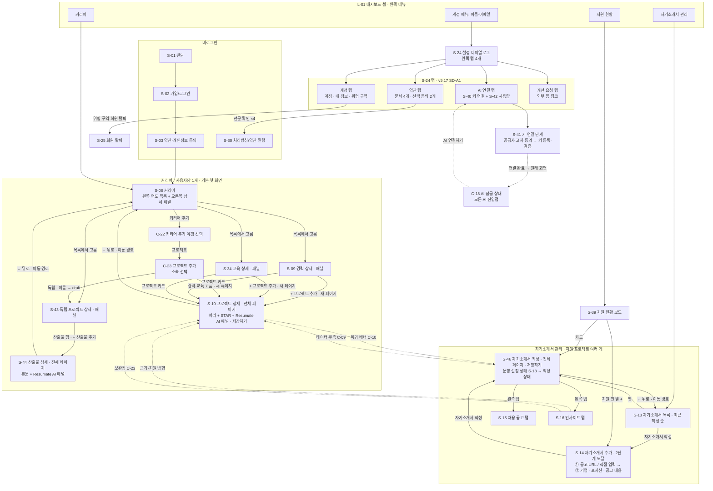

- **(v5.19, RM-1·RM-A4)** "모의 면접" 메뉴와 면접 화면 S-20·S-22·S-33·S-37, 진입 요소 C-14·C-16을 사이트맵에서 지웠다. 왼쪽 메뉴는 3개(M1 커리어 · M2 자기소개서 관리 · M4 지원 현황 — 노드 이름은 바꾸지 않았다).
- (v5.5) S-11·S-35·S-36은 폐기, S-12는 `[보류]`라 사이트맵에서 뺐다. S-09·S-34는 별도 화면이 아니라 S-08의 패널 상태다(ID 유지).
- **(v5.17, SD-A1·SD-A2·SD-A6)** 설정은 화면 하나가 아니라 **왼쪽 탭 4개짜리 다이얼로그**(S-24)다. **S-04는 폐기**(계정 탭 "내 정보"로), **S-40·S-42는 별도 화면이 아니라 S-24 AI 연결 탭의 구성**이다(ID 유지 — S-09·S-34·S-43을 S-08의 패널 상태로 둔 것과 같은 관행. 내용이 거의 그대로 살아 있고 다른 문서·구현이 ID로 참조하기 때문에 ~~S-35~~·~~S-36~~처럼 폐기하지 않는다). S-41만 다이얼로그 위 전체 화면 단계로 남는다. S-25는 다이얼로그 밖 별도 화면이다(SD-A6).
- (v5.6, PA-1·PA-3) S-10·S-44는 L-02 전체 페이지 셸(1.3a)이다. 경력·교육의 "+ 프로젝트 추가"는 C-23 없이 S-10 새 프로젝트 빈 페이지로, S-43의 "+ 산출물 추가"는 S-44 새 산출물 빈 페이지로 간다.
- (v5.18, 이력 — **(v5.20, R-CF-12) S-45는 폐기, S-46만 L-02**) **(v5.18, CL-2·CL-A2·CL-A10)** 서류 작성 화면 **~~S-45 경력기술서 작성~~·S-46 자소서 문항 답변 작성도 L-02 전체 페이지 셸**(1.3a)이다 — 왼쪽 본문(경력기술서 = 섹션별 블록 / 자소서 = 문항별 블록) + 오른쪽 "Resumate AI" 패널, 상단 바 "저장하기". 자기소개서 관리 안에 있지만 왼쪽 메뉴를 보이지 않는다.
- **(v5.20, CF-1·CF-7·CF-A11·CF-A12)** 자기소개서 관리는 **S-13 목록 → S-14 2단계 모달 → S-46 작성 화면** 세 단계다. **~~S-31~~ 허브·~~S-17~~ 서류 목록·~~S-45~~ 경력기술서 작성은 폐기**(ID 재사용 금지, 옛 주소는 S-46으로 리다이렉트). S-18은 S-46의 **문항 설정 상태**, S-15·S-16은 S-46의 **왼쪽 탭**(채용 공고 / 인사이트)으로 재정의했다(ID 유지). 면접 화면(S-20·S-22·S-33)으로 가던 허브 간선은 v5.19에서 면접 화면과 함께 지워졌다 — **모의 면접은 MVP에서 제외됨(RM-1)**.
- (v5.18, 이력) **(v5.18, CL-7) ~~S-19~~ 초안 편집기는 폐기**하고 그 자리를 S-45·S-46이 대신한다(~~S-35~~·~~S-36~~·~~S-04~~와 같은 폐기 표기, **ID 재사용 금지**). S-17 서류 초안 목록은 **진입구로 남고**(CL-A9 `[가정]`), S-18 자소서 문항 설정은 **자소서의 진입 단계**로 남는다(CL-7).

### 1.2 화면 목록

| ID | 화면명 | 메뉴/영역 | 관련 기능 | 우선순위 | v4 변경 |
|----|--------|-----------|-----------|----------|---------|
| L-01 | 대시보드 셸 (왼쪽 메뉴) | 공통 | F-COM-10 | Must | **신설** |
| L-02 | 전체 페이지 셸 (상단 바: 로고 · 저장하기 · 계정) | 커리어 (S-10·S-44) · **자기소개서 관리 (S-46)**(v5.18, CL-A10 · v5.20, CF-1) | F-COM-10, F-P1-06, **F-DOC-04** | Must | **v5.6 신설**(PA-1·PA-3). v5.18: 서류 작성 화면 2개 추가(CL-A10). **v5.20: S-45 폐기로 자기소개서 쪽은 S-46 하나**(CF-1) |
| S-01 | 랜딩 | 비로그인 | — | Must | 문구 |
| S-02 | 가입/로그인 | 비로그인 | F-COM-01 | Must | 로그인 후 S-08 |
| S-03 | 약관·개인정보 동의 | 가입 직후 | F-COM-02, F-COM-03 | Must | 다음 화면 S-08, 고지에 AI 작성 대화 추가 |
| ~~S-04~~ | ~~기본 프로필 편집~~ | — | ~~F-P1-01~~ | — | **v5.17 폐기**(SD-A2). 같은 필드를 **S-24 계정 탭 "내 정보"**에서만 고친다. ID 재사용 금지 |
| ~~S-05~~, ~~S-06~~ | (v3 폐기 유지) | — | — | — | |
| ~~S-07~~ | ~~홈~~ | — | — | — | **폐기**. 첫 화면은 S-08. 이어하기 항목은 S-08·S-39로 분산((v5.19, RM-1) S-37 폐기) |
| S-08 | 커리어 | 커리어 (기본 첫 화면) | F-P1-02, 03, 06, 09, 14, 17, F-COM-04 | Must | **v5.5: 왼쪽 연도 목록 + 오른쪽 상세 패널 2단으로 재설계**(CR-3·CR-4·CR-14). v4: 연도 계층 보기 |
| S-09 | 경력 상세 (S-08 패널) | 커리어 | F-P1-02, F-P1-03, F-P1-06 | Must | **v5.5: 별도 편집 화면 → S-08 경력 상세 패널(섹션 수정)으로 재정의.** 경력 단위 성과 삭제(CR-11) |
| S-10 | 프로젝트 상세 (전체 페이지) | 커리어 | F-P1-03, F-P1-06, F-P1-13, F-P1-15, F-P1-19 | Must | **v5.5: 경력·교육 안 프로젝트의 전체 페이지(왼쪽 메뉴 없음). 머리(이름·경험 유형·역량) + STAR 1개 + Resumate AI 패널. S-35·S-36 흡수**(CR-2·CR-3·CR-5·CR-10). **v5.6: L-02 셸, 페이지 단위 저장("저장하기"), 빈 새 프로젝트 페이지로 진입(C-23 없음), 머리 = 종류·경험 유형·역량·진행 기간·진행 중 늘 입력 상태(PA-3·PA-4)** |
| ~~S-11~~ | ~~정량 성과 (모달)~~ | — | ~~F-P1-04~~ | — | **v5.5 폐기**(CR-11) |
| S-12 | 스킬 목록 | — | F-P1-05 | `[보류]` | **v5.5: 보류(CR-16)**. 사용 기술은 S-43 태그로만(CR-10) |
| S-13 | 자기소개서 목록 | 자기소개서 관리 | F-AP-02, F-AP-05 | Must | **v5.20 재작성**(CF-3·CF-9): 행 = "{기업 명} 자기소개서" / 포지션 / 만든 날 + D-day(있을 때만), "최근 작성 순", [자기소개서 작성]. 전형 단계 열·기능 진행·단계 이동·보드로 보기 제거 |
| S-14 | 자기소개서 추가 (**2단계 모달**) | 자기소개서 관리 / 지원 현황 | F-AP-01, F-P2-01, **F-P2-10** | Must | 보드에서도 진입, 새 단계 "지원 전". **v5.20 재작성**(CF-8·CF-10): 전체 페이지 → 2단계 모달(① 공고 URL / 직접 입력 → ② 지원 기업·포지션·공고 내용), 옛 `/applications/new`는 모달로 |
| S-15 | JD·요건 → **채용 공고 탭** (S-46 왼쪽 탭의 구성, 별도 화면 아님, ID 유지) | 자기소개서 관리 | F-P2-02 | Must | **v5.20 재정의**(CF-7·CF-A12): S-46 "채용 공고" 탭. 규칙 그대로 |
| S-16 | 인사이트 → **인사이트 탭** (S-46 왼쪽 탭의 구성, 별도 화면 아님, ID 유지) | 자기소개서 관리 | F-P2-04, 05, 09, F-AP-06 | Must | STAR 단위 근거, 보완점 → C-23 → S-10(v5.5·v5.6). **v5.20 재정의**(CF-7·CF-A12): S-46 "인사이트" 탭 |
| ~~S-17~~ | ~~서류 초안 목록~~ | — | ~~F-DOC-01, 04~~ | — | **v5.20 폐기**(CF-1·CF-7). 서류가 하나라 고를 것이 없다 — S-13 행이 S-46을 바로 연다. ~~이관 안내 상자는 S-13 머리로~~ (CF-M1 확정) 이관할 초안이 없어 안내 상자를 두지 않는다. `/applications/{id}/drafts` → S-46 리다이렉트. ID 재사용 금지 |
| S-18 | 자소서 문항 설정 → **S-46의 문항 설정 상태** (별도 화면 아님, ID 유지) | 자기소개서 관리 | F-DOC-02, 09 | Must | v5.18: 생성 버튼 폐기, 진입 단계. **v5.20 재정의**(CF-5·CF-A11): S-46과 같은 주소의 첫 상태, 문항 최대 5개·글자 수 사용자 입력·메모 접힘 |
| ~~S-19~~ | ~~초안 편집기~~ | — | ~~F-DOC-01~04, 08~~ | — | **v5.18 폐기**(CL-7). 주소 `/applications/{id}/drafts/{draft_id}`는 **(v5.20, CF-1) 서류 종류와 관계없이 S-46으로** 리다이렉트. ID 재사용 금지 |
| ~~S-20~~ | ~~면접 준비~~ | — | ~~F-P3-01, 07, 13~~ | — | **v5.19 폐기**(RM-1). 주소는 아래 "폐기한 면접 화면의 주소". ID 재사용 금지 |
| ~~S-21~~ | (v3 폐기 유지) | — | — | — | |
| ~~S-22~~ | ~~면접 결과~~ | — | ~~F-P3-06, 07~~ | — | **v5.19 폐기**(RM-1). ID 재사용 금지 |
| ~~S-23~~ | (v3 폐기 유지) | — | — | — | (v5.19, RM-1) 이를 대신하던 S-37도 폐기 |
| S-24 | 설정 (다이얼로그) | 계정 메뉴 "설정" | F-COM-02, 03, 05, 10, 11, F-P1-01, 01a, F-AI-01~05, 07 | Must | **v5.17 재작성**(SD-A1): 섹션 7개 → **왼쪽 탭 4개(계정 · AI 연결 · 약관 · 개선 요청)**. S-04 흡수(SD-A2), S-40·S-42를 AI 연결 탭 안으로(SD-A8·A10) |
| S-25 | 회원 탈퇴 | 설정 | F-COM-05 | Must | 삭제 범위에 교육·AI 작성 대화·전형 이력. v5.5: 상세 내용·정량 성과 → 산출물 |
| S-26, S-32 | (예약) 커리어 채팅 / 지원 프로젝트 정보 편집 | | Should | | |
| ~~S-27~~ | ~~(예약) 완성도~~ | — | ~~F-P1-07~~ | — | **v5.5 폐기**(F-P1-07 폐기, CR-11). ID 재사용 금지 |
| ~~S-29~~ | ~~(예약) 사용량~~ | — | — | — | **폐기**. F-COM-07(남은 횟수) 폐기. 사용량은 S-42 사용량 미터로 새로 정의 |
| S-28 | 오류·접근 불가 | 공통 | F-COM-01, NFR-PRV-07 | Must | |
| S-30 | 처리방침·약관 열람 | 공통 | NFR-PRV-10 | Must | **v5.8: 문서별 페이지 3개**(이용약관 / 개인정보 처리방침 / 국외 이전 고지, PT-6). **(v5.17, SD-A13) AI 데이터 처리 페이지를 더해 문서 4개** |
| ~~S-31~~ | ~~지원 프로젝트 허브~~ | — | ~~F-AP-03, 05, 06, F-ST-01~~ | — | **v5.20 폐기**(CF-7). 헤더 이름·마감일 → S-46 머리, JD·인사이트 카드 → S-46 탭, 단계 칩 → 없앰(CF-3), 서류·면접 카드 → 없앰(면접 카드는 v5.19에서 이미 삭제 — 모의 면접은 MVP에서 제외됨(RM-1)). `/applications/{id}` → S-46 리다이렉트. ID 재사용 금지 |
| ~~S-33~~ | ~~면접 답변지~~ | — | ~~F-P3-02~04~~ | — | **v5.19 폐기**(RM-1). ID 재사용 금지 |
| S-34 | 교육 상세 (S-08 패널) | 커리어 | F-P1-14 | Must | v4 신설(교육 편집). **v5.5: S-08 교육 상세 패널(섹션 수정)로 재정의** |
| ~~S-35~~ | ~~상세 내용 편집 (STAR + 회고 및 배운 점)~~ | — | — | — | **v5.5 폐기** → S-10 STAR(CR-2) |
| ~~S-36~~ | ~~AI 작성 대화~~ | — | — | — | **v5.5 폐기** → S-10 Resumate AI 패널(CR-5) |
| ~~S-37~~ | ~~모의 면접 (전체 세션)~~ | — | ~~F-P3-15~~ | — | **v5.19 폐기**(RM-1). 왼쪽 메뉴 "모의 면접"도 함께 지웠다(RM-A4). ID 재사용 금지 |
| S-38 | (예약) 전형 이력 타임라인 | 자기소개서 관리 | F-ST-06 | Should | |
| **S-39** | **지원 현황 보드** | 지원 현황 | F-ST-01~05 | Must | **신설** |
| **S-40** | **AI 연결** — **S-24 AI 연결 탭의 구성**(별도 화면 아님, ID 유지) | 설정 > AI 연결 탭 | F-AI-01~05, F-AI-09 | Must | **v5 신설**. **v5.17 재정의**(SD-A1·A8): 공급자 카드 3개 → 한 줄 라디오 행 3개 + [연결] + ⋯ 메뉴, 플랜 안내 문구(SD-1) |
| **S-41** | **키 연결 단계** (공급자별 고지·동의 → 키 등록·검증, Gemini 무료 키 가이드 포함) | 설정 > AI 연결 | F-AI-01, 04, 05 | Must | **v5 신설**. S-40 위 전체 화면 단계(좁은 화면은 페이지) |
| **S-42** | **AI 사용량 미터** — **S-24 AI 연결 탭의 구성**(별도 화면 아님, ID 유지) | 설정 > AI 연결 탭 | F-AI-07 | Must | **v5 신설**. **v5.17 재정의**(SD-A10~A12): 공급자 탭 + 그 공급자의 기능별 표 **5행**((v5.19, RM-1·RM-A2) 면접 2행 삭제), 비용 열 4개 |
| **S-43** | **독립 프로젝트 상세** (S-08 패널) | 커리어 | F-P1-17, F-P1-18, F-P1-05 | Must | **v5.5 신설**(CR-7). 프로젝트 정보·프로젝트 내용·산출물, STAR 없음 |
| ~~S-45~~ | ~~경력기술서 작성~~ | — | ~~F-DOC-01, 03, 04, 08, 11~~ | — | v5.18 신설. **v5.20 폐기**(CF-1 — 경력기술서를 서비스에서 뺀다). `/applications/{id}/career-description` → S-46 리다이렉트. ID 재사용 금지 |
| **S-46** | **자기소개서 작성** (전체 페이지 · 문항 설정 상태 + 작성 상태 · 왼쪽 탭 자소서 / 채용 공고 / 인사이트 + Resumate AI 패널) | 자기소개서 관리 | F-DOC-02, 03, 04, 08, 09, **11**, F-AP-03, 04, 05, F-AI-06·08·09 | Must | **v5.18 신설**(CL-1·CL-2·CL-8·CL-10·CL-A10). **v5.20 재작성**(CF-5·CF-6·CF-7·CF-A11·CF-A12): S-18을 첫 상태로 합침, 문항마다 문항 이름 · 제목(`answer_title`) · 내용, 머리 지원 직무 · JD 상세 · 마감일, 왼쪽 탭 3개 |
| **S-44** | **산출물 상세** (전체 페이지, v5.6 이름 변경 — v5.5 "산출물 편집") | 커리어 | F-P1-18, F-P1-06, F-AI-06·08·09 | Must | **v5.5 신설**(CR-8). 제목 + 마크다운 본문, AI 근거. **v5.6 재정의(PA-1·PA-2·PA-3)**: L-02 셸, 제목 = 머리 입력, 본문 + Resumate AI 패널(본문 전체 초안 제안), 분류 없음, 페이지 단위 저장 |

- **폐기한 면접 화면의 주소 (v5.19, RM-1 · `[가정]`)**: 북마크·알림 링크로 들어올 수 있으므로 404 대신 가장 가까운 남은 화면으로 **리다이렉트**한다(~~S-19~~ 주소 처리와 같은 관행). `/applications/{id}/interview` · `/applications/{id}/interview/{sessionId}` · `/applications/{id}/interview/{sessionId}/result`(옛 S-20·S-33·S-22) → ~~S-31 `/applications/{id}`~~ **S-46 `/applications/{id}/cover-letter`**(v5.20 병합 정렬 MRG-UX-1 `[가정]` — S-31이 CF-7로 폐기되어 `/applications/{id}`도 S-46으로 리다이렉트하므로 한 번에 보낸다. 그 지원 프로젝트가 없거나 남의 것이면 ST-NOTFOUND) / `/interviews` · `/interviews/{sessionId}/result`(옛 S-37·"자기소개서 삭제됨" S-22) → **S-13 `/applications`**. 안내 토스트는 두지 않는다. 쿼리(`?type=` 등)는 버린다.

### 1.3 L-01 대시보드 셸 (F-COM-10)

| 요소 | 내용 | 비고 |
|------|------|------|
| 왼쪽 메뉴 | 순서 고정: **커리어 · 자기소개서 관리 · 지원 현황**(CR-12: 두 번째 메뉴 이름만 바꿈, 화면·구조는 기업 JD 관리 그대로. **(v5.19, RM-1·RM-A4 `[가정]`) "모의 면접"을 빼 메뉴 3개, 남은 순서는 그대로**). 현재 메뉴 강조. 지원 프로젝트 하위 화면(S-14 모달 — v5.20: ~~S-31~~·~~S-17~~ 폐기, S-15·S-16·S-18은 S-46 안)에 있으면 "자기소개서 관리"를 강조하되, 지원 현황(S-39)에서 들어온 경우 이동 경로에 출발 메뉴를 남긴다(아래). **S-10 프로젝트 상세·S-44 산출물 상세(L-02 전체 페이지)에서는 왼쪽 메뉴를 보이지 않는다**(CR-3, v5.6 PA-1) | F-COM-10 |
| 메뉴 배지 | (v5.19, RM-1) ~~모의 면접 배지~~ 메뉴와 함께 삭제. 자기소개서 관리: 진행 중 AI 작업 수. **(v5.18, CL-1·CL-6 `[가정]`) 서류 작성 대화의 턴은 이 수에 세지 않는다** — 커리어의 AI 작성 대화 턴을 커리어 배지에 세지 않는 것과 같은 규칙이고(커리어는 배지 없음), 턴은 스트리밍이라 사용자가 그 화면에서 끝까지 본다. 세는 것은 비동기 작업(요건 추출·인사이트)뿐이다((v5.19, RM-1) 면접 질문 생성·채점 삭제). 커리어: 배지 없음(v5.5: 작성 중 AI 대화 묶음이 없어짐) `[가정]` | |
| 메뉴 하단 | **계정 블록**(사용자 이름·이메일 + 펼침 아이콘, 피그마) → 계정 메뉴 **3항목: 설정 · 다크 모드 · 로그아웃**(v5.13, OD-S1, 구현 `nav-user.tsx` `AccountMenuContent`. 메뉴 맨 위는 이름·이메일 머리). "설정"은 설정 다이얼로그(S-24)를 열고, **(v5.17, SD-A1·SD-A2·SD-A5) 내 정보(옛 기본 프로필 S-04)·AI 연결(S-40)·AI 사용량(S-42)·회원 탈퇴 입구는 그 다이얼로그의 탭 안 구성이다**(계정 탭 / AI 연결 탭). 계정 메뉴는 **설정 · 다크 모드 · 로그아웃 3항목 그대로**이고(SD-A5·SD-A16, OD-S1) 로그아웃은 설정 계정 탭 "위험 구역"에도 **함께** 있다. "다크 모드"는 켜고 끄는 스위치(메뉴를 닫지 않음). 처리방침은 설정 다이얼로그와 S-01 하단 링크(→ S-30)로 간다. v5.12까지의 5항목(기본 프로필·설정·AI 연결·처리방침·로그아웃)은 쓰지 않는다. 계정 블록 위에 **AI 연결 상태 한 줄**(연결 전: "AI 연결 안 됨" → S-40 / 연결 후: C-19 공급자·등급 배지, 키 무효면 경고 표시) 유지(확정 2026-11-02 (사용자, CR-24). 피그마에 이 줄을 추가해야 한다) | F-AI-09. 메뉴 3개와 별도(PRD 3.1, v5.19 RM-A4) |
| 상단 바·이동 경로 | 본문 위 상단 바: **사이드바 접기 아이콘 + 현재 메뉴 이름**(피그마). 지원 프로젝트 하위 화면은 메뉴 이름 대신 이동 경로 "**자기소개서 관리** › {자기소개서 이름} › {하위 화면}"(v5.20 — 이름은 S-14 이름 규칙 "{기업 명} 자기소개서", CF-A7). ~~허브(S-31) 제목~~은 허브 폐기로 없어졌다(v5.20, CF-7). (v5.14, U36-7, 확정 2026-11-05 (사용자)) 이름에 이미 "자기소개서"가 들어 있으면(기본 이름 "새 자기소개서 ({날짜})" 등) 뒤의 "자기소개서"를 붙이지 않는다. S-39에서 들어오면 첫 마디가 "지원 현황"으로 바뀌어 원래 메뉴로 돌아갈 수 있다((v5.19, RM-1) S-37 출발 경로 삭제). 커리어: S-08은 "커리어". S-10·S-44는 L-01 밖의 L-02(1.3a) 이동 줄을 쓴다(v5.6). **(v5.18, CL-A10 · v5.20, CF-1) 작성 화면 S-46은 L-02**라 이 이동 경로를 쓰지 않고 1.3a 이동 줄을 쓴다 — 왼쪽 메뉴·메뉴 강조가 없으므로 위 하위 화면 목록에도 넣지 않는다 | 화면 안의 개체 이름은 "자기소개서"(CR-23, D-UX-20). (v5.20, CF-U3 확정 — 확정 2026-11-08 (사용자, CF-U3) — OD-D7·U36-6의 "자소서 문항 답변"을 대체) 서류가 하나라 그 본문도 "자기소개서"로 부르고, 작성 화면의 탭 이름만 "자소서"다 |
| 전역 알림 | AI 작업 완료 인앱 토스트(C-03), 복귀 배너(C-10, 커리어 안에서만), AI 장애 배너(S-28) | |
| 좁은 화면 | 메뉴를 접는다: 상단 바 + 메뉴 버튼 → 서랍(drawer)으로 3개 메뉴 `[가정]`((v5.19, RM-A4) 4개 → 3개). 현재 메뉴 이름은 상단 바에 항상 보인다. 넓은 화면의 사이드바 접기 상태는 브라우저에 기억 `[가정]` | F-COM-10 "UX 결정" |
| 첫 화면 | 로그인·가입 후 항상 S-08(마지막 메뉴를 기억하지 않음, PRD 3.1 `[가정]`). 단 로그인 전 요청한 URL이 있으면 그 URL. **예외: 탈퇴가 끝나지 않은 계정(데이터는 지워졌고 계정 정보 삭제만 남음)으로 로그인하면 동의 게이트·원래 URL보다 먼저 S-25 "탈퇴 마무리"로 보낸다**(A7, 확정 2026-11-05 (사용자)) | |

### 1.3a L-02 전체 페이지 셸 (S-10·S-44·**S-46**, v5.6 신설, PA-1·PA-3 · v5.18 확장, CL-A10 · v5.20 S-45 폐기, CF-1)

S-10 프로젝트 상세와 S-44 산출물 상세는 L-01 왼쪽 메뉴 없이 이 셸을 쓴다(피그마 `1034:8565`·`1041:8783`·`1041:8904`). 페이지 단위로 입력하고 상단 바 "저장하기"로 저장한다(확정 2026-11-03 (사용자, PA-3)).

**(v5.18, CL-2·CL-A10 · v5.20, CF-1)** 작성 화면 **S-46 자기소개서 작성**도 이 셸을 쓴다(v5.18의 S-45는 v5.20에 폐기) — 적용 화면은 3개다. 세 화면 모두 "왼쪽 본문 + 오른쪽 Resumate AI 패널 + 페이지 단위 저장하기"라는 같은 모양이다. 아래 표에서 서류 작성 화면만의 값은 **(서류)**로 적는다.

| 요소 | 내용 | 비고 |
|------|------|------|
| 상단 바 왼쪽 | ResuMate 로고. 누르면 S-08(저장하지 않은 변경이 있으면 아래 이탈 확인) | 피그마 |
| 상단 바 오른쪽 | 순서: **[Resumate AI]**(패널을 닫았을 때만 보이는 다시 열기 버튼) · **"저장하기"**(주 버튼) · 계정 아이콘(→ L-01과 같은 계정 메뉴 3항목: 설정 · 다크 모드 · 로그아웃, v5.13, OD-S1) | 다시 열기 버튼 위치 D-UX-27 `[가정]`. 피그마는 저장하기 + 계정만 |
| "저장하기" 상태 | 변경 없음: 비활성 / 변경 있음: 활성 + 저장하지 않은 변경 표식(점) `[가정]` / 저장 중: 비활성 + "저장 중…" / 성공: 비활성 + 옆에 C-06 "저장됨 HH:MM" / 실패: 활성 유지 + "저장하지 못했어요 · 다시 시도"(ST-SAVE-FAILED, 입력 유지) / 검증 오류: 저장을 막고 첫 오류 칸으로 포커스 | 새 페이지는 칸을 하나라도 입력하면 활성. 단축키 Ctrl/⌘ + S `[가정]` |
| 이동 줄 | 상단 바 아래: "←" + 이동 경로. S-10 "{회사명 / 교육 표시 이름} › {프로젝트명} › 프로젝트 상세"(교육 표시 이름 = S-34 규칙, v5.10, ED-2), S-44 "{프로젝트명} › {산출물 제목} › 산출물 상세". **(서류, v5.20, CF-7·CF-A11 `[가정]`)** S-46 **"자기소개서 관리 › {자기소개서 이름}"**(두 상태 공통, 시안의 세 번째 마디 "자기소개서 상세"는 쓰지 않는다) — 메뉴 하위 개체라 S-10·S-44와 달리 **첫 마디에 메뉴 이름을 넣는다**. "자기소개서 관리"와 "←"는 **S-13**으로 간다(S-39에서 왔으면 첫 마디 "지원 현황", "←"는 S-39). 이름에 이미 "자기소개서"가 들어 있으므로 U36-7 겹침 규칙대로 뒤에 붙이지 않는다. 자기소개서에는 **"행이 없는 새 페이지" 마디가 없다** — 지원 프로젝트를 만든 순간부터 주소가 정해져 있어(CL-9) "새 … 추가" 마디를 쓰지 않는다(v5.18의 S-45·S-17·S-31 마디는 폐기). 이름·제목은 입력 중인 값을 따라간다. **(v5.13, OD-C4, 구현 `project-page.tsx`·`deliverable-page.tsx`·`new-row-notice.tsx` `CRUMB_CURRENT` 그대로) 행이 아직 없는 새 페이지**: 마지막 마디가 **"새 프로젝트 추가"** / **"새 산출물 추가"**이고, 이름·제목이 비어 있으면 이름 마디를 빼서 "{회사명 / 교육 표시 이름} › 새 프로젝트 추가" / "{프로젝트명} › 새 산출물 추가"로 읽힌다(이름을 입력하면 "… › {프로젝트명} › 새 프로젝트 추가"). 첫 저장에 성공해 행이 생기면 바로 "… 상세"로 바뀐다(URL이 아니라 행 유무를 따름). **기존 행**에서 이름·제목을 지우면 이름 마디는 남고 자리 표시 "새 프로젝트" / "새 산출물"을 보인다 | 피그마의 "{커리어명}"·"{프로젝트 명}"은 자리표시자 오류로 본다 |
| 복귀 배너 | C-10, 이동 줄 아래 페이지 전체 폭 | |
| 본문 | 머리(제목 = 입력 칸 + 머리 필드 + ⋯ 메뉴) / 구분선 / 왼쪽 입력 영역 · 세로 손잡이 · 오른쪽 Resumate AI 패널. (v5.12, UP-12) 왼쪽 입력 영역은 최대 폭 제한 없이 열 전체 폭을 쓴다 | 화면별 내용은 S-10·S-44. 스크롤바·포커스 표시·조작 요소 크기 등 시각 규칙은 디자인 시스템(UP-12) |
| 이탈 확인 | 저장하지 않은 변경(직접 입력 + AI [반영]으로 채운 값)이 있는 채로 ←·이동 경로·로고·계정 메뉴의 이동·C-10 "돌아가기"·C-02 같은 앱 안 이동과 **브라우저 뒤로·앞으로**(v5.12, UP-11)를 하면 이탈 확인 다이얼로그(v5.13, OD-S2, 구현 `page-shell.tsx` `LeaveGuardDialog` 그대로): 제목 **"저장하지 않은 변경이 있어요"**, 설명 **"저장하지 않고 나가면 이번에 고친 내용이 사라져요"**, 버튼 2개 **"저장하지 않고 나가기" / "저장하고 나가기"**(주 버튼), **오른쪽 위 X = 계속 편집**(닫으면 그 자리에 남음. v5.12까지의 "계속 편집" 버튼은 X로 대신). "저장하고 나가기"가 검증 오류·실패로 끝나면 이동하지 않고 그 자리에 남는다. 브라우저 닫기·새로 고침은 브라우저 기본 확인 | UX-7. 문구 확정(v5.13, OD-S2). design-system P-19 닫힘 |
| 입력 보존 | 편집 중 폼 전체를 브라우저에 임시 보존한다(키: 기존 = 행 ID, 새 페이지 = 소속 ID(산출물은 프로젝트 ID) + "new"). **(서류, v5.18, CL-3·CL-9 `[가정]`) 서류는 행 ID 대신 "지원 프로젝트 ID + 서류 종류"**(v5.20, CF-A2: `cover_letter` 하나 — ~~`career_description`~~)를 키로 쓴다 — 서류 정본은 지원 프로젝트 × 서류 종류당 한 행이고(CL-9) 화면에 들어가기 전부터 주소가 정해져 있어 "new" 변형이 필요하지 않다. 기준 버전(U40-2)은 서류 정본 행의 `updated_at`이다. 보존·저장 대상에는 본문·문항과 함께 **문체**(정본 `meta.tone` — 저장 RPC `save_application_document`의 **`p_meta`**로 올라간다, DM v4.13 확정)도 들어간다. (v5.12, UP-11) 다시 열면 **배너 없이 자동 복원**한다 — 페이지가 "변경 있음"이 되어 "저장하기"가 켜지고, 나갈 때 이탈 확인이 뜬다. 버리려면 이탈 확인의 "저장하지 않고 나가기"를 고른다. v5.11까지의 "저장하지 않은 수정이 있어요 · 이어서 편집 / 버리기" 배너는 없다. 저장에 성공하거나 "저장하지 않고 나가기"를 고르면 지운다. (v5.16, U40-1) **로그아웃·탈퇴 때도 이 기기의 보존 입력을 모두 지운다**(S-14 작성 중 공고 초안·복귀 대상 같은 사용자별 임시 저장도 함께. 테마 같은 기기 설정은 남김). (v5.16, U40-2) 보존할 때 그 행의 `updated_at`(기준 버전)을 함께 적고, 다시 열 때 행의 `updated_at`이 기준과 다르면(다른 탭·기기에서 그 사이 저장함) **복원하지 않고 보존본을 버린 뒤 저장된 행을 보여 준다**(안내 없음). 기준 버전이 없는 보존본도 버린다 | 자동 복원은 확정 2026-11-04 (사용자, UP-11), 보존 키는 `[가정]`. 내용은 브라우저 저장소에만, URL에는 넣지 않는다 |
| 왼쪽 메뉴·AI 연결 상태 줄 | 없다. 공급자·등급은 **패널 입력창 아래 줄의 C-19 배지**로 보인다(v5.12, UP-2. v5.11까지 패널 머리) | |
| 좁은 화면 | 상단 바: 로고 · 저장하기 · 계정(저장하기는 늘 보인다). 이동 경로 대신 "← {상위 이름}". AI 패널은 화면 아래 "Resumate AI" 버튼 → 전체 화면 시트 | UX-9 `[가정]` |

### 1.4 Should 이하 확장 자리

| 기능 | 배치 예정 | MVP 처리 |
|------|-----------|----------|
| ~~F-P1-07 완성도~~ | — | **폐기**(PRD v4.5, CR-11: S-08 상단 요약·안내 1줄 삭제) |
| F-P1-08 STAR 섹션 다듬기 | S-10 STAR 입력란 옆(폼에 채우기만, PA-3) | 없음 |
| F-P1-12 숙련도, F-P1-16 경력·교육 대화 작성 | S-12 / S-09·S-34 | 없음 |
| F-AP-04 정보 편집 | S-32, **S-46 머리**(v5.20, CF-7 — ~~S-31 헤더~~) | S-46 머리 이름·마감일 수정 (PRD 5.3 확정) |
| F-AP-09 복제 | S-13·S-39 카드 메뉴 | 없음 |
| F-ST-06 전형 이력 | S-38, S-39(v5.20 — ~~S-31~~ 폐기) | 없음 (기록은 MVP부터, F-ST-05) |
| F-ST-07 통계, F-ST-08 서류 전형 팝업 | S-39 | 없음 |
| F-P2-03, 07, 08 | S-15(채용 공고 탭) / S-16(인사이트 탭) / S-26 (v5.20 — ~~S-31~~ 폐기) | F-P2-07 "데이터 변경됨" 상태 표시만 (PRD 5.3 확정) |
| ~~F-DOC-05~~ | — | **폐기**(v5.18, PRD v4.15 Q-PRD-1 — 대화가 곧 다시 쓰기 지시라 F-DOC-11에 흡수됐다. Should 자리도 없어졌다) |
| F-DOC-06, 10 | **S-46** / **S-46**(문항 설정 상태 포함) | 없음 (v5.18, CL-6·CL-7 · v5.20, CF-1 — S-45 폐기) |
| ~~F-P3-08, 09, 10~~ | — | **폐기**(v5.19, RM-1 — 기능군 P3 삭제) |
| F-COM-06 | S-16·**S-46** | 없음 (v5.18, CL-7 · v5.19, RM-1: S-22 폐기 · v5.20, CF-1) |
| **F-COM-11 개선 요청** (v5.17, SD-3) | S-24 ④ 개선 요청 탭 | 탭·링크는 둔다(주소 미정이면 "준비 중") |
| ~~F-COM-07~~ | — | **폐기**(v4). 사용량 미터 F-AI-07(S-42)로 대체 |
| F-AI-10 모델 직접 선택, F-AI-11 기능별 공급자 | S-40 | 없음 (Won't) |
| F-AI-12 예산 상한, F-AI-13 실시간 분당 한도, F-AI-14 관리자 키 잔액 조회 | — | **명시적 제외**. 화면 자리도 두지 않는다 |

---

## 2. 핵심 플로우

플로우 ID는 바꾸지 않는다. FL-01·FL-02는 v3에서 폐기됐다. v4 신설은 FL-14부터.

| ID | 플로우 | PRD 핵심 작업 | v4 상태 |
|----|--------|---------------|---------|
| FL-03 | 자기소개서 채워 가기 (v5.20 이름 변경 — 옛 "서류 초안") | J-4 | v5.18 전면 재작성(대화형). **v5.20 재작성**(CF-1·CF-7·CF-A11): 경력기술서 분기·S-31·S-17 제거, S-46 문항 설정 상태 → 작성 상태 |
| ~~FL-04~~ | ~~면접 답변지 이어쓰기~~ | ~~J-5~~ | **v5.19 폐기**(RM-1). ID 재사용 금지 |
| FL-05 | 커리어 정리 (직접 입력) | J-1 | **v5.5 개정**(2단 목록·섹션 수정·C-22·C-23·독립 프로젝트·산출물). v4: 연도 계층·교육·상세 내용. **v5.6: S-10·S-44 새 빈 페이지 + 저장하기(PA-3)** |
| FL-06 | 지원 프로젝트 삭제 | J-2 | 개정(전형 이력 포함, 보드에서도) |
| FL-07 | 회원 탈퇴 | — | 개정(삭제 범위). v5.3: 확인 체크·오류 2종·탈퇴 마무리 재진입(A7) |
| FL-08 | AI 실패·재시도 | — | 개정(`error_category`) |
| FL-09 | 가입 → 커리어 | — | **개정**(홈 → 커리어). v5.5: 빈 커리어 시작점 = "커리어 추가" 1개. v5.6: "+ 프로젝트 추가" → S-10 새 페이지. v5.7: S-02 = Google 로그인만 |
| FL-10 | 지원 프로젝트 만들기 | J-2 | 개정(보드 진입). v5.4: 동의 필요·키 무효는 만들기 전에 막음(Q53-1). **v5.20 재작성**(CF-8·CF-10·CF-A6): 2단계 모달, 공고 URL 가져오기, 판정 시점 [다음], 도착 = S-46 문항 설정 상태 |
| FL-11 | 인사이트 | J-3 | 유지. v5.5: 근거 이동 S-10·S-44, 보완점 → C-23. v5.6: C-23 소속 선택 → S-10 새 프로젝트. **v5.20**: 진입이 S-46 인사이트 탭(CF-7·CF-A12) |
| ~~FL-12~~ | ~~모의 면접 (일괄)~~ | ~~J-5~~ | **v5.19 폐기**(RM-1). ID 재사용 금지 |
| FL-13 | 데이터 부족 → 커리어 → 복귀 | — | 개정(대화 작성 바로가기). v5.3: `project_fields` → S-10(A18). **v5.5: 이동 대상 S-10 프로젝트 상세·C-23·S-09 새 경력**. v5.6: C-23 소속 선택 → S-10 새 프로젝트, 재판정은 저장 때 |
| **FL-14** | Resumate AI 패널로 프로젝트 STAR 채우기 | J-1 | v4 신설. **v5.5 개정**: S-36 → S-10 패널, 모든 대화는 프로젝트에 묶임, 제안 [반영] 방식(CR-5·CR-6). v5.3의 그만둔 대화 재개(A6)는 없어짐, 상한에서 인사 제외(A5)는 유지. **v5.6: 새 프로젝트 첫 메시지 = 첫 저장, [반영] = 폼 채우기 → 저장하기(PA-3)** |
| **FL-15** | 지원 현황 보드에서 단계 이동 | J-6 | **신설**. (v5.19, RM-2) 4열, AI·팝업 분기 없음 |
| ~~FL-16~~ | ~~인터뷰 전형 이동 → 면접 준비~~ | — | **v5.19 폐기**(RM-1·RM-2, PRD F-ST-04 삭제). ID 재사용 금지 |
| ~~FL-17~~ | ~~모의 면접 메뉴에서 새 면접 시작~~ | — | **v5.19 폐기**(RM-1). ID 재사용 금지 |
| **FL-18** | AI 연결 (공급자 고지·동의 → 키 등록·검증) | J-0 | **v5 신설** |
| **FL-19** | AI 잠금 상태 → AI 연결 → 원래 화면 복귀 | J-0 | **v5 신설** |
| **FL-20** | 키 교체·다시 확인·삭제·활성 공급자 변경 | J-0 | **v5 신설** |
| **FL-21** | 공급자 한도·오류 안내 → 복구 | J-7 | **v5 신설** |
| **FL-22** | Resumate AI 패널로 산출물 본문 쓰기 | J-1 | **v5.6 신설**(PA-1) |

### FL-09 가입 → 커리어

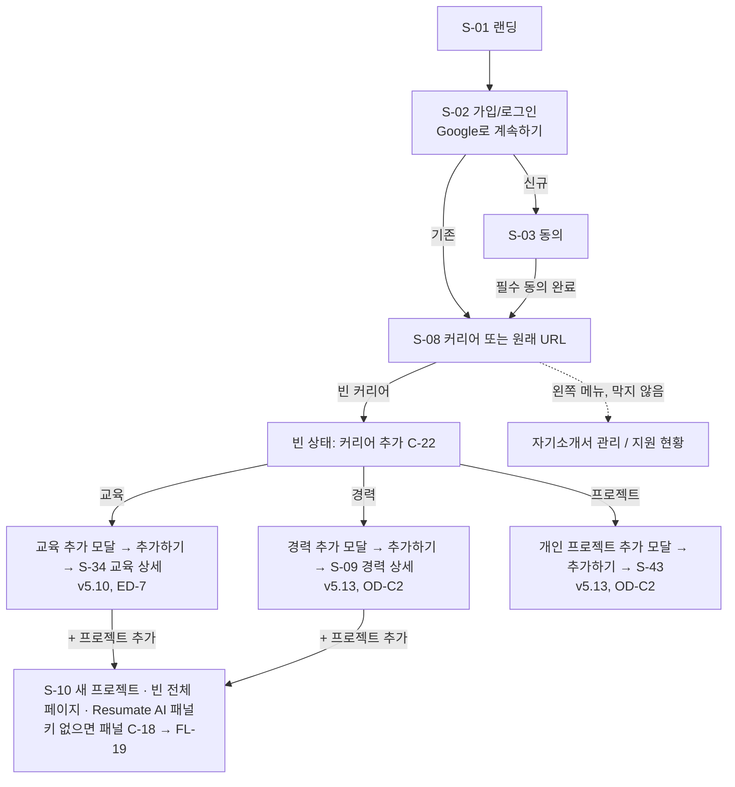

- 화면 단계 수: 가입부터 커리어까지 **3화면**(S-02 → S-03 → S-08). 강제 입력 없음. **키 연결 단계 없음**(D-35).
- (v5.5, CR-14) 빈 커리어의 시작점은 **"커리어 추가" 하나**다(C-22에서 경력 / 교육 / 프로젝트를 고름). v5.4의 두 번째 시작점 "AI와 대화하며 첫 프로젝트 정리하기"는 없다 — 모든 AI 대화는 프로젝트에 묶이므로(CR-6) 경력·교육의 "+ 프로젝트 추가"로 S-10 새 페이지를 연 뒤 패널에서 시작한다(v5.6: 첫 메시지 때 프로젝트 행이 생김, PA-3). 키가 없으면 그 패널이 C-18이다(FL-19).
- 관련 기능: F-COM-01, F-COM-02, F-COM-03, F-COM-10, F-AI-06.

### FL-05 커리어 정리 — 직접 입력 (J-1, v5.5 개정)

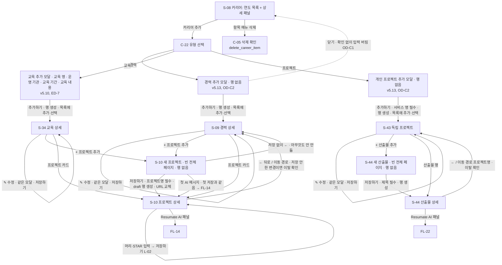

- 화면 단계 수: 첫 경력 + 첫 프로젝트 STAR까지 **2화면 + 다이얼로그 2개**(S-08 → C-22 → 경력 추가 모달 "추가하기" → S-09 → S-10 새 프로젝트 → 저장하기). v5.5의 C-23 이름 다이얼로그가 빠졌다(v5.6, PA-3). 돌아와 S-08 연도 목록에서 본다(F-P1-09 완료 지점).
- 편집 방식(D-UX-19 · v5.6 D-UX-24 · **v5.13, OD-C2**): 경력·교육·독립 프로젝트(S-09·S-34·S-43)는 추가와 "✎ 수정" 모두 **커리어 항목 추가·수정 모달**(S-08)로 한다. 모달을 닫으면 입력을 확인 없이 버린다(OD-C1). C-24 섹션 인라인 편집은 폐기. **S-10·S-44 전체 페이지는 모든 칸이 늘 입력 상태이고 상단 바 "저장하기"로 한 번에 저장한다**(L-02, 확정 2026-11-03 (사용자, PA-3)). 경력·교육·독립 프로젝트는 모달의 "추가하기"로 행이 생기고(독립 프로젝트는 `draft`, v5.9 D-UX-28의 "처음 저장할 때 생성"을 모달에서 지킴), **소속 프로젝트·산출물은 첫 "저장하기" 또는 첫 AI 메시지 때** 행이 생긴다(PA-3).
- 완료 판정(PRD v4.5 · DM v4.4): 경력·교육은 v4와 같음 / 경력·교육 안 프로젝트 = 이름 + 상황 + 행동(STAR 1개, CR-2. `role` 조건 제거, CR-10) / 독립 프로젝트 = 이름 + 프로젝트 내용 / 산출물 = 제목 + 본문. **화면에는 "작성 중" 배지가 없다**(CR-11). 미완료 항목이 AI 근거에서 빠진다는 사실은 C-09 게이트에서 알린다.
- 저장: 모달 "추가하기"·"저장하기" 또는 L-02 "저장하기"마다 서버 저장, 서버가 `status`(draft / complete)를 다시 계산한다. 편집 중 입력의 브라우저 임시 보존은 L-02만(UX-7, v5.13, OD-C1).

### FL-14 Resumate AI 패널로 프로젝트 STAR 채우기 (F-P1-13, v5.5 개정)

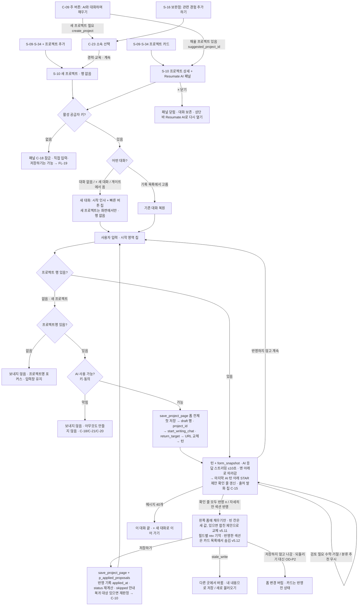

- 화면 단계 수: 시작점에서 STAR 저장까지 **1화면**(S-10). C-09·S-16에서 새 프로젝트가 필요하면 C-23 소속 선택 다이얼로그 1회가 앞에 붙는다(v5.6: 이름 입력 없음).
- 관련 기능: F-P1-13, F-P1-15, F-P1-06, F-AP-06, F-P2-09.
- **패널 대화 화면 (v5.12, 확정 2026-11-04 (사용자))**: 빠른 버튼 칩은 **시작 영역 전용**이다 — 첫 메시지를 보내는 순간(보내는 중 포함)부터 숨긴다(UP-1). 빠른 응답 "잘 모르겠어요 / 건너뛸게요" 버튼은 없다(사용자가 그렇게 쓰면 AI는 지금처럼 처리, UP-1). 메시지를 보내거나 턴이 시작되면 대화를 맨 아래로 따라가고, 턴이 끝난 뒤에는 스크롤을 옮기지 않는다(UP-3). STAR 제안은 **마지막 AI 턴 바로 아래 확인 줄** + [자세히]이고(UP-4), 섹션별 직접 고치기는 없다(UP-5). STAR 빈 칸의 "AI에게 물어보기"는 없다(UP-7).
- **모든 대화는 프로젝트에 묶인다**(CR-6, 확정 2026-11-02 (사용자)). 그래서 `new_project` 모드, 소속 고르기·소속 제안(`affiliation_suggestion`), 정리 결과 일괄 "저장"(`save_writing_chat`), "폼으로 전환"(`hand_off_writing_chat`), "대화 그만두기"·"다시 이어 하기"(A6), 프로젝트에 묶이지 않은 대화의 90일 자동 삭제(U-9 일부)가 없다. 대화 기록은 프로젝트와 함께 남고, 대화만 따로 지울 수 있다(U-9의 나머지는 유지).
- **새 프로젝트에서 대화 시작 (v5.6, 확정 2026-11-03 (사용자, PA-3) · 세부 D-UX-25 `[가정]`)**: v5.5는 C-23에서 이름만 넣어 `draft` 프로젝트를 먼저 만들었다. 이제는 빈 S-10 페이지에서 바로 시작한다. 패널은 행이 생기기 전에는 시작 인사·칩을 화면에서만 보인다(시작 인사는 AI 호출이 아님). 첫 메시지(칩 포함. 빈 칸 "AI에게 물어보기"는 v5.12 UP-7로 없어졌다)는 **순차 호출**로 보낸다(DM v4.5 7장, 한 RPC로 묶지 않음): ① 프로젝트명 확인 — **비어 있으면 보내지 않고** 프로젝트명 칸에 포커스 + "대화를 시작하려면 프로젝트명을 먼저 입력해 주세요"(입력창 내용 유지, D-UX-25) ② AI 사용 가능 확인(키·동의 — 막히면 아무것도 만들지 않음) ③ `save_project_page(p_project_id = null, …)`로 폼 전체 첫 저장 → 반환 `project_id`로 URL 교체 ④ `start_writing_chat(p_project_id, p_return_target, p_form_snapshot)` ⑤ 턴(`form_snapshot` 포함).
- **[반영] = 폼 채우기, "저장하기" = 사용자 확정** (v5.6, PA-3, UX-4): 제안 카드(v5.12, UP-4: 마지막 AI 턴 아래 확인 줄)의 [반영]·[반영 (n)](닫힌 대화 상자는 [모두 반영 (n)])은 왼쪽 폼에만 값을 채운다(검토 필요 섹션은 수락 후, AI·DB 호출 없음). 커리어 데이터는 "저장하기"(`save_project_page`)에서 바뀌고, 그 요청의 `p_applied_proposals: [{writing_chat_id, field, rev}]`로 서버가 같은 트랜잭션에서 `applied_at`을 기록한다(기록 실패는 저장을 막지 않고 `skipped`로 돌아옴). 그래서 화면은 **[반영] 때 그 필드의 `rev`를 기억**한다. 저장하지 않고 나가면 제안은 반영 전 상태로 남는다. (v5.13, OD-P2) [반영]·[반영 (n)]·[모두 반영 (n)]에는 **되돌리기가 없다** — 채운 뒤 토스트는 "{섹션}에 채웠어요"만이고, 되돌리려면 "저장하지 않고 나가기"로 저장된 값으로 돌아간다. v5.5의 `apply_writing_chat_proposal`은 **폐기**됐다(DM v4.5). 반영 규칙은 S-10 "반영 규칙".
- **AI가 읽는 STAR** (리더 정렬 2026-11-03, D-UX-26 폐기): 턴마다 저장하지 않은 폼 값 **`form_snapshot`**(`{name, start_month, end_month, is_current, project_type, experience_type, competencies, star: {…}}`)을 함께 보내고, AI는 이를 저장된 값보다 우선해 읽는다(저장·로그 없음). 입력창 위 "저장하지 않은 수정은 AI가 아직 보지 못해요" 안내 줄은 **두지 않는다**. 저장 전 값을 공급자로 보내는 고지·동의 범위는 데이터 모델 **D-DM-12** **확정 2026-11-03 (사용자): (a) 지금 범위 + 다음 고지 버전에 한 구절**.
- 키 필요(F-P1-13): 새 대화·메시지 보내기는 활성 공급자 키를 먼저 확인한다(C-18). 키가 무효·삭제돼도 대화 기록과 처리 안 한 제안은 보존·열람되고, 반영(폼 채우기)과 저장은 키 없이 할 수 있다 `[가정]`. 새 메시지를 보낼 때 C-20(D-36).
- 서비스 횟수 제한 없음(D-34). **메시지 상한 40개**(사용자 + AI, 시작 인사 제외, A5)는 **대화마다** 유지하고, 닿으면 새 대화로 이어 간다. 새 대화는 이전 대화 기록을 이어받지 않고 지금 폼 값(`form_snapshot`, 없으면 저장된 값)만 맥락으로 받는다(AI 명세).

### FL-22 Resumate AI 패널로 산출물 본문 쓰기 (F-P1-18, v5.6 신설, PA-1)

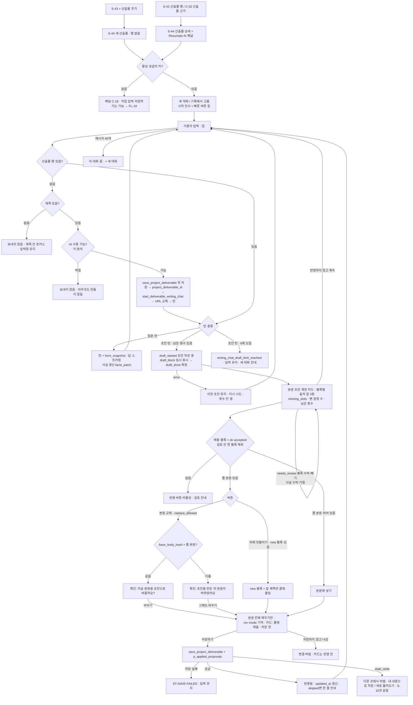

- 화면 단계 수: S-43에서 1화면(S-44). 다이얼로그 없음.
- 관련 기능: **F-P1-18 (6)~(8)**(산출물 AI 작성, Must, 키 필요 — PRD 확정. STAR 대화는 F-P1-13), F-P1-06, F-AI-06·08·09.
- 확정 2026-11-03 (사용자, PA-1): 산출물 상세에 Resumate AI 패널을 둔다. AI는 대화로 **본문 전체 초안**을 제안하고, 사용자가 **교체 / 현재 본문 뒤에 덧붙이기**를 고른다. (v5.6 R-PA-1·R-PA-3) 초안은 블록 단위다 — 수락하지 않은 `needs_review` 블록은 어느 방식이든 채우지 않고, 덧붙이기는 `basis = new` 블록만 붙이며, 본문이 비면 [본문에 넣기] 하나, `replace_allowed = false`면 교체 없음, 기준 본문이 바뀌었으면(`base_body_hash`) 교체 전 추가 확인(S-44 "반영 규칙"). 반영 전에는 커리어 데이터가 바뀌지 않는다(UX-4). PA-3에 따라 반영은 폼만 채우고 "저장하기"가 확정한다.
- S-43(독립 프로젝트 패널)에는 여전히 AI가 없다(CR-19 유지). CR-7 "독립 프로젝트엔 AI 패널 없음" 중 산출물 부분만 PA-1이 바꾼다.
- 대화는 **산출물마다 여러 개**이고 산출물에 묶인다(`writing_chats.project_deliverable_id`, DM v4.5). 산출물을 지우면 그 대화도 함께 지워진다(C-05).
- 시작 인사·빠른 버튼 칩·초안 스키마·근거 범위·민감정보 가드레일은 AI 명세 AI-13이 원천이다. 화면은 받은 값을 그대로 보인다.
- 메시지 상한 40·키 상태·실패한 턴·공급자 전환은 FL-14·S-10과 같다.
- (v5.12, UP-1·UP-3·UP-4) 자동 스크롤·빠른 응답 버튼 없음은 S-10과 같다. 다만 S-44는 **대화 중에도 칩을 유지**한다(초안 만들기·`style = shorter`. 초안 6회 도달 때는 **고정 3개 칩**으로 바뀐다 — v5.13, OD-P6, S-44 "빠른 버튼 칩").
- (v5.13, OD-P2) 채우기(본문 교체·덧붙이기·넣기)에는 **되돌리기가 없다**. 채우기 전으로 돌아가려면 "저장하지 않고 나가기"(L-02 이탈 확인)를 쓴다. 본문 교체 전 확인은 그대로다. 본문 초안 제안도 마지막 AI 턴 아래 확인 줄 + [자세히]다.
### FL-10 지원 프로젝트 만들기 (J-2, v5.20 재작성 — CF-7·CF-8·CF-10)

**(v5.20, CF-8)** S-14가 전체 페이지에서 **2단계 모달**로 바뀌었다. ① JD 입력(공고 URL 또는 직접 입력) → [다음] → ② 지원 기업·지원 포지션·공고 내용 확인·수정 → [자기소개서 작성] → **S-46 작성 화면의 문항 설정 상태**(CF-7·CF-A11). ~~S-31 허브~~는 거치지 않는다(폐기, CF-7).

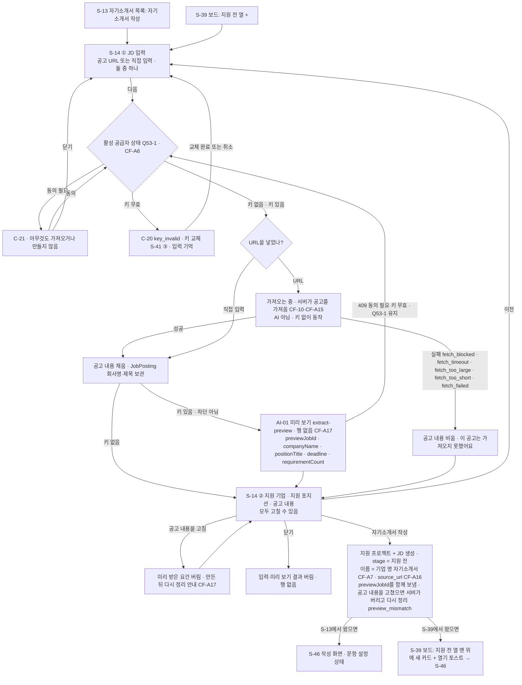

- 화면 단계 수: **모달 2단계 + 1화면**(S-13 → S-14 ① → S-14 ② → S-46 문항 설정 상태). 보드에서 오면 S-39로 돌아간다(기존 보드 출발 동작 유지). 키 없이도 완결(J-2): 키가 없으면 AI-01을 부르지 않는다. ②의 기업명·포지션명 채움 우선순위는 **AI-01 추출값(키 있음) → 공고 페이지 `JobPosting`(URL로 가져왔을 때) → 빈 칸**이고, 사용자가 ②에서 고친 값이 언제나 최종이다(CF-A6 `[가정]`, 2026-11-08 리더 정정). URL 가져오기는 AI가 아니라 **키 없이도 된다**(CF-A15 `[가정]`). ②는 [다음]의 가져오기·AI-01이 **끝난 뒤** 열린다 — 빈 칸을 먼저 열고 나중에 채우지 않는다 `[가정]`(사용자가 쓰는 중에 값이 바뀌지 않게, PRD 요청 4 회신).
- **URL 가져오기 (v5.20, CF-10 확정 2026-11-08 (사용자))**: [다음]을 누르면 서버가(`POST /api/job-descriptions/fetch`, DM v4.15) 공고를 가져와 ②의 "공고 내용"을 **고칠 수 있는 상태로** 채운다. 가져오지 못하면 ②로 넘어가되 칸을 비우고 **"이 공고는 가져오지 못했어요. 내용을 직접 붙여넣어 주세요"**를 보인다. 실패 코드(`fetch_blocked` 내부망·차단 주소 / `fetch_timeout` 10초 / `fetch_too_large` 2MB / `fetch_too_short` 200자 미만 / `fetch_failed` 그 밖 — 이미지뿐인 공고·로그인 필요 포함, DM v4.15)는 화면에서 나누지 않고 같은 문구 하나로 알린다 `[가정]`(사용자가 할 일이 "직접 붙여넣기" 하나로 같기 때문). 가져오기 결과는 사용량 미터·`ai_jobs`에 남지 않는다(CF-A16 `[가정]`).
- **동의 필요·키 무효 (확정 2026-10-30 (사용자, Q53-1) — v5.20, CF-A6 `[가정]`으로 판정 시점을 [다음]으로 옮김)**: 키가 있고 [다음]을 누른 시점에 `consent_required = true`이거나 `key_status = 'invalid'`이면 요청을 보내기 전에 C-21 / C-20 `key_invalid`를 연다. **본문 기준은 Q53-1 유지**다 — URL 가져오기·AI-01·행 생성을 모두 하지 않고, 동의하면 그 [다음]을 이어서 보내고, 키 무효면 키 교체(S-41 ③) 뒤 복원된 ①에서 다시 [다음]을 누른다(자동 실행 없음, FL-19). 입력은 보존하고, JD 없는 행이 남지 않으며, 추출 없이 넘어가는 우회 버튼은 두지 않는다. **(v5.20, CF-U1 확정)** 확정 2026-11-08 (사용자, CF-U1 (a)): 막혔을 때 **"AI 없이 계속" 버튼은 두지 않는다**(Q53-1 유지). (b)(AI 없이 ②로 가서 만들기)는 채택하지 않았다. [자기소개서 작성]을 누를 때 상태가 바뀌었으면(그 사이 다른 탭에서 키 삭제 등) 같은 규칙으로 막는다 `[가정]`.
- **행을 만드는 시점 (v5.20, CF-A17 `[가정]` — 구현 모양 DM v4.15 2.6.2)**: [다음]의 AI-01은 **행을 만들지 않는 미리 보기 실행**(`POST /api/job-descriptions/extract-preview`, 동기)이다. 응답 `{previewJobId, companyName, positionTitle, deadline, requirementCount}`로 ②를 채우고, [자기소개서 작성] 때 **`previewJobId`**를 생성 요청과 함께 보낸다 — 요건 목록 자체는 모달이 들고 있지 않고 서버에 있다. 이 요청이 409(동의 필요·키 무효 — 화면 판정과 요청 사이에 상태가 바뀐 경우)로 끝나면 **위 Q53-1 규칙대로** C-21 / C-20 `key_invalid`를 연다(v5.20, CF-U1 확정 — AI 없이 ②로 넘어가지 않는다). ②의 회사명·포지션명은 AI가 채운 값이어도 **사용자가 보낸 값으로 저장된다**(DM v4.15). 행(`application_projects` + `job_descriptions`)은 **②의 [자기소개서 작성]에서만** 생긴다. ②에서 **공고 내용을 고치면 서버가 미리 받은 결과를 버리고**(`preview_skip_reason = preview_mismatch`) 만든 뒤 다시 추출한다(키 있을 때) — 고친 순간 칸 아래 한 줄 **"공고 내용을 고쳐서 요건은 만든 뒤 다시 정리해요"** `[가정]`(다시 정리에 토큰을 한 번 더 쓰므로 알린다. 기업명·포지션명은 지우지 않는다). 모달을 닫으면 입력과 미리 보기 결과를 버린다(토큰은 이미 썼고 사용량에 남는다, CF-A17). 저장되는 공고 원문은 **사용자가 ②에서 확인한 텍스트**다(CF-A16).
- 키 없이 만든 JD의 요건은 사용자가 "채용 공고" 탭(S-15)에서 "요건 정리하기"를 누르거나, 그 JD로 첫 AI 기능(인사이트·자소서 대화)을 시작할 때 먼저 추출한다(D-30). 키를 연결해도 기존 JD를 일괄 추출하지 않는다.
- 관련 기능: F-AP-01, F-P2-01, F-P2-02, **F-P2-10**(v5.20, CF-10 — PRD에서 `Won't [보류]` → 이 사이클 범위), F-ST-01 (4).

### FL-11 인사이트 (J-3, v5.20 진입 변경 — CF-7·CF-A12)

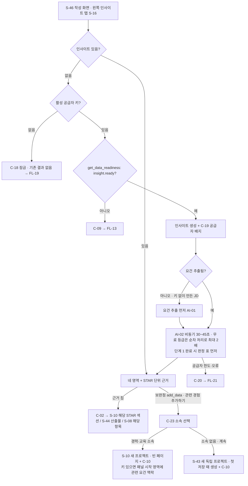

- 화면 단계 수 (v5.20, CF-7): **1화면 + 탭 전환 1회**(S-46 → 인사이트 탭) + 버튼 1회. v5.18까지의 S-31 → S-16 2화면은 ~~S-31~~ 폐기로 없어졌다. 탭을 옮겨도 자소서 탭의 저장하지 않은 본문은 잃지 않는다(CF-A12 `[가정]`). 인사이트 생성은 작성 화면의 "저장하기"와 별개다(AI 결과는 서버가 저장한다). 관련 기능: F-P2-04, 05, 09, F-AP-06.

### FL-03 자기소개서 채워 가기 (J-4, v5.18 전면 재작성 — CL-1·CL-2·CL-6·CL-7 · **v5.20 재작성 — CF-1·CF-5·CF-6·CF-7·CF-A11**)

**(v5.20, CF-1)** 경력기술서가 서비스에서 빠져 서류는 **자소서 하나**다. 서류 종류 분기(경력기술서 S-45 / 자소서 S-18 → S-46)가 없어지고, ~~S-31 허브~~ → ~~S-17 서류 목록~~을 거치던 진입도 없어졌다(CF-7). 목록 행이나 추가 모달에서 **S-46 작성 화면 하나**로 바로 들어가고, 그 화면이 **문항 설정 상태 → 작성 상태** 두 상태를 가진다(CF-A11 `[가정]`). 대화 흐름(질문 턴·초안 턴·[반영]·저장하기)은 v5.18 그대로다.

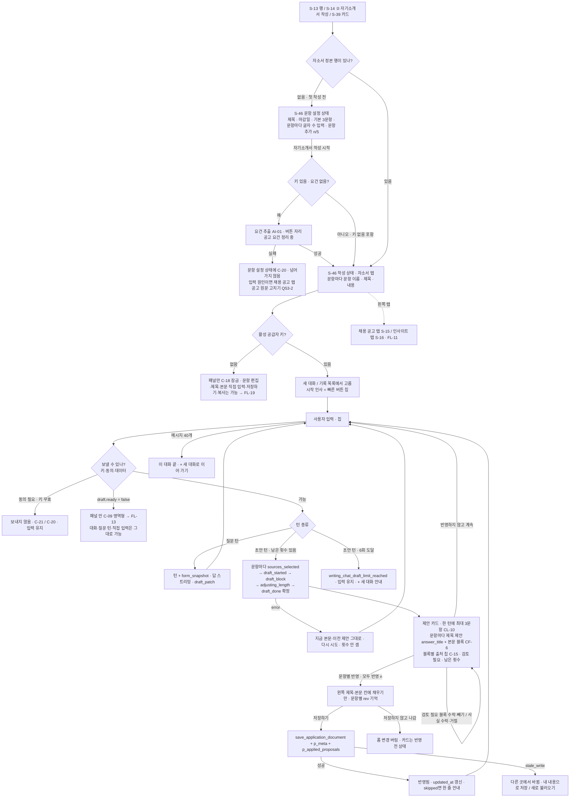

- **화면 단계 수 (v5.20, CF-7)**: 새 자기소개서 **모달 2단계 + 1화면**(S-13 → S-14 ①② → S-46 문항 설정 상태 → [자기소개서 작성 시작] → 같은 화면 작성 상태). **이미 만든 자기소개서**는 S-13 행 → S-46 작성 상태 **1화면**이다. v5.18의 4화면(S-31 → S-17 → S-18 → S-46)이 줄었다. 관련 기능: F-DOC-02~04, 08, 09, **11**. ~~F-DOC-01~~은 폐기(CF-1).
- **문항 설정 상태 → 작성 상태 (v5.20, CF-A11 `[가정]`)**: 같은 주소(`/applications/{id}/cover-letter`)의 두 상태다. 판정은 **자소서 정본 행(`application_documents`, `document_kind = 'cover_letter'`)이 있느냐**다 — 행이 없으면 문항 설정 상태, 있으면 작성 상태 `[가정]`(판정 원천 확인은 ux_requests DM-3). 문항 설정 상태의 "저장하기"·[자기소개서 작성 시작]이 첫 저장이고, 그 뒤로는 작성 상태로 열린다. 문항은 작성 상태에서도 고칠 수 있다(CL-8).
- **대화 단위 (v5.18, CL-1 · v5.20, CF-1)**: 한 자기소개서(지원 프로젝트)에 **자소서 대화**만 있다(경력기술서 대화는 없다). 문항 전체를 한 대화에서 순서대로 채우고, 한 자기소개서에 대화는 여러 개, 상한은 두지 않는다(CL-A1 `[가정]`).
- **정본은 대화 밖 (v5.18, CL-9)**: 본문·제목·문항의 정본은 **지원 프로젝트당 한 행**이고(v5.20, CF-A2 — `document_kind`는 `cover_letter` 하나), 대화의 `structured_draft`에는 **제안만** 담긴다. 그래서 ① 대화를 지워도 본문·문항은 남고 ② AI를 연결하지 않아도 문항·제목·본문을 고치고 저장·복사할 수 있고 ③ 새 대화를 열어도 AI가 **지금 본문을 "현재 값"으로 읽어** 이어 간다(CL-4).
- **키 필요 (v5.18, CL-2·CL-4·CL-6·CL-8)**: 키가 없으면 **오른쪽 AI 패널만** C-18이고(대화 없으면 영역형, 기존 대화가 있으면 인라인형), **문항 설정·문항 편집·제목·본문 직접 입력·저장하기·복사는 그대로 된다**(CL-8 확정). D-36은 그대로 성립한다.
- **요건 선행 추출 (A13 재해석, v5.18 — v5.20, CF-A11)**: **[자기소개서 작성 시작]을 누를 때** 요건이 없고 **키가 있으면** 요건 추출(AI-01, 별도 요청)을 먼저 끝내고 작성 상태로 넘어간다 — 버튼 자리에 "공고 요건 정리 중". 실패하면 **문항 설정 상태에 C-20**을 보이고 넘어가지 않으며, 입력 원인 실패(`not_a_jd`·`input_too_long`·`safety_blocked`)면 C-20 버튼이 "채용 공고" 탭의 공고 원문 수정으로 간다(Q53-2). **키가 없으면 추출을 부르지 않고 바로 작성 상태로 넘어간다**(CL-8을 깨지 않는다). 작성 상태에서 대화를 열 때 아직 요건이 없으면(문항 설정 뒤 키를 연결한 경우) 패널에 "공고 요건 정리 중"을 보이고 한 번 추출한다(시작 인사 ④). **턴 안에서는 추출하지 않는다**(A13 원칙 유지).
- **데이터 부족 게이트의 시점 (v5.18, Q-2 `[가정]`)**: 게이트(C-09)는 **첫 AI 턴을 보낼 때** 패널 안 영역형으로 뜬다 — 작성 화면 진입은 막지 않는다. 게이트 상태에서도 **질문 턴과 직접 입력은 계속 가능**하다. FL-13의 복귀 대상은 S-46 작성 상태(자소서 탭)다.
- **글자 수·제목 (v5.20, CF-5·CF-6)**: AI 초안은 **사용자가 문항 설정 상태에서 입력한 글자 수 제한**을 따른다(A12 범위 안내 그대로). 답변 **제목**(`answer_title`)은 글자 수에 넣지 않고, 초안 제안이 제목을 함께 낼 수 있으며 [반영]은 제목·본문을 함께 채운다(CF-A4 `[가정]`).
- **초안 턴 중단 (v5.18, CL-A4)**: "중단"하면 **임시 블록을 모두 버리고 지금 본문·이전 제안을 그대로 둔다.** 작업은 `canceled`이고 실패로 표시하지 않으며 C-20도 보이지 않는다(C-04 "사용자 중단의 결과").
- **초안 턴 실패 (v5.18, CL-3·CL-A4)**: 임시 블록을 버리고 **지금 본문과 이전 제안을 그대로** 두고, 카드 위 "초안을 만들지 못했어요. 지금 본문은 그대로예요 · 다시 시도"(C-20 원인 문구), **초안 횟수는 줄지 않는다**. 다시 시도는 버튼을 누른 시점의 활성 공급자로 돈다(C-20 "다시 시도의 공급자", A1).
- 동의 필요·키 무효는 **패널 전송 차단 규칙**(S-10·S-44 "전송이 막힐 때")으로 다룬다 — 보내기 전에 C-21 / C-20 `key_invalid`를 열고 아무것도 만들지 않으며 입력은 유지한다. ~~AI-11(근거 자동 선택)은 초안 턴 안의 한 단계로 남는다~~ **(v5.20, R-CF-7) AI-11은 폐기**(AI v4.15 — CF-1의 귀결 `[가정]`, AI-04는 AI-11을 부르지 않는다). 문항 근거는 AI-04 초안 턴 안에서 정해지고 `sources_selected`(근거 목록 카드)로 보인다.
- **모의 면접 (v5.20, CF-3)**: v5.18까지 허브(S-31)에서 면접 준비(S-20)로 가던 길은 v5.19(RM-1)에서 면접 화면과 함께 없어졌고, 허브도 폐기됐다. 작성 화면에는 면접 진입을 두지 않는다 — **모의 면접은 MVP에서 제외됨(RM-1)**.

### ~~FL-12~~ 모의 면접 (일괄) · ~~FL-17~~ 모의 면접 메뉴에서 새 면접 시작 (v5.19 폐기, RM-1)

- **(v5.19, RM-1)** 모의 면접이 MVP 범위에서 빠져 두 플로우를 지웠다(「보류」로 남기지 않는다). **ID 재사용 금지**. 걸려 있던 화면 S-20·S-22·S-33·S-37·C-16도 함께 지웠다(3장).

### FL-15 지원 현황 보드에서 단계 이동 (F-ST-01~03, 05)

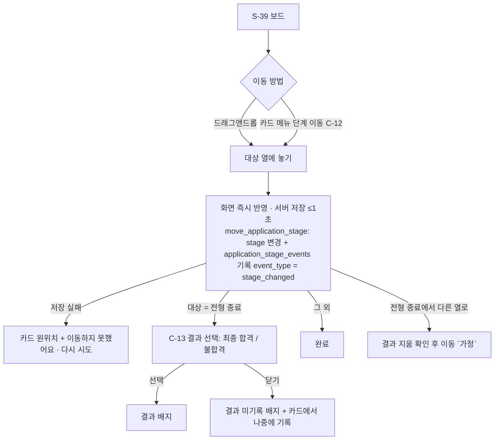

- 관련 기능: F-ST-01, 02, 03, 05. 어느 열로든, 어느 방향으로든 이동 가능(단계 건너뛰기·되돌리기 허용).
- **(v5.19, RM-2)** 열은 **4개**(지원 전 `before_apply` / 서류 전형 `document` / 과제 전형 `assignment` / 전형 종료 `closed`)이고, 단계 이동에 AI·팝업이 끼어드는 경로는 없다 — 면접 전형 열 2개와 그 이동 팝업(FL-16·C-14, PRD F-ST-04)을 지웠다. 이동 뒤 분기는 "전형 종료 → C-13"과 "전형 종료에서 나감 → 결과 지움 확인" 두 가지뿐이다.

### ~~FL-16~~ 인터뷰 전형 이동 → 면접 준비 · ~~FL-04~~ 면접 답변지 이어쓰기 (v5.19 폐기, RM-1·RM-2)

- **(v5.19, RM-1·RM-2)** 면접 전형 열 2개와 PRD F-ST-04(면접 전형 이동 팝업)가 삭제되어 두 플로우를 지웠다. **ID 재사용 금지**. 보드에서 단계를 옮겨도 AI·팝업이 끼어들지 않는다(FL-15).

### FL-13 데이터 부족 → Resumate AI(또는 직접 입력)로 채우기 → 복귀 (F-AP-06, U-5, v5.5 개정)

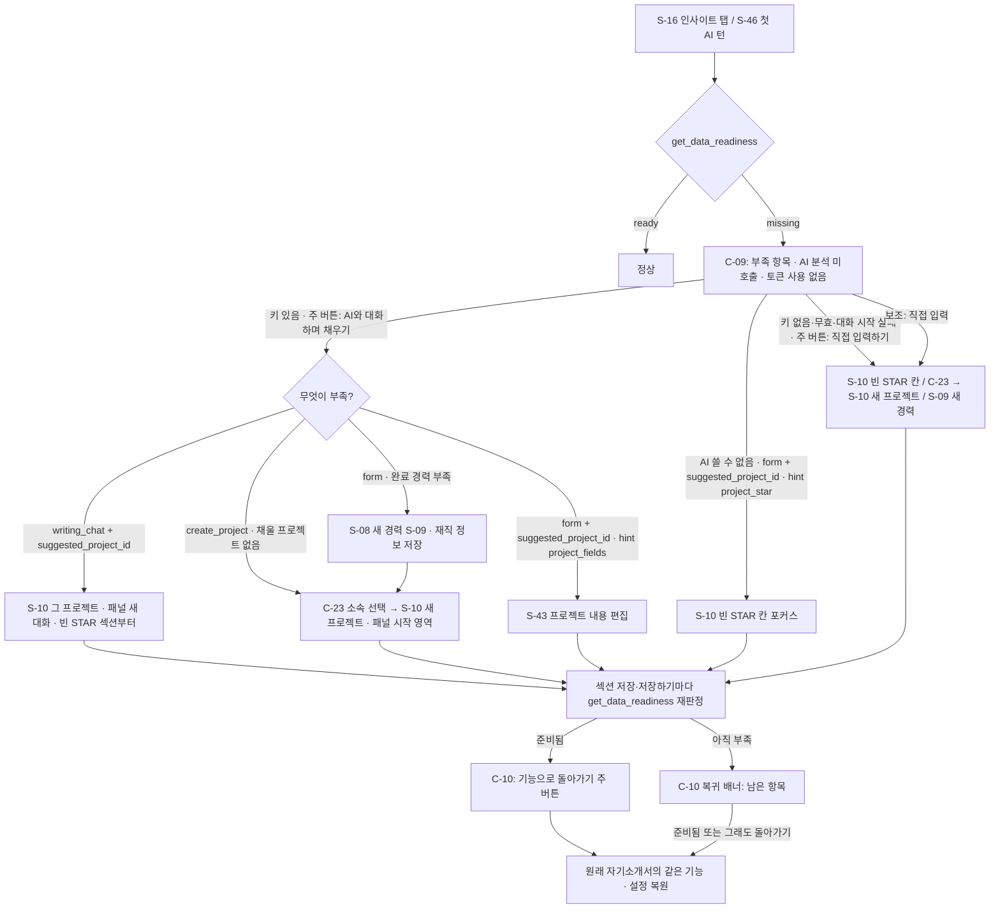

- 화면 단계 수: 기능 화면 → S-10 → 기능 화면(**3화면**). 새 프로젝트가 필요하면 C-23 소속 선택 다이얼로그 1회(v5.6), 완료된 경력이 없으면 S-08(S-09 새 경력) 1화면이 더 붙는다.
- **(v5.18, CL-6 · Q-2 `[가정]`) 서류의 게이트 시점이 바뀌었다**: 생성 버튼이 없어져 "생성을 누를 때"가 아니라 **작성 화면(S-46, v5.20 — ~~S-45~~ 폐기)에서 첫 AI 턴을 보낼 때** 게이트가 뜬다. 게이트는 **패널 안 영역형**이고 작성 화면 진입은 막지 않는다 — 키 없이도 본문·문항을 직접 써야 하기 때문이다(CL-4·CL-8). 게이트가 걸린 상태에서도 질문 턴과 직접 입력은 된다(초안 제안만 막힌다, PRD F-DOC-11 (6) `[가정]`). 복귀 대상은 S-46 작성 상태(인사이트에서 왔으면 인사이트 탭, v5.20 CF-A12)이고 복원할 "진행 중 설정"은 열려 있던 대화와 탭뿐이다(포함 항목·문체 설정이 없어졌다, CL-2).
- U-5: 그 자리에서 Resumate AI 패널로 부족한 커리어 데이터를 채우게 하고 원래 기능으로 돌려보낸다. 키가 없거나 대화 시작이 공급자 오류로 실패하면 주 버튼은 "직접 입력하기"(S-10 칸 직접 입력, v5.6)다(PRD F-AP-06, 3.3). **(v5.19, RM-A5 `[가정]`)** 면접 분기(직무 면접 판정·컬처핏 예외)는 지웠다 — 게이트 자체는 인사이트·서류용으로 남는다.
- **`form` + `suggested_project_id`의 이동 (A18 대상 변경, 2026-11-02, DM v4.4 6장)**: v5.3은 이름·역할이 빈 프로젝트를 S-10 폼으로 보냈다. v4.4에서 `projects.name`은 not null이고 역할은 소속 프로젝트에 없어(CR-10) 그런 행이 없다. 이제 화면은 `hints`로 나눈다: **`project_star`**(STAR 상황·행동이 빈 소속 프로젝트, v5.4 `complete_project_detail` 대체) → **S-10 빈 STAR 칸 포커스**(v5.6) / **`project_fields`**(프로젝트 내용이 빈 `draft` 독립 프로젝트) → **S-43 "프로젝트 내용" 섹션 편집**.
- 복귀 대상: 패널에서 새 대화를 시작하면 그 대화 행의 `writing_chats.return_target`에 저장되어 기기를 바꾸거나 나중에 다시 열어도 C-10 배너가 나온다. 돌아가면 지운다. 직접 입력(섹션 수정·칸 입력)으로만 간 경우는 브라우저 세션 저장. (v5.6) S-10 새 프로젝트 페이지로 간 경우 복귀 대상은 브라우저 세션에 두었다가, 첫 AI 메시지로 대화 행이 생기면 `writing_chats.return_target`으로 옮긴다 `[가정]`. URL에는 지원 프로젝트 ID와 기능 이름만.
- v5.3의 "저장하고 돌아가기"(일괄 저장 후 재판정)는 없어졌다. 섹션 저장·"저장하기"마다 재판정하고(v5.6: [반영]은 폼만 채우므로 재판정하지 않음), 준비되면 C-10 배너의 "{기능}으로 돌아가기"를 주 버튼으로 강조한다.

### FL-06 지원 프로젝트 삭제

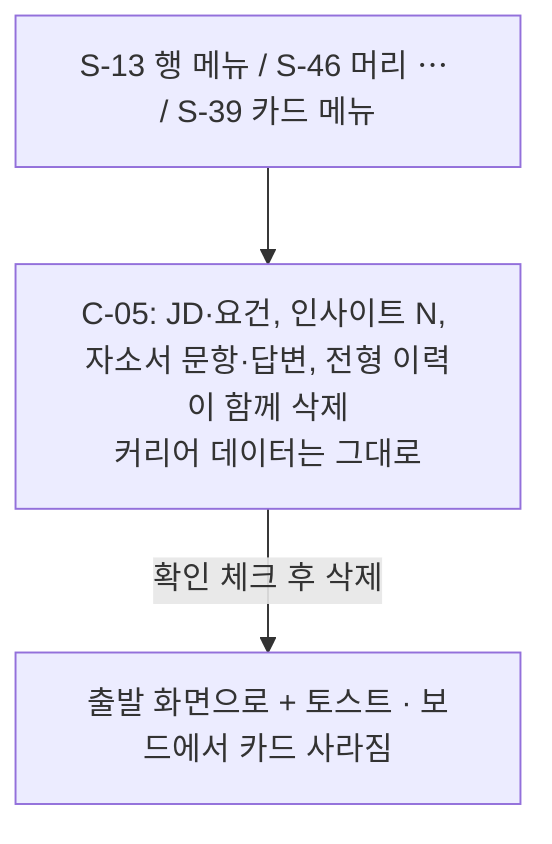

- 관련 기능: F-AP-05. 진행 중 AI 작업은 취소(`ai_jobs.cancel_requested_at`). **토큰 사용 기록은 삭제되지 않는다**(대상 참조만 비움, PRD F-AP-05 `[가정]`).
- **(v5.20, CF-7·CF-A9·CF-A14)** 진입은 S-13 행 메뉴 · **S-46 머리 ⋯ "자기소개서 삭제"** · S-39 카드 메뉴다(~~S-31 헤더~~ 폐기). 서류가 하나라 영향 줄에 서류 **수**를 보이지 않고 "자소서 문항·답변"으로 적는다(C-05). S-46에서 지웠으면 S-13(보드에서 왔으면 S-39)으로 간다.
- **삭제 영향 키 (v5.18, DM v4.13 확정)**: `get_deletion_impact('application_project', id)`의 서류 부분은 **`cascade.documents`**(= 내용이 있는 서류 수, `filled_slot_count > 0`)와 **`cascade.document_chats`**(함께 지워지는 서류 AI 대화 수)다 — 옛 `cascade.drafts`는 폐기됐다. 화면 문구에는 `documents`만 쓰고 대화 수는 보이지 않는다(C-05).
- **(v5.19, RM-1) 지원 프로젝트에 속한 데이터는 모두 함께 지운다** — 끝난 면접 기록을 남기던 v5.13 OD-I6은 폐기됐다(PRD F-AP-05). 어느 지원 프로젝트에도 속하지 않는 읽기 전용 기록은 남지 않는다. 탈퇴(FL-07)도 그대로 전부 지운다.

### FL-07 회원 탈퇴

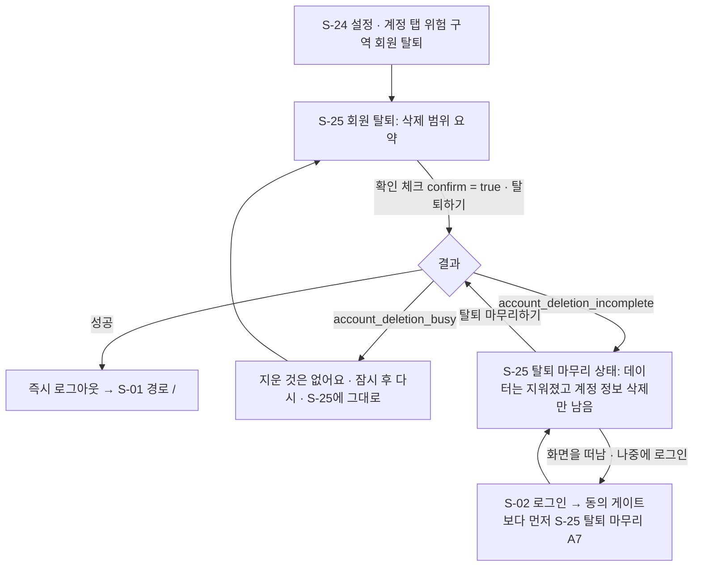

- 삭제 범위: 커리어 전체 + 자기소개서 전체 + AI 작성 대화 + 전형 이력 + **등록한 API 키 전부 + 토큰 사용 기록**, AI 연결 동의 이력은 D-DM-02 정책. 관련: F-COM-05, D-11, NFR-KEY-06.
- 확인 방식: 문구 입력 대신 **확인 체크**("모든 데이터가 즉시 삭제되고 되돌릴 수 없다는 것을 이해했어요")를 켜야 "탈퇴하기"가 활성된다. 요청은 체크 플래그 `confirm: true`로 보낸다(구현 반영).
- 탈퇴 후 이동: 공개 랜딩 S-01(`/`).
- **탈퇴 미완료 재진입 (A7, 확정 2026-11-05 (사용자))**: S-25는 **약관 동의 게이트 밖**에 둔다(동의 기록이 이미 지워진 상태에서도 열린다). 미완료 상태로 로그인하면 S-08·원래 URL·S-03보다 먼저 S-25 "탈퇴 마무리"로 보낸다. 이 상태에서는 다른 메뉴로 갈 수 없고, 할 수 있는 일은 "탈퇴 마무리하기"(같은 요청을 다시 보냄, 멱등)와 로그아웃뿐이다 `[가정]`.

### FL-08 AI 실행 공통 (키 확인 → 데이터 → 실행 → 실패)

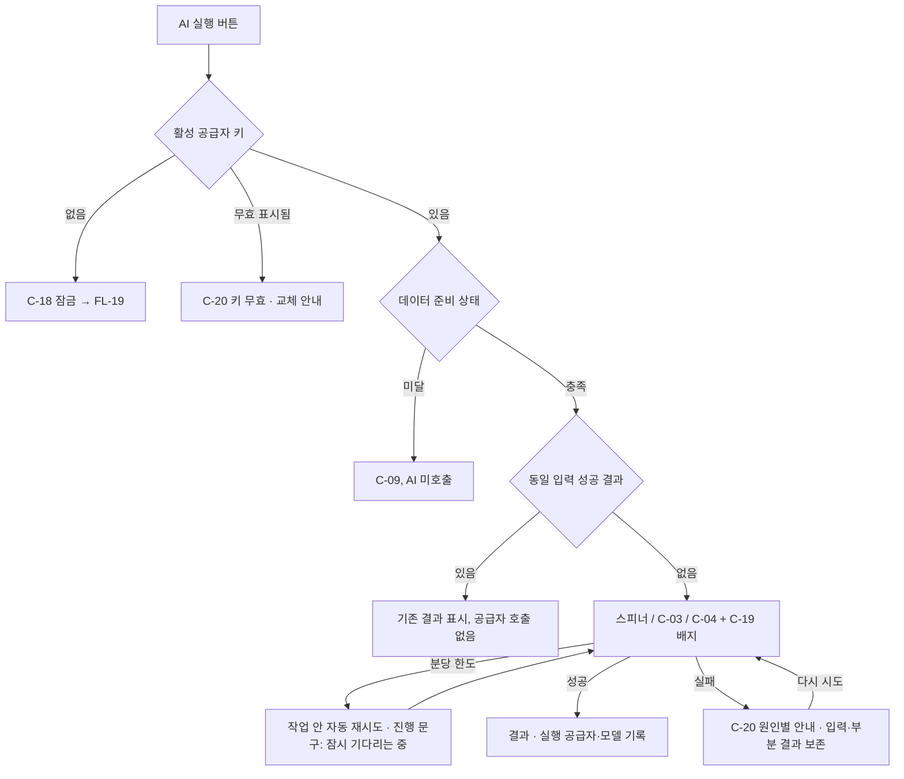

- 서비스 한도 확인 단계는 없다(D-34). 키 확인은 클라이언트 표시용이고, 서버가 실행 시점에 키를 복호화해 다시 확인한다(NFR-KEY-03).
- **(v5.18, CL-1·CL-A7) AI 작성 대화 3종은 이 흐름을 쓰지 않는다**: 프로젝트 상세(FL-14)·산출물 상세(FL-22)·**서류 작성(FL-03)**의 대화는 "실행 버튼 → 비동기 작업 1회"가 아니라 **턴 반복**이다. 세 대화의 공통 순서는 "키·동의 확인(보내기 전, C-18·C-21) → 데이터 확인(초안 턴만, C-09) → 턴 스트리밍 → 실패는 그 턴 자리에 C-20"이고, 턴은 요청 안에서 끝나는 경로라 대기 재시도를 하지 않는다(C-20 "요청 안에서 끝나는 경로의 대기", A14). 서류가 v5.17까지 이 흐름의 "서류 생성" 자리에 있던 것은 CL-6으로 없어졌다.

### FL-18 AI 연결 — 공급자 고지·동의 → 키 등록·검증 (F-AI-01, 04, 05)

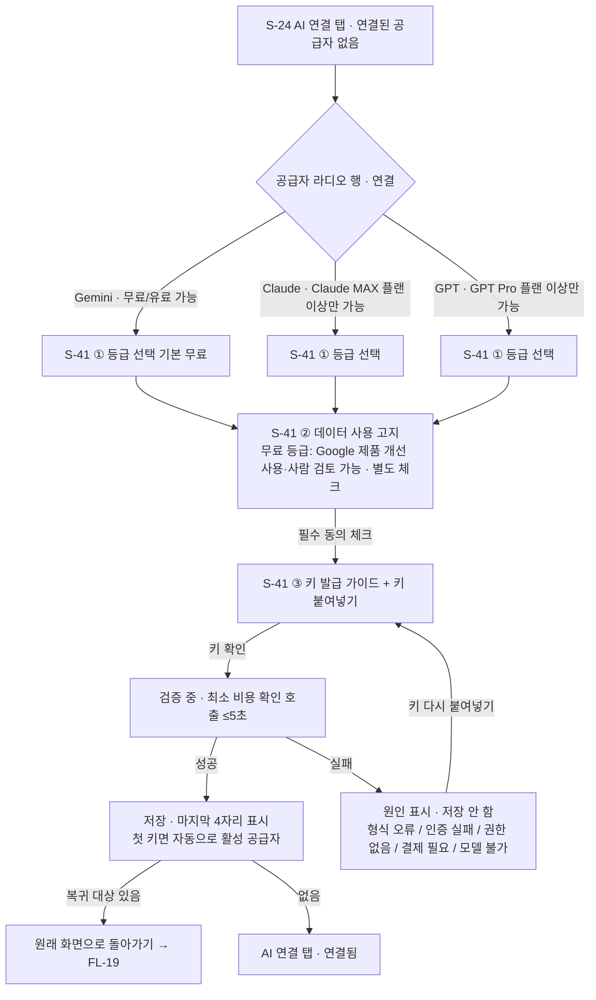

- 화면 단계 수: S-24 AI 연결 탭 → S-41(3단계) → AI 연결 탭 또는 원래 화면 (v5.17, SD-A1). 고지·동의 없이 키 입력 단계로 갈 수 없다(F-AI-04 (4)).
- 키 원문은 저장 후 다시 보이지 않는다(NFR-KEY-01, 05). 검증 호출의 토큰은 사용량 미터에 "연결 확인"으로 집계된다(NFR-KEY-04 `[가정]`).

### FL-19 AI 잠금 상태 → AI 연결 → 원래 화면 복귀 (F-AI-06)

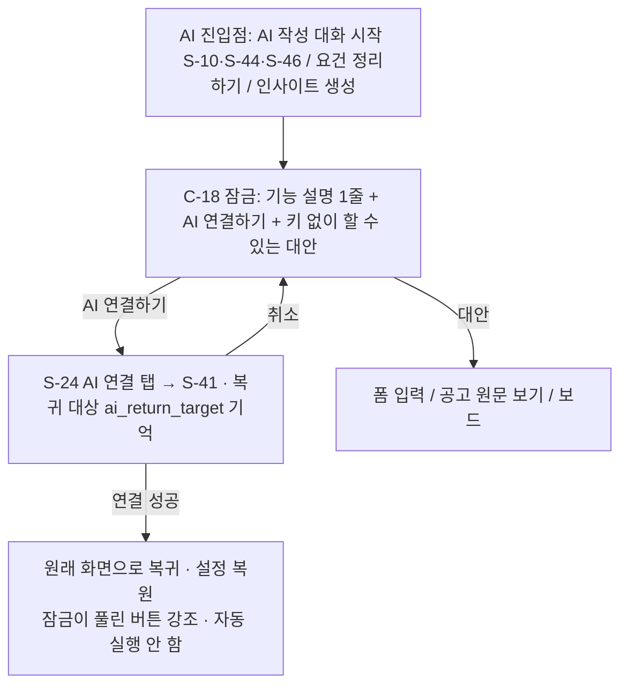

- 연결을 마쳐도 AI를 자동으로 실행하지 않는다(사용자가 누를 때만, NFR-AI-08). 복귀 화면에서 방금 풀린 버튼을 강조만 한다.
- 복귀 대상은 브라우저 세션 저장 `[가정]`(키 연결은 보통 같은 기기에서 끝난다). 데이터 부족 게이트의 `writing_chats.return_target`과는 별개다.
- **(v5.20, CF-1·CF-A13)** 복귀 대상 화면은 **S-46**(그 탭)이다. 기능 이름 "경력기술서"는 S-45 폐기로 쓰이지 않고(구현 고정 목록에서 빼는 것은 UI 후속), 자소서 대화의 기능 이름은 C-18 기능 이름 열을 따른다. S-14 ①의 [다음]에서 키 교체로 나갔다가 돌아오면 모달을 다시 열어 입력을 복원한다(FL-10).
- (v5.18, 이력) **(v5.18, CL-2·CL-5)** 복귀 문장의 기능 이름에서 **"AI 근거 선택"이 빠진다** — 그 이름은 S-17 "AI에게 맡기기" 버튼의 것이었고 그 버튼이 폐기됐다(AI-11은 초안 턴 안의 한 단계가 되어 사용자가 따로 실행하지 않는다). "경력기술서"·"자소서 문항 답변"은 그대로 쓰되 복귀 대상 화면이 S-45·S-46이다. 구현 고정 목록 `AI_FEATURE_NAMES`에서 "AI 근거 선택"을 빼는 것은 **UI 후속**이다(C-18 기능 이름 열).

### FL-20 키 교체·다시 확인·삭제·활성 공급자 변경 (F-AI-02, 03)

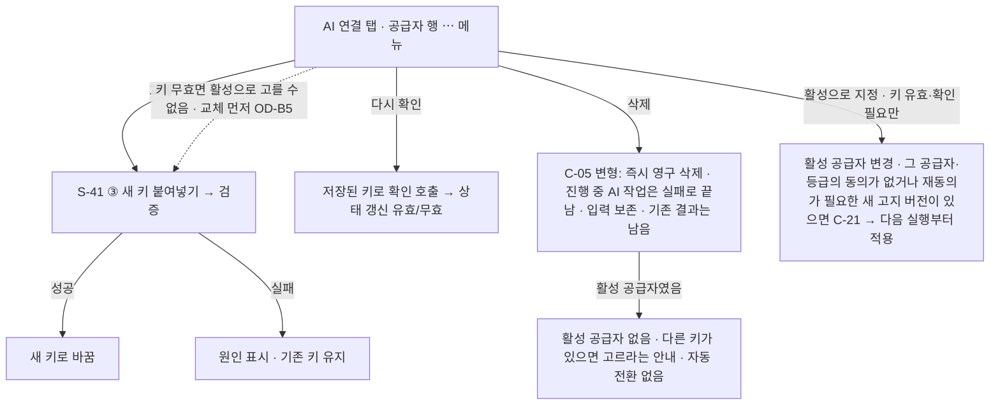

- 재동의 판정(A20, 확정 2026-11-05 (사용자)): 키 등록과 AI 실행 모두 같은 규칙이다. 동의한 뒤 시행된 고지 버전 중 `requires_reconsent = true`인 버전이 있을 때만 C-21을 다시 보인다. 문구만 고친 새 버전은 다시 묻지 않는다.
- 진행 중(running) 작업만 시작할 때의 공급자로 끝까지 간다. **다시 시도를 포함한 모든 재실행은 바꾼 활성 공급자로 돈다**: 실패한 비동기 작업 행의 "다시 시도"(인사이트), 요건 추출·자소서 초안 턴의 다시 시도((v5.20, R-CF-12) — ~~서류 3종~~), 인사이트 다시 생성 모두 같다((v5.19, RM-1) 면접 재실행 동작 삭제). 같은 작업 행 다시 시도에서 활성 공급자·등급이 작업에 기록된 것과 다르면 처음 단계부터 다시 한다. 활성 공급자 키가 없으면 "AI 연결 필요", 활성 공급자·등급의 동의가 필요하면 활성 공급자·등급으로 C-21을 연다(C-20 "다시 시도 거부" 행, DM 2.11.7 경로 ②)(A1, 확정 2026-11-05 (사용자, A1 변경)). 동의 필요는 `get_data_readiness().ai_connection.consent_required`로 실행 전에 알고, 요청 범위 작업(경로 ⑤)·AI 작성 대화 턴을 포함한 모든 실행 시작 전에 C-21을 먼저 연다. 서버가 동의 원인을 `key_missing`으로 돌려준 경우(경로 ③④⑤)도 readiness를 다시 읽어 `consent_required = true`면 C-21로 보낸다(C-18·C-20, R-67 사용자 확정 2026-11-06). 진행 중인 AI 작성 대화는 다음 메시지부터 새 공급자로 이어 간다(F-AI-03 (2) `[가정]`).

### FL-21 공급자 한도·오류 안내 → 복구 (F-AI-08)

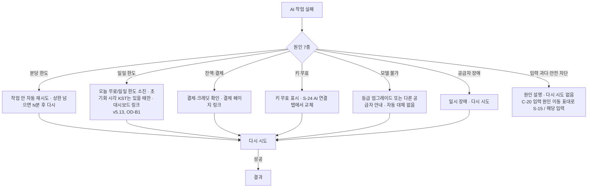

- 모든 경우 입력과 부분 결과는 보존된다. 자동 충전·결제 유도·서비스 내 결제는 없다(F-AI-08).

---

## 3. 화면 명세

### 3.0 공통 컴포넌트·상태

#### C-01 근거 칩 (Evidence Chip)

데이터: `evidence_links`(`owner_type`, `owner_id`, `item_key`, `sort_order`). **(v5.18, CL-3·CL-5·CL-9)** 서류 근거의 소유자는 폐기된 `draft_section`이 아니라 **서류 정본 행**이다 — `owner_type = 'application_document'`(DM v4.13 확정), `owner_id` = 그 행의 id. `item_key`는 **블록까지 내려가는 점 경로**이고 **첫 구간이 uuid가 아니라 슬롯 키**다(DM v4.13 확정, DM 3.8·2.8): **`{slot}.blocks.{block_id}`**(예 `s_3.blocks.b2`, `q_2.blocks.p1`), 슬롯(섹션·문항) 단위 근거는 **`{slot}.sources.{n}`**(예 `q_2.sources.1`). `slot`은 ~~`s_{n}`(경력기술서 섹션)~~ / `q_{n}`(자소서 문항)((v5.20, R-CF-12) — `s_{n}`은 새로 생기지 않는다)이고 정본이 `section_id`·`question_id`(uuid) 매핑을 함께 들고 있다 — 모델 입출력과 같은 키를 써야 하고 uuid는 턴당 입력 토큰이 크게 늘기 때문이다. ~~`section_id`·`question_id`는 이관에서 기존 `draft_sections.id`를 그대로 쓰고, 근거 행은 `owner_type`·`owner_id`·`item_key` 세 컬럼을 다시 가리킨다(CL-A5, DM 11.8 5단계).~~ **(v5.20, CF-M1)** 옛 초안이 0행이라 이관하지 않는다 — `question_id`는 새로 만든다. 가드가 멈춰 이관을 다시 계획하면 이 매핑이 출발점이다(CLA-Q3 (a), DM 2.7.4). **(v5.20, CF-1)** 경력기술서가 빠져 `s_{n}` 슬롯은 새로 생기지 않는다 — 서류 근거는 `q_{n}`뿐이다. 칩 구조(라벨·상태 3종)는 그대로 재사용한다. 그 밖은 점 경로(`requirement_matches.{id}`, `strengths.{n}`, `gaps.{n}`, `gaps.{n}.actions.{m}`, `strategy.positioning`, `strategy.project_priorities.{rank}`, `criteria.{key}`, `improvements.{n}`, `model_answer`, `overall_strengths.{n}`, `sources.{n}`).

| 요소 | 표시 데이터 | 동작 | 비고 |
|------|-------------|------|------|
| 칩 라벨 | 종류 + `source_label`. profile "기본 프로필"(**(v5.17, SD-6) 내 정보 값을 AI에 보내지 않으므로 새 결과에서는 이 근거가 생기지 않는다 — 과거 기록의 행·라벨은 그대로 남기고, 칩의 "원본으로 이동"만 비활성으로 보인다**(SD-A19, DM v4.12 2.8: 원본 **데이터**가 지워진 것이 아니라 **원본 화면**(S-04)이 없어진 것이라 "원본 삭제됨"으로도 보이지 않고 `source_deleted_at`을 채우지도 않는다). 새 행은 서버가 거부한다(`invalid_evidence_source`)), experience "경력", **education "교육"**(라벨의 교육 이름 = 교육 표시 이름, v5.10, ED-3), project "프로젝트", **STAR 필드 "프로젝트 · {필드}"**(`source_field` = situation 상황 / task 역할 / action 행동 / result 결과·성과 / learnings 배운 점, v5.5 CR-2), **산출물 "산출물 › {산출물 제목}"**(v5.5 CR-8, 누르면 S-44(v5.6 전체 페이지) 본문 입력 칸에서 `source_locator` 구간 강조. 근거 종류 `project_deliverable`, 별칭 `DLV-n`, 강조 구간 = 원문 마크다운 문자 범위 `{start, end}`, DM v4.4). 분류 3종(종류·경험 유형·역량)은 근거 칩으로 나오지 않는다, ~~achievement "정량 성과"~~(v5.5 폐기, CR-11), skill "스킬", jd_requirement "JD 요건", jd_sentence "공고 원문", user_note "내 메모"((v5.19, RM-1) ~~interview_answer "내 답변"~~ 근거 종류 삭제) | 클릭 → C-02 | v5.5: STAR가 프로젝트당 1개가 되어 `title` 칩 없음. STAR 근거는 `source_type = 'project'` + `source_field`(DM v4.4, `project_detail`·`achievement` 종류 삭제) |
| 회고 구분 | `source_field = learnings`인 칩은 "배운 점" 라벨만 쓴다(v5.5, CR-2)(별도 표식 없음). 사실 근거와 다른 종류라는 것은 라벨로 구분된다 | | NFR-AI-06, U-2, PRD v3.2 |
| 상태 | 정상 / **변경됨**(원본 기준 시각 > `source_snapshot_at`. 기준 시각: `project`는 `projects.content_updated_at`(분류·Link만 바꾸면 변경됨 아님), `project_deliverable`은 산출물 `updated_at`, 그 밖은 원본 `updated_at`. 판정은 서버 값을 따른다(DM v4.4 2.8), `jd_sentence`는 JD `created_at` 기준이라 항상 정상) / **원본 삭제됨**(`source_deleted_at`) | | |

#### C-02 근거 패널

| 요소 | 표시 데이터 | 동작 | 비고 |
|------|-------------|------|------|
| 근거 카드 | 라벨, `source_label`, `quote`(있을 때), 경로 "회사명/교육 표시 이름 › 프로젝트명 › 필드"(독립 프로젝트는 "프로젝트명 › 필드", 산출물은 "프로젝트명 › 산출물 제목") (v5.5. v5.10, ED-3: 교육 이름은 기관명이 아니라 교육 표시 이름) | | `quote` 없는 근거는 원본 현재 값(생성 당시 값 미보관, 원본 삭제 시 값 없음). (v5.10, ED-3) 저장된 `source_label`의 교육 이름도 교육 표시 이름이다 — 저장 시점에 이 규칙으로 만들고, 예전 라벨은 백엔드 마이그레이션이 바꿔 두었다(원본 교육이 없는 행은 예전 라벨 그대로). 화면은 `source_label`을 다시 만들지 않고 그대로 보인다 |
| 원본으로 이동 | (v5.5) STAR 필드 근거 → **S-10 해당 섹션에 포커스**, 프로젝트 근거 → 경력·교육 안이면 S-10 / 독립이면 S-08 `?item=project:` (S-43), 산출물 → **S-44**(v5.6 전체 페이지, 구간 강조), 경력 → S-08 `?item=experience:` (S-09), 교육 → S-08 `?item=education:` (S-34), **(v5.18, CL-5·CL-7)** 반대 방향(근거 → 그 근거를 쓴 서류)으로 가는 길은 ~~S-19~~ 대신 **S-46**이다(v5.20 — ~~S-45~~ 폐기)(C-08 "커리어에 추가하기"의 반대 방향도 같다). 서류 근거에서 커리어 원본으로 가는 이동 규칙은 그대로다, **기본 프로필 → "원본으로 이동" 없음(비활성)**(v5.17 리뷰 라운드 1, SD-A19 — S-04가 없어졌고 계정 탭 "내 정보"에는 그 근거가 가리켰던 값(희망 직무·총 경력 연차·관심 산업 배열)이 더 이상 없어 "같은 내용"을 열 수 없다). 카드는 라벨·`source_label`·`quote`·경로를 그대로 보이고 이동 버튼 자리에 한 줄 **"이 근거의 원본 화면은 더 이상 없어요"**를 둔다 `[가정]`. 칩도 누를 수는 있지만(C-02는 열린다) 계정 탭으로 보내지 않는다. 커리어로 가는 이동은 C-10 함께 | | 정량 성과 → S-11 이동은 폐기(CR-11) |
| 변경됨 / 원본 삭제됨 | **구현 기준(문구·구성)**(v5.13, OD-D3. v5.12까지 "v3와 같음"). 동작 규칙: 변경됨 = 카드에 "변경됨" 표식 + "이 결과를 만든 뒤 원본이 수정됐어요." 한 줄, 인용문·경로·원본으로 이동은 그대로 / 원본 삭제됨 = "원본 삭제됨 — 이 근거의 원본과 인용문은 삭제되었습니다", **인용문·경로·이동 없음**. 칩 라벨 뒤에도 " · 변경됨" / " · 원본 삭제됨"을 붙인다(스크린 리더도 같음) | | D-AI-04 (b) |
| 고지 | "입력된 데이터 기준 판단입니다" | | |

#### C-03 AI 작업 상태 (비동기)

| 요소 | 표시 데이터 | 비고 |
|------|-------------|------|
| 진행 | `ai_jobs.job_type`, `ai_jobs.progress.stage` → 문구, `progress.done` / `total` | 10초 안에 첫 진행 |
| 단계 문구 | **`prepare`** — 인사이트: **공고 요건 정리 중**(요건이 이미 있으면 짧게 지나감) / `match` 요건 대조 중 / `synthesize` 강점·지원 방향 정리 중 / **`synthesize_regen` 강점·지원 방향 정리 중**(`synthesize`와 같은 문구, 숫자 확인 뒤 다시 정리할 때만 나타남) / `validate` 근거 확인 중 / **`rank` 어떤 경력·프로젝트를 쓸지 고르는 중**(v5.18 문구 변경, CL-5 — AI-11. v5.17까지 "쓸 경력·프로젝트 고르는 중". **(v5.20, CF-1) 서류에서 `rank` 쓰임은 S-45 폐기로 없어졌다** — 자소서는 이 단계가 초안 턴 안의 `sources_selected` 이벤트로 문항마다 온다) / ~~`adjust_length` 글자 수 맞추는 중~~ — **(v5.18, CL-6) 서류의 글자 수 보정은 초안 턴 안의 `adjusting_length` 이벤트**가 됐다(C-04). 같은 문구("글자 수 맞추는 중")를 패널 안에서 쓴다 / ~~`generate`·`evaluate`·`summarize`·`score`~~ **(v5.19, RM-1) 폐기** — 남은 쓰임이 면접 질문 생성·채점뿐이었다(`generate`의 서류 쓰임은 v5.18, CL-6에서 폐기) / **(v5.6, AI-13 초안 턴) `compose` 초안 작성 중 · `validate` 초안 확인 중**((v5.13, OD-P7) `compose` = "초안 작성 중"을 이 표의 정식 단계 문구로 둔다 — 구현 상수 `DRAFT_STAGE_COPY` 그대로, SSE `draft_started`도 같은 문구) — S-44 본문 초안 제안 카드 자리에 보인다(질문 턴 `extract`·`reply`는 문구 없음, 스트리밍으로 대신) / **`complete` 별도 문구 없음** — 직전 단계 문구를 그대로 둔다. 마지막 단계·AI 호출 없음, 곧 완료 화면으로 바뀜 | 데이터 모델 v3.x 확정 키 + v5.3 추가 3개(AI 명세 v4.3 C-6). (R-51) `prepare`(인사이트)·`synthesize_regen`·`complete`는 AI C-6 문구에 맞췄다. (v5.19, RM-1) 채점의 `prepare` 문구는 채점과 함께 지웠다 |
| 진행 표시 우선순위 | **(v5.18, CL-6·CL-A6) 서류는 이 규칙에서 빠진다** — `drafts.status`가 폐기되어 "생성 중 / 있음 / 없음" 3값을 판정할 근거가 없다. **(v5.20, CF-9·CF-A14)** S-13에는 기능 진행 표시가 없고, S-39 카드는 "자소서 작성 중 / 작성됨"만 보인다(S-39). 진행 중인 턴은 S-46 패널 안에서만 보인다. 아래는 인사이트에 적용된다((v5.19, RM-1)). 카드·탭(S-39·S-16 인사이트 탭)의 기능 상태는 ① 작업이 대기·실행 중이면 이전 결과가 있어도 "생성 중" ② 아니면 최신 결과가 있으면 "있음" ③ 없으면 "없음". 결과가 "생성 중"인데 그 작업이 이미 끝났거나 없으면 **실패로 보인다**(작업 실패면 그 원인, 작업이 없거나 끝났는데 결과가 없으면 `stalled` "시간이 오래 걸려 중단됐어요", 사용자가 취소했으면 표시 없음). 실패 안내는 지금 보이는 결과보다 늦게 끝난 실패만 보인다. 공고 원문 수정(`raw_text_edited_at`) 전에 끝난 실패도 보이지 않는다 | 구현 반영 `[가정]` |
| 부분 결과 | 인사이트 단계 1 판정 표 | (v5.19, RM-1) 채점 답변 카드 삭제 |
| 이탈 허용·완료 알림 | 인앱 토스트 + 메뉴 배지. (v5.13, OD-D1 K-8) 작업별 문구: 인사이트 **"{자기소개서 이름} 인사이트가 준비됐어요 [보기]"**(v5.20 — 이름 규칙 CF-A7, 겹침 규칙 U36-7. [보기] → S-46 인사이트 탭) / 그 밖 "AI 작업이 끝났어요 [보기]". [보기]는 그 결과 화면(S-16 → S-46 인사이트 탭). (v5.19, RM-1) 면접 질문·채점 완료 알림 삭제 | 이메일·푸시 없음 `[가정]` |
| **토스트 목록** (v5.13, OD-C3·OD-P2) | 위 완료 알림 외에 이 문서가 정한 토스트: **첫 저장(행 생성)** — S-10 새 프로젝트 "프로젝트를 커리어에 추가했어요", S-44 새 산출물 "산출물을 추가했어요"(첫 저장 한 번만, 그 뒤 저장은 C-06 "저장됨 HH:MM"만) / **커리어 항목 모달** — "경력을 추가했어요"·"교육을 추가했어요"·"프로젝트를 추가했어요", 수정 "저장했어요"(S-08) / **AI 채우기** — S-10 "{섹션}에 채웠어요"(여러 칸이면 섹션 이름을 쉼표로 이어 "상황, 행동에 채웠어요" — 구현 그대로), S-44 "본문에 채웠어요" — **되돌리기 버튼 없음**(OD-P2) / 삭제 — (v5.15, U38-1) 자기소개서 "'{이름}' 자기소개서를 삭제했어요"(S-13·S-46·S-39 같은 문구 — v5.20, ~~S-31~~ 폐기. 이름에 이미 "자기소개서"가 있으면 뒤의 "자기소개서"를 붙이지 않고 "'{이름}'을(를) 삭제했어요" — U36-7 겹침 규칙) | 토스트는 정보 알림이고 되돌리기·실행 버튼은 완료 알림의 [보기]뿐이다 |
| 공급자 배지 | 진행 표시 옆에 C-19("Gemini · 무료 등급") | F-AI-09 |
| 무료 등급 순차 모드 (D-37) | 활성 공급자가 무료 등급이면: 단계 문구에 처리 단위를 더한다(예: "요건 대조 중 (2/6) — 무료 등급이라 하나씩 처리해요"), 예상 시간 안내를 유료 기준의 **2배**로(예: 인사이트 "1분 30초 정도 걸려요"), 분당 한도로 자동 재시도 중이면 "공급자 요청 한도로 잠시 기다리는 중 (n초)"(n = `ai_jobs.progress.waiting_retry_until` − 지금) — 실패로 표시하지 않음 | 재시도는 AI 명세 v4.3 C-11.3 규칙(아래 C-20 "자동 재시도 규칙"). 상한을 넘으면 C-20. 남은 한도 표시가 아니다(R-44) |

#### C-04 스트리밍 출력

**AI 작성 대화 3종(S-10·S-44·**S-46** Resumate AI 패널, v5.6 · v5.18 CL-1 · v5.20 CF-1) 응답(첫 글자 3초, 완료 10초)**, **산출물 초안(S-44 초안 턴, 블록 단위 — 첫 블록 8초, 완료 60초, v5.6 R-PA-4)**, **서류 초안(S-46 초안 턴, 블록 단위 — 첫 블록 5초, 완료 60초, v5.18, CL-10 · PRD 6.4)**. ~~경력기술서(블록)~~·~~자소서 문항 답변(문항, 근거 선택 먼저)~~는 v5.18에서 **서류 작성 대화의 초안 턴으로 흡수**됐다(CL-6) — 일괄 생성 경로가 없다. 중단은 `ai_jobs.cancel_requested_at`. 이탈 시 서버가 끝까지 생성·저장 `[가정]`.

- **서류 초안 턴 이벤트 순서 (v5.18, CL-6·CL-10 — AI 명세 v4.13 확정값, AI 회신 1)**: ~~AI-04의 `block_started`/`block_delta`/`block_completed`/`validated`/`done`~~은 서류에서 폐기하고 **AI-13형 이름으로 통일**했다. **질문 턴(두 서류 공통)**: `turn_started` -> `reply_delta` -> `reply_done` -> `draft_patch`(검증 통과 사실·근거 지정) -> `draft_flags`(`needs_review`·`actor_ambiguous`·`number_vague`·`sensitive`) -> `turn_done`(`draft_count`). **~~초안 턴 — 경력기술서(AI-03)~~ (v5.20, CF-1 폐기 — 아래 순서는 기록으로만 남긴다)**: `turn_started` -> `draft_patch`(사실 갱신이 있을 때만) -> `draft_started` -> `draft_block`(블록 완료마다) -> `draft_done`(섹션별 결과: 제거 수·`needs_review` 블록·`rev`·`draft_count`·`section_order_proposal`) -> `reply_done`(고정 문구) -> `turn_done`. **초안 턴 — 자소서(AI-04)**: `turn_started` -> `draft_patch` -> **문항마다** [`sources_selected`(그 문항의 근거 카드: 경력명 › 프로젝트명 + 이유 한 줄) -> `draft_started` -> `draft_block`] -> (보정이 필요한 문항이 있으면) **`adjusting_length`**(보정 전 글자 수·제한·기준·이유) -> `draft_done`(문항별 최종: 글자 수·제한·`char_adjust_needed`·`needs_review` 블록·제거 수·`rev`·`draft_count`) -> `reply_done` -> `turn_done`. **`draft_done`은 보정이 끝난 뒤 1번만** 오고(옛 `validated`의 규칙 그대로) 그 뒤에 오류가 오지 않는다 — 화면은 `draft_done`에서 블록을 **통째로 교체**하고 **모델이 준 `block_id`를 믿지 않는다**(블록 id는 서버가 정한다. 자소서 문단 id는 `{question_slot}.{n}`). **(v5.20, CF-6·CF-A4)** 자소서 **`draft_done`만** 문항별 **제목 제안 `answer_title`**(≤ 100자 또는 null)을 실어 온다 — `draft_block`에는 없다(AI·DM v4.15 확정, (v5.20, R-CF-2)). ~~**경력기술서의 AI-11은 초안 턴 안의 이벤트가 아니다** — 첫 초안 턴 **직전 1회** 도는 동기 단계(2~5초)이고, 패널이 진행 문구 `rank`를 보인 뒤 **제안 카드 앞의 근거 목록 카드**를 보여 준다(C-03 `rank`, S-45 "응답 방식").~~(v5.20 폐기, R-CF-19)
- **산출물 초안 이벤트 순서 (AI-13, v5.6)**: `turn_started` → `facts_patch` → `draft_started`("초안 작성 중") → `draft_block`(블록마다, 임시 표시) → `draft_done`(확정 — 임시 블록을 통째로 교체, 검토 표시·`missing_slots`·`replace_allowed`·`rev`) → `reply_done`(고정 문구) → `turn_done`. `error`면 임시 블록을 버리고 이전 초안 유지(S-44).
- **블록 확정 시점 (v5.18, CL-A4)**: 스트리밍 중 블록은 **임시 표시**다(블록 id가 아직 확정되지 않음). **`draft_done`**(v5.17까지 `validated`)이 오면 화면은 그 슬롯(경력기술서 = 섹션 / 자소서 = 문항)의 블록을 **통째로 교체**한다. 근거 칩·자리 표시·검증 배지·"확인해 주세요" 안내는 `draft_done` 뒤에 붙는다. 그 전에는 **제안 카드 안에서** 수락·빼기·반영을 막고 "마무리 중"으로 보인다 — v5.17과 달리 **왼쪽 본문 편집·복사는 막지 않는다**(제안은 아직 본문이 아니기 때문, CL-9). ~~경력기술서도 같은 방식이다.~~((v5.20, R-CF-12) 경력기술서 폐기)
- **사용자 중단의 결과 (v5.13, OD-P10, 확정 2026-11-05 (사용자) — 구현 그대로)**: **AI 작성 대화 턴(S-10·S-44)** = 부분 응답을 버린다. 실패로 표시하지 않고 C-20을 보이지 않는다. (v5.13, R-OD-8 — 구현 그대로) AI 응답 자리(메시지 행)는 `failed`로 닫히고 그 작업(`ai_jobs`)은 `canceled`다. 화면은 **작업 상태로 중단과 실패를 가른다**(`canceled` = 중단 → "답을 받지 못한 메시지", `failed` = 실패한 턴 C-20). 응답 자리는 **시작할 때 메시지 수(상한 40)에 1개로 세고 중단해도 빼지 않는다**. 중단 뒤 "다시 보내기"는 같은 자리를 다시 쓰므로 더 세지 않는다. 사용자 메시지는 기록에 남는다(다시 열면 S-10 "답을 받지 못한 메시지", OD-P11) / **자소서 문항 답변 생성** = 그 문항의 이전 결과를 그대로 둔다(`ai_content`는 완료 때만 덮어씀) / **(v5.18, CL-A4) 서류 초안 턴(S-46)** = 산출물 초안 턴과 같다 — 임시 블록을 버리고 **지금 본문과 이전 제안을 그대로** 두며, 실패로 표시하지 않고 C-20도 보이지 않는다(작업 `canceled`). 초안 횟수는 줄지 않는다. ~~자소서 문항 답변 생성~~·~~경력기술서(Q53-7)~~의 옛 규칙은 이 규칙이 대신한다.
- ~~**경력기술서 중단 (Q53-7)**~~ **폐기 (v5.18, CL-2·CL-A6)**: 포함 항목·문체 설정 화면과 `drafts.status = 'composing'`이 없어져 "생성 전 상태로 돌아가 설정을 복원한다"가 성립하지 않는다. 위 "사용자 중단의 결과"의 **서류 초안 턴** 규칙이 대신한다 — 임시 블록을 버리고 저장된 본문 그대로, 실패 표시 없음. `draft_done`이 먼저 도착하면 완료로 본다 `[가정]`.

#### C-05 삭제 확인 다이얼로그

| 대상 | 표시 데이터 | 선택지 | 처리 |
|------|-------------|--------|------|
| 커리어 항목(경력·교육·프로젝트·산출물) (v5.5) | `get_deletion_impact(entity_type, entity_id, affiliation_mode)` (`entity_type`: experience / education / project / **project_deliverable** / writing_chat. v5.5에서 project_detail·achievement 삭제, skill은 S-12 보류로 화면 진입점 없음): `cascade`(projects, project_skills, writing_chats, **project_deliverables** 개수), `affected_results.by_application_project[]`(자기소개서별 insights·**서류**(v5.18, CL-3 — ~~drafts·draft_sections~~ 폐기. **(v5.18a, R-CLA-4)** DM v4.13 4.2 확정 키 2개 — **`documents`** = 삭제 대상을 근거로 단 블록이 있는 서류 수, **`document_sections`** = 그 서류 안의 해당 슬롯(섹션·문항) 수. 기준은 둘 다 `evidence_links`이고 섹션 머리글만 걸린 경우는 세지 않는다(DM 쪽 `[가정]`). **화면 문구는 서류 수만 쓴다** — 자기소개서별 영향 줄에 ~~"서류 {N}"~~ **(v5.20, R-CF-12 · CF-A14) "자소서"**(`documents`가 0~1이라 수를 보이지 않고, 1이면 그 자기소개서 줄에 "자소서"를 붙인다 `[가정]`. 이하 v5.18 기록: N = `documents`, 지원 프로젝트 삭제 영향 줄과 같은 꼴)을 보이고 슬롯 수는 보이지 않는다. `delete_results`가 지우는 범위가 섹션(문항) 단위임은 아래 범위 설명 행이 한 문장으로 알리므로, 숫자를 하나 더 두면 "서류 N개 · 섹션 M개"가 지원 프로젝트 삭제의 서류 수와 헷갈린다. `document_sections`는 응답에 있어도 화면에 쓰지 않는다) 수)((v5.19, RM-1) 면접 세션 수·`detached_interview_sessions` 삭제) | ① 결과 처리 `result_mode`: **"결과는 남기고 근거만 '원본 삭제됨'으로"**(`keep_results`, 기본값) / **"관련 결과도 함께 삭제"**(`delete_results`). ② 경력·교육 삭제 시 소속 프로젝트 `affiliation_mode`: **`delete_projects`만**(기본값도 같음, 데이터 모델 v4.4가 `keep_projects`를 `affiliation_mode_not_supported`로 거부). 다이얼로그에 "이 {경력/교육}의 프로젝트 N개와 그 STAR·AI 대화 N개가 함께 삭제돼요"를 보인다(확정 2026-11-02 (사용자, CR-15), D-UX-22). (v5.10, ED-2) 다이얼로그·⋯ 메뉴에서 항목을 이름으로 부를 때 교육은 교육 표시 이름(S-34 규칙), 경력은 `company_name`(비면 "이름 없는 경력") | RPC `delete_career_item(entity_type, entity_id, affiliation_mode, result_mode)` |
| `delete_results` 범위 설명 | "인사이트는 해당 버전, **자기소개서는 해당 문항의 답변 본문만**(문항·글자 수 제한·메모·제목은 남음 `[가정]`) 삭제돼요" (v5.18, CL-3·CL-9 · (v5.19, RM-1) 모의 면접 범위 삭제 · v5.20, CF-1: 경력기술서 구절 삭제, CF-A13 용어) | | 데이터 모델 4.2 결과 단위. **(v5.18)** 서류는 "문서 전체"가 아니라 **섹션(문항) 단위**가 됐다 — 서류 정본이 지원 프로젝트당 한 행이어서 문서 전체를 지우면 다른 근거로 쓴 섹션까지 사라진다. 문항·글자 수 제한·메모가 남는다는 약속은 그대로다(정본 쪽에 있으므로, CL-8·CL-9). **(v5.18a, R-CLA-4)** 범위는 DM v4.13 4.2(결과 영향 키 `documents`·`document_sections`)와 11.8 (2) 6단계 `delete_career_item`의 `delete_results` 범위 재작성으로 확정됐다 |
| 공통 안내 | "어느 쪽이든 인용문은 지워져요. 결과를 남기면 AI가 쓴 본문에는 내용이 남을 수 있어요" | | |
| ~~상세 내용 삭제~~ | v5.5 폐기(상세 내용·정량 성과 없음, CR-2·CR-11) | | |
| 프로젝트 삭제 | 경력·교육 안: "STAR 내용과 이 프로젝트의 AI 대화 {N}개가 함께 삭제돼요" / 독립: "산출물 {N}개와 산출물의 AI 대화 {M}개가 함께 삭제돼요"(v5.6 PA-1) (`cascade.writing_chats`, `cascade.project_deliverables`). S-10에서 저장하지 않은 변경이 있으면 "저장하지 않은 수정도 함께 사라져요" 한 줄 | | D-27 (a). `writing_chats.project_id` 연쇄. 독립 프로젝트의 `cascade.writing_chats` = 산출물 대화 수(독립 프로젝트의 대화는 모두 산출물 대화, DM v4.5 확정) |
| AI 대화만 삭제 (`entity_type = 'writing_chat'`, S-10·S-44·**S-46** 패널 ⋯ 메뉴) | "대화 메시지 {message_count}개가 삭제돼요. 이미 반영해 저장한 내용은 그대로예요"(S-10: STAR, S-44: 본문, **S-46: 문항·제목·답변**(v5.20)). **(v5.18, CL-9) 서류에서도 이 문장이 사실이다** — 서류 본문·문항의 정본은 대화 밖 한 행이고 대화의 `structured_draft`에는 제안만 있으므로, 대화를 지워도 저장된 본문·문항·섹션 근거는 그대로 남는다. 지워지는 것은 그 대화의 메시지와 **아직 반영하지 않은 제안**뿐이다. 폼에 채우고 아직 저장하지 않은 내용은 화면에 남고, 저장은 성공하지만 그 반영 기록은 남지 않는다(저장 응답 `skipped` `not_found`, DM v4.5) | `result_mode` 없음 | v5.5: 저장 전 정리 결과·출처 대화 연결 문구 삭제. v5.6: S-44 추가(PA-1) |
| 산출물 삭제 (S-44 머리 ⋯ 메뉴) | "'{산출물 제목}'을 삭제할까요?" + (대화가 있으면) "이 산출물의 AI 대화 {N}개도 함께 삭제돼요" + 결과 처리 선택지(위 ①, 산출물이 근거로 쓰인 결과가 있을 때만) | | v5.5 신설, CR-8. v5.6: 대화 연쇄(PA-1, `get_deletion_impact('project_deliverable', …).cascade.writing_chats`, DM v4.5 확정). 새 산출물(행 없음)에는 삭제 메뉴 없음 |
| 자기소개서(지원 프로젝트) (S-13 행 메뉴 · **S-46 머리 ⋯**(v5.20, CF-A9) · S-39 카드 메뉴) | (v5.13, OD-D1 K-2) 제목 **"자기소개서 삭제"**, 첫 줄 **"'{이름}' 자기소개서를 삭제할까요?"**(v5.20 — 이름 규칙 "{기업 명} 자기소개서"(CF-A7)이므로 U36-7 겹침 규칙대로 **"'{이름}'을(를) 삭제할까요?"**로 읽힌다) + 영향 줄 (v5.19, RM-1 · **v5.20, CF-A14 `[가정]`**) **"JD·요건, 인사이트 {N}, 자소서 문항·답변, 전형 이력이 함께 삭제돼요. 커리어 데이터는 그대로예요"**(면접 구절은 v5.19, RM-1로 지웠다) + S-46에서 저장하지 않은 변경이 있으면 "저장하지 않은 수정도 함께 사라져요" 한 줄 `[가정]`. (v5.20, CF-A14) **"서류 {N}"은 쓰지 않는다** — 서류가 하나라 수가 뜻이 없다. 이하 v5.18 기록: (v5.18, CL-A6: "서류 초안 {N}" → **"서류 {N}"**. {N} = **내용이 있는 서류 수**(0~2) — `composing` 개념이 폐기되어 '작성 중'을 빼는 규칙이 없어졌고, 서류 정본 행이 있어도 섹션·문항이 모두 비어 있으면 세지 않는다. 그 서류의 **AI 대화도 함께 지워진다**(연쇄, CL-A1. 반환 키 `cascade.document_chats`) — 수를 따로 보이지는 않는다 `[가정]`) + 확인 체크 **"삭제한 내용은 되돌릴 수 없다는 것을 확인했어요"**(켜야 "삭제" 활성) | 취소 / 삭제 | F-AP-05. {N}은 `get_deletion_impact('application_project', id)`가 실제로 지울 행 수(인사이트·**서류** = `cascade.insights`·**`cascade.documents`**(v5.18, CL-A6 — ~~`cascade.drafts`~~ 폐기. 셈법은 S-13 "기능 진행" 행과 같은 `filled_slot_count > 0`). 함께 지워지는 서류 대화 수는 **`cascade.document_chats`**로 온다(DM v4.13 확정, DM 2.7.2) — 화면에 수를 보이지는 않는다 `[가정]`). **(v5.19, RM-1)** 면접 {N}·끝난 모의 면접 {M} 줄과 그 셈법(OD-I6, `kept.interview_sessions`)은 지웠다. 진행 중 AI 작업은 취소한다. 삭제 성공 토스트·이동은 FL-06 |
| ~~**서류**~~ (v5.18, CL-3·CL-9·CL-A1) — **v5.20 폐기**(CF-1·CF-7·CF-A9 `[가정]`): 진입점(S-17 행 ⋯·S-45·S-46 머리 ⋯)이 모두 없어졌다. 서류가 자기소개서와 1:1이라 지우기는 위 "자기소개서" 행 하나다. `get_deletion_impact('application_document', …)`는 화면에서 부르지 않는다(DM 쪽 정리는 ux_requests DM-6). 아래는 v5.18 기록 | 삭제 단위가 `drafts` 행에서 **서류 1건**(= 서류 정본 행 + 그 서류의 AI 작성 대화 전부)으로 바뀐다. 제목 "{경력기술서 / 자소서 문항 답변} 삭제", 첫 줄 **"{경력기술서 / 자소서 문항 답변}을(를) 삭제할까요?"**(초안 이름이 없어졌다 — 화면 제목이 서류 종류로 고정되므로 `drafts.title`을 쓰지 않는다, CL-3), 영향 줄: 자소서 문항 답변 **"문항 {N}개와 그 답변·메모·사용한 경력·프로젝트가 함께 삭제돼요"** / 경력기술서 **"작성한 섹션 {N}개와 직접 고친 내용이 함께 삭제돼요"**, + (대화가 있으면) **"이 서류의 AI 대화 {M}개도 함께 삭제돼요"**(산출물 삭제 행과 같은 모양). 영향은 **`get_deletion_impact('application_document', id)` → `{cascade: {writing_chats: M}, slots: N}`**(DM v4.13 확정 — `entity_type`에 `application_document`가 생겼다, DM 2.7.3). 서류를 지우면 S-17 행은 남고(서류 2종 고정 2행) "아직 없어요" 상태로 돌아간다. ~~실패한 경력기술서 행의 "삭제"~~ 진입점은 사라진다(CL-3: 실패한 초안 행이 없다) | 취소 / 삭제 | 확인 체크 없음. 토스트 없음(목록에서 상태가 바뀜). 영향 수 {N} = `slots`, {M} = `cascade.writing_chats`(DM v4.13 확정) |
| 경력·교육 삭제의 연쇄 줄 | (v5.13, OD-D1 K-3) 소속 프로젝트가 있을 때만 "이 {경력 / 교육}의 프로젝트 {N}개와 그 STAR·AI 대화 {M}개가 함께 삭제돼요"(대화가 없으면 "…프로젝트 {N}개와 그 STAR가 함께 삭제돼요") | | 위 커리어 항목 행 ②의 문구를 그대로 쓴다(CR-15) |
| 공통 | 영향 수를 읽는 동안 줄 자리 표시, 읽기 실패 "삭제할 항목을 불러오지 못했어요. 이미 삭제됐을 수 있어요. 새로고침 후 다시 확인해 주세요", 삭제 실패 한 줄(다이얼로그 유지) | | 구현 문구 그대로(OD-D1) |
| **API 키 삭제** (S-40) | "{공급자} 키를 삭제할까요? 즉시 영구 삭제되고 되돌릴 수 없어요. 진행 중인 AI 작업 {N}건은 실패로 끝나고 입력(답변·대화·문항)은 그대로 남아요. 지금까지 만든 AI 결과는 그대로 볼 수 있어요" + 활성 공급자였다면 "삭제하면 AI 기능이 잠겨요. 다른 키가 있으면 활성 공급자를 직접 골라 주세요" + "공급자 사이트에서도 키를 폐기하려면 → 대시보드 링크" | 취소 / 삭제 | D-36, NFR-KEY-06·09. 자동 전환 없음(F-AI-02 (3) `[가정]`) |
| **API 키 교체** (S-41 ③) | "새 키로 확인되면 바꿔요. 확인에 실패하면 기존 키를 그대로 써요. 진행 중 작업은 기존 키로 끝나요" | 확인 | F-AI-02 (1) |

#### C-06 저장 상태 · C-07 입력 가이드

- C-06: "저장 중… / 저장됨 HH:MM / 저장 실패 — 다시 시도". ~~(v5.5) 커리어 섹션 저장(C-24) 뒤에 잠깐 보인다~~ (v5.13, OD-C2) 커리어 항목 모달은 C-06 대신 토스트("…추가했어요"·"저장했어요", S-08). (v5.6) S-10·S-44는 L-02 상단 바 "저장하기" 옆에 보인다. v5.4의 "작성 중 — 필수 항목을 채우면 AI 분석에 반영돼요" 표시는 CR-11(작성 중 배지 삭제)에 따라 뺀다 `[가정]`(CR-21: 대신 S-43에 빈 칸일 때만 보이는 도움말 한 줄. S-10의 도움말은 v5.12, UP-7로 없어졌다).
- C-07 가이드:

| 가이드 | 위치 | 내용 |
|--------|------|------|
| G-1 본인 행동 | ~~S-10 행동(Action) 칸~~ **(v5.12, UP-7) S-10에서 삭제** — 지금 이 가이드를 보이는 화면은 없다(정의만 남긴다) | "'우리 팀은'보다 '저는'으로 써 주세요. 팀이 한 일·배경은 상황에 써 주세요" |
| G-2 민감정보·기밀 | 모든 자유 서술 필드(근무 내용·교육 내용·프로젝트 내용·STAR·산출물). ~~S-10·S-44 AI 패널 입력창~~ (v5.12, UP-2) 패널 입력창 아래 G-2 줄은 없다 — S-44 머리 안내 1줄과 다른 화면의 G-2는 그대로 | "건강·종교·노조 활동 같은 민감정보, 동료·고객의 개인정보, 회사 기밀은 쓰지 마세요" |
| ~~G-3 정량 성과 권유~~ | — | v5.5 폐기(CR-11). 숫자는 결과/성과 안내 문구("숫자가 있으면 함께 써 주세요")로 대신 |
| G-4 STAR 권유 | ~~S-10 역할·결과/성과·배운 점이 비었을 때~~ **(v5.12, UP-7) S-10에서 삭제** — 지금 이 가이드를 보이는 화면은 없다(칸 자리 표시 문구는 S-10 STAR 표 그대로) | 필드별 한 줄 예시 |

- 글자 수 표시 (v5.12, UP-10): S-10 STAR 칸은 **칸 제목(라벨) 줄 오른쪽**, 2,000자 하드 상한과 오류 상태는 S-10 STAR "본문 형식". S-44 본문은 글자 수를 보이지 않는다(20,000자는 저장 검증만).

#### C-08 자리 표시·검증 배지

**구현 기준(문구·구성)**(v5.13, OD-D3. v5.12까지 "v3와 같음", 구현 `placeholders.tsx`). 동작 규칙: 자리 표시(사용자 데이터에 없어 비워 둔 칸)는 본문 안에 표시하고 툴팁으로 무엇을 채울지 알린다. 블록 배지는 "근거 확인 필요"·"수치 확인 필요"(검증 결과), 사용자가 고친 블록은 "편집됨 — 근거 재확인 권장". 자리 표시가 남은 채 복사하면 경고한다. "커리어에 추가하기"는 STAR가 근거인 블록이면 S-10 해당 섹션으로, 산출물이 근거면 S-44로 이동(v5.5).

- **(v5.18, CL-3 — AI 회신 13) 서류의 "편집됨 — 근거 재확인 권장" 판정이 바뀐다**: `ai_content`/`edited_content` 2단 보관이 없어졌으므로, **저장 시점의 블록 텍스트가 `applied_rev` 제안의 텍스트와 다르면** 편집된 것으로 본다 `[가정 — 판정 위치는 DM v4.13]`. 배지 문구는 그대로 쓴다.
- **(v5.18, CL-5·CL-A4) 그대로 재사용한다** — 배지가 붙는 자리만 ~~S-19 초안 편집기~~에서 **S-46 자소서 탭 본문**으로 바뀐다(v5.20 — ~~S-45~~ 폐기). **제안 카드 안의 "검토 필요"(C-15 상태 ②·S-44 카드 구성의 "검토 필요 블록")와 반영된 본문의 검증 배지는 다른 것이다**: 카드의 검토 표시는 *반영 전* 수락·빼기를 묻는 것이고, C-08 배지는 *반영해 본문에 들어간* 블록의 근거·수치 상태를 알린다. 두 표시가 같은 블록에 차례로 붙을 수 있다.

#### C-09 데이터 부족 게이트 (F-AP-06)

데이터: RPC `get_data_readiness()` → `counts`, `draft_item_ids`, `features.{insight | draft}.ready / missing`. **(v5.19, RM-1·RM-A5 `[가정]`)** `job_interview`·`culture_fit_interview` 분기와 그 분기에만 있던 데이터 충분성 등급(`data_sufficiency`)을 지웠다 — 게이트 자체(D-01 판정·복귀 흐름)는 인사이트·서류가 쓰므로 그대로다. (v5.5) 이동 대상은 S-10 프로젝트 상세(STAR·Resumate AI 패널)·C-23 프로젝트 추가·S-09 새 경력으로 바뀌었다. (v5.6, PA-3) C-23은 소속 선택이고, 경력·교육을 고르면 행 없이 S-10 새 프로젝트 페이지로 간다(행은 첫 저장·첫 AI 메시지 때). `hints`(`project_star`·`project_fields`)·`counts.projects_without_complete_star`·`next_action = 'create_project'`는 데이터 모델 v4.4 6장.

| 요소 | 표시 데이터 | 동작 | 비고 |
|------|-------------|------|------|
| 제목 | 기본: "{기능}을 만들려면 커리어가 조금 더 필요해요. AI와 대화하며 바로 채워 볼까요?" / **`project_fields`**(`next_action = 'form'` + `suggested_project_id`, 프로젝트 내용이 빈 독립 프로젝트): **"한 칸만 채우면 바로 쓸 수 있어요"** | | U-5. `project_fields` 제목은 확정 2026-10-30 (사용자, Q53-8)의 1칸 문구를 따른다 |
| 부족 항목 (`missing`) | `complete_experience` "완료된 경력 1건이 필요해요(교육만으로는 부족해요)", `complete_project` "완료된 프로젝트 1건이 필요해요" + 현재 개수(`counts.complete_experiences`, `counts.complete_projects`) | — | 교육 아래 프로젝트, 완료된 독립 프로젝트도 셈(DM v4.4 D-01) |
| 보조 안내 (`hints`) | `project_star`(v5.5, v5.4 `complete_project_detail` 대체: STAR가 덜 찬 소속 프로젝트) → "프로젝트는 있지만 STAR의 상황·행동이 비어 있어요" + `counts.projects_without_complete_star` / **`project_fields`** → "'{프로젝트명}'의 프로젝트 내용이 비어 있어요"(DM v4.4: `description`이 빈 `draft` 독립 프로젝트) | — | `hints`는 문구 분기용, 판정은 `missing`만. A18 대상 변경(2026-11-02) |
| **`form` + `suggested_project_id`** (키 없음·무효 등 AI를 못 쓸 때, DM 6장 판정 ②·③) | 서버가 `next_action = 'form'` + `suggested_project_id` + `hints`를 준다. 화면은 **`hints`로 이동 대상을 나눈다** | 주 버튼 **"'{프로젝트명}' 마저 채우기"** + 복귀 대상 기억(브라우저 세션), 저장마다 재판정 → C-10: **`project_star`** → **S-10 그 프로젝트, 빈 STAR 칸(상황 → 행동 순)에 포커스**(v5.6) / **`project_fields`** → **S-08 `?item=project:{id}`(S-43), "프로젝트 내용" 섹션 편집 열림** | A18 대상 변경(2026-11-02). 대화로 보내지 않는다. 독립 프로젝트를 S-10으로 보내지 않는다 |
| **주 버튼** (`features.{기능}.next_action`) | `next_action = 'writing_chat'` → **"AI와 대화하며 채우기"**: `suggested_project_id`가 있으면 → **S-10 그 프로젝트 + 패널 새 대화**(빈 STAR 섹션부터 묻도록 `requested_slot`), 없으면(`next_action = 'create_project'`) → **C-23 소속 선택**(완료 경력이 있으면 그 경력 미리 선택) → 경력·교육이면 **S-10 새 프로젝트**(빈 페이지, 패널 시작 영역 — 첫 메시지 때 프로젝트·대화 행 생성, v5.6 PA-3) / 독립이면 이름 입력 → S-43. 인사이트 보완점에서 왔으면 관련 요건을 대화 시작 맥락으로 표시 / `next_action = 'form'`: `suggested_project_id`가 있으면 "'{프로젝트명}' 마저 채우기"(위 행, `hints`로 S-10 / S-43), 없고 `missing`에 `complete_experience`가 있으면 **"경력 먼저 입력하기"**(S-08 + S-09 새 경력), 그 밖(키 없음·무효)은 "직접 입력하기"(아래 키 행) | 새 대화 행의 `writing_chats.return_target`에 복귀 대상 저장(돌아가면 지움). 새 프로젝트 페이지는 대화 행이 생길 때 브라우저 세션에서 옮긴다(v5.6) | **U-5 유지**. 대화 버튼 옆 C-19 배지 |
| 경력이 없을 때 | `next_action = 'form'`: 대화는 경력을 만들지 않으므로(F-P1-16 Could) S-09 새 경력(재직 정보 필수 3개)을 먼저 열고, 저장 후 다시 판정해 `writing_chat`이면 C-23 소속 선택(방금 만든 경력 미리 선택) → S-10 새 프로젝트(v5.6) | S-09 → C-23 → S-10 → 복귀 | |
| **키가 없거나 무효이거나 대화 시작이 실패할 때** | `active_provider = null` 또는 `key_status = 'invalid'`이면 서버가 `next_action = 'form'`. 대화 첫 턴이 공급자 오류로 실패해도 주 버튼을 **"직접 입력하기"**로 바꾼다: `draft_item_ids`의 프로젝트가 있으면 S-10(빈 STAR 칸 포커스), 없으면 C-23 소속 선택 → S-10 새 프로젝트(v5.6). 복귀 대상은 브라우저 세션. C-20 원인 한 줄 + "키를 확인하면 AI와 대화로 채울 수 있어요 [AI 연결 확인]" — **이 원인 줄은 키 무효·대화 시작 실패일 때만** 보인다. 키가 없을 때(`active_provider = null`)는 원인이 아니라 미연결이라 보이지 않는다(v5.13, OD-B6, 구현 그대로). 이미 이 프로젝트에 대화가 있으면 "이어서 대화하기"는 그대로(새 메시지 전송 시 C-20) | | PRD F-AP-06, 3.3 |
| 키가 없을 때 | 키가 없으면 AI 기능 버튼 자체가 C-18 잠금이라 보통 이 게이트에 오지 않는다. 데이터 부족만 알려야 하는 경우에는 주 버튼을 "직접 입력하기"로 한다 | | PRD 3.3 |
| 보조 링크: 직접 입력 | 작성 중 항목(`draft_item_ids`)이 있으면 그 항목(경력·교육 → S-08 해당 항목, 경력·교육 안 프로젝트 → S-10, 독립 프로젝트 → S-08 S-43), 없으면 C-22 | 복귀 대상 기억 | |
| **서류의 게이트 시점·형태** (v5.18, CL-6 · Q-2 `[가정]`) | `features.draft` 판정 자체는 그대로다(DM v4.13 확정 — 응답 모양(`ready`·`missing`·`hints`·`next_action`·`suggested_project_id`)이 바뀌지 않고 뜻만 "기능 진입 차단"에서 **"초안 제안 차단"**으로 정의됐다, DM 6장). 바뀌는 것은 **뜨는 자리**뿐이다: 생성 버튼이 없어졌으므로 S-46(v5.20)의 **첫 AI 턴을 보낼 때** 패널 안에 **영역형**으로 띄운다(S-10·S-44와 같이 진입은 자유). 게이트가 걸려도 **질문 턴·본문 직접 입력·문항 편집·저장·복사는 그대로** 되고 **초안 제안만** 막힌다(PRD F-DOC-11 (6) `[가정]`) — 안내 문구도 "AI 기능을 쓸 수 없어요"가 아니라 "초안을 제안하려면 커리어가 조금 더 필요해요"로 읽히게 쓴다 `[가정]`. (SD-6 확인) 이 컴포넌트에 `profile_filled`·`hints: "profile"`은 v5.17에서 이미 없어졌고 이번 사이클에서 되살리지 않는다 | 패널 안 영역형 | PRD F-AP-06 (1) 서류 예외 |
| 안내 | "AI 분석은 실행하지 않았어요(토큰을 쓰지 않았어요). 커리어를 채우면 이 화면으로 다시 돌아와요" + (v5.5) "덜 채운 항목은 AI 분석에 쓰이지 않아요" | | CR-11로 목록의 "작성 중" 배지가 없어져, 미완료가 근거에서 빠진다는 안내를 여기서 한다 `[가정]` |

#### C-10 복귀 배너

커리어 안 모든 화면(S-08과 그 패널 S-09·S-34·S-43, S-10, S-44) 상단. (v5.17, SD-A2) S-04 폐기로 목록에서 빠졌고, 설정 다이얼로그는 복귀 배너 대상이 아니다. "{자기소개서 이름} · {기능}으로 돌아가기"(v5.20, CF-A7) + 준비 상태(섹션 저장·"저장하기"마다 `get_data_readiness()` 재판정. v5.6: [반영]은 폼만 채우므로 재판정하지 않음). 준비되면 "{기능}으로 돌아가기"를 주 버튼으로 강조한다(v5.3 S-36 "저장하고 돌아가기" 대체). 돌아가면 원래 화면의 진행 중 설정(자소서 문항 등)을 복원한다(U-5, (v5.19, RM-1) 면접 유형·질문 수 삭제). **(v5.18, CL-2)** ~~경력기술서 포함 항목~~은 설정 화면이 폐기되어 복원할 것이 없다 — 자기소개서(S-46, v5.20)로 돌아갈 때 복원하는 것은 **열려 있던 대화와 탭**(자소서 / 인사이트)뿐이다 `[가정]`. S-10·S-44에서는 L-02 이동 줄 아래, AI 패널을 포함한 페이지 전체 폭에 둔다(v5.6). "돌아가기"를 누를 때 저장하지 않은 변경이 있으면 L-02 이탈 확인을 먼저 보인다.

#### C-11 사용한 경력·프로젝트 (F-DOC-08 / F-DOC-01, v5.18 재작성 — CL-2·CL-3·CL-5·CL-6)

**(v5.18)** "사용한 경력·프로젝트"를 **보여 주는 것은 그대로**다(CL-5, F-DOC-08 **Must 유지** — PRD v4.15 UX PP-1 회신: 요구사항은 "근거를 확인·변경하고 그 섹션만 다시 받는다"이고 수단이 트리인지 대화인지는 요구사항이 아니다). 바뀐 것은 ① **고르는 수단이 체크 트리에서 대화 지시로** 바뀐 것(CL-6)과 ② **저장 위치가 `draft_section_sources`에서 `evidence_links`의 슬롯별 행으로** 옮겨진 것(CL-3·CL-9, DM v4.13 확정 — 정본 행에 근거 배열을 두지 않는다)이다. 보이는 자리는 **S-46의 문항 아래**이고(v5.20 — ~~S-45~~ 섹션 아래는 폐기), S-17·S-31에서 여는 출처 트리는 없어졌다(두 화면도 v5.20 폐기).

| 요소 | 표시 데이터 | 동작 | 비고 |
|------|-------------|------|------|
| 섹션(문항)별 근거 목록 | **근거는 정본에 복제하지 않는다**(DM v4.13 확정, DM-6) — 그 슬롯의 **`evidence_links` 행**(`item_key` = `{slot}.sources.{n}` / `{slot}.blocks.{block_id}`)을 읽어 커리어 출처만 묶어 보인다. 행에서 쓰는 값: `source_type`·`source_id`(experience / education / project → "회사명 또는 교육 표시 이름 › 프로젝트명", v5.10 ED-3), `source_label`(원본이 지워져도 남는 라벨), `source_deleted_at`, `sort_order`. 선택 주체(`origin`)·선택 이유(`rationale`)는 **제안 쪽에만** 있다(`structured_draft.document.source_ranking`) — 정본 목록에는 보이지 않는다. ~~`role`~~·~~`reuse_reason`~~·~~`requirement_ids`~~는 **폐기**(DM 2.7.4) — 관련 요건은 그 블록의 `jd_requirement` 근거 칩으로 보인다. 산출물은 근거 선택 단위가 아니며 고른 독립 프로젝트의 산출물이 함께 쓰인다(현행 유지) | **읽기 전용 목록**(기본 접힘, 섹션·문항마다). 항목을 누르면 C-02 근거 패널 → 원본으로 이동 | ~~`draft_section_sources`~~ 테이블 폐기(CL-3) — 근거는 `evidence_links` 한 곳에 있다 |
| **근거 바꾸기** (v5.18, Q-3 `[가정]`) | ~~완료 상태 경력·교육·프로젝트 체크 트리~~ **폐기**(CL-2·CL-6). 대신 **대화로 지시**한다 — "이 섹션은 B 프로젝트로 써 줘", "A 경력은 빼 줘". 패널 빠른 버튼 칩에 **"쓸 경력·프로젝트 바꿔 줘"**를 둔다 `[가정]`(칩 표의 원천은 AI 명세) | 지시 → 다음 **초안 턴이 그 슬롯만** 다시 제안(진행 표시 `sources_selected`) → [반영] → "저장하기"로 확정 | 서류 전체를 다시 만들지 않는다(F-DOC-08). ~~`source_selection_mode`~~·~~`sources_modified_at`~~ 폐기 |
| ~~다시 생성~~ | **폐기**(v5.18, CL-6) — "다시 생성하면 공급자 토큰을 다시 써요" + 편집본 덮어씀 확인은 **대화의 초안 턴**이 대신한다. 토큰 안내는 C-20 공통 규칙("다시 {동작}하면 공급자 토큰을 다시 써요")에 남는다 | | ~~`generation_no`~~ 폐기(이전 생성본 미보관은 그대로, D-DM-06) |
| ~~모두 제외~~ | **폐기**(v5.18, CL-6) — 근거 없이 쓰라는 지시는 대화로 한다. "근거 없이 메모·공고 내용만으로 작성돼요"라는 경고는 근거 0개 블록의 **검토 필요** 표시(C-15 상태 ②)가 대신한다 | | |
| ~~경력기술서 포함 항목~~ | **폐기**(v5.18, CL-2) — `drafts.options.included_experience_ids`·`included_education_ids`·`included_project_ids`·`project_order`·`selection_origin`, 프로젝트 **최대 8개** 상한, 프로젝트당 불릿 4개, 출처 표시(insight / ai_ranking / user)가 모두 없어진다. **섹션 배열 자체가 "포함된 것"의 정본**이고 순서는 사용자가 S-45에서 바꾼다(CL-A2) | | AI-11은 폐기되지 않고 **초안 턴 안의 근거 선택 단계**로 남는다(CL-5) |
| ~~AI 기본 선택 실패 (A23)~~ | **폐기**(v5.18, CL-2) — "체크 없는 트리 + 직접 골라 주세요" 안내와 "AI에게 다시 맡기기" 버튼의 자리(설정 화면)가 없어졌다. AI-11이 초안 턴 안에서 실패하면 **그 초안 턴의 실패**로 다뤄진다(C-04 "초안 실패", 지금 본문 유지 + 다시 시도, 횟수 안 셈) | | 자리 이동이 아니라 폐기다 |
| ~~자동 실행이 없는 진입 (Q53-4)~~ | **폐기**(v5.18, CL-2) — 설정 화면이 없어 "진입 자동 AI-11"이라는 개념이 사라졌다. 동의 필요·키 무효는 **패널 전송 차단 규칙**(S-10·S-44 "전송이 막힐 때")으로 흡수한다 | | |
| 자소서 근거 개수 | **(v5.18a, R-CLA-5 ⓑ)** ~~문항당 직접 지정 최대 5개~~와 그 상한을 알리는 AI 답변 문장은 **지웠다** — DM v4.13 4.5가 "사용자 근거 선택 ≤ 5개"를 폐기했고(선택 화면 없음, CL-2), 체크 화면이 없어져 넘기는 지시를 셀 UI도 없다. 남는 상한은 DM 4.5의 **블록당 근거 ≤ 20개** `[가정]`(서버 값 검사)뿐이고, 화면은 이 상한을 따로 안내하지 않는다 | | ~~상한 값 자체는 유지~~ → 폐기(v5.18a, R-CLA-5) |
| **"데이터 변경됨" 표시** (F-P2-07·CL-5) | 근거로 쓴 커리어 항목이 바뀌면 근거 칩이 "변경됨"(C-01)이 되고, 섹션·문항 머리에 한 줄 "근거가 바뀌었어요. 이 {섹션 / 문항}을 다시 제안받아 보세요" `[가정]` | 안내를 누르면 그 슬롯을 다시 제안받는 메시지를 보낸다 `[가정]` | ~~"근거를 바꿨으니 다시 생성하세요" 배너~~는 `sources_modified_at` 폐기로 근거 데이터가 없어졌다 — **대체하지 않고**(DM Q-DM-5 권고에 동의) C-01 "변경됨"으로 알린다 `[가정]`. data-architect가 `sources_changed_at`을 두지 않아도 된다(ux_requests 4) |

#### C-12 단계 이동 메뉴 (신설, F-ST-02 (3))

보드 카드 메뉴(⋯)에서만 연다(v5.20, CF-3 — ~~S-31 헤더 전형 단계 칩~~·~~S-13 행 메뉴~~ 폐기. 전형 단계 변경은 S-39에서만).

| 요소 | 표시 데이터 | 동작 | 비고 |
|------|-------------|------|------|
| 단계 목록 | **4단계**(지원 전 / 서류 전형 / 과제 전형 / 전형 종료 — (v5.19, RM-2) 직무 인터뷰·컬처핏 전형 삭제), 현재 단계 체크 | 선택 → 드래그와 같은 처리(FL-15) | 키보드 (v5.13, OD-D2, 구현 `kanban-board.tsx`): 카드 본문의 Enter는 S-46으로 간다(v5.20). 단계 이동은 **카드의 ⋯ 메뉴 버튼**(Tab으로 포커스 → Enter/Space로 메뉴 → 화살표로 단계 선택)이나 **손잡이**(포커스 → Space로 집기 → ←/→로 열 이동 → Space로 놓기, Esc 취소)로 한다 |
| 단축 동작 | "다음 단계로" | 다음 열로 이동 | `[가정]` 편의 |
| 스크린 리더 | 이동 후 "{카드}를 {단계}로 옮겼어요" 알림(조사 자동) | | |
| **결과 지우기 확인** (v5.13, OD-D1 K-10) | 결과(`stage_outcome`)를 기록한 카드를 "전형 종료"가 아닌 단계로 옮길 때: 제목 **"기록한 결과({최종 합격 / 불합격})를 지울까요?"**, 설명 **"전형 종료가 아닌 단계로 옮기면 결과 배지가 사라져요. 이전 기록은 전형 이력에 남아요"** | **취소**(옮기지 않음) / **지우고 옮기기** | 드래그·메뉴 모두 같다(v5.20 — ~~S-31 칩~~) |

#### C-13 전형 결과 선택 창 (신설, F-ST-03)

| 요소 | 표시 데이터 | 동작 | 비고 |
|------|-------------|------|------|
| 제목 | "전형 결과를 기록할까요?" | | |
| 선택지 | **최종 합격** / **불합격** → `application_projects.stage_outcome` = `passed` / `failed` (RPC `set_application_outcome`, 이력 `event_type = 'outcome_changed'`) | 선택 → 저장, 카드 배지 | D-25 (a) 사용자 확정(U-3). 지원 철회 등은 추가하지 않음 |
| 닫기 | **"나중에 기록"** 버튼 또는 X(v5.13, OD-D1 K-10) | `stage_outcome = null` → 카드 "결과 미기록" 배지 + 카드 메뉴 "결과 기록" | |
| 기록 완료 알림 (v5.13, OD-D1 K-10) | 화면 토스트는 없다(카드 배지가 바뀜). 스크린 리더 알림 "{카드} 전형 결과를 {최종 합격 / 불합격}으로 기록했어요". 실패 토스트 "결과를 기록하지 못했어요" | | 구현 그대로 |

#### ~~C-14~~ 인터뷰 전형 팝업 (v5.19 폐기, RM-1·RM-2)

**(v5.19, RM-2)** 면접 전형 열과 PRD F-ST-04가 없어져 팝업·키 없음 변형·작성 중 세션 변형을 모두 지웠다. 다른 화면에서 쓰지 않는다(쓰던 곳: S-39·S-31 단계 칩). **ID 재사용 금지**.

#### C-15 출처 발화 칩 (F-P1-13 (3), v5.5 개정 · v5.18 서류 2종 추가 — CL-5)

**(v5.18, CL-5 — AI 명세 v4.13 확정값, AI 회신 9)** S-46 패널(v5.20 — ~~S-45~~ 폐기)의 **자소서 초안 제안 카드**에도 블록마다 붙는다. 서류 초안 블록의 출처는 **3종**이다: **`evidence`**(커리어·JD 근거 → C-01 근거 칩·C-02 근거 패널로 간다) / **`source_fact_ids`**("이 말에서 정리했어요" → 발화로 스크롤) / **`source_body_quotes`**("지금 본문에서" — CL-4로 AI가 지금 본문을 현재 값으로 읽으므로 그대로 쓰인다). `source_project_fields`는 서류에 쓰지 않는다. **내가 제안했던 `source_career_items`·`source_requirements`라는 새 키는 만들지 않는다** — `evidence`의 `source_type`으로 이미 구분되므로(`experience`/`education`/`project`/`project_deliverable`/`skill` ↔ `jd_requirement`/`jd_sentence`/`user_note`) **표시 문구만 두 갈래**로 나눈다: 커리어 쪽은 **"커리어에서"**, JD 쪽은 **"공고 요건에서"**(누르면 S-46 채용 공고 탭(S-15)의 그 요건으로, v5.20) `[가정: 문구]`. 상태 ①~⑤와 "출처 없는 제안은 표시하지 않는다"(NFR-AI-02)는 그대로 쓰며, 자소서는 슬롯(문항)이 여러 개라 상태 ④·⑤를 **슬롯마다** 가진다.

S-10 Resumate AI 패널의 **STAR 제안 카드**(대화당 1개, v4 S-36 정리 결과 미리보기 대체)의 섹션마다 붙는다. (v5.6, PA-1 · R-PA-2) S-44 패널의 **본문 초안 제안 카드**에는 **블록마다** 붙고 출처 종류가 3개다 — "이 말에서 정리했어요"(`source_fact_ids` → 사실의 발화) / "지금 본문에서"(`source_body_quotes`) / "프로젝트 내용에서"(`source_project_fields`). S-44에서 상태 ②의 동작은 **블록 [수락] / [빼기]**(거절·비우기 없음, 초안 전체 거절 없음)이고, 사실(`facts[]`)의 검토 필요는 [수락] / [거절]이다(`structured_draft.deliverable.body.blocks[]`·`facts[]`, DM v4.5 2.5.0). 상태 ③ 직접 고침은 S-44에 없다(블록 직접 수정 없음). (v5.12, UP-5) S-10에서도 카드에서 직접 고치는 길과 "직접 수정" 표식이 없어졌다. (v5.12, UP-4) 두 카드 모두 마지막 AI 턴 바로 아래 **확인 줄**로 놓이고, 섹션·블록 목록과 그 출처 칩은 **[자세히]**(기본 접힘) 안에 있다. C-01과 같은 모양. 데이터는 대화의 정리 결과 `structured_draft.star.{situation,task,action,result,learnings}`(기간은 `structured_draft.project.{start_month,end_month}`, 데이터 모델 v4.4): `value`, `origin`, `source_message_ids`, `source_quotes`, `review`, 반영 여부 `applied_at`.

| 요소 | 표시 데이터 | 동작 | 비고 |
|------|-------------|------|------|
| 상태 ① 출처 있음 (`review = 'ok'`) | "내 답변 #n" 칩(`source_message_ids` → `writing_chat_messages.sequence`, 사용자 메시지만 다시 번호) | 칩 클릭 → 대화의 해당 발화로 스크롤·`source_quotes` 구간 강조 | |
| 상태 ② **검토 필요** (`review = 'needs_review'`) | 값 + "AI가 정리한 표현이 원래 말과 달라요. 확인해 주세요" + 출처 칩 + **[수락] / [거절(비우기)]** | 수락 → `accepted`, 이후 AI가 덮어쓰지 않고 반영 대상이 됨. 거절 → 값을 비우고 AI가 다시 묻는다. (v5.12, UP-5) 카드에서 직접 고치는 길은 없다 — 다르게 쓰려면 반영한 뒤 왼쪽 칸에서 고친다 | R-03, R-27 유지. 수락 전에는 [반영]·[모두 반영]에서 빠진다 |
| 상태 ③ 직접 고침 (`origin = 'user_edit'`) | (v5.12, UP-5) **표식·출처 칩 없이 값만** 보인다(v5.11까지 "직접 수정" 표식). 화면에서 새로 만드는 길은 없고, 이미 저장된 객체만 이 상태로 보인다 | | AI 패치가 덮어쓰지 않음. 서버의 사용자 값 패치 경로는 남는다(과거 객체 호환. 분류 [무시]는 같은 RPC의 `set` null이고 결과는 `origin = 'ai'` 빈 객체라 이 상태가 아니다 — DM 2.5) |
| 상태 ④ 폼에 채움 · 저장 전 (v5.6) | [반영]을 눌렀지만 아직 "저장하기" 전 — "폼에 채움 · 저장하기를 눌러야 저장돼요" + 출처 칩 유지. 저장하지 않고 나가면 반영 전으로 돌아감 | 화면은 채운 필드(S-44는 초안)의 `rev`(+ S-44 `mode`)를 기억해 저장 때 `p_applied_proposals`로 보낸다. (v5.12, UP-4) **S-10 STAR 카드는 이 상태의 섹션을 목록에서 숨긴다**(새 `rev` 제안이 오면 다시 나옴). S-44 본문 초안 카드는 이 상태를 보인다 | PA-3. 화면 상태(DB 기록 없음). 카드 직접 고치기는 v5.12(UP-5)로 없어졌다 |
| 상태 ⑤ 반영됨 | "저장하기" 성공 뒤 저장 응답 `applied`에 든 섹션(또는 본문 초안)에 "반영됨"(`applied_at`) + 출처 칩 유지. (v5.13, OD-P9) S-44 본문 초안 카드는 방식을 함께 보인다: **"반영됨 · 교체"** / **"반영됨 · 덧붙임"**(`applied_mode` `append`면 덧붙임, 그 밖([본문에 넣기] 포함)은 교체 — 구현 그대로). `skipped` `proposal_changed`(채운 뒤 AI 턴 등으로 `rev`가 바뀜)면 반영됨 대신 "새 제안이 있어요"로 ①~③ 상태로 그린다. (v5.12, UP-4) S-10 STAR 카드는 반영됨 섹션도 목록에서 숨기고, 남은 제안이 없으면 카드 전체를 숨긴다 | | v5.5 신설. v5.6: 저장 시점에 기록(DM v4.5 2.5.1) |
| 출처 없는 제안 | 표시하지 않는다 | | NFR-AI-02 |
| 보조 배지: 본인 역할 확인 중 | `kind = 'actor_ambiguous'` 되묻기가 걸린 제안(주로 행동) → "본인 역할 확인 중 — 팀이 한 일과 본인이 한 일을 AI가 묻고 있어요" | 클릭 → **마지막 AI 턴(되묻기를 담은 말)으로 스크롤·강조**(v5.13, OD-P1, 구현 그대로. `clarifications[]`에 메시지 id가 없어 질문 하나를 가리키지 않는다) | R-03. 답해서 해소되면 배지 사라짐 |
| 반영 후 STAR 섹션 | 섹션에는 출처 칩을 남기지 않는다(MVP) `[가정]`. ~~출처는 패널의 "반영함" 카드에서 본다~~ (v5.12, UP-4) 반영한 섹션은 카드에서 숨겨지므로, 반영 뒤에는 대화 기록의 발화로만 출처를 확인한다 `[가정]` | | 필드 단위 출처 저장이 필요하면 데이터 모델 요청 |

#### ~~C-16~~ 자기소개서 선택 다이얼로그 (v5.19 폐기, RM-1)

**(v5.19, RM-1)** S-37 "새 면접"에서만 쓰던 다이얼로그라 함께 지웠다(RM-A1 — 다른 소비자 없음). **ID 재사용 금지**.

#### C-18 AI 잠금 상태 (v5 신설, F-AI-06)

**판정 원천: `get_data_readiness().ai_connection`**(`active_provider`, `key_status`, `connection_tier`, **`consent_required`**). `active_provider = null`이면 C-18, `key_status = 'invalid'`면 C-18과 같은 자리에 C-20 `key_invalid`(키 교체), `needs_check`면 잠그지 않고 실행 허용 + C-19 주의 배지, `valid`면 정상. **(R-67, 사용자 확정 2026-11-06) `consent_required = true`**(활성 공급자·등급의 실행 동의가 없거나 `requires_reconsent` 새 고지 버전이 있음, DM 2.11.5 판정)면 실행 버튼은 잠그지 않되, **모든 AI 실행 시작 전**(새 작업, 같은 행 다시 시도, 요청 범위 작업(경로 ⑤: 요건 추출·자소서(v5.20, R-CF-12 — ~~서류 3종~~)), AI 작성 대화 턴 포함)에 요청을 보내지 않고 활성 공급자·등급으로 C-21을 먼저 연다 → 동의하면 readiness를 다시 읽고 그 실행을 이어서 보낸다(자동 실행이 아니라 사용자가 누른 실행의 연속), 닫으면 아무것도 보내지 않는다. **S-14 ①의 [다음]도 이 판정을 따른다**(v5.20, CF-A6 — AI-01이 [다음] 뒤에 돌기 때문. v5.18까지 "만들기"): 동의 필요면 C-21, 키 무효면 C-20 `key_invalid`이고, 이때는 URL 가져오기·AI-01·생성 요청을 모두 보내지 않으며 입력을 보존한다. 키 없음(`active_provider = null`)은 S-14에서 잠그지 않는다(확정 2026-10-30 (사용자, Q53-1)). 잠금 상태는 **모든 AI 진입점**에 같은 모양으로 보인다. 버튼 하나를 대신하는 인라인형과, 화면·탭 본문을 대신하는 영역형 두 크기가 있다.

| 요소 | 표시 데이터 | 동작 | 비고 |
|------|-------------|------|------|
| 제목 | "AI 연결하면 사용할 수 있어요" | | |
| 기능 설명 1줄 | 진입점별 고정 문구(아래 표) | | F-AI-06 (3) |
| 주 버튼 | **"AI 연결하기"** | → S-40(연결된 공급자가 하나도 없으면 바로 S-41 공급자 선택) + 복귀 대상 기억 → FL-19 | |
| 추천 한 줄 | "Gemini 무료 키로 결제 없이 시작할 수 있어요" | → S-41 Gemini 단계 | F-AI-05, UB-4 확정 |
| 대안 | 진입점별 키 없이 할 수 있는 일(아래 표) | 링크 | F-AI-06 (4) |
| 기존 결과 | 그 기능의 기존 결과가 있으면 잠금은 **실행 버튼에만** 걸고 결과는 그대로 열람·편집·복사 가능 | | D-36 |

| 진입점 | 형태 | 기능 설명 1줄 | 대안 | 기능 이름 (FL-19 복귀 문장, v5.13, OD-B3) |
|--------|------|---------------|------|------|
| AI 작성 대화 (S-10·S-44 Resumate AI 패널, v5.6) | 영역(대화 없음) / 인라인(기존 대화 있음 — 입력창·칩·새 대화 자리) | S-10: "질문에 답하면 AI가 STAR(상황·역할·행동·결과/성과·배운 점)에 넣을 내용을 제안해요" / S-44: "질문에 답하면 AI가 산출물 본문 초안을 제안해요" `[가정]` | "직접 입력" → 왼쪽 칸에 포커스(v5.6: 늘 입력 상태, "저장하기"로 저장). 기존 대화 열람·처리 안 한 제안 반영(폼 채우기)은 가능 | AI 작성 대화 |
| 요건 정리하기 (S-15) | 영역 | "공고에서 주요 업무·자격요건·우대사항을 정리해 드려요" | 공고 원문은 그대로 보임 | 요건 정리 |
| 인사이트 (S-16 인사이트 탭 — v5.20, ~~S-31 카드~~ 폐기) | 영역 | "이 공고와 내 커리어를 비교해 충족 요건·강점·보완점을 정리해요" | "커리어 정리하기" → S-08 | 인사이트 |
| ~~서류 초안 생성 (S-17, S-18, S-19)~~ | — | **폐기**(v5.18, CL-2·CL-6·CL-8) — 생성 버튼 3개가 없어졌고 S-17 목록·S-18 문항 설정은 **키 없이 되는 화면**이 되어 잠금 대상에서 빠진다. 잠금은 아래 서류 AI 패널 행에만 둔다 | — | — |
| **AI 작성 대화 — 자기소개서 (S-46 Resumate AI 패널)** (v5.18, CL-2·CL-6·CL-8·CL-A7 · v5.20, CF-1) | 영역(대화 없음) / 인라인(기존 대화 있음 — 입력창·칩·새 대화 자리) | S-46: "질문에 답하면 AI가 문항 제목과 답변에 넣을 내용을 제안해요" `[가정]`(v5.20, CF-6). ~~S-45 문구~~ 폐기 | "직접 입력" → 자소서 탭 본문 칸에 포커스. **문항 설정 상태·문항 편집(문장·글자 수 제한·추가·삭제·메모)·제목·본문 직접 입력·저장하기·복사는 전부 키 없이 된다**(CL-8 확정). 기존 대화 열람·처리 안 한 제안 반영(폼 채우기)도 가능 | **자소서**(v5.20, CF-U3 확정 — 확정 2026-11-08 (사용자, CF-U3) — OD-D7·U36-6의 "자소서 문항 답변"을 대체. 구현 상수 변경은 UI 후속). ~~경력기술서~~(CF-1)·~~AI 근거 선택~~(CL-2)은 빠진다 |
| 사용량 미터 (S-42) | 영역 | "AI를 연결하면 Resumate에서 쓴 토큰과 예상 비용을 여기서 볼 수 있어요" | — | AI 사용량 |

- **기능 이름 열 (v5.13, OD-B3)**: FL-19 복귀 배너·S-41 ③ 성공의 "{기능 이름}으로 돌아가기"에 넣는 고정 이름이다. 원천은 구현 고정 목록 `AI_FEATURE_NAMES`(`src/lib/data/labels.ts`: 요건 정리 · 인사이트 · 경력기술서 · 자소서 문항 답변 · ~~AI 근거 선택~~(v5.18, CL-2 폐기 — **구현 상수에서도 빼야 한다, UI 후속**) · ~~면접 질문 생성~~ · ~~면접 채점~~((v5.19, RM-1) 폐기 — 구현 상수에서도 뺀다, UI 후속) · AI 작성 대화 · AI 사용량). **(v5.18, CL-A8)** 사용량 표의 행 이름 "자기소개서 작성 AI 채팅"은 **표 이름**이고, 복귀 문장의 자기소개서 기능 이름은 **"자소서" 하나**다((v5.20, CF-U3 확정·R-CF-12) — ~~"경력기술서"·"자소서 문항 답변"~~. 구현 상수 `AI_FEATURE_NAMES`에서 "경력기술서"를 빼고 "자소서 문항 답변"을 "자소서"로 바꾸는 것은 UI 후속). 패널 이름은 세 화면 모두 **"Resumate AI"**다(PRD UX PP-5 회신). (v5.14, U36-6, 확정 2026-11-05 (사용자)) 문항 서류(`cover_letter`)는 "자소서 문항 답변" — "자기소개서"는 지원 건 이름이라(CR-23) 쓰지 않는다. **(v5.20, CF-U3 확정 — 확정 2026-11-08 (사용자, CF-U3) — OD-D7·U36-6의 "자소서 문항 답변"을 대체)** v5.18a(cl-audit, ux_terminology A-3)에 두었던 **용어 해소 규칙의 교차 참조("자기소개서"는 컨테이너만, 문항형 서류는 항상 "자소서 문항 답변")는 걷었다** — 서류가 하나가 되어 구분할 대상이 없다. 이제 **"자기소개서"는 지원 건과 그 안의 자소서 본문을 함께 가리키고**, 작성 화면 탭 이름만 **"자소서"**다. 기능 이름도 "자소서"로 쓴다(위 표). 사용량 표의 행 이름 "자기소개서 작성 AI 채팅"(CL-A8)은 그대로이고, CLA-T1·T2는 **닫혔다**(CF-U3 확정 2026-11-08 (사용자) — PRD 8장 용어집이 정본). 버튼 라벨을 그대로 쓰지 않는다. 조사는 이름에 맞춰 자동("인사이트로", "요건 정리로").
- **실행 전 거절의 `key_missing` (v5.13, OD-B4)**: 키가 없어 대화 전송·새 작업 시작이 요청 단계에서 거절되면(실행 중 키 삭제가 아님) 이 컴포넌트의 제목 **"AI 연결하면 사용할 수 있어요"**(토스트나 인라인 잠금)로 보인다. C-20 `key_missing` "키가 삭제되어 작업을 끝냈어요…"는 **실행 중 삭제**(ST-AI-KEY-MISSING)에만 쓴다.

#### C-19 공급자·등급 배지 (v5 신설, F-AI-09)

| 요소 | 표시 데이터 | 동작 | 비고 |
|------|-------------|------|------|
| 배지 | 공급자명 + 등급: "Gemini · 무료 등급" / "Claude · 유료 등급" / "OpenAI · 유료 등급"(v5.13, OD-B2 — 등급 글자는 **"무료 등급 / 유료 등급"**, 구현 `labels.ts` 그대로. v5.12까지 "Claude · 유료") — `get_data_readiness().ai_connection`(`active_provider`, `connection_tier`, `key_status`) | 클릭 → S-40 | AI 실행 버튼 옆, C-03 진행 표시 옆, **S-10·S-44·S-46 Resumate AI 패널 입력창 아래 줄**(v5.12, UP-2. v5.11까지 패널 머리 · v5.20 S-46 명시), **S-14 ① [다음] 옆**(v5.20, CF-A6) |
| 결과 배지 | 결과를 만든 공급자·모델 단계(작게): **"Gemini · 기본으로 만든 결과"**처럼 "공급자 · {단계 이름}으로/로 만든 결과"(조사는 단계 이름에 맞춰 자동 — "경량으로"·"기본으로"·"고성능으로", v5.13, OD-D2. v5.12까지 "기본로" 오기)(`provider` + `model_tier` → 경량 / 기본 / 고성능). 모델 원래 ID(`model`)는 **툴팁과 결과 상세 정보**에만. **(v5.18, CL-3)** 서류의 `drafts.provider`·`model`·`model_tier`가 폐기되어 읽을 컬럼이 없어졌다 — 서류 배지는 **그 슬롯(섹션·문항)을 만든 초안 제안이 속한 대화의 턴 작업** 값을 읽는다(DM v4.13 확정): 제안 쪽은 **그 턴의 `ai_jobs`**(`provider`·`model`·`model_tier`·`connection_tier`)와 `writing_chat_messages`(assistant 행), 정본 쪽은 반영된 **블록의 `applied_writing_chat_id`·`applied_rev`**로 그 턴을 되찾아 읽는다(화면은 제안 카드 위와 반영된 슬롯 옆에 보인다). 서류 머리에 서류 전체를 대표하는 배지는 두지 않는다 — 슬롯마다 다른 대화·공급자로 만들어질 수 있기 때문이다(한 서류에 대화 여러 개, CL-A1). 확정 자리는 data-architect(ux_requests 8) | — | S-16·**S-46(제안 카드·반영된 문항)**(v5.20) 결과 상단. D-UX-18. (v5.19, RM-1) 면접 결과·세션 목록 자리 삭제 |
| 무료 등급 툴팁 | "무료 등급은 입력이 Google 제품 개선에 쓰이고 사람이 검토할 수 있어요. 민감정보·회사 기밀은 넣지 마세요" (등급별 고지 요약). (v5.13, R-OD-15) **Gemini 무료 등급에서만** 이 문장. OpenAI·Claude 무료 등급은 유료 등급 툴팁 문장을 쓴다 `[가정]` | 마우스 올림 / 탭 | F-AI-04 고지 상기 |
| 유료 등급·동의 필요 툴팁 (v5.13, OD-D1 B-7) | 유료 등급: **"연결한 {공급자} 키로 실행돼요. 사용한 토큰은 {공급자} 계정에 청구돼요"** / 동의 필요(`consent_required = true`): **"데이터 사용 고지에 동의해야 실행할 수 있어요"** | 마우스 올림 / 탭 | 무료 등급과 같은 자리 |
| 경고 상태 | `key_status = 'invalid'`면 경고 모양 + "키를 확인해 주세요"(툴팁 "키를 확인해 주세요. 눌러서 키를 교체하세요") / **`needs_check`면 주의 모양 + "키 상태를 확인하지 못했어요(한도 또는 일시 오류)"** — 실행은 허용 | 클릭 → S-40 해당 카드 | NFR-KEY-09, R-41 |

#### C-20 한도·오류 안내 (v5 신설, F-AI-08 — 기존 ST-AI-FAILED 대체)

AI 작업이 공급자 오류로 끝났을 때 결과 영역(또는 실패한 대화 턴, 실행 버튼 아래)에 보인다. 원인은 `ai_jobs.failure_cause`(공급자 원인 7값, `error_code`에서 생성)이고, 그 밖은 `error_category` 5값(`provider_limit` / `user_account` / `transient` / `input` / `system`) + `error_code`로 문구를 고른다(데이터 모델 v4). 자동 재시도는 아래 "자동 재시도 규칙"(AI 명세 v4.3 C-11.3)을 따른다.

| 원인 (`failure_cause`) | 문구 | 버튼·링크 | 자동 동작 |
|------------------------|------|-----------|-----------|
| `rate_limited` 분당 요청 한도 | (진행 중) "공급자 요청 한도로 잠시 기다리는 중이에요" → (상한 초과) **비동기 작업**: "요청이 몰려 잠시 쉬어야 해요. {N}분 뒤 다시 시도해 주세요"({N} = `ai_jobs.retry_after` 기준, 값이 없으면 "잠시 후 다시 시도해 주세요") / **요청 안 경로**(AI 작성 대화 턴·서류 스트리밍·요건 추출): 제목 "요청이 몰려 잠시 쉬어야 해요." + 아래 카운트다운 줄 "{대기} 다시 보낼 수 있어요"({대기} = "{s}초 뒤" / "{m}분 {s}초 뒤" / "{m}분 뒤") — 제목에 분을 넣지 않고 대기 시간은 카운트다운 줄 하나로만 보인다(v5.13, OD-D1 Q-16) | 다시 시도(`retry_after`까지 비활성), 공급자 대시보드 | 호출당 최대 4회 자동 재시도(D-37). 재시도 중에는 실패로 보이지 않음(C-03) |
| `daily_quota_exhausted` 일일 한도 소진 | (v5.13, OD-B1) 제목은 등급별: **무료 등급 "오늘 {공급자} 무료 한도를 다 썼어요"** / **유료 등급 "오늘 {공급자} 일일 한도를 다 썼어요"**. 초기화 줄 "**{초기화 시각} (KST)**에 다시 채워져요 · {남은 시간}"(남은 시간 "곧" / "약 {n}분 뒤" / "약 {n}시간 뒤")은 **`ai_jobs.quota_resets_at`이 있을 때만** 보인다(시각 = KST 변환. 계산 규칙이 있는 것은 Gemini 무료뿐: 태평양 시간 자정 = KST 오후 4시, 미국 서머타임이 아닌 기간 오후 5시 `[가정]`). 없으면 제목만 | 공급자 대시보드, "유료 등급·다른 공급자 연결" → S-40 | 없음 |
| `billing_required` 잔액·결제 부족 | "{공급자} 계정의 결제 수단이나 크레딧을 확인해 주세요" | **결제 페이지 링크**(공급자별), 다시 시도 | 없음. Resumate 안 결제 유도 없음 |
| `key_invalid` 키 무효·폐기·권한 없음 | "{공급자} 키가 더 이상 작동하지 않아요. 새 키로 바꿔 주세요" | **키 교체** → S-41 ③, 공급자 대시보드 | 키 상태를 `invalid`로 표시(C-19 경고) |
| `model_not_available` 이 등급에서 쓸 수 없는 모델 | "현재 등급에서 Resumate가 쓰는 모델을 사용할 수 없어요" | "등급 업그레이드 안내"(공급자 링크), "다른 공급자 연결" → S-40 | **자동으로 다른 모델로 바꾸지 않음**(D-31) |
| `provider_unavailable` 공급자 장애·과부하 | "{공급자}에 일시적인 문제가 있어요. 잠시 후 다시 시도해 주세요" | 다시 시도, 공급자 상태 페이지 | 최대 2회 자동 재시도(2초·4초) 후 표시 |
| `input_rejected` 입력이 너무 김(`error_code = 'input_too_long'`) / 안전 필터 차단(`safety_blocked`) | 너무 김: "보낼 내용이 공급자 한도보다 길어요. {줄일 대상}을 줄여 주세요" / 차단: "공급자의 안전 정책으로 응답을 받지 못했어요. 표현을 바꾼 뒤 다시 실행해 주세요" | 아래 **"입력 원인 실패의 이동"** 표대로. **"다시 시도" 버튼은 두지 않는다** — 같은 행 다시 시도는 같은 입력으로 같은 원인에 걸리므로 서버가 409 `ai_job_not_retryable`로 거부한다(R-69, 구현과 같음) | 없음 |
| **`key_missing` 실행 중 키 삭제** (`error_code`, `error_category = 'user_account'`) | "키가 삭제되어 작업을 끝냈어요. 입력은 저장돼 있어요" — **실행 중 삭제에만** 쓴다. 보내기 전에 키가 없어 거절된 경우는 C-18 "AI 연결하면 사용할 수 있어요"(v5.13, OD-B4) | **AI 연결하기**(C-18 → S-40), 입력으로 돌아가기. 단 readiness를 다시 읽어 활성 공급자가 있고 `consent_required = true`면(동의 원인, 경로 ③) 문구 "{공급자}({등급}) 사용 동의가 필요해 작업을 멈췄어요. 입력은 저장돼 있어요" + **C-21(활성 공급자·등급)** → 동의 뒤 "다시 시도"(R-67, 사용자 확정 2026-11-06) | 없음. D-36 |
| **다시 시도 거부** (v5.3, R-49: 같은 행 다시 시도 `POST /api/ai-jobs/{id}/retry`의 HTTP 409 — 데이터 모델 v4.2 2.11.7 경로 ②. 작업 행의 `error_code`가 아니라 요청 응답) | `key_missing`(**활성 공급자**의 키 없음, A1 변경): **"AI 연결 필요" 잠금과 같은 처리** — 다시 시도 버튼 자리를 C-18 인라인형으로 바꾸고 "AI 연결이 필요해요. 작성한 내용은 저장돼 있어요". **`ai_consent_required`(활성 공급자·등급의 실행 동의가 필요함, A20)**: 같은 잠금 자리에서 **활성 공급자·등급으로 C-21을 바로 연다** → 동의하면 다시 시도. `key_invalid`(활성 공급자 키 무효): 위 `key_invalid` 행과 같음. **`ai_connection_changed`**(2026-11-06 추가, 리더 판단: 다시 시도 처리 중에 공급자·등급이 바뀜): "AI 연결이 방금 바뀌었어요. 다시 시도해 주세요." — 다시 시도 버튼을 그대로 둔다(누르면 새 활성 공급자로 돈다). 이때 readiness를 다시 읽어 **버튼 옆 C-19 배지와 "{활성 공급자}로 처음부터 다시 해요" 표시를 새 활성 공급자·등급으로 고친다**(바뀌기 전 공급자를 보인 채 다시 누르지 않게, R-73). **`ai_job_not_retryable`**(R-69, 구현과 같음): 같은 행 다시 시도 대상이 아닌 작업 — 입력 원인 실패(`error_category = 'input'`: `input_too_long`·`safety_blocked`·`insufficient_data`·`not_a_jd`), 요청 범위 작업 유형, `failed`가 아닌 행(`succeeded`·`canceled`). 화면은 이런 행에 "다시 시도"를 두지 않으므로(입력 원인은 위 `input_rejected`·(입력) 행) 보통 나오지 않는다 — 나오면(다른 탭에서 상태가 바뀐 경우 등) "이 작업은 다시 시도할 수 없어요. 입력을 확인한 뒤 새로 실행해 주세요" + 해당 입력·실행 버튼으로. 판정 순서(DM 2.11.7, 구현): 작업 없음 404 → 진행 중이면 그 작업을 따라감(202) → `ai_job_not_retryable` → `key_missing` → `key_invalid` → `ai_consent_required` → `ai_connection_changed` | `key_missing`: **AI 연결하기**(C-18 → S-40) / `ai_consent_required`: C-21(활성 공급자·등급) / `key_invalid`: 키 교체 / `ai_connection_changed`: 다시 시도 | 작업 행은 `failed` 그대로, 입력·부분 결과 보존(D-36). 동의 필요를 별도 코드로 받는 곳은 HTTP 409 경로뿐이다. 새 작업 시작(경로 ①)의 409(`ai_not_connected` → C-18, `ai_consent_required` → 활성 공급자·등급으로 C-21, `key_invalid`)는 일반 실행 버튼과 같은 처리(코드는 DM 2.11.7 `[가정]`). **동의 필요는 보통 실행 전에 막힌다**: readiness `consent_required = true`면 C-18 판정대로 요청 전에 C-21을 연다(R-67, 사용자 확정 2026-11-06). 그래도 실행 중 단계 확인(경로 ③)·AI 작성 대화 턴(경로 ④)·요청 범위 작업 시작(경로 ⑤: 요건 추출·자소서(v5.20, R-CF-12 — ~~서류 3종~~))에서 서버가 `key_missing`을 돌려주면(서버는 동의 원인도 `key_missing`으로 보냄), 화면은 **readiness를 다시 읽고** `consent_required = true`면 "AI 연결하기" 대신 **활성 공급자·등급으로 C-21**을 연다(동의하면 그 실행을 다시 보낼 수 있게 버튼을 되살림). `active_provider = null`일 때만 위 `key_missing` 행("AI 연결하기")으로 보인다 — 이미 연결된 공급자에서 "AI 연결하기" → S-40 → 다시 실행 → 또 `key_missing`이 반복되지 않게 한다 |
| (시스템) `error_category = 'system'` | `error_code`로 문구: `timeout`·`stalled` "시간이 오래 걸려 중단됐어요" / `schema_invalid` "결과를 정리하지 못했어요" / `canceled` 표시 안 함 | 다시 시도 | |
| (입력) `error_category = 'input'`의 `not_a_jd`·`insufficient_data` | `not_a_jd`: "채용 공고가 아닌 텍스트로 보여요" / `insufficient_data`: C-09 | 아래 **"입력 원인 실패의 이동"** 표대로("다시 시도" 없음, R-69) | |

- **입력 원인 실패의 이동 (확정 2026-10-30 (사용자, Q53-2·3·9))**: 어디로 보낼지는 작업과 원인으로 정한다.

  | 작업 | `not_a_jd`·`input_too_long`·`safety_blocked` | `insufficient_data` |
  |------|-----------------------------------------------|---------------------|
  | 요건 추출(S-15 채용 공고 탭, **S-46 문항 설정 상태 [자기소개서 작성 시작]과 대화를 열 때의 선행 추출**(v5.18, CL-6 · v5.20, CF-A11), **S-14 ① [다음]의 AI-01**(v5.20, CF-A6 — 실패해도 막지 않고 ②로)) | **S-15 공고 원문 수정**. 버튼 "공고 원문 고치기" `[가정]`. {줄일 대상} = "공고 원문" | 해당 없음 |
  | 인사이트(S-16) | 선행 추출이 실패해 요건이 없으면 **S-15 공고 원문 수정**. 요건이 있으면 S-15 "요건이 있는 공고" 안내 `[가정]` | S-16 C-09 |
  | 자소서 작성 대화(S-46 패널, AI-04 개정분 + 그 안의 AI-11, 요건 있음)(v5.18, CL-6 · v5.20, CF-1 — ~~AI-03~~·~~S-45~~) | 입력을 고친 뒤 다시 보내기(AI 작성 대화 행과 같다) | **S-46 패널 안 C-09**(영역형) |
  | AI 작성 대화(S-10·S-44 패널) | 입력을 고친 뒤 다시 보내기 | 해당 없음 |

  - **"고친 뒤" 안내 줄 (v5.13, OD-D1 Q-25)**: 입력 원인 실패(`input_too_long`·`safety_blocked`·`not_a_jd`·`insufficient_data`)의 안내 아래 한 줄 **"고친 뒤 {실행 이름}으로 새로 실행해 주세요"**(실행 이름 = 그 자리의 실행 버튼 라벨, 조사 자동. 이름이 없으면 "고친 뒤 다시 실행해 주세요"). "다시 시도" 버튼이 없다는 것을 이 줄이 대신 알린다.

- **자동 재시도 규칙** (AI 명세 v4.3 C-11.3, 유료·무료 같음): `rate_limited` 호출당 최대 4회(공급자 `retry-after`, 없으면 2·4·8·16초) / `provider_unavailable` 최대 2회(2·4초) / `schema_invalid`·`timeout` 1회 / 그 밖 0회. 한 작업의 재시도 대기 합계는 최대 120초. 스트리밍은 첫 토큰 전에만 재시도한다. 최종 실패 시 `ai_jobs.retry_after`가 채워지고 "다시 시도" 버튼이 그 시각까지 카운트다운한다. 무료 등급은 호출을 간격을 두고 순차로 보낼 뿐 재시도 규칙은 같다.
- **요청 안에서 끝나는 경로의 대기 (AI 명세 v4.3 C-11.3, A14 확정 2026-11-05 (사용자))**: 비동기 작업(인사이트)만 위 대기 재시도를 한다((v5.19, RM-1)). **AI 작성 대화 턴과 서류 스트리밍**은 첫 토큰 전 즉시 재시도(`schema_invalid`·`timeout`)만 하고, 분당 한도·공급자 장애처럼 기다려야 하는 원인은 **바로 실패**로 보인다 → 대기 시간 안내("{N}초 뒤 다시 보낼 수 있어요") + `retry_after`까지 카운트다운하는 "다시 보내기"/"다시 시도". **요건 추출(동기)**은 5초 이하 대기만 요청 안에서 기다리고, 더 길면 같은 방식으로 실패를 보인다. 무료 등급 호출 간격(약 6초)은 요청 안에서 기다리므로 "조금 느릴 수 있어요" 안내로 충분하다.
- **다시 시도의 공급자 (A1, 확정 2026-11-05 (사용자, A1 변경))**: **다시 시도를 포함한 모든 재실행은 버튼을 누른 시점의 활성 공급자·등급으로 돈다.** 경우를 나누지 않는다(이전의 "같은 작업 행 다시 시도 = 처음 공급자" 해석은 폐기, R-48).

  | 해당 동작 | 공급자 | 버튼 옆 C-19 배지 | 키·동의가 없을 때 |
  |-----------|--------|-------------------|-------------------|
  | 같은 작업 행 다시 시도(`POST /api/ai-jobs/{id}/retry`: 인사이트(S-16) "다시 시도"), 인사이트 "다시 생성"(S-16), 요건 추출(S-15 "요건 정리하기" 다시), **서류 초안 턴 실패 "다시 시도"**(v5.18, CL-A4 — 새 초안 행을 만들지 않고 같은 대화에서 턴을 다시 보낸다. 초안 횟수를 세지 않는다), ~~경력기술서 실패 "다시 시도"(새 초안 행, A4)~~·~~자소서 문항 답변 실패 문항 다시 시도·다시 생성~~·~~AI-11 "AI에게 다시 맡기기"~~(v5.18 폐기). (v5.19, RM-1) 면접 다시 채점·종합 평가 다시 정리·남은 질문 다시 만들기 삭제 | **현재 활성 공급자·등급** | 현재 활성 공급자·등급. 같은 작업 행 다시 시도에서 작업 행의 `provider`·`connection_tier`와 다르면 "{활성 공급자}로 처음부터 다시 해요" 한 줄을 붙인다 | 활성 키 없으면 C-18("AI 연결 필요"), 무효면 C-20 `key_invalid`, 동의 필요면 활성 공급자·등급으로 C-21. 같은 행 다시 시도의 409는 위 "다시 시도 거부" 행 |

  - 같은 작업 행 다시 시도: 활성 공급자·등급이 작업에 기록된 것과 **다르면** 완료된 단계 결과를 버리고 처음 단계(`prepare`)부터 다시 한다(한 결과가 두 공급자의 출력으로 섞이지 않게, 리더 판단). **같으면** 완료된 단계를 건너뛰고 이어서 한다. 작업 행·결과 행의 공급자 표시는 새로 실행한 공급자로 바뀐다.
  - 진행 중(running) 작업만 시작한 공급자로 끝까지 간다("공급자 변경은 다음 실행부터" — 다시 시도는 다음 실행이다). 결과 화면에는 각 결과를 실제로 만든 공급자가 C-19 결과 배지로 남는다.
- 공통: 공급자 이름과 등급을 문구에 넣는다. 공급자 대시보드·결제·상태 페이지 링크는 **위 원인별 표의 "버튼·링크" 열이 기준**이다 — 입력 원인(`input_rejected`·(입력))과 (시스템) 행에는 링크가 없다(v5.13, OD-D2. v5.12까지 "각 안내에 공급자 대시보드 링크"). 실패한 작업의 **입력과 부분 결과는 보존**하고 안내 아래 한 줄 **"입력과 지금까지 만든 결과는 그대로 있어요"**로 알린다(v5.13, OD-D1 B-3. 경력기술서처럼 남는 결과가 없는 곳은 이 줄을 숨긴다)(인사이트 단계 1 판정 표, 자소서 문항 답변의 이미 완료된 문항, 대화 기록). ~~**경력기술서는 예외**(A4)~~ **폐기**(v5.18, CL-3·CL-A4): 초안 행이 없어져 "새 초안으로 처음부터"가 성립하지 않는다. 서류 초안 턴이 실패하면 **지금 본문과 이전 제안이 그대로 남으므로** 이 줄("입력과 지금까지 만든 결과는 그대로 있어요")을 **보인다**. 자동 충전·결제 유도·서비스 내 결제 없음.
- 표시 위치: 인사이트(S-16) 결과 영역 상단 / ~~초안(S-19) 실패한 섹션~~ → **자소서 초안 턴(S-46 패널) 실패한 턴 자리·제안 카드 위**(v5.18, CL-7 · v5.20) / AI 작성 대화(S-10·S-44·**S-46** Resumate AI 패널) 실패한 턴 자리 / 요건(S-15 채용 공고 탭) 요건 영역, **S-46 문항 설정 상태 버튼 아래**(선행 추출, v5.20), **S-14 ② 머리 축약형**(AI-01, v5.20) / 키 검증(S-41 ③) 입력란 아래.
- 기존 ST-AI-FAILED의 "사용량은 차감되지 않았습니다" 문구는 삭제한다(차감 개념 없음, D-34). 실패해도 공급자가 토큰 수를 돌려주면 사용량 미터에 집계된다(F-AI-07 (7)) — 다시 시도 버튼 아래 작은 글씨로 **"다시 {동작}하면 공급자 토큰을 다시 써요"**({동작} = 그 버튼: "다시 시도하면" / "다시 보내면" — (v5.19, RM-1) "다시 채점하면"·"다시 정리하면" 삭제). (v5.13, OD-D1 Q-25) "실행 버튼 공통 규칙"의 "다시 하면 공급자 토큰을 다시 써요"와 같은 말("공급자 토큰")로 맞춘다.

#### C-21 데이터 사용 고지·동의 (v5 신설, F-AI-04)

S-41 ② 단계의 본문. 공급자·등급 조합마다 문구가 다르다. (v5.13, OD-L2, 확정 2026-11-05 (사용자)) 고지는 공급자 약관을 다시 확인한 **새 버전 `v2026-11-05`**(`ai_disclosures` 3공급자 × 2등급 6행)이다. (v5.13, OD-L2a / R-OD-7, 확정 2026-11-05 (사용자)) 재동의는 공급자별로 다르다: **Claude(Anthropic) 2행(무료·유료)은 처리 지역이 "추론 global(여러 국가), 저장 미국"으로 바뀌어 `requires_reconsent = true`** — 이미 동의한 Claude 사용자는 **다음 AI 실행 때 또는 Claude를 활성으로 고를 때** 실행 전 동의 창(아래, "데이터 사용 고지가 바뀌어 다시 동의가 필요해요" 알림)으로 다시 동의한다(S-40 "동의 필요" 상태). **Gemini 4행·OpenAI 2행은 `requires_reconsent = false`** — 이미 동의한 사용자에게 다시 묻지 않는다. 공급자·등급별 사실 값(처리 국가·학습 사용·사람 검토·**보관 기간 구체 값**)과 출처 URL·확인일은 **AI 명세 v4.11의 고지 사실 표가 원천**이고, 화면은 그 값을 그대로 보인다(출시 전 재확인 표시는 AI 명세). 본문 상수는 구현의 mock 폴더 밖 실제 모듈에서 읽는다(UI 후속).

| 요소 | 표시 데이터 | 동작 | 비고 |
|------|-------------|------|------|
| 전송되는 데이터 | "AI 기능을 쓰면 다음 내용이 {공급자}로 전송돼요: 커리어 데이터(**작성 중인(저장하지 않은) 내용 포함**), 공고 원문, 자소서 메모, AI 작성 대화" | | **(v5.19, RM-1)** "면접 답변" 삭제 — 보내는 범위가 줄어드는 변경이라 재동의는 필요 없다 `[가정]`(고지 원문은 법무 문서 쪽에서 리더가 정리). NFR-PRV-03. **(v5.18, CL-2·CL-4 · PRD UX PP-6 / AI P-5 회신)** 서류 작성 대화도 턴마다 저장 전 폼 값(`form_snapshot` = 지금 서류 본문·문항·메모)을 보내므로 **D-DM-12가 서류 본문·문항에도 적용된다**. 고지 새 버전 `v2026-11-05`의 "작성 중인(저장하지 않은) 내용 포함" 구절이 이미 이것을 덮으므로 **재동의는 필요 없다** `[가정]`(항목·공급자·목적이 같다). 문구에 서류 본문·문항이 포함됨을 다음 고지 버전에서 명시하도록 PRD 9.0 D-10에 묶었고, 출시 전 법무 확인 권장은 그대로다. (v5.13, OD-L2) "작성 중인(저장하지 않은) 내용 포함" 구절 추가 — D-DM-12 (a)의 "다음 고지 버전에 한 구절"을 이 버전에서 채운다(S-10·S-44 `form_snapshot`) |
| 공급자·처리 국가 | 공급자명, 처리 국가(국외). (v5.13, OD-L2a) Claude는 **"추론: global(여러 국가) · 저장: 미국"**(이전 고지 "미국"), 값은 AI 명세 고지 사실 표 | | D-39: 국외 이전 + 공급자별 별도 동의로 출시, 법무 검토는 출시 전 확인 권장(v5.13, OD-L3 — PRD) |
| 학습 사용·사람 검토·보관 기간 | 공급자·등급별 값 + 공급자 약관 링크. (v5.13, OD-L2) 보관 기간은 "공급자 정책에 따라요"가 아니라 **공급자·등급별 구체 값**(AI 명세 고지 사실 표) | 펼치기 | NFR-PRV-04 |
| **Gemini 무료 등급 강조 고지** (v5.13, R-OD-15: **Gemini 무료 등급에서만** 보이고 체크받는다 — OpenAI·Claude 무료 등급은 입력을 학습에 쓰지 않으므로 이 상자·체크박스 없음) | "무료 등급에서는 입력한 내용이 Google 제품 개선에 쓰이고 사람이 검토할 수 있어요" (눈에 띄는 상자) + 민감정보·회사 기밀 주의 문구 | **별도 체크박스** "무료 등급의 데이터 사용 방식을 이해했어요" | F-AI-04 (3). 별도 동의 방식은 UB-4 확정, 고지 문구는 최신 약관 확인 후 확정(D-10) |
| 필수 동의 | "위 내용을 확인했고 {공급자}({등급})로 데이터를 보내는 데 동의해요" | 체크 → "다음" 활성 | 동의 없이는 키 입력 단계로 갈 수 없다 |
| Resumate 원칙 | "Resumate는 내 데이터를 AI 학습에 쓰지 않아요. 공급자의 데이터 사용은 연결한 공급자·등급의 정책을 따라요" | | F-COM-03 |
| **실행 전 동의 창** (C-18의 `consent_required = true`, C-20 동의 원인에서 여는 다이얼로그) (v5.13, OD-D1 Q-24) | 제목 **"{공급자}({등급}) 데이터 사용 동의"**, 설명 **"AI를 실행하기 전에 {공급자}로 보내는 데이터와 공급자 정책을 확인하고 동의해 주세요"**, 본문은 이 표의 위 행들. 고지가 바뀌어 다시 묻는 경우(`requires_reconsent` 새 버전)에는 본문 위에 알림 한 줄 **"데이터 사용 고지가 바뀌어 다시 동의가 필요해요"**(v5.13, OD-D1 B-7). 체크하지 않고 누르면 "동의 항목을 모두 체크해 주세요" | **닫기**(아무것도 보내지 않음) / **동의하고 계속**(동의 기록 → 누른 실행을 이어서 보냄). S-40 카드에서 열면 주 버튼은 "동의하기"(S-40), S-41 ②에서는 "이전" / "다음" | 동의 뒤 토스트 없음 |
| 기록 | `ai_data_use_consents`(`provider`, `connection_tier`, `disclosure_version`, `free_tier_acknowledged`, `agreed_at`, `withdrawn_at`) (데이터 모델 v4, 고지 문구 `ai_disclosures`) | | F-AI-04 (6). 처음 쓰는 공급자·등급이면 동의를 받는다. 같은 공급자·등급의 재동의는 **동의 후 시행된 고지 버전 중 `requires_reconsent = true`인 버전이 있을 때만**(키 등록·AI 실행 같은 규칙, A20 확정 2026-11-05 (사용자)) |

#### C-22 커리어 추가 — 유형 선택 (v5.5 신설, CR-14)

S-08 "⊕ 커리어 추가"(빈 상태에도 같은 버튼 하나, v5.10, ED-1), C-09 보조 링크에서 연다. **"커리어 추가" 버튼에 붙은 드롭다운 메뉴**(경력 / 교육 이수 / 개인 프로젝트 3항목, 좁은 화면도 같음)다 — 확정 2026-11-05 (사용자, v5.14, U36-4. v5.13까지 "작은 다이얼로그(좁은 화면은 시트) `[가정]`", 구현 그대로). 메뉴라서 아래 표의 제목·닫기 행은 없고(Esc·바깥 누름으로 닫힘), 항목 이름은 구현 라벨을 따른다.

| 요소 | 표시 데이터 | 동작 | 비고 |
|------|-------------|------|------|
| 제목 | "어떤 커리어를 추가할까요?" | | |
| 경력 | "경력 — 회사에서 일한 기간" | → **경력 추가 모달**(S-08 "커리어 항목 추가·수정 모달", v5.13, OD-C2). "추가하기"로 행을 만들고 S-08에서 그 경력을 선택(S-09 보기) | (v5.13, OD-C2) v5.12까지 "S-09 새 경력(재직 정보 편집 중)" — 구현 그대로 |
| 교육 | "교육 — 학위 과정, 부트캠프·교육 과정" | → **교육 추가 모달**(S-34 "교육 추가·수정 모달", v5.10, ED-7). "추가하기"로 행을 만들고 S-08에서 그 교육을 선택(S-34 보기) | (v5.10, ED-7) v5.9까지 "S-34 새 교육(교육 정보 편집 중)". 안내 문구는 구현 그대로 두지만, 모달에 구분 입력이 없어 학위 과정도 **교육 과정(`course`)으로 저장**된다 — 학위 과정(`degree`)은 화면에서 만들 수 없다 |
| 프로젝트 | "프로젝트 — 회사·학교에 속하지 않은 개인·사이드 프로젝트" | → **개인 프로젝트 추가 모달**(S-08 "커리어 항목 추가·수정 모달", v5.13, OD-C2). "추가하기"로 `draft` 행을 만들고 S-08에서 선택(S-43 보기). 처음 저장할 때 행이 생기는 규칙(v5.9, D-UX-28 — C-23 이름 다이얼로그 없음)은 그대로 | CR-7. (v5.13, OD-C2) v5.12까지 "S-43 새 독립 프로젝트(프로젝트 정보 편집 중)" — 구현 그대로. 회사·학교 안 프로젝트는 경력·교육 상세의 "+ 프로젝트 추가"(S-10 새 페이지, v5.6)로 만든다는 한 줄 안내 `[가정]` |
| 닫기 | | 아무것도 만들지 않음 | |

#### C-23 프로젝트 추가 — 소속 선택 (v5.5 신설, CR-6 · v5.6 재정의, PA-3 · v5.9 소속 선택 전용, D-UX-28)

(v5.6) **경력·교육 소속 프로젝트는 이 다이얼로그 없이** S-09·S-34 "+ 프로젝트 추가"에서 **S-10 새 프로젝트 빈 페이지**로 바로 간다(확정 2026-11-03 (사용자, PA-3)). 행은 S-10의 첫 저장 또는 첫 AI 메시지 때 생긴다. (v5.9, D-UX-28) **독립 프로젝트도 이 다이얼로그에서 이름을 받아 먼저 만들지 않는다** — C-22 "프로젝트"는 S-43 새 독립 프로젝트로 바로 가고 처음 저장할 때 생긴다(확정 2026-11-04 (사용자), 2026-11-03의 (a) 이름 다이얼로그 유지를 대체). 그래서 C-23은 **소속 선택 한 경우**에만 남고 행을 만들지 않는다:
- **소속을 골라야 할 때** — C-09 `create_project`·"직접 입력하기"(작성 중 항목 없음)·"경력이 없을 때"의 후속, S-16 보완점 "관련 경험 추가하기".

| 요소 | 표시 데이터 | 동작 | 비고 |
|------|-------------|------|------|
| 진입·제목 | C-09·S-16 → "어디에 프로젝트를 추가할까요?" `[가정]` | | v5.5의 S-09·S-34 진입은 없어졌다(PA-3). v5.6의 ① C-22 "프로젝트" 진입("새 독립 프로젝트")은 없어졌다(v5.9, D-UX-28) |
| 소속 | 경력 목록(`experiences.company_name`) / 교육 목록(**교육 표시 이름**, S-34 규칙 — v5.10, ED-2. v5.9까지 `educations.institution_name`) / "소속 없음(독립 프로젝트)" — 완료 경력이 있으면 가장 최근 경력 미리 선택 `[가정]` | 하나 선택(필수) | 독립을 고르면 "독립 프로젝트에는 STAR가 없어요. 산출물은 AI와 함께 쓸 수 있어요" 안내 `[가정]`(v5.6, PA-1 — 독립 프로젝트 정보·내용의 AI는 D-AI-16) |
| 주 버튼 | **"계속"** (어느 소속이든, v5.9) | 행을 만들지 않는다. 경력·교육 → **S-10 새 프로젝트**(`/career/projects/new?experience={id}` 또는 `?education={id}`). "소속 없음" → **개인 프로젝트 추가 모달**("추가하기" 때 행 생성 — C-22 "프로젝트"와 같은 모달, v5.13, OD-C2. v5.12까지 "S-43 새 독립 프로젝트"). C-09에서 왔으면 패널 시작 영역(S-10) + 복귀 대상(브라우저 세션, 대화 행이 생기면 `return_target`으로), S-16 보완점이면 시작 인사에 관련 요건 맥락(S-10) / 저장 후 C-10(S-43) | 만든 독립 프로젝트는 저장한 순간부터 목록에 보이고, AI 근거에서는 완료될 때까지 빠진다 |
| 취소 | | 아무것도 만들지 않음 | |

#### ~~C-24 섹션 편집~~ (v5.5 신설, CR-3, D-UX-19 · **v5.13 폐기, OD-C2**)

**폐기(v5.13, OD-C2, 확정 2026-11-05 (사용자)).** 섹션마다 그 자리에서 입력 폼으로 바꾸는 인라인 편집은 쓰는 화면이 없다. 경력(S-09)·교육(S-34)·독립 프로젝트(S-43)의 추가와 "✎ 수정"은 모두 **커리어 항목 추가·수정 모달**(S-08 "커리어 항목 추가·수정 모달", ED-7을 경력·독립 프로젝트로 넓힘)로 한다. S-10·S-44 전체 페이지는 v5.6부터 페이지 단위 입력 + "저장하기"(L-02)다. ID는 다시 쓰지 않는다.

- 옮겨 간 곳: 방식·저장·검증 오류·저장 실패·긴 글·빈 섹션 → 모달 규칙(S-08). 동시 편집 확인·섹션 이탈 확인·입력 보존 배너("저장하지 않은 수정이 있어요 · 이어서 수정 / 버리기")는 **없어졌다** — 모달은 한 번에 하나만 열리고, 닫으면 입력을 확인 없이 버린다(v5.13, OD-C1).
- 남은 규칙: 근무 내용·교육 내용·프로젝트 내용은 마크다운 입력(목록·굵게·링크 정도), 보기는 렌더링 `[가정]`. 보기에서 빈 섹션은 "내용을 입력해주세요"(피그마), 누르면 그 항목의 수정 모달이 열린다.
- 예전 `/career/experiences/*`·`/career/educations/*` 폼 경로가 남아 있으면 그 화면의 처리는 UI가 정한다(이 문서의 진입점에서는 가지 않는다).

#### C-25 프로젝트 카드 · 기간 표기 규칙 (v5.5 신설, CR-10)

S-09 "프로젝트"·S-34 "진행 프로젝트" 섹션의 2열 카드(좁은 화면 1열).

| 요소 | 표시 데이터 | 동작 | 비고 |
|------|-------------|------|------|
| 종류 태그 | `projects.project_type` 라벨 `[가정]`(S-10 값 목록). 비면 태그 없음 | | CR-9 |
| 이름 | `projects.name` 한 줄, 넘치면 말줄임(전체 이름은 툴팁) | | |
| 기간 | "2023.11 - 2025.09 (1년 11개월)" | | 아래 규칙 |
| 카드 전체 | | 누름 → S-10 | 역할·사용 기술·요약·상세 내용 수·작성 중 배지는 보이지 않는다(CR-10·CR-11) |

- **기간 표기 규칙** `[가정]`(카드, S-10 머리, S-43 프로젝트 기간에 공통):
  - 형식 `YYYY.MM - YYYY.MM (N년 N개월)`.
  - **개월 수는 시작월과 종료월을 모두 센다**: (종료 연 − 시작 연) × 12 + (종료 월 − 시작 월) + 1. 예: 2023.11~2025.09 = 23개월 = "1년 11개월"(피그마와 일치). 같은 달 시작·종료 = "1개월".
  - 12개월 미만은 "N개월", 나머지가 0이면 "N년".
  - 진행 중: 종료월 자리에 **"현재"**, 개월 수는 이번 달(KST)까지 센다 — 예 "2025.03 - 현재 (1년 8개월)". 경력은 `is_current`, 교육은 `enrollment_status = 'enrolled'`, **프로젝트는 `projects.is_current`**(소속·독립 모두, 확정 2026-11-02 (사용자, CR-22). D-DM-11 (a) 대체). 프로젝트 편집에 "진행 중" 체크가 있고, 켜면 종료월이 비활성·비워진다.
  - 프로젝트에서 "진행 중"을 켜지 않았는데 `end_month`가 비면 **"YYYY.MM -"만 쓰고 개월 수를 붙이지 않는다**(진행 중으로 보지 않음).
  - 시작월이 없으면 기간 줄을 생략한다(PRD F-P1-03 (3)).
  - S-09 재직 정보·S-34 교육 정보의 기간은 개월 수 없이 "YYYY.MM - YYYY.MM"(피그마).

#### 공통 상태

| 상태 ID | 표준 표시 |
|---------|-----------|
| ST-EMPTY / ST-LOADING | **구현 기준(문구·구성)**(v5.13, OD-D3. v5.12까지 "v3와 같음"). 동작 규칙: 빈 상태 = 무엇이 없는지 한 줄 + 그 화면의 주 버튼 하나(화면별 문구는 각 S-xx), 다른 메뉴 이동은 막지 않음 / 로딩 = 내용 모양의 자리 표시(스피너 아님), 목록을 먼저 보이고 상세는 따로 자리 표시 |
| ST-AI-SYNC / PENDING / STREAM | 스피너 / C-03 / C-04 |
| ST-AI-FAILED | **C-20으로 대체**(v5). 공급자 원인 7종은 `failure_cause`, 그 밖은 `error_category` 5값(`provider_limit` / `user_account` / `transient` / `input` / `system`) + `error_code` |
| ST-AI-LOCKED | `ai_connection.active_provider = null` → C-18 |
| ST-AI-KEY-MISSING | (v5.1 신설) 실행 중 키가 삭제됨(`error_code = 'key_missing'`) → C-20 `key_missing` 행(입력 보존 + AI 연결하기) |
| ST-AI-KEY-CHECK | (v5.1 신설) `key_status = 'needs_check'` → 실행 허용, C-19 주의 배지, S-40 카드 "다시 확인" 강조 |
| ~~ST-LIMIT~~ | **폐기**(v5, D-34). 서비스 월간 한도가 없다. 공급자 한도는 C-20 |
| ST-INSUFFICIENT | C-09 |
| ST-WAIT-JD | "공고 분석이 끝나면 시작할 수 있어요" |
| ST-MOVE-FAILED | (보드) 카드 원위치 + "이동하지 못했어요" + 다시 시도 |
| ST-UNAUTH / NOTFOUND / SAVE-FAILED | **구현 기준(문구·구성)**(v5.13, OD-D3. v5.12까지 "v3와 같음"). 동작 규칙: UNAUTH = 안내 화면 + "로그인" 버튼(S-02, `?next=`로 원래 URL을 지킴 — S-02 "원래 URL") / NOTFOUND = 없거나 볼 수 없는 항목이면 안내 화면 + "커리어로 가기"(삭제됨·남의 항목을 구분해 알리지 않음). S-08 `?item=`처럼 목록 안 선택이면 기본 선택 + 토스트(S-08) / SAVE-FAILED = 입력을 지우지 않고 "저장하지 못했어요 · 다시 시도", 다시 시도는 같은 내용을 다시 보냄 |

#### 실행 버튼 공통 규칙 (v5)

- 모든 AI 실행 버튼(인사이트 생성, 요건 정리하기, **S-14 ① [다음]**(키 있을 때, v5.20), AI 작성 대화 시작 — ~~경력기술서 생성~~·~~자소서 생성·다시 생성~~은 v5.18·v5.20에, 면접 시작·제출·다시 채점은 (v5.19, RM-1)에 없어졌다) 옆에 **C-19 공급자·등급 배지**를 둔다.
- 키가 없으면 버튼 자리가 C-18 잠금(인라인형)으로 바뀐다. 키가 무효면 버튼은 보이되 누르면 C-20 `key_invalid` 안내.
- **횟수·남은 사용량 표시는 없다**(v4.2b의 "이번 달 {N}회 남음 · 이 작업으로 {k}회 사용", AI 작성 대화 "{N}/10회"는 삭제, D-34). 비용 감각은 사용량 미터(S-42)가 맡는다.
- 다시 생성처럼 같은 일을 또 하는 버튼에는 "다시 하면 공급자 토큰을 다시 써요" 한 줄을 붙인다(NFR-AI-08). 버튼 이름이 정해진 곳은 "다시 생성하면 공급자 토큰을 다시 써요"처럼 그 동작으로 쓴다((v5.19, RM-1) 다시 채점·다시 정리 예시 삭제)(C-20 다시 시도 줄과 같은 말, v5.13, OD-D1 Q-25). 동일 입력 결과가 있으면 새로 호출하지 않고 기존 결과를 보여 준다.
- 품질·안전 목적 제한은 유지하고 "한도"라는 말을 쓰지 않는다: AI 작성 대화 메시지 40개, 입력 길이 상한, 같은 대상에 같은 AI 작업 동시 실행 1개("이미 만들고 있어요")(D-34. (v5.19, RM-1) 작성 중 면접 1개 제한 삭제). 서버 남용 방지 제한에 걸리면 "잠시 후 다시 시도해 주세요"로만 보인다 `[가정]`.

---

### S-01 랜딩 · S-02 가입/로그인 · S-03 동의

- S-01: 가치 제안 문구를 "커리어를 정리하고 / 자기소개서를 모아 지원 현황 보드로 관리하고 / 원하면 내 AI 키를 연결해 인사이트·서류까지"로 바꾼다((v5.19, RM-1) "면접" 삭제). "AI는 본인 키(OpenAI·Gemini·Claude)로 쓰고, Gemini는 무료 키로 시작할 수 있어요" 한 줄. 하단 링크는 "로그인 · 이용약관 · 개인정보 처리방침"(v5.8, PT-6). 나머지는 **구현 기준(문구·구성)**(v5.13, OD-D3. v5.12까지 "v3와 같음"). 동작 규칙: 시작·로그인 버튼은 S-02로 간다.
- S-02 (v5.7 개정, D-09 변경 확정 2026-11-04 (사용자)): **Google 로그인만** 둔다. v3의 이메일 입력·"로그인 링크 받기"·링크 보냄 안내·재발송(쿨다운)·"다른 이메일로 받기"·링크 만료 안내는 모두 없앤다.

| 영역 | 내용 |
|------|------|
| 제목·안내 | (v5.13, OD-S3, 구현 `sign-in/page.tsx` 그대로) 위에 Resumate 로고(→ S-01), 제목 **"Resumate에서 커리어 준비를 시작해요"**, **부제 없음**. 처음이면 바로 가입된다는 안내는 아래 약관 안내 문장이 대신한다(v5.12까지 제목 "가입/로그인" + 부제) |
| 주 버튼 | **"Google로 계속하기"**(전체 폭, Google 로고). 누르면 Google 동의 화면으로 이동. 누른 뒤에는 진행 중 표시 + 중복 클릭 막음 |
| 약관 안내 | "가입할 때 다음 화면에서 약관과 개인정보 처리에 동의를 받아요" + **"이용약관 · 개인정보 처리방침" 두 링크**(각 S-30 문서 페이지, v5.8 PT-6) |
| 원래 URL | `?next=`를 Google 왕복 뒤에도 유지한다(ST-UNAUTH "로그인" → S-02 → 원래 화면) |

| 상태 | 표시 |
|------|------|
| 기본 | 위 구성 |
| 시작 실패 | Google 화면으로 가지 못함 → 버튼 아래 오류 한 줄 "Google 로그인을 시작하지 못했어요. 다시 시도해 주세요", 버튼 다시 활성 |
| 콜백 실패 | Google 화면에서 취소했거나 로그인 처리가 실패해 `?error=`로 돌아옴 → 상단 경고 "로그인을 마치지 못했어요" + "다시 시도해 주세요"(링크 만료 문구를 쓰지 않는다) `[가정]` 취소와 실패를 나누지 않는다 |
| 신규 | 로그인 후 **S-03** 동의 |
| 기존 | 로그인 후 **S-08** 또는 원래 URL. **(v5.8, PT-1) 필수 동의(이용약관·처리방침)에 `requires_reconsent = true`인 새 버전이 시행됐으면 먼저 S-03**(같은 화면·같은 문구, 재동의 전용 안내 없음 `[가정]`) → 동의 뒤 원래 URL |
| 탈퇴 미완료 | 동의 확인보다 먼저 **S-25 탈퇴 마무리**(FL-07, A7) |

  - 계정 이메일(S-24 설정 등에 표시)은 Google 계정 이메일이다. 바꾸는 화면은 없다.
- S-03: 서비스 이용 동의(필수/선택)만 받는다. **AI 공급자 관련 국외 이전·데이터 사용 동의는 여기서 받지 않고 키 연결 시점(C-21)에 받는다**(F-COM-02 v4). 고지 한 줄: "AI 기능은 선택이에요. 쓰려면 나중에 본인 AI 키를 연결하고, 그때 공급자별 데이터 사용에 동의해요". 키 입력 단계 없음(D-35). 동의 완료 후 **S-08**.
  - **(v5.8, PT-5) 연령 확인**: 동의 항목 맨 위에 필수 체크 **"만 14세 이상이에요"**(필수 배지). "모두 동의"에 포함되고, 빠진 채 "동의하고 시작하기"를 누르면 다른 필수 항목과 같이 "필수 항목에 모두 동의해야 시작할 수 있어요 (만 14세 이상이에요, …)"로 안내한다. 화면 확인만 하고 따로 저장하지 않는다(연령 조항은 이용약관 동의에 포함).

### ~~S-04~~ 기본 프로필 편집 (v5.17 폐기, SD-A2)

- **폐기**(v5.17, SD-A2). 같은 필드를 두 곳에서 고치게 둘 이유가 없어 **S-24 설정 다이얼로그 계정 탭 "내 정보"** 하나로 모았다. 화면·진입점·데이터 정의는 모두 S-24 계정 탭으로 옮겼다. ~~S-35~~·~~S-36~~와 같은 폐기 표기이고 **ID는 재사용하지 않는다**.
- **URL 처리**: 기존 주소 `/career/profile`은 **커리어(S-08)로 영구 리다이렉트하고 설정 다이얼로그 계정 탭을 함께 연다** — 계정 탭은 다이얼로그여서 그 자체로는 주소가 없고, 북마크·외부 링크·구현 안에 남은 링크가 빈 화면으로 떨어지지 않게 한다 `[가정]`. 설정 다이얼로그를 열어 주는 주소 규칙(예: `/career?settings=account`)은 구현이 이미 쓰는 `openSettings(section)` 규칙을 따른다 `[가정]`.
- 함께 없어진 것: C-02 "기본 프로필 → S-04" 이동(→ 계정 탭 "내 정보"), C-10 복귀 배너 대상 목록의 S-04, L-01 계정 메뉴·S-24 섹션의 "기본 프로필 편집" 링크.
- **총 경력 연차**(`profiles.total_years_of_experience`)는 이 화면과 함께 **입력 항목에서 완전히 사라진다**(v5.17, SD-2) — 어느 화면에도 입력·표시 자리를 두지 않는다.

### S-08 커리어 (기본 첫 화면, v5.5 재설계)

- 목적: 경력·교육·독립 프로젝트를 **시작 연도별 목록**으로 보고, 하나를 골라 오른쪽 상세에서 보고 **추가·수정 모달**로 고친다(v5.13, OD-C2). 경력·교육 안 프로젝트는 상세의 카드로 보이고, 누르면 프로젝트 상세 페이지(S-10)로 간다. J-1의 완료 지점(F-P1-09).
- 관련: F-P1-02, F-P1-03, F-P1-06, F-P1-09, F-P1-14, F-P1-17, F-P1-18, F-COM-04. 진입: 로그인, L-01 메뉴, C-02, C-09, S-10 뒤로·이동 경로, S-44 뒤로 / 이탈: S-10, S-44
- 레이아웃: L-01 안 **2단**. 왼쪽 **커리어 목록**(좁은 고정 폭) + 오른쪽 **커리어 상세 패널**. 오른쪽 패널은 고른 항목의 종류에 따라 **S-09 경력 상세 / S-34 교육 상세 / S-43 독립 프로젝트 상세** 중 하나다. S-09·S-34·S-43은 별도 페이지가 아니라 S-08 안의 패널(보기 전용)이며, **추가와 각 섹션의 "✎ 수정"은 모두 아래 "커리어 항목 추가·수정 모달"**로 한다(v5.13, OD-C2. v5.12까지 경력·독립 프로젝트는 C-24 섹션 인라인 편집, 교육만 모달(ED-7)).

**커리어 항목 추가·수정 모달 (v5.13, OD-C2·OD-C1, 확정 2026-11-05 (사용자). ED-7을 경력·독립 프로젝트로 넓힘. 구현 `add-career-dialog.tsx`, 피그마 `1009:2`)**
- 하나의 모달이 세 종류를 맡는다. 추가는 C-22(또는 C-23 "소속 없음", C-09 "경력 먼저 입력하기")에서, 수정은 상세 패널의 어느 섹션 "✎ 수정"(빈 섹션의 "내용을 입력해주세요" 포함)에서 연다. 수정은 행 값으로 채워 연다.

| 종류 | 제목 (추가 / 수정) | 입력 | 필수·검증 문구 | 추가 성공 토스트 |
|------|--------------------|------|----------------|------------------|
| 경력 | "경력 추가" / "경력 수정" | **재직 정보** — 회사명(`company_name`) · 재직 기간(시작 연월 `start_month` ~ 종료 연월 `end_month` + "재직 중" `is_current`) · 직급(`job_rank`) · 직책(`job_position`) · 부서(`department`) · 고용 형태(`employment_type`) / **근무 내용** `summary`(≤ 2,000자) | 회사명 "회사명을 입력해 주세요", 시작 "시작 연월을 선택해 주세요", 종료 "종료 연월을 선택하거나 재직 중을 체크해 주세요", 역전 "종료가 시작보다 빨라요", 직급·직책 "직급이나 직책 중 하나를 입력해 주세요" | "경력을 추가했어요" |
| 교육 | "교육 이수 추가" / "교육 이수 수정" | S-34 "교육 추가·수정 모달"(ED-7) 그대로 | S-34 | "교육을 추가했어요" |
| 독립 프로젝트 | "개인 프로젝트 추가" / "개인 프로젝트 수정" | **프로젝트 정보** — 서비스 명(`projects.name`) · 역할(`role`) · 진행 기간(시작 ~ 종료 + "진행 중" `is_current`) · 사용 기술(`project_skills`, 입력 후 Enter) · 프로젝트 링크(`link_url`) / **프로젝트 내용** `description`(≤ 5,000자) | 서비스 명 "서비스 명을 입력해 주세요", 시작·역전은 경력과 같음, 링크 "http:// 또는 https://로 시작하는 주소를 입력해 주세요" | "프로젝트를 추가했어요" |

- 주 버튼: 추가 **"추가하기"** / 수정 **"저장하기"**. 오른쪽 위 X로 닫는다.
- 저장: 추가는 "추가하기" 한 번에 행을 만든다(작성 중 자동 저장 없음). 서버가 `status`(draft / complete)를 다시 계산한다. 성공 → 위 토스트 + 목록에 추가·선택 / 수정 성공 → "저장했어요" + 모달 닫힘. 실패는 모달을 열어 둔 채 알림: 추가 "추가하지 못했어요. 입력한 내용을 확인해 주세요"(네트워크 "추가하지 못했어요. 잠시 후 다시 시도해 주세요"), 수정 "저장하지 못했어요. 입력한 내용을 확인해 주세요", 충돌 "다른 곳에서 먼저 수정됐어요. 새로고침 후 다시 시도해 주세요", 삭제됨 "이미 삭제된 항목이에요".
- **닫기 (v5.13, OD-C1, 확정 2026-11-05 (사용자))**: 저장하기 전에 X·Esc·바깥 누르기로 닫으면 **확인 없이 입력을 버린다**(추가면 아무것도 만들지 않음). 브라우저 임시 보존·복원도 없다. 입력 보존(UX-7, F-P1-06)은 L-02(S-10·S-44)만의 규칙이다.
- 경력의 "종료 연월 또는 재직 중"은 모달의 입력 검증이다(완료 판정은 DM 2.3 그대로 — 종료월은 완료 조건이 아님).
- v5.5에서 뺀 것 (확정 2026-11-02 (사용자), CR-5·CR-7·CR-11·CR-14): 상단 요약과 규칙 기반 안내 1줄(F-P1-07 축소판), "작성 중" 배지, "작성 중인 AI 대화"·"그만둔 AI 대화" 묶음, "기타 프로젝트" 묶음, 프로젝트 행·상세 내용 행, 연도별 반복 표시, 스킬 보기 바로가기, 시작 버튼 4개("커리어 추가" 1개로).

**연도 묶음 규칙 (CR-4, 확정 2026-11-02 (사용자). D-22 (b) 대체)**
- 경력·교육·독립 프로젝트는 **시작 연도(`start_month`의 연도)에 한 번만** 나온다. 여러 해에 걸쳐도 반복하지 않는다(예: 2023.11~2025.09 경력은 2023 아래에만).
- 연도 아래에는 이 세 종류의 항목 행만 있다. 경력·교육 안 프로젝트는 목록에 나오지 않고 오른쪽 상세의 프로젝트 카드로만 보인다.
- 최신 연도가 위. 같은 연도 안에서는 `start_month` 최신순, 같으면 최근 만든 순이며 종류를 섞어 정렬한다 `[가정]`.
- `start_month`가 없는 항목(기간을 넣지 않은 독립 프로젝트)은 맨 아래 **"연도 미정"** 묶음 `[가정]`. 경력·교육은 처음 저장할 때 시작월을 요구해 여기 오지 않는다(PRD F-P1-09 (3)) `[가정]`.
- 연도 접기는 두지 않는다(피그마에 없고 목록이 짧다) `[가정]`. v4의 접힘 상태 브라우저 기억도 없앤다.

**선택 상태와 URL**
- 기본 선택: URL에 항목이 없으면 **목록 맨 위 항목**(가장 최근에 시작한 항목)을 고른다 `[가정]`.
- 선택은 URL에 남긴다: `/career?item={종류}:{id}`(종류 = `experience` / `education` / `project`) `[가정]`. 새로 고침, 브라우저 뒤로, S-10·S-44에서 돌아오기, C-02 이동이 같은 항목을 연다. URL에는 종류와 ID만 넣는다.
- URL의 항목이 없으면(삭제됨·남의 항목) 기본 선택으로 열고 토스트 "찾을 수 없는 항목이에요" `[가정]`.
- ~~편집 중인 섹션에 저장하지 않은 변경이 있는데 다른 항목을 누르면 C-24 이탈 확인~~ (v5.13, OD-C2) 편집은 모달 안에서만 하므로 이 확인은 없다.

| 컴포넌트 | 표시/입력 데이터 | 동작 | 비고 |
|----------|------------------|------|------|
| 복귀 배너 | C-10 | | |
| 커리어 추가 | "⊕ 커리어 추가" 버튼 1개, 목록 맨 위. **항목이 있든 없든 늘 이 자리**(v5.10, ED-1) | → C-22 유형 선택 | CR-14. 한 화면의 주 버튼은 이것 하나(ED-1) |
| 연도 머리 | 연도("2025") / "연도 미정" | — | |
| 항목 행 | 경력: `experiences.company_name` / 교육: **교육 표시 이름**(S-34 "교육 표시 이름" 규칙 — 교육 명 `program_name` → 운영 기관 `institution_name` → "이름 없는 교육", v5.10, ED-2. v5.9까지 `educations.institution_name`) / 독립 프로젝트: `projects.name`(where `experience_id`·`education_id` 모두 null). 경력 이름이 비면 "이름 없는 경력" `[가정]`. 커리어 목록 응답의 `name`이 이 값을 싣는다(ED-2, 데이터 모델). 종류를 작은 표식으로 함께 보인다(경력 / 교육 / 프로젝트) `[가정]` — 피그마는 이름만 있으나 종류가 섞인 목록이라 구분이 필요 | 누름 → 오른쪽 패널 교체 + URL 갱신. 고른 행 강조 | 키보드: 목록은 위아래 화살표로 이동, Enter로 선택 `[가정]` |
| 커리어 상세 패널 | 고른 항목에 따라 S-09 / S-34 / S-43 | | |

- AI: 해당 없음(목록·상세). AI 진입점은 S-10·S-44의 Resumate AI 패널뿐이다(v5.6 PA-1).
- 상태:
  - **빈 상태**(항목 0개, PRD 3.1) (v5.10, ED-1, 확정 2026-11-04 (사용자)): 2단 배치는 그대로 둔다. "커리어 추가" 주 버튼(→ C-22)은 **왼쪽 목록 머리의 평소 자리**에 있다. 데이터가 없는 칸은 **칸 안 가운데 안내 문구만** 보인다 — 왼쪽 목록 칸 "아직 추가한 커리어가 없어요", 오른쪽 패널 칸 "커리어를 정리해 두면 자기소개서마다 인사이트·서류에 바로 쓸 수 있어요"((v5.19, RM-1)) + 한 줄 "경력·교육 아래에 프로젝트를 만들면 Resumate AI와 대화하며 내용을 채울 수 있어요(AI 연결 필요)". **오른쪽에는 버튼을 두지 않는다**(한 화면 주 버튼 1개. v5.9까지는 왼쪽 "커리어 추가"만 + 오른쪽 문구 + 주 버튼). 키 없음 잠금은 여기 두지 않는다(AI 진입점이 아님). 다른 메뉴 이동은 막지 않음.
  - 로딩: 목록 자리 표시(행 모양) + 패널 자리 표시. 목록을 먼저 보이고, 패널은 고른 항목을 읽는 동안 자리 표시.
  - 목록 읽기 실패: "커리어를 불러오지 못했어요 · 다시 시도"(ST-SAVE-FAILED와 같은 모양) `[가정]`.
  - 정상.
  - **좁은 화면**(UX-9): 목록이 한 화면을 차지하고, 항목을 누르면 상세 패널이 전체 화면으로 열리며 상단에 "← 커리어"가 생긴다 `[가정]`. URL 규칙은 같다(URL에 항목이 있으면 상세부터 열림). 프로젝트 카드 그리드는 1열. (v5.10, ED-1) 항목이 0개면 목록 칸만 보인다("커리어 추가" + "아직 추가한 커리어가 없어요"), 오른쪽 안내 문구 칸은 보이지 않는다.

### S-09 경력 상세 (v5.5 재정의 — S-08 오른쪽 패널 · v5.13 추가·수정 모달, OD-C2)

- v4의 "경력 편집" 별도 화면을 없애고, S-08에서 경력을 골랐을 때의 오른쪽 패널로 재정의한다(CR-3, D-UX-19). ID는 그대로 둔다(다른 문서가 참조).
- 관련: F-P1-02, F-P1-03, F-P1-06. 진입: S-08 목록, C-22 "경력", C-02(경력 근거), C-09 "경력 먼저 입력하기" / 이탈: S-10(카드·새 프로젝트)
- v5.5에서 뺀 것: 경력 단위 성과(`achievements.experience_id`, S-11 연결)(CR-11).

| 컴포넌트 | 표시/입력 데이터 | 동작 | 비고 |
|----------|------------------|------|------|
| 제목 | `experiences.company_name` | | |
| 머리 메뉴 (⋯) | 경력 삭제 | → C-05 | 피그마에 없음. 삭제 진입점으로 둔다 `[가정]` |
| **재직 정보** 섹션 + "✎ 수정" | 보기: **재직 기간 / 고용 형태** "2023.11 - 2025.09 · 정규직"(`start_month`, `end_month` 또는 `is_current` → "현재", `employment_type`), **부서** `department`, **직급 / 직무** `job_rank` / `job_position`. 기간 옆 개월 수는 붙이지 않는다(피그마) `[가정]`. 편집: **경력 추가·수정 모달**(S-08 표, v5.13, OD-C2 — 회사명 · 재직 기간(재직 중) · 직급 · 직책 · 부서 · 고용 형태 · 근무 내용) | "✎ 수정" → 경력 수정 모달 | 필수는 v4와 같음. 덜 차도 저장 가능 → `status = 'draft'` |
| **근무 내용** 섹션 + "✎ 수정" | `experiences.summary`(≤ 2,000자, CR-13). 비면 "내용을 입력해주세요"(누르면 "✎ 수정"과 같음) | → 경력 수정 모달(v5.13, OD-C2 — v5.12까지 C-24) | G-2 |
| **프로젝트** 섹션 + "+ 프로젝트 추가" | `projects` where `experience_id` = 이 경력, **2열 카드 그리드**(C-25). 정렬: `start_month` 최신순, 기간 없는 프로젝트는 뒤 `[가정]` | 카드 → S-10. "+ 프로젝트 추가" → **S-10 새 프로젝트**(소속 = 이 경력, 빈 전체 페이지, 행은 첫 저장·첫 AI 메시지 때. v5.6 PA-3, C-23 없음) | 0개면 "이 회사에서 한 프로젝트를 추가해 보세요" `[가정]`. (v5.13, OD-C2) 경력은 모달 "추가하기"로 행이 생긴 뒤에만 이 패널이 열리므로 "저장 전 비활성" 상태는 없다 |

- 상태 (v5.13, OD-C2): 경력 추가 모달(C-22에서, 행 없음 — 닫으면 아무것도 만들지 않고 이전 선택 그대로) / 보기 / 수정 모달 / 검증 오류(모달 안 칸 아래) / 저장 실패(모달 유지 + 알림). v5.12까지의 "새 경력(재직 정보 섹션 편집 중)"·"섹션 편집"은 모달로 대체.

### S-34 교육 상세 (v5.5 재정의 — S-08 오른쪽 패널 · v5.10 추가·수정 모달, ED-7 · v5.13 OD-C5)

- v4의 "교육 편집" 별도 화면을 S-08의 교육 상세 패널로 재정의한다(CR-3). 관련: F-P1-14, F-P1-03, F-P1-06. 진입: S-08 목록, C-22 "교육", C-02(교육 근거) / 이탈: S-10(카드·새 프로젝트)
- 피그마 섹션 제목 "재직 정보"는 오류로 보고 **"교육 정보"**로 쓴다. 피그마 "교육 직무" 라벨은 `program_name`으로 본다 — 화면 라벨은 **"교육 명"**(v5.10, ED-6. v5.9까지 "전공/과정명").
- **교육 표시 이름** (v5.10, ED-2, 확정 2026-11-04 (사용자)): 앞뒤 공백을 뺀 **교육 명** `program_name` → 비면 **운영 기관** `institution_name`(공백 제거) → 둘 다 비면 **"이름 없는 교육"**. 교육을 이름으로 부르는 모든 곳에 쓴다: S-08 목록 행, 이 패널 제목, ⋯ 메뉴·C-05 삭제 확인, S-10 이동 경로·"소속 변경" 목록, C-23 소속 목록, C-11 출처 트리, 근거 칩·서류 출처 라벨(`source_label`, ED-3). 추가·수정 모달 안의 입력 값에는 이 이름을 만들지 않는다(모달은 칸만 보인다, v5.13, OD-C5). AI 모델 입력(컨텍스트 팩의 원본 필드, AI-03 교육 섹션 머리글 "운영 기관 교육 명")은 바꾸지 않는다(ED-4).
- **교육 추가·수정 모달** (v5.10, ED-7, 확정 2026-11-04 (사용자). 구현 `add-career-dialog.tsx`, 피그마 `1009:2`): 새 교육(C-22 "교육")과 기존 교육의 "✎ 수정"(교육 정보·교육 내용 두 섹션 모두)이 **같은 모달**을 연다. (v5.13, OD-C2·OD-C5) 이 모달은 S-08 "커리어 항목 추가·수정 모달"의 교육 행이다 — 닫기(확인 없이 버림, OD-C1)·저장 규칙은 그 공통 규칙을 따른다. C-24는 폐기.
  - 제목: 새 교육 "교육 이수 추가" / 수정 "교육 이수 수정". 주 버튼: "추가하기" / "저장하기". 수정은 행 값으로 채워 연다.
  - 입력(이것뿐): **교육 정보** — 교육 명(`program_name`, 선택) · **운영 기관 \***(`institution_name`, 필수, 비면 "운영 기관을 입력해 주세요") · **교육 기간**(시작 연월 \* `start_month` ~ 종료 연월 `end_month` + **"진행 중"** 체크, 켜면 종료 연월 비활성·비움. 시작 비면 "시작 연월을 선택해 주세요", 종료가 시작보다 빠르면 "종료가 시작보다 빨라요") / **교육 내용** — `description`(≤ 2,000자). **구분·상태 입력은 없다.**
  - **구분 `education_type`** — 입력받지 않는다. 새 교육은 `course`(교육 과정), 수정은 기존 값을 그대로 둔다. **학위 과정(`degree`)은 화면에서 만들 수 없다**(기존 `degree` 행·컬럼·CHECK는 그대로, 수정해도 `degree`가 유지된다).
  - **상태 `enrollment_status`** — 입력받지 않고 기간에서 정한다: "진행 중" 체크면 `enrolled` → 아니면 기존 값이 `enrolled`가 아닌 값(`graduated`·`completed`·`dropped_out`·`on_leave`)이면 그대로 → 그것도 없으면 종료 연월이 있을 때 `completed`(수료), 없으면 null. 그래서 새 교육은 `enrolled` / `completed` / null만 생기고, 졸업·중퇴·휴학은 예전 데이터에만 남는다.
  - 저장: 새 교육은 "추가하기" 한 번에 행을 만든다(작성 중 자동 저장 없음, 저장 전에 닫으면 아무것도 만들지 않음). 성공 → "교육을 추가했어요" + 목록에 추가·선택 / 수정 성공 → "저장했어요" + 모달 닫힘. 실패는 모달을 열어 둔 채 알림: 추가 실패 "추가하지 못했어요. 입력한 내용을 확인해 주세요"(네트워크 "… 잠시 후 다시 시도해 주세요"), 수정 충돌 "다른 곳에서 먼저 수정됐어요. 새로고침 후 다시 시도해 주세요", 삭제됨 "이미 삭제된 항목이에요".

| 컴포넌트 | 표시/입력 데이터 | 동작 | 비고 |
|----------|------------------|------|------|
| 제목 | **교육 표시 이름**(위 규칙. v5.10, ED-2 — v5.9까지 `educations.institution_name`) | | 교육 명이 있으면 기관명은 아래 "운영 기관" 행에 보인다(ED-5) |
| 머리 메뉴 (⋯) | 교육 삭제 | → C-05 | `[가정]`. 확인 창의 항목 이름 = 교육 표시 이름(v5.10, ED-2) |
| **교육 정보** 섹션 + "✎ 수정" | 보기: **교육 기간** "2020.03 - 2024.02 · 수료"(`start_month`, `end_month`, `enrollment_status = 'enrolled'`면 "현재", 상태가 있으면 " · " 뒤에 상태 라벨 — `enrollment_status`: 재학·수강 중 / 졸업 / 수료 / 중퇴 / 휴학), **운영 기관** `institution_name`(v5.10, ED-5. v5.9까지 "전공/과정명 `program_name`" — 교육 명은 제목으로 옮김). **구분 `education_type`은 보이지 않는다**(v5.10, ED-7 — 구현 그대로. v5.9까지 "구분(학위 과정 / 교육 과정)" 행). 편집: 위 **교육 추가·수정 모달**(교육 명 · 운영 기관 \* · 교육 기간(진행 중) · 교육 내용. 구분·상태 입력 없음) (v5.10, ED-6·ED-7. v5.9까지 "기관명 *"·"전공/과정명"·"구분 *"·"상태" 섹션 편집) | "✎ 수정" → 교육 추가·수정 모달(수정, ED-7) | 상태 라벨 값 목록은 v4와 같음(`[가정]` 유지). 완료 판정(**운영 기관·구분·시작 월**)은 그대로 — 구분은 자동으로 정해지므로(새 교육 `course`) 화면에서는 운영 기관·시작 월만 채우면 완료다(ED-6·ED-7) |
| **교육 내용** 섹션 + "✎ 수정" | `educations.description`(≤ 2,000자, CR-13). 비면 "내용을 입력해주세요"(누르면 "✎ 수정"과 같음) | → 교육 추가·수정 모달(수정, v5.10, ED-7 — v5.9까지 C-24) | G-2 |
| **진행 프로젝트** 섹션 + "+ 프로젝트 추가" | `projects` where `education_id` = 이 교육, 2열 카드 그리드(C-25) | 카드 → S-10. 추가 → **S-10 새 프로젝트**(소속 = 이 교육, v5.6 PA-3) | (v5.13, OD-C5) 교육은 모달 "추가하기"로 행이 생긴 뒤에만 이 패널이 열리므로 "새 교육(저장 전) 비활성" 상태는 없다 |

- 상태 (v5.10, ED-7): 교육 추가 모달(C-22에서, 행 없음) / 보기 / 수정 모달 / 검증 오류(모달 안 칸 아래) / 저장 실패(모달 유지 + 알림). v5.9까지의 "새 교육 패널"·"섹션 단위 수정"은 모달로 대체됐다(v5.13, OD-C5에서 남은 문장 정리). 자격증은 범위 밖(`[보류]`).

### S-43 독립 프로젝트 상세 (v5.5 신설 — S-08 오른쪽 패널, CR-7·CR-8)

- 목적: 회사·학교에 속하지 않은 프로젝트를 프로젝트 정보·프로젝트 내용·산출물로 정리한다. **STAR와 Resumate AI 패널은 없다**(CR-7).
- 관련: F-P1-17, F-P1-18, F-P1-05(사용 기술), F-P1-06. 진입: S-08 목록, C-22 "프로젝트"·C-23 "소속 없음" → "계속"(개인 프로젝트 추가 모달 "추가하기" 뒤, v5.13, OD-C2), C-02(독립 프로젝트·산출물 근거) / 이탈: S-44
- "기타 프로젝트" 묶음(v4)을 대체한다. 독립 프로젝트는 경력·교육과 같은 줄의 목록 항목이다.

| 컴포넌트 | 표시/입력 데이터 | 동작 | 비고 |
|----------|------------------|------|------|
| 제목 | `projects.name` | | |
| 머리 메뉴 (⋯) | 프로젝트 삭제 | → C-05 | `[가정]` |
| **프로젝트 정보** 섹션 + "✎ 수정" | 보기: **프로젝트 기간**(`projects.start_month`~`end_month`, C-25 기간 표기 규칙, 진행 중이면 "YYYY.MM - 현재 (N년 N개월)"), **담당 업무** `projects.role`(독립 프로젝트에서만 쓰는 "본인 역할"), **사용 기술** 태그(`project_skills` → `skills.name`), **Link** `projects.link_url`(누르면 새 탭). 편집: **개인 프로젝트 추가·수정 모달**(S-08 표, v5.13, OD-C2 — 서비스 명 * · 역할(`role`, 보기 라벨 "담당 업무") · 진행 기간 · **"진행 중" 체크**(`projects.is_current`, 켜면 종료월 비활성·비움, CR-22) · 사용 기술 · 프로젝트 링크(`http(s)://`만) · 프로젝트 내용) | "✎ 수정" → 개인 프로젝트 수정 모달 | Link 컬럼 신설(CR-7, `link_url` ≤ 2,048자, 독립 프로젝트만) |
| **프로젝트 내용** 섹션 + "✎ 수정" | `projects.description`(마크다운, ≤ 5,000자). v4의 `summary`(≤ 200자 한 줄 요약)와 다른 긴 글(CR-7). 비면 "내용을 입력해주세요"(누르면 "✎ 수정"과 같음) | → 개인 프로젝트 수정 모달(v5.13, OD-C2 — v5.12까지 C-24) | G-2. `summary`는 삭제됨(DM v4.4, 독립은 `description`이 대신) |
| **산출물** 섹션 + "+ 산출물 추가" (프로젝트당 50개, DM `deliverable_limit_reached`: 50개면 버튼 비활성 + "산출물은 프로젝트당 50개까지 쓸 수 있어요" `[가정]` 문구) | 산출물 목록: 아이콘 + `project_deliverables.title` 한 줄씩, `sort_order`(없으면 만든 순) | 행 → S-44. "+ 산출물 추가" → **S-44 새 산출물**(빈 전체 페이지, 행은 첫 저장·첫 AI 메시지 때, v5.6 PA-3) | 피그마 "산출물 업로드" 문구는 "산출물 추가"로(CR-8). 파일 업로드 아님. 산출물 행에는 분류를 보이지 않는다(PA-2) |

- 산출물 빈 상태: "프로젝트에서 만든 결과물(기획서 요약, 설계 문서, 회고, 발표 내용 등)을 글로 남겨 두면 AI가 근거로 써요" `[가정]`.
- (v5.6, PA-1) S-43 패널 자체에는 여전히 Resumate AI가 없다(CR-19 유지). 산출물 본문은 S-44 패널에서 AI와 쓸 수 있다. 독립 프로젝트의 "프로젝트 정보·프로젝트 내용"을 AI가 채우지는 않는다.
- 상태 (v5.13, OD-C2): 개인 프로젝트 추가 모달(행 없음. 서비스 명 필수, "추가하기" 때 `projects` 행(`draft`, 소속 없음)이 생기고 목록에 추가·선택 — v5.9 D-UX-28 "처음 저장할 때 생성"은 그대로. 닫으면 아무것도 남지 않는다(OD-C1). 산출물은 행이 생긴 뒤에 쓴다) / 보기 / 수정 모달 / 검증 오류 / 저장 실패(모달 유지 + 알림).
- 완료 판정(PRD F-P1-17 (4) · DM v4.4): 이름 + 프로젝트 내용. 산출물은 완료 조건이 아니다. 화면에는 완료 여부를 표시하지 않는다(CR-11).

### S-44 산출물 상세 (v5.5 신설, CR-8 · v5.6 재정의 — 전체 페이지 + Resumate AI 패널, PA-1·PA-2·PA-3)

- 목적: 독립 프로젝트의 산출물 하나를 제목 + 마크다운 본문으로 쓴다. 사용자가 직접 쓰거나, 오른쪽 **Resumate AI 패널**과 대화해 **본문 전체 초안**을 제안받고 반영 방식(교체 / 뒤에 덧붙이기)을 고른다(v5.6, PA-1). 파일 업로드가 아니다. **AI 근거로 쓰인다**(CR-8).
- 관련: F-P1-18, F-P1-06, F-COM-04, (패널) **F-P1-18 (6)~(8)**(산출물 AI 작성, Must, 키 필요)·F-AI-06·08·09. 진입: S-43 산출물 행·"+ 산출물 추가", C-02(산출물 근거 → 본문 구간 강조), C-08 / 이탈: "←"·이동 경로(→ S-08 `?item=project:{project_id}`, S-43), C-10 복귀
- 레이아웃 (v5.6, PA-1): **L-02 전체 페이지**(왼쪽 메뉴 없음, S-10과 같은 셸). 상단 바: 로고 · [Resumate AI](패널을 닫았을 때만) · **"저장하기"** · 계정 아이콘. 이동 줄: **"← {프로젝트명} › {산출물 제목} › 산출물 상세"** — 프로젝트명을 누르면 S-08 `?item=project:{project_id}`(S-43), 산출물 제목은 현재 페이지(누름 없음). (v5.13, OD-C4) 행이 없는 새 산출물은 **"← {프로젝트명} › 새 산출물 추가"**(제목을 입력하면 "… › {산출물 제목} › 새 산출물 추가"), 첫 저장 직후 "… › 산출물 상세"로 바뀐다(L-02 이동 줄). 그 아래 머리, 구분선, 본문 2단: 왼쪽 본문 입력 | 세로 손잡이(너비 조절) | 오른쪽 Resumate AI 패널. v5.5의 "L-01 안 한 화면·커리어 › {프로젝트명} › 산출물" 배치는 없어졌다.
- URL: 기존 `/career/deliverables/{id}`, 새 산출물 `/career/projects/{project_id}/deliverables/new` `[가정]`(v5.5와 같음). 첫 저장(또는 첫 AI 메시지)으로 행이 생기면 브라우저 기록을 늘리지 않고(replace) 기존 산출물 URL로 바꾼다. 연 대화는 `?chat={writing_chat_id}` `[가정]`. `project_id`가 소속 프로젝트이면(산출물은 독립 프로젝트만) S-10으로 보내고 토스트 "산출물은 독립 프로젝트에만 쓸 수 있어요" `[가정]`.
- Figma(`1041:8904`)와 다른 점: 머리의 "경험 유형·역량" 드롭다운은 두지 않는다 — **산출물에는 분류가 없다**(확정 2026-11-03 (사용자, PA-2), 분류는 프로젝트 단위만). Figma 이동 경로 "{커리어명} › {산출물 명}"·제목 "{프로젝트 명}"은 자리표시자 오류로 본다. 삭제 메뉴(⋯)·민감정보 안내 1줄은 기획을 유지한다(Figma에 추가 요청).

**머리·본문 (왼쪽)**

| 컴포넌트 | 표시/입력 데이터 | 동작 | 비고 |
|----------|------------------|------|------|
| 복귀 배너 | C-10 | | 이동 줄 아래 |
| **새 행 안내** (v5.13, OD-C4, 새 산출물만) | 머리 맨 위 안내 상자: 제목 **"아직 추가되지 않았어요"**, 본문 **"새 산출물을 쓰는 중이에요. 위 "저장하기"를 누르면 이 산출물이 프로젝트에 추가돼요"**(구현 `new-row-notice.tsx` 그대로) | 첫 저장(또는 첫 AI 메시지로 행 생성)에 성공하면 바로 사라진다(새로 고침 없음). 좁은 화면에서도 보인다 | 화면을 열 때 읽히는 정적 안내(즉시 알림 아님). "작성 중" 배지가 아니다(CR-11과 무관) |
| 제목 * (머리 제목 = 입력 칸) | `project_deliverables.title`(≤ 100자). 비면 자리 표시 "산출물 제목을 입력해 주세요" | 입력. 별도 제목 칸은 없다 | 저장 필수(DM: `title` 항상 필수) |
| 머리 메뉴 (⋯) | "산출물 삭제" → C-05(`entity_type = 'project_deliverable'`) → 삭제 후 S-08 `?item=project:{project_id}`(S-43). 새 산출물(행 없음)에는 메뉴를 보이지 않는다 | | 제목 줄 오른쪽 `[가정]`. Figma에 없음 → 추가 요청 |
| 안내 1줄 | "산출물은 인사이트·서류에서 AI가 근거로 써요. 민감정보·회사 기밀·다른 사람의 개인정보는 쓰지 마세요" | | CR-8, G-2(기획 유지) |
| 본문 | `project_deliverables.body`(마크다운, ≤ 20,000자, 빈 문자열 허용). **늘 입력 상태**(보기·편집 전환 없음, D-UX-24). 비면 자리 표시 "프로젝트에서 만든 결과물(기획서 요약, 설계 문서, 회고, 발표 내용 등)을 정리해 주세요" `[가정]` + (키 있음) "AI와 초안 쓰기" 작은 버튼 | 입력. "AI와 초안 쓰기" → 패널을 열고 입력창 포커스 `[가정]` | (v5.12, UP-9) Notion식 마크다운 편집기(지원 서식·저장값은 S-10 STAR "본문 형식"과 같음). **(v5.19, DH-1) 높이는 화면에 고정하지 않는다** — 내용에 따라 끝까지 자라고 칸 안에서 따로 스크롤하지 않는다(최소 높이만 유지, 값은 디자인 시스템). 넘치는 만큼은 본문 영역(L-02 왼쪽 입력 영역)이 스크롤한다. 이 한 가지는 S-10 STAR 칸(400px에서 칸 안 스크롤)과 다르다. (v5.12, UP-10) **글자 수 표시 없음** — 20,000자는 저장 검증만(v5.11까지 "n / 20,000" `[가정]`) |
| AI 초안 있음 | 연 대화의 제안 카드에 반영하지 않은 초안이 있으면 본문 위에 "AI 초안 있음" 표식 | (v5.12, UP-4) 누르면 패널을 열고(닫혀 있으면) 마지막 AI 턴 아래 본문 초안 확인 줄의 [자세히]를 펼쳐 그 자리로 간다 | 표식 자체는 `[가정]`, 펼침 동작은 UP-4 |
| 근거 구간 강조 | C-02에서 왔으면 `source_locator` `{start, end}` 구간을 강조하고 그 자리로 스크롤 | 본문을 고치면 강조를 지운다 | C-01 |

**Resumate AI 패널 (오른쪽, v5.6 신설, PA-1)**

구조·열고 닫기·너비 조절·키 상태(C-18·C-20·C-21)·메시지 상한 40·실패한 턴·전송 차단·좁은 화면은 **S-10 패널과 같다**. 아래는 다른 점만 적는다. 행동·문구·출력 스키마·가드레일의 원천은 AI 명세 **AI-13** 산출물 작성 대화이고, 계약 이름은 데이터 모델 v4.5 확정 이름이다(2026-11-03 정렬).

| 컴포넌트 | 표시/입력 데이터 | 동작 | 비고 |
|----------|------------------|------|------|
| 데이터 | `writing_chats` where `project_deliverable_id` = **이 산출물**(`project_id`는 부모 독립 프로젝트, DM v4.5) — **산출물마다 대화 여러 개**, `writing_chat_messages`. 정리 결과 `structured_draft.deliverable.body`(값 + 블록별 출처·`review` + `rev` + `applied_at`·`applied_mode`·`applied_rev`, DM 2.5.0). 대화 시작 RPC `start_deliverable_writing_chat(p_project_deliverable_id, p_form_snapshot)` | | PA-1 |
| 패널 머리 | "Resumate AI" + 대화 기록 목록 아이콘 + "+ 새 대화" + "⋯"("이 대화 삭제" → C-05 `writing_chat`) + "×". (v5.12, UP-2) C-19 배지는 머리가 아니라 입력창 아래 줄에 있다 | | Figma |
| 대화 기록 목록 | 이 산출물의 대화: 제목(첫 사용자 메시지 앞 30자, 없으면 "새 대화"), 최근 활동, `message_count` / 40, 끝난 대화 표시 | 누르면 그 대화를 연다(키 없어도 열람) | S-10과 같은 규칙 |
| 시작 영역 | 시작 인사 — **AI-13의 3종**(① 본문이 비어 있고 종류를 모름 ② 본문이 비어 있고 제목으로 종류를 짐작함 ③ 본문이 있음, 공통 마지막 줄 민감정보 안내). (v5.13, OD-P3) 제목이 빈 새 산출물이면 제목 자리를 **"이 산출물"**로 쓴다(구현 그대로). 분기는 대화를 열 때의 폼 값(`p_form_snapshot`)으로 정한다(v5.6, R-PA-4) + 고정 안내 "AI는 내가 말한 내용과 이 프로젝트 정보로 초안을 제안하고, 반영은 내가 정해요" `[가정]` + 무료 등급 안내(S-10과 같은 문장) + 빠른 버튼 칩 3개 | 칩을 누르면 칩 문구가 사용자 메시지로 간다(메시지 수에 포함). (v5.12, UP-1) **S-44 칩은 대화 중에도 유지**한다 — 첫 메시지 뒤에도 입력창 위에 남는다(S-10은 시작 영역 전용). 초안 만들기·`style = shorter`는 그대로. **(v5.13, OD-P6) 초안 6회 도달 때는 칩 자리 바꿈(R-PA-14) 대신 고정 3개 칩**: "빠진 부분 물어봐 줘" · "프로젝트 내용을 바탕으로 물어봐 줘"(`ask_from_project`) · "새 대화 시작" `[가정]`(정확한 요청 값은 AI-13 칩 표) | **칩 문구·노출 상태는 AI-13 "빠른 버튼 칩 3개" 표가 원천**이고 S-10과 같이 **화면이 `quickChips(state)`로 계산한다**(v5.6 R-PA-5 — 입력 = 폼 제목·본문 + 연 대화의 `structured_draft`(사실 수·초안 유무·`draft_count`)·`message_count`, 대화 행이 없으면 사실 0개·초안 없음·`draft_count` 0으로 계산 — 본문이 비면 "초안 불가" 행, 본문이 있으면 "초안 가능, 초안 없음" 행(AI-12 칩 계산 규칙, R-PA-14)). 화면 쪽 예시 문구를 따로 두지 않는다. 시작 인사는 메시지 수에 세지 않는다(A5) |
| **본문 초안 제안 카드** (대화당 1개, **블록 단위**, v5.6 R-PA-2) | (v5.12, UP-4) **마지막 AI 턴 바로 아래 확인 줄**: 제목 "본문 초안" + 설명 한 줄("초안을 본문에 넣을까요?"/"초안을 반영할까요?" · "초안 남은 횟수 n / 6" 등) + 주 버튼([본문에 넣기] 또는 [본문 교체]·[뒤에 덧붙이기], 모두 primary). [나중에]·머리 아이콘 없음. 블록·사실·빈 부분 등 세부는 **[자세히]**(기본 접힘) 안. 초안 턴에서만 바뀌는 **본문 초안**(`deliverable.body.blocks[]`를 블록마다 렌더링 — 제목·문단·목록·표·인용·코드, 길면 접기·펼치기). 아래 "카드 구성" 표 참조. 상태: 초안 없음 / 초안 작성 중 / 제안 / **폼에 채움 · 저장 전** / 반영됨 | 반영 버튼(아래 "반영 규칙" — [본문 교체] / [뒤에 덧붙이기] 또는 [본문에 넣기] 하나), 블록별 [수락]·[빼기], 사실별 [수락]·[거절] | **UX-4: 반영해도 폼만 채워지고, "저장하기"를 눌러야 커리어 데이터가 바뀐다**(PA-3). 초안 전체를 거절(비우기)하는 버튼은 없다(DM 2.5.0 사용자 패치에 그 경로 없음) — 새 초안은 칩 "새 내용으로 초안 다시 만들기"로 |
| 메시지 목록·입력창·실패한 턴·전송이 막힐 때 | S-10 패널과 같음 — 자동 스크롤(UP-3), 사용자 말풍선(UP-13), 입력창 Prompt Input 배치(textarea · [+] 첨부 비활성 · "n/40" · C-19 · 보내기/중단, UP-2). ~~G-2 1줄~~(v5.12, UP-2 삭제 — 머리 안내 1줄은 유지). ~~빠른 응답~~(v5.12, UP-1 삭제) | | |
| 민감정보 안내 | S-10과 같은 문장. 산출물에는 다른 사람의 개인정보·회사 기밀이 섞이기 쉬워, 그런 내용은 초안에 넣지 않는다(판정은 AI 명세) | 대화 삭제 바로가기 | NFR-PRV-05 |

**본문 초안 제안 카드 구성** (v5.6, R-PA-2 — 원천 AI-13 "교체와 덧붙이기"·"사용자 수정", DM 2.5.0). 데이터는 `structured_draft.deliverable.body`와 `structured_draft.facts[]`·`draft_count`. (v5.12, UP-4) 아래 요소는 확인 줄의 **[자세히]** 안에 있다. 초안 남은 횟수는 확인 줄 설명에도 보인다.

| 요소 | 표시 데이터 | 동작 | 비고 |
|------|-------------|------|------|
| 블록 | `blocks[]`의 `type`·`text`(목록은 `items[]`, 표는 `rows[][]`)를 순서대로 렌더링. 카드 전체 마크다운은 `value` | 블록 문장을 카드에서 직접 고치지 않는다 — 반영 후 왼쪽 본문 칸에서 고친다 | AI-13·DM 2.5.0(UX-12). 제목 블록(`heading`)은 본문 안 소제목이다 |
| 블록별 출처 칩 (C-15) | **3종**: `source_fact_ids` → "이 말에서 정리했어요"(사실의 `source_message_ids` → 발화로 스크롤·`source_quotes` 강조) / `source_body_quotes` → "지금 본문에서"(누르면 왼쪽 본문의 그 구간 강조) / `source_project_fields` → "프로젝트 내용에서"(툴팁으로 `PRJ.description` 등 항목 이름). 출처가 여러 종류면 칩도 여러 개 | 칩 클릭 → 해당 출처로 이동·강조 | 제목 블록에는 칩이 없다. 출처 없는 블록은 서버가 뺐으므로 오지 않는다(V-10a) |
| 덧붙일 블록 표시 | `basis = 'new'` 블록에 "새 내용" 작은 표식, `basis = 'current_body'` 블록은 표식 없음 | [뒤에 덧붙이기]에 마우스를 올리거나 포커스하면 **붙을 블록만 강조**(미리보기) | AI-13 미리보기 |
| 검토 필요 블록 | `review = 'needs_review'` 블록 강조 + 안내 한 줄 "본인이 한 일이 맞는지, 원래 말과 같은지 확인해 주세요" `[가정]`(V-10d·V-10e — 블록에 사유가 저장되지 않아 한 문장으로 묶음) | **[수락]** → `accepted`(`rev` 그대로) / **[빼기]** → 블록 삭제(`rev` + 1, `value` 다시 조립). **[빼기]에는 되돌리기가 없다**(v5.13, OD-P8 — 뺀 블록은 다음 초안에서 다시 나올 수 있고 저장 전이라 데이터 손실이 없다). 둘 다 `apply_structured_draft_patch`(사용자 세션, 키 없이 가능) | **수락하지 않은 `needs_review` 블록은 채우기 결과(교체·덧붙이기 모두)에서 빠진다**(리더 판정 R-PA-3, AI-13과 같은 규칙). 블록 [수락] 전 채우기 미리보기에 "검토하지 않은 문장 N개는 넣지 않아요" |
| 확인이 필요한 사실 | `facts[]` 중 `review = 'needs_review'`(V-9e): 사실 문장 + 출처 칩("이 말에서 정리했어요") — 카드 아래 접힌 묶음 "확인이 필요한 내용 N개" | **[수락]** → `accepted`(다음 초안부터 출처로 쓰임, 지금 초안은 그대로) / **[거절]** → 그 사실을 비움. `apply_structured_draft_patch` | 수락하지 않은 사실은 초안의 출처가 되지 않는다(V-10a). 대화 중에도 보인다(초안이 없어도) |
| 아직 비어 있는 부분 | `missing_slots`가 있으면 "아직 비어 있는 부분: {슬롯 표시명, …}"(표시명은 AI-13 종류별 슬롯 표) | 슬롯 이름을 누르면 그 슬롯을 묻는 메시지를 보낸다 `[가정]`(칩 "빠진 부분 물어봐 줘"와 같은 동작) | 본문에 자리 표시를 넣지 않는 대신 여기서만 보인다(AI-13) |
| 뺀 문장 | `dropped_block_count` > 0이면 "확인되지 않은 문장 N개는 뺐어요" | | V-10 제거 수 |
| 초안 남은 횟수 | "초안 남은 횟수 {6 − `draft_count`} / 6"(`structured_draft.draft_count`로 화면이 계산. 턴 뒤 새 값은 `turn_done.draft_count`(산출물 대화, R-PA-15)) | 0이면 칩이 고정 3개("빠진 부분 물어봐 줘" · "프로젝트 내용을 바탕으로 물어봐 줘" · "새 대화 시작")로 바뀜(v5.13, OD-P6. v5.12까지 R-PA-14 자리 바꿈) + "이 대화에서는 초안을 더 만들 수 없어요. 새 대화에서 이어 가세요" + [새 대화] | AI 7.4, DM `draft_count` |
| 교체 불가 안내 | `replace_allowed = false`이면 "본문이 길어(6,000자 초과) 교체 초안은 만들지 않았어요. 덧붙이기나 직접 편집을 써 주세요" | [본문 교체] 숨김 | AI-13·C-14 |
| 카드 잠금 | 상태 "폼에 채움 · 저장 전"·"반영됨"에서는 블록 [수락]·[빼기]·반영 버튼을 비활성(반영됨은 DB도 `field_already_applied`로 거부). 사실 [수락]·[거절]은 계속 가능(다음 초안용) | (v5.13, OD-P2) 되돌리기는 없다 — "저장하지 않고 나가기"로 나가면 다음에 열 때 다시 "제안" | 화면 규칙 |

- **반영 규칙** `[가정]` (PA-1·PA-3, D-UX-29 — v5.6 R-PA-1에서 AI-13·DM 3.3에 맞춰 다시 씀. **v5.13, OD-P2: D-UX-29 (a)의 되돌리기 부분은 폐기, 교체 전 확인은 유지**):
  - **채울 블록 고르기 (공통)**: `review in ('ok','accepted')` 블록만 쓴다 — **수락하지 않은 `needs_review` 블록은 뺀다**(리더 판정 R-PA-3). 남은 내용 블록이 없는 제목 블록도 함께 뺀다. 결과 마크다운은 남은 블록을 순서대로 조립한 것이다(`value`와 같은 규칙, 블록 사이 빈 줄).
  - **버튼 구성**(폼 본문 기준, 앞뒤 공백 제외):
    - 폼 본문이 **비어 있으면** **[본문에 넣기]** 하나만 보인다(교체와 같음, `mode = 'replace'` `[가정]`).
    - 폼 본문이 있으면 **[본문 교체]** / **[뒤에 덧붙이기]** 두 개. `replace_allowed = false`면 **[본문 교체]를 숨긴다**(위 교체 불가 안내).
    - 채울 블록 중 `basis = 'new'`가 하나도 없으면 [뒤에 덧붙이기] **비활성** + 툴팁 "덧붙일 새 내용이 없어요(지금 본문을 다시 정리한 초안이에요)".
    - 채울 블록이 하나도 없으면(모두 `needs_review`) 모든 반영 버튼 비활성 + "검토가 필요한 문장을 수락하거나 빼 주세요".
  - **[본문 교체]**: 본문 칸을 채울 블록 전체(`new` + `current_body`)로 바꾼다. 확인 다이얼로그(유지, OD-P2) "지금 본문을 AI 초안으로 바꿀까요? · 바꾸기 / 취소"(v5.13, OD-P2 / R-OD-13 — "저장하기 전에는 되돌릴 수 있어요" 문구 삭제. 되돌리기 버튼은 없고, 돌아가는 길은 "저장하지 않고 나가기"뿐이며 이 페이지의 다른 미저장 변경도 함께 버린다). **`base_body_hash`가 지금 폼 본문의 해시와 다르면** 문구를 "초안을 만든 뒤 본문이 바뀌었어요. 교체하면 바뀐 내용도 사라져요 · 그래도 바꾸기 / 취소"로 바꾼다(AI-13). 해시는 **공백을 정규화한 본문**으로 계산한다(v5.13, OD-P5, 확정 2026-11-05 (사용자) — 줄 끝 `\r\n`·`\r` → `\n`, 각 줄 끝 공백·탭 제거, 연속 빈 줄 2개 이상 → 1개, 끝 줄바꿈 제거 뒤 `"sha256:" + hex(UTF-8)`, 정규화 세부는 `[가정]`, DM 2.5.0). 서버와 화면이 같은 함수를 쓴다. 그래서 줄 끝 공백·빈 줄만 바뀐 본문은 "바뀌었어요" 확인을 띄우지 않는다.
  - **[뒤에 덧붙이기]**: 채울 블록 중 **`basis = 'new'` 블록(과 그 바로 앞 제목 블록)만** 지금 폼 본문(저장하지 않은 입력 포함) 끝에 빈 줄 1개를 두고 붙인다. `current_body` 블록은 붙이지 않는다(덧붙이기 중복 방지, AI-13 품질 기준). `base_body_hash`가 달라도 확인 없이 붙인다.
  - **[본문에 넣기]**: 빈 본문 칸에 채울 블록 전체를 넣는다. 확인 없음.
  - 모두 **폼에만 채운다**(AI·DB 호출 없음, 키 없이 가능). 채운 직후 토스트 **"본문에 채웠어요"**(v5.13, OD-P2 — **되돌리기 버튼 없음**. v5.12까지 "본문에 채웠어요 · 되돌리기"). 채우기 전으로 돌아가려면 "저장하지 않고 나가기". 카드는 "폼에 채움 · 저장하기를 눌러야 저장돼요". 화면은 채울 때 그 초안의 `rev`와 방식(`replace`/`append`)을 기억하고, "저장하기"가 `p_applied_proposals: [{writing_chat_id, rev, mode}]`(배열 — 한 방문에 여러 대화의 초안을 채웠으면 여러 개)로 보낸다. 응답 `applied`면 "반영됨"(`applied_at`·`applied_mode`), `skipped` 사유는 S-10 "저장 응답의 건너뜀"과 같은 문구. 저장하지 않고 나가면 카드는 반영 전 상태로 남는다.
  - **검토 안 한 블록이 남은 채 저장할 때** (확정, DM v4.5 2.5.1 리뷰 라운드 1): 화면은 그 블록을 이미 채우기에서 뺐으므로 반영 기록이 남는다. 산출물의 `skipped: needs_review`는 **채울 수 있는 내용 블록(`ok`·`accepted`)이 하나도 없을 때만** 온다 — 화면은 그 경우 [반영]을 이미 막으므로 정상 흐름에서는 나오지 않는다.
  - 결과가 20,000자를 넘으면 채우지 않고 "본문이 20,000자를 넘어 채우지 못했어요. 본문을 줄이거나 [본문 교체]를 써 주세요"(교체 결과는 초안 상한 8,000자라 넘지 않는다).
  - 반영된 초안은 같은 값으로 다시 반영할 수 없다. 이후 턴에서 새 초안이 오면(`rev` + 1, `applied_*` null) 다시 반영 대상이 된다. 폼에 채움(저장 전) 상태에서는 반영 버튼이 비활성이다.
  - **제목은 AI가 제안하지 않는다**(PRD F-P1-18 (7), AI-13 출력은 본문 블록뿐 — `heading` 블록은 본문 안 소제목). 분류 추천도 없다(PA-2).
- **AI가 읽는 내용**(원천은 AI-13, 리더 정렬 2026-11-03): 턴마다 보내는 **`form_snapshot` `{title, body}`**(저장 전 제목·본문, 저장된 값보다 우선, 저장·로그 없음) + 부모 독립 프로젝트 정보(이름·기간·담당 업무·사용 기술·프로젝트 내용) + 이 대화. 안내 줄은 두지 않는다(D-UX-26 폐기). 고지·동의 범위는 **D-DM-12** **확정 2026-11-03 (사용자): (a) 지금 범위 + 다음 고지 버전에 한 구절**.
- **초안 6회 상한** `[가정]`(AI 7.4, DM `structured_draft.draft_count`): 대화당 초안 생성이 6회에 닿으면 서버가 초안 턴을 `writing_chat_draft_limit_reached`(409)로 막는다. 화면은 입력을 유지하고 "이 대화에서는 초안을 더 만들 수 없어요. 새 대화에서 이어 가세요" + [새 대화] `[가정]`. 칩은 AI-13 규칙대로 바뀐다(질문·대화는 계속 가능).
- **새 산출물에서 첫 AI 메시지** (PA-3, D-UX-25): 새 산출물(행 없음)의 패널은 시작 인사·칩을 화면에서만 보이고 대화 행을 만들지 않는다. 첫 메시지(칩 포함)는 S-10과 같은 순서의 순차 호출이다: ① 제목 확인 — **비면 보내지 않고** 입력창 내용을 그대로 두며 제목 칸에 포커스 + "대화를 시작하려면 산출물 제목을 먼저 입력해 주세요"(D-UX-25) ② AI 사용 가능 확인(키·동의, 막히면 아무것도 만들지 않음) ③ `save_project_deliverable(p_project_deliverable_id = null, p_project_id, p_title, p_body, …)`로 첫 저장 → 반환 `project_deliverable_id`로 URL 교체 ④ `start_deliverable_writing_chat(p_project_deliverable_id, p_form_snapshot)` ⑤ 턴(토스트 "대화를 시작하려고 산출물을 저장했어요" `[가정]`). ③은 `p_client_id`를 함께 보낸다(OD-C6). 저장 실패·대화 시작 실패 처리는 S-10과 같다. 산출물 50개 상한(`deliverable_limit_reached`)이면 보내지 않고 "산출물은 프로젝트당 50개까지 쓸 수 있어요".
- AI 응답 방식: **SSE 스트리밍**, 턴이 두 가지다(AI-13 "응답 모드", v5.6 R-PA-4).
  - **질문 턴**: S-10과 같다 — `turn_started` → `reply_delta`(답 스트리밍) → `reply_done` → `facts_patch`(사실 갱신 — "확인이 필요한 내용" 묶음 갱신) → `draft_flags` → `turn_done`(뒤에 화면이 칩을 다시 계산). 첫 글자 3초, 사실 갱신 10초. 카드의 초안은 바뀌지 않는다.
  - **초안 턴**(칩 "지금까지 내용으로 초안 만들기"·"새 내용으로 초안 다시 만들기"·"더 짧게 정리해 줘" 또는 "초안 써 줘" 같은 발화): 응답 스트리밍이 없다. `facts_patch` → **`draft_started`**: 카드 자리에 **"초안 작성 중"**(진행 단계 `compose`, C-03 문구), 이전 초안은 접어서 "이전 초안"으로 둔다 → **`draft_block`**(블록마다): 받은 블록을 **임시 표시**로 차례로 채운다(출처 칩·검토 표시·반영 버튼 없음, "마무리 중") → **`draft_done`**: 임시 블록을 확정 초안으로 **통째로 교체**하고 `needs_review` 블록 강조·`missing_slots`·`dropped_block_count`·`replace_allowed`·새 `rev`를 붙인 뒤 반영 버튼을 연다 → `reply_done`(서버 고정 문구 AI 메시지 "초안을 만들었어요. 확인하고 반영 방식을 골라 주세요." 등) → `turn_done`(뒤에 화면이 칩·초안 남은 횟수를 다시 계산). 목표 **첫 블록 8초, 완료 60초**(무료 등급은 2배, C-03 무료 등급 문구). 첫 블록 전 15초가 지나면 "긴 글이라 조금 더 걸려요" `[가정]`.
  - **초안 실패**(`error`): 임시 블록을 버리고 **이전 초안을 그대로** 되살린다. 카드 위 "초안을 만들지 못했어요. 이전 초안은 그대로예요 · 다시 시도"(C-20 원인 문구), 초안 횟수는 줄지 않는다(AI-13). 내용 블록이 하나도 남지 않은 경우는 실패가 아니라 AI 메시지 "초안을 만들 내용이 아직 부족해요"로 끝나며 **횟수는 하나 줄고** 이전 초안은 그대로다.
  - 초안 턴 중에는 입력창·칩·카드의 반영 버튼이 비활성이다(S-10 "AI 응답 중"과 같음). 사용자가 초안 턴 중 페이지를 떠나도 서버는 끝까지 만들고 저장한다(C-04).

**페이지 편집·저장** (L-02, PA-3) — S-10 "페이지 편집·저장 규칙"과 같다. 산출물만의 값:
- 저장 = **`save_project_deliverable(p_project_deliverable_id, p_project_id, p_title, p_body, p_expected_updated_at, p_applied_proposals, p_client_id)`** 한 번(DM v4.5 2.5.1, `p_client_id`는 v5.13, OD-C6). 반환 `{project_deliverable_id, project_id, sort_order, updated_at, applied, skipped}` — `updated_at`을 다음 저장의 기대 버전으로 쓴다.
- 저장 필수 칸은 **제목**뿐이다. 비어 있으면 "저장하기"를 눌렀을 때 제목 칸 아래 "산출물 제목을 입력해 주세요" + 포커스, 저장을 막는다(화면 검사, 서버도 `deliverable_title_required`로 같은 문구). 본문은 비어도 저장된다. `field_too_long`(제목 100자·본문 20,000자) → 해당 칸 아래 "{n}자까지 쓸 수 있어요" `[가정]`.
- 새 산출물 첫 저장 = `project_deliverables` 행 생성(제목 + 본문 한 번에, `sort_order`는 맨 뒤). **(v5.13, OD-C3) 첫 저장 성공 때 한 번만 토스트 "산출물을 추가했어요"** + 새 행 안내가 사라지고 이동 줄이 "… 산출물 상세"로 바뀐다. 첫 AI 메시지로 행이 생긴 경우는 기존 토스트 "대화를 시작하려고 산출물을 저장했어요" 하나만 보인다 `[가정]`. **(v5.13, OD-C6) 같은 행 보장**: 화면은 새 산출물 페이지를 열 때 id 하나(`p_client_id`)를 만들어 저장·첫 AI 메시지마다 보낸다. 응답을 못 받고 다시 저장해도 서버는 그 id의 행이 있으면 새로 만들지 않고 그 행 기준으로 처리하므로 행은 1개다(S-10과 같음). 상한이면 `deliverable_limit_reached` → "산출물은 프로젝트당 50개까지 쓸 수 있어요"(입력 유지). 부모가 소속 프로젝트로 바뀌었으면 `deliverable_requires_standalone_project` → "이 프로젝트에는 산출물을 추가할 수 없어요" + S-10으로 `[가정]`.
- 다른 곳에서 바뀜(`stale_write`)은 S-10과 같은 처리.
- 저장 성공 → "저장하기" 옆 C-06 "저장됨 HH:MM", `updated_at` 갱신(근거 "변경됨" 판정 기준, C-01).

- 상태(페이지): 새 산출물(행 없음, 제목 칸 포커스, 새 행 안내·"새 산출물 추가" 이동 줄 — OD-C4) / 로딩 / 정상 / 저장하지 않은 변경 있음 / 저장 중 / 검증 오류(제목 없음·20,000자 초과) / 저장 실패(ST-SAVE-FAILED, 입력 유지) / 다른 곳에서 바뀜(S-10과 같은 규칙) / 찾을 수 없음(ST-NOTFOUND → S-08 `?item=project:` 또는 S-08) / 부모가 소속 프로젝트(→ S-10).
- 상태(패널): 시작 영역(새 산출물은 행 없는 시작 영역) / 대화 중 / AI 응답 중(질문 턴) / **초안 작성 중**(초안 턴 — `draft_started` ~ `draft_done`, 블록 임시 표시) / 초안 실패(이전 초안 유지 + 다시 시도) / 실패한 턴 / 답을 받지 못한 메시지(OD-P11, S-10과 같음) / 사용자 중단(S-10과 같음 — 작업 `canceled`, 응답 자리는 메시지 수에 셈, v5.13, R-OD-8) / 초안 상한 도달(6회, 대화는 계속, 칩 고정 3개 OD-P6) / 메시지 상한 도달(40) / 잠금 C-18 / 닫힘. 나머지 규칙은 S-10 패널과 같다.
- 좁은 화면: L-02 좁은 화면 규칙. 이동 줄은 "← {프로젝트명}"만 `[가정]`.

### S-10 프로젝트 상세 (v5.5 재정의 — 경력·교육 안 프로젝트, 전체 페이지. S-35·S-36 흡수 · v5.6 페이지 단위 저장·머리 항상 입력, PA-3·PA-4)

- 목적: 경력·교육 안 프로젝트 하나의 머리(분류·기간)와 **STAR 1개**(상황 / 역할 / 행동 / 결과·성과 / 배운 점)를 한 페이지에서 입력하고 상단 바 **"저장하기"**로 저장한다. 오른쪽 **Resumate AI 패널**과 대화해 STAR를 채울 제안을 받아 **사용자가 반영을 정한다**(UX-4). (v5.6) 반영은 폼만 채우고, 저장은 "저장하기"가 한다(PA-3).
- v4의 S-10 프로젝트 편집, S-35 상세 내용 편집, S-36 AI 작성 대화를 이 페이지 하나로 합친다(CR-2·CR-3·CR-5). 프로젝트당 STAR는 1개다(CR-2, D-23 폐기). ID S-10은 그대로 둔다.
- 관련: F-P1-03, F-P1-06, F-P1-13, F-P1-15, F-P1-19, F-AP-06, F-P2-09. 진입: S-09·S-34 프로젝트 카드, **S-09·S-34 "+ 프로젝트 추가"(새 프로젝트, v5.6)**, **C-23 소속 선택 "계속"(새 프로젝트, v5.6)**, C-02(STAR 근거 → 해당 칸 포커스), C-08, C-09, S-16 보완점·지원 방향 / 이탈: "←"·이동 경로(→ S-08, 소속 경력·교육 선택), C-10 복귀
- 레이아웃 (v5.6): **L-02 전체 페이지**(왼쪽 메뉴 없음, CR-3). 상단 바: 로고 · [Resumate AI](패널을 닫았을 때만) · **"저장하기"** · 계정 아이콘. 이동 줄: "←" + **"{회사명 / 교육 표시 이름} › {프로젝트명} › 프로젝트 상세"**(교육 표시 이름 = S-34 규칙, v5.10, ED-2). 그 아래 머리, 구분선, 본문 2단: 왼쪽(넓음) STAR | 세로 손잡이(너비 조절) | 오른쪽 Resumate AI 패널. Figma `1034:8565`(근무 › 프로젝트 추가)·`1041:8783`(교육,연수 › 프로젝트 상세)의 "{커리어명}"·"{프로젝트 명}"은 자리표시자로 본다.
- URL: 기존 `/career/projects/{id}` `[가정]`, **새 프로젝트 `/career/projects/new?experience={id}`(교육이면 `?education={id}`)** `[가정]`(v5.6). 새 프로젝트는 첫 저장(또는 첫 AI 메시지)으로 행이 생기면 브라우저 기록을 늘리지 않고(replace) `/career/projects/{id}`로 바뀐다. 연 대화는 `?chat={writing_chat_id}` `[가정]`. **독립 프로젝트 ID로 열면** 이 페이지가 아니라 S-08 `?item=project:{id}`(S-43)로 보낸다(독립 프로젝트에는 STAR가 없음, CR-7). 새 프로젝트 URL의 소속이 없거나 남의 것·삭제됨이면 S-08 + 토스트 "찾을 수 없는 항목이에요" `[가정]`.
- "←": 브라우저 기록에 S-08이 있으면 뒤로, 없으면 S-08 `?item=experience:{소속 id}`(교육이면 `education:`) `[가정]`. 이동 경로의 회사명/교육 표시 이름(v5.10, ED-2)도 같은 곳으로, 프로젝트명은 현재 페이지(누름 없음). 이동 경로의 프로젝트명은 입력 중인 이름을 따라간다. (v5.13, OD-C4) 행이 없는 새 프로젝트는 마지막 마디가 **"새 프로젝트 추가"**이고 이름이 비면 이름 마디를 빼서 "{회사명 / 교육 표시 이름} › 새 프로젝트 추가"로, 기존 프로젝트에서 이름을 지우면 이름 마디에 자리 표시 "새 프로젝트"를 보인다(L-02 이동 줄). 저장하지 않은 변경이 있으면 L-02 이탈 확인.

**페이지 편집·저장 규칙** (v5.6, 확정 2026-11-03 (사용자, PA-3) · 세부 `[가정]` D-UX-24·D-UX-25)

- **늘 입력 상태**: 머리 필드와 STAR 다섯 칸은 처음부터 입력 칸이다. 섹션 "✎ 수정"·섹션 저장/취소(C-24)는 S-10에 없다(D-UX-24).
- **저장 = 상단 바 "저장하기" 한 번**: 머리 + STAR 전체를 한 요청 **`save_project_page(p_project_id, p_values, p_expected_updated_at, p_applied_proposals, p_client_id)`**(DM v4.5 2.5.1, `p_client_id`는 v5.13, OD-C6)로 저장한다. `p_values`는 페이지 전체(`name`, `experience_id`/`education_id`, `start_month`, `end_month`, `is_current`, `project_type`, `experience_type`, `competencies`, `situation`, `task`, `action`, `result`, `learnings`), `p_expected_updated_at`은 페이지를 연 시점 또는 마지막 저장 응답의 `updated_at`, `p_applied_proposals`는 이번 방문에서 [반영]으로 채운 `[{writing_chat_id, field, rev}]`. 반환 `{project_id, status, updated_at, applied, skipped}`. 서버가 `status`(draft / complete)를 다시 계산한다. 성공하면 "저장하기" 옆 C-06 "저장됨 HH:MM", 저장 전 변경 표식을 지우고, AI [반영]으로 채운 필드의 반영 기록(`applied_at`)을 남기며, 복귀 대상이 있으면 `get_data_readiness()`를 다시 판정한다(C-10).
- **저장 필수 칸은 프로젝트명뿐**이다(`projects.name` not null). 비어 있으면 "저장하기"를 눌렀을 때 머리 제목 아래 "프로젝트명을 입력해 주세요" + 포커스, 저장을 막는다(화면 검사, 서버 `project_name_required`도 같은 문구). 나머지 칸은 비어도 저장한다(`draft`, 필수 칸 미입력은 오류가 아님). 형식 오류(종료월이 시작월보다 이름)는 칸 아래 문구 + 저장 막음. (v5.12, UP-10) STAR 칸 2,000자 초과는 칸의 오류 상태(STAR "본문 형식")로 보이고 저장을 막는다(정확히 2,000자는 저장 가능).
- **새 프로젝트**: 행 없이 빈 페이지로 연다(C-23 이름 다이얼로그 없음, PA-3). 머리 제목(프로젝트명)에 포커스. 첫 "저장하기" = `save_project_page(p_project_id = null, …)`로 소속 + 머리 + STAR 전체를 보내 `projects` 행 생성(`draft`) → 반환 **`project_id`**로 URL 교체 → 소속 경력·교육의 카드 그리드에 보인다. **(v5.13, OD-C3) 첫 저장 성공 때 한 번만 토스트 "프로젝트를 커리어에 추가했어요"** + 머리의 새 행 안내가 사라지고 이동 줄이 "… 프로젝트 상세"로 바뀐다(이후 저장은 C-06 "저장됨 HH:MM"만). 첫 AI 메시지로 행이 생긴 경우는 그 경로의 토스트 "대화를 시작하려고 프로젝트를 저장했어요" 하나만 보인다 `[가정]`. **(v5.13, OD-C6, 확정 2026-11-05 (사용자)) 같은 행 보장**: 화면은 새 프로젝트 페이지를 열 때 id 하나를 만들어(`p_client_id uuid`) 첫 저장·첫 AI 메시지의 저장에 보낸다. 서버는 행이 없으면 그 id로 만들고, 같은 사용자의 그 id 행이 이미 있으면 새로 만들지 않고 그 행 기준으로 처리한다 — 첫 저장 응답을 못 받아(네트워크 끊김 등) "다시 시도"·"저장하기"를 다시 눌러도 행은 1개다. 화면은 다시 저장할 때 같은 `p_client_id`를 보낸다(입력 보존에도 함께 담는다 `[가정]`). **저장하지 않고 나가면 아무것도 만들지 않는다**(입력은 L-02 입력 보존 규칙으로 브라우저에 남음). 첫 AI 메시지로도 행이 생긴다(아래 패널 "새 프로젝트에서 첫 AI 메시지").
- **이탈 확인·입력 보존**: L-02 규칙(UX-7). AI [반영]으로 채운 값도 저장 전 변경이다.
- **저장 실패**: 입력 유지 + "저장하지 못했어요 · 다시 시도"(ST-SAVE-FAILED). 서버 거부 코드(모두 아무것도 쓰지 않음, DM v4.5)는 칸에 붙인다(문구 `[가정]`):
  | 코드 | 붙는 곳 | 문구 |
  |------|---------|------|
  | `project_name_required` | 머리 제목 | "프로젝트명을 입력해 주세요" |
  | `field_too_long` (details `field`) | 해당 칸 | "{n}자까지 쓸 수 있어요"(이름 100자, STAR 2,000자 — STAR는 칸 오류 상태 문구 "2,000자까지 쓸 수 있어요 · n / 2,000", v5.12, UP-10) |
  | `invalid_period` (details `field`) | 진행 기간 | "종료월은 시작월보다 빠를 수 없어요" / 진행 중인데 종료월이 있으면 "진행 중이면 종료월을 비워 주세요" |
  | `invalid_classification` (details `field`) | 해당 분류 | "선택할 수 없는 값이에요. 다시 골라 주세요"(역량 3개 초과 포함) |
  | `project_affiliation_required` | 페이지 위 | "소속 경력·교육을 찾을 수 없어요" → S-08 |
  | `project_scope_change_not_allowed` | 소속 변경 | "소속은 경력·교육 사이에서만 바꿀 수 있어요" |
  | `project_not_affiliated` | — | 독립 프로젝트로 바뀌었음 → S-08 `?item=project:{id}`(S-43) + 토스트 |
  | `not_found` | — | ST-NOTFOUND → S-08 |
  화면 검사(이름·2,000자·기간 순서·역량 3개)가 먼저 막으므로 서버 거부는 다른 탭 등 드문 경우다.
- **다른 곳에서 바뀜** (`stale_write`, 409, details `{current_updated_at}`): 보낸 `p_expected_updated_at`이 행과 다르면 서버는 아무것도 쓰지 않는다. 화면은 다이얼로그(v5.13, OD-S2, 구현 `page-shell.tsx` 그대로): 제목 **"다른 곳에서 이 프로젝트가 바뀌었어요"**, 설명 **"새로 불러오면 저장하지 않은 변경과 AI 반영 표시가 사라져요"**, 버튼 **"새로 불러오기" / "내 내용으로 저장"**(첫 포커스 = 내 내용으로 저장). **"내 내용으로 저장"** = 같은 요청을 `p_expected_updated_at = null`로 다시 보냄(`p_applied_proposals`도 그대로). **"새로 불러오기"** = 저장하지 않은 변경과 [반영] 기억(`rev`)을 버리고 다시 읽는다(버린다는 것은 위 설명 문구가 알린다). 패널에서 대화를 지우는 것만으로는 `updated_at`이 오르지 않아 이 상태가 되지 않는다(DM v4.5).
- 단축키: Ctrl/⌘ + S = "저장하기" `[가정]`.

**머리** (v5.6, 확정 2026-11-03 (사용자, PA-4): 근무·교육 소속 모두 같은 필드, 항상 입력 상태)

- **배치 (v5.12, 확정 2026-11-04 (사용자, UP-8))**: 1행 프로젝트 종류 · 경험 유형 · 역량, 2행 진행 기간(진행 중 체크와 함께). 좁은 화면(<768)은 한 줄에 한 필드.

| 컴포넌트 | 표시/입력 데이터 | 동작 | 비고 |
|----------|------------------|------|------|
| 복귀 배너 | C-10(C-09·S-16에서 온 경우) | | 이동 줄 바로 아래 |
| **새 행 안내** (v5.13, OD-C4, 새 프로젝트만) | 머리 맨 위 안내 상자: 제목 **"아직 추가되지 않았어요"**, 본문 **"새 프로젝트를 쓰는 중이에요. 위 "저장하기"를 누르면 이 프로젝트가 커리어에 추가돼요"**(구현 `new-row-notice.tsx` 그대로 — 사용자 결정으로 문구를 다듬지 않음) | 첫 저장(또는 첫 AI 메시지로 행 생성)에 성공하면 바로 사라진다(URL이 아니라 행 유무를 따름). 좁은 화면에서도 보인다. 첫 포커스는 프로젝트명이지만 이 안내가 가려지지 않게 스크롤하지 않는다 | 화면을 열 때 읽히는 정적 안내(즉시 알림 아님). "작성 중" 배지가 아니다(CR-11과 무관) |
| 제목 = 프로젝트명 * | `projects.name`(≤ 100자). 머리 제목이 곧 입력 칸(별도 칸 없음). 비면 자리 표시 "프로젝트명을 입력해 주세요" | 입력 | 저장 필수 |
| 머리 메뉴 (⋯) | "프로젝트 삭제" → C-05 → 삭제 후 S-08(소속 선택). 저장하지 않은 변경도 함께 버려진다고 알린다 / **"소속 변경"** → 이 사용자의 경력·교육 목록 다이얼로그(지금 소속 체크. 교육은 교육 표시 이름으로 보인다, v5.10, ED-2) → 고르면 폼 값과 이동 경로가 바뀌고 "저장하기"로 확정. "소속 없음"은 목록에 없다(서버 `project_scope_change_not_allowed`, PRD F-P1-03 (7)) `[가정]`. 새 프로젝트(행 없음)에는 "소속 변경"만 보인다 | | 제목 줄 오른쪽 `[가정]`. Figma에 없음 → 추가 요청(기획 유지) |
| 프로젝트 종류 | `projects.project_type` — 드롭다운, 정해진 값 중 **하나**. 비면 "미선택" | 선택 | CR-9. C-25 카드 태그 |
| 경험 유형 | `projects.experience_type` — 드롭다운, **하나**. 비면 "미선택" | 선택 | CR-9. 근무 프레임에도 둔다(PA-4, Figma 추가 요청) |
| 역량 | `projects.competencies` — ~~드롭다운에서 고르면 칩으로 쌓인다~~ (v5.12, UP-8) 팝오버의 **체크 목록**(**최대 3**, "n / 3")에서 고르고 **[적용]**을 눌러야 한 번에 칩으로 반영된다(바깥 클릭·Esc = 체크 버림). 칩 "×"는 바로 뺀다. 비면 "미선택" | 체크 / [적용] / 빼기. 3개를 체크하면 나머지 비활성 + "최대 3개까지 고를 수 있어요" | CR-9, CR-17 |
| 진행 기간 | `projects.start_month` (연도 / 월 드롭다운) ~ `projects.end_month` (연도 / 월 드롭다운). 둘 다 있으면 옆에 개월 수 "(1년 11개월)"(C-25 규칙) `[가정]` | 선택 | 시작월 없이 종료월만 고르면 "시작월을 먼저 골라 주세요" `[가정]` |
| 진행 중 | `projects.is_current` 체크 — 켜면 종료 연도·월이 비활성·비워지고 개월 수는 이번 달까지(C-25) | 체크 | CR-22. 근무 프레임에도 둔다(PA-4, Figma 추가 요청) |

- v5.5의 "종류·기간 (작게)" 보기 줄, "경험 유형·역량" 보기 값, 머리 "✎ 수정"은 없어졌다(v5.6, PA-4: 같은 값을 늘 입력 칸으로 보인다). 역할(`role`)·사용 기술·팀 규모·한 줄 요약은 두지 않는다(CR-10).
- **분류 값 목록**은 PRD F-P1-19 목록으로 확정(확정 2026-11-02 (사용자, CR-17). CR-9, 셋은 서로 다른 필드, 모두 선택 사항이며 완료 조건이 아님). 화면은 라벨만 쓰고 영문 키는 데이터 모델이 정한다:
  - 프로젝트 종류(단일, 카드 태그): 신규 구축 / 개선·고도화 / 운영·유지보수 / 분석·리서치 / 마케팅·캠페인 / 프로세스·조직 개선 / 전환·마이그레이션 / 교육·학습 과제 / 기타
  - 경험 유형(단일): 성과 창출 / 문제 해결 / 협업·갈등 조정 / 주도·리딩 / 실패·극복 / 새로운 시도 / 고객·사용자 대응
  - 역량(복수, 최대 3): 문제 해결력 / 분석력 / 기획력 / 실행력 / 커뮤니케이션 / 협업 / 리더십 / 기술 전문성 / 고객 이해 / 학습 민첩성
  - 비어 있으면 드롭다운에 "미선택"을 흐리게 보이고(기획 유지, Figma는 자리표시자), 카드 태그 자리는 비운다 `[가정]`.

**STAR (왼쪽)** — 다섯 칸 모두 늘 입력 상태(v5.6)

| 컴포넌트 | 표시/입력 데이터 | 동작 | 비고 |
|----------|------------------|------|------|
| 상황 Situation | `situation` — 자리 표시 "배경, 팀 구성, 문제 상황" | 입력 | `projects.situation`(DM v4.4 DM-19: STAR는 `projects` 컬럼, `project_details` 폐기). 다섯 칸 같음 |
| 역할 Task | `task` — "본인이 맡은 목표·책임" | 〃 | 화면 문구 "과제" → **"역할"**(CR-2). ~~비면 G-4~~(v5.12, UP-7 삭제) |
| 행동 Action | `action` — "본인이 직접 한 일" | 〃 | ~~G-1~~(v5.12, UP-7 삭제) |
| 결과/성과 Result | `result` — "결과와 성과. 숫자가 있으면 함께 써 주세요" | 〃 | "결과" → **"결과/성과"**(CR-2). 정량 성과 목록·"+ 정량 성과" 없음(CR-11) |
| 배운 점 Insights | `learnings` — "이 경험에서 얻은 교훈을 본인 말로 써 주세요. AI는 이 내용을 사실이 아니라 본인의 회고로 다뤄요" | 〃 | "회고 및 배운 점" → **"배운 점"**(CR-2, U-2 문구 대체). NFR-AI-06 |
| 본문 형식 | (v5.12, UP-9) 각 칸은 **Notion식 마크다운 편집기**다 — 쓰는 즉시 서식이 보이고, 보기·편집 전환은 없다. 지원: 문단, 목록(`-`·`1.`, Tab 들여쓰기), 제목 h1~h3, 굵게·기울임·취소선·인라인 코드, 코드 블록, 인용, 링크(클릭·자동 링크 없음), 표. 저장값은 **마크다운 문자열 그대로**(Enter = 새 문단 `\n\n`, 과거 한 줄 바꿈 데이터는 그대로 보임). 글자는 그대로 저장한다(`&`·`<` 엔티티 변환 없음, 단어 안 `_` 이스케이프 없음 — 서식으로 읽힐 기호와 HTML 태그 시작 `<`만 이스케이프). 칸 높이는 내용에 따라 늘다가 **400px에서 멈추고 칸 안에서 스크롤**(스크롤바는 스크롤할 때만) — (v5.19, DH-1) **이 높이 규칙은 S-10 STAR 칸만**이고, S-44 본문 칸은 상한 없이 자란다(S-44 본문 행). **글자 수·상한 (v5.12, UP-10)**: 글자 수는 **칸 제목(라벨) 줄 오른쪽**에 포커스 중·90% 이상·초과일 때 보인다(v5.11까지 칸 아래 `[가정]`). **2,000자 하드 상한** — 2,001자째 입력은 들어가지 않고, 붙여넣기는 들어갈 만큼만 붙는다. 이때 칸은 **오류 상태**(라벨 왼쪽 오류 아이콘, 라벨·글자 수 빨간색, "2,000자까지 쓸 수 있어요 · n / 2,000")이고, 2,000자 미만으로 줄이면 풀린다. [반영]은 칸을 2,000자 넘게 만드는 값이면 **채우지 않는다**("'{섹션}'에 채우면 2,000자를 넘어 채우지 못했어요", 아래 반영 규칙 — 구현과 같음). 넘는 값은 **입력 복원**(과거 데이터 포함)으로만 들어올 수 있고, 이때는 자르지 않고 같은 오류를 보이며 저장을 막는다(정확히 2,000자는 저장 가능) | | 확정 2026-11-04 (사용자, UP-9·UP-10). v5.11까지 "입력 중 서식은 디자인 시스템 `[가정]`" | 칸별 안내 문구는 기획을 유지한다(Figma 자리표시자는 같은 더미 문구) |
| 빈 칸 | 자리 표시(위 안내 문구)만 보인다. ~~(키 있음) "AI에게 물어보기" 작은 버튼~~ | | (v5.12, UP-7) "AI에게 물어보기" 버튼 삭제. 칸 요청은 칩·직접 입력으로 한다 |
| 반영 안 한 AI 제안 | 연 대화의 제안 카드에 이 칸의 반영 안 한 값이 있으면 칸 제목 옆 "AI 제안 있음" 표식 | (v5.12, UP-4) 누르면 패널을 열고(닫혀 있으면) STAR 제안 확인 줄의 [자세히]를 펼쳐 그 섹션으로 간다 | 표식은 `[가정]`, 펼침 동작은 확정 2026-11-04 (사용자, UP-4) |
| 반영 강조 | 패널에서 [반영]하면 해당 칸을 잠깐 강조하고 스크린 리더에 "{섹션}에 채웠어요. 저장하기를 눌러야 저장돼요" | | v5.6 문구 |

- 제목 필드는 없다. v4 상세 내용의 `title`은 프로젝트명이 대신한다(CR-2).
- ~~**AI 근거 도움말**~~ **(v5.12, 확정 2026-11-04 (사용자, UP-7)) S-10에서 삭제** — STAR 영역 맨 위 도움말 한 줄을 두지 않는다. S-43의 같은 도움말(CR-21)은 그대로다. v5.11까지: (확정 2026-11-02 (사용자, CR-21)) 상황 또는 행동이 비어 있는 동안에만 STAR 영역 맨 위에 한 줄 "상황과 행동을 채우면 인사이트·서류·면접에서 AI가 이 프로젝트를 근거로 써요"를 보인다. 저장된 값 기준으로, 둘 다 채워 저장하면 사라진다 `[가정]`. 배지가 아니라 도움말이며 목록·카드에는 보이지 않는다(CR-11). S-43은 프로젝트 내용이 빌 때 같은 문장("프로젝트 내용을 채우면 …").
- 완료 판정(PRD F-P1-15 · DM v4.4): **이름 + 상황 + 행동**(역할 `role` 조건 제거, CR-10). 화면에는 완료·작성 중 표시를 하지 않는다(CR-11). 미완료는 C-09 게이트에서만 드러난다.

**Resumate AI 패널 (오른쪽) — v4 S-36 AI 작성 대화 대체 (CR-5)**

- 데이터: `writing_chats` where `project_id` = 이 프로젝트(**프로젝트당 여러 개**, CR-5), `writing_chat_messages`. 모든 대화는 프로젝트에 묶인다(CR-6). `writing_chats.status` ∈ `active` / `closed`(상한 도달, 열람·반영만), 정리 결과는 `structured_draft.star.{field}`. 대화는 **경력·교육 소속 프로젝트에만** 만들 수 있다(데이터 모델 v4.4). (v5.6, PA-3) **[반영]은 화면에서 폼을 채우는 동작**이고, 커리어 데이터 쓰기와 반영 기록(`applied_at`)은 "저장하기" 요청이 한다. v5.5의 `apply_writing_chat_proposal(p_writing_chat_id, p_fields)`는 **폐기**됐다 — 반영 기록은 `save_project_page`의 `p_applied_proposals`로만 남는다(DM v4.5). 대화 시작은 `start_writing_chat(p_project_id, p_return_target, p_form_snapshot)`, 턴 요청 본문은 `{content, requested_slot?, requested_action?, style?, form_snapshot}`.
- 열림·닫힘: 데스크톱 기본 열림 `[가정]`. "×" → 패널 닫힘(대화는 보존), **L-02 상단 바 "저장하기" 왼쪽 "Resumate AI" 버튼**(패널이 닫혀 있을 때만 보임)으로 다시 연다(D-UX-27 `[가정]`). 열림 상태·너비는 브라우저에 기억 `[가정]`.
- 너비 조절: 세로 손잡이 드래그. 키보드는 손잡이에 포커스 후 좌우 화살표 `[가정]`. 왼쪽 STAR 최소 폭을 보장하고 패널 최소·최대 폭을 둔다(값은 디자인 시스템).

| 컴포넌트 | 표시/입력 데이터 | 동작 | 비고 |
|----------|------------------|------|------|
| 패널 머리 | "Resumate AI" + 대화 기록 목록 아이콘 + "+ 새 대화" + "⋯" 메뉴 + "×" 닫기 | | Figma. (v5.12, UP-2) C-19 공급자·등급 배지는 머리에서 입력창 아래 줄로 옮겼다 |
| 대화 기록 목록 | 이 프로젝트의 대화: `writing_chats.title`(서버가 첫 사용자 메시지 앞 30자로 채움, null이면 "새 대화"), `last_activity_at`, `message_count` / 40, 상한 도달이면 "끝난 대화" 표시. 최근 활동순. 새 프로젝트(행 없음)에서는 비어 있다 | 누르면 그 대화를 연다(키 없어도 열람 가능) | 목록 아이콘을 누르면 패널 안에서 목록 보기로 바뀐다 `[가정]` |
| + 새 대화 | 새 `writing_chats` 행(이 프로젝트) + 시작 인사(고정 문구, AI 호출 없음, 메시지 수에 세지 않음, A5). 새 프로젝트(행 없음)에서는 행을 만들지 않고 시작 영역만 다시 보인다 | | 키 없으면 C-18. 활성 키가 **Gemini 무료 등급**이면(v5.13, R-OD-15 — OpenAI·Claude 무료 등급은 입력을 학습에 쓰지 않아 덧붙이지 않는다) 시작 인사에 한 줄을 덧붙인다: "무료 등급에서는 입력한 내용이 {공급자} 제품 개선에 쓰이고 사람이 검토할 수 있어요. 민감정보·회사 기밀은 쓰지 마세요"(C-19 툴팁·C-21과 같은 문장. (v5.13, OD-L2) 새 고지 버전에서도 이 문장은 그대로 둔다). 시작 인사는 메시지 수에 세지 않고 번호도 붙이지 않는다(A5) |
| ⋯ 메뉴 | "이 대화 삭제" → C-05(`entity_type = 'writing_chat'`) | | 대화 이름 바꾸기·그만두기는 두지 않는다 `[가정]` |
| 시작 영역 (대화가 없거나 새 대화) | 시작 인사(AI 명세 AI-12의 4가지: STAR 비어 있음 / 일부만 / 다 채워짐 / 게이트 진입, + 민감정보 주의, 무료 등급 안내) + 고정 안내 "AI는 내가 말한 내용만으로 제안하고, 반영은 내가 정해요" + 빠른 버튼 칩 3개 | | NFR-AI-02. 시작 인사 최종 문구는 ux가 AI 명세 초안을 다듬어 정한다 `[가정]`. 새 프로젝트는 "STAR 비어 있음" 분기. (v5.13, OD-P3) 프로젝트명이 비어 있으면 이름 자리를 **"이 프로젝트"**로 쓴다(예: "이 프로젝트를 함께 정리해 볼게요…", 구현 그대로) |
| **빠른 버튼 칩** | 3개. **문구·`requested_slot`·노출 상태는 AI 명세 AI-12 "빠른 버튼 칩 3개" 표가 원천**이고, **화면이 계산한다**(v5.6 R-PA-5, AI-12): AI-12 칩 표를 그대로 옮긴 공유 상수 + 순수 함수 `quickChips(state)`. 입력 = 지금 폼 값(STAR 칸 비어 있음 여부) + 연 대화의 `structured_draft`·`message_count`. **대화 행이 없으면**(새 프로젝트·새 대화 전) 사실 0개·초안 없음으로 계산한다. 다시 계산하는 때: 새 페이지 진입, 대화 열기, 턴 이벤트 뒤(`draft_patch`·`turn_done`), 폼 값 변경. `turn_done`은 칩을 싣지 않는다. 화면 쪽 예시 문구를 따로 두지 않는다(바꾸려면 AI-12 표를 고친다). 참고(AI v4.5): 필수 빔 → "비어 있는 항목부터 물어봐 줘"(첫 빈 필수 슬롯)·"결과/성과도 정리하고 싶어요"(`result`)·"배운 점도 정리하고 싶어요"(`learnings`) / 선택만 빔 → "남은 항목 채우기"(첫 빈 슬롯)·"본인이 한 일을 더 구체적으로"(`action`)·"결과/성과에 수치 더하기"(`result`) / 다 채워짐 → "행동 보강하기"(`action`)·"결과/성과 보강하기"(`result`)·"배운 점 보강하기"(`learnings`) | 누르면 칩 문구가 사용자 메시지로 가고 그 칩의 `requested_slot`을 붙인다. 메시지 수에 포함 | (v5.12, 확정 2026-11-04 (사용자, UP-1)) **시작 영역 전용** — 사용자가 첫 메시지를 보내는 순간(보내는 중 포함)부터 숨긴다(v5.11까지 "시작 영역과 입력창 위"). `message_count` ≥ 36·`closed`·키 없음이면 숨기는 규칙은 그대로 `[가정]`. 슬롯 없는 칩은 두지 않는다. S-44는 대화 중에도 칩을 유지한다(S-44) |
| 메시지 목록 | `writing_chat_messages`: AI 질문(한 번에 1~2개), 사용자 답변(사용자 메시지만 #n 번호), 스트리밍. (v5.12, UP-13) 사용자 말풍선은 primary 채움·테두리 없음(근거 강조는 AI 색 링, 시각 세부는 디자인 시스템). **자동 스크롤 (v5.12, UP-3)**: 메시지를 보내거나 턴이 시작되면 항상 맨 아래로 이동해 따라간다(사용자 메시지를 위에 고정하지 않음). 턴이 끝난 뒤에는 스크롤을 옮기지 않는다 | 사용자 발화 클릭 → 그 발화를 출처로 가진 제안 카드 강조 | |
| **STAR 제안 카드** (대화당 1개) | 대화마다 하나, **턴마다 갱신**되는 정리 결과 카드. ~~(대화 목록 아래 고정, 접기 가능)~~ **(v5.12, 확정 2026-11-04 (사용자, UP-4)) 마지막 AI 턴 바로 아래 확인 줄**: 제목 "STAR 제안" + 설명 한 줄("N개 섹션을 폼에 반영할까요? · 검토 필요 n개") + 주 버튼 **[반영 (n)]**(닫힌 대화 상자의 버튼은 [모두 반영 (n)]). 섹션 목록·분류 추천은 **[자세히]**(기본 접힘) 안. [나중에]·머리 아이콘 없음. **이미 반영한 섹션(폼에 채움·반영됨)은 목록에서 숨기고**(새 `rev` 제안이 오면 다시 나옴), **남은 제안이 없으면**(전부 반영·무시, 또는 아직 제안 없음) **카드 전체를 숨긴다**. 다섯 섹션(상황 / 역할 / 행동 / 결과·성과 / 배운 점)과 **분류 추천**(CR-20, 아래) 묶음. 섹션마다: **빈 칸 = 새 값**, ~~**내용이 있는 칸 = "현재 내용 뒤에 붙어요" + 덧붙일 문장 강조**(AI 명세 덧붙임 규칙)~~ **(v5.11, RQ-5) 내용이 있는 칸 = 라벨 "기존 내용과 합친 제안" + 합친 전체 문장 + [기존 내용과 비교]**(펼치면 지금 폼 값과 제안을 나란히, AI v4.9 AI-12). 검토 필요 섹션의 안내는 (v5.11 QA, R8-QA-4) 필드 객체 `review_reason`으로 고른다 — `existing_missing`(V-9j) "기존 내용 일부가 빠졌을 수 있어요" + [기존 내용과 비교] 펼침 권장, `content_unverified`(V-9e)·null(과거 객체) 기존 검토 필요 문구. 비교 토글 이름은 **"기존 내용과 비교"**(과거 `append` 초안만 "현재 내용 뒤에 붙어요" + 덧붙일 문장 강조), C-15 출처 칩·상태(~~"폼에 채움 · 저장 전" / "반영됨" 표시~~ — v5.12, UP-4: 그 섹션은 목록에서 숨김). 바뀐 섹션은 갱신 때 잠깐 강조 | 섹션별 **[반영]**([자세히] 안), 확인 줄 **[반영 (n)]**(반영할 수 있는 섹션 전부) — 둘 다 주 버튼(v5.12, UP-4), ~~섹션별 직접 고치기(→ `user_edit`)~~(v5.12, UP-5 삭제), 검토 필요 섹션의 **[수락] / [거절(비우기)]**, 분류 추천의 [무시]·[반영](v5.12, UP-6) | **UX-4: 반영은 폼만 채우고, "저장하기" 전에는 커리어 데이터가 바뀌지 않는다**(v5.6, PA-3). 반영은 화면 동작(AI·DB 호출 없음, 키 없이도 가능). 반영 규칙은 아래 |
| AI 되묻기 | 팀 성과와 본인 기여가 섞이면 "그중 본인이 직접 한 부분은 무엇인가요?" + 관련 제안 카드에 "본인 역할 확인 중" 배지(C-15) | | F-P1-13 (4) |
| 민감정보 안내 | 민감정보로 보이는 내용은 제안에 넣지 않고 "이 부분은 민감한 정보로 보여 제안에 넣지 않았어요. 대화 기록에는 남아 있어요. 필요하면 대화를 삭제하세요" | 대화 삭제(C-05) 바로가기 | NFR-PRV-05 |
| ~~저장 안 한 수정 안내~~ | **폐기**(리더 정렬 2026-11-03): 턴마다 `form_snapshot`을 보내 AI가 저장 전 값도 읽으므로 안내 줄을 두지 않는다 | | D-UX-26 폐기. 고지 범위 D-DM-12 **확정 2026-11-03 (사용자): (a) 지금 범위 + 다음 고지 버전에 한 구절** |
| 입력창 (v5.12, 확정 2026-11-04 (사용자, UP-2) Prompt Input 배치) | 위 textarea "Resumate AI에게 물어보세요". 아래 줄 왼쪽 **[+] 파일 첨부**(비활성, 툴팁 "파일 첨부는 준비 중이에요" — 업로드 기능은 MVP 밖 그대로, 버튼만 노출), 오른쪽 "`message_count`/40" · **C-19 공급자·등급 배지** · 보내기/중단. ~~G-2 1줄~~(v5.12 삭제) | 보내기 / 중단 | 상한(A5): `message_count`는 사용자 + AI 메시지(시작 인사 제외, 칩 메시지 포함). 사용자 메시지는 `message_count` ≤ 38일 때만 보낼 수 있어 그 답이 40번째가 되고, 40에 닿으면 입력 비활성(아래 "메시지 상한") |
| ~~빠른 응답~~ | **v5.12 삭제(UP-1)**: "잘 모르겠어요" / "건너뛸게요" 버튼을 두지 않는다(S-10·S-44 모두). 사용자가 직접 그렇게 쓰면 AI는 지금처럼 그 섹션 제안을 만들지 않는다 | | |
| 실패한 턴 | 실패한 AI 메시지 자리에 C-20(원인 7종). 분당 한도·공급자 장애는 바로 실패로 보이고 대기 시간 안내 | "다시 보내기"(`retry_after`까지 비활성) | 메시지 수를 늘리지 않음 `[가정]` 유지. A14 |
| **답을 받지 못한 메시지** (v5.13, OD-P11, 확정 2026-11-05 (사용자)) | 대화를 다시 열었을 때 **마지막 메시지가 AI 답이 없는 사용자 메시지**이고(탭을 닫음·중단·연결 끊김 등) **진행 중인 턴이 없으면**, 그 메시지 아래 한 줄 **"답을 받지 못한 메시지예요 · 다시 보내기"**. 진행 중인 턴이 있으면(다른 탭 등) 보이지 않고 그 턴을 따라간다 | **다시 보내기** → 그 사용자 메시지에 대한 응답 턴을 다시 실행한다. **사용자 메시지를 새로 만들지 않는다** `[가정]`(같은 메시지에 답만 받음). 키·동의·상한 판정은 일반 전송과 같다(막히면 "전송이 막힐 때"). (v5.14, U36-3, 확정 2026-11-05 (사용자) — 구현 그대로) 모양 = 그 사용자 말풍선 아래 흐린 작은 글씨 + 링크 버튼 "다시 보내기". **같은 방문에서 사용자가 중지한 직후에도** 같은 줄을 보인다(상태가 같으므로). 서버가 다시 보낼 것이 없다고 거절하면(409 `nothing_to_retry`) 토스트 **"이 메시지는 다시 보낼 수 없어요. 입력창의 내용을 새로 보내 주세요"** + 그 메시지 내용을 입력창에 되돌린다(입력창이 비어 있을 때만). 다른 탭이 답하는 중(409 `turn_in_progress`)이면 토스트 "이전 메시지에 대한 응답을 만들고 있어요. 잠시 후 다시 보내 주세요" | 메시지 상한 계산은 그대로(그 사용자 메시지는 이미 셈, 답이 오면 AI 메시지 1개 추가). (v5.13, R-OD-8) 중단으로 닫힌 응답 자리(`failed` 행 + 작업 `canceled`)가 있으면 그 자리는 이미 세어져 있고, 다시 보내기가 같은 행을 다시 쓰므로 더 늘지 않는다. S-44 패널도 같다. 서버 턴 계약은 AI-12·AI-13·DM 7장 |
| 전송이 막힐 때 | 키 없음·동의 필요 / 키 무효로 막히면 사용자 메시지를 저장하지 않고 입력창 내용을 그대로 둔다 + 안내: 키 없음 = **C-18 "AI 연결하면 사용할 수 있어요"**(v5.13, OD-B4 — C-20 `key_missing` "키가 삭제되어…"는 쓰지 않음), 동의 필요 = C-21, 키 무효 = C-20 `key_invalid`. `invalid_form_snapshot`(400, 폼 값이 길이·형식 상한을 넘음 — 화면 검사가 먼저 막으므로 드묾)이면 입력을 유지하고 "입력한 내용 중 길이·형식이 맞지 않는 칸이 있어요. 칸을 고친 뒤 다시 보내 주세요" `[가정]` | AI 연결하기 / C-21 / 키 교체 | |

- **새 프로젝트에서 첫 AI 메시지** (v5.6, PA-3 · D-UX-25 `[가정]`, 순서는 DM v4.5 7장 확정): 새 프로젝트(행 없음)의 패널은 시작 인사·칩을 화면에서만 보이고 대화 행을 만들지 않는다(시작 인사는 AI 호출이 아님). 첫 메시지(칩 포함. "AI에게 물어보기"는 v5.12, UP-7로 없어짐)를 보내면 **① 이름 확인 → ② AI 사용 가능 확인 → ③ 페이지 저장 → ④ 대화 시작 → ⑤ 턴** 순서로 호출한다(한 RPC로 묶지 않음):
  - **프로젝트명이 있으면**: (②를 통과한 뒤) `save_project_page(p_project_id = null, p_values = 폼 전체, …, p_client_id)`로 **첫 저장**해 `draft` 프로젝트 행을 만들고(반환 `project_id`) → `start_writing_chat(p_project_id, p_return_target, p_form_snapshot)`로 대화 행을 만들고(C-09에서 왔으면 `return_target` 함께) → `form_snapshot`을 실은 턴으로 메시지를 보낸다. URL을 교체하고 토스트 "대화를 시작하려고 프로젝트를 저장했어요" `[가정]`. 첫 저장과 같은 처리라 이후 "저장하기"는 일반 저장(`p_project_id` = 새 id, `p_expected_updated_at` = 첫 저장 응답의 `updated_at`)이다. 첫 메시지가 폼 전체를 저장하므로 그 직후에는 저장 전 변경이 없다.
  - **프로젝트명이 비면**: 보내지 않는다. 입력창 내용을 그대로 두고 머리 제목에 포커스 + "대화를 시작하려면 프로젝트명을 먼저 입력해 주세요". 임시 이름("이름 없는 프로젝트")으로 만들지 않는다.
  - 프로젝트 생성이 실패하면(③, 위 거부 코드 포함) 아무것도 만들지 않고 입력창 내용을 유지 + "저장하지 못해 대화를 시작하지 못했어요 · 다시 시도"(거부 코드가 있으면 해당 칸 문구도). 프로젝트는 생겼는데 대화 시작이 실패하면 프로젝트는 남고(URL 교체됨) 입력창 내용을 유지 + C-20 해당 행 `[가정]`.
  - 키 없음·동의 필요·키 무효는 **저장보다 먼저** 판정한다(C-18·C-21·C-20). 막히면 프로젝트도 만들지 않는다.
- **반영 규칙** (AI 명세 ~~덧붙임 규칙~~ (v5.11) 합친 제안 규칙에 맞춤 · v5.6 PA-3으로 의미 변경, 세부 `[가정]`):
  - **[반영]·[모두 반영]은 왼쪽 폼에만 채운다**(AI·DB 호출 없음, 키 없이 가능). 빈 칸이면 제안 값을 쓰고, 내용이 있는 칸이면 ~~**지금 폼 값 뒤에 덧붙인다**(저장하지 않은 입력 포함, 기존 내용을 지우지 않음)~~ **(v5.11, RQ-5 — 확정 2026-11-04 (사용자)) 제안 `op = set`(합친 제안)이면 그 칸을 제안 값으로 교체한다**((v5.13, OD-P2) 되돌리기는 없다 — v5.11의 "교체(되돌리기 유지)"·"채우기 직전 값 보관"은 폐기. 저장 전이므로 "저장하지 않고 나가기"로 저장된 값으로 돌아갈 수 있다). 카드의 [기존 내용과 비교]로 **지금 폼 값**(저장하지 않은 입력 포함)과 제안을 반영 전에 볼 수 있다 — 제안을 만든 뒤 칸을 고쳤다면 그 차이도 여기서 보인다. 과거 초안(`op = append`)만 지금 폼 값 뒤에 덧붙인다. 다르게 쓰고 싶으면 사용자가 칸을 직접 고친다.
  - 채운 칸은 저장 전 변경이 되고, 카드 섹션은 "폼에 채움 · 저장 전"이 된다. 화면은 채운 필드마다 `{writing_chat_id, field, rev}`(`rev` = [반영]을 누른 때의 필드 판 번호)를 기억하고 입력 보존(L-02)에도 함께 담는다. 채운 직후 토스트 **"{섹션}에 채웠어요"**(여러 섹션이면 이름을 쉼표로 이어 씀) — **되돌리기 버튼 없음**(v5.13, OD-P2, 확정 2026-11-05 (사용자). [반영]·[반영 (n)]·[모두 반영 (n)] 모두. v5.12까지 "{섹션}에 채웠어요 · 되돌리기"). **"저장하기"가 성공하면 응답 `applied`의 필드가 "반영됨"**(`applied_at`) — 저장 요청이 `p_applied_proposals: [{writing_chat_id, field, rev}]`로 보낸다(DM v4.5). 저장하지 않고 나가거나 이탈 확인에서 "저장하지 않고 나가기"를 고르면 그 섹션은 반영 전 상태로 남는다.
  - 커서가 그 칸에 있어도 채운다(v5.11 교체, 과거 `append`는 끝에 붙임). v5.5의 "섹션 편집 중이면 [반영] 막기"는 없다(S-10에 섹션 편집이 없음).
  - 대화 중 사용자가 왼쪽 칸을 직접 고쳐도 제안은 남는다. ~~반영하면 **그 시점의 폼 값 뒤에** 붙는다. 카드에 "현재 내용 뒤에 붙어요"를 늘 보인다.~~ (v5.11) 반영하면 칸이 제안으로 **교체**되므로, 카드에 "기존 내용과 합친 제안"을 늘 보이고 [기존 내용과 비교]를 둔다. 다음 턴의 AI는 고친 폼 값 기준으로 다시 합친다.
  - 검토 필요(`needs_review`, V-9e·(v5.11) V-9j) 섹션은 [수락]하기 전에는 [반영]·[모두 반영]에서 빠진다(카드에 "검토하지 않은 섹션 N개는 반영되지 않아요"). 거절하면 값을 비우고 AI가 다시 묻는다(v4 R-27과 같음).
  - "폼에 채움 · 저장 전"이거나 "반영됨"인 섹션은 같은 값을 다시 반영할 수 없다(v5.12, UP-4: 카드 목록에서 숨긴다). 이후 턴에서 새로 정리된 문장만 다시 반영 대상이 된다 `[가정]`.
  - 건너뜀은 **두 단계**로 나뉜다(DM v4.5):
    - **채우기 단계(화면 판정)** — [반영]을 누른 때의 폼 값 기준, DB를 부르지 않는다. 이름은 화면 판정 이름이다(RPC는 돌려주지 않음): `needs_review` "검토하지 않은 섹션은 반영하지 않았어요" / `already_applied` "이미 반영한 섹션이에요" / `empty` "반영할 내용이 없는 섹션은 건너뛰었어요" / `period_already_set` "기간은 이미 입력돼 있어 바꾸지 않았어요" / `classification_already_set` — (v5.12, UP-6) **분류 행 [반영]에서는 쓰지 않는다**(덮어씀). 확인 줄 [반영 (n)]은 이미 고른 분류를 n에 세지 않고 채우지도 않으며 안내 문구도 없다(~~"이미 직접 고른 분류는 바꾸지 않았어요"~~) — 아래 "분류 추천". 건너뛴 섹션이 있으면 카드 아래 한 줄로 모아 보인다 `[가정]` 문구.
    - **저장 응답의 건너뜀(`skipped[].reason`)** — 커리어 저장은 성공했고 그 반영 기록만 남지 않은 경우. 저장 성공 표시(C-06)는 그대로 하고 카드 아래 한 줄 `[가정]`: `not_found`(대화가 지워짐) "대화가 삭제돼 반영 기록은 남기지 않았어요" / `already_applied`(다른 탭에서 먼저 저장) "이미 반영된 제안이에요" / `proposal_changed`(채운 뒤 AI가 제안을 고침) "채운 뒤 제안이 바뀌었어요 · 새 제안이 있어요"(섹션은 새 제안 상태로) / `needs_review` "검토가 필요한 제안이라 반영 기록을 남기지 않았어요" / `invalid_entry`·`mark_failed` "일부 반영 기록을 남기지 못했어요. 저장한 내용은 그대로예요". 섹션 값은 어느 경우든 저장됐다.
  - **2,000자 초과**: 채운 결과((v5.11) 교체면 제안 값, 과거 `append`면 덧붙인 결과)가 칸 상한(2,000자)을 넘으면 그 섹션은 채우지 않고 "'{섹션}'에 채우면 2,000자를 넘어 채우지 못했어요. 칸을 줄인 뒤 다시 [반영]해 주세요". [모두 반영]은 넘는 섹션만 빼고 나머지를 채운다 `[가정]`(v5.5는 요청 전체 거부). 서버는 저장할 때 다시 검사한다(`field_too_long`).
  - **합친 제안의 서식 (v5.12, 확정 2026-11-04 (사용자, UP-14))**: 내용이 있는 칸의 합친 제안을 [반영]하면 그 칸의 목록·번호·제목·문단 구조는 남고, 굵게·기울임·취소선·인라인 코드는 제안에 들어가지 않는다(AI-12, 구현 후속).
  - ~~카드에서 직접 고치기 막기~~ (v5.12, UP-5): 카드에서 직접 고치기가 없어 화면 규칙도 없다. **"반영됨"**(저장 뒤, `applied_at` 있음) 필드에 대한 사용자 패치는 DB가 지금처럼 `field_already_applied`로 거부한다(다른 탭 등 드문 경우, 문구 "이미 반영했어요. 왼쪽 칸에서 고쳐 주세요").
  - 닫힌 대화(`closed`)에 보내기를 시도하면(`writing_chat_closed`, 다른 탭 등) 입력을 유지하고 "이 대화는 끝났어요. 새 대화에서 이어 가세요" + [새 대화].
  - 반영 정보가 걸린 대화가 저장 전에 삭제되면 저장은 그대로 하고 그 반영 기록만 남기지 않는다(`skipped` `not_found`, DM v4.5 확정).
  - 이름·기간(빈 기간만 제외)은 AI가 제안하지 않는다. **분류 3종은 추천한다**(아래 "분류 추천", CR-20). 분류는 AI의 사실 근거가 아니다.
  - `status` 재계산과 복귀 대상 재판정은 **"저장하기" 때** 한다(v5.6. v5.5는 반영 때). 준비되면(`ready_to_return`) 패널 입력창 위와 C-10 배너에 "{기능}으로 돌아가기"를 강조한다(원래 기능은 사용자가 다시 눌러 실행).
- **분류 추천 (확정 2026-11-02 (사용자, CR-20))** — 제안 카드 STAR 다섯 섹션 아래 "분류 추천" 묶음. 데이터 `structured_draft.classification.{project_type, experience_type, competencies}`(필드 객체 = 값 + `source_message_ids`·`review`·`applied_at`, AI 명세·데이터 모델과 같음). 값은 CR-17 목록 안에서만(밖이면 서버가 버림):
  | 항목 | 추천 조건 | 표시·동작 |
  |------|-----------|-----------|
  | 프로젝트 종류·경험 유형 (단일) | **지금 값이 비어 있을 때만** | "추천: {값}" + 출처 칩 + **[무시]**(ghost) · **[반영]**(primary)(v5.12, UP-6). 이미 값이 있으면 추천하지 않는다(바꾸기 제안 없음) |
  | 역량 (최대 3) | **고른 역량이 하나도 없을 때만** | 추천 칩 최대 3개, 각각 체크(기본 모두 체크) + **[무시]**(ghost) · **[반영]**(primary)(v5.12, UP-6). 하나라도 골라져 있으면 추천하지 않는다(남은 자리 추가 없음) |
  - ~~추천이 나온 뒤 사용자가 그 분류를 폼에서 직접 골랐으면 [반영] 때 건너뛴다(`classification_already_set`)~~ **(v5.12, 확정 2026-11-04 (사용자, UP-6))** 추천이 나온 뒤 사용자가 그 분류를 폼에서 직접 골랐어도 그 행의 **[반영]은 추천 값으로 바꾼다**(`classification_already_set` 건너뜀 폐지). 확인 줄 [반영 (n)]은 지금처럼 **빈 분류만** 채운다(이미 고른 분류는 n에 세지 않고 안내 없이 건너뜀). **[무시]** = 그 필드 제안을 사용자 패치(`set` null)로 비우고, **이 대화에서는 그 분류를 다시 보이지 않는다**(지금은 브라우저 기억 — 서버 "dismissed" 표식은 백엔드·데이터 후속). AI가 추천을 만드는 규칙(빈 분류만 추천, V-9i)은 그대로다. [모두 반영]은 STAR와 분류 추천을 함께 포함한다. **역량 칩을 일부만 체크한 경우**: 체크한 값만 머리 역량 칩에 채우고, 체크를 뺀 값은 버린다. 반영 정보에는 `{writing_chat_id, field: 'competencies', rev}` **하나**를 보낸다 — 어떤 값을 골랐는지는 함께 저장되는 `p_values.competencies`(→ `projects.competencies`)가 말한다(DM 2.5.1 원소 모양 그대로, 변경 없음 — v5.6 R-PA-7). 체크를 모두 빼면 역량은 채우지 않고 원소도 보내지 않는다. 체크하지 않은 값을 따로 기록하지 않는다(필요해지면 데이터 모델에 원소 모양 변경을 요청).
  - **진행 중(`is_current`)은 AI가 제안하지 않는다.** 분류 추천·기간 제안 어디에도 진행 중 항목이 없고, 사용자가 S-10 머리·S-43 프로젝트 정보에서만 켠다(CR-22).
  - 반영하면 머리 드롭다운·역량 칩에 값이 채워지고 잠깐 강조된다(저장 전 변경). 카드 종류 태그는 저장한 뒤 바뀐다.
  - 분류 추천은 매 턴이 아니라 STAR가 어느 정도 채워진 뒤 나온다(시점은 AI 명세 AI-12) `[가정]`.
- AI 응답 방식: **SSE 스트리밍**(첫 글자 3초, 완료 10초). 이벤트 순서는 AI 명세 AI-12(`turn_started` → `reply_delta` → `reply_done` → `draft_patch` → `draft_flags` → `turn_done`(`ready_to_return` — 빠른 버튼은 싣지 않고 화면이 이 뒤에 `quickChips`로 다시 계산, R-PA-5) / `error`). 답이 끝난 뒤 제안 카드가 갱신되는 동안 카드에 "정리 중". 무료 등급은 순차 처리로 조금 느릴 수 있음(D-37).
- 키·연결 상태 (C-18·C-20·C-21):
  - 키 없음(`active_provider = null`): 대화가 하나도 없으면 패널 본문이 **C-18 영역형**. 기존 대화가 있으면 기록 열람은 가능하고 입력창·칩·"+ 새 대화" 자리만 C-18 인라인형. 반영 안 한 제안의 [반영]·[수락]·분류 [무시]는 **키 없이 가능**(v5.12, UP-5: 직접 고치기 삭제)(폼 채우기·커리어 쓰기는 AI 호출이 아님, AI 명세와 같음).
  - 키 무효: 보내기를 누르면 C-20 `key_invalid`. 동의 필요: 보내기 전에 C-21.
  - 머리·STAR 직접 입력과 "저장하기"는 키와 무관하게 항상 된다(UX-10).
- 메시지 상한 40(A5 유지, 대화마다): 마지막 AI 메시지가 반영 안 한 제안을 요약하고, 입력 비활성 + "이 대화가 길어졌어요. 반영할 내용을 반영해 저장하고 새 대화에서 이어 가세요" + [모두 반영] / [새 대화]. 그 대화는 닫힌 상태(열람·반영만, AI 명세 `closed`). 새 대화는 이전 대화 기록을 이어받지 않고 지금 폼 값(`form_snapshot`, 없으면 저장된 값)만 읽는다(AI 명세).
- 활성 공급자가 바뀌면 다음 메시지부터 새 공급자, 입력창 아래 줄 C-19 배지 변경(v5.12, UP-2. F-AI-03 (2) `[가정]`). 턴별 공급자는 `writing_chat_messages.provider`.
- 상태(페이지): **새 프로젝트(행 없음, 프로젝트명 포커스, 새 행 안내·"새 프로젝트 추가" 이동 줄 — OD-C4)** / 로딩(머리·STAR 자리 표시, 패널은 기록 목록 자리 표시) / 정상 / **저장하지 않은 변경 있음** / **저장 중** / **검증 오류(프로젝트명 없음 등, 화면 검사 또는 서버 거부 코드)** / 저장 실패 / **다른 곳에서 바뀜(`stale_write`)** / 저장됨 + 반영 기록 일부 건너뜀(`skipped`) / 찾을 수 없음(ST-NOTFOUND → S-08) / 독립 프로젝트 ID(→ S-43). v5.5의 "섹션 편집" 상태는 없어졌다.
- 상태(패널): 시작 영역(새 프로젝트는 행 없는 시작 영역) / 대화 중 / AI 응답 중(입력 비활성) / 제안 정리 중 / 실패한 턴 / **답을 받지 못한 메시지(다시 열었을 때, OD-P11)** / **사용자 중단(부분 응답 버림·실패 표시 없음, 작업 `canceled`로 실패와 구분. 응답 자리는 이미 메시지 수에 1개로 셈 — v5.13, R-OD-8, C-04 OD-P10)** / 상한 도달 / 잠금(C-18) / 닫힘.
- **좁은 화면**(UX-9): L-02 좁은 화면 규칙. 머리·STAR가 한 열. AI 패널은 화면 아래 "Resumate AI" 버튼 → 전체 화면 시트로 열리고, 시트 머리에 "×"와 "STAR 보기"가 있다 `[가정]`. 손잡이는 없다. 제안 카드의 [반영] 뒤에는 "STAR에서 보기" 링크와 "저장하기를 눌러야 저장돼요" 한 줄.
- (Should) F-P1-08 섹션별 "AI 다듬기" 자리는 STAR 칸 옆에 둔다.

### ~~S-35~~ 상세 내용 편집 · ~~S-36~~ AI 작성 대화 · ~~S-11~~ 정량 성과 (v5.5 폐기)

- **S-35 폐기**(CR-2·CR-3, 확정 2026-11-02 (사용자)): 프로젝트당 STAR 1개가 되어 상세 내용 목록·제목·"+ 같은 프로젝트에 상세 내용 추가"가 없다. STAR 편집은 S-10으로 옮겼다(v5.6 PA-3부터 S-10의 STAR 입력란, 페이지 단위 저장).
- **S-36 폐기**(CR-5·CR-6): AI 작성 대화는 S-10의 Resumate AI 패널이다. 소속 고르기·새 프로젝트 대화(`new_project`)·정리 결과 미리보기의 일괄 "저장"(`save_writing_chat`)·"폼으로 전환"(`hand_off_writing_chat`)·"대화 그만두기"·"그만둔 대화 다시 이어 하기"·저장하지 않은 대화의 90일 자동 삭제가 없어진다. 게이트 진입 배너·"저장하고 돌아가기"는 S-10 상단 C-10 배너로 옮겼다.
- **S-11 폐기**(CR-11): 정량 성과(구조화된 수치)와 경력 단위 성과를 기획에서 뺀다. 숫자는 "결과/성과" 서술에 쓴다.

### S-12 스킬 목록 (v5.5 `[보류]`)

- S-08의 "스킬 보기" 바로가기가 없어지고(피그마), 경력·교육 안 프로젝트에서 사용 기술이 빠져(CR-10) 스킬은 **독립 프로젝트의 "사용 기술" 태그**(S-43)로만 입력된다. 별도 스킬 목록 화면·직접 추가는 MVP에 두지 않고 `[보류]`한다(확정 2026-11-02 (사용자, CR-16)). `skills`는 사용 기술 입력의 자동완성 사전으로만 쓴다. F-P1-05는 독립 프로젝트 "사용 기술" 태그로 범위가 줄었다(CR-16).

### S-13 자기소개서 목록 (메뉴: 자기소개서 관리 — v5.20 재작성, CF-3·CF-9·CF-A8·CF-A14)

- 목적: 만든 자기소개서를 최근 작성 순으로 보고, 새로 만들거나 하나를 골라 작성 화면(S-46)으로 간다.
- 관련: F-AP-02, F-AP-05. 진입: L-01 메뉴 "자기소개서 관리", S-39 빈 상태 "자기소개서 관리로" / 이탈: 행 → S-46, [자기소개서 작성] → S-14 모달
- URL: `/applications` 그대로. 페이지 제목은 **"자기소개서 관리"**(v5.15, U38-2. "자기소개서 목록"은 이 명세 안의 화면 이름이다).

| 컴포넌트 | 표시/입력 데이터 | 동작 | 비고 |
|----------|------------------|------|------|
| 머리 | 제목 "자기소개서 관리" + 정렬 표기 **"최근 작성 순"**(바꿀 수 없는 표기, 정렬 선택 없음) + 주 버튼 **[자기소개서 작성]** | [자기소개서 작성] → **S-14 추가 모달**(이 화면 위) | (v5.20, CF-9·CF-A8 `[가정]`) v5.18까지의 "최근 활동순 / 마감일순"·전형 단계 거르기는 없다 |
| 행 | ① **이름** `application_projects.name`(이름 규칙 S-14 — 새 자기소개서는 **"{기업 명} 자기소개서"**, CF-A7) ② **포지션** `job_descriptions.position_title`(비면 줄 생략) ③ **만든 날** `application_projects.created_at`(KST, `yyyy.mm.dd`) ④ **마감 D-day** `application_projects.deadline` — **값이 있을 때만**(CF-2·CF-9). "D-{n}" / 당일 "D-day" / 지나면 "마감" `[가정]` | 행 → **S-46**(정본 행이 없으면 문항 설정 상태, 있으면 작성 상태 — CF-A11) | 정렬 = **`created_at desc`**(CF-A8 `[가정]`). **이름 모양이 섞여 보인다**: v5.20 전에 만든 자기소개서는 이름을 바꾸지 않아(DM v4.15 `[가정]`) "회사명 – 포지션명" 모양이 그대로이고, 새 자기소개서는 "{기업 명} 자기소개서"다 — 사용자가 S-46 머리에서 고칠 수 있다. 화면은 이름을 다시 만들지 않고 `name`을 그대로 보인다 `[가정]`. (v5.20, CF-3·CF-A14) **전형 단계 칩·결과·기능 진행(인사이트·서류 수·면접 수) 표시는 없다** — 전형 단계는 S-39에서만, 서류 수는 서류가 하나라 사라졌다, 면접 수는 모의 면접이 MVP에서 제외됨(RM-1) |
| 행 메뉴 (⋯) | **삭제**(C-05 "자기소개서(지원 프로젝트)" 행) | 삭제 후 목록에서 사라지고 토스트 | (v5.20, CF-3) ~~단계 이동(C-12)~~은 목록에서 뺐다 — S-39에서만 한다. 삭제는 S-46 머리 ⋯ 메뉴에도 있다(CF-A9 `[가정]`) |
| ~~보드로 보기~~ | — | — | **(v5.20 `[가정]`) 두지 않는다** — 시안에 없고, 같은 데이터의 보드는 왼쪽 메뉴 "지원 현황"으로 바로 간다(L-01). 사용자가 원하면 되살린다 |
| ~~이관하지 못한 이전 초안 안내~~ (v5.18, CL-A5·CL-Q2 (a) → **v5.20, CF-M1 확정 2026-11-08 (사용자)로 걷음**) | **두지 않는다** — 운영 DB에 옛 초안(`drafts`·`draft_sections`·`draft_section_sources`)이 0행이라 **이관 없이 정리**한다(CF-M1, CL-Q2 (a) 대체). 관찰 기간·안내 상자(자소서 미이관 문장, 경력기술서 문장 R-CF-15)·[초안 보기](R-CLA-1)가 모두 필요 없고, `{n}`·대상(CLA-Q4)·`{날짜}`(CLA-Q5)·경력기술서 초안을 읽는 자리(CLA-Q3 (가)/(나))도 해당 없다. 마이그레이션은 행이 하나라도 있으면 멈추는 가드만 둔다(RM-4 선례) — 그때 이관을 다시 계획한다(CLA-Q3 (a) 기준) | — | 이전 판의 상자·[초안 보기] 규칙은 v5.18~v5.20 이력에만 남는다 |

- 상태: 빈 상태("지원하려는 공고를 넣어 첫 자기소개서를 만들어 보세요. 커리어 정리 전에도 만들 수 있어요" + [자기소개서 작성]) `[가정]`(v5.20 — "붙여넣어"를 URL 입력에 맞게 "넣어"로) / 로딩 / 정상 / 목록 읽기 실패(S-28 공통).
- AI: 해당 없음(목록은 AI를 실행하지 않는다).
- 좁은 화면: 행은 이름 / 포지션 · 만든 날 · D-day 두 줄 `[가정]`.

### S-14 자기소개서 추가 — 2단계 모달 (v5.20 재작성 — CF-8·CF-10·CF-A6·CF-A7·CF-A15·CF-A16)

- 목적: 공고 URL 또는 공고 원문으로 새 자기소개서(지원 프로젝트 + JD)를 만든다. **v5.18까지의 전체 페이지(`/applications/new`)를 2단계 모달이 대체한다**(CF-8).
- 관련: F-AP-01, F-P2-01, **F-P2-10**(v5.20, CF-10), F-ST-01 (4). 진입: S-13 [자기소개서 작성], S-39 "지원 전" 열 "+", 빈 상태 버튼 / 이탈: ② [자기소개서 작성] → S-46 문항 설정 상태(S-39에서 왔으면 S-39), 닫기(×)·Esc → 출발 화면 그대로
- 형태: 출발 화면(S-13 / S-39) 위 모달. 머리 "자기소개서 작성" + 단계 표시(① JD 입력 · ② 지원 기업 / 포지션) `[가정]`. 옛 주소 **`/applications/new`는 `/applications`로 보내고 모달을 연 채로 연다** `[가정]`(`?new=1` 같은 화면 상태 파라미터만, 입력 내용은 URL에 넣지 않는다).
- **작성 중 자동 저장 없음.** 행은 ②의 [자기소개서 작성]에서만 생긴다 — ①·②에서 닫으면 **입력과 미리 보기 결과를 버리고** 아무것도 남지 않는다(CF-A17). 입력이 있는 채로 닫으면(×·Esc·바깥 누르기) 확인 한 줄 **"입력한 내용과 정리한 결과가 사라져요 · 닫기 / 계속 작성"** `[가정]` — 긴 공고를 붙여넣은 뒤 실수로 닫는 일이 잦고, 미리 보기에 이미 토큰을 썼기 때문이다. 아무것도 입력하지 않았으면 확인 없이 닫는다.

**① JD 입력**

| 컴포넌트 | 표시/입력 데이터 | 동작 | 비고 |
|----------|------------------|------|------|
| 공고 URL | 입력란(라벨 "포지션 공고 URL", `http(s)://` 주소 하나). 저장 자리 **`job_descriptions.source_url`**(text, null — CF-A16 `[가정]`) | 입력 | (v5.20, **CF-10 확정 2026-11-08 (사용자)**) 서버가 공고를 가져온다(브라우저가 아니다, CF-A15 `[가정]`). 형식이 URL이 아니면 [다음] 비활성 + "공고 주소를 확인해 주세요" `[가정]` |
| 직접 입력 | 큰 입력란(라벨 "직접 입력", 자리 표시 "공고 내용을 붙여넣어 주세요") | 입력 | **URL과 직접 입력은 둘 중 하나**다 `[가정]`: 한쪽에 쓰면 다른 쪽은 흐리게(비활성) 두고, 비우면 다시 열린다. 직접 입력의 길이 경고는 아래 "입력 검사"(②에서도 같다) |
| [다음] | — | ① 키가 있으면 Q53-1 판정(아래 표) ② URL이면 **가져오는 중** — 버튼 자리 스피너 + "공고를 가져오는 중" `[가정]`(`POST /api/job-descriptions/fetch`, 최대 10초, CF-A15) ③ 키가 있고 차단되지 않았으면 **AI-01 미리 보기 실행**(`POST /api/job-descriptions/extract-preview`, 행 없음, CF-A17 — 409면 아래 Q53-1 표대로 막는다 — (v5.20, CF-U1 확정)) — 진행 문구 "공고 내용을 정리하는 중" `[가정]` ④ 둘 다 끝나면 ②로 넘어간다(빈 칸을 먼저 열지 않는다) | URL·직접 입력이 모두 비면 비활성. 키가 있을 때 버튼 옆 C-19 배지(AI-01이 돈다). 키가 없으면 배지 대신 C-18 인라인 한 줄 "AI를 연결하면 공고에서 회사명·포지션명·마감일·요건을 정리해 드려요"(막지는 않음) |

**② 지원 기업 / 포지션**

| 컴포넌트 | 표시/입력 데이터 | 동작 | 비고 |
|----------|------------------|------|------|
| 지원 기업 | 입력란 → `job_descriptions.company_name`(≤ 200자). 미리 채우는 값(CF-A6 `[가정]`, 2026-11-08 정정): ① **AI-01 추출값**(키 있음) ② 그것이 없으면 URL 공고의 schema.org `JobPosting` 회사명(키 없이도, CF-A15) ③ 둘 다 없으면 빈 칸. **사용자가 고친 값이 최종** | 고칠 수 있다 | `company_name_source`: 사용자가 ②에서 확인했으므로 `user` `[가정]`(ux_requests DM-2) |
| 지원 포지션 | 입력란 → `job_descriptions.position_title`(≤ 200자). 미리 채우는 순서는 지원 기업과 같다(AI-01 → `JobPosting` 제목 → 빈 칸) | 고칠 수 있다 | 같음 |
| 공고 내용 | 큰 입력란 → `job_descriptions.raw_text`(필수, 1~50,000자). URL 가져오기에 성공하면 **가져온 본문이 채워진 채 고칠 수 있다**(CF-10). 직접 입력이면 ①의 내용 그대로 | 고칠 수 있다. **이 칸의 값이 저장되는 공고 원문이다**(CF-A16 — 가져온 원본을 따로 두지 않는다). 미리 보기 결과를 받은 뒤 고치면 "공고 내용을 고쳐서 요건은 만든 뒤 다시 정리해요" 한 줄(CF-A17 `[가정]`) | 저장 뒤에는 원문을 바꿀 수 없다(U-6, 예외 Q53-2 — 아래 "공고 원문 안내") |
| 가져오기 실패 안내 | URL을 가져오지 못했으면(이미지뿐인 공고·로그인 필요·가져온 글 200자 미만·시간 초과 등) 공고 내용 칸을 **비운 채** 위에 **"이 공고는 가져오지 못했어요. 내용을 직접 붙여넣어 주세요"**(CF-10 확정 문구) | 사용자가 붙여넣는다 | 실패 코드 5종(`fetch_blocked`·`fetch_timeout`·`fetch_too_large`·`fetch_too_short`·`fetch_failed`, DM v4.15)을 화면에서 나누지 않는다 `[가정]`. 지원 기업·포지션은 비어 있다(본문이 없어 AI-01을 돌리지 않았다. `JobPosting` 값이 있으면 그것은 채운다 `[가정]`). 붙여넣은 뒤 AI-01은 다시 돌리지 않고, 생성 때 요건을 추출한다(키 있을 때) |
| 미리 정리 표시 | 미리 보기가 성공했으면 공고 내용 칸 위 한 줄 **"공고에서 요건 {requirementCount}개를 미리 정리해 두었어요"** `[가정]`(0개면 줄 숨김). 공고 내용을 고치면 이 줄이 "공고 내용을 고쳐서 요건은 만든 뒤 다시 정리해요"로 바뀐다 | — | 사용자가 공고를 고칠지 판단할 때 "이미 정리된 것이 버려진다"를 알 수 있게 둔다. 요건 목록은 보이지 않는다(모달이 들고 있지 않다, DM v4.15 2.6.2) — 만든 뒤 "채용 공고" 탭에서 본다 |
| 마감일 | **②에는 입력란이 없다**(시안) — AI-01이 본문에서 찾은 날짜를 생성 때 `application_projects.deadline`에 채우고(CF-2·CF-A5 — 비어 있을 때만, 일 단위), 사용자는 S-46 문항 설정 상태·머리에서 정하거나 고친다(CF-4) | — | 연도 없는 날짜·"상시 채용"은 비운다(CF-A5 `[가정]`). `JobPosting.validThrough`는 쓰지 않는다(확인한 사이트에서 비어 있었다) |
| [이전] | — | ①로 돌아간다(입력 유지) | `[가정]` |
| [자기소개서 작성] (주 버튼) | — | 지원 프로젝트 + JD 생성(`create_application_project` — `previewJobId`와 `source_url`을 함께, CF-A17·DM v4.15 2.6.2) → S-13에서 왔으면 **S-46 문항 설정 상태**, S-39에서 왔으면 아래 "보드에서 왔을 때" | 공고 내용이 비면 비활성. 생성 중 버튼 비활성 + "만드는 중…". 미리 보기 요건이 없거나 버렸고 키가 있으면 생성 직후 요건 추출이 자동으로 돈다(D-30). 생성이 **`invalid_source_url`(400)**로 거부되면 ② 위에 "공고 주소를 저장할 수 없어요 · 주소 없이 만들기" `[가정]`(주소만 빼고 다시 보낸다, 입력 유지) |

- **동의 필요·키 무효일 때 (확정 2026-10-30 (사용자, Q53-1) — v5.20, CF-A6 `[가정]`: 판정 자리가 "만들기"에서 ①의 [다음]으로 옮겨졌다)**: 키가 있을 때 [다음]은 URL 가져오기 전에 아래를 판정한다. 키가 없으면(`active_provider = null`) 막지 않고 AI-01 없이 ②로 간다. **본문 기준은 Q53-1 유지**(우회 버튼 없음)이고, 막혔을 때 "AI 없이 계속"은 **두지 않는다**((v5.20, CF-U1 확정) 확정 2026-11-08 (사용자, CF-U1 (a)) — (b)는 채택하지 않음).

    | 상태 | [다음]을 누르면 | 그 뒤 |
    |------|-----------------|-------|
    | `consent_required = true` | 요청을 보내지 않고 활성 공급자·등급으로 C-21 | 동의 → readiness 다시 읽기 → 그 [다음]을 이어서 보낸다(가져오기 + AI-01). 닫기 → 아무것도 하지 않고 ① 입력 그대로 |
    | `key_status = 'invalid'` | 요청을 보내지 않고 버튼 아래 C-20 `key_invalid`(C-19 경고 배지) | "키 교체" → S-41 ③. 끝나면 모달을 다시 열어 ① 입력 복원, 자동 실행 없음(FL-19), 다시 [다음]. 새 키의 공급자·등급에 동의가 필요하면 위 행 |
    | `needs_check` | 막지 않음(C-18) | 평소처럼 가져오기 + AI-01 |

    - **입력 보존**: ①·②의 입력(URL·직접 입력·지원 기업·포지션·공고 내용)과 진입 출처(S-13 / S-39)를 C-21과 키 교체를 거쳐도 유지한다. 키 교체로 화면을 떠날 때는 브라우저 세션에 저장하고 URL에는 넣지 않으며, 돌아오거나 생성이 성공하면 지운다 `[가정]`(로그아웃·탈퇴 때도 지운다, U40-1).
    - **행을 남기지 않음**: ①·②에서는 행을 만들지 않는다. [자기소개서 작성] 때 서버가 동의·키를 다시 확인해 거부하면 화면은 위 표대로 처리하고 입력을 그대로 둔다. JD 없는 `application_projects` 행은 생기지 않는다.
    - **AI-01이 [다음]에서 실패하면** `[가정]`: 막지 않고 ②로 넘어가 빈 칸을 사용자가 쓰게 한다(`JobPosting` 값이 있으면 그것으로 채운다. 공급자 오류 원인 한 줄은 ② 머리에 C-20 축약형). 미리 보기 요건이 없으므로 생성 직후 요건 추출이 다시 돈다. 생성 직후의 요건 추출이 실패하면 지금과 같다: 행은 남고 "채용 공고" 탭에 C-20, 이름은 아래 규칙.
- **공고 원문 안내 (U-6, 예외 Q53-2)**: ②의 공고 내용 칸 아래 "만든 뒤에는 공고 내용을 바꿀 수 없어요. 요건 정리에 실패한 공고만 고칠 수 있어요" `[가정]`.
- **이름 규칙 (v5.20, CF-A7 `[가정]` — v5.3의 "회사명 – 포지션명" 대체)**: 지원 기업이 있으면 **"{기업 명} 자기소개서"**(`name_source = 'user'` — ②에서 사용자가 확인한 값이므로, 미리 채운 출처와 관계없다 `[가정]`), 비면 기본 이름 **"새 자기소개서 (YYYY-MM-DD)"**(만든 날, KST. `name_source = 'default'`). `application_projects.name`은 100자까지라 넘으면 기업 명 앞쪽을 남기고 줄인다 `[가정]`. 기본 이름은 나중에 요건 추출이 회사명을 찾으면 **"{AI 추출 회사명} 자기소개서"**(`ai`)로 바뀌고, 사용자가 S-46 머리에서 고친 이름(`user`)은 바뀌지 않는다. **이미 있는 자기소개서의 이름("회사명 – 포지션명")은 바꾸지 않는다** `[가정]`(ux_requests DM-2).
- `application_projects.name_source`: user / ai / default / null(추출 대기, "새 자기소개서").
- **입력 검사 (구현 값 `[가정]`, ①의 직접 입력과 ②의 공고 내용)**: 200자 미만이면 "공고가 짧아요. 전체 공고를 붙여넣으면 요건을 더 정확히 정리해요", 24,000자를 넘으면 "공고가 길어요. 공고와 관계없는 부분은 빼 주세요"(둘 다 경고만, 막지 않음). 지원 기업·지원 포지션은 각 200자까지. URL은 2,048자까지 `[가정]`.
- 새 지원 프로젝트의 `stage = 'before_apply'`(지원 전). 자기소개서 화면에서는 단계를 바꾸지 않는다(CF-3).
- **보드에서 왔을 때 (기존 동작 유지)**: 진입이 S-39면 생성 뒤 S-39로 돌아가 "지원 전" 열 맨 위에 카드 + "열기" 토스트(→ S-46 문항 설정 상태). 이때 주 버튼 라벨은 **"추가하기"** `[가정]`(이동하지 않으므로 "자기소개서 작성"은 맞지 않는다).
- AI 응답 방식: [다음]의 AI-01은 **요청 안에서 끝나는 동기 처리**(진행 표시 후 완료, 최대 30초 `[가정]` — 대기가 필요한 공급자 오류는 C-20 "요청 안에서 끝나는 경로" 규칙). URL 가져오기는 AI가 아니다.
- 상태: ① 입력 전 / ① 입력 중 / 가져오는 중 / 정리하는 중(AI-01 미리 보기) / 동의 필요(C-21) / 키 무효(C-20) / ② 정상 / ② 가져오기 실패 / ② 공고 내용 고침(요건 다시 정리 안내) / 닫기 확인 / 만드는 중 / 생성 실패("만들지 못했어요. 다시 시도해 주세요", 입력 유지) / 주소 저장 불가(`invalid_source_url`) `[가정]`.
- 좁은 화면: 모달 대신 전체 화면 시트 `[가정]`.

### ~~S-31~~ 지원 프로젝트 허브 (v5.20 폐기, CF-7)

- **폐기**(v5.20, CF-7 확정 2026-11-08 (사용자)). 헤더 + 기능 카드(JD·요건 / 인사이트 / 서류 / 면접)로 하위 화면에 들어가던 허브를 **S-46 작성 화면**이 대신한다 — 목록 행이 바로 작성 화면을 열고, JD·요건과 인사이트는 그 화면의 왼쪽 탭이 됐다. ~~S-04~~·~~S-19~~와 같은 폐기 표기이고 **ID는 재사용하지 않는다**.
- **어디로 갔는지**:

  | S-31의 규칙 | 간 곳 |
  |-------------|-------|
  | 헤더 이름·마감일 인라인 수정(F-AP-04, PRD 5.3) | **S-46 머리**(제목·마감일, "저장하기"로 저장) |
  | 헤더 전형 단계 칩 → C-12·C-13·C-14 | **없앰** — 전형 단계 변경은 S-39에서만(CF-3) |
  | 헤더 삭제 | **S-46 머리 ⋯ "자기소개서 삭제"**(CF-A9 `[가정]`), S-13 행 메뉴 |
  | JD·요건 카드, 요건 상태 "요건 정리 전" | **S-46 "채용 공고" 탭**(S-15, CF-A12) |
  | 인사이트 카드 | **S-46 "인사이트" 탭**(S-16, CF-A12) |
  | 서류 카드(서류 수·종류별 한 줄) | **없앰** — 서류가 하나라(CF-1) 작성 화면 자체가 그 자리다. 서류 수는 사라졌다(CF-A14) |
  | 면접 카드(세션 수·점수·작성 중) | **없앰** — **모의 면접은 MVP에서 제외됨(RM-1)**(면접 카드는 v5.19에서 이미 삭제) |
  | AI 카드 공통 "AI 연결 필요" 표식 | 탭 안의 C-18(채용 공고 탭 요건 영역·인사이트 탭 본문)과 패널 C-18 |
  | C-09 데이터 부족 → S-10, C-10 복귀 대상 | 복귀 대상이 **S-46의 그 탭**(인사이트 / 자소서)이 됐다(C-10) |
  | (Should) 전형 이력 → S-38 | S-39 쪽 자리로(1.4) |

- **URL 처리**: 옛 주소 **`/applications/{id}`**는 **`/applications/{id}/cover-letter`**(S-46)로 영구 리다이렉트한다 `[가정]`. 지원 프로젝트가 없으면 ST-NOTFOUND → S-13. 면접 하위 주소(`/applications/{id}/interview…`)는 v5.19(RM-1) 규칙대로 리다이렉트하되, 그 도착지였던 S-31이 폐기되어 **S-46**으로 보낸다(1.2 "폐기한 면접 화면의 주소", 병합 정렬 MRG-UX-1 `[가정]`).

### S-15 채용 공고 탭 · S-16 인사이트 탭 (v5.20 재정의 — S-46 작성 화면의 왼쪽 탭, CF-7·CF-A12. 옛 S-17·S-18은 아래 절)

**(v5.20, CF-7 확정 · CF-A12 `[가정]`)** S-15·S-16은 별도 화면이 아니라 **S-46 작성 화면(작성 상태) 왼쪽 탭**의 구성이다 — 탭 이름 **"채용 공고"**(S-15) / **"인사이트"**(S-16). ID는 유지한다(S-40·S-42를 S-24 탭의 구성으로 둔 것과 같은 관행 — 규칙이 그대로 살아 있고 다른 문서·구현이 ID로 참조한다). 주소는 `/applications/{id}/cover-letter?tab=jd` / `?tab=insight` `[가정]`이고 옛 주소 `/applications/{id}/jd`·`/applications/{id}/insight`는 여기로 영구 리다이렉트한다. 아래 규칙은 그대로 탭 안에서 돈다. 탭을 옮겨도 자소서 탭의 저장하지 않은 제목·본문을 잃지 않는다. 두 탭은 상단 바 "저장하기"와 별개다 — 공고 원문 수정(Q53-2)은 탭 안의 "저장"/"취소", 요건 추출·인사이트는 AI 작업 결과를 서버가 저장한다. 진입은 ~~S-31 카드~~ 대신 탭 머리, S-46 머리 "JD 상세"(`source_url`이 없을 때, CF-A16), C-03 완료 알림 [보기](인사이트 탭)다.

기본 구성은 **구현 기준(문구·구성)**(v5.13, OD-D3. v5.12까지 "v3 명세를 유지")이고, 아래는 동작이 걸린 규칙이다.

- **공통 소속 키**: `insights`, **서류 정본 행**(v5.18, CL-3·CL-9 — ~~`drafts`~~ 폐기), **서류 작성 대화**(v5.18, CL-1), `ai_jobs`, `evidence_links`는 `application_project_id`(v3의 `job_description_id`).
- **S-15 (v5)**: 키가 없으면 요건 영역이 C-18 영역형("공고에서 주요 업무·자격요건·우대사항을 정리해 드려요"), **공고 원문 패널은 그대로**. 키가 있고 요건이 아직 없으면(키 없이 만든 JD) **"요건 정리하기"** 버튼 + C-19 배지(누르면 AI-01, 사용량 미터 "요건 추출"). 추출 실패는 C-20. 키를 연결해도 자동 추출하지 않는다(D-30).
- **S-15**: 원문 패널 라벨은 "공고 원문"(D-UX-10). 요건 목록에서 `importance = 'high'` 요건에는 배지 **"핵심"**을 붙인다(v5.13, OD-D1 K-5, 구현 그대로). JD 판별 경고는 `extraction.is_likely_jd`; 추출 실패가 `error_category = 'input'`(`not_a_jd`)이면 "채용 공고가 아닌 텍스트로 보여요" 문구. "요건 정리하기"는 동기 요청(최대 30초 `[가정]`)이라 진행 중에는 버튼 자리에 "공고 요건 정리 중" 스피너, 이미 다른 경로로 추출 중이면 "이미 정리하고 있어요". 대기가 필요한 공급자 오류는 C-20 "요청 안에서 끝나는 경로" 규칙.
- **S-15 공고 원문 수정 (확정 2026-10-30 (사용자, Q53-2))**: U-6·D-19 "JD 교체 불가"의 **유일한 예외**다. 요건 추출이 입력 원인으로 실패해 요건이 없는 JD와, 추출은 성공했는데 요건이 0개인 JD(Q53-11)만 원문을 고칠 수 있다. 컬럼·RPC 이름은 데이터 모델 A.6이 정하고, 여기서는 동작만 정한다.

  | 항목 | 표시/동작 | 비고 |
  |------|-----------|------|
  | 수정 가능 조건 | 모두 만족: ① 요건 추출의 마지막 실패 원인이 `not_a_jd`·`input_too_long`·`safety_blocked`(요건 0개로 `not_a_jd` 처리된 경우 포함) ② 요건 0개 ③ 이 자기소개서의 요건 추출·인사이트 작업이 대기·실행 중이 아님 | 서버도 저장 때 같은 조건을 검사한다. `insufficient_data`, 공급자·시스템 원인 실패, 추출 전(`pending`), 요건이 있는 추출 성공 JD는 대상이 아니다 |
  | **요건 0개로 성공 (확정 2026-11-01 (사용자, Q53-11))** | 요건 영역에 `not_a_jd` 문구 + "공고 원문 고치기". "요건 정리하기"는 저장 뒤에 보인다. 이 원문으로 만든 결과가 있으면 수정할 수 없다: "이 공고로 만든 결과가 있어 원문을 고칠 수 없어요. 공고가 원인이면 새 자기소개서로 추가해 주세요" + "새 자기소개서 추가"(S-14) `[가정]` | AI-01 정상 경로에서는 생기지 않는 안전망(DM 2.6.1). 저장 뒤 동작은 아래 행과 같다 |
  | 진입 | 요건 영역의 C-20 안 "공고 원문 고치기" `[가정]`, 공고 원문 패널 머리의 같은 버튼. **(v5.20, CF-A12)** 인사이트 탭·자소서 쪽(S-46 문항 설정 상태의 선행 추출 실패, 패널의 대화 열 때 추출 실패)의 C-20 버튼으로 오면 채용 공고 탭을 수정 상태로 연다 `[가정]` | 조건 밖이면 버튼 없음. **AI 실행이 아니므로 키 없이도 된다**(요건 영역이 C-18이어도 패널 버튼은 보임) `[가정]` |
  | 수정 중 | 공고 원문 패널이 입력란으로 바뀌고 현재 원문이 채워져 있다. "저장" / "취소". 자동 저장 없음. 저장하지 않고 떠나면 확인 `[가정]`. 수정 중에는 "요건 정리하기" 비활성 + "저장한 뒤 정리할 수 있어요" `[가정]` | 실패 원인 줄은 저장 전까지 그대로 보인다 |
  | 경고 | S-14 입력 검사와 같다: 200자 미만 / 24,000자 초과 경고(저장은 막지 않음). 비어 있거나 데이터 모델 상한(50,000자)을 넘으면, 또는 바뀐 내용이 없으면 "저장" 비활성 `[가정]` | 같은 원문으로는 같은 원인으로 실패하므로 |
  | 저장 성공 | 원문 교체, 서버가 문장을 다시 나눈다. 요건 상태는 **추출 전**으로 돌아가고 실패 안내를 치운다. "저장했어요. '요건 정리하기'를 누르면 고친 공고로 다시 정리해요" `[가정]`. **AI는 자동 실행하지 않고 토큰도 쓰지 않는다**(D-30) | 패널은 읽기 전용으로 돌아간다. 추출 전 상태라 다시 수정하려면 재추출 실패 뒤에 가능 |
  | 저장 실패 | 입력 유지 + "저장하지 못했어요. 다시 시도해 주세요" `[가정]`. 조건에서 벗어났으면(다른 탭에서 추출 중·성공) "이 공고는 지금 고칠 수 없어요" + 최신 상태 다시 읽기 `[가정]` | |
  | 재추출 | 기존 **"요건 정리하기"** + C-19 배지(AI-01). 키 없음 C-18, 동의 필요 C-21, 키 무효 C-20 `key_invalid`, 진행 표시와 대기 규칙은 위와 같다 | 새 실행이라 현재 활성 공급자 |
  | 재추출 결과 | 성공: 요건 표시, 수정 버튼이 사라지고 **이후 원문은 다시 고정**. 입력 원인 재실패: 다시 고칠 수 있다. 그 밖의 원인: C-20 "다시 시도"(같은 원문, 수정 버튼 없음) | |
  | 이름 | 저장만으로는 이름이 바뀌지 않는다. 재추출이 성공하면 S-14 이름 규칙대로: `name_source = 'default'`면 AI 추출 이름(`ai`)으로 바뀌고, `user`는 그대로다. 사용자가 입력한 회사명·포지션명도 유지한다 | S-14 이름 규칙 |
  | 상태 | 전형 단계(`stage`·`stage_outcome`)·`deadline`은 바뀌지 않아 S-39 위치와 S-13 D-day가 그대로다. 채용 공고 탭의 요건 상태는 저장 뒤 "요건 정리 전"(`extraction_status = 'pending'`)(v5.20 — ~~S-31~~ 폐기) | 요건이 없었으므로 지우거나 다시 만들 AI 결과가 없다(데이터 모델이 확인) |
  | 이전 실패 안내 | 저장한 시점부터 그 전에 끝난 실패는 안내하지 않는다(DM 2.6.1). **S-16**: 보통의 "없음" 상태 + 생성 버튼 + "공고를 고쳤어요. 생성하면 요건부터 다시 정리해요" `[가정]`(`extraction_status = 'pending'`일 때만. 재추출 성공 뒤에는 문구 없이 생성 버튼만).  재추출 전에 "생성"을 누르면 `prepare`에서 추출한다. 재추출이 다시 입력 원인으로 실패하면 S-15·해당 실행의 C-20을 따른다. ((v5.19, RM-1) 면접 화면 S-33·S-37의 안내 삭제) | 저장 뒤에는 원문이 다시 잠겨 옛 안내의 "공고 원문 고치기"가 동작하지 않는다 |
  | 돌아가기 | 인사이트 탭·자소서 쪽에서 왔으면 재추출 성공 뒤 "{인사이트 / 자소서} 탭으로 돌아가기"(v5.20, CF-A12). ((v5.19, RM-1) S-33 출발 경로 삭제 — 모의 면접은 MVP에서 제외됨(RM-1).) 원래 작업을 자동 실행하지 않는다 | |
  | 원인을 알 수 없는 실패 | 실패 기록이 정리되어 원인이 없으면(DM 2.6.1) 수정 버튼 없음. "요건을 정리하지 못했어요. 다시 정리해 보세요" + "요건 정리하기". 입력 원인으로 다시 실패하면 고칠 수 있다 `[가정]` | |
  | **요건이 있는 공고** | 인사이트의 입력 원인 실패(`input_too_long`·`safety_blocked`)로 왔는데 요건이 있으면 **수정할 수 없다**. 패널은 읽기 전용, 원인 줄 + "이 공고는 요건이 정리되어 있어 원문을 고칠 수 없어요. 공고가 원인이면 새 자기소개서로 추가하고, 커리어가 길면 줄인 뒤 다시 실행해 주세요" + "새 자기소개서 추가"(S-14), "커리어 정리하기"(S-08) `[가정]` | Q53-2 범위 밖. Q53-9가 S-15로 보내므로 막다른 길을 두지 않는다 |
- **S-15 요건 편집과 인사이트 생성 (A2, 확정 2026-11-05 (사용자))**: 요건 수정(F-P2-03)은 Could라 MVP 화면에는 없다. **그 기능이 생기면** 이 자기소개서의 인사이트가 생성 중(`ai_jobs` 대기·실행 중)인 동안 요건 추가·수정·삭제를 막는다: 편집 동작 비활성 + "인사이트를 만드는 동안에는 요건을 고칠 수 없어요. 끝나면 고칠 수 있어요". 편집 기능 구현 시 함께 적용한다. 요건 길이는 500자, 자기소개서당 200개까지 `[가정]`(구현 값).
- **S-16**:
  - (v5) 키 없음 + 인사이트 없음 → 본문 C-18 영역형. 키 없음 + 기존 인사이트 있음 → 결과 그대로 열람, "다시 생성" 자리만 C-18 인라인. 생성 버튼·결과 상단에 C-19(결과는 만든 공급자·모델). 요건이 없으면 생성 시 요건 추출 먼저(D-30). 실패는 C-20. 무료 등급 순차 모드 진행 문구(C-03).
  - 근거 칩이 STAR 필드 단위(C-01 "프로젝트 · 행동", v5.5).
  - (v5.15, U38-3) `data_sufficiency.level = 'thin'`이면 결과 위 정보 알림: "입력된 커리어가 적어 판단 근거가 제한적이에요. 프로젝트·STAR·산출물을 더 채우면 더 정확해져요"
  - 보완점 `add_data` "관련 경험이 있다면 추가하기" → **C-23**(소속) → S-10 + C-10(키 있으면 패널 새 대화의 시작 맥락에 관련 요건 표시, 없으면 STAR 직접 수정) / 독립을 고르면 개인 프로젝트 추가 모달("추가하기" 때 생성, v5.13, OD-C2) → S-43 + C-10. F-P2-09. v5.5: v4의 선택지 2개(대화 / 직접 입력)는 S-10 한 화면에 두 길이 다 있어 하나로 합쳤다.
  - 지원 방향 `strategy.project_priorities[]`의 프로젝트명 → S-10(독립 프로젝트면 S-08 S-43).
  - (v5.3) 진행 단계: `prepare`(공고 요건 정리 중, 키 없이 만든 JD면 여기서 요건 추출) → `match` → `synthesize` → (필요할 때만) `synthesize_regen` → `validate`. 선행 요건 추출이 실패하면 인사이트도 같은 원인으로 실패하고(입력 원인 실패 `not_a_jd`·`insufficient_data`·`input_too_long`·`safety_blocked`는 다시 시도 없이 C-20 "입력 원인 실패의 이동" 표대로 — 요건이 없으면 S-15에서 원문을 고치고 "요건 정리하기"로 다시 정리한 뒤 "생성", 확정 2026-10-30 (사용자, Q53-2). `insufficient_data`는 C-09, R-76), 그 밖의 원인이면 "다시 시도"는 같은 작업 행을 `prepare`부터 다시 하며 **현재 활성 공급자**로 돈다(작업 행의 공급자·등급과 다르면 버튼 옆에 "{활성 공급자}로 처음부터 다시 해요". `ai_connection_changed` 뒤에는 C-19 배지와 이 표시가 새 활성 공급자를 다시 읽는다). 인사이트 "다시 생성"도 활성 공급자다(C-20 "다시 시도의 공급자", A1 변경). 추출은 됐는데 요건이 0개면 `not_a_jd` 문구.
  - (v5.3) 상태 표시는 C-03 "진행 표시 우선순위" 규칙(생성 중이 우선, 끝났는데 결과가 없으면 실패). 저장 문장에는 내부 별칭(예: PRJ-3)이 보이지 않고 프로젝트·요건 이름으로 보인다(AI 명세 v4.3 C-3).
  - (v5.3) 인사이트 작업 도중 커리어 데이터가 바뀌면 결과는 저장 직후부터 "데이터 변경됨"(F-P2-07)으로 보인다(판정 기준 해시는 작업 시작 시점 값). 요건은 A2에 따라 생성 중 편집을 막으므로 이 경우에 해당하지 않는다.
- **(v5.20, CF-A16) "JD 상세"와 공고 주소**: 공고 URL로 만든 자기소개서는 `job_descriptions.source_url`이 있다 — S-46 머리 "JD 상세"가 그 페이지를 새 창으로 열고, 이 탭의 공고 원문 패널 머리에도 "원래 공고 열기" 링크를 둔다 `[가정]`. 저장된 공고 원문은 S-14 ②에서 사용자가 확인한 텍스트다(가져온 원본을 따로 두지 않는다). 원문 수정(Q53-2)은 `source_url`을 바꾸지 않는다 `[가정]`.

### ~~S-17~~ 서류 초안 목록 (v5.20 폐기, CF-1·CF-7)

- **폐기**(v5.20, CF-7 확정 2026-11-08 (사용자)). 서류 2종(경력기술서 / 자소서 문항 답변)의 진입구였으나 **경력기술서가 빠져(CF-1) 서류가 하나**가 되어 고를 것이 없다. 목록 행(S-13)이 바로 S-46을 연다. **ID는 재사용하지 않는다**.
- **어디로 갔는지**: 행 상태 표(아직 없음 / 문항만 있음 / 내용 있음)의 분기 → **S-46 두 상태**(문항 설정 상태 / 작성 상태, CF-A11) / 행 ⋯ "삭제"(서류만 삭제) → **없앰** — 삭제는 자기소개서 단위(C-05 "자기소개서" 행)만 남는다 `[가정]`(C-05 "서류" 행 폐기) / 요약("문항 {n}개 · 답변 {m}개")·대화 수 → **S-46 머리 요약 한 줄** / **이관하지 못한 이전 초안 안내 상자** → ~~S-13 머리~~ **없앰**(v5.20, CF-M1 확정 — 옛 초안 0행) / 키 없이 전부 동작 → S-46 문항 설정 상태도 키 없이 된다.
- **URL 처리**: 옛 주소 **`/applications/{id}/drafts`**는 **`/applications/{id}/cover-letter`**(S-46)로 영구 리다이렉트 `[가정]`.

### S-18 자소서 문항 설정 → **S-46의 문항 설정 상태** (v5.18 역할 변경 · **v5.20 재정의 — 별도 화면이 아니라 S-46의 한 상태, CF-5·CF-A10·CF-A11**)

- **(v5.20, CF-A11 `[가정]`)** S-18은 따로 열리는 화면이 아니라 **S-46 작성 화면의 "문항 설정 상태"**다(ID 유지 — S-09가 S-08의 패널 상태인 것과 같은 관행). 명세는 **S-46 "문항 설정 상태" 표**에 있고, 이 절은 v5.18 규칙 가운데 바뀐 것만 적는다.
- URL: S-46과 같은 **`/applications/{id}/cover-letter`**. v5.18의 `/applications/{id}/cover-letter/questions`와 v5.17의 `/applications/{id}/drafts/{draft_id}/questions`는 이 주소로 영구 리다이렉트 `[가정]`.
- **바뀐 것 (v5.20)**: 문항 **최대 10개 → 5개**("+ 문항 추가 {n}/5", CF-5 확정 — CL-8의 나머지는 그대로) · **글자 수 제한은 사용자가 문항마다 입력**(CF-5 — **기본값 800자**, (v5.20, CF-U2 확정) 확정 2026-11-08 (사용자). 시안의 600은 쓰지 않는다) · **메모는 접어 둔다**(CF-A10 `[가정]`) · **제목·마감일 입력**이 이 상태의 머리에 있다(시안 3, CF-4) · 주 버튼 이름 **[작성 시작] → [자기소개서 작성 시작]** · 진입이 ~~S-17 행 [문항 설정하기]~~에서 **S-14 ② [자기소개서 작성]과 S-13 행(정본 행이 없을 때)**으로 바뀜.
- **그대로인 것**: 기본 3문항(`template_key` = `motivation` / `job_competency` / `future_plan`, 문구는 OD-D1 K-28) · 문항 문장 1,000자 · A12 범위 안내 · 문항 삭제 확인(K-28 + 메모) · 키 없이 전부 동작(CL-8) · [자기소개서 작성 시작] 때 요건 선행 추출(키가 있고 요건이 없을 때, 실패하면 이 상태에 C-20 — FL-03) · 문항은 대화가 아니라 정본에 있다(CL-9).

### ~~S-19~~ 초안 편집기 (v5.18 폐기, CL-7)

- **폐기**(v5.18, CL-7). 생성된 본문을 블록으로 보여 주고 편집·복사하던 이 화면을 **S-45 경력기술서 작성 · S-46 자소서 문항 답변 작성**이 대신한다 — 같은 본문 편집 자리에 **오른쪽 Resumate AI 패널**이 붙어 "한 번에 생성 → 편집"이 "대화로 채워 가기"가 됐다(CL-2·CL-6). ~~S-04~~·~~S-35~~·~~S-36~~과 같은 폐기 표기이고 **ID는 재사용하지 않는다**.
- **어디로 갔는지**:

  | S-19의 규칙 | 간 곳 |
  |-------------|-------|
  | 본문 블록 표시·편집·복사(키 없이 가능) | **S-45 "머리·본문(왼쪽)"** / **S-46 "문항·답변(왼쪽)"** |
  | 근거 칩(C-01)·근거 패널(C-02)·검증 배지(C-08)·`[수치 확인 필요]` 자리 표시 | 같은 두 표(반영된 본문 위에서 그대로 돈다, CL-5·CL-A4) |
  | 글자 수 표시(A12)와 "제한보다 {n}자 많아요…" 안내 | **S-46 문항별 글자 수**(문항 옆에 남는다, CL-A4) |
  | 생성 직후 안내(A21: `omitted`·`notes_for_user`·`char_adjust_needed`) | **제안 카드의 [자세히] 안**(v5.18, Q-7 `[가정]`) — S-44의 `missing_slots`·`dropped_block_count`와 같은 자리다. 대화 기록에 남으므로 **"이 안내는 지금만 보여요" 한 줄은 필요 없어진다**(개선). 글자 수 경고는 CL-A4대로 문항 옆에 남는다 |
  | 스트리밍 표시(AI-04 이벤트) | **C-04 "서류 초안 턴 이벤트 순서"**(AI-13형으로 통일) + S-45·S-46 "응답 방식" |
  | 다시 생성 = 섹션 덮어쓰기 / 문항 다시 생성 | **대화의 초안 턴**(슬롯 단위 제안 → [반영], CL-6) |
  | 실패 처리(자소서 문항별 C-20, 경력기술서는 블록 없음 A4) | **C-04 "초안 실패"** + C-20 표시 위치(패널 안) |
  | 경력기술서 중단(Q53-7) | **C-04 "사용자 중단의 결과 — 서류 초안 턴"** |
  | 상단 C-19 결과 배지 | **제안 카드 위·반영된 슬롯 옆**(서류 머리에 대표 배지 없음, C-19) |
  | C-11 "사용한 경력·프로젝트" | **C-11 재작성분** — S-45 섹션 아래 / S-46 문항 아래, 읽기 전용 목록 |
  | 출력 상한(블록 500개·블록당 5,000자·섹션 30개) | S-45·S-46 "페이지 편집·저장"(값 그대로 유지 `[가정]`) |

- **URL 처리**: 기존 주소 `/applications/{id}/drafts/{draft_id}`는 ~~서류 종류에 따라 S-45 또는 S-46~~ **(v5.20, CF-1) 서류 종류와 관계없이 S-46(`/applications/{id}/cover-letter`)으로 영구 리다이렉트**한다 `[가정]` — 경력기술서 초안 주소도 그 자기소개서의 S-46으로 간다(S-45 폐기). `draft_id`를 더 이상 쓰지 않으므로 종류 판정은 리다이렉트 시점에 서버가 한다 — ~~옛 `drafts.draft_type`~~(v5.20, CF-M1 — 테이블은 이관 없이 바로 지워진다)이나 주소 파라미터로 판정하고, ~~판정할 수 없으면 S-17로 보낸다~~ (v5.20) 종류 판정이 필요 없어졌다. 옛 문항 설정 주소 `/applications/{id}/drafts/{draft_id}/questions`도 **S-46**(`/applications/{id}/cover-letter`)으로 보낸다 `[가정]`. 복귀 배너·C-02·북마크에 남은 링크가 빈 화면으로 떨어지지 않게 한다.
- 함께 없어진 것: 1.2 화면 목록 행(폐기 표기로 바뀜), 4.1 매트릭스의 S-19(→ S-45·S-46), C-18 "서류 초안 생성" 진입점 행, C-20 표시 위치의 "초안(S-19) 실패한 섹션", 1.4·4.2의 Should 배치 자리(→ S-45·S-46), F-COM-04 C-05 대상 목록의 S-19.
- **(v5.20, CF-1·CF-7)** 위 "어디로 갔는지" 표의 S-45 쪽 행(경력기술서)은 S-45 폐기로 **갈 곳이 없어졌다**(기능 삭제). S-46 쪽 행은 v5.20 S-46이 그대로 들고 있다.

### ~~S-45~~ 경력기술서 작성 (v5.18 신설 · **v5.20 폐기, CF-1**)

- **폐기**(v5.20, CF-1 확정 2026-11-08 (사용자) — 경력기술서를 서비스에서 완전히 뺀다). 기능 자체가 없어졌으므로 **규칙이 옮겨 갈 곳이 없다**. v5.18에 S-45에 적었던 공통 규칙(패널 구조·제안 카드 구성·반영 규칙·저장·응답 방식)은 **S-46이 직접 들고 있다**(아래 S-46 — v5.18까지 S-46이 "S-45와 같다"로 참조하던 부분을 옮겨 적었다). 경력기술서 전용 규칙(섹션 목록·섹션 추가·삭제·순서 변경·AI-11 근거 목록 카드·`rank` 진행 문구·"경력기술서" 머리)은 함께 없어진다. **ID는 재사용하지 않는다**.
- **이미 만든 경력기술서**: 새 구조로 옮기지 않는다(CF-A1 `[가정]`). **(v5.20, CF-M1 확정 2026-11-08 (사용자))** 운영 DB에 경력기술서 초안이 0행이라 잃는 내용이 없고, 안내 상자·읽기 전용 보기를 두지 않는다(CLA-Q3~Q5 해당 없음).
- **URL 처리**: **`/applications/{id}/career-description`**은 **`/applications/{id}/cover-letter`**(S-46)로 영구 리다이렉트 `[가정]`(안내 없음). 지원 프로젝트가 없으면 S-13.

### S-46 자기소개서 작성 (v5.18 신설 "자소서 문항 답변 작성" · **v5.20 재작성 — 문항 설정 상태 + 작성 상태, 왼쪽 탭 3개, CF-1·CF-2·CF-4·CF-5·CF-6·CF-7·CF-A9~CF-A13·CF-A16**)

- 목적: 한 자기소개서(지원 프로젝트)의 **문항을 정하고**(문항 설정 상태), **문항마다 제목과 답변을 쓴다**(작성 상태). 직접 쓰거나 오른쪽 **Resumate AI 패널**과 대화해 문항별 초안을 제안받고 [반영]으로 채운다(CL-2·CL-6). 같은 화면의 왼쪽 탭에서 **채용 공고(S-15)**와 **인사이트(S-16)**를 본다(CF-7·CF-A12).
- 관련: **F-DOC-02, 03, 04, 08, 09, 11**, F-AP-03, F-AP-04(머리 이름·마감일), F-AP-05(머리 ⋯ 삭제), F-P2-02(채용 공고 탭), F-P2-04·05·09(인사이트 탭), F-COM-04, F-AI-06·08·09. ~~F-DOC-01~~은 폐기(CF-1).
- 진입: **S-14 ② [자기소개서 작성]**(새 자기소개서 → 문항 설정 상태), **S-13 행**, **S-39 카드**·"열기" 토스트, C-02(근거 → 그 문항 강조), C-10 복귀, C-03 인사이트 완료 알림 [보기](→ 인사이트 탭), 폐기된 S-31·S-17·S-45·S-19 주소와 v5.19에 지운 면접 주소(`/applications/{id}/interview…`, MRG-UX-1) 리다이렉트 / 이탈: "←"·이동 줄(→ S-13, 보드에서 왔으면 S-39), 로고(→ S-08), C-10 "돌아가기", 머리 ⋯ 삭제 후 S-13
- 레이아웃: **L-02 전체 페이지**(왼쪽 메뉴 없음, 1.3a). 상단 바: 로고 · [Resumate AI](패널을 닫았을 때만) · **"저장하기"** · 계정 아이콘. 이동 줄: **"← 자기소개서 관리 › {이름}"**(이름 = `application_projects.name`, 예 "{기업 명} 자기소개서" — U36-7 겹침 규칙으로 뒤에 "자기소개서"를 더 붙이지 않는다). 시안 3의 세 번째 마디 "자기소개서 상세"는 **자리표시자로 보고 쓰지 않는다**(CF-A11). S-39에서 들어오면 첫 마디가 **"지원 현황"**이고 "←"는 S-39로 간다 `[가정]`(L-01 이동 경로 규칙과 같은 뜻). 그 아래 머리, 구분선, 본문 3단: **왼쪽 탭 목록(자소서 / 채용 공고 / 인사이트)** | 가운데 탭 내용 | 세로 손잡이 | 오른쪽 Resumate AI 패널. **문항 설정 상태에서는 왼쪽 탭과 AI 패널을 보이지 않는다** `[가정]`(시안 3 — 문항을 정하는 단계이고 AI를 쓰지 않는다).
- URL: **`/applications/{id}/cover-letter`** `[가정]`(CL-A10 — 서류 id를 주소에 넣지 않는다, 지원 프로젝트당 정본 1행 CF-A2). 탭 `?tab=jd` / `?tab=insight`(없으면 자소서 탭) `[가정]`, 연 대화 `?chat={writing_chat_id}` `[가정]`. 리다이렉트로 들어오는 옛 주소: `/applications/{id}`(S-31) · `/applications/{id}/jd`(→ `?tab=jd`) · `/applications/{id}/insight`(→ `?tab=insight`) · `/applications/{id}/drafts`(S-17) · `/applications/{id}/career-description`(S-45) · `/applications/{id}/cover-letter/questions`(S-18) · `/applications/{id}/drafts/{draft_id}`(S-19, 아래 ~~S-19~~ 절) · `/applications/{id}/drafts/{draft_id}/questions`.
- **두 상태 (CF-A11 `[가정]`)**: 자소서 정본 행(`application_documents`, `document_kind = 'cover_letter'`)이 **없으면 문항 설정 상태**, **있으면 작성 상태**로 연다. 정본 행은 **문항 설정 상태의 첫 "저장하기"·[자기소개서 작성 시작](추출 → 저장 순서)에서만** 생긴다(이관 경로는 CF-M1로 없어졌다, v5.20) — 대화 시작·턴·요건 추출은 행을 만들지 않는다(DM 2.5.1, (v5.20, R-CF-17)). 작성 상태는 행이 있을 때만 열리므로 첫 AI 메시지 전 자동 저장은 두지 않는다. 주소는 처음부터 정해져 있어 바뀌지 않는다.

**머리 (두 상태 공통)**

| 컴포넌트 | 표시/입력 데이터 | 동작 | 비고 |
|----------|------------------|------|------|
| 제목 | **입력 칸** → `application_projects.name`(≤ 100자). 자리 표시 "자기소개서 이름" `[가정]` | 고치면 페이지 "변경 있음", "저장하기"로 저장(`name_source = 'user'`) | v5.18까지 S-31 헤더 인라인 수정(F-AP-04)이 여기로 왔다. 비우고 저장하면 지금 회사명으로 "{회사명} 자기소개서", 회사명이 없으면 기본 이름으로 되돌린다 `[가정]`(DM v4.15 — 서버 헬퍼가 정한다). 저장은 본문과 한 번에(`save_application_document`의 `p_application_values {name, deadline}`, 아래 "페이지 편집·저장"). 100자 초과는 `field_too_long`(details `application.name`) |
| 지원 직무 | `job_descriptions.position_title`(읽기 전용, 비면 "포지션 없음" `[가정]`) | — | 작성 상태 머리에만 보인다(시안 4) `[가정]` |
| JD 상세 | 링크 "JD 상세" | **`job_descriptions.source_url`이 있으면 그 공고 페이지를 새 창으로 연다**(CF-A16 `[가정]`), 없으면(직접 입력으로 만든 공고) **"채용 공고" 탭으로 옮긴다** | 작성 상태 머리에만. 새 창 링크는 외부 사이트로 나간다는 표시를 붙인다 `[가정]` |
| 마감일 | 날짜 선택 → `application_projects.deadline`(date, **일 단위** — CF-4. 시안의 연도/월 선택은 자리표시자). 비어 있을 수 있다(CF-2) | 고르면 "저장하기"로 저장(`p_application_values.deadline`, 본문과 한 번에 — DM v4.15). "비우기" 가능 `[가정]`. 형식 오류는 `invalid_fields`(details `application.deadline`) | **JD에 마감일이 있으면 AI-01이 채워 두고**(CF-2·CF-A5 — 비어 있을 때만 채운다, 사용자가 넣은 값을 덮지 않는다) 사용자가 고친다. AI가 채웠다는 표식은 두지 않는다 `[가정]`(출처 컬럼 없음) |
| 요약 한 줄 | 작성 상태: "문항 {n}개 · 답변 {m}개 · 마지막 수정 {상대 시각}"(`updated_at`) | — | ~~S-17~~ 행 요약을 옮겼다 |
| 머리 메뉴 (⋯) | **"자기소개서 삭제"** → C-05 "자기소개서(지원 프로젝트)" 행 → 삭제 후 S-13(보드에서 왔으면 S-39) + 토스트 | | (v5.20, CF-A9 `[가정]`) v5.18의 "자소서 문항 답변 삭제"(서류만 삭제, C-05 "서류" 행)는 폐기 — 서류가 자기소개서와 1:1이라 자기소개서 단위로 지운다. 저장하지 않은 변경이 있어도 확인 다이얼로그 하나로 끝낸다(C-05가 "저장하지 않은 수정도 함께 사라져요" 한 줄을 더한다 `[가정]`) |
| 단계 칩 | **없다** | — | (v5.20, CF-3) 전형 단계 변경은 S-39에서만 |

**문항 설정 상태 (첫 작성 전 — 옛 S-18, CF-5·CF-A10·CF-A11)**

| 컴포넌트 | 표시/입력 데이터 | 동작 | 비고 |
|----------|------------------|------|------|
| 안내 1줄 | "지원서에 있는 문항과 글자 수를 그대로 넣어 주세요. 문항은 나중에도 고칠 수 있어요" `[가정]` | | |
| **자기소개서 문항 추가** (문항 목록) | 기본 **3문항**(`template_key` `motivation` / `job_competency` / `future_plan`, 문항 문장은 OD-D1 K-28 그대로). 문항마다: **번호** + **문항 문장**(입력, ≤ 1,000자) + **글자 수 제한**(숫자 입력 → `char_limit` 1~10,000, **필수**, **기본값 800**(v5.20, CF-U2 확정 2026-11-08 (사용자) — 기본 3문항과 "+ 문항 추가"로 새로 만든 문항에 800을 미리 채우고 사용자가 바꾼다. 값을 지우면 아래 검증대로 필수 — 이관 문항이 없어 null 예외도 없다(v5.20, CF-M1). 시안의 600은 쓰지 않는다)) + 기준 선택(`count_basis` 공백 포함 `with_spaces` / 제외 `without_spaces`, 기본 공백 포함 `[가정]`) + **메모**(≤ 300자 → `user_note`, **접어 둔다** — "메모 추가" 버튼으로 펼침, CF-A10 `[가정]`. 입사 후 포부 문항의 메모 힌트 "배운 점이 있으면 AI가 참고해요") + 삭제 | 입력. 글자 수 칸 옆 A12 안내 "AI는 제한의 90~110% 안으로 맞춰요. 최대 10%까지 넘을 수 있으니 제출 전에 글자 수를 확인해 주세요" | 문항 편집 규칙(삭제 확인·최소 1개)은 아래 "문항 편집"과 같다 |
| **+ 문항 추가 {n}/5** | 현재 문항 수 / 5 | 빈 문항 하나 추가. **5개면 비활성 + "문항은 5개까지 추가할 수 있어요"**(v5.20, CF-5 확정 — OD-D1 Q-23 상한 안내의 수를 10 → 5로) | 최소 1개 |
| **[자기소개서 작성 시작]** (주 버튼, 목록 아래) | — | 검증 → (키 있음 + 요건 없음이면) 요건 추출 AI-01("공고 요건 정리 중") → **성공 뒤** 저장(`save_application_document` + `p_application_values`, 정본 행 생성) → **작성 상태**(자소서 탭). 순서를 "추출 → 저장"으로 둔다(v5.20 정정, DM v4.15 회신 DM-3 — 먼저 저장하면 추출이 실패해도 다음 방문이 작성 상태로 열린다) | 실패: 저장 실패는 ST-SAVE-FAILED(입력 유지, 상태 그대로) / 추출 실패는 이 상태에 C-20, 넘어가지 않음, 입력 원인이면 "채용 공고" 탭 공고 원문 수정(Q53-2). 키가 없으면 추출 없이 바로 넘어간다(CL-8) |
| "저장하기" (상단 바) | — | 같은 검증 → 저장만 하고 **이 상태에 남는다**(이번 방문 동안) `[가정]` | 저장으로 정본 행이 생기므로 다음에 열면 작성 상태로 열린다(위 "두 상태") |
| 검증 | 문항 문장 빈 값 → "문항을 입력해 주세요" / 1,000자 초과 / 글자 수 제한 빈 값 → "글자 수를 입력해 주세요"(문항은 모두 새로 만든 문항이라 늘 필수 — v5.20, CF-M1: 이관 문항이 없어 R-CF-18의 빈 값 예외를 걷었다) / 1~10,000 밖 → "1~10,000자 사이로 입력해 주세요" `[가정]` | 저장을 막고 첫 오류 칸에 포커스(L-02 규칙) | |

- 이 상태는 **AI를 실행하지 않으므로**(선행 추출 제외) **키가 없어도 전부 동작한다**(CL-8). C-18·C-19는 보이지 않는다.
- 입력 보존: L-02 규칙(1.3a). 손대지 않은 기본 3문항만 있는 새 화면은 "변경 없음"으로 보고 이탈 확인을 띄우지 않는다 `[가정]`.
- 상태: 로딩 / 정상(기본 3문항) / 저장하지 않은 변경 있음 / 검증 오류 / 저장 중 / 저장 실패 / 요건 정리 중 / 요건 추출 실패(C-20) / 찾을 수 없음(ST-NOTFOUND → S-13) / 권한 없음(S-28).

**작성 상태 — 왼쪽 탭 (CF-7·CF-A12)**

| 탭 | 내용 | 비고 |
|----|------|------|
| **자소서** (기본) | 아래 "자소서 탭" 표 | CF-U3 확정: 탭 이름은 "자소서" |
| **채용 공고** | **S-15의 규칙 그대로**(공고 원문 + 요건, 요건 정리하기, 공고 원문 수정 Q53-2·Q53-11 포함) | 탭 안의 공고 원문 수정은 **탭 안의 자기 "저장" / "취소"**를 쓰고 상단 바 "저장하기"와 섞지 않는다 `[가정]` |
| **인사이트** | **S-16의 규칙 그대로**(생성·다시 생성·C-18·C-20·C-09·근거 칩·보완점 → C-23) | 생성은 버튼으로(UX-6), 결과는 서버가 저장 |

- 탭을 옮겨도 자소서 탭의 저장하지 않은 제목·본문을 잃지 않는다(같은 페이지 폼, CF-A12 `[가정]`). "저장하기"가 켜져 있는 동안 탭 머리에 표식을 두지 않는다 `[가정]`. AI 패널은 탭과 관계없이 오른쪽에 그대로 있다(자소서 대화) `[가정]`.
- 좁은 화면: 왼쪽 탭은 가운데 위 가로 탭 3개로 바뀐다 `[가정]`.

**자소서 탭 (작성 상태)**

| 컴포넌트 | 표시/입력 데이터 | 동작 | 비고 |
|----------|------------------|------|------|
| 복귀 배너 | C-10 | | 이동 줄 아래, 페이지 전체 폭 |
| 안내 1줄 | "문항 답변은 모아 둔 커리어와 공고 요건을 근거로 써요. 지어낸 경험·수치는 넣지 않아요" `[가정]` + G-2 민감정보 문구 | | NFR-AI-01·02 |
| **문항 목록** | `body.questions[]`. 문항마다(시안 4): **문항 이름**(`question_text` — 번호 + 문항 문장, 읽기 전용 표시. 고치기는 "문항 편집") + **제목**(입력 칸 → **`answer_title`**, ≤ 100자, 비어 있어도 된다 — CF-6·CF-A4. 자리 표시 "답변 제목" `[가정]`) + **내용**(답변 본문, 마크다운, **늘 입력 상태**) + **글자 수 표시** + ⋯ 메뉴(문항 편집·이 문항 복사·문항 삭제 `[가정]`) + **메모**(문항 옆 "메모" 버튼으로 펼침, CF-A10) + C-11 "사용한 경력·프로젝트"(접힘) + 근거 칩(C-01)·검증 배지(C-08)·`[수치 확인 필요]` | 제목·내용 입력. 문항 접기·펼치기 `[가정]` | 문항 하나하나가 **반영 단위**다(CL-1·CL-10). 슬롯 키 `slot` = `q_{n}`·`question_id`(uuid)는 화면에 보이지 않는다 |
| **제목** (v5.20, CF-6) | `answer_title` | 직접 입력, 또는 AI 제안 [반영]으로 채움 | **글자 수 제한에 넣지 않는다**(CF-6 확정) — 글자 수 표시는 내용만 센다. 복사에는 포함한다 `[가정]` |
| **문항 편집** (v5.18, CL-8 — 문항 편집 규칙의 정본) | 문항 문장 수정 · "+ 문항 추가 {n}/5"(최소 1, **최대 5**, 5개면 비활성 + "문항은 5개까지 추가할 수 있어요" — v5.20, CF-5) · 문항 삭제 · 순서 변경 `[가정]` · 글자 수 제한 수정(A12 안내) · 기준 수정 · 메모 수정 | **전부 키 없이 된다**(CL-8 확정). 문항 삭제: 답변·제목이 없는 문항은 확인 없이 지우고, **답변이나 제목이 있는 문항**은 확인 다이얼로그(C-05 계열) 제목 "문항 삭제", 본문 **"문항 {n}과 이 문항의 제목·답변·직접 고친 내용·메모·사용한 경력·프로젝트가 함께 삭제돼요. 되돌릴 수 없어요"**(v5.20 — "제목"을 더했다, CF-6) · 취소 / 삭제. 마지막 1문항은 지울 수 없고 "문항은 1개 이상 있어야 해요" | 문항은 대화가 아니라 **정본**에 있으므로 대화가 없어도·대화를 지워도 남는다(CL-9). 문항 수는 추가 버튼에서 막고(5개면 비활성), 서버도 문항을 늘리는 저장을 **`too_many_questions`**(400, details `{limit: 5, current: n}`, DM v4.15)로 거부한다 — 화면 문구는 위 "문항은 5개까지 추가할 수 있어요"와 같다. ~~이미 6~10문항인 기존 자기소개서 안내("지금 {n}개라 더 추가할 수 없어요", CF-DM-2)~~ **(v5.20, CF-M1 확정 2026-11-08 (사용자))** 이관할 자기소개서가 없어 걷었다 — 6개 이상인 정본 행은 생기지 않는다 |
| **글자 수 표시** (A12·CL-A4 유지) | 문항마다 "현재 {n}자 / 제한 {limit}자({공백 포함·제외})" — **내용만 센다**(제목 제외, CF-6). 제한을 넘었지만 110% 이내라 보정하지 않은 경우 "제한보다 {n − limit}자 많아요. AI 보정 범위(최대 10% 초과) 안이라 그대로 두었어요. 제출처 제한을 확인해 주세요" | 입력 중 실시간 다시 센다 | 제안 카드에는 보정 후 값과 글자 수·제한만 보인다(AI 회신 7). 반영 후 사용자가 고쳐 범위를 벗어나면 보정하지 않고 안내만, 칩 "글자 수 맞춰 줘"는 새 초안 턴 |
| 빈 상태 | 답변이 하나도 없으면 문항 목록 위 안내 상자: "아직 답변이 비어 있어요. 오른쪽 Resumate AI와 대화하면 **먼저 1~3번 문항**부터 초안을 제안해 드려요"(CL-10) — **(v5.20, R-CF-8) 문항이 3개 이하면** "…대화하면 **바로 초안을** 제안해 드려요" + (키 있음) **[AI와 초안 쓰기]**(패널을 열고 입력창 포커스) | | 키가 없으면 버튼 자리에 C-18 인라인 |
| AI 초안 있음 | 연 대화의 제안 카드에 반영하지 않은 문항이 있으면 그 문항 위에 "AI 제안 있음" 표식 `[가정]` | 누르면 패널을 열고 마지막 AI 턴 아래 확인 줄의 [자세히]를 그 문항 자리로 펼친다(UP-4) | |
| 복사 | 머리 "전체 복사"(문항 + 제목 + 답변을 순서대로) + 문항별 복사 `[가정]`. 자리 표시가 남으면 경고(C-08) | **키 없이** 된다 | `first_copied_at` 기록(PRD 7장 지표) |
| 근거 구간 강조 | C-02에서 왔으면 그 문항으로 스크롤하고 블록을 강조 | 본문을 고치면 강조를 지운다 | C-01 |

**Resumate AI 패널 (오른쪽, 작성 상태만)**

구조·열고 닫기·너비 조절·키 상태(C-18·C-20·C-21)·메시지 상한 40·실패한 턴·전송이 막힐 때·자동 스크롤(UP-3)·사용자 말풍선(UP-13)·입력창 Prompt Input 배치(UP-2)·좁은 화면은 **S-10·S-44 패널과 같다**(CL-A7·CL-A1). 아래는 다른 점만 적는다. 행동·문구·출력 스키마·가드레일의 원천은 **AI 명세 AI-04 개정분(대화형)**이고 AI-12·AI-13과 공통 규칙을 공유한다(CL-A7). (v5.20) v5.18까지 S-45 절에 있던 이 표들을 여기로 옮겼다.

| 컴포넌트 | 표시/입력 데이터 | 동작 | 비고 |
|----------|------------------|------|------|
| 데이터 | `writing_chats` where 이 자기소개서(`application_project_id` + `document_kind = 'cover_letter'`, DM v4.13 확정 — v5.20, CF-A2로 `document_kind`는 한 값) — **대화 여러 개**(CL-A1), `writing_chat_messages`. 제안은 대화의 `structured_draft`(`target` + `schema_version`, 키 **`document.questions[]`**, 문항마다 `{slot, question_id, draft: {value, blocks[], rev, base_body_hash, replace_allowed, missing_slots, dropped_block_count, applied_at, applied_rev, char_count, char_limit_at_generation, char_adjust_needed, correction_applied, **answer_title**}}`, `review`·`review_reason`은 블록마다, 문체 지시 `meta.tone_requested`). **제목 제안은 `structured_draft.document.questions[].draft.answer_title`**(string ≤ 100자 또는 null — AI·DM v4.15 확정, (v5.20, R-CF-2)). 제목은 **`draft_done`에서만** 오고(`draft_block`에는 없다) null이면 그 문항에 제목 제안이 없다. 검증에서 버려진 제목은 AI 메시지 한 줄로 알린다 `[가정]`. 본문·제목·문항의 정본은 대화 밖(CL-9). 대화 시작 RPC **`start_document_writing_chat(p_application_project_id, p_document_kind, p_form_snapshot)`** | | `p_form_snapshot` = `{questions: [{slot, question_text, char_limit, count_basis, user_note, **answer_title**, body}]}`(DM v4.13 · v5.20 확정 `formSnapshot.questions[].answer_title`, R-CF-2) — 지금 제목을 넣어야 AI-04가 "제목이 빈 문항에만 제안"을 판정한다 |
| 패널 머리 | "Resumate AI" + 대화 기록 목록 아이콘 + "+ 새 대화" + "⋯"("이 대화 삭제" → C-05 `writing_chat`) + "×" | | 시안 4와 같다. 패널 이름 "Resumate AI"(PRD UX PP-5) |
| 대화 기록 목록 | 이 자기소개서의 대화: 제목(첫 사용자 메시지 앞 30자, 없으면 "새 대화"), 최근 활동, `message_count` / 40, 끝난 대화 표시 | 누르면 그 대화를 연다(키 없어도 열람) | S-10·S-44와 같은 규칙 |
| 시작 영역 | 시작 인사(분기는 `form_snapshot`으로): ① 답변 없음 ② 일부 있음 ③ 전부 있음("지금 답변을 바탕으로 더 다듬어 볼게요", CL-4) ④ **요건 추출 전**(먼저 "공고 요건 정리 중", 끝나기 전에는 첫 턴을 보내지 않는다) + 고정 안내 "AI는 모아 둔 커리어와 공고 요건으로 문항 초안을 제안하고, 반영은 내가 정해요" `[가정]` + 무료 등급 안내(S-10과 같은 문장) + 빠른 버튼 칩 | 칩 문구가 사용자 메시지로 간다(메시지 수에 포함). **칩은 대화 중에도 유지**(S-44 방식) `[가정]` | 칩 문구·노출 상태는 AI 명세 칩 표가 원천, 화면이 `quickChips(state)`로 계산. 시작 인사는 메시지 수에 세지 않는다(A5) |
| 첫 턴 제안 | **(v5.20, R-CF-8 — UX 확정 문구, AI-04 제안 반영)** 문항 **3개 이하**: "모아 둔 커리어로 **바로 초안을** 만들어 드릴까요?" / **4~5개**: "모아 둔 커리어로 바로 초안을 만들어 드릴까요? **먼저 1~3번 문항을** 써 볼게요"(CL-6·CL-10). 4~5개일 때 첫 초안 턴 뒤 빠른 버튼 칩 **"남은 4~5번 문항 초안 만들기"**(5개면 "4~5번", 4개면 "4번") `[가정]`. 받으면 초안 턴이 돌고, 끝나면 "다음 문항도 이어서 써 볼까요?" `[가정]` | | 문항이 최대 5개라(CF-5) 초안 턴 **2회**(3+2)면 모든 문항에 닿는다 |
| **문항 초안 제안 카드** (대화당 1개, 슬롯 = 문항) | (UP-4) **마지막 AI 턴 바로 아래 확인 줄**: 제목 "자소서 초안" + 설명 한 줄("{n}번~{m}번 문항 초안을 만들었어요. 문항마다 반영할까요?" · "초안 남은 횟수 n / 6") + 주 버튼 **[모두 반영 (n)]** + [자세히](기본 접힘). [자세히] 안에 문항마다 **제안 제목**(있으면) + 블록 + 블록별 출처 칩 C-15 + 근거 목록 + 글자 수 + [반영] | 문항별 [반영] / [모두 반영 (n)], 블록별 [수락]·[빼기], 사실별 [수락]·[거절] | **반영해도 폼만 채워지고 "저장하기"를 눌러야 바뀐다**(UX-4). 한 턴 최대 3문항(CL-10. 3문항 완료가 60초를 넘으면 다음 턴부터 2문항 `[가정]`, AI-04) |
| 메시지 목록·입력창·실패한 턴·전송이 막힐 때 | S-10 패널과 같음. 입력창 아래 줄: "n/40" · C-19 배지 · 보내기/중단. 초안 제안 남은 횟수 "n / 6"(Q-8 `[가정]`) | 상한에 닿으면 "이 대화에서는 초안을 더 만들 수 없어요. 새 대화에서 이어 가세요" + [새 대화] | 정본이 대화 밖이라 새 대화로 이어도 끊기지 않는다(CL-9) |
| 민감정보 안내 | S-10과 같은 문장 | 대화 삭제 바로가기 | NFR-PRV-05 |

**제안 카드 구성** (원천 AI 명세 AI-04 개정분. 확인 줄의 **[자세히]** 안)

| 요소 | 표시 데이터 | 동작 | 비고 |
|------|-------------|------|------|
| 문항 슬롯 | 문항 번호·문항 문장 + **제안 제목**(CF-6, 있을 때) + 블록 목록을 순서대로. 카드에서 문장을 직접 고치지 않는다(UP-5) | 문항별 [반영] → 그 문항의 **제목·내용 칸**에 채운다 | |
| 블록별 출처 칩 (C-15) | 3종: `evidence`("커리어에서" / "공고 요건에서") / `source_fact_ids` "이 말에서 정리했어요" / `source_body_quotes` "지금 본문에서" | 칩 → 출처로 이동·강조 | 출처 없는 블록은 서버가 뺐으므로 오지 않는다(NFR-AI-02) |
| 근거 목록 (CL-5) | 그 문항이 쓴 경력·교육·프로젝트(초안 턴의 `sources_selected` 카드, C-11 모양) | 항목 → C-02 | 반영·저장 때 저장 RPC가 `evidence_links` 행(`{slot}.sources.{n}` / `{slot}.blocks.{block_id}`)으로 넣는다 |
| 글자 수 | 보정 후 "{n}자 / 제한 {limit}자" | | 초안 턴에 `adjusting_length`("글자 수 맞추는 중 (현재 {n}자 / 제한 {limit}자)")가 올 수 있다 |
| 검토 필요 블록 | `review = 'needs_review'` 블록 강조 + "본인이 한 일이 맞는지, 원래 말과 같은지 확인해 주세요" `[가정]` | **[수락]** / **[빼기]**(`rev` + 1, 되돌리기 없음 OD-P8) | 수락하지 않은 블록은 반영에서 빠진다. 플래그만 붙은 블록(`[수치 확인 필요]`)은 수락 없이 반영되고 본문에서 C-08로 보인다 |
| 확인이 필요한 사실 | `facts[]` 중 `needs_review`: 접힌 묶음 "확인이 필요한 내용 N개" | [수락] / [거절] | 수락하지 않은 사실은 출처가 되지 않는다 |
| 아직 비어 있는 부분 | `missing_slots`가 있으면 "아직 비어 있는 부분: {…}" | 이름을 누르면 묻는 메시지를 보낸다 `[가정]` | 자리 표시는 본문에 들어가 C-08로 보인다(AI 회신 8) |
| 확인해 주세요 (옛 A21) | `notes_for_user`·`char_adjust_needed` | — | 대화 기록에 남으므로 "지금만 보여요" 한 줄은 없다 |
| 뺀 문장 | `dropped_block_count` > 0이면 "확인되지 않은 문장 N개는 뺐어요" | | |
| 초안 남은 횟수 | "초안 남은 횟수 {6 − `draft_count`} / 6" `[가정]`(Q-8). 대화 전체 6회, 넘으면 서버 `writing_chat_draft_limit_reached`(409) | 0이면 고정 칩 3개(OD-P6) + [새 대화] | **CL-Q1 확정 2026-11-08 (사용자)** — RAG 전까지 모든 턴에 전체 팩, 6회 상한은 품질·안전 제한 `[가정]`: 안내 문구에 비용을 적지 않는다 |
| 카드 잠금 | "폼에 채움 · 저장 전"·"반영됨" 문항은 블록 [수락]·[빼기]·[반영] 비활성. 사실 [수락]·[거절]은 계속 | 되돌리기 없음(OD-P2) | |

- ~~**글자 수 제한이 빈 이관 문항** (v5.20, R-CF-18 — DM R-CF-16)~~ **(v5.20, CF-M1 확정 2026-11-08 (사용자)) 걷었다** — 이관 문항이 없어 `char_limit`이 null인 문항이 생기지 않는다. 새 문항은 늘 필수·기본값 800(CF-U2)이고, 초안 턴이 건너뛰는 문항·그 문항의 칩 비활성·"글자 수 제한을 먼저 넣어 주세요" AI 메시지도 두지 않는다.
- **반영 규칙** (CL-2·CL-6 · PRD Q-PRD-2 `[가정]`):
  - 채울 블록: `review in ('ok','accepted')` 블록만.
  - **[반영]**(문항별): 그 문항의 **내용**을 제안으로 **교체**하고, 제안에 제목이 있으면 **제목도 교체**한다(CF-A4 `[가정]` — 제안에 제목이 없으면 지금 제목을 둔다). 그 문항에 이미 제목·내용이 있으면 확인 한 줄 "이 문항을 AI 초안으로 바꿀까요? · 바꾸기 / 취소" `[가정]`(`base_body_hash`가 다르면 "초안을 만든 뒤 답변이 바뀌었어요. 바꾸면 바뀐 내용도 사라져요" — 해시 정규화 OD-P5, 문항별 계산 `[가정]`). 비어 있으면 확인 없이 채운다.
  - **[모두 반영 (n)]**: 채울 수 있는 문항을 한 번에. 내용이 있는 문항이 섞이면 확인 한 줄에 "답변이 있는 문항 {m}개는 바뀌어요" `[가정]`.
  - 모두 **폼에만 채운다**(키 없이 가능). 토스트 "{n}번 문항에 채웠어요"(여러 개면 "문항 {n}개에 채웠어요") — 되돌리기 없음(OD-P2).
  - 채울 때 그 문항의 `rev`를 기억하고 "저장하기"가 **`p_applied_proposals: [{writing_chat_id, slot, rev}]`**로 보낸다. `skipped` 사유 문구는 S-10 "저장 응답의 건너뜀"과 같다. 반영된 제안은 같은 값으로 다시 반영할 수 없다.
- **요건 추출이 도는 자리 (v5.20 정리 — PRD 요청 11)**: ① S-14 ① [다음]의 **미리 보기**(키 있고 차단 아님, CF-A17) → 결과가 생성과 함께 저장된다 ② 생성 직후 자동 추출(D-30, 키 있음) — [다음]의 AI-01이 실패했거나 ②에서 공고 내용을 고쳐 미리 받은 요건을 버렸을 때만 ③ **문항 설정 상태 [자기소개서 작성 시작]**(키 있고 요건 없음 — 키 없이 만든 뒤 키를 연결한 경우, ②의 추출이 실패한 경우) ④ **작성 상태에서 대화를 열 때**(시작 인사 ④, 요건 없음) ⑤ **채용 공고 탭 "요건 정리하기"**(사용자가 직접) ⑥ 인사이트 생성의 `prepare`. 어느 자리든 턴 안에서는 추출하지 않는다(A13). 실패는 그 자리의 C-20이고 입력 원인이면 채용 공고 탭의 공고 원문 수정(Q53-2)으로 간다.
- **AI가 읽는 내용**: 턴마다 **`form_snapshot`**(저장 전 문항 배열, 저장된 값보다 우선, 저장·로그 없음 — CL-4) + 커리어 컨텍스트 팩 + JD 요건 + 최신 인사이트(있으면 근거 우선순위) + 이 대화. **문항 메모는 대화 컨텍스트에 들어간다**(F-DOC-09). 고지·동의 범위는 D-DM-12 (a)(C-21).
- **문체**: 화면에 간결/상세 선택은 없다(CL-2). 대화로 지시하고 마지막 값이 정본 메타(`meta.tone`)에 남는다(CL-A3 `[가정]`). 지금 문체를 패널에 보이지 않는다 `[가정]`. "더 간결하게" 칩 `[가정]`(AI U-8).
- **응답 방식**: **SSE 스트리밍**, 턴 두 가지(C-04 "서류 초안 턴 이벤트 순서").
  - **질문 턴**: `turn_started` → `reply_delta` → `reply_done` → `draft_patch` → `draft_flags` → `turn_done`(`draft_count`). 첫 글자 3초, 완료 10초(PRD 6.4).
  - **초안 턴**: `turn_started` → `draft_patch` → 문항마다 [`sources_selected` → `draft_started`("초안 작성 중") → `draft_block`(임시 표시)] → (필요하면) `adjusting_length` → `draft_done`(문항별 확정 — 통째로 교체) → `reply_done` → `turn_done`. **첫 블록 5~8초, 완료 45~60초**(PRD 6.4, 무료 등급은 3배). 첫 블록 전 15초가 지나면 "긴 글이라 조금 더 걸려요" `[가정]`.
  - **초안 실패**(`error`): 임시 블록을 버리고 지금 본문·이전 제안 유지, 카드 위 "초안을 만들지 못했어요. 지금 본문은 그대로예요 · 다시 시도", 횟수 줄지 않음.
  - 초안 턴 중에는 입력창·칩·카드의 반영 버튼이 비활성(왼쪽 편집·복사는 막지 않는다, C-04). 페이지를 떠나도 서버는 끝까지 만들고 저장한다.
- **페이지 편집·저장** (L-02, PA-3) — S-10 "페이지 편집·저장 규칙"과 같다. 이 화면의 값:
  - 저장 = **`save_application_document(p_application_project_id, p_document_kind, p_body, p_meta, p_expected_updated_at, p_applied_proposals, p_client_id)`**(DM v4.13 확정, `p_document_kind = 'cover_letter'`, `p_meta`는 문체만) 의 마지막 인자 **`p_application_values {name, deadline}`**(머리의 제목·마감일, 바뀐 키만 — DM v4.15 확정). **한 번의 "저장하기" = RPC 한 번**이라 본문과 이름·마감일 중 한쪽만 저장되는 경우가 없고, `stale_write`면 이름·마감일도 쓰지 않는다(v5.20 정정 — 앞서 적은 "두 쓰기를 차례로 보낸다"를 대체). 이름·마감일만 바꾼 두 탭은 나중 저장이 이긴다 `[가정]`(기대 버전이 서류 `updated_at` 하나). `p_body`의 문항 원소에 **`answer_title`**이 들어간다(CF-A4). 반환 `{application_document_id, document_kind, filled_slot_count, slot_count, name, name_source, deadline, updated_at, applied, skipped}`(DM v4.15 — 머리는 돌려받은 `name`·`deadline`으로 다시 그린다).
  - **저장 단위는 페이지 단위 "저장하기"**(문항 전체 + 제목·답변 전체 한 번). 문항이 최대 5개라 요청은 작다(CF-5).
  - `field_too_long`(문항 문장 1,000자·메모 300자·제목 100자·답변 8,000자 등 DM 4.5 상한) → 그 칸 아래 "{n}자까지 쓸 수 있어요". 문항 수는 추가 버튼에서 막고, 서버도 문항을 늘리는 저장을 `too_many_questions`로 거부한다(DM v4.15) — 화면은 "문항 편집"의 같은 문구를 보인다.
  - 다른 곳에서 바뀜(`stale_write`)은 S-10과 같은 처리("내 내용으로 저장" / "새로 불러오기").
  - 저장 성공 → "저장하기" 옆 C-06 "저장됨 HH:MM".
  - 입력 보존 키(1.3a): "지원 프로젝트 ID + `cover_letter`" 그대로. 머리 제목·마감일도 보존 대상이다 `[가정]`.
- 상태(페이지): 문항 설정 상태(위) / 작성 상태: 로딩 / 정상 / 답변 없음(빈 상태) / 저장하지 않은 변경 있음 / 저장 중 / 검증 오류 / 저장 실패(ST-SAVE-FAILED, 입력 유지) / 다른 곳에서 바뀜 / 찾을 수 없음(ST-NOTFOUND → S-13) / 권한 없음(S-28).
- 상태(패널): 시작 영역 / 요건 정리 중 / 대화 중 / AI 응답 중(질문 턴) / 초안 작성 중 / 초안 실패 / 실패한 턴 / 답을 받지 못한 메시지(OD-P11) / 사용자 중단(C-04) / 데이터 부족(C-09 영역형 — 질문 턴은 계속) / 초안 상한 도달(6회 `[가정]`) / 메시지 상한 도달(40) / 잠금 C-18 / 닫힘.
- **모의 면접**: 이 화면에는 면접 진입·면접 수를 두지 않는다(CF-3) — **모의 면접은 MVP에서 제외됨(RM-1)**.
- 좁은 화면: 상단 바는 로고 · 저장하기 · 계정. 이동 경로 대신 "← 자기소개서 관리". 탭은 가로 탭, AI 패널은 화면 아래 "Resumate AI" 버튼 → 전체 화면 시트(1.3a).

### ~~S-20~~ 면접 준비 · ~~S-33~~ 면접 답변지 · ~~S-22~~ 면접 결과 · ~~C-17~~ 점수 표시 규칙 · ~~S-37~~ 모의 면접 — 전체 세션 (v5.19 폐기, RM-1)

- **(v5.19, RM-1)** AI 모의 면접이 MVP 범위에서 빠져 네 화면과 C-17을 **명세째 지웠다**(「보류」로 남기지 않는다, ~~S-19~~와 같은 폐기 표기). **S-ID·C-ID는 재번호하지 않고 비워 두며 재사용하지 않는다**.
- 화면 안에만 있던 면접 전용 상태(질문 생성 중 · 채점 중 · 채점 실패 · 그만둠 · "자기소개서 삭제됨" 읽기 전용 · 새 결과 표식)도 함께 없어졌다. 공통 상태(ST-xx) 표에는 면접 전용 ID가 없었다.
- C-17 점수 표시(가중 100점·항목별 등급·다음 연습)는 S-22·S-20·S-37·S-31 면접 카드만 썼다 — 인사이트는 적합도 점수를 내지 않는다(PRD D-05). 남은 소비자가 없어 지웠다(RM-A1 `[가정]`).
- 주소 처리는 1.2 "폐기한 면접 화면의 주소".

### S-39 지원 현황 보드 (신설, F-ST-01~05)

- 목적: 자기소개서(지원 프로젝트) 카드를 전형 단계별 칸반으로 보고 옮긴다.
- 진입: L-01 메뉴(v5.20 — ~~S-13 "보드로 보기"~~ 제거 `[가정]`) / 이탈: **S-46**(카드, v5.20 — ~~S-31~~ 폐기), S-14 2단계 모달(지원 전 열 +)((v5.19, RM-2) C-14 → S-20·S-33 이탈 삭제)
- 데이터 (데이터 모델 v3 2.6): `application_projects.stage`(`before_apply` 지원 전 / `document` 서류 전형 / `assignment` 과제 전형 / `closed` 전형 종료, 기본 `before_apply` — **(v5.19, RM-2) 4개**), `application_projects.stage_outcome`(`passed` / `failed` / null), `application_projects.stage_changed_at`, 이력 `application_stage_events`(`application_project_id`, `event_type`(`created` / `stage_changed` / `outcome_changed`), `from_stage`, `to_stage`, `from_outcome`, `to_outcome`, `created_at`). 이동은 RPC `move_application_stage`(종료에서 나가면 결과 null, 이전 결과는 `from_outcome`에 보존), 결과 기록은 `set_application_outcome`.

| 컴포넌트 | 표시/입력 데이터 | 동작 | 비고 |
|----------|------------------|------|------|
| **열 4개** (고정 순서, (v5.19, RM-2)) | 지원 전 / 서류 전형 / 과제 전형 / 전형 종료. 열 머리에 카드 수 | — | 열 추가·숨김 없음(F-ST-09 `[보류]`) |
| 카드 | 회사명, 포지션명(`application_projects.name` 또는 JD 값), 마감일 D-day(`deadline`, 지나면 "마감"), 진행 표시: 인사이트 있음 여부 · **자소서 표시**(v5.20, CF-A14 `[가정]` — ~~서류 수~~ 폐기, CLA-Q2 해당 없음): 정본 행이 없거나 `filled_slot_count = 0`이면 표시 없음 / **`0 < filled_slot_count < slot_count`** → **"자소서 작성 중"** / **`filled_slot_count = slot_count`** → **"자소서 작성됨"** `[가정]`(DM v4.15 — `application_documents.slot_count`는 본문이 비어도 세는 문항 수. **제목(`answer_title`)만 있고 본문이 빈 문항은 답변으로 세지 않는다** — DM v4.15 `[가정]`) ((v5.19, RM-1) 면접 횟수 삭제), 전형 종료 카드는 결과 배지(최종 합격 / 불합격 / 결과 미기록) | 클릭 → **S-46**(정본 행이 없으면 문항 설정 상태, 이동 줄 "지원 현황 › …", v5.20), 드래그 손잡이, 메뉴(⋯) | F-ST-01 (2)(3) |
| 열 안 정렬 | `stage_changed_at desc`(최근 이동순) | | D-26 (a) |
| 드래그앤드롭 | 카드를 다른 열에 놓기, 놓을 수 있는 열 강조 | 놓으면 FL-15 | 어느 방향으로든 |
| 카드 메뉴 | 단계 이동(C-12), 결과 기록(종료 카드, C-13), 자기소개서 열기, 삭제(C-05) | | 키보드·터치 대안 |
| 지원 전 열 "+" | — | → **S-14 2단계 모달**(보드 위, 보드에서 왔음 기억 — 생성 뒤 보드에 남고 "열기" 토스트, v5.20) | F-ST-01 (4) |
| 마감 임박 표시 | D-3 이내 카드 강조 `[가정]` | | 알림은 `[보류]` |

- AI: 해당 없음 — **(v5.19, RM-2) 보드에는 AI 잠금 상태가 하나도 없다**(면접 전형 열과 C-14 팝업 삭제, PRD 3.3). 이동 저장 목표: 화면 즉시, 서버 1초.
- 상태:
  - **빈 열** (v5.13, OD-D1 K-6): 카드가 없는 열에는 열 안에 "카드 없음"(구현 그대로).
  - 빈 상태(카드 0): "자기소개서를 추가하면 여기서 전형 단계를 관리할 수 있어요" + "자기소개서 작성"(→ S-14 모달, v5.20) / "자기소개서 관리로"(→ S-13). F-ST-01 (5).
  - 이동 중(낙관적 반영) / 이동 실패(ST-MOVE-FAILED, 원위치) / 로딩 / 정상.
  - 전형 종료에서 다른 열로 옮기면 C-12 "결과 지우기 확인"("기록한 결과({최종 합격})를 지울까요?" · 지우고 옮기기, v5.13, OD-D1 K-10) 후 `stage_outcome = null`, 이전 결과는 이력 `from_outcome`에 남음 (D-UX-12 확정).
- 좁은 화면: 열을 가로 탭(4개 단계 이름 + 카드 수, (v5.19, RM-2))으로 바꾸고 한 번에 한 열만 보여 준다. 이동은 카드 메뉴 "단계 이동"으로 한다(드래그 비활성) `[가정]`. 페이지 가로 스크롤 없음.
- 접근성: 열은 목록, 카드는 목록 항목. 드래그 시작·놓기·취소를 키보드로도(**카드의 손잡이** 포커스 → Space로 집기 → 좌우 화살표로 열 이동 → Space로 놓기 / Esc 취소 — v5.13, OD-D2, 카드 본문 Enter는 S-46, v5.20) — C-12와 함께 제공. (v5.13, OD-D1 K-6) 스크린 리더 안내: 시작 전 "Space로 카드를 집고, 좌우 화살표로 열을 옮긴 뒤 Space로 놓아요. Esc로 취소해요. 카드 메뉴의 단계 이동으로도 옮길 수 있어요", 집었을 때 "{카드} 카드를 집었어요. 좌우 화살표로 열을 옮기고 Space로 놓아요. Esc로 취소해요", 열 위 "{단계} 열 위에 있어요", 취소 "이동을 취소했어요", 놓은 뒤는 C-12 "{카드}를 {단계}로 옮겼어요"(구현 그대로).

### S-24 설정 (v5.17 재작성 — 왼쪽 탭 4개 다이얼로그, SD-A1) · S-25 회원 탈퇴 · S-28 · S-30

- **목적**: 계정 정보와 내 정보, AI 연결·사용량, 약관·동의, 개선 요청 창구를 한 다이얼로그에서 다룬다.
- **관련 기능**: F-COM-02, 03, 05, 10, 11, F-P1-01, F-P1-01a, F-AI-01~05, F-AI-07, F-AI-09.
- **진입**: L-01·L-02 계정 메뉴 "설정"(OD-S1) / C-18·C-19·C-20의 "AI 연결하기"·배지(→ AI 연결 탭) / 폐기된 `/career/profile` 리다이렉트(→ 계정 탭). **C-02 기본 프로필 근거는 이 진입점이 아니다** — "원본으로 이동"이 비활성이라 계정 탭으로 보내지 않는다(v5.17 리뷰 라운드 1, SD-A19). **이탈**: S-41(다이얼로그 위 전체 화면 단계), S-25(별도 화면), S-30 문서 페이지 4개, 개선 요청 외부 폼(새 창).
- **구조 (v5.17, SD-A1)**: 다이얼로그 왼쪽에 **탭 4개 — 계정 · AI 연결 · 약관 · 개선 요청**(순서 고정), 오른쪽이 탭 본문. v5.16까지의 섹션 7개(계정 · AI 연결 · AI 사용량 · 동의 관리 · AI 데이터 처리 · 처리방침·약관 · 회원 탈퇴)는 쓰지 않는다 — "AI 사용량"은 AI 연결 탭 안으로, "동의 관리"·"AI 데이터 처리"·"처리방침·약관"은 약관 탭 하나로, "회원 탈퇴"는 계정 탭 "위험 구역"으로 합쳤다. 화면 모드(다크 모드)는 설정에 넣지 않고 계정 메뉴 스위치로 남는다(SD-A16, OD-S1). 좁은 화면은 왼쪽 탭을 **가로 탭 줄**로 바꾼다(구현 `settings-dialog.tsx` 현행 규칙 그대로) `[가정]`.
- **열 때 고를 탭**: 진입점이 지정한 탭(없으면 계정). 다이얼로그를 닫았다 다시 열면 **계정 탭으로 돌아간다**(구현 그대로) `[가정]`.
- **AI 응답 방식**: 해당 없음(키 확인 호출만 동기, S-41 ③).
- **공통 상태**: 로딩(탭 본문 자리) / 저장 실패(각 탭 규칙) / 권한 없음은 다이얼로그를 열 수 없음(로그인 상태에서만 열린다, ST-UNAUTH는 L-01이 처리).

#### S-24 ① 계정 탭 (v5.17, SD-A1·SD-A2·SD-2·SD-5·SD-6)

- 섹션 3개: **계정 · 내 정보 · 위험 구역**.
- **저장 방식 = 섹션 단위 저장**(v5.17 결정): "내 정보" 섹션 아래 **[저장] 버튼 하나**로 섹션 전체(이름 + 구직 상태 + 관심 기업군 + 관심 산업 + 관심 직군·직무 쌍 + 최종 학력)를 한 번에 저장한다. 필드별 즉시 저장이 아니다 — 셀렉트 7개 + 학력 6칸에 대해 칸마다 저장 실패·되돌리기를 다루게 되기 때문이다. **커리어 항목 추가·수정 모달(OD-C1: 닫으면 버림)과 다른 점**: 설정 다이얼로그는 입력을 임시 보존하지 않고(L-02의 입력 보존 대상도 아니다), **저장하지 않은 변경이 있는 채로 다이얼로그를 닫거나 다른 탭으로 가려 하면 확인을 보인다** — 제목 "저장하지 않은 변경이 있어요", 버튼 "저장하지 않고 닫기" / "저장하고 닫기"(주 버튼), X = 계속 편집(L-02 이탈 확인과 같은 문구 규칙, OD-S2) `[가정]`. 선택 동의 토글(약관 탭)과 AI 연결은 **이 저장 버튼과 무관하게 각자 즉시 저장**이므로 미저장 확인 대상이 아니다.
- **(v5.17b, UI42-2) 셀렉트 비우기**: 내 정보의 단일 선택 셀렉트(구직 상태 · 관심 기업군 · 관심 산업 · 학위 · 졸업 상태 · 관심 직무)는 목록 맨 위에 **"선택 안 함"** 항목을 둔다 — 고르면 그 칸이 비고 저장 때 `null`. 관심 직군은 쌍 행의 [삭제]로 비운다. 기간 연월에서 연도만 고른 상태는 저장 전 검증 문구 없이 칸 테두리 강조만 둔다 `[가정]`(UI 구현 그대로)
- **(v5.17b, UI42-3) 저장 충돌(`stale_write`)**: 최신 값을 다시 읽어 폼을 갱신하고, **내가 고쳤던 값 목록**(칸 이름 · 내가 입력한 값)을 경고 상자 안에 보인다. 사용자가 다시 고쳐 저장한다(자동 덮어쓰기 없음)
- **(v5.17b, UI42-1) 확인·오류 문구**: 미저장 확인은 닫기·탭 전환·회원 탈퇴 어느 경우에도 같은 문구("…닫기")를 쓴다. 계정 탭 읽기 실패는 기존 "설정을 불러오지 못했어요" + 다시 시도

| 컴포넌트 | 표시·입력 데이터 | 동작 | 비고 |
|----------|------------------|------|------|
| 계정 — 이메일 | `auth.users.email`(Google 계정 이메일) **읽기 전용** 한 줄 | 없음(복사 버튼도 두지 않는다) | 바꾸는 화면은 없다(S-02 비고). 피그마의 다른 계정 항목은 없다 |
| 내 정보 — 안내 한 줄 | "이 정보는 화면 표시와 Resumate 안 추천에만 써요. AI에는 보내지 않아요" | — | **(v5.17, SD-6)** 필수 고지 성격. 모든 항목은 **선택 입력**이고 어느 기능의 진입·완료 조건도 아니다(F-P1-01 (4)) |
| 내 정보 — 이름 | `profiles.display_name`(text, ≤ 50자) | 입력 | placeholder **"이름을 입력해 주세요"**(v5.17 — 피그마 "직책 입력"은 자리표시자) `[가정]` |
| 내 정보 — 구직 상태 | `profiles.job_search_status`(text, 단일 선택) | 셀렉트 | **확정 (DM v4.12, D-UX-29 해소)**: `profile_options` 카테고리 `job_search_status`의 **코드**를 저장하고 라벨은 `profile_options`에서 읽는다(셀렉트 옵션 목록도 이 테이블). 값 목록은 **PRD 9.7 (1)** 참조, UX에서 다시 정의하지 않는다(`[결정 필요]` SD-Q2). placeholder **"선택해 주세요"**(모든 셀렉트 공통. 피그마 "고용 형태 선택"은 자리표시자) `[가정]` |
| 내 정보 — 관심 기업군 | `profiles.interested_company_type`(text, 단일 선택) | 셀렉트 | **확정 (DM v4.12)**: 카테고리 `company_type`의 **코드** 저장, 라벨은 `profile_options`. PRD 9.7 (2) |
| 내 정보 — 관심 산업 | **`profiles.interested_industry`**(text, 단일 선택) | 셀렉트 | PRD 9.7 (3). **(v5.17, SD-A4)** **확정 (DM v4.12)**: 현행 `interested_industries`(`text[]`)는 폐기되고 단일 값 컬럼 `interested_industry`로 교체된다. 카테고리 `industry`의 **코드**를 저장하고 라벨은 `profile_options`에서 읽는다. 기존 다중 값은 일부만 백필되므로(DM 마이그레이션 ②) **비어 있을 수 있다** — 화면은 빈 값으로 보이고 사용자가 다시 고르면 된다(별도 분기 없음) |
| 내 정보 — 관심 직군·직무 쌍 | **`profile_job_interests(user_id, sort_order, job_family, job_role)`** 쌍 목록: 행마다 **관심 직군** 셀렉트 + **관심 직무** 셀렉트, **최대 2쌍**(SD-A3 → **확정 2026-11-05 (사용자, SD-Q3 (가))**) | 행 오른쪽 **[삭제]**, 목록 아래 **[+ 관심 직무 추가]**(2쌍이면 비활성 + "최대 2개까지 고를 수 있어요"). **직군을 고르기 전 직무 셀렉트는 비활성**이고 placeholder가 "직군을 먼저 골라 주세요" / 직군을 고르면 **그 직군에 속한 직무만** 보인다(PRD 9.7 (4)(5) 상하 관계) / 직군을 바꾸면 그 행의 직무를 **비운다**(경고 없음) `[가정]` | **확정 (DM v4.12, D-UX-29 해소)**: 저장은 별도 테이블 `profile_job_interests`에 **쌍 전체 덮어쓰기**(한 트랜잭션에서 delete → insert, 부분 수정 API 없음). 순서는 `sort_order`(~~1~3~~ **1~2** — 최대 2쌍, (v5.17a, D1)), `job_role`은 **비울 수 있다**(직군만 고른 상태 허용 — 선택 입력). 같은 쌍을 두 번 고르면 막는다 — DB 제약은 **`unique nulls not distinct (user_id, job_family, job_role)`**이라 **직무를 비운 쌍끼리도 중복**이고, 서버는 요청 안의 중복을 insert 전에 거부한다(오류 `duplicate_job_interest`, 아래 오류 표). **확정 (DM v4.12, R-SD-18)**. 저장 값은 코드(`job_family`·`job_role`)이고 라벨은 `profile_options` |
| 내 정보 — 최종 학력 | 한 섹션 안 6칸: **학교 명**(text) · **학위**(단일 선택, PRD 9.7 (6)) · **졸업 상태**(단일 선택, PRD 9.7 (7)) · **기간**(시작·종료 연월) · **전공**(text) · **학점**(자유 입력, 예 `3.8/4.5`) | 입력·셀렉트 | **확정 (DM v4.12, D-UX-29 해소)** 평면 컬럼 6칸: 학교 명 `profiles.highest_education_school_name`(≤ 100자) · 학위 `highest_education_degree`(코드) · 졸업 상태 `highest_education_status`(코드) · 기간 `highest_education_start_month`·`highest_education_end_month` · 전공 `highest_education_major`(≤ 100자) · 학점 `highest_education_gpa`(자유 입력 text, ≤ 20자). 기간 표기 규칙은 C-25를 따른다 |
| 내 정보 — 최종 학력 안내 한 줄 | "커리어의 **교육**과는 별개 값이에요. 한쪽을 고쳐도 다른 쪽은 바뀌지 않아요" | — | **(v5.17, SD-5, F-P1-01a)** 두 값이 달라도 경고하지 않는다. 커리어 교육 목록으로 가는 링크는 두지 않는다 `[가정]` |
| 내 정보 — [저장] | 변경 없음: 비활성 / 변경 있음: 활성 / 저장 중: 비활성 + "저장 중…" | 섹션 전체 저장 | 단축키 없음 |
| 위험 구역 — [로그아웃] | — | 확인 없이 즉시 로그아웃 → S-01(`/`). **(v5.16, U40-1) 이 기기의 보존 입력을 모두 지운다** | **(v5.17, SD-A5)** 계정 메뉴의 "로그아웃"도 그대로 남는다. **(SD-A7)** 디자인 시스템의 **파괴적 동작 스타일**(피그마의 초록 primary는 자리표시자) |
| 위험 구역 — [회원 탈퇴] | — | **S-25 회원 탈퇴 화면**(`/settings/withdraw`)으로 간다. 다이얼로그는 닫힌다 | **(v5.17, SD-A6)** 탈퇴는 별도 화면 유지(탈퇴 마무리 재진입 A7 때문에 독립 경로가 필요하다). 저장하지 않은 "내 정보" 변경이 있으면 위 미저장 확인을 먼저 보인다 `[가정]`. SD-A7 파괴적 스타일 |

- **검증 문구**(v5.17 `[가정]`): 이름 50자 초과 → "이름은 50자까지 쓸 수 있어요" / 학교 명 100자 초과 → "학교 명은 100자까지 쓸 수 있어요" / 전공 100자 초과 → "전공은 100자까지 쓸 수 있어요" / 학점 20자 초과 → "학점은 20자까지 쓸 수 있어요"(상한 확정, DM v4.12) / 기간 시작 > 종료 → "종료 시점이 시작보다 앞설 수 없어요" / 학점 형식은 **검사하지 않는다**(자유 입력, PRD 9.7 열어 둔 점). 검증에 걸리면 저장을 막고 **첫 오류 칸으로 포커스**를 옮긴다(L-02 규칙과 같음).
- **조회·저장 경계 (v5.17 리뷰 라운드 1, DM v4.12 확정)**:
  - **조회**는 세 읽기다 — `profiles`(이름 + 셀렉트 5값 + 최종 학력 6칸 — 컬럼은 7개, 기간 한 칸이 시작·종료 2컬럼 (v5.17a, D3)) + `profile_job_interests`(쌍 목록, `sort_order` 순) + `profile_options`(셀렉트 옵션 목록과 저장된 코드의 라벨). 저장된 코드가 `is_active = false`로 내려간 값이어도 **그 값을 계속 보인다**(DM 2.1.1).
  - **저장**은 RPC **`save_profile_basics(p_values jsonb, p_job_interests jsonb, p_expected_updated_at timestamptz)`** 하나다(동기, 한 트랜잭션에서 `profiles` update + 쌍 전체 덮어쓰기). **기대 버전 = 조회 때 받은 `profiles.updated_at`**, 응답 `{updated_at}`을 화면이 다음 저장의 기대 버전으로 들고 있는다(S-10·S-44 페이지 저장과 같은 모양).
- **저장 오류 ~~5종~~ 6종**((v5.17a, D8) — `duplicate_job_interest` 포함)**과 화면 문구**(v5.17 리뷰 라운드 1, DM v4.12 7장):

| 오류 코드 | 화면 문구 | 처리 |
|-----------|-----------|------|
| `stale_write` (409) | "다른 곳에서 내 정보가 바뀌었어요. 새로 불러온 값을 확인해 주세요" | 서버 값으로 다시 채우고 기대 버전을 갱신한다. 사용자가 고친 값은 덮어쓰기 전에 보여 준다(L-02 `stale_write` 규칙과 같은 성격) `[가정]` |
| `invalid_profile_option` (400) | "고를 수 없는 값이에요. 다시 골라 주세요" + 해당 칸 아래 "목록에서 내려간 값이거나 고른 직군에 없는 직무예요" | 목록을 다시 읽어 셀렉트를 새로 채우고 **문제가 된 칸으로 포커스**를 옮긴다. 저장은 막힌다 |
| `field_too_long` | "{항목}이 너무 길어요"(길이 상한은 위 검증 문구와 같은 100/100/20) | 화면 검증이 먼저 막으므로 **보일 일이 거의 없는 방어 문구**다 |
| `invalid_period` | "종료 시점이 시작보다 앞설 수 없어요" | 최종 학력 기간 칸으로 포커스. 화면 검증과 같은 문구를 쓴다 |
| `duplicate_job_interest` | "이미 고른 직군·직무예요. 다른 쌍을 고르거나 지워 주세요" | 중복으로 걸린 쌍 행 아래 인라인 + 그 행에 포커스. 직무를 비운 쌍끼리도 중복이다 (v5.17, R-SD-18) |
| `too_many_job_interests` | "관심 직군·직무는 최대 2개까지 고를 수 있어요" | 3쌍 이상일 때. [+ 관심 직무 추가]가 2쌍에서 비활성이므로 역시 방어 문구다 (v5.17, SD-Q3 (가)) |

- **성공·그 밖 실패 문구**(v5.17 `[가정]`): 성공 → 버튼 옆 C-06 "저장됨 HH:MM" + 스크린리더 알림 "내 정보를 저장했어요". 위 5종이 아닌 실패(네트워크·서버 오류) → 섹션 위 한 줄 **"내 정보를 저장하지 못했어요 · 다시 시도"**(ST-SAVE-FAILED, 입력 유지, 버튼 다시 활성).
- **빈 상태**: 내 정보가 전부 비어 있어도 **빈 상태 화면을 따로 두지 않는다** — 빈 입력 칸과 placeholder가 그대로 보이고, 섹션 위에 "아직 비어 있어요. 채우면 Resumate 안 추천이 더 잘 맞아요" 한 줄만 둔다(선택 입력이므로 재촉하지 않는다) `[가정]`. 관심 직군·직무 쌍이 0개면 빈 행 1개를 보여 바로 고를 수 있게 한다 `[가정]`.
- **없어진 입력**: **총 경력 연차**(`profiles.total_years_of_experience`) — 입력 칸도 표시도 없다(v5.17, SD-2). **희망 직무**(`profiles.desired_job_title`) — 자유 입력 칸이 없어지고 관심 직군·직무 쌍이 그 자리를 대신한다(v5.17, SD-A2·SD-A3). **컬럼 폐기 확정(SD-A17 / DM v4.12)** — 읽기 전용으로도 남기지 않는다. `profiles.interested_industries`(배열)도 같이 폐기되고 `interested_industry`로 교체된다(SD-A4).

#### S-24 ② AI 연결 탭 (v5.17 — S-40 + S-42를 한 탭으로, SD-A8·A10·A11·A12)

현행 **S-40**(키 연결·활성 공급자)과 **S-42**(사용량 미터)의 내용이 이 탭 하나에 **위아래 두 블록**으로 들어간다(ID 유지, 1.1 비고). 데이터·상태 정의는 각 ID 절(S-40·S-42)이 원천이고, 아래는 탭 안 구성과 v5.17에 바뀐 점만 적는다.

| 컴포넌트 | 표시·입력 데이터 | 동작 | 비고 |
|----------|------------------|------|------|
| 복귀 배너 | C-18에서 왔으면 "{기능 이름}으로 돌아가려면 AI를 연결해 주세요" | 연결 후 "돌아가기" 강조 | **(v5.17, SD-A8) 유지** — 그 상태일 때만 보인다 |
| 블록 ① 제목 | "**모델 공급자 설정**" | — | 피그마 |
| 블록 ① 안내 | "본인 AI 키를 연결하면 연결한 모델의 한도 내에서 인사이트·서류 초안·AI 작성 대화를 쓸 수 있어요. 비용은 연결한 공급자에 직접 내요" | — | **(v5.17, SD-1)** BYOK 그대로. **(v5.19, RM-1)** "모의 면접" 삭제 |
| 공급자 행 3개 (순서 고정) | **한 줄 라디오 행**(v5.17 — 현행 카드 3개 대체): ① **Gemini** — 플랜 안내 "무료/유료 가능" ② **GPT** — "GPT Pro 플랜 이상만 가능" (**(v5.17b, UI42-5) OpenAI 공급자의 화면 표기는 서비스 전체에서 "GPT"** — 상태 배지(C-19)·실패 안내(C-20)·상태 줄·S-41·툴팁까지. 회사 이름이 필요한 곳(공급자 약관·처리방침 링크, 국외 이전 고지의 이전받는 자, AI 고지의 데이터를 받는 회사)만 "OpenAI") ③ **Claude** — "Claude MAX 플랜 이상만 가능". 행마다 상태 표시(연결됨이면 `key_last4` "••••1a2b" · 등급 · 마지막 확인 시각 / 무효 · 확인 필요 · 일시 중지 · 동의 필요 배지) | 미연결 행: **[연결]** → S-41(해당 공급자) / 연결된 행: **라디오 = 활성 공급자 선택** + **⋯ 메뉴**(키 교체 / 다시 확인 / 등급 변경 / 데이터 사용 고지 다시 보기 / 키 삭제) | **(v5.17, SD-1)** 플랜 안내 문구는 **키를 발급·사용할 수 있는 플랜 조건 안내**이고 구독 계정 연결(OAuth)이 아니다. **(SD-A8)** 키 무효 경고·마지막 4자리·마지막 확인 시각·동의 필요 배지·일시 중지는 **그대로 유지**하고 행 안/아래에 그 상태일 때만 보인다. 화면 이름은 "GPT"(공급자 값 `openai`), 문서·데이터는 OpenAI |
| 활성 공급자 없음 경고 | 키는 있는데 활성이 없을 때 "AI 기능이 잠겨 있어요. 사용할 공급자를 골라 주세요" | 라디오로 선택 | **(v5.17, SD-A8) 유지** |
| 블록 ② 제목 | "**모델 공급자 별 사용량 확인**" | — | 피그마 |
| 블록 ② 상시 고지 | "**예상치이며 공급자 청구서가 아니에요.** 실제 청구는 공급자 대시보드에서 확인하세요" | 숨기거나 닫을 수 없음 | F-AI-07 (4) |
| 블록 ② 공급자 탭 | **Gemini · GPT · Claude** 가로 탭 + 고른 공급자의 "**{공급자} 대시보드 ↗**" 링크(새 탭) | 탭을 고르면 **그 공급자의 기능별 표**를 보여 준다 | **(v5.17, SD-A10)** 현행 `by_provider` 표는 없어지고 **공급자 × 기능 교차 집계**를 읽는다 — **확정**: `get_ai_usage_summary`의 `providers[]`(DM v4.12 2.9.5, D-UX-30 해소). 자세한 모양은 S-42 절 |
| 블록 ② 기간 한 줄 | 이번 달만(KST 달력 월, 예 "2026년 11월 1일 ~ 오늘") | — | **(v5.17, SD-A11) 유지**. 지난달 비교 없음(UB-2) |
| 블록 ② 기능별 표 | 열 **기능 / 입력 비용(USD) / 호출 수 / 출력 비용(USD)**, 입력·출력 **토큰 수는 각 비용 칸의 보조 표기**. 행 **5개**((v5.19, RM-1·RM-A2 `[가정]`) 면접 질문·면접 채점 2행 삭제): 프로젝트/산출물 작성 AI 채팅(`writing_chat`) · 요건 추출(`jd_extraction`) · 인사이트(`insight`) · **자기소개서 작성 AI 채팅**(`career_description` + `cover_letter` 합산) · 연결 확인(`key_verification`). 0인 행은 흐리게 | 정렬 | **(v5.17, SD-A11·A12)** 합계 토큰 카드는 없앤다(확인 SD-Q3 (나)). 열 2개의 원천 = `ai_usage_records.input_cost_usd`·`output_cost_usd`(S-42 절 참조). **저장되는 `feature` 값은 6개**((v5.19, RM-A2 `[가정]`) 면접 2값 삭제 — v5.18까지 8개)이고 `career_description` + `cover_letter`만 표시에서 합친다(SD-4) |
| 블록 ② 무료 등급 표시 | 고른 공급자가 무료 등급이면 표 위에 "무료 등급: 청구되지 않을 수 있어요(유료 단가로 환산한 예상치)" | — | F-AI-07 (5). 공급자별 표가 없어져 **해당 공급자 탭에** 둔다. 판정 원천 = **활성 키의 `ai_provider_keys_public.connection_tier`**(S-42 행 참조, v5.17 리뷰 라운드 1) |
| 블록 ② 가격표 정보 | "가격표 {version} · 기준일 {source_checked_at}" + "공급자 가격이 바뀌면 갱신해요. 지난 기록은 당시 가격표로 계산돼요" | — | F-AI-07 (3) |
| 블록 ② 하단 안내 2줄 | "Resumate 밖에서 같은 키로 쓴 사용량은 포함되지 않아요. 실패한 호출도 공급자가 토큰을 알려 주면 포함돼요" / "AI 사용 후 1분 안에 반영돼요" | — | **현행 그대로**(F-AI-07 (6)(7), PRD 6.4) |

- **없어진 것**: 공급자 카드 3개 레이아웃, "이번 달 예상 비용 합계" 한 줄로 가는 **사용량 입구**(같은 탭 안에 표가 있으므로 입구가 필요 없다, v5.17) `[가정]`, 합계 토큰 카드, `by_provider` 표.
- **옮긴 것**: "Resumate는 내 데이터를 AI 학습에 쓰지 않아요 · 키는 서버에 암호화해 저장하고 화면에는 마지막 4자리만 보여요" 원칙 줄 → **약관 탭의 "AI 데이터 처리"**(v5.17, SD-A9. 문서 전문은 S-30 `/policies/ai_data_use`).
- **상태**: S-40·S-42 절의 상태를 그대로 쓴다. 사용량 블록의 **연결 전 빈 상태**는 C-18 영역형이 아니라 **블록 ①이 바로 위에 있으므로 한 줄 안내**로 줄인다 — "AI를 연결하면 Resumate에서 쓴 토큰과 예상 비용을 여기서 볼 수 있어요"(별도 "AI 연결하기" 버튼 없음) `[가정]`.

#### S-24 ③ 약관 탭 (v5.17, SD-A13·A14·A15)

| 컴포넌트 | 표시·입력 데이터 | 동작 | 비고 |
|----------|------------------|------|------|
| "Resumate 약관" — 문서 4개 | 행마다 문서 이름 + **[전문 확인]**: **개인정보 처리방침** · **이용 약관** · **국외 이전 약관** · **AI 데이터 처리** | 각 S-30 문서 페이지(`/policies/privacy`, `/policies/terms`, `/policies/cross_border_transfer`, **`/policies/ai_data_use`**)를 **새 탭**으로 연다 `[가정]` | **(v5.17, SD-A13)** 네 문서를 같은 모양으로 둔다. "AI 데이터 처리"가 S-30의 네 번째 문서로 신설된다. 화면 문구는 피그마 그대로 쓰고(약관/약관), 문서 페이지 제목은 S-30 표를 따른다 |
| "선택 동의" — 토글 2개 | ① **이용 패턴 기록 활용** = `consents.consent_type = 'service_improvement'` ② **기능 업데이트, 소식 받기** = `consents.consent_type = 'marketing'`. 각 토글 아래 현행 설명 한 줄 유지 | **즉시 저장**(계정 탭 [저장]과 무관): 켜면 **새 동의 행**, 끄면 `withdrawn_at` 기록. 실패하면 토글을 되돌리고 "변경하지 못했어요 · {항목} 설정이 그대로예요 · 다시 시도"(ST-SAVE-FAILED) | **(v5.17, SD-A15)** 기존 `consents` 두 값에 그대로 붙는다. 화면 라벨만 피그마 문구로 바꾼다(현행 "서비스 개선을 위한 이용 기록 활용"·"새 기능·이벤트 소식 받기") `[가정]`. 선택 동의는 정책 버전이 바뀌어도 다시 묻지 않는다(DM 2.x) |
| AI 데이터 처리 원칙 줄 | "Resumate는 내 데이터를 AI 학습에 쓰지 않아요. 키는 서버에 암호화해 저장하고 화면에는 마지막 4자리만 보여요" + "공급자 데이터 사용은 연결한 공급자·등급 정책을 따라요" | [전문 확인] → `/policies/ai_data_use` | **(v5.17, SD-A9)** AI 연결 탭에서 옮겨 왔다. F-COM-03, NFR-KEY |

- **빈 상태·상태**: 로딩 / 토글 저장 중(해당 토글만 비활성) / 불러오기 실패("약관 설정을 불러오지 못했어요" + "다시 불러오기") `[가정]`.
- **공급자별 데이터 사용 동의**(`ai_data_use_consents`, C-21)는 **이 탭에 두지 않는다** — AI 연결 탭의 공급자 행 ⋯ 메뉴 "데이터 사용 고지 다시 보기"와 동의 필요 배지가 그 자리다(현행 유지) `[가정]`.

#### S-24 ④ 개선 요청 탭 (v5.17, SD-3 / F-COM-11 Should)

| 컴포넌트 | 표시·입력 데이터 | 동작 | 비고 |
|----------|------------------|------|------|
| 안내 한 줄 | "쓰면서 아쉬웠던 점이나 바라는 기능을 알려 주세요" | — | |
| 외부 폼 링크 | **[개선 요청 보내기 ↗]** 하나 | **새 창**으로 외부 폼을 연다 | **(SD-3)** 서비스 안에서 내용을 받지 않는다 — 입력창·첨부·보낸 내역·상태 추적 **없음** |
| 전달 고지 한 줄 | "입력한 내용은 폼 제공자에게 전달돼요. Resumate는 저장하지 않아요" | — | F-COM-11 (3) `[가정]` |
| **주소 미정 상태** | 링크 대신 **"준비 중"** — "개선 요청 창구를 준비하고 있어요. 곧 열어요" + 비활성 버튼 | 누를 수 없음 | **`[결정 필요]` SD-Q1**(폼 주소). 주소가 정해지면 버튼만 활성이 된다 |

- **상태**: 준비 중(기본, 주소 미정) / 링크 활성. 로딩·오류 상태 없음(서버에서 읽는 값이 없다).
#### S-25 회원 탈퇴 · S-28 · S-30 (v5.17: S-24 탭 아래가 아니라 설정 밖 화면들)

- **S-25 진입 (v5.17, SD-A6)**: **설정 다이얼로그 계정 탭 "위험 구역"의 [회원 탈퇴]**가 유일한 입구다(v5.16까지 "S-24 회원 탈퇴 섹션"). 화면은 그대로 **별도 화면 `/settings/withdraw`**로 남긴다 — 탈퇴 마무리 재진입(A7)이 동의 게이트 밖 독립 경로를 요구하기 때문이다. 다이얼로그는 이 화면으로 가면서 닫힌다.
- S-25 삭제 범위: **커리어** — 경력 N, 교육 N, 프로젝트 N(STAR 포함), 산출물 N, 스킬 N, AI 작성 대화 N(v5.5: 상세 내용·정량 성과 → 산출물) / **자기소개서** N개 — 인사이트 N, 자소서 N((v5.20, R-CF-12) — ~~초안 N~~, 자소서가 작성된 지원 건 수, 반환 키는 그대로), 전형 이력((v5.19, RM-1) 면접 세션 삭제) / **(v5) AI 연결** — 등록한 API 키 N개(즉시 파기), 토큰 사용 기록, AI 연결 동의 이력(D-DM-02 보관 정책에 따름) — `get_account_deletion_summary()`(데이터 모델 v4: 키·동의·사용 기록 포함). 안내: "공급자 사이트에서도 키를 폐기하는 것을 권해요"(NFR-KEY-09).
- **S-25 (v5.3, 구현 반영 + A7)**:

| 컴포넌트 | 표시/입력 데이터 | 동작 | 비고 |
|----------|------------------|------|------|
| 위치 | **약관 동의 게이트 밖** 경로. 동의 기록이 없는 상태에서도 열린다 | | A7, 확정 2026-11-05 (사용자) |
| 삭제 범위 | 위 `get_account_deletion_summary()` 요약 | | |
| 확인 체크 | "모든 데이터가 즉시 삭제되고 되돌릴 수 없다는 것을 이해했어요" | 체크해야 "탈퇴하기" 활성. 요청은 `confirm: true` | 문구 입력 방식은 쓰지 않는다 |
| 탈퇴하기 | — | 성공 → 즉시 로그아웃 → S-01(`/`) | |
| 오류: `account_deletion_busy` | "다른 작업과 겹쳐 탈퇴를 마치지 못했어요. **지운 것은 없어요.** 잠시 후 다시 시도해 주세요." | 다시 시도(같은 화면) | 데이터 그대로 |
| 오류: `account_deletion_incomplete` → **탈퇴 마무리 상태** | "데이터는 모두 지웠지만 계정 정보 삭제를 마치지 못했어요. 잠시 후 다시 시도해 주세요." + "탈퇴 마무리하기" | 탈퇴 마무리하기 → 같은 요청 다시(멱등) → 성공 시 로그아웃 → S-01. 로그아웃 | 이 상태에서는 삭제 범위 요약·확인 체크를 보이지 않는다(지울 데이터가 없음) |
| 재진입 | 탈퇴 마무리 상태로 로그인하면 S-08·원래 URL·S-03 대신 **바로 이 화면의 탈퇴 마무리 상태** | 다른 메뉴 이동 없음 `[가정]` | A7. 판정 방법은 데이터 모델 확인 요청. **(v5.8, PT-3) 장기 미접속 파기 뒤 Auth 삭제만 실패한 계정**도 같은 상태로 보고 같은 화면·문구를 쓴다(사용자가 탈퇴를 요청하지 않았어도, 데이터는 이미 지워짐) `[가정]`. 크론의 Auth 정리 단계가 다음 날 지운다(DM 4.6) |
| 그 밖 오류 | "탈퇴를 처리하지 못했어요. 잠시 후 다시 시도해 주세요" | 다시 시도 | |
- S-28: AI 장애 배너는 **공급자별**("{공급자}에 일시적인 문제가 있어요. 커리어 입력과 열람, 자기소개서, 지원 현황 보드는 정상이에요"), 활성 공급자가 영향을 받을 때만 보인다(v5). 개별 실패는 C-20.
- **S-30 (v5.8, PT-6)**: 한 화면의 탭 대신 **문서마다 페이지**를 둔다. 로그인 없이 열린다(셸 밖, 상단 로고만).

| 페이지 | 주소 | 내용 |
|--------|------|------|
| 이용약관 | `/policies/terms` | 제목 · "버전 {version} · 시행일 {effective_at}"(`policy_versions` 현재 행) · 조항 본문 |
| 개인정보 처리방침 | `/policies/privacy` | 위와 같음. 처리방침의 기본 문서 |
| 국외 이전 고지 | `/policies/cross_border_transfer` | 위와 같음. AI 공급자 국외 이전(공급자별 세부는 C-21) |
| **AI 데이터 처리** | **`/policies/ai_data_use`** | **(v5.17, SD-A13 신설)** 위와 같은 모양. 내용 = 현재 **AI 고지(`ai_disclosures`)의 전문 + 공급자별 요약**(공급자·등급마다 데이터 사용 정책 한 단락) + "Resumate는 내 데이터를 AI 학습에 쓰지 않아요 · 키는 암호화 저장" 원칙(SD-A9). **확정 (DM v4.12 2.1.3, D-UX-31 해소)**: 머리글 "버전 {version} · 시행일 {effective_at}"의 원천은 **`policy_versions`의 `policy_type = 'ai_data_use'` 행**(신설)이고, 본문의 **공급자별 요약 단락만** `ai_disclosures` 6행에서 읽는다. 그래서 버전 문자열 모양이 다른 세 문서와 같아진다(`2026-11-05` 꼴 — `ai_disclosures`의 `v2026-11-05` 꼴이 아니다). 재동의는 요구하지 않는다(`requires_reconsent = false` `[가정]`, 법무 확인 D-39 범위) |

  - 공통: 맨 위 "돌아가기"(같은 앱에서 왔으면 뒤로, 아니면 S-08), 본문 아래 **다른 세 문서 링크**(v5.17, SD-A13 — 문서가 4개가 되어 "다른 두 문서"에서 바뀜). 주소의 문서 이름은 `policy_type`과 같다. `document_path`(`/policies/{type}/{version}`)는 기록용 값이고 링크로 쓰지 않는다(그 주소의 페이지는 없다).
  - **진입점 (v5.17, SD-A13 개정)**: S-01 하단(이용약관·처리방침), S-02 약관 안내(이용약관·처리방침), S-03 각 동의 항목 "보기"(이용약관 동의 → 이용약관, 개인정보 수집·이용과 선택 항목 → 처리방침), **S-24 ③ 약관 탭의 [전문 확인] 4개**(처리방침 · 이용약관 · 국외 이전 · **AI 데이터 처리**, 새 탭), **S-24 ③ 약관 탭의 AI 데이터 처리 원칙 줄 [전문 확인]**(→ `/policies/ai_data_use`), ~~S-24 "처리방침·약관" 섹션(문서 3개)~~(v5.17 — 약관 탭으로 합쳐졌다), ~~L-01·L-02 계정 메뉴 "처리방침"~~(v5.13, OD-S1 — 계정 메뉴 항목이 없어졌다).
  - 예전 주소 `/policies?doc={type}`은 그 문서 페이지로, 그 밖의 `/policies`는 개인정보 처리방침으로 영구 리다이렉트한다.
  - 없는 문서 이름은 찾을 수 없음 화면.
  - 본문 원본은 `docs/legal/`(시행 2026-11-04, PT-1).

### S-40 AI 연결 (v5 신설 · **v5.17 재정의: S-24 AI 연결 탭의 구성**, SD-A1·SD-A8)

- **(v5.17, SD-A1) 별도 화면이 아니다**: 아래 내용은 **S-24 ② AI 연결 탭의 블록 ①**이다. 화면 ID는 다른 문서·구현이 참조하므로 **유지**한다(S-09·S-34·S-43을 S-08의 패널 상태로 둔 관행과 같다).
- 목적: 공급자 키를 연결·관리하고 활성 공급자를 고른다. **(v5.17)** 사용량은 같은 탭 블록 ②(S-42)에 바로 있으므로 "사용량 미터로 가는 입구"는 없어진다.
- 관련: F-AI-01~05, F-AI-09, F-COM-03. 진입: L-01 메뉴 하단 AI 연결 상태 줄, 계정 메뉴 > 설정 > **AI 연결 탭**, C-18 "AI 연결하기", C-19 배지, C-20(키 교체·다른 공급자) / 이탈: S-41, 복귀 대상 화면(FL-19)
- 데이터 (데이터 모델 v4): 뷰 `ai_provider_keys_public`(`id`, `provider`(`gemini` / `anthropic` / `openai`), `connection_tier`(`free` / `paid`), `key_last4`, `status`(`valid` / `invalid` / `needs_check`), `last_verified_at`, `last_failure_cause`(`failure_cause` 7값), `last_failure_at`, `created_at` — 암호 컬럼은 화면에 오지 않음), `profiles.active_ai_provider`, `ai_data_use_consents`, **`get_data_readiness().ai_connection.consent_required`**(활성 공급자·등급의 동의 필요 여부, R-67, 사용자 확정 2026-11-06), 공급자 출시 상태 `ai_providers.is_available`(D-38). 쓰기는 RPC `save_provider_key` / `record_provider_key_check` / `delete_provider_key` / `set_active_ai_provider`. (v5.3) 키 저장·확인은 서버만 실행한다(브라우저가 직접 부르지 않음, A19). 화면 동작은 같다.

| 컴포넌트 | 표시/입력 데이터 | 동작 | 비고 |
|----------|------------------|------|------|
| 복귀 배너 | C-18에서 왔으면 "{기능 이름}으로 돌아가려면 AI를 연결해 주세요"(기능 이름 = C-18 진입점 표 "기능 이름" 열, v5.13, OD-B3) | 연결 후 자동으로 "돌아가기" 강조 | FL-19 |
| 안내 | **(v5.17b, UI42-4) S-24 ② 블록 ① 안내 문구가 정본**: "본인 AI 키를 연결하면 연결한 모델의 한도 내에서 인사이트·서류 초안·AI 작성 대화를 쓸 수 있어요. 비용은 연결한 공급자에 직접 내요"((v5.19, RM-1) "모의 면접" 삭제) | | BYOK |
| 공급자 **라디오 행** 3개 (순서 고정, v5.17 SD-A1 — 카드 3개 대체) | ① **Gemini** — 플랜 안내 **"무료/유료 가능"**(추천: 무료로 시작) / ② **GPT** — **"GPT Pro 플랜 이상만 가능"** / ③ **Claude** — **"Claude MAX 플랜 이상만 가능"**. **(v5.17, SD-1)** 이 문구는 **그 플랜 이상이어야 키를 발급·사용할 수 있다는 안내**이고 구독 계정 연결(OAuth)이 아니다. 미연결 행에는 **[연결]** 버튼, 연결된 행에는 **⋯ 메뉴**. 행마다 상태: 미연결 / 연결됨(`key_last4` "••••1a2b", 등급, 마지막 확인 시각) / **무효**(경고, `last_failure_cause` 문구 + `last_failure_at`) / **확인 필요**(`needs_check`, 주의: "키는 인증됐지만 한도 때문에 확인을 끝내지 못했어요. 그대로 쓸 수 있어요" + 다시 확인) / **일시 중지**(출시 후 운영상 그 공급자 연결을 잠시 막을 때만, `ai_providers.is_available = false` `[가정]`: "{공급자} 연결을 잠시 멈췄어요. 이미 연결한 키는 계속 보관돼요") / **동의 필요**(활성 카드만, 키가 유효·확인 필요일 때, `consent_required = true`, R-67 사용자 확정 2026-11-06. 배지 "{공급자} · {등급} · 동의 필요" + 한 줄 + **"동의하기"** 버튼. 키 상태 표시와 함께 보임. (v5.13, OD-D1 Q-15) 한 줄은 이유에 따라 둘: 이 공급자·등급의 **동의 기록이 아예 없으면** "{공급자}({등급})로 AI를 쓰려면 데이터 사용 고지에 동의해 주세요" / **고지가 바뀌어 다시 묻는 경우**(`requires_reconsent` 새 버전) "{공급자}({등급})의 데이터 사용 고지가 바뀌어 다시 동의해야 AI를 쓸 수 있어요". 대화 시작·턴을 포함한 모든 실행 전에 같은 판정으로 C-21을 연다(C-18)) — 출시 시점에는 세 공급자 모두 열린다(UB-3) | 미연결 → **[연결]** → S-41(해당 공급자) / 연결됨 → **⋯ 메뉴** / 동의 필요 "동의하기" → **C-21(활성 공급자·등급)** → 동의 저장 뒤 readiness 다시 읽기 → 카드 "연결됨", 복귀 대상이 있으면 "돌아가기" 강조(FL-19) | F-AI-05 (1), UB-3·UB-4 확정, D-38 |
| 활성 공급자 선택 | **연결된 행의 라디오**(하나만, v5.17 — 행 자체가 라디오다). 현재 활성 행 강조 + C-19 배지. **(v5.13, OD-B5) 키가 무효(`invalid`)인 공급자는 고를 수 없다**(라디오 비활성 + "무효 키는 교체한 뒤 활성으로 고를 수 있어요") — 고르면 다음 실행이 곧바로 `key_invalid`가 되므로(구현 그대로) | 다른 행 선택 → 확인 "다음 실행부터 {공급자}({등급})로 실행돼요. 다시 시도·다시 생성도 {공급자}로 해요. 진행 중인 작업만 원래 공급자로 끝까지 해요"((v5.19, RM-1) "다시 채점" 삭제)(A1, 확정 2026-11-05 (사용자, A1 변경), C-20 "다시 시도의 공급자") → (그 공급자·등급 동의가 없거나 `requires_reconsent` 새 고지 버전이 있으면 C-21, A20) → 저장 | F-AI-03, D-28. 기능별 공급자 지정 없음(F-AI-11 Won't) |
| ⋯ 메뉴 (v5.17 — 카드 메뉴) | 키 교체 / 다시 확인 / 등급 변경 / 데이터 사용 고지 다시 보기 / 키 삭제 | 교체 → S-41 ③ / 다시 확인 → `record_provider_key_check`: 성공 → `valid`, `key_invalid` → `invalid`, 그 밖의 실패 → `needs_check`(유료 ≤5초, 무료 ≤10초) / 등급 변경 → C-21 재동의 / 삭제 → C-05 키 삭제 | F-AI-02, FL-20 |
| 활성 공급자 없음 경고 | 키는 있는데 활성이 없을 때(활성 키를 지운 경우) "AI 기능이 잠겨 있어요. 사용할 공급자를 골라 주세요" | 라디오로 선택 | F-AI-02 (3) `[가정]` |
| ~~사용량 입구~~ | — | — | **(v5.17) 없앴다** — 사용량 표가 같은 탭 블록 ②에 바로 있다 `[가정]` |
| ~~Resumate 원칙~~ | — | — | **(v5.17, SD-A9) 약관 탭의 "AI 데이터 처리"로 옮겼다**(전문은 S-30 `/policies/ai_data_use`) |

- AI 응답 방식: 해당 없음(키 확인 호출만 동기 ≤5초).
- 상태: 미연결(공급자 라디오 행 3개 + 안내, Gemini 강조, v5.17) / 연결됨 / 키 무효(카드 경고 + "교체" 강조) / 확인 필요(`needs_check`, 실행 허용) / **동의 필요**(활성 카드 "동의하기" 강조, C-21로 진입, R-67. (v5.13, OD-L2a / R-OD-7) 고지 `v2026-11-05`의 Claude 행이 `requires_reconsent = true`라 이미 동의한 Claude 사용자는 이 상태가 되고, Claude를 활성으로 고를 때·다음 AI 실행 때 C-21 재동의를 거친다. Gemini·OpenAI는 재동의 없음) / 다시 확인 중 / 확인 실패(원인 문구, C-20 분류) / 로딩 / 저장 실패.

### S-41 키 연결 단계 (v5 신설, F-AI-01, 04, 05)

- 목적: 한 공급자에 대해 등급 선택 → 데이터 사용 고지·동의 → 키 발급 가이드·붙여넣기·검증을 차례로 한다. 데스크톱은 S-40 위 전체 화면 단계, 좁은 화면은 페이지.
- 진입: **S-24 AI 연결 탭의 공급자 라디오 행 [연결]·⋯ 메뉴**(v5.17, SD-A1. v5.16까지 "S-40 공급자 카드"), C-18 "AI 연결하기"(연결된 공급자가 없으면 공급자 선택부터), C-20 키 교체 / 이탈: **S-24 AI 연결 탭**, 복귀 대상 화면
- 진행 표시: ① 등급 → ② 데이터 사용 동의 → ③ 키 등록 (교체는 ③만, 등급 변경은 ①②만)

| 단계·컴포넌트 | 표시/입력 데이터 | 동작 | 비고 |
|---------------|------------------|------|------|
| (공급자가 정해지지 않았을 때) 공급자 선택 | **AI 연결 탭과 같은 라디오 행 3개**(v5.17), Gemini 추천 | 선택 → ① | |
| ① 등급 선택 | "이 키는 어떤 등급인가요?" 무료 / 유료 + 설명(무료: 낮은 분당·일일 한도, 데이터 사용 정책이 다름 / 유료: 사용한 만큼 공급자에 청구). **Gemini 기본값 "무료"**(UB-4 확정). OpenAI·Claude는 기본 "유료" `[가정]` | 선택 → `ai_provider_keys.connection_tier` | 등급 자동 판별 불가 전제(D-32 `[가정]`) |
| ② 데이터 사용 고지·동의 | C-21 (공급자·등급별 문구, Gemini 무료는 강조 상자 + 별도 체크) | 필수 체크 → 다음 | 동의 없이 ③으로 못 감 |
| ③ 키 발급 가이드 | **Gemini 무료 키 가이드**(단계별 3~5개): 공급자 키 발급 페이지 링크(새 탭) → 로그인 → 키 만들기 → 복사 → 아래에 붙여넣기. 무료 등급 제약 요약(분당·일일 한도 낮음, 하루 한도는 KST 오후 4~5시에 초기화 `[가정]`). 가이드 버전·최종 확인일 표시 / Claude·OpenAI: 짧은 발급 안내 + "결제 수단 등록이 필요해요" | 링크 | F-AI-05 (2)~(4). 가이드 문구는 버전 관리 `[가정]` |
| ③ 키 입력 | 비밀번호형 입력란(붙여넣기, 보기 토글 없음 `[가정]`), "키는 서버에 암호화해 저장하고 다시 보여 주지 않아요" | [키 확인] | NFR-KEY-01·05 |
| ③ 검증 중 | "키를 확인하고 있어요" + 예상 시간(유료 등급 "최대 5초", **무료 등급 "최대 10초 정도"**) — 최소 비용 확인 호출 | | NFR-KEY-04. 확인 토큰은 사용량 미터 "연결 확인" `[가정]` |
| ③ 성공 | "연결됐어요 · ••••{마지막 4자리}" + 첫 키면 "활성 공급자로 지정했어요" + 복귀 대상이 있으면 **"{기능 이름}으로 돌아가기"** 주 버튼(C-18 "기능 이름" 열, v5.13, OD-B3) | → 복귀 / S-40 | F-AI-01 (5), FL-19 |
| ③ 실패 (저장 안 함) | 키 형식 오류("{공급자} 키 형식이 아니에요"), 인증 실패·권한 없음(`key_invalid` — (v5.13, OD-D1 B-13) 새 키 등록·교체에서는 C-20의 "더 이상 작동하지 않아요" 대신 **"{공급자}가 이 키를 인증하지 않았어요. 키를 다시 복사해 붙여넣어 주세요"**, 교체 중이면 "기존 키는 그대로 쓰여요" 한 줄), 결제 필요(`billing_required`, 결제 페이지 링크), 모델 불가(`model_not_available`) | 키 다시 붙여넣기 / 공급자 대시보드 | **저장하지 않음**(F-AI-01 (2), R-38). 교체 중 실패면 기존 키 유지 |
| ③ 확인 보류 (저장함, R-38) | 인증은 됐지만 확인 호출이 분당 한도(`rate_limited`)·일일 한도(`daily_quota_exhausted`)·공급자 장애(`provider_unavailable`)로 끝나면 `save_provider_key(..., verification_result = limited)` → `status = needs_check`, `last_verified_at = null`. 문구: "키는 연결됐어요. 지금은 {공급자} 사정으로 확인을 끝내지 못했어요" + 일일 한도면 "{quota_resets_at KST}에 다시 채워져요" | 확인 / 나중에 AI 연결 탭의 ⋯ 메뉴 "다시 확인" | 활성 공급자로 지정 가능, 실행 허용(ST-AI-KEY-CHECK). 성공 검증은 `verification_result = valid` |

- 상태: 단계별 진행 / 검증 중 / 성공 / 실패 / 중단(입력한 키는 버림, 동의 기록만 남음 `[가정]`).

### S-42 AI 사용량 미터 (v5 신설 · **v5.17 재정의: S-24 AI 연결 탭의 구성**, SD-A1·SD-A10~A12, F-AI-07)

- **(v5.17, SD-A1) 별도 화면이 아니다**: 아래 내용은 **S-24 ② AI 연결 탭의 블록 ②**다. 화면 ID는 유지한다(S-40과 같은 이유).
- 목적: 이번 달 Resumate를 통해 쓴 토큰과 예상 비용을 **고른 공급자의 기능별로** 본다. **공급자 청구서가 아니다.**
- 진입: 계정 메뉴 > 설정 > **AI 연결 탭**(블록 ②, 스크롤) / 이탈: 공급자 대시보드(외부)
- 데이터 (데이터 모델 v4 2.9): 토큰 사용 기록 `ai_usage_records`(`feature`(`jd_extraction` 요건 추출 / `insight` 인사이트 / `career_description` 경력기술서(과거 기록만, 새 기록 없음 — (v5.20, CF-A3·R-CF-12)) / `cover_letter` 자소서 문항 답변 / `writing_chat` AI 작성 대화 / `key_verification` 연결 확인 — (v5.19, RM-A2 `[가정]`) 6값, 면접 2값 삭제), `provider`, `model`, `model_tier`, `connection_tier`, `job_type`, `input_tokens`, `output_tokens`, `cached_input_tokens`, `cache_write_tokens`, `reasoning_tokens`, `usage_source`, **`input_cost_usd`·`output_cost_usd`(v4.12 신설)**, `estimated_cost_usd`(= 두 값의 합), `price_table_version`, `outcome`(`succeeded` / `failed`) + `error_code`, `period_month`(KST 달력 월), `application_project_id`(null 허용), `ai_job_id`, `call_key`, `occurred_at`), 가격표 `ai_price_tables`(`provider`, `model`, `version`, `input_usd_per_mtok`, `output_usd_per_mtok`, `cached_input_usd_per_mtok`, `cache_write_usd_per_mtok`, `long_context_*`, `effective_from`, `source_checked_at`). **(v5.17, SD-A10)** 화면은 **공급자 × 기능 교차 집계**를 읽는다. **확정 (DM v4.12 2.9.5, D-UX-30 해소)**: RPC `get_ai_usage_summary(period_month, include_previous = false)`는 시그니처 그대로이고 **응답이 `providers[]`로 교체**된다 — 최상위 `by_feature`·`by_provider`는 삭제. 화면이 쓰는 값:
  - `providers[]` — 그 달에 기록이 있는 공급자만 들어온다(기록 없는 공급자는 행이 없다 → 공급자 탭은 3개 그대로 보이고 빈 상태를 쓴다).
  - `providers[].by_feature[]` — **저장되는 `feature` 값 그대로**(6값 중 기록이 있는 값만, (v5.19, RM-A2)). 화면이 매핑 상수 하나(AI C-13.1 표)로 **5행으로 접는다** — `career_description` + `cover_letter` 합산은 **표시 단계에서만** 한다. 매핑에 없는 값은 표에 보이지 않는다(그래도 `totals`에는 들어 있어 합이 어긋날 수 있다) `[가정]`.
  - 행마다 `input_cost_usd`·`output_cost_usd`·`estimated_cost_usd`·`calls`·`failed_calls`·`input_tokens`·`cached_input_tokens`·`cache_write_tokens`·`output_tokens`.
  - `providers[].price_table_versions`(그 공급자 기록의 버전·`source_checked_at`), `providers[].connection_tiers`(그 달 **기록에 나타난** 등급 — 현재 등급 판정에는 쓰지 않는다. 아래 무료 등급 안내 행), 최상위 `totals`·`price_table_versions`.

| 컴포넌트 | 표시/입력 데이터 | 동작 | 비고 |
|----------|------------------|------|------|
| **상시 고지** (상단 고정) | "**예상치이며 공급자 청구서가 아니에요.** 실제 청구는 공급자 대시보드에서 확인하세요" + 공급자별 대시보드 링크 | 링크(새 탭) | F-AI-07 (4). 숨기거나 닫을 수 없음 |
| **공급자 탭** (v5.17, SD-A10) | **Gemini · GPT · Claude** 가로 탭 + 고른 공급자의 "**{공급자} 대시보드 ↗**" 링크 | 탭을 고르면 아래 표가 그 공급자의 기록으로 바뀐다. 기본 선택 = **활성 공급자**(없으면 Gemini) `[가정]` | 공급자 화면 이름은 Gemini · GPT · Claude(데이터 값은 `gemini` · `openai` · `anthropic`) |
| 기간 | **이번 달만**(KST 달력 월, 예: "2026년 11월 1일 ~ 오늘") | — | UB-2 확정: 지난달 비교 없음. **(v5.17, SD-A11) 표 위 한 줄로 유지** |
| ~~합계 카드~~ | — | — | **(v5.17, SD-A11) 없앴다**(확인 SD-Q3 (나)) |
| **기능별 표** (고른 공급자, v5.17 SD-A11·A12) | 열 = **기능 / 입력 비용(USD) / 호출 수 / 출력 비용(USD)**, 입력·출력 **토큰 수는 각 비용 칸 아래 보조 표기**(예: "$0.12 · 42,100 토큰"). 행 **5개**((v5.19, RM-1·RM-A2 `[가정]`) 면접 질문·면접 채점 2행 삭제): 프로젝트/산출물 작성 AI 채팅(`writing_chat`) / 요건 추출(`jd_extraction`) / 인사이트(`insight`) / **자기소개서 작성 AI 채팅**(`career_description` + `cover_letter` 두 기록을 **한 행으로 합산**) / 연결 확인(`key_verification`). 0인 행은 흐리게 | 정렬 | **저장되는 `feature` 값은 6개**((v5.19, RM-A2 `[가정]`))이고 두 서류 값만 표시에서 합친다(SD-4). **열 2개의 원천 (v5.17 리뷰 라운드 1, DM v4.12)**: 입력 비용 = `input_cost_usd` 합, 출력 비용 = `output_cost_usd` 합(저장 컬럼을 그대로 더한 값이고 화면이 토큰에서 역산하지 않는다). **토큰 보조 표기**: 입력 비용 칸 아래는 **`input_tokens` + `cached_input_tokens` + `cache_write_tokens`를 더한 한 수**(입력 비용에 캐시 읽기·쓰기 비용이 들어 있으므로 보조 표기도 캐시를 포함한다 — 비용과 토큰이 같은 범위를 가리켜야 한다) `[가정]`, 출력 비용 칸 아래는 `output_tokens`. 비용 소수 자리는 현행(USD 소수 2자리, 0.01 미달은 "< $0.01") `[가정]`. 과거 행에 비용 2컬럼을 백필하지 않기로 하면 **지난달 기록의 비용 열이 0으로 보인다**(DM `[결정 필요]` D-DM-15) |
| ~~공급자별 표 (`by_provider`)~~ | — | — | **(v5.17, SD-A10) 없앴다** — 공급자 탭이 그 역할을 한다. 무료 등급 안내는 아래 행 |
| 무료 등급 안내 (v5.17) | 고른 공급자의 등급이 무료면 표 위에 **"무료 등급: 청구되지 않을 수 있어요(유료 단가로 환산한 예상치)"** | — | F-AI-07 (5). 공급자별 표가 없어져 **해당 공급자 탭 안에** 둔다. **판정 원천 (v5.17 리뷰 라운드 1, DM v4.12)**: 그 공급자의 **활성 키의 `ai_provider_keys_public.connection_tier`**가 `free`일 때만 보인다 — `providers[].connection_tiers`(그 달 기록에 나타난 등급)로 판정하지 않는다(달 중간에 등급을 바꾸면 기록에 두 등급이 섞인다). **그 공급자의 키가 없으면 안내를 보이지 않는다**(기록만 남아 있는 경우) |
| 가격표 정보 | "가격표 {version} · 기준일 {source_checked_at}" + "공급자 가격이 바뀌면 갱신해요. 지난 기록은 당시 가격표로 계산돼요" | 가격표 펼쳐 보기 `[가정]` | F-AI-07 (3), PRD 6.5 |
| 포함 범위 안내 | "Resumate 밖에서 같은 키로 쓴 사용량은 포함되지 않아요. 실패한 호출도 공급자가 토큰을 알려 주면 포함돼요" | | F-AI-07 (6)(7) |
| 반영 지연 | "AI 사용 후 1분 안에 반영돼요" | | PRD 6.4 |

- 제외(명시): 예산 상한 설정, 실시간 분당 한도·남은 요청 수, 공급자 계정 잔액·청구액 조회(F-AI-12~14). 원화 환산 없음(D-33, Could).
- 상태: **연결 전 빈 상태**(v5.17: C-18 영역형이 아니라 **한 줄 안내** "AI를 연결하면 Resumate에서 쓴 토큰과 예상 비용을 여기서 볼 수 있어요" — 연결 버튼은 같은 탭 블록 ①에 있으므로 두지 않는다 `[가정]`) / 연결했지만 이번 달 기록 없음("이번 달에는 아직 AI를 쓰지 않았어요") / **고른 공급자에 이번 달 기록이 없음**("{공급자}로는 이번 달에 아직 AI를 쓰지 않았어요", 표는 0 행으로 보인다, v5.17 `[가정]`) / 키를 지웠어도 **기록된 사용량은 계속 보임** / 로딩 / 오류(v5.13, OD-D1 B-7: **"사용량을 불러오지 못했어요"** + "다시 불러오기").

---

## 4. 기능 ↔ 화면 매트릭스

### 4.1 Must (PRD v4 5.1)

| 기능 ID | 화면 ID |
|---------|---------|
| F-P1-01 | **S-24 ① 계정 탭 "내 정보"**(v5.17, SD-A2. ~~S-04~~ 폐기), C-02 |
| F-P1-01a | S-24 ① 계정 탭 최종 학력 + 안내 한 줄(v5.17, SD-5) |
| F-P1-02 | S-08, S-09(패널), C-22 |
| F-P1-03 | S-09·S-34 프로젝트 카드(C-25)·"+ 프로젝트 추가", S-10(새 프로젝트 페이지 포함, v5.6), C-23(소속 선택) |
| ~~F-P1-04~~ | **v5.5 폐기**(CR-11). 매핑 없음 |
| F-P1-05 | S-43 사용 기술 태그. 전체 스킬 목록 S-12 `[보류]`(CR-16) |
| F-P1-06 | ~~C-24 섹션 편집 임시 보존(S-09, S-34, S-43)~~ (v5.13, OD-C1·OD-C2: 커리어 항목 추가·수정 모달 S-08 — 입력 보존 대상 아님), **L-02 페이지 임시 보존·이탈 확인(S-10, S-44, v5.6)**, S-10·S-44 AI 패널 대화 기록, C-06 |
| F-P1-09 | S-08(시작 연도 목록, CR-4) |
| F-P1-13 | S-10 Resumate AI 패널, C-15, 시작점 S-10(새 프로젝트 포함)·C-23·C-09·S-16 (키 없으면 C-18) |
| F-P1-14 | S-34(패널), S-08, C-22 |
| F-P1-15 | S-10 STAR(1개, CR-2) |
| F-P1-17 | S-43(새 독립 프로젝트 포함, v5.9), C-22, C-23(소속 없음), S-08 |
| F-P1-18 | S-43 산출물 섹션, S-44(전체 페이지 + Resumate AI 패널, v5.6 PA-1 — 산출물 AI 작성 = F-P1-18 (6)~(8), Must, 키 필요), FL-22, C-01, C-02, C-15 |
| F-P1-19 | S-10 머리(늘 입력 상태, v5.6 PA-4), C-25 종류 태그 |
| F-AP-01 | S-14 2단계 모달(키 없는 생성 경로 포함, v5.20 CF-8) |
| F-AP-02 | S-13 |
| F-AP-03 | **S-46**(작성 화면의 왼쪽 탭 자소서 / 채용 공고 / 인사이트, v5.20 CF-7 — ~~S-31~~ 폐기). 모의 면접 진입은 없다 — 모의 면접은 MVP에서 제외됨(RM-1) |
| F-AP-05 | S-13 행 메뉴, **S-46 머리 ⋯**(v5.20, CF-A9), S-39, C-05 |
| F-AP-06 | C-09(키 없음·대화 실패 → 폼), C-10 |
| F-ST-01 | S-39 |
| F-ST-02 | S-39, C-12 (v5.20, CF-3: 단계 이동은 S-39에서만 — ~~S-13·S-31~~) |
| F-ST-03 | C-13, S-39 |
| ~~F-ST-04~~ | **v5.19 폐기**(RM-1·RM-2). 매핑 없음 |
| F-ST-05 | FL-15(기록, 화면 없음) |
| F-P2-01 | S-14 |
| **F-P2-10** | **S-14 ① 공고 URL**(v5.20, CF-10 확정 — PRD `Won't [보류]` → 이 사이클 범위), S-46 머리 "JD 상세"(`source_url`, CF-A16) |
| F-P2-02 | S-15 채용 공고 탭(요건 정리하기·잠금·입력 원인 실패 시 공고 원문 수정) (v5.20 — ~~S-31~~ 폐기) |
| F-P2-04 | S-16 인사이트 탭 |
| F-P2-05 | S-16, C-01, C-02 |
| F-P2-09 | S-16 → C-23 소속 선택 → S-10 새 프로젝트 / S-43, C-10 |
| ~~F-DOC-01~~ | **폐기**(v5.20, CF-1 — 경력기술서 제외). 매핑 없음 |
| F-DOC-02 | **S-46**(문항 설정 상태 = 옛 S-18, 작성 상태의 문항 편집) (v5.20) |
| F-DOC-03 | **S-46**, C-01, C-02, C-08, C-15 (v5.20) |
| F-DOC-04 | **S-46**(편집·저장·복사) (v5.20 — ~~S-17~~·~~S-45~~ 폐기) |
| ~~F-DOC-05~~ | **폐기**(v5.18, PRD v4.15 — F-DOC-11 흡수) |
| F-DOC-08 | **S-46**, C-11 (v5.20) |
| F-DOC-09 | **S-46**(문항 설정 상태 메모 접힘·작성 상태 문항 옆, CF-A10) (v5.20) |
| **F-DOC-11** | **S-46 Resumate AI 패널**, C-04, C-15, C-18, C-20, C-21, FL-03 (v5.18 신설 · v5.20 S-45 폐기) |
| ~~F-P3-01~15~~ | **v5.19 기능군 폐기**(RM-1). 매핑 없음 |
| F-COM-01 | S-02, S-28 |
| F-COM-02 | S-03, **S-24 ③ 약관 탭**(v5.17) |
| F-COM-03 | S-01, S-03, **S-24 ③ 약관 탭 AI 데이터 처리 원칙 줄**(v5.17, SD-A9), S-30 `/policies/ai_data_use` |
| F-COM-04 | C-05 (S-08~S-10, S-34, S-43, S-44, **S-13·S-46**(자기소개서 삭제)) (v5.19, RM-1: S-20·S-22·S-37 폐기 · v5.20: ~~S-17~~·~~S-45~~ 폐기) |
| F-COM-05 | **S-24 ① 계정 탭 위험 구역**(v5.17, SD-A6), S-25 |
| F-COM-10 | L-01, L-02(v5.6), **S-24 탭 4개**(v5.17, SD-A1) |
| F-AI-01 | **S-24 ② AI 연결 탭**(S-40), S-41 ③ |
| F-AI-02 | S-40 **⋯ 메뉴**(v5.17), S-41 ③, C-05(키 삭제·교체) |
| F-AI-03 | S-40 활성 공급자 **라디오 행**(v5.17), C-19 결과 배지 |
| F-AI-04 | S-41 ①②, C-21 |
| F-AI-05 | S-40 Gemini **라디오 행 + 플랜 안내 문구**(v5.17, SD-1), S-41 ③ 가이드 |
| F-AI-06 | C-18 (S-10·S-44·**S-46** AI 패널, S-14, S-15, S-16, ~~S-42~~(v5.17: 사용량 블록은 한 줄 안내로 바뀜)). **(v5.19, RM-1) S-20·S-22·S-33·S-37·C-14는 폐기되어 빠졌다.** **(v5.18, CL-2·CL-6·CL-8) S-17·S-18은 대상에서 빠진다** — 생성 버튼이 없어져 목록·문항 설정이 키 없이 전부 동작한다. ~~S-19~~는 폐기 | **(v5.20, CF-1·CF-7)** ~~S-31~~·~~S-45~~ 폐기, S-46 문항 설정 상태는 키 없이 동작
| F-AI-07 | **S-24 ② AI 연결 탭 블록 ②**(S-42, 공급자 탭 + 기능별 표 **5행**, v5.17 SD-A10~A12 · v5.19 RM-A2) |
| F-AI-08 | C-20 (S-14 ① [다음], S-15, S-16, S-10·S-44·**S-46** AI 패널, S-46 문항 설정 상태 선행 추출, S-41), C-03 자동 재시도 표시 (v5.19, RM-1: S-22·S-33 폐기 · v5.20: S-45 폐기) |
| F-AI-09 | C-19 (실행 버튼, C-03, 결과 화면, L-01 하단) |

모든 Must 기능이 1개 이상 화면(또는 F-ST-05처럼 기록 플로우)에 매핑됨. 폐기 F-P2-06, F-AP-07, **F-P1-04·F-P1-07(v5.5)**, **F-DOC-05(v5.18)**, **F-P3-01~15 전부·F-ST-04(v5.19, RM-1·RM-2)**, **F-DOC-01(v5.20, CF-1)**는 매핑하지 않는다. 신설 Must F-DOC-11은 S-46 AI 패널에, **이 사이클 범위로 올라온 F-P2-10(CF-10)은 S-14 ①에** 매핑된다. F-P1-05의 "전체 스킬 목록"은 S-12 `[보류]`로 화면이 없다(CR-16).

### 4.2 Should 이하

| 기능 ID | 예정 | MVP 노출 |
|---------|------|----------|
| ~~F-P1-07~~ | — | **폐기**(PRD v4.5, CR-11) |
| F-P1-08 | S-10 STAR 입력란 옆(폼에 채우기만, PA-3) | 없음 |
| F-P1-12, 16 | S-12 / S-09·S-34 | 없음 |
| F-AP-04 | S-32, **S-46 머리**(v5.20) | 이름·마감일 수정 |
| F-AP-09 | S-13·S-39 메뉴 | 없음 |
| F-ST-06, 07, 08 | S-38 / S-39 | 없음 |
| F-P2-03, 07, 08 | S-15 / S-16 / S-26 (v5.20 — ~~S-31~~) | 상태 표시만 |
| ~~F-DOC-05~~ | — | **폐기**(v5.18, PRD v4.15 Q-PRD-1 — F-DOC-11 흡수) |
| F-DOC-06, 10 | **S-46** / **S-46** (v5.20) | 없음 |
| ~~F-P3-08, 09, 10~~ | — | **폐기**(v5.19, RM-1) |
| F-COM-06 | 결과 하단 | 없음 |
| **F-COM-11** (v5.17, SD-3) | **S-24 ④ 개선 요청 탭** | 탭은 MVP에 **있고** 안에는 외부 폼 링크 하나. 주소 미정이면 "준비 중"(SD-Q1) |
| ~~F-COM-07~~ | — | 폐기(v4) → F-AI-07 |
| F-AI-10, 11 | S-40 | 없음 (Won't) |
| F-AI-12, 13, 14 | — | 명시적 제외 |

---

## 5. 결정 필요

> **(v5.19, RM-1) 이 장의 면접 서술은 역사 기록이다.** 5.1 D-UX-07·D-UX-09, 5.1a~5.1l 결정 반영 표의 면접 행(U-1·U-7·A8·A9·Q53-3·5·6·9·10·OD-I1~OD-I7·OD-P10의 면접 부분 등), 5.2 D-14 행은 RM-1로 **모두 효력을 잃었다**. 그 표들의 "반영 자리" 열이 가리키는 S-20·S-22·S-33·S-37·C-14·C-16·C-17·FL-04·FL-12·FL-16·FL-17은 지금 문서에 없다. 왜 바뀌었는지 추적하려고 지우지 않았다. 지금 유효한 명세는 1~4장이고, 처리 표는 v5.19(RM)가 **5.1m**, v5.20(`cover-letter-flow`)이 **5.1n**이다(v5.20, R-FIN-10).

### 5.1 UX 결정 항목

| ID | 질문 | 선택지 | 권고와 이유 | 상태 |
|----|------|--------|-------------|------|
| D-UX-01~06 | (v3에서 해소) | | | 해소 |
| D-UX-07 | 면접 답변란을 언제 열까 | (a) 질문 모두 생성 후 (b) 생성된 것부터 | (a) | **UX 결정 (a)** — 리뷰 T-9 권고와 일치, 데이터 모델 RLS로 반영(`generation_status = 'ready'`) · **무효(v5.19, RM-1)** |
| D-UX-08 | 커리어 항목 삭제 시 결과 기본값 | (a) 유지 + 원본 삭제됨 (b) 함께 삭제 | (a) | PRD v3 F-COM-04 권고 반영, 해소 |
| D-UX-09 | D-14 전 점수 자리 표시 | (a) "준비 중" 문구 (b) 숨김 | (a) | **UX 결정 (a)** — 리뷰 T-9 권고와 일치, `score_status = 'pending_method'`로 반영 · **무효(v5.19, RM-1)** |
| **D-UX-10** (신규) | 화면 문구에서 지원 프로젝트를 뭐라고 부를까 (D-20 위임) | (a) **"기업 JD"** (메뉴 라벨과 같은 말: "기업 JD 추가", "이 기업 JD를 삭제할까요?", "기업 JD 선택") (b) "지원 건" (c) "지원 프로젝트" | **(a)**. 사용자가 메뉴에서 보는 말과 같아 따로 배울 말이 없다. 카드·목록은 "회사명 – 포지션명"이라 개체 이름이 드러나는 곳은 추가·삭제·선택 문구 정도다. (c)는 커리어의 "프로젝트"와 화면에서 바로 겹친다. JD 원문은 화면에서 "공고 원문"으로 불러 "기업 JD"(지원 건)와 구분한다(리뷰 T-1) | ~~UX 결정 (a)~~ **대체됨(2026-11-02, CR-23)**: 화면 이름 "자기소개서"(D-UX-20) — 이전: **UX 결정 (a)** — 리뷰 T-1 권고와 일치. PRD 용어집에 화면 표기로 등록은 product-planner(R-13) |
| **D-UX-11** (신규) | AI 작성 대화에서 "폼으로 전환"할 때 정리 결과를 언제 커리어 데이터로 옮길까 | (a) 전환 확인 시 `status = 'draft'` 항목으로 저장하고 폼 자동 저장 규칙을 따름 (b) 저장하지 않은 임시 폼으로 열고 폼에 별도 "저장" 버튼 | **(a)**. 폼은 자동 저장이 원칙(F-P1-06)이라 (b)는 폼 화면에 저장 방식이 두 가지가 된다. 전환 확인 다이얼로그가 F-P1-13 (5)의 "사용자 확정"을 대신하며, `draft`라 AI 근거에도 바로 쓰이지 않는다. 데이터 모델 RPC `hand_off_writing_chat`이 지원 | ~~UX 결정 (a)~~ **대체됨(2026-11-02, CR-5·CR-6)** — 폼 전환 없음, D-UX-21 |
| **D-UX-12** (신규) | 전형 종료 카드를 다른 열로 옮길 때 기록한 결과 처리 | (a) 확인 후 결과를 지움 (b) 결과를 유지 | **(a)**. 종료가 아닌 단계에 "최종 합격" 배지가 남으면 보드가 모순된다. 이전 결과는 `application_stage_events.from_outcome`에 남는다(데이터 모델 v3 확정) | **UX 결정 (a)** — 리뷰 T-7 권고와 일치 |
| **D-UX-13** (신규) | 좁은 화면의 보드 | (a) 열 탭 + 카드 메뉴로만 이동 (b) 가로 스크롤 보드 + 드래그 | **(a)**. 긴 터치 드래그는 스크롤과 충돌하고, 페이지 가로 스크롤을 피한다. 모든 이동은 C-12로 가능 | **UX 결정 (a)** — 리뷰 T-8 권고, PRD 6.5와 일치 |

### 5.1a 사용자 결정 반영 (2026-10-24)

| 결정 | 화면 반영 |
|------|-----------|
| U-1 점수 산식 대기 | C-17 `pending_method` "점수 산정 방식 준비 중" 유지. 미응답 처리(D-16 (b))는 `[가정]` |
| U-2 "회고 및 배운 점" | ~~S-35·S-36 문구~~ → **v5.5: "배운 점"으로 대체(CR-2, 2026-11-02)**. S-10 STAR, C-01 칩 |
| U-3 최종 합격 / 불합격 | C-13 확정 |
| U-4 왼쪽 메뉴 4개 | L-01 확정 |
| U-5 데이터 부족은 AI 채팅으로 | C-09 주 버튼 = AI 작성 대화(v5.5: S-10 Resumate AI 패널, C-23), FL-13 개정, C-10 복귀 시 설정 복원. 컬처핏 예외 `[가정]` |
| U-6 JD 필수·교체 불가 (PRD D-19) | S-14 안내 확정. **예외 (확정 2026-10-30 (사용자, Q53-2))**: 요건 추출이 입력 원인(`not_a_jd`·`input_too_long`·`safety_blocked`)으로 실패해 요건이 없는 JD는 S-15에서 공고 원문을 고칠 수 있다. 다른 JD로 바꾸는 기능은 아니며 지원 프로젝트 1개 = JD 1개는 그대로다 |
| U-7 직무 / 컬처핏 2종 | S-20 확정 |
| ~~U-8 AI 작성 대화 월 10회~~ | **v5에서 폐기**(사용자 BYOK 결정 2026-10-26, D-34). "{N}/10회", ST-LIMIT, 실행 버튼 횟수 안내 모두 삭제. 메시지 상한 40은 유지 |
| U-9 계속 보관 + 대화만 삭제 | S-10 AI 패널 ⋯ 메뉴 대화 삭제, C-05. 저장 전 대화 90일 자동 삭제는 **v5.5에서 대상 없음**(CR-6, 2026-11-02) |
| U-10 일괄 승인 | 화면 변경 없음(기존 권고 그대로 설계됨) |

D-UX-07·09~13은 리뷰 2차 기준 PRD v3.1에 확정 기록됨(T-1·T-6~T-9·T-12). D-UX-01~08 포함 UX 결정 항목은 모두 닫혔다.

### 5.1b BYOK 결정 반영 (PRD v4, 2026-10-26)

| 결정 | 화면 반영 |
|------|-----------|
| BYOK 전용, AI는 선택 확장 | UX-10, C-18 잠금을 모든 AI 진입점에, 키 없이 J-1·J-2·J-6 완결(S-08 기본 "직접 입력", S-14 이름 입력, S-15 공고 원문) |
| D-28 활성 공급자 1개 | S-40 활성 라디오, C-19 배지 |
| D-29 서버 암호화 저장 | S-41 ③ 안내 문구, 마지막 4자리만 표시 |
| D-30 요건 추출 시점 | FL-10 키 없는 생성, S-15 "요건 정리하기", 첫 AI 기능 때 선행 추출, 키 연결 시 일괄 추출 없음 |
| D-31 고정 모델 매핑 | 모델 선택 UI 없음, C-20 `model_not_available` 자동 대체 없음 |
| D-32 고지·동의 | S-41 ①②, C-21, Gemini 무료 별도 체크, 재동의 조건 |
| D-33 사용량 미터 | S-42 |
| D-34 운영비 통제 폐기 / 품질 제한 유지 | 횟수·남은 사용량·ST-LIMIT 삭제, 메시지 상한 40·동시 실행 1개 등 유지(실행 버튼 공통 규칙) |
| D-35 온보딩에 키 없음 | FL-09, S-03 |
| D-36 키 삭제·무효 시 결과 유지 | C-05 키 삭제, C-18 "기존 결과" 행, S-33·S-10 AI 패널 입력 보존 |
| D-37 무료 등급 순차 | C-03 무료 등급 순차 모드, S-20·S-10 AI 패널 안내 |
| D-38 공급자 출시 게이트 → UB-3 확정: 세 공급자 모두 평가 세트 통과가 출시 조건 | S-40 출시 시점 "준비 중" 상태 없음. 운영상 "일시 중지" 상태만 `[가정]` |
| D-39 법적 성격 (법무 대기) | C-21은 국외 이전 고지·동의로 보수적으로 처리 |

| ID | 질문 | 선택지 | 권고와 이유 | 상태 |
|----|------|--------|-------------|------|
| **D-UX-14** (신규) | 키 연결 화면 형태 | (a) S-40 목록 + S-41 단계형(등급 → 동의 → 키) (b) S-40 카드 안 펼침 입력 한 화면 | **(a)**. 고지·동의를 키 입력보다 먼저, 건너뛸 수 없게 해야 한다(F-AI-04 (4)). Gemini 가이드처럼 공급자 사이트를 오가는 동안 단계 위치가 유지돼야 한다 | UX 결정 |
| **D-UX-15** (신규) | AI 잠금 상태를 기능 화면 전체에 걸지, 실행 버튼에만 걸지 | (a) 기존 결과가 없으면 영역형(본문 대체), 있으면 실행 버튼에만 인라인형 (b) 항상 화면 전체 잠금 | **(a)**. D-36 "기존 결과는 키 없이 열람·편집·복사"와 맞고, 키를 지운 사용자가 작업물을 잃은 것처럼 보이지 않는다 | UX 결정 |
| **D-UX-16** (신규) | AI 연결 후 원래 화면으로 돌아왔을 때 자동 실행 여부 | (a) 자동 실행 없이 풀린 버튼만 강조 (b) 원래 누른 기능을 바로 실행 | **(a)**. 사용자가 요청하지 않은 호출 금지(NFR-AI-08), 무료 등급 일일 한도 보호. 한 번 더 누르는 비용이 작다 | UX 결정 |
| ~~D-UX-17~~ | 사용량 미터 기간 | — | — | **닫음**: 사용자 결정 UB-2(이번 달만, 기능별·공급자별)로 대체 |
| **D-UX-18** (신규) | 결과 배지의 모델 표시 | (a) "공급자 · 단계 이름"(예: "Gemini · 기본"), 모델 원래 ID는 툴팁·결과 상세 (b) 모델 원래 ID를 배지에 | **(a)**. 모델 ID는 길고 자주 바뀌어 사용자에게 의미가 적다. 단계 이름은 Resumate 모델 매핑(D-31)과 같은 말이다. 확인이 필요한 사람은 툴팁에서 본다 — 리뷰 R-46 권고 | UX 결정 |

### 5.1c 백엔드 구현 반영 결정 (2026-11-05) · UI QA 결정 (2026-10-30)

사용자 확정 A1~A24(`_workspace/00_input/planning-decisions-2026-11-05.md`) 중 화면에 닿는 것은 **확정 2026-11-05 (사용자)**. 표 아래쪽 묶음 Q53-1~10(`_workspace/00_input/planning-decisions-v53-qa.md`)는 **확정 2026-10-30 (사용자, Q53-n)**.

| 결정 | 화면 반영 |
|------|-----------|
| A1 (사용자 후속 변경, 2026-11-05) 다시 시도를 포함한 모든 재실행은 활성 공급자. 같은 행 다시 시도에서 공급자가 다르면 처음 단계부터. 진행 중 작업만 시작 공급자로 끝까지 | C-20 "다시 시도의 공급자"·"다시 시도 거부" 행, FL-03, FL-12, FL-20, S-16, S-22, S-33, S-37, S-40 활성 변경 확인 문구 |
| A2 인사이트 생성 중 요건 편집 금지 (편집 기능이 생길 때 적용) | S-15 |
| ~~A4~~ 경력기술서 실패 시 블록 보존 없음, 새 초안으로 처음부터 | **폐기 (v5.18, CL-3·CL-A4)** — 초안 행이 없어져 "새 초안 행"이 성립하지 않는다. 서류 초안 턴 실패 규칙(C-04 "초안 실패", 지금 본문 유지 + 다시 시도, 횟수 안 셈)이 대신한다: FL-03, C-04, C-20 |
| A5 메시지 상한 40 = 사용자 + AI, 시작 인사 제외 | S-10 AI 패널 시작 인사·입력창(대화마다), FL-14 (v5.5) |
| A6 그만둔 대화 재개(`abandoned → active`, 자동 정리 전까지) | **대체됨(2026-11-02, CR-5·CR-6)**: 그만두기·재개 없음. S-10 대화 기록 목록에서 다시 열기 |
| A7 S-25를 동의 게이트 밖에, 미완료 로그인은 바로 탈퇴 마무리 | FL-07, S-25, S-02, L-01 첫 화면 |
| A8 그만둔 면접 세션 답변 편집 불가 | S-33, S-37, FL-12 |
| A9 실패한 답변만 다시 채점, 종합은 항상 다시, 새 결과 표식 | S-22 "다시 채점", S-37 "새 결과 표식", S-20, FL-12 |
| A12 자소서 최대 10% 초과까지 통과 | **유지, 자리 이동** (v5.18, CL-A4): S-18 안내(유지) + **S-46 "글자 수 표시"**(S-19에서 옮김) + 초안 턴 `adjusting_length` |
| A13 요건 추출은 화면이 먼저(별도 요청) 끝낸 뒤 생성 | **유지, 트리거 이동** (v5.18, CL-6 · PRD Q-PRD-4 `[가정]`): 생성 버튼이 없어져 **S-45·S-46에서 대화를 열 때(첫 턴 전) 한 번** 돈다. "턴 안에서는 추출하지 않는다"는 원칙은 그대로: FL-03, S-45·S-46 |
| A14 대화 턴은 첫 토큰 전 즉시 재시도만 | C-20 "요청 안에서 끝나는 경로의 대기", S-10 AI 패널 실패한 턴 |
| ~~A17~~ 문체 `concise` 간결 / `detailed` 상세 | **화면 선택은 폐기 (v5.18, CL-2)** — S-17의 간결/상세 선택이 없어졌다. **값은 남는다**(CL-A3 `[가정]`): 대화로 지시하고 마지막 값이 **서류 정본의 메타**에 남아 다음 제안에 이어진다. 화면에 문체를 보이지 않는다(S-46 "문체" 행): C-11, S-46 |
| A18 hint `project_fields` → `form` + `suggested_project_id` → S-10 | C-09, FL-13, S-10. **v5.5 대상 변경**: `project_fields` = 독립 프로젝트 내용 → S-43, `project_star` → S-10 STAR 섹션(DM v4.4) |
| A20 재동의는 `requires_reconsent` 새 버전이 있을 때만 | C-21 기록 행, FL-20, S-40 |
| A21 `omitted`·`notes_for_user`·`char_adjust_needed`는 저장 안 함 | **유지, 자리 이동** (v5.18, Q-7 `[가정]`): **제안 카드의 [자세히] 안**으로 옮겼다 — 대화 기록에 남으므로 "이 안내는 지금만 보여요" 한 줄이 필요 없어졌다. 글자 수 경고는 문항 옆에 남는다: ~~S-19~~ → S-45·S-46 제안 카드 구성 |
| ~~A23~~ AI-11 실패 시 대체 없음, 직접 고르기(`user`) | **폐기 (v5.18, CL-2)** — 포함 항목 설정 화면이 없어져 "체크 없는 트리 + 직접 골라 주세요"·"AI에게 다시 맡기기"의 자리가 사라졌다. AI-11은 초안 턴 안의 단계가 되어 실패하면 **그 초안 턴의 실패**로 다뤄진다: C-11, C-04 |
| **UI QA 결정 Q53 (v5.4) — 확정 2026-10-30 (사용자, Q53-n)** | |
| Q53-1 동의 필요·키 무효에서 S-14 "만들기"는 만들기 전에 막음(C-21, 키 교체), 입력 보존. 키 없음 흐름은 그대로 | S-14, FL-10, C-18 |
| Q53-2 입력 원인 실패(요건 없는 JD)에서 공고 원문 수정 허용. U-6·D-19의 예외 | S-15 "공고 원문 수정", S-14 안내, S-16, C-20 "입력 원인 실패의 이동", FL-03, 5.1a U-6 |
| Q53-3 입력 원인 채점 실패는 다시 채점 없음, "이 자기소개서로 새 면접 시작" | S-22, C-17, C-20, FL-12, FL-21 |
| ~~Q53-4~~ 요건 없는 JD의 새 경력기술서: 추출 먼저 → 설정, 기본 "AI에게 맡기기" | **폐기 (v5.18, CL-2)** — 설정 화면이 없어 결정 전체가 근거를 잃었다. 동의 필요·키 무효는 **패널 전송 차단 규칙**으로 흡수: FL-03, C-11 |
| Q53-5 종합만 실패하면 "종합 평가 다시 정리", 답변 재호출 없음 | S-22, C-20 "다시 시도의 공급자", S-37, FL-12 |
| Q53-6 S-37 메뉴는 채점 실패 행 + 완료인데 실패 답변이 남은 행 모두 | S-37 |
| ~~Q53-7~~ 경력기술서 생성 중단은 블록 없이 이전 상태로 | **대체 (v5.18, CL-A4)** — `drafts.status = 'composing'`과 설정 복원이 없어졌다. C-04 "사용자 중단의 결과 — 서류 초안 턴"(임시 블록 버림, 저장된 본문 그대로, 실패 표시 없음)이 대신한다: C-04, FL-03 |
| Q53-8 `project_fields`일 때 C-09 제목 변경 | C-09 |
| Q53-9 질문 생성 입력 원인 실패는 S-15로, `insufficient_data`만 S-20의 C-09 | C-20, S-33, S-20, FL-12 |
| Q53-10 입력 원인 채점 실패로 다시 할 것이 없는 세션은 첫 열람에 "새 결과" 표식을 지움. 다시 할 수 있는 실패 세션은 A9 그대로 | S-22 첫 열람, S-37 "새 결과 표식", L-01 배지, S-20 |

화면 변화가 없는 확정: A3(DM), A10·A11·A15·A16(AI 판정 규칙), A19(키 RPC 실행 주체 — S-40 데이터 줄에 한 줄만), A22·A24(DM 저장·권한).

구현 반영(spec-gaps B·C, 사용자 결정 아님): S-20 실행 공급자 규칙, S-25 확인 체크·오류 2종·이동 경로, S-36 시작 인사 무료 등급 문구(v5.5: S-10 AI 패널 시작 인사), C-14 작성 중 세션 상세, S-17·S-19 초안 상태·배지, C-03 진행 단계 3개·진행 표시 우선순위, C-04 서류 이벤트 순서, S-14 기본 이름·공고 길이 경고, 각종 길이·개수 상한(`[가정]`).

### 5.1d 커리어 화면 재설계 결정 반영 (2026-11-02)

사용자 결정 CR-1~CR-14(`_workspace/00_input/planning-decisions-career-redesign.md`)는 모두 **확정 2026-11-02 (사용자)**.

| 결정 | 화면 반영 |
|------|-----------|
| CR-1 경력·교육 > 프로젝트 계층 유지, 보여 주는 방식만 바뀜 | S-09·S-34 프로젝트 카드 = `projects`, S-10 |
| CR-2 프로젝트당 STAR 1개, 문구 상황 / 역할 / 행동 / 결과·성과 / 배운 점 (D-23 폐기) | S-10 STAR, C-01 칩 라벨, C-02 경로, C-07 G-1·G-4, C-11, S-35 폐기 |
| CR-3 S-08 2단(목록 + 상세), 섹션 단위 수정, 경력·교육 안 프로젝트는 전체 페이지 | S-08, S-09·S-34 패널 재정의, C-24, S-10 전체 페이지, UX-1 예외, D-UX-19 |
| CR-4 시작 연도에 한 번만 (D-22 개정) | S-08 연도 묶음 규칙, "연도 미정" `[가정]` |
| CR-5 AI 작성 대화 = S-10 오른쪽 Resumate AI 패널, 프로젝트마다 여러 대화, S-08 대화 묶음 삭제, UX-4 유지 | S-10 패널, C-15, C-18·C-19·C-20 위치, FL-14, S-36 폐기 |
| CR-6 프로젝트 추가 = 이름만 넣어 draft 생성 → 상세에서 대화. 모든 대화는 프로젝트에 묶임 | C-23, FL-05·FL-13·FL-14, `new_project`·미연결 대화·90일 자동 삭제 없음 |
| CR-7 독립 프로젝트 = 목록 항목, 프로젝트 정보·프로젝트 내용·산출물, STAR 없음 | S-43, C-22, "기타 프로젝트" 폐기 |
| CR-8 산출물 = 제목 + 마크다운 본문, 여러 개, 직접 작성, AI 근거 | S-43 산출물 섹션, S-44, C-01·C-02·C-05·C-08 |
| CR-9 프로젝트 종류·경험 유형·역량은 서로 다른 분류 필드 | S-10 머리·값 목록 `[가정]`, C-25 태그 |
| CR-10 경력·교육 안 프로젝트에서 역할(`role`)·사용 기술 제외, 카드 = 종류 + 이름 + 기간(개월 수) | C-25 카드·기간 표기 규칙 `[가정]`, S-10 머리, S-12 보류 |
| CR-11 상단 요약·규칙 기반 안내·작성 중 배지·경력 단위 성과·정량 성과(S-11) 삭제 | S-08, S-09, S-11 폐기, C-05, C-06, C-07 G-3, 1.4 F-P1-07, UX-7 |
| CR-12 두 번째 메뉴 이름 "자기소개서 관리" | L-01, UX-1, 사이트맵, 화면 목록, 이동 경로, S-13·S-39 문구. 화면 안 "기업 JD"는 CR-23으로 "자기소개서"로 바뀜 |
| CR-13 근무 내용 = `experiences.summary`, 교육 내용 = `educations.description` | S-09·S-34 섹션 |
| CR-14 "커리어 추가" 하나 → 유형 선택 | S-08, C-22, FL-09 빈 상태 |

| ID | 질문 | 선택지 | 권고와 이유 | 상태 |
|----|------|--------|-------------|------|
| **D-UX-19** (신규) | S-09·S-34·S-10(v4 편집 화면)을 어떻게 다룰까. 섹션 편집은 인라인인가 모달인가 | (a) ID를 유지하고 S-08 패널(S-09·S-34)과 S-10 프로젝트 상세로 **재정의**, 섹션 편집은 **인라인 + 저장/취소**(C-24) (b) 세 화면을 폐기하고 S-08 상태로 흡수, 편집은 모달 | **(a)**. 다른 문서(AI·데이터·UI 코드)가 S-09·S-10·S-34를 참조해 ID를 유지하는 편이 연결이 덜 끊긴다. 인라인은 보던 자리에서 바로 고쳐 맥락을 잃지 않고, 피그마의 섹션별 "수정"과 맞는다. 긴 글(STAR·산출물)도 같은 폭에서 쓸 수 있다 | UX 결정 `[가정]` (CR-3 위임) |
| **D-UX-20** (신규) | 메뉴 이름이 "자기소개서 관리"로 바뀐 뒤 화면 안의 "기업 JD" 용어 | (a) 유지 (b) 함께 바꿈 | — | **확정 2026-11-02 (사용자, CR-23): (b) 화면 안 지원 건 이름을 "자기소개서"로**(예: "새 자기소개서", "{회사명 – 포지션명} 자기소개서"). 그 안의 개별 서류 "자기소개서"는 **"자소서 문항 답변"**으로 부른다 `[가정]`(D-UX-23). 내부 이름(지원 프로젝트, `application_projects`, `job_descriptions`)은 그대로 |
| **D-UX-23** (신규) | 지원 건이 "자기소개서"가 되면서 그 안의 개별 서류(**(v5.18, CL-3) `drafts.type`이 폐기되어 식별은 서류 정본 행의 서류 종류 키 `cover_letter`로 한다** `[가정]` — 확정 이름은 data-architect, ux_requests 1)를 뭐라고 부를까 | (a) "자소서 문항 답변" (b) "자기소개서 초안" (c) "자소서" | **(a)**. (b)는 상위 이름 "자기소개서"를 그대로 품어 이동 경로("자기소개서 관리 › 토스 – PM 자기소개서 › 자기소개서 초안")가 겹친다. (c)는 줄임말일 뿐 같은 말이다. 실제 내용이 문항별 답변이라 (a)가 뜻도 정확하다. 문항 설정 화면(S-18)은 "자소서 문항 설정", 서류 묶음은 "서류 초안"(경력기술서 · 자소서 문항 답변) | UX 결정 `[가정]` → **(v5.20, CF-U3 확정 2026-11-08 (사용자)) 대체** — OD-D7·U36-6의 "자소서 문항 답변"도 함께 대체: 서류가 하나가 되어 본문도 "자기소개서", 작성 화면 탭 이름 "자소서" |
| **D-UX-21** (신규) | AI 제안을 커리어 데이터로 옮기는 방식 | (a) 대화당 제안 카드 1개, 섹션별 [반영]·[모두 반영], 있는 섹션은 뒤에 덧붙임 (b) v4처럼 정리 결과를 모아 일괄 "저장" | **(a)**. STAR가 패널 옆에 늘 보여 결과 미리보기가 따로 필요 없고, 섹션 하나씩 확인하는 편이 UX-4(사용자 확정)에 더 가깝다. 일괄 저장·폼 전환 두 경로가 하나로 준다 | UX 결정 — AI 명세 v4.5 AI-12·데이터 모델 v4.4 `apply_writing_chat_proposal`과 일치 |
| **D-UX-22** (신규) | 경력·교육 삭제 시 소속 프로젝트 처리 | (a) "함께 삭제"만 (b) "독립 프로젝트로 남기기" (c) 남기되 STAR를 "프로젝트 내용"으로 옮김 | (a) | **확정 2026-11-02 (사용자, CR-15): (a)** 함께 삭제, 확인 창에 프로젝트 수·대화 수 표시 |

**v5.5로 대체된 기존 결정** (2026-11-02)

| 기존 | 대체 내용 |
|------|-----------|
| D-UX-11 폼으로 전환 시 draft 저장 | **대체됨(2026-11-02, CR-5·CR-6)**: "폼으로 전환"이 없어졌다. 직접 수정과 AI 제안 반영이 S-10 한 화면에 있다(D-UX-21) |
| D-22 (b) 경력·교육은 활동한 모든 연도에, 프로젝트는 시작 연도에 | **대체됨(2026-11-02, CR-4)**: 경력·교육·독립 프로젝트를 시작 연도에 한 번만. 경력·교육 안 프로젝트는 목록에 없음 |
| D-23 (b) 프로젝트당 상세 내용 여러 개 | **폐기(2026-11-02, CR-2)**: STAR 1개 |
| D-24 (b) 결과 서술 + 정량 성과 | **폐기(2026-11-02, CR-11)**: 결과/성과 서술만 |
| U-2 "회고 및 배운 점" | **문구 대체(2026-11-02, CR-2)**: "배운 점". 회고로 다루는 원칙(NFR-AI-06)은 유지 |
| U-9 계속 보관 + 대화만 삭제, 저장 전 대화 90일 자동 삭제 `[가정]` | **일부 대체(2026-11-02, CR-6)**: 모든 대화가 프로젝트에 묶여 90일 자동 삭제 대상이 없다. 계속 보관 + 대화만 삭제는 유지 |
| A6 그만둔 대화 재개 | **대체됨(2026-11-02, CR-5·CR-6)**: "대화 그만두기"가 없다. 대화 기록 목록에서 아무 대화나 다시 연다(상한 40 전까지 이어 쓰기) `[가정]` |
| A18 `project_fields` → S-10 폼(이름·역할) | **대상 변경(2026-11-02, CR-10)**: `project_fields` = 프로젝트 내용이 빈 독립 프로젝트 → S-43 "프로젝트 내용" 편집. STAR 미완 소속 프로젝트는 `project_star` → S-10 STAR 섹션(DM v4.4) |
| T-16 완료 조건(프로젝트 = 이름 + 역할 + 완료 상세 내용, 상세 내용 = 제목 + 상황 + 행동) | **재정의됨(PRD v4.5 · DM v4.4)**: 경력·교육 안 프로젝트 = 이름 + 상황 + 행동 / 독립 = 이름 + 프로젝트 내용 |
| "대화 그만두기 진입점 `[가정]`" | **해소(폐기)**: 그만두기 없음 |

### 5.1e 커리어 재설계 후속 결정 반영 (2026-11-02)

사용자 결정 CR-15~CR-24(`_workspace/00_input/planning-decisions-career-redesign.md` "후속 결정")는 모두 **확정 2026-11-02 (사용자)**. 이로써 Q-UX-1~4는 닫혔다. Q-UX-5(D-UX-19 섹션 인라인 수정, D-UX-21 제안 카드 반영)는 후속 결정에 따로 없고 이의가 없어 UX 결정대로 진행한다.

| 결정 | 화면 반영 |
|------|-----------|
| CR-15 경력·교육 삭제 시 소속 프로젝트 함께 삭제 (D-UX-22, Q-UX-1) | C-05 ②, 확인 창에 프로젝트 수·대화 수 |
| CR-16 전체 스킬 목록·직접 추가 보류 (Q-UX-4) | S-12 `[보류]` 확정, F-P1-05 = 독립 프로젝트 사용 기술 태그 |
| CR-17 분류 값 목록 확정(종류 9 단일, 경험 유형 7 단일, 역량 10 중 최대 3, 모두 선택) | S-10 머리·값 목록, C-25 태그 |
| CR-18 소속 프로젝트에 기술 정보 없음 유지 | 화면 변경 없음 |
| CR-19 독립 프로젝트 AI 대화 MVP 없음 | S-43(패널 없음) 확정 |
| CR-20 AI가 분류 3종을 추천, 사용자가 반영 | S-10 제안 카드 "분류 추천" 묶음(빈 값에만 추천 + [반영], ~~이미 정한 값은 `classification_already_set`으로 건너뜀~~ — v5.12, UP-6: 행마다 [무시]·[반영], 행 [반영]은 이미 고른 분류도 바꿈) |
| CR-21 "작성 중" 배지 대신 빈 STAR 도움말 한 줄 | S-10·S-43 AI 근거 도움말 확정 (v5.12, UP-7: S-10은 삭제, S-43은 유지) |
| CR-22 프로젝트 "진행 중" 체크(`projects.is_current`) | S-10 머리 수정·S-43 프로젝트 정보 편집 체크, C-25 "YYYY.MM - 현재 (N년 N개월)" |
| CR-23 화면 안 "기업 JD" → "자기소개서" (D-UX-20, Q-UX-2) | 전 화면 문구·이동 경로·C-09·C-10·C-14·C-16·S-13~S-20·S-22·S-31·S-33·S-37·S-39. 개별 서류는 "자소서 문항 답변"(D-UX-23 `[가정]`) |
| CR-24 메뉴 아래 AI 연결 상태 줄 유지 (Q-UX-3) | L-01 메뉴 하단. 피그마에 추가 필요 |

### 5.1f 프로젝트 추가·산출물 상세 피그마 결정 반영 (2026-11-03)

사용자 결정 PA-1~PA-4(`_workspace/00_input/planning-decisions-project-add-figma.md`)는 모두 **확정 2026-11-03 (사용자)**. 같은 문서의 "함께 정리할 명세"(리더 추천안)는 아래 화면 반영과 D-UX-24~30에 `[가정]`으로 넣었다.

| 결정 | 화면 반영 |
|------|-----------|
| PA-1 산출물 상세(S-44)에 Resumate AI 패널, 본문 전체 초안 제안, 교체 / 뒤에 덧붙이기, 반영 전 데이터 불변 | S-44 재정의(L-02 전체 페이지, 제목 = 머리 입력, 이동 경로 "{프로젝트명} › {산출물 제목} › 산출물 상세", ⋯ 삭제 메뉴, 안내 1줄 유지, 패널), FL-22 신설, C-05 산출물·대화 삭제, C-15 본문 초안 칩, C-01·C-02 이동, S-43 안내, 매트릭스 F-P1-18·F-AI-06·08 |
| PA-2 산출물에는 경험 유형·역량 분류 없음 | S-44 머리에 분류 없음, S-43 산출물 행에 분류 없음. 피그마 수정 요청 |
| PA-3 S-10·S-44 페이지 단위 저장, 빈 전체 페이지로 진입(C-23 없음), 행은 첫 저장·첫 AI 메시지 때, [반영]은 폼 채우기만 | L-02 신설(로고 · Resumate AI · 저장하기 · 계정, 이탈 확인·입력 보존), S-10 "페이지 편집·저장 규칙", S-10·S-44 "첫 AI 메시지", S-10 반영 규칙, C-23 재정의(소속 선택·독립 이름), C-24 S-09·S-34·S-43 전용, C-06·C-09·C-10·C-15, UX-4·UX-7, FL-05·FL-09·FL-11·FL-13·FL-14, 새 URL |
| PA-4 S-10 머리 = 프로젝트 종류 · 경험 유형 · 역량 · 진행 기간 · 진행 중, 근무·교육 통일, 늘 입력 상태 | S-10 머리 표, 머리 "✎ 수정"·보기 줄 삭제. 피그마 근무 프레임에 경험 유형·진행 중 추가 요청 |

| ID | 질문 | 선택지 | 권고와 이유 | 상태 |
|----|------|--------|-------------|------|
| **D-UX-24** (신규) | S-10·S-44 페이지 단위 편집의 모양 | (a) 모든 칸이 늘 입력 상태, 보기·편집 전환 없음, 필수 칸은 이름·제목만 (b) 보기 상태로 열고 "편집" 버튼으로 전체 편집 전환 | **(a)**. 피그마 프레임이 머리 드롭다운·STAR 입력 칸을 처음부터 입력 상태로 그렸고, "저장하기" 하나로 끝나는 구조와 맞다. 필수 칸이 이름·제목뿐이면 덜 채운 채로도 저장해 `draft`로 둘 수 있다(DB not null 컬럼과 같음) | UX 결정 `[가정]` (PA-3·PA-4) |
| **D-UX-25** (신규) | 아직 저장하지 않은 새 페이지에서 첫 AI 메시지를 보낼 때 | (a) 폼 전체를 첫 저장한 뒤 대화를 만들고 보냄, 이름·제목이 비면 보내지 않고 이름 칸 포커스 (b) 이름만으로 행을 만들고 나머지는 미저장 (c) 이름이 비면 "이름 없는 프로젝트" 임시 이름으로 생성 | **(a)**. 대화는 행에 묶여야 하고(CR-6), 폼 전체를 저장하면 "일부만 저장된" 상태가 생기지 않는다. (b)는 "일부만 저장된" 상태가 생겨 헷갈리고, (c)는 이름 없는 draft 행이 목록·카드에 쌓인다. 호출 순서(이름 확인 → AI 사용 가능 확인 → 페이지 저장 → 대화 시작 → 턴)는 DM v4.5 7장으로 확정 | UX 결정 `[가정]` (PA-3 "첫 AI 메시지 때 생성"의 세부). 리더 정렬 1(2026-11-03)·DM v4.5와 일치 — 유지 |
| ~~**D-UX-26**~~ (신규 → 폐기) | 저장하지 않은 변경을 AI가 볼까 | (a) AI는 저장된 값만 읽고, 미저장이면 입력창 위 안내 "저장하지 않은 수정은 AI가 아직 보지 못해요 · 저장하기" (b) 턴마다 폼 스냅숏을 함께 보냄 | **(a)**. 지금 AI 명세(새 대화는 지금 STAR 값만 읽음)를 그대로 쓰고, "저장된 것만 커리어"라는 PA-3 규칙과 맞다. (b)는 더 매끄럽지만 저장 안 한 입력이 공급자로 나가 동의·근거 기준이 흐려진다 | **폐기 (리더 정렬, 2026-11-03)**: (b)로 정함 — 턴마다 `form_snapshot`을 보내고 AI는 저장된 값보다 우선해 읽는다(저장·로그 없음). 안내 줄 삭제. 저장 전 값을 공급자로 보내는 고지·동의 범위는 데이터 모델 **D-DM-12** **확정 2026-11-03 (사용자): (a) 지금 범위 + 다음 고지 버전에 한 구절** |
| **D-UX-27** (신규) | AI 패널을 닫은 뒤 다시 여는 버튼 위치 | (a) 상단 바 "저장하기" 왼쪽 "Resumate AI"(닫혔을 때만) (b) 화면 오른쪽 가장자리 세로 탭 (c) 머리 ⋯ 메뉴 | **(a)**. 상단 바는 늘 보이고 좁은 화면 버튼과 같은 이름이라 찾기 쉽다. (c)는 숨어 있어 다시 찾기 어렵다 | UX 결정 `[가정]`. 피그마에 추가 요청 |
| **D-UX-28** (신규) | 독립 프로젝트 만들기도 이름 다이얼로그(C-23 ①) 없이 바꿀까 | (a) 유지 — C-22 "프로젝트" → 이름 → `draft` → S-43 (b) S-09 "새 경력"처럼 S-43 "새 독립 프로젝트" 패널(프로젝트 정보 편집 중)로 열고 첫 섹션 저장 때 행 생성. C-23은 소속 선택 전용 | **(b)**. 경력·교육·소속 프로젝트·산출물이 모두 "첫 저장 때 생성"이 되어 독립 프로젝트만 다른 규칙이 사라지고 다이얼로그 하나가 준다. 다만 PA-3 범위(S-10·S-44) 밖이라 이번 판은 (a)로 둔다 | ~~확정 2026-11-03 (사용자): (a) 유지~~ → **확정 2026-11-04 (사용자): (b)로 변경**(v5.9) |
| **D-UX-29** (신규) | 산출물 [본문 교체]·[반영]의 안전장치 | (a) 본문이 있을 때 교체 확인 + 채운 직후 "되돌리기" 토스트(다음 입력 전까지) (b) 확인 없이 교체, 되돌리기 없음 | **(a)**. 저장 전이라 데이터는 안전하지만, 긴 본문을 한 번에 덮으면 화면에서 잃기 쉽다. S-10 [반영]에도 같은 되돌리기를 둔다. **(v5.13, OD-P2, 확정 2026-11-05 (사용자)) 되돌리기 토스트는 S-10·S-44 모두 폐기, 교체 확인만 유지**. (v5.6 R-PA-1) 초안의 `base_body_hash`가 지금 폼 본문과 다르면 교체 확인 문구를 "초안을 만든 뒤 본문이 바뀌었어요. 교체하면 바뀐 내용도 사라져요"로 바꾸고, 본문이 비면 [본문에 넣기] 하나(확인 없음), `replace_allowed = false`면 교체 없음 | UX 결정 `[가정]` |
| **D-UX-30** (신규) | S-10에서 소속(경력·교육)을 어디서 바꿀까 | (a) 머리 ⋯ 메뉴 "소속 변경" → 목록 → 폼 값, "저장하기"로 확정 (b) 머리에 소속 드롭다운 | **(a)**. 드물게 쓰는 동작이고 피그마 머리에 자리가 없다. 이동 경로가 바로 바뀌어 결과를 확인할 수 있다 | UX 결정 `[가정]` |

**v5.6으로 대체된 기존 결정** (2026-11-03)

| 기존 | 대체 내용 |
|------|-----------|
| CR-6 "프로젝트 추가 = 이름만 넣어 draft 먼저 생성(C-23)" | **소속 프로젝트는 대체됨(PA-3)**: 빈 S-10 페이지로 들어가 첫 저장·첫 AI 메시지 때 생성. 독립 프로젝트도 대체됨(v5.9, D-UX-28 **확정 2026-11-04 (사용자): (b)** — S-43 새 독립 프로젝트, 첫 저장 때 생성). "모든 대화는 프로젝트에 묶임"은 유지 |
| C-24를 S-10(머리·STAR)·S-44에도 적용 (D-UX-19 일부) | **대체됨(PA-3)**: C-24는 S-09·S-34·S-43 패널 전용. S-10·S-44는 L-02 페이지 단위 저장 |
| D-UX-21 반영 = 섹션별 [반영]이 바로 커리어 데이터로 저장(`apply_writing_chat_proposal`) | **의미 변경(PA-3)**: 대화당 제안 카드·섹션별 [반영]·[모두 반영]·덧붙임 규칙은 유지, [반영]은 폼 채우기이고 "저장하기"가 확정·반영 기록 |
| CR-7 "독립 프로젝트엔 AI 패널 없음"·CR-19 | **산출물 부분만 대체(PA-1)**: S-44에 패널. S-43 자체는 여전히 없음 |
| CR-8 산출물 = 직접 작성 | **확장(PA-1)**: 직접 작성 + AI 본문 초안 제안. 파일 업로드 아님은 유지 |
| v5.5 S-10 머리 "✎ 수정"(보기 값 + 편집), "종류·기간 (작게)" 줄 | **대체됨(PA-4)**: 같은 필드를 늘 입력 상태로 |
| v5.5 S-44 "L-01 안 한 화면, 커리어 › {프로젝트명} › 산출물" | **대체됨(PA-1)**: L-02 전체 페이지, "{프로젝트명} › {산출물 제목} › 산출물 상세" |

### 5.1g 커리어 빈 상태·교육 표시 이름 결정 반영 (2026-11-04)

사용자 결정 ED-1~ED-7(`_workspace/00_input/planning-decisions-education-name.md`)은 모두 **확정 2026-11-04 (사용자)**. ED-7은 리뷰 R-ED-5의 후속 결정이다. 이미 구현됨(PR #29, 원격 마이그레이션 `20261113000100`·`20261113000200`) — 이 사이클은 문서를 구현에 맞춘다. 단 ED-6은 일부만 구현됐다(아래 "UI 후속").

| 결정 | 화면 반영 |
|------|-----------|
| ED-1 S-08 빈 상태: "커리어 추가"는 왼쪽 목록 머리에 늘, 빈 칸은 가운데 안내 문구만, 오른쪽 버튼 없음, 좁은 화면은 목록 칸만 | S-08 "커리어 추가" 행, 빈 상태, 좁은 화면 |
| ED-2 교육 표시 이름 = `program_name` → `institution_name` → "이름 없는 교육" (공백 제거) | S-34 "교육 표시 이름" 규칙·제목·⋯ 메뉴, S-08 항목 행, C-05, C-23 소속 목록, S-10 이동 경로·"←"·소속 변경, L-02 이동 줄, C-11 출처 트리 |
| ED-3 근거 칩·서류 출처 라벨의 교육 이름도 ED-2(저장 라벨, 예전 라벨 백필) | C-01 칩 라벨, C-02 근거 카드 경로·비고, C-11 자소서 문항별 목록 |
| ED-4 AI 모델 입력은 그대로 | 화면 변경 없음. S-34 표시 이름 규칙에 "AI 입력은 바꾸지 않음" 한 줄 |
| ED-5 S-34 보기 행 "운영 기관", 출처 트리 교육 보조 줄 "운영 기관 · 기간" / "기간" | S-34 교육 정보 보기, C-11 "변경" 행, S-17 |
| ED-6 입력 라벨 "교육 명"(선택)·"운영 기관 *"(필수), 추가·편집 같음, 완료 판정 그대로 | S-34 교육 정보 편집, 피그마 "교육 직무" 해석 줄. 구현은 S-08 추가·수정 모달만 — 아래 UI 후속 |
| ED-7 교육 추가·수정은 구현된 S-08 모달 기준: 입력 = 교육 명 · 운영 기관 * · 교육 기간(진행 중) · 교육 내용, 구분 미입력(새 교육 `course`, 수정 시 유지), 상태는 기간에서 유도, `degree`는 화면에서 못 만듦, 보기에서 구분 숨김 | S-34 "교육 추가·수정 모달" 규칙(신설)·교육 정보 행·교육 내용 행·상태 줄, C-22 "교육" 행, FL-05·FL-09 교육 가지. 완료 판정 문구 "운영 기관·구분·시작 월"(구분 자동). 이미 구현됨 — UI 후속 없음 |

**UI 후속** (v5.10, ED-6)

| 대상 | 현재 | 맞출 내용 |
|------|------|-----------|
| 예전 교육 폼 경로 `/career/educations/new`·`/career/educations/[id]`(`education-form.tsx`) 입력 라벨 | "기관명"·"전공/과정명" | "운영 기관 *"·"교육 명" (또는 이 경로를 없애고 S-08 추가·수정 모달로 일원화) |
| 같은 폼의 C-24 충돌 필드 라벨(`conflictFields`) | "기관명"·"전공/과정명" | "운영 기관"·"교육 명" |

S-08 추가·수정 모달(`add-career-dialog.tsx`)은 이미 ED-6 라벨이다. 모달의 구분·상태 입력 차이(R-ED-5)는 ED-7로 **구현 기준**으로 정리됐다(문서를 모달에 맞춤, v5.10, ED-7). 예전 `education-form.tsx` 경로는 아직 구분·상태 입력이 있다 — 위 "이 경로를 없애고 모달로 일원화"를 고르면 함께 정리된다.

**v5.10로 대체된 기존 명세** (2026-11-04)

| 기존 | 대체 내용 |
|------|-----------|
| S-08 빈 상태 "왼쪽은 커리어 추가만, 오른쪽 패널에 문구 + 주 버튼" | **대체됨(ED-1)**: 주 버튼은 왼쪽 목록 머리 하나, 오른쪽은 문구만 |
| 교육 이름 = `educations.institution_name`(S-08 행·S-34 제목·C-23·이동 경로) | **대체됨(ED-2)**: 교육 표시 이름 |
| S-34 보기 "전공/과정명 `program_name`", 편집 "기관명 *·전공/과정명" | **대체됨(ED-5·ED-6)**: 보기 "운영 기관", 편집 "교육 명"·"운영 기관 *" |
| C-22 "교육" → S-34 새 교육(교육 정보 편집 중), S-34 C-24 섹션 편집(구분 *, 상태 입력), 보기 "구분" 행 | **대체됨(ED-7)**: 교육 추가·수정 모달(구분·상태 입력 없음, 구분 자동·상태 유도), 보기에서 구분 숨김 |

### 5.1h AI 패널·문서형 입력 UI 결정 반영 (2026-11-04)

사용자 결정 UP-1~UP-13(`_workspace/00_input/planning-decisions-ui-panel-doc.md`)은 모두 **확정 2026-11-04 (사용자)**. 코드는 먼저 구현됐다(미커밋, 워크트리 `ai-chat-response-error-3f096a`) — 이 사이클은 문서를 결정에 맞춘다.

| 결정 | 화면 반영 |
|------|-----------|
| UP-1 칩: S-10 시작 영역 전용(첫 메시지부터 숨김), S-44 대화 중 유지, 빠른 응답 버튼 삭제(두 화면) | S-10 빠른 버튼 칩·빠른 응답 행, S-44 시작 영역·메시지 목록 행, FL-14·FL-22 |
| UP-2 패널 입력 영역 Prompt Input 배치(textarea · [+] 첨부 비활성 · n/40 · C-19 · 보내기/중단), C-19는 패널 머리 → 입력창 아래 줄, 패널 입력창 G-2 줄 삭제 | S-10·S-44 패널 머리·입력창 행, C-19 위치, C-07 G-2, 1.3a 왼쪽 메뉴 행 |
| UP-3 대화 자동 스크롤(보낼 때·턴 시작 때 맨 아래로 따라감, 턴 뒤 이동 없음) | S-10 메시지 목록, FL-14 |
| UP-4 제안 카드 → 마지막 AI 턴 아래 확인 줄 + [자세히], [나중에]·머리 아이콘 없음, 반영 버튼은 모두 주 버튼, STAR 카드는 반영한 섹션 숨김·남은 제안 없으면 카드 숨김, "AI 제안 있음" → 패널 열고 펼침 | S-10 STAR 제안 카드·반영 안 한 AI 제안, S-44 본문 초안 제안 카드·카드 구성·AI 초안 있음, C-15 ④⑤·반영 후 출처, FL-14 |
| UP-5 STAR 제안 직접 고치기·편집창·"직접 수정" 표식 삭제, 서버 사용자 `edit` 패치 경로는 유지 | C-15 ②③, S-10 제안 카드 동작·직접 고치기 막기·키 없음, FL-14 |
| UP-6 분류 추천 행마다 [무시]·[반영], [무시] = `set` null + 이 대화에서 다시 안 보임(브라우저 기억), 행 [반영]은 덮어씀(행에서 `classification_already_set` 안 씀), 확인 줄 [반영 (n)]은 빈 분류만(이미 고른 분류는 n에서 뺌, 안내 없음) | S-10 분류 추천 표·규칙, 채우기 단계 건너뜀, CR-20 행 |
| UP-7 S-10 CR-21 도움말·G-1·G-4·[AI에게 물어보기] 삭제(S-43 등은 그대로) | S-10 STAR 표·도움말, C-06, C-07 G-1·G-4, FL-14, CR-21 행 |
| UP-8 S-10 머리 1행 분류 3종·2행 진행 기간, 좁은 화면 한 줄에 한 필드, 역량 팝오버 체크 목록 + [적용] | S-10 머리 |
| UP-9 STAR·본문 = Notion식 마크다운 편집기, 저장값 마크다운 그대로, 400px에서 칸 안 스크롤 | S-10 STAR "본문 형식", S-44 본문, C-24 긴 글 — (v5.19) 400px 부분은 **S-44 본문에서 DH-1로 대체**(S-10 STAR는 그대로) |
| UP-10 S-10 글자 수 = 라벨 줄 오른쪽, 2,000자 하드 상한·오류 상태, S-44 글자 수 표시 삭제 | S-10 STAR "본문 형식"·저장 규칙·`field_too_long`, S-44 본문, C-07 |
| UP-11 입력 보존 배너 삭제·자동 복원, 브라우저 뒤로·앞으로 이탈 확인 | 1.3a 이탈 확인·입력 보존, UX-7, C-24 입력 보존 비고 |
| UP-12 화면 공통 시각 규칙(본문 폭 제한 없음, 얇은 스크롤바, 포커스 링 없음, 조작 요소 32px) | 1.3a 본문 행만. 이 문서에 44px 언급은 없었다. 상세는 디자인 시스템 |
| UP-13 패널 사용자 말풍선 primary 채움·테두리 없음 | S-10 메시지 목록(시각 세부는 디자인 시스템) |
| UP-14 합친 제안은 블록 서식(목록·번호·제목·문단) 유지, 인라인 강조 없음(리뷰 R-UP-3 → 확정 2026-11-04 (사용자)) | S-10 반영 규칙 한 줄(구현 후속) |

**v5.12로 대체된 기존 명세** (2026-11-04)

| 기존 | 대체 내용 |
|------|-----------|
| S-10 STAR 제안 카드 "대화 목록 아래 고정, 접기 가능", S-44 카드 위치, C-15 ④⑤ 표시 | **대체됨(UP-4)**: 마지막 AI 턴 아래 확인 줄 + [자세히], STAR 카드는 반영한 섹션을 숨김 |
| C-15 ③ "직접 수정" 표식, S-10 섹션별 직접 고치기·카드 직접 고치기 막기 | **대체됨(UP-5)**: 표식 없이 값만, 직접 고치기 없음 |
| S-10 `classification_already_set` 건너뜀 | **대체됨(UP-6)**: 행 [반영]은 덮어씀, [무시] 추가 |
| C-19 위치 "S-10 패널 머리", S-10·S-44 패널 입력창 G-2 1줄, 빠른 응답 버튼 | **대체됨(UP-1·UP-2)** |
| S-10 CR-21 도움말·G-1·G-4·"AI에게 물어보기" | **대체됨(UP-7)**: S-10에서 삭제 |
| S-10 역량 "드롭다운에서 고르면 칩으로 쌓임" | **대체됨(UP-8)**: 체크 목록 + [적용] |
| C-24 "S-10 STAR·S-44 본문도 같은 마크다운 범위", S-10 "칸 아래 글자 수", S-44 "n / 20,000" | **대체됨(UP-9·UP-10)** |
| L-02 입력 보존 배너 "이어서 편집 / 버리기" | **대체됨(UP-11)**: 자동 복원 |

### 5.1i 열린 결정 일괄 확정 반영 (2026-11-05)

사용자 결정 OD-*(`_workspace/00_input/planning-decisions-open-decisions.md`, 배경 `_workspace/00_input/open-decisions-2026-11-04.md`)는 모두 **확정 2026-11-05 (사용자)**(OD-I7만 사용자가 "알아서 정해" → 리더 판단). 기준 문서 PRD v4.13 · AI v4.11 · DM v4.11. 이 문서에 닿는 행만 적는다.

| 결정 | 화면 반영 |
|------|-----------|
| OD-I1 점수 = 가중 100점(30·30·20·20, 등급 100·75·50·25), 세션 = 모든 질문 평균·미응답 0점 포함, `d14.v1`, "합격 예측 아님" 유지 | C-17 표·산식·고지, FL-12, 5.2 D-14 |
| OD-I2 항목별 등급·다음 연습은 점수와 함께만(`pending_method` 동안 숨김) | C-17 마지막 줄 |
| OD-I3 S-22를 연 채 채점이 끝나면 첫 열람 | S-22 "첫 열람" |
| OD-I4 입력 원인 추출 실패로 요건 없는 JD는 S-20 "시작하기" 막음 + "공고 원문 고치기" | S-20 시작하기, FL-12 |
| OD-I5 키 없음 + 작성 중 세션이면 C-14 "이어서 쓰기" 먼저 | C-14 |
| OD-I6 자기소개서를 지워도 `completed` 세션은 남김(스냅샷 회사명·포지션명, 읽기 전용), 나머지 세션은 함께 삭제 | C-05 자기소개서 행, FL-06, S-37 행·메뉴, S-22 "자기소개서 삭제됨", S-33, UX-2 |
| OD-I7 S-15 "작업이 없어 비교할 수 없으면" = 공고 수정 기록이 있을 때 | S-15 이전 실패 안내 |
| OD-C1 커리어 추가·수정 모달은 닫으면 확인 없이 버림, 입력 보존은 L-02만 | S-08 모달 "닫기", UX-7, FL-05, 매트릭스 F-P1-06 |
| OD-C2 커리어 항목 추가·수정 모달 공통 규칙(경력·교육·독립 프로젝트), **C-24 폐기** | S-08 모달 표, S-09·S-34·S-43, C-22·C-23, C-24, C-06, UX-4, FL-05·FL-09, S-16 |
| OD-C3 새 프로젝트·산출물 첫 저장 때만 토스트 | S-10·S-44 페이지 저장, C-03 토스트 목록 |
| OD-C4 새 행 이동 줄·머리 안내를 구현 문구 그대로 | L-02 이동 줄, S-10·S-44 머리 "새 행 안내", 상태 |
| OD-C5 S-34 "새 교육 패널"·"섹션 단위 수정" 문장 정리 | S-34 |
| OD-C6 페이지 저장 `p_client_id`로 재저장해도 같은 행 | S-10·S-44 페이지 저장·첫 AI 메시지 |
| OD-P1 "본인 역할 확인 중" 배지 → 마지막 AI 턴으로 | C-15 |
| OD-P2 S-10·S-44 [반영]·채우기 되돌리기 삭제, S-44 교체 전 확인 유지 | S-10 반영 규칙, S-44 반영 규칙·카드 잠금, FL-14·FL-22, C-03, D-UX-29, v5.11 상태 줄 |
| OD-P3 이름 빈 새 페이지 시작 인사 "이 프로젝트"/"이 산출물" | S-10·S-44 시작 영역 |
| OD-P5 `base_body_hash` 공백 정규화 | S-44 [본문 교체] |
| OD-P6 초안 6회 도달 칩 = 고정 3개 | S-44 시작 영역·초안 남은 횟수, FL-22 |
| OD-P7 `compose` "초안 작성 중"을 C-03 정식 문구로 | C-03 |
| OD-P8 S-44 블록 [빼기] 되돌리기 없음 | S-44 검토 필요 블록 |
| OD-P9 산출물 카드 "반영됨 · 교체 / 덧붙임" | C-15 ⑤ |
| OD-P10 사용자 중단의 결과(대화 턴·자소서 문항·면접 질문) | C-04, S-33, S-10 패널 상태 |
| OD-P11 답 없는 사용자 메시지 "답을 받지 못한 메시지예요 · 다시 보내기" | S-10 패널 행·상태, S-44 상태 |
| OD-B1 `daily_quota_exhausted` 제목 등급별, 초기화 시각은 있을 때만 | C-20, FL-21 |
| OD-B2 C-19 "무료 등급 / 유료 등급" | C-19 배지 |
| OD-B3 FL-19 기능 이름 = `AI_FEATURE_NAMES` | C-18 "기능 이름" 열, S-40 복귀 배너, S-41 ③ 성공 |
| OD-B4 실행 전 거절 `key_missing` = C-18 문구 | C-18, C-20 `key_missing`, S-10 전송이 막힐 때 |
| OD-B5 무효 키 공급자는 활성으로 못 고름 | S-40 활성 공급자 선택, FL-20 |
| OD-B6 C-09 C-20 원인 줄은 키 무효·대화 실패만 | C-09 |
| OD-S1 계정 메뉴 = 설정 · 다크 모드 · 로그아웃 | 1.3·1.3a, S-04, S-24, S-30 진입점 |
| OD-S2 L-02 이탈 확인 2버튼 + X, "새로 불러오기" 설명 | 1.3a 이탈 확인, S-10 `stale_write` |
| OD-S3 S-02 제목, 부제 없음 | S-02 |
| OD-D1 비어 있던 화면 문구 17건 작성 | 아래 "OD-D1 문구 위치"와 "구현과 다른 문구" |
| OD-D2 틀린 문장 4곳(B-1 조사, B-4 링크, K-12 키보드, Q-26 화면 ID) | C-19 결과 배지, C-20 공통, C-12·S-39 키보드, C-14 |
| OD-D3 "v3와 같음" 14곳 → "구현 기준(문구·구성)" + 동작 규칙 | C-02, C-08, 공통 상태 2행, S-01, S-04, S-14, S-31, S-15~S-19 머리, S-18, S-33, S-22, C-17, S-24 |
| OD-L2 C-21 새 고지 버전 `v2026-11-05`, "작성 중인(저장하지 않은) 내용 포함", 보관 기간 구체 값 | C-21, 5.2 D-10 |
| OD-L3 D-39 국외 이전 + 별도 동의로 출시 | C-21 처리 국가 비고, 5.2 D-39 |
| OD-D9 | UX 쪽 할 일 없음(C-03 "공고 요건 정리 중"이 이미 원천, R-51) |

**OD-D1 문구 위치** (원ID → 이 문서 자리): K-2 → C-05 자기소개서 행 / K-3 → C-05 초안·면접 세션·경력·교육 연쇄 행 / K-5 → S-15 "핵심" / K-6 → S-39 빈 열·접근성 / K-8 → C-03 완료 알림 / K-10 → C-12 결과 지우기 확인, C-13 닫기·기록 완료 알림 / K-11 → C-14 컬처핏 행 / K-28 → S-18 기본 문항·문항 삭제 / B-3 → C-20 공통 보존 줄 / B-7 → C-19 유료 등급·동의 필요 툴팁, C-21 재동의 알림, S-42 오류 / B-13 → S-41 ③ 실패 / B-27 → C-18 다시 채점 행 / Q-15 → S-40 동의 필요 / Q-16 → C-20 `rate_limited` / Q-23 → S-17·S-18 상한 안내 / Q-24 → C-21 실행 전 동의 창 / Q-25 → C-20 "고친 뒤" 줄·토큰 줄, 실행 버튼 공통 규칙.

**구현과 다른 문구 (UI 후속, v5.13, OD-D1)** — 위 17건 중 나머지 11건(K-5·K-6·K-8·K-10·K-11·B-3·B-13·B-27·Q-16·Q-23·Q-24)은 지금 구현 문구를 그대로 정본으로 적었다. 아래 6건만 코드를 바꾼다.

| 원ID | 자리 | 지금 구현 | 이 문서 문구 | 바꾼 이유 |
|------|------|-----------|--------------|-----------|
| K-2 | C-05 자기소개서 삭제 (`delete-confirm-dialog.tsx`) | 제목 "기업 JD 삭제", 첫 줄 "이 기업 JD를 삭제할까요?", 영향 줄 "…면접 세션 {N}…", 체크 "삭제된 내용은 되돌릴 수 없어요를 확인했어요" | 제목 "자기소개서 삭제", 첫 줄 "'{회사명 – 포지션명}' 자기소개서를 삭제할까요?", 영향 줄 "…작성 중인 면접 {N}…" + "끝난 모의 면접 {M}개는 기록에 남아요"(OD-I6), 체크 "삭제한 내용은 되돌릴 수 없다는 것을 확인했어요" | 폐기 용어 "기업 JD"(CR-23), 체크 문장 비문, OD-I6 삭제 범위 |
| K-3 | C-05 초안 삭제 | 제목 "{경력기술서/자기소개서} 삭제", 영향 줄 "섹션 {N}개가 함께 삭제돼요" | 제목 "{경력기술서 / 자소서 문항 답변} 삭제", 자소서 "문항 {N}개와 그 답변이 함께 삭제돼요" / 경력기술서 "작성한 블록과 직접 고친 내용이 함께 삭제돼요" | "섹션"은 내부 용어, 개별 서류 이름(D-UX-23) |
| K-3 | C-05 경력·교육 삭제 연쇄 줄 | "소속 프로젝트 {N}건과 그 AI 작성 대화 {M}개도 함께 삭제돼요" | "이 {경력 / 교육}의 프로젝트 {N}개와 그 STAR·AI 대화 {M}개가 함께 삭제돼요"(대화 0이면 "…그 STAR가…") | C-05 커리어 항목 행 ②(CR-15)의 문구와 하나로 |
| K-3 | C-05 면접 세션 첫 줄 | "'{label}' 면접 세션을(를) 삭제할까요?" | "'{세션 이름}' 면접 세션을 삭제할까요?" | 조사 고정("세션을") |
| K-28 | S-18 문항 삭제 확인 (`cover-letter-questions.tsx`) | "…이 문항의 초안·직접 고친 내용·…" | "…이 문항의 답변·직접 고친 내용·…" | 문항 단위 결과는 "답변"(D-UX-23) |
| B-7 | C-19 유료 등급 툴팁 (`provider-badge.tsx`) | "연결한 {공급자} 키로 실행돼요" | "연결한 {공급자} 키로 실행돼요. 사용한 토큰은 {공급자} 계정에 청구돼요" | 무료 등급 툴팁과 짝(비용 주체 BYOK, UX-11) |
| Q-15 | S-40 동의 필요 카드 둘째 줄 (`provider-card.tsx`) | 동의 기록이 없을 때도 "…고지가 바뀌어 다시 동의해야…" | 동의 기록 없음: "{공급자}({등급})로 AI를 쓰려면 데이터 사용 고지에 동의해 주세요" / 재동의: 지금 문구 | 처음 동의하는 사용자에게 "바뀌어 다시"는 틀린 안내 |
| Q-25 | C-20 다시 시도 토큰 줄 (`ai-error-notice.tsx` `retryTokenNote`) | "다시 {동작}하면 토큰을 다시 써요" | "다시 {동작}하면 **공급자** 토큰을 다시 써요" | 실행 버튼·S-22 줄("공급자 토큰")과 한 말로 |

- 같은 정리 중 본 **이미 명세에 있는데 구현이 다른 문구**(17건 밖, UI 후속): "기업 JD" 잔여 — C-14 "이 기업 JD에 작성 중인 면접이 있어요"(명세 "이 자기소개서에"), S-39 "기업 JD 추가"·삭제 토스트 "기업 JD를 삭제했어요", S-24 회원 탈퇴 설명 "커리어와 기업 JD를 포함한…" / C-18 AI 작성 대화 기능 설명 "…프로젝트와 상세 내용으로 정리해 줘요"(명세 S-10 문구 "…STAR(상황·역할·행동·결과/성과·배운 점)에 넣을 내용을 제안해요") / C-18 서류 기능 설명 "경력기술서·자기소개서 초안"(명세 "경력기술서·자소서 문항 답변 초안").
- 그 밖 UI 후속: S-10·S-44 되돌리기 토스트 버튼 제거(OD-P2), 첫 저장 토스트(OD-C3), `daily_quota_exhausted` 유료 등급 제목(OD-B1), S-22 `pending_method` 동안 항목 등급·다음 연습 숨김(OD-I2) → 점수 표시(OD-I1), "자기소개서 삭제됨" 표시·읽기 전용(OD-I6, S-37·S-22·S-33·C-05), 답 없는 메시지 "다시 보내기"(OD-P11), 초안 6회 고정 칩(OD-P6), `p_client_id` 전송(OD-C6), 해시 정규화 함수 공유(OD-P5), C-21 본문 상수 이동(OD-L2).

**v5.13으로 대체된 기존 명세** (2026-11-05)

| 기존 | 대체 내용 |
|------|-----------|
| C-24 섹션 인라인 편집(S-09·S-43), "새 경력"·"새 독립 프로젝트" 패널 상태, 섹션 입력 보존 배너 | **폐기(OD-C2·OD-C1)**: 커리어 항목 추가·수정 모달, 닫으면 버림 |
| S-10·S-44 "{섹션}에 채웠어요 · 되돌리기"·"본문에 채웠어요 · 되돌리기", D-UX-29 되돌리기, RQ-5 "교체(되돌리기 유지)" | **폐기(OD-P2)**: 토스트만, 교체 전 확인은 유지 |
| 계정 메뉴 5항목 | **대체됨(OD-S1)**: 설정 · 다크 모드 · 로그아웃 |
| L-02 이탈 확인 3버튼 | **대체됨(OD-S2)**: 2버튼 + X |
| S-02 제목 "가입/로그인" + 부제 | **대체됨(OD-S3)** |
| C-17 "항목별 등급은 D-14 결과에 따라(v3와 같음)" | **대체됨(OD-I2)**: 점수와 함께만 |
| C-05 자기소개서 삭제 "면접 세션 N이 함께 삭제" | **대체됨(OD-I6)**: 작성 중 세션만 삭제, 끝난 면접은 남김 |
| S-44 초안 6회 칩 자리 바꿈(R-PA-14) | **대체됨(OD-P6)**: 고정 3개 |
| `base_body_hash` 계산 `[가정]` | **확정(OD-P5)**: 공백 정규화 |
| "v3와 같음" 14곳 | **대체됨(OD-D3)**: 구현 기준(문구·구성) + 동작 규칙 |

### 5.1j 새 설정 다이얼로그 결정 반영 (2026-11-05, `settings-dialog`)

사용자 확정 **SD-1~SD-6**(확정 2026-11-05 (사용자), `_workspace/00_input/planning-decisions-settings-dialog.md`)과 리더 판단 **SD-A1~SD-A19**(`[가정]`)을 반영했다. 기준 **PRD v4.14 · AI 명세 v4.12 · 데이터 모델 v4.12**. **리뷰 라운드 1(2026-11-05) 반영**: DM v4.12 회신으로 D-UX-29·30·31이 해소됐고, 사이클 중 추가된 리더 판단 **SD-A17·SD-A18·SD-A19**를 본문에 확정으로 적었다.

**사용자 확정 — 화면에 닿는 것**

| 결정 | 반영 위치 |
|------|-----------|
| SD-1 AI 연결은 BYOK 그대로, 플랜 안내 문구는 키 발급 조건 안내 | S-24 ② AI 연결 탭 공급자 행, S-40 라디오 행, FL-18 |
| SD-2 총 경력 연차 삭제 | ~~S-04~~, S-24 ① 계정 탭 "없어진 입력" |
| SD-3 개선 요청 = 외부 폼 링크 하나 | S-24 ④ 개선 요청 탭, 1.4·4.2 F-COM-11 |
| SD-4 사용량 표의 행 이름·묶음만 바꿈(자기소개서 작성 채팅형 전환은 이 사이클 밖) | S-42 기능별 표. ~~**S-13~S-19는 바꾸지 않았다**~~ → **(cover-letter-chat에서 개정, v5.18)** S-13·S-17·S-18은 개정되고 **S-19는 폐기**됐다(5.1l — v5.18a, R-CLA-7). **S-42의 행 이름·묶음은 CL-A8대로 그대로 둔다** — 저장 `feature` 값 8개 유지, 표시에서 `career_description` + `cover_letter`를 "자기소개서 작성 AI 채팅" 한 행으로 합산(AI C-13.1) |
| SD-5 설정의 최종 학력은 설정 전용 값 | S-24 ① 계정 탭 최종 학력 + 안내 한 줄, 4.1 F-P1-01a |
| SD-6 내 정보 값은 AI에 보내지 않음 | S-24 ① 내 정보 안내 한 줄, C-01 profile 칩 비고 |

**리더 판단 `[가정]`** — SD-A1(탭 4개) · SD-A2(S-04 폐기) · SD-A3(직군·직무 쌍 — **최대 2쌍으로 확정**, SD-Q3 (가)) · SD-A4(모두 단일 선택) · SD-A5(로그아웃 두 곳) · SD-A6(S-25 별도 화면 유지) · SD-A7(파괴적 스타일) · SD-A8(S-40 상태 표시 유지) · SD-A9(원칙 줄 → 약관 탭) · SD-A10(공급자 × 기능 교차 집계) · SD-A11(비용 열 4개·토큰 보조 표기·합계 카드 삭제) · SD-A12(기능 행 7개 매핑) · SD-A13(AI 데이터 처리 문서 페이지) · SD-A14(필수 동의 기록 — **아래 `[결정 필요]`**) · SD-A15(선택 동의 토글 2개) · SD-A16(다크 모드는 계정 메뉴) · **SD-A17**(`profiles.desired_job_title` 폐기 — S-24 ① "없어진 입력") · **SD-A18**(`get_data_readiness().profile_filled` 삭제 — 내 정보는 어떤 게이트 판정에도 쓰지 않는다. C-09·C-10 게이트 설명은 이 값을 쓰지 않는다) · **SD-A19**(과거 `profile` 근거는 행·라벨 유지 + 칩의 "원본으로 이동" 비활성 — C-01·C-02).

**v5.17로 대체된 기존 명세**

| 기존 | 대체 내용 |
|------|-----------|
| S-04 기본 프로필 편집 페이지(`/career/profile`) | **폐기**(SD-A2) → S-24 ① 계정 탭 "내 정보". 주소는 리다이렉트 `[가정]` |
| S-24 섹션 7개 | **왼쪽 탭 4개**(SD-A1) |
| S-40 공급자 카드 3개 · 사용량 입구 · Resumate 원칙 줄 | **라디오 행 3개 + [연결] + ⋯ 메뉴**(SD-A1), 입구 삭제, 원칙 줄은 약관 탭(SD-A9) |
| S-42 합계 토큰 카드 · `by_provider` 표 · 기능 행 8개 · 열 4개(토큰/비용/호출) | **공급자 탭 + 기능별 표 7행**, 열 = 기능 / 입력 비용 / 호출 수 / 출력 비용(SD-A10~A12) |
| S-30 문서 3개 · "다른 두 문서 링크" | **문서 4개**(AI 데이터 처리 추가) · "다른 세 문서 링크"(SD-A13) |
| C-02 기본 프로필 근거 → S-04 | **"원본으로 이동" 비활성**(v5.17 리뷰 라운드 1, SD-A19) — 계정 탭으로도 보내지 않는다. 라벨·인용문·경로는 그대로 보인다 |
| C-10 복귀 배너 대상 목록의 S-04 | 목록에서 빠짐 |

**새 `[결정 필요]` (v5.17)**

| ID | 질문 | 권고 |
|----|------|------|
| **SD-Q1** (사용자) | 개선 요청 외부 폼 **주소** | 정해지기 전까지 탭은 "준비 중" + 비활성 버튼. 주소만 넣으면 끝난다 |
| ~~**SD-Q2**~~ **확정 2026-11-05 (사용자)** | 내 정보 **값 목록** 7종 | **PRD 9.7 초안 그대로 확정**. UX에서 다시 정의하지 않고 화면은 값 목록을 참조만 한다 |
| ~~**SD-Q3**~~ **확정 2026-11-05 (사용자)** | (가) 쌍 상한 / (나) 토큰 열·합계 카드 / (다) 필수 동의 기록 | **(가) 최대 2쌍**(3쌍 아님) · **(나) 화면대로 줄인다**(토큰 열·합계 카드 없앰, 토큰은 비용 칸 보조 표기) · **(다) 화면대로 지운다**(약관 탭에 필수 동의 기록을 두지 않는다). (다)는 동의 이력 열람 경로가 서비스 안에서 사라지므로 **출시 전 법무 확인 권장**(PIPA) |
| ~~**D-UX-29**~~ (data-architect) | 내 정보 새 필드 이름과 관심 산업 단일 선택 전환, 폐기할 컬럼 | **해소 (DM v4.12)**: 10개 컬럼 확정 + 쌍은 별도 테이블 `profile_job_interests` + 상한 100/100/20 + 세 컬럼 폐기(SD-2·SD-A17·SD-A4). S-24 ① 표에 확정명으로 반영했다 |
| ~~**D-UX-30**~~ (data-architect) | 사용량 **공급자 × 기능 교차 집계** 응답 모양 | **해소 (DM v4.12 2.9.5)**: 응답을 `providers[]`로 교체(최상위 `by_feature`·`by_provider` 삭제), 비용 열의 원천은 신설 컬럼 `input_cost_usd`·`output_cost_usd`, 7행 묶음은 **화면이** 접는다. S-42 절에 반영했다 |
| ~~**D-UX-31**~~ (data-architect) | `/policies/ai_data_use` 문서의 버전 원천 | **해소 (DM v4.12 2.1.3)**: `policy_versions`에 `policy_type = 'ai_data_use'` 행을 더한다(머리글 버전·시행일의 원천). 본문 공급자별 요약만 `ai_disclosures` 6행. S-30 표에 반영했다 |

### 5.1k UI 42·43 런 기획 확인 확정 (2026-11-06)

새 설정 다이얼로그 구현(UI 42 런, PR #58)이 올린 확인 9건과 원본 화면 맞춤(UI 43 런)의 확인 4건. **확정 2026-11-06 (사용자)**. 원천: `docs/ui/screen-status.md` "42 런", `_workspace/ui/42_ui-qa_review.md`.

| ID | 확인 (UI 번호) | 결정 | 반영 |
|----|------|------|------|
| UI42-1 | 미저장 확인·읽기 실패 문구 (P-22·P-24) | UI 구현 그대로 — 같은 "…닫기" 문구, 기존 읽기 실패 문구 | S-24 ① 머리 |
| UI42-2 | 셀렉트 비우기 (P-25) | **"선택 안 함"** 항목 확정(새 문구) | S-24 ① 머리 |
| UI42-3 | 저장 충돌 때 내 입력 보이기 (P-26) | 경고 상자 안 목록 | S-24 ① 머리 |
| UI42-4 | AI 연결 안내 문구 두 벌 (QP-1) | **S-24 ② 블록 ① 문구가 정본**, S-40 표를 그 문구로 | S-40 표 |
| UI42-5 | OpenAI 표기 (QP-2) | **화면 전체 "GPT"**. 법적 주체(약관·처리방침 링크, 국외 이전 이전받는 자, AI 고지 데이터 수신 회사)만 "OpenAI" | S-24 ② 공급자 행 |
| UI42-6 | 화면 테마 (P-23) | **계정 메뉴에만 둔다** — 설정 탭에 테마 행을 다시 넣지 않는다. 계정 메뉴의 다크 모드 스위치 그대로(한 번 누르면 "시스템 설정 따르기"로 돌아가는 길은 없다 — 받아들임) | L-01 계정 메뉴 (변경 없음) |
| UI42-7 | 개인정보 처리방침 수집 항목 (법무) | **초안을 만들고 "법무 확인 전" 표시** — 폐기된 "희망 직무·총 경력 연수·관심 산업"을 빼고 새 내 정보 항목을 넣은 개정안 `docs/legal/drafts/privacy-policy-2026-11-06.md`. 앱 본문(`policy-content.ts`)·`policy_versions`는 법무 확인 뒤에 바꾼다 | 출시 전 체크리스트 |
| UI42-8 | AI 데이터 처리 본문 원문 (법무) | **초안을 만들고 "법무 확인 전" 표시** — `docs/legal/drafts/ai-data-use-2026-11-06.md`. 지금 화면은 기존 고지 문구 조합 그대로 | 출시 전 체크리스트 |
| UI43-1 | 최종 학력 상자 안 placeholder (P-27, 43 런) | 칸 이름 그대로(학교 명·학위·졸업 상태·yyyy.mm - yyyy.mm·전공·학점). 상자 밖 셀렉트는 "선택해 주세요" | S-24 ① 최종 학력 |
| UI43-2 | 최종 학력 기간 표시 | **날짜만**, "(N년 N개월)" 없음(C-25와 다름) | S-24 ① 최종 학력 |
| UI43-3 | 학력 칸 오류 표시 | 문구에 칸 이름 없이 그 칸만 빨간 밑줄. 연도만 고른 기간은 화면 낭독기 문구 "연도와 월을 함께 골라 주세요" | S-24 ① 오류 |
| UI43-4 | 모서리·초록 채움 (DR-13·14) | 브랜드 12px·10% 유지(시각, 디자인 시스템 v5.12) | — |

### 5.1l 자기소개서 작성 채팅형 전환 결정 반영 (2026-11-05, `cover-letter-chat`)

사용자 확정 **CL-1~CL-8**과 2차 확정 **CL-9·CL-10**(확정 2026-11-05 (사용자), `_workspace/00_input/planning-decisions-cover-letter-chat.md`), 리더 판단 **CL-A1~CL-A10**(`[가정]`)을 반영했다. 기준 **PRD v4.15 · AI 명세 v4.13 · 데이터 모델 v4.13**. 편집 자리 목록은 `_workspace/cover-letter-chat/touchpoints_ux.md`(60개, 열린 질문 Q-1~Q-11), product-planner 요청은 `_workspace/cover-letter-chat/prd_requests.md`(10건).

**사용자 확정 — 화면 반영**

| 결정 | 반영 위치 |
|------|-----------|
| **CL-1** 대화 단위는 서류별, 자소서는 문항 전체를 한 대화에서 | 1.1 사이트맵, FL-03, S-45·S-46 패널 "데이터", C-04, C-18 |
| **CL-2** 산출물 상세(S-44)와 같은 방식. 포함 항목 설정·문체 선택 화면 폐기 | 1.2·1.3a, FL-03, **S-17 재작성**, **S-45·S-46 신설**, C-11 재작성, C-18, 5.1c A17·A23·Q53-4 |
| **CL-3** `structured_draft`로 모양 통일, `drafts`·`draft_sections`·`draft_section_sources` 폐기 | C-01 `item_key`·소유자 키, C-05 "서류" 행, C-11, C-19, S-17 "없어지는 것", D-UX-23 |
| **CL-4** 이미 만든 초안도 대화로 이어 쓴다(지금 본문을 "현재 값"으로) | 1.1 간선, FL-03 "화면 단계 수", S-17 행 상태 표, S-45·S-46 "AI가 읽는 내용"·시작 인사 ② |
| **CL-5** 근거 유지(섹션·문항마다 근거 배열), AI-11도 대화 안의 한 단계 | C-01, C-02, C-08, **C-11**, C-15(출처 칩 3종 — `evidence`·`source_fact_ids`·`source_body_quotes`), C-04 `sources_selected`, S-45·S-46 |
| **CL-6** 일괄 생성 버튼 폐기 → 대화 첫 턴의 제안 + 항목별 [반영] | FL-03 전면 재작성, S-17·S-18 "없어지는 것", C-03, C-18, C-20, 1.3 메뉴 배지 |
| **CL-7** 문항 설정 → 작성 화면. 편집기 폐기, 목록 유지 | 1.1·1.2, **~~S-19~~ 폐기 절**, S-18 역할 변경, 4.1 매트릭스 |
| **CL-8** 문항 편집은 작성 화면 안에서, 키 없이도 된다 | **S-46 "문항 편집"**(명세 정본), S-18(참조), C-18 대안 열, 4.1 F-AI-06 |
| **CL-9** 서류 본문·문항의 정본은 대화 밖 한 행, 대화에는 제안만 | FL-03 "정본은 대화 밖", C-05 "AI 대화만 삭제" 행, S-45·S-46 패널 "데이터", S-18 "문항은 대화가 없어도 남는다", 1.3a 입력 보존 키 |
| **CL-10** 자소서 초안 제안은 한 턴에 최대 3문항, 첫 턴 "먼저 1~3번 문항을" | **S-46 패널 차이 표**, S-46 빈 상태 문구, C-04, FL-03 |

**리더 판단 `[가정]`** — CL-A1(한 서류에 대화 여러 개, 메시지 40, `active`/`closed`) · CL-A2(경력기술서도 같은 작성 화면, 섹션 추가·삭제·순서 변경) · CL-A3(문체는 대화 지시 + 정본 메타, 화면 선택 없음) · CL-A4(스트리밍·검증·placeholder·글자 수 규칙 유지, 제안 카드와 [반영] 위에서 돈다) · CL-A5(기존 초안 1회 마이그레이션, 이관 대화는 만들지 않음) · CL-A6("서류 수"를 내용 있는 서류만, `composing` 폐기) · CL-A7(AI-03·AI-04를 대화형으로 개정, AI-12·AI-13과 공통 규칙 공유) · CL-A8(사용량 `feature` 값 유지, 표에서 한 행 합산) · CL-A9(문항 설정 유지 + 편집기 폐기 + 목록 유지) · CL-A10(작성 화면은 서류 단위 전체 페이지 L-02).

**열린 질문 Q-1~Q-11 — 추천안을 `[가정]`으로 적용했다**

| ID | 적용한 답 | 반영 위치 |
|----|-----------|-----------|
| Q-1 | **해소 — 사용자가 CL-9로 확정했다**: 본문·문항의 정본은 대화 밖 한 행이고 `structured_draft`에는 제안만 둔다. 내가 올린 추천과 같다 | 5.1l CL-9 행의 반영 위치 전부 (v5.18a, R-CLA-7) |
| Q-2 | 데이터 부족 게이트는 **첫 AI 턴을 보낼 때** 뜨고 **패널 안 영역형**이다. 작성 화면 진입은 막지 않는다 | C-09(서류 행), FL-13, FL-03 |
| Q-3 | **체크 트리는 폐기하고 대화로 지시**한다. 섹션별 근거 **표시**는 읽기 전용으로 남긴다(F-DOC-08 Must 유지 — PRD UX PP-1 회신) | C-11 |
| Q-4 | "내용이 있다" = **저장된 본문이 한 섹션(문항)이라도 비어 있지 않을 때**. 대화 존재·제안 존재는 세지 않는다. 셈은 서버가 한다 | S-13(정의), S-31, S-39, C-05 |
| Q-5 | S-17은 **항상 2행**(아직 안 쓴 것은 [작성 시작] / [문항 설정하기]) | S-17 "행 구성" |
| Q-6 | S-18 = 처음 한 번의 설정 단계, **S-46에 문항 편집 규칙 전체를 쓰고 S-18은 참조**한다. S-18 재진입은 첫 작성 전에만 | S-18, S-46 "문항 편집" |
| Q-7 | 생성 직후 안내(옛 A21)는 **제안 카드의 [자세히] 안**으로. 대화 기록에 남아 "지금만 보여요" 한 줄이 필요 없어진다 | S-45 제안 카드 구성, ~~S-19~~ 폐기 절, 5.1c A21 |
| Q-8 | **초안 턴 6회 상한을 서류에도 적용**한다(산출물 대화와 같은 수). 자소서 10문항은 CL-10으로 초안 턴 4회면 닿고, 모자라면 "+ 새 대화"로 이어 간다(정본이 대화 밖이라 끊기지 않는다, CL-9) | S-45·S-46 패널, 제안 카드 "초안 남은 횟수" |
| Q-9 | 섹션 추가·삭제·순서 변경은 **사용자가 한다**(CL-A2 유지). 섹션은 **커리어 항목에 묶인다**(섹션마다 `experience_id`/`education_id` + `project_id`) — 근거와 "사용한 경력·프로젝트"가 그 키로 붙는다 | S-45 "섹션 목록" |
| Q-10 | 폐기된 S-19 주소는 **서류 종류에 따라 S-45·S-46으로 영구 리다이렉트**, 옛 문항 설정 주소는 S-18로 | ~~S-19~~ 폐기 절 "URL 처리" |
| Q-11 | **해소 — CL-Q2가 (a)로 확정됐다**(2026-11-08). S-17 머리에 **관찰 기간 동안만** 안내 상자 + [초안 보기](본문만 읽기 전용)를 두고, 테이블이 지워지면 함께 사라진다. 별도 읽기 전용 화면은 만들지 않는다. **(v5.18a, cl-audit)** CL-Q2 (a) 자체는 확정 그대로지만, **[초안 보기]의 읽기 경로와 안내를 보일 대상의 판정 규칙은 `[결정 필요]` CLA-Q4로 미결**이고(R-CLA-1), 안내 문구의 `{날짜}`는 `[결정 필요]` CLA-Q5다 → **(v5.20) CF-M1 확정 2026-11-08 (사용자)로 대체 — 이관 없이 정리, CLA-Q4·Q5 해당 없음** | S-17 "이관하지 못한 이전 초안" |

**사용자가 미룬 결정 `[결정 필요]`** (답을 가정하지 않는다)

| ID | 미룬 결정 | 두 안 | UX 쪽 영향과 이 판의 서술 |
|----|-----------|-------|---------------------------|
| ~~**CL-Q1** (사용자)~~ **확정 2026-11-08 (사용자) — RAG 전까지 모든 턴에 전체 팩, RAG 사이클에서 다시 정함** | 채팅형의 **토큰 비용** | (a) 질문 턴에는 요약형 팩만 + **초안 턴 상한 6회**를 비용 수단으로 확정 / (b) 모든 턴에 전체 팩 — 품질 우선 / **(c)** 전체 팩으로 출시하고 캐시 적중률·대화당 턴 수를 잰 뒤 조건부로 (a)(cl-audit 추가안, v5.18a, R-CLA-18) | **UX 쪽 영향은 작다.** 이 판은 **(b)를 본문 기준**으로 쓰고(PRD 6.5와 같다), **초안 턴 상한 6회는 품질·안전 제한으로** 둔다(Q-8 `[가정]`) — 패널의 "초안 남은 횟수 n / 6" 안내에 **비용을 적지 않는다**. (a)로 정해지면 그 문구에 비용 근거를 더하는 것 말고 화면 변경이 없다 |
| ~~**CL-Q2** (사용자)~~ ~~확정 2026-11-08 — (a)~~ → **CF-M1 확정 2026-11-08 (사용자)로 대체 — 이관 없이 정리, 안내 상자·[초안 보기] 없음** | 기존 초안 **이관 잔여 행** 처리 | **(a) 운영자 덤프 + 관찰 기간 안내 뒤 `drafts` 계열 drop** ← 확정 / ~~(b) 읽기 전용 영구 보관~~ | S-17 머리에 **관찰 기간 동안만** 안내 상자 + [초안 보기](본문만 읽기 전용)를 둔다. 테이블이 지워지면 함께 사라진다. "이전 형식 · 읽기 전용" 배지·별도 화면은 **만들지 않는다**. **(v5.18a, cl-audit)** 읽기 경로·대상 판정·`{n}`은 **`[결정 필요]` CLA-Q4**, `{날짜}`는 **`[결정 필요]` CLA-Q5**(S-17 행) |

**v5.18로 대체된 기존 명세**

| 기존 | 대체 내용 |
|------|-----------|
| S-19 초안 편집기(`/applications/{id}/drafts/{draft_id}`) | **폐기**(CL-7) → **S-45·S-46**. 주소는 서류 종류에 따라 리다이렉트 `[가정]` |
| S-17 포함 항목 설정 트리·8개 상한·"AI에게 맡기기"/"직접 고르기"·`selection_origin`·문체(A17)·`drafts.status` 5값·실패 초안 행(A4)·`composing` 행(Q53-7) | **전부 폐기**(CL-2·CL-3·CL-6·CL-A6) → S-17은 **서류 2종 고정 2행의 진입구** |
| S-18 생성 버튼 2개("전체 문항 생성" / "이 문항만 생성") | **폐기**(CL-6) → 주 버튼 **[작성 시작]** → S-46 |
| C-11 체크 트리·다시 생성·모두 제외·경력기술서 포함 항목·A23·Q53-4 | **폐기**(CL-2·CL-6) → 섹션(문항)별 **읽기 전용 근거 목록** + 대화 지시 |
| C-04 서류 스트리밍 이벤트 순서(AI-04: `sources_selected` → `block_*` → `adjusting_length` → `validated` → `done`) | **AI-13형 초안 턴 이벤트로 통일**(CL-6·CL-A4 `[가정]`, 원천은 AI 명세 개정분) |
| C-03 단계 문구 `rank`·`adjust_length`, 진행 표시 우선순위의 서류 | **C-03에서 빼고 C-04 초안 턴 이벤트로**(CL-6). 목록·카드의 서류 칸은 "내용이 있는 서류 수"만(CL-A6) |
| C-18 "서류 초안 생성 (S-17, S-18, S-19)" 진입점 행 | **"AI 작성 대화 — 서류 (S-45·S-46)"**로 다시 씀(CL-2·CL-6·CL-8). 기능 이름에서 "AI 근거 선택" 제거 |
| C-19 결과 배지의 `drafts.provider`·`model`·`model_tier` | 제안 카드·반영된 슬롯 옆 배지로 `[가정]`(CL-3) — 서류 머리에 대표 배지 없음 |
| C-05 "초안" 행(`drafts` 행 단위) | **"서류" 행**(서류 정본 + 그 서류의 대화) + 자기소개서 삭제 영향 줄 "서류 {N}"(CL-3·CL-A1·CL-A6) |

### 5.1m AI 모의 면접 MVP 제외 결정 반영 (2026-11-08, `remove-mock-interview`)

**확정 2026-11-08 (사용자)** — 원문 `_workspace/00_input/planning-decisions-remove-mock-interview.md`, 받은 요청 `_workspace/remove-mock-interview/prd_requests.md`(ux-planner 1~8). 새 결정을 만들지 않고 적용만 했다. 지운 ID는 **비워 두고 재사용하지 않는다**.

| 결정 | 이 문서 반영 자리 |
|------|-------------------|
| **RM-1** AI 모의 면접을 MVP에서 뺀다(「보류」로 남기지 않는다) | **삭제**: S-20·S-22·S-33·S-37 명세, C-14·C-16·C-17, FL-04·FL-12·FL-16·FL-17. **개정**: 상태 줄, 0장 UX-1·2·5·6·7·9, 1.1 사이트맵, 1.2 화면 목록 + "폐기한 면접 화면의 주소", 1.3 L-01(메뉴·배지·이동 경로·좁은 화면), 1.4, 2장 표·FL-06·FL-09·FL-10·FL-13·FL-15·FL-19·FL-20·FL-21, C-01·C-03·C-04·C-05·C-09·C-10·C-18·C-19·C-20·C-21·실행 버튼 공통 규칙, S-01·S-08·S-13·S-15·S-31·S-44 문구, S-24 ② 안내·기능별 표, S-25 삭제 범위, S-40 안내, S-42 데이터·기능별 표, 4.1·4.2 매트릭스 |
| **RM-2** 지원 단계 4개(`before_apply`·`document`·`assignment`·`closed`) | S-39 데이터·**열 4개**·카드·좁은 화면 탭 4개, C-12 단계 목록 **4단계**, FL-15(면접 열 분기 삭제), S-31 단계 칩(C-14 분기 삭제) |
| **RM-3** DB는 `-- DESTRUCTIVE:` drop 마이그레이션, 원격 push는 사용자 | UX 본문 변경 없음(데이터 모델·백엔드 후속) |
| **RM-4** (후속 확정) 면접 단계 행 없음 — 이관 규칙 없이 drop 마이그레이션에 가드만 | UX 본문 변경 없음 — 보드 4열에 옮겨 올 카드가 없다(RM-A3 대체) |
| **RM-5** (후속 확정) 전형 이력의 면접 단계 값 행 삭제 | UX 본문 변경 없음 — S-38(Should 예약)에 옛 단계 라벨이 필요 없다 |

**리더 판단 `[가정]` (사용자 확인 필요)**

| ID | UX 처리 | 근거 |
|----|---------|------|
| RM-A1 | **지웠다**: C-14(쓰던 곳 S-39·S-31 단계 칩 — 둘 다 면접 열로 옮길 때만), C-16(S-37 "새 면접"만), C-17(S-22·S-20·S-37·S-31 면접 카드만), 화면 안 면접 전용 상태(질문 생성 중·채점 중·채점 실패·그만둠·"자기소개서 삭제됨" 읽기 전용·새 결과 표식), C-03 단계 문구 `generate`·`evaluate`·`summarize`·`score`와 채점 `prepare` 문구, C-01 `interview_answer` 칩, C-18 면접 진입점 4행·기능 이름 2개, C-19 "면접 세션의 실행 공급자" 행, C-20 면접 이동 행 2개, C-05 면접 세션 삭제 행. **남겼다**: C-09 데이터 부족 게이트(S-16·S-45·S-46이 쓴다), C-10 복귀 배너(같음), C-12 단계 이동 메뉴·C-13 결과 선택(S-39·S-31이 쓴다), C-03·C-20 공통 틀(요건 추출·인사이트·서류 대화가 쓴다), C-05 다이얼로그(커리어·서류·자기소개서·키 삭제가 쓴다), **ST-WAIT-JD**("공고 분석이 끝나면 시작할 수 있어요" — 표에만 있고 참조하는 화면이 없지만 면접 전용이라는 근거가 없어 공통 상태로 남겼다) | 다른 소비자가 있으면 남긴다 |
| RM-A2 | S-24 ②·S-42 기능별 표 **5행**, 저장 `feature` **6값** | PRD F-AI-07 (2) |
| ~~RM-A3~~ | ~~옛 면접 단계 카드는 이관 결과대로 그 열에 보인다, 이관 안내 없음~~ → **RM-4·RM-5로 대체(확정 2026-11-08, 사용자)** — 면접 단계 행이 없어 이관이 없고(drop 마이그레이션은 가드만, RM-4), 이력의 면접 단계 값 행은 삭제된다(RM-5). 화면 영향 없음, S-38에 옛 라벨 불필요 | 결정 입력 5장, DM 회신 3 |
| RM-A4 | L-01 메뉴 **3개**(커리어 / 자기소개서 관리 / 지원 현황), 순서 그대로, 좁은 화면 서랍도 3개 | F-COM-10 |
| RM-A5 | C-09에서 `job_interview`·`culture_fit_interview` 분기·컬처핏 대안 행·`data_sufficiency`를 지우고 게이트는 남겼다 | 인사이트·서류가 쓴다 |

**UX가 이번에 새로 정한 것 `[가정]`** (사용자·product-planner 확인 권장)

| 항목 | 정한 값 | 자리 |
|------|---------|------|
| 폐기한 면접 화면의 주소 | 404 대신 리다이렉트: `/applications/{id}/interview…` → S-31, `/interviews…` → S-13. 토스트 없음 — **(v5.20 병합 정렬 MRG-UX-1)** S-31이 CF-7로 폐기되어 `/applications/{id}/interview…`의 도착지는 **S-46** | 1.2 |
| C-21 고지에서 "면접 답변" 삭제 | 보내는 범위가 줄어드는 변경이라 재동의 불필요 | C-21 |
| 실행 버튼 "다시 …하면" 예시 | "다시 채점하면"·"다시 정리하면" 대신 "다시 생성하면" | 실행 버튼 공통 규칙 |

### 5.1n 자기소개서 흐름 재설계 결정 반영 (2026-11-08, `cover-letter-flow`)

사용자 확정 **CF-1~CF-10**(확정 2026-11-08 (사용자), `_workspace/00_input/planning-decisions-cover-letter-flow.md` 1장 — CF-10은 같은 날 CF-Q1을 해소), 리더 판단 **CF-A1~CF-A16**(`[가정]`, 같은 파일 3장), 사용자가 보여 준 화면 시안 4장(목록 · 추가 모달 2단계 · 문항 설정 · 작성 — 피그마 파일 키 없음)을 반영했다. 기준 **PRD v4.17 · AI 명세 v4.15 · 데이터 모델 v4.15**(같은 사이클 짝 판). 바뀐 문장에 `(v5.20, CF-n)`을 붙였다. 다른 문서에 보낸 요청은 `_workspace/cover-letter-flow/ux_requests.md`.

**사용자 확정 — 화면 반영**

| 결정 | 반영 위치 |
|------|-----------|
| **CF-1** 경력기술서를 서비스에서 뺀다, 서류는 자소서 하나 | **~~S-45~~ 폐기**, ~~S-17~~ 폐기, S-46 재작성, FL-03, C-01·C-03·C-04·C-05·C-11·C-15·C-18·C-20, 1.1·1.2·1.3a, 4.1 F-DOC-01 폐기 |
| **CF-2** 마감일은 JD에 있으면 AI가 채우고 없으면 빈 값, D-day는 값이 있을 때만 | S-14 ② "마감일" 행, S-46 머리 "마감일", S-13 행 ④ |
| **CF-3** 전형 단계 변경은 S-39에서만, 자기소개서 화면 안의 면접 진입·수는 걷어 냄 | S-13 행·행 메뉴, ~~S-31~~ 폐기 절, S-46 머리 "단계 칩", C-12, 4.1 F-ST-02. **모의 면접 화면·플로우(S-20~S-22·S-33·S-37, FL-04·FL-12·FL-16·FL-17)는 이 사이클이 고치지 않았다** — 모의 면접은 MVP에서 제외됨(RM-1, v5.19가 명세째 삭제). 병합 때 면접 쪽 문장이 S-31을 가리키던 자리(옛 면접 주소 리다이렉트)는 S-46으로 맞췄다(MRG-UX-1 `[가정]`) |
| **CF-4** 마감일은 일 단위 | S-46 머리 "마감일"(시안의 연도/월 선택은 자리표시자) |
| **CF-5** 문항 최대 5개, 글자 수 제한은 사용자가 입력, AI는 그 값을 따른다 | S-46 문항 설정 상태·"문항 편집", S-18 절, FL-03 |
| **CF-6** 답변마다 제목, 글자 수에 넣지 않음, AI가 제안할 수 있음 | S-46 자소서 탭 "제목"·글자 수 표시·제안 카드·반영 규칙, C-04, C-18 문구 |
| **CF-7** 목록 → 추가 모달 → 문항 설정 → 작성, S-31·S-17 폐기, S-15·S-16은 작성 화면 탭 | **~~S-31~~·~~S-17~~ 폐기**, S-15·S-16 탭 재정의, S-46, FL-03·FL-11, 1.1 사이트맵·1.2 화면 목록, S-39 카드 이동 |
| **CF-8** 추가는 2단계 모달 | **S-14 재작성**, FL-10, C-18 판정 자리 |
| **CF-9** 목록 행 "{기업 명} 자기소개서" / 포지션 / 날짜 + D-day, "최근 작성 순" | **S-13 재작성**, S-14 이름 규칙 |
| **CF-10** 공고 URL로 가져오기, 실패하면 직접 입력 (CF-Q1 해소) | S-14 ① "공고 URL"·②"가져오기 실패 안내", FL-10, S-46 머리 "JD 상세", 4.1 F-P2-10 |

**리더 판단 `[가정]` — 반영 위치**

| ID | 반영 위치 |
|----|-----------|
| CF-A1 경력기술서 초안은 옮기지 않는다 | ~~S-45~~ 폐기 절 (S-13 이관 안내 상자는 CF-M1로 걷음) |
| CF-A2 `document_kind`는 `cover_letter` 하나 | 1.3a 입력 보존 키, S-46 패널 "데이터" |
| CF-A3 사용량 `career_description`은 과거 행만 | 화면 변경 없음(S-42 표 행 이름 그대로) |
| CF-A4 `answer_title`(≤ 100자), AI 제안·[반영]이 제목·본문을 함께 | S-46 자소서 탭·반영 규칙, C-04 |
| CF-A5 AI-01 `deadline`, 비어 있을 때만 채움 | S-14 ② 마감일 행, S-46 머리 마감일 |
| CF-A6 (2026-11-08 리더 정정) ②의 기업명·포지션명 = AI-01 → `JobPosting` → 빈 칸, 사용자가 고친 값이 최종 / Q53-1은 [다음]에서(Q53-1 유지 — "AI 없이 계속"은 **CF-U1 (a)로 두지 않기로 확정**, 2026-11-08 (사용자)) | S-14 ①·② 표와 Q53-1 표, FL-10, C-18 |
| CF-A17 [다음]의 AI-01은 행 없는 미리 보기, 생성 때는 `previewJobId`만 보내고 결과는 서버 작업 행에 있다((v5.20, R-CF-3)), ②에서 공고 내용을 고치면 요건은 버리고 만든 뒤 다시, 닫으면 버림 | S-14 "작성 중 자동 저장 없음"·공고 내용 행·[자기소개서 작성] 행, FL-10 "행을 만드는 시점", S-46 "요건 추출이 도는 자리" |
| CF-A7 이름 "{기업 명} 자기소개서", 비면 기본 이름 | S-14 이름 규칙, S-13 행, C-03 알림, C-05, C-10, 1.3a 이동 줄 |
| CF-A8 날짜 = `created_at`, "최근 작성 순" = `created_at desc` | S-13 머리·행 |
| CF-A9 삭제는 S-46 머리 ⋯와 S-13 행 메뉴 | S-46 머리 메뉴, S-13 행 메뉴, C-05 자기소개서 행, FL-06 |
| CF-A10 문항 메모 유지, 설정 단계에서는 접음 | S-46 문항 설정 상태·자소서 탭 |
| CF-A11 문항 설정과 작성은 같은 주소의 두 상태, "자기소개서 상세" 마디는 쓰지 않음 | S-46 "두 상태"·이동 줄, S-18 절, FL-03 |
| CF-A12 "채용 공고" 탭 = S-15, "인사이트" 탭 = S-16, 탭 이동이 본문을 잃지 않음 | S-15·S-16 절 머리, S-46 왼쪽 탭 표, FL-11 |
| CF-A13 → **CF-U3 확정 2026-11-08 (사용자)** "자기소개서"가 지원 건과 본문을 함께 가리킴, 탭 이름 "자소서" — OD-D7·U36-6의 "자소서 문항 답변"을 대체, v5.18a의 용어 해소 규칙 교차 참조를 걷음 | 머리말 표기, L-01 이동 경로 비고, C-18 기능 이름 열·진입점 행, D-UX-23 |
| CF-A14 "서류 수"는 사라짐, 보드 카드는 "자소서 작성 중 / 작성됨" | S-13, S-39 카드, C-03, C-05 자기소개서 행, FL-06 |
| CF-A15 URL 가져오기는 서버가, AI 없이, `JobPosting` 회사명·제목, 10초·2MB, 200자 미만은 실패 | S-14 ①·②, FL-10 |
| CF-A16 `job_descriptions.source_url`, 저장되는 원문 = 사용자가 ②에서 확인한 텍스트, 사용량·`ai_jobs` 기록 없음 | S-14 ① 공고 URL, S-46 머리 "JD 상세", S-15 절 마지막 줄 |

**UX가 이 판에서 새로 둔 `[가정]`** (입력 파일에 없는 세부. 사용자·짝 문서가 바꾸면 따른다)

| 자리 | 가정 |
|------|------|
| S-13 | "보드로 보기" 버튼 제거(왼쪽 메뉴 "지원 현황"으로 대신) · D-day 표기("D-{n}" / "D-day" / "마감") · 빈 상태 문구 · ~~이관 안내 상자를 S-13 머리로 옮김~~(CF-M1로 걷음) |
| S-14 | ②는 [다음]의 가져오기·AI-01이 끝난 뒤 연다(빈 칸 먼저 열지 않음) · ② "요건 {n}개를 미리 정리해 두었어요" 한 줄 · `extract-preview` 409는 Q53-1대로 ①에서 막는다((v5.20, R-CF-3 · CF-U1 확정)) · 입력이 있으면 닫기 확인 · ~~막혔을 때 보조 버튼 "AI 없이 계속"~~ → CF-U1 (a) 확정으로 두지 않음 · ②에서 공고 내용을 고치면 "요건은 만든 뒤 다시 정리해요" 한 줄 · `invalid_source_url`이면 "주소 없이 만들기" · URL과 직접 입력은 둘 중 하나 · 가져오기 실패 코드 5종을 화면에서 나누지 않음 · ②의 기업명·포지션명은 사용자가 확인했으므로 `user` · [다음]의 AI-01 실패는 막지 않음 · [이전] 버튼 · 보드에서 온 경우 주 버튼 "추가하기" · 옛 `/applications/new` → 목록 + 모달 · 기존 "회사명 – 포지션명" 이름은 바꾸지 않음 |
| S-46 | 두 상태의 판정 = 자소서 정본 행 유무 · 문항 설정 상태에서는 왼쪽 탭·AI 패널을 숨김 · ~~글자 수 제한 기본값 없음~~ → CF-U2 확정: 기본값 800 · 손대지 않은 기본 3문항은 "변경 없음" · 머리 제목 비우고 저장하면 기본 이름 · 지원 직무·JD 상세는 작성 상태 머리에만 · AI가 채운 마감일 표식 없음 · 머리 ⋯ 삭제 = 자기소개서 삭제 · ~~6개 이상 문항이 있는 기존 자기소개서는 추가만 막음~~ → ~~CF-DM-2~~ 닫힘(CF-M1, 이관 없음) · 탭 주소 `?tab=jd`/`?tab=insight` · 채용 공고 탭의 원문 수정은 탭 안 "저장" · S-39에서 오면 이동 줄 첫 마디 "지원 현황" · 반영은 제안에 제목이 없으면 지금 제목 유지 |
| C-05 | "서류" 행 폐기 · 자기소개서 영향 줄의 "자소서 문항·답변"(수 없음) · `delete_results`에서 제목은 남음 |
| S-39 | "자소서 작성 중 / 작성됨"의 판정(일부 / 모든 문항 답변) |
| 옛 주소 | `/applications/{id}`·`/jd`·`/insight`·`/drafts`·`/career-description`·`/cover-letter/questions`·`/drafts/{draft_id}`(`/questions`) → 모두 S-46(탭 파라미터) |

**사용자 결정 대기 `[결정 필요]`** (입력 파일 2장, 2026-11-08 리더 후속 — UX가 처음 `[가정]`으로 적었던 것을 옮겼다. 답을 가정하지 않는다)

| ID | 질문 | 선택지 | UX 쪽 영향과 이 판의 서술 |
|----|------|--------|---------------------------|
| ~~**CF-U1**~~ **확정 2026-11-08 (사용자) — (a)** | 동의 필요·키 무효로 S-14 ① [다음]의 AI 추출이 막혔을 때 "AI 없이 계속"을 둘까 | **(a) 두지 않는다 — Q53-1 유지** ← 확정 / ~~(b) 둔다~~ | 본문은 Q53-1 그대로다 — C-21 동의 / 키 교체 뒤 [다음] 다시, 입력 보존, `extract-preview` 409도 같은 규칙. (b)를 위해 두었던 FL-10 점선 간선·S-14 표의 조건부 줄·S-46 "요건 추출이 도는 자리"의 괄호는 걷었다 (v5.20, CF-U1 확정) |
| ~~**CF-DM-2**~~ **닫힘 — 해당 없음 (CF-M1 확정 2026-11-08 (사용자))** | 이미 6~10문항인 기존 자소서의 **이관** | ~~권고 (a): 그대로 옮기고 문항을 늘리는 저장만 막음~~ | 옛 초안·자소서가 운영 DB에 0행이라 이관이 없다. S-46 "문항 편집"의 6~10문항 줄을 걷었다. `too_many_questions` 서버 거부는 문항 상한 검사로 남는다 ((v5.20, R-CF-5 → CF-M1)) |
| ~~**CF-M1**~~ **확정 2026-11-08 (사용자)** | 옛 초안 데이터 이관 | **이관 없이 정리 — 행이 하나라도 있으면 멈추는 가드만**(RM-4 선례) ← 확정 / ~~CL-Q2 (a) 운영자 덤프 + 관찰 기간 안내~~ | 운영 DB 옛 초안 0행. S-13 이관 안내 상자(자소서·경력기술서 두 문장)·[초안 보기], S-46 6~10문항 안내, 글자 수 제한이 빈 이관 문항 절(R-CF-18)을 걷었다. CLA-Q3 (a)는 가드가 멈춰 이관을 다시 계획할 때의 기준으로만 남는다 |
| ~~**CL-Q1**~~ **확정 2026-11-08 (사용자)** | 질문 턴 팩 비용 | **RAG 전까지 모든 턴에 전체 팩** ← 확정 / ~~(a) 질문 턴 요약형 팩~~ — RAG 사이클에서 다시 정한다 | 화면 영향 없음 — 초안 남은 횟수 문구에 비용을 적지 않는다(6회 상한은 품질·안전 제한 `[가정]`) |
| ~~**CF-U2**~~ **확정 2026-11-08 (사용자) — 800자** | 문항별 글자 수 제한의 **기본값** | ~~(a) 시안의 600자~~ / ~~(b) 빈 칸·필수~~ → **기본값 800자** | 기본 3문항과 "+ 문항 추가"로 새로 만든 문항(4·5번)의 `char_limit`에 800을 미리 채우고(`count_basis` 기본 공백 포함 `[가정]`) 사용자가 바꾼다. 값을 지우면 필수 검증("글자 수를 입력해 주세요"), 이관 문항이 없어 R-CF-18 예외는 걷었다(CF-M1 확정 2026-11-08 (사용자)). 손대지 않은 기본 문항(800 포함)은 "변경 없음" (v5.20, CF-U2 확정) |

**cl-audit 열린 결정에 미치는 영향** (decisions 1장 — 상태는 사용자 몫이고, 여기서는 UX 쪽 서술만 맞춘다)

| ID | 이 판의 처리 |
|----|-------------|
| **CLA-Q1** (경력기술서 섹션 단위) | **해당 없음으로 닫는다**(CF-1) — S-45가 폐기되어 섹션 목록이 없다. S-45 절의 `[결정 필요]` CLA-Q1 표기는 폐기 절과 함께 사라졌다 |
| **CLA-Q2** ("서류 수" 정의) | **해당 없음으로 닫는다**(CF-A14) — S-13의 정의 행이 없어지고, S-39 카드는 "자소서 작성 중 / 작성됨" `[가정]`으로 바뀌었다 |
| **CLA-Q3** (이관 범위) | **확정 2026-11-08 (사용자) — (a) 나머지 초안은 보관, 블록 없는 문항은 옮긴다**. 단 CF-M1(이관 없이 정리)로 지금은 옮길 행이 없고, 가드가 멈춰 이관을 다시 계획할 때의 기준으로만 남는다. 경력기술서 초안을 읽는 자리((가) S-13 안내 상자 / (나) 운영자 요청 — v5.20 UX 권고 (가))는 **해당 없음**(초안 0행) |
| CLA-Q4·CLA-Q5·CLA-Q6·CLA-Q7 | **닫힘 — 해당 없음 (CF-M1 확정 2026-11-08 (사용자))**. 이관 안내 상자·[초안 보기]·관찰 기간이 없어 `{n}`·대상·읽기 경로(Q4)·`{날짜}`(Q5)를 정할 자리가 없다. R-CLA-1(관찰 기간 읽기 경로)도 해당 없음 |
| ~~CL-Q1~~ (질문 턴 팩 비용) | **닫힘 — 확정 2026-11-08 (사용자)**: RAG 전까지 모든 턴에 전체 팩, RAG 사이클에서 다시 정한다(위 결정 대기 표). 화면 영향 없음(초안 남은 횟수 문구에 비용을 적지 않는다). 문항이 최대 5개라 초안 턴 2회면 모든 문항에 닿는다 |
| CLA-T1·T2 (용어) | **닫힘** — CF-U3 확정 2026-11-08 (사용자). C-18 기능 이름 열의 교차 참조를 걷었다 |

**v5.20로 대체된 기존 명세**

| 기존 | 대체 내용 |
|------|-----------|
| S-31 지원 프로젝트 허브 | **폐기**(CF-7) → S-46 머리·왼쪽 탭. `/applications/{id}` 리다이렉트 |
| S-17 서류 초안 목록(2행 고정) | **폐기**(CF-1·CF-7) → S-13 행이 S-46을 바로 연다. 이관 안내는 ~~S-13~~ 없음(CF-M1) |
| S-45 경력기술서 작성 | **폐기**(CF-1) — 갈 곳 없음(기능 삭제). 공통 패널 규칙은 S-46이 직접 들고 있다 |
| S-18 별도 화면(`/cover-letter/questions`), 문항 최대 10 | **S-46 문항 설정 상태**(CF-A11), 최대 5(CF-5) |
| S-14 전체 페이지(공고 원문·회사명·포지션명·마감일 + "만들기") | **2단계 모달**(CF-8), URL 가져오기(CF-10), 마감일은 모달 밖(CF-2) |
| S-13 전형 단계 열·기능 진행·정렬 2종·단계 이동·보드로 보기 | 이름 / 포지션 / 만든 날 / D-day, "최근 작성 순"(CF-3·CF-9) |
| 이름 규칙 "회사명 – 포지션명" | "{기업 명} 자기소개서"(CF-A7) |
| C-05 "서류" 행 · 자기소개서 영향 줄 "서류 {N}" | 폐기 · "자소서 문항·답변"(CF-A14) |
| C-12 진입(보드 + S-31 칩) | 보드만(CF-3) |
| C-18 기능 이름 "경력기술서 / 자소서 문항 답변" + 용어 해소 규칙 교차 참조 | "자소서"(CF-A13) |

### 5.2 화면이 다른 결정에 달린 항목

| 결정 | 영향 화면 |
|------|-----------|
| ~~D-14 점수 산정~~ | **무효(v5.19, RM-1)** — 점수를 보이던 화면(S-22·S-20·S-37·S-31 면접 카드)과 C-17이 모두 없어졌다 |
| D-21 → U-2 확정 "회고 및 배운 점" → **CR-2 "배운 점"** | S-10 STAR, C-01 칩 (v5.5 반영 완료) |
| D-22 연도 묶음 → **CR-4 시작 연도에 한 번만** | S-08 (v5.5 반영 완료). 기간 없는 항목 "연도 미정" `[가정]` |
| ~~D-23 상세 내용 복수~~ | **폐기(CR-2)**: S-10 STAR 1개 |
| ~~D-24 결과 + 정량 성과~~ | **폐기(CR-11)**: S-11 폐기 |
| D-25 → U-3 확정 최종 합격 / 불합격 | C-13 (반영 완료) |
| D-26 보드 정렬 | S-39 |
| D-32 등급 사용자 선택 `[가정]`, Gemini 무료 별도 동의(UB-4 확정), 고지 문구(약관 확인 전) | S-41 ①②, C-21, C-19 툴팁 |
| F-AI-05 Gemini 기본 추천 — UB-4 확정 | S-40 카드 순서, C-18 추천 한 줄 (반영 완료) |
| F-AI-02 (3) 활성 키 삭제 시 자동 전환 없음 `[가정]` | S-40 활성 공급자 없음 경고, C-05 키 삭제 |
| F-AI-03 (2) 진행 중 대화의 공급자 전환 `[가정]` | S-10 AI 패널 입력창 아래 줄 배지 전환(v5.12, UP-2. v5.11까지 패널 머리) |
| D-39 법무 — 국외 이전 + 별도 동의로 출시, 법무 검토는 출시 전 확인 권장(v5.13, OD-L3) | C-21 문구 |
| D-27 → U-9 확정 계속 보관 + 대화만 삭제 | S-10 AI 패널 대화 삭제, C-05, S-25 (v5.5: 90일 자동 삭제 대상 없음, CR-6) |
| PRD 완료 조건(T-16) → **재정의 완료**(PRD v4.5 · DM v4.4) | S-10, S-43, C-09 문구 (반영 완료) |
| F-P2-03 요건 편집(Could) 구현 시점 | S-15 생성 중 편집 금지(A2)를 그때 함께 적용 |
| ~~대화 그만두기 진입점 `[가정]`~~ | **해소(폐기, 2026-11-02)** |
| 탈퇴 미완료 판정 방법(데이터 모델) | S-25 재진입, L-01 첫 화면 |
| D-10 공급자 고지 문구 — 새 고지 버전 `v2026-11-05`(v5.13, OD-L2). 사실 값은 AI 명세 고지 사실 표, 출시 전 재확인 | S-10 AI 패널 시작 인사 무료 등급 문장(유지), C-19 툴팁, C-21 |
| 데이터 모델 v4.4(CR-1~CR-14) | S-08, S-10, S-43, S-44, C-01, C-05, C-09, C-11, C-15 (반영 완료, v5.5) |
| AI 명세 개정(빠른 버튼 칩, 제안 → STAR 매핑, 산출물 근거) | S-10 AI 패널, C-15 |
| Q53-2 공고 원문 수정의 백엔드 후속(`job_descriptions.raw_text` 변경 불가 해제, 데이터 모델 A.6) | S-15 공고 원문 수정 |
| (v5.6) 데이터 모델 개정 — **해소(DM v4.5, 2026-11-03 정렬 반영 완료)**: `save_project_page`·`save_project_deliverable`(`p_expected_updated_at`·`p_applied_proposals`), `apply_writing_chat_proposal` 폐기, `writing_chats.project_deliverable_id`, `start_writing_chat`·`start_deliverable_writing_chat`(`p_form_snapshot`), `stale_write`, 산출물 대화 연쇄 집계 | S-10, S-44, C-05, C-15, FL-14, FL-22 (반영 완료) |
| ~~(v5.6) 데이터 모델 확인 요청~~ **해소**(DM v4.5 2.5.1, 리뷰 라운드 1) — 산출물 저장에서 **수락하지 않은 `needs_review` 블록이 남아도 반영 기록을 남김**(화면이 이미 채우기에서 뺐으므로, 2.5.1 `skipped: needs_review`를 산출물에는 적용하지 않음 — R-PA-3 리더 판정의 후속) | S-44 반영 규칙, C-15 ⑤ |
| (v5.6) **D-DM-12** **확정 2026-11-03 (사용자): (a) 지금 범위 + 다음 고지 버전에 한 구절** — 저장 전 폼 값(`form_snapshot`)을 공급자로 보내는 고지·동의 범위(product-planner·법무 D-39) | S-10·S-44 패널 시작 영역·무료 등급 안내, C-21 문구 |
| (v5.6) AI 명세 개정 — **해소: AI-13 산출물 작성 대화**(시작 인사 3종·칩·블록 단위 `structured_draft.deliverable.body`·V-10·민감정보 가드레일, 반영 화면 반영 완료), ~~저장된 값만 읽기(D-UX-26)~~ → 턴 `form_snapshot`(리더 정렬). 행 없는 새 페이지의 칩도 **해소**(R-PA-5 — 화면이 `quickChips`로 계산, 대화 행 없으면 사실 0개·초안 없음) | S-44 패널, S-10 패널 새 프로젝트, C-15 |
| (v5.12, UP-6) 분류 [무시]의 서버 "dismissed" 표식(지금은 브라우저 기억) — 백엔드·데이터 후속 | S-10 분류 추천 |
| (v5.6) PRD — 산출물 AI 작성 요구사항 ID **해소: F-P1-18 (6)~(8)**(별도 ID 없음, STAR 대화는 F-P1-13), F-P1-06 페이지 저장 문구, CR-7·CR-19 부분 대체 표기 | 매트릭스 F-P1-18, S-44, FL-22 (반영 완료) |
| **(v5.18) 데이터 모델 개정 (data-architect)** — 서류 정본 테이블 1개 신설(이름 제안 `application_documents`, `document_kind`, `body` jsonb, `meta.tone`, `first_copied_at`), `drafts`·`draft_sections`·`draft_section_sources` 폐기와 마이그레이션 ★, `evidence_links` 소유자 키(`owner_type`·`owner_id`·`item_key` 점 경로), 저장 RPC `save_application_document`와 `stale_write`, 대화 시작 RPC `start_document_writing_chat`, "서류 수" 집계, `get_deletion_impact` 서류 부분, `get_data_readiness().features.draft` | **(해소, DM v4.13)** 10건 모두 확정 이름이 왔고 **S-45·S-46 전체, S-17, S-18, C-01, C-05, C-11, C-19, 1.3a 입력 보존 키**를 그 이름으로 정렬했다(ux_requests 1~10). `[가정]`으로 남는 것은 CL-Q2에 묶인 요청 9뿐이다 |
| **(v5.18) AI 명세 개정 (ai-feature-designer)** — AI-03·AI-04 대화형 개정분의 턴 종류·이벤트 이름·제안 슬롯 단위·출처 칩 종류·AI-11 단계 위치·초안 턴 상한·글자 수 보정 자리·빠른 버튼 칩 표 | **C-04 이벤트 순서, C-15 출처 칩 2종, S-45·S-46 "응답 방식"·제안 카드 구성·칩** (ux_requests AI-1~AI-8). 확정 전까지 `[가정]` |
| **(v5.18) PRD F-DOC-* 개정 결과 (product-planner)** — **해소 (PRD v4.15)**: F-DOC-01~04·08·09 개정, F-DOC-11 신설(Must), F-DOC-05 폐기, 화면 이름·패널 이름·S 번호 승인 | 4.1·4.2 매트릭스, 1.2 화면 목록, S-45·S-46 머리 (반영 완료) |
| **(v5.20) 짝 문서 개정 (cover-letter-flow)** — DM v4.15: `answer_title`, `job_descriptions.source_url`, `document_kind` 한 값, `POST /api/job-descriptions/fetch`·`fetch_*` 5종·`invalid_source_url`, 6~10문항 기존 자소서 처리 / AI v4.15: AI-01 `deadline`·미리 보기 실행, AI-04 `answer_title` 제안, AI-03 폐기 / PRD v4.17: F-DOC-01 폐기, F-P2-10 범위 편입 | S-14, S-46, S-39, C-04·C-05·C-18. 남은 확인은 `_workspace/cover-letter-flow/ux_requests.md` |

---

## 6. 변경 이력

| 버전 | 날짜 | 변경 내용 |
|------|------|-----------|
| **v5.20** | 2026-11-08 | **자기소개서 흐름 재설계 (결정 사이클 `cover-letter-flow`, 사용자 확정 CF-1~CF-10, 리더 판단 CF-A1~CF-A17 `[가정]`, 화면 시안 4장)**, 기준 PRD v4.17 · AI 명세 v4.15 · 데이터 모델 v4.15. 바뀐 문장에 `(v5.20, CF-n)`. (1) **폐기**: ~~S-45~~ 경력기술서 작성(CF-1), ~~S-31~~ 지원 프로젝트 허브·~~S-17~~ 서류 초안 목록(CF-7) — 취소선 절, "어디로 갔는지" 표, 옛 주소 → S-46 리다이렉트, ID 재사용 금지. C-05 "서류" 행 폐기 (2) **재작성**: S-13(행 = 이름 / 포지션 / 만든 날 + D-day, "최근 작성 순", [자기소개서 작성], 행 메뉴 삭제만, 이관 안내 상자를 S-17에서 옮김), S-14(2단계 모달 — ① 공고 URL `POST /api/job-descriptions/fetch` 또는 직접 입력 ② 지원 기업·포지션·공고 내용, Q53-1을 [다음]으로, "AI 없이 계속", AI-01 미리 보기, 이름 "{기업 명} 자기소개서", 보드 출발 동작 유지), S-46(자기소개서 작성 — 문항 설정 상태 + 작성 상태, 머리 제목·지원 직무·JD 상세·마감일, 왼쪽 탭 자소서 / 채용 공고 / 인사이트, 문항 이름 · 제목 · 내용, 문항 최대 5개, S-45에 있던 패널·제안 카드·반영·저장 규칙을 직접 들고 있음) (3) **재정의**: S-18 → S-46 문항 설정 상태, S-15·S-16 → S-46 탭(ID 유지) (4) **플로우**: FL-03·FL-10·FL-11 재작성, FL-06·FL-13·FL-19 진입·복귀 대상 (5) **공통**: C-01·C-02·C-03(알림·진행 표시)·C-04(경력기술서 이벤트 폐기, 제목 제안)·C-05·C-10·C-11·C-12(보드만)·C-15·C-18(판정 자리·기능 이름 "자소서", 용어 해소 규칙 교차 참조 걷음 CF-A13)·C-19·C-20, S-39 카드(→ S-46, "자소서 작성 중 / 작성됨") (6) 1.1 사이트맵·1.2 화면 목록·1.3·1.3a·1.4·4.1·4.2(F-DOC-01 폐기, F-P2-10 매핑), 5.1n 신설(CLA-Q1·Q2 해당 없음, CLA-Q3 넓어짐 + 읽는 자리 권고), D-UX-23 대체 표기. 모의 면접 화면·플로우는 바꾸지 않음(모의 면접은 MVP에서 제외됨(RM-1) — v5.19가 삭제). **(같은 판, 리더 후속)** "AI 없이 계속"을 `[가정]`에서 **`[결정 필요]` CF-U1**로 옮기고 본문 기준을 Q53-1 유지로 되돌림(S-14 Q53-1 표·[다음] 행, FL-10 그림 점선·본문, 5.1n), 글자 수 제한 "필수 · 기본값 없음"을 **`[결정 필요]` CF-U2**((a) 600자 / (b) 빈 칸·필수, 본문 (b))로 옮김(S-46, S-18 절, 5.1n). **(같은 판, DM 정렬 라운드)** S-46 머리 이름·마감일을 `save_application_document`의 `p_application_values {name, deadline}`로 본문과 한 번에 저장("두 쓰기를 차례로" 대체), [자기소개서 작성 시작] 순서 추출 → 저장, S-39 카드 판정 `filled_slot_count`·`slot_count`, "AI 없이 계속"의 생성 때 추출 생략은 CF-U1 (b)일 때만, 문항 수 거부 코드 `too_many_questions`. **(같은 판, 리뷰 라운드 1)** R-CF-2 `draft.answer_title`·`formSnapshot.questions[].answer_title` 확정 반영, R-CF-3 5.1n 가정 목록의 409 → CF-U1 참조·CF-A17 행 `previewJobId`, R-CF-5 6~10문항 = `[결정 필요]` CF-DM-2(본문 권고 (a)), R-CF-7 FL-03 AI-11 폐기, R-CF-8 첫 턴 문구 문항 수 분기, R-CF-12 서류 3종·`s_{n}`·C-05 서류 {N}·S-25 초안 N·C-18 기능 이름 "자소서"·S-42 `career_description` 잔재 정리, R-CF-13 채용 공고 탭의 S-20 돌아가기 제거, R-CF-15 경력기술서 초안 안내 문장 따로, R-CF-17 정본 행 생성 시점. **(같은 판, 리더 후속)** R-CF-18 글자 수 제한이 빈 이관 문항 — 저장은 막지 않고 필수 표시, AI-04가 건너뛰는 문항의 칸 강조·칩 비활성·AI 메시지, R-CF-19 C-04 취소선 범위. **(같은 판, 사용자 확정 2026-11-08)** CF-U1 (a) "AI 없이 계속" 없음·Q53-1 유지(점선 간선·조건부 줄 걷음), CF-U2 글자 수 제한 기본값 800자(기본·추가 문항), CF-U3 서류도 "자기소개서"·탭 "자소서"(OD-D7·U36-6 대체, CLA-T1·T2 닫힘) — 5.1n 결정 대기 표 정리. **(main 병합 2026-11-08)** main의 v5.19(`remove-mock-interview` RM-1~RM-5 + `s44-body-height` DH-1)가 먼저 들어와 이 사이클을 **v5.19 → v5.20**, 결정 반영 절을 **5.1m → 5.1n**, 짝 판을 **PRD v4.17 · AI 명세 v4.15 · 데이터 모델 v4.15**로 다시 매겼다(RM·DH 표시는 그대로). "모의 면접은 별도 사이클(삭제 진행 중)" 문장을 "모의 면접은 MVP에서 제외됨(RM-1)"으로 바꾸고, 옛 면접 주소의 도착지를 폐기된 S-31 대신 S-46으로 맞췄다(MRG-UX-1 `[가정]`). **(같은 판, 사용자 확정 2026-11-08 — 병합 뒤)** CF-M1(옛 초안 0행, 이관 없이 정리 — CL-Q2 (a) 대체): S-13 이관 안내 상자·[초안 보기]·경력기술서 안내 문장, S-46 6~10문항 안내, 글자 수 제한이 빈 이관 문항 절(R-CF-18)을 걷고 `too_many_questions` 서버 거부만 남김. CLA-Q3 확정 (a)(재계획 기준), CLA-Q4~Q7·CF-DM-2·R-CLA-1 해당 없음, CL-Q1 확정(RAG 전까지 전체 팩) — 5.1n 결정 대기 0건. **(같은 판, 최종 리뷰)** R-FIN-10 5장 머리의 처리 표 안내를 "v5.19(RM) 5.1m · v5.20(CF) 5.1n"으로 고침 |
| **v5.19** | 2026-11-08 | **AI 모의 면접 MVP 제외 (결정 사이클 `remove-mock-interview`, 사용자 확정 RM-1~RM-3, 리더 판단 RM-A1~RM-A5 `[가정]`)**, 기준 PRD v4.16 · AI 명세 v4.14 · 데이터 모델 v4.14. 바뀐 문장에 `(v5.19, RM-n)`. (1) **RM-1 삭제**: 화면 S-20 면접 준비·S-22 면접 결과·S-33 면접 답변지·S-37 모의 면접(전체 세션), 공통 C-14 인터뷰 전형 팝업·C-16 자기소개서 선택 다이얼로그·C-17 점수 표시 규칙, 플로우 FL-04·FL-12·FL-16·FL-17 — 명세째 지우고 ID는 비워 둠(재번호·재사용 금지). (2) **RM-1 개정**: 왼쪽 메뉴 3개(RM-A4)·메뉴 배지·이동 경로·사이트맵, 화면 목록에 폐기 표기 + 폐기 주소 리다이렉트 `[가정]`, 면접 진입점(S-31 면접 카드·단계 칩, S-39 카드 면접 횟수, C-18 면접 4행, S-13 면접 세션 수) 삭제, C-03 단계 문구 4개·채점 문구·완료 알림 2개, C-04 면접 질문 스트리밍·중단, C-05 면접 세션 행·자기소개서 삭제의 면접 {N}·끝난 면접 {M}(OD-I6 폐기)·커리어 삭제의 `detached_interview_sessions`, C-19 면접 세션 공급자 행, C-20 면접 이동 2행·다시 채점 공급자, C-21 전송 데이터 "면접 답변", S-24 ②·S-40 안내 "모의 면접", S-25 삭제 범위, S-01·S-08·S-44 문구. (3) **RM-2**: S-39 보드 6열 → **4열**, C-12 4단계, FL-15 면접 열 분기 삭제, 보드에 AI 잠금 없음. (4) **RM-A2**: 사용량 기능별 표 7행 → **5행**, 저장 `feature` 8값 → **6값**. (5) **RM-A5**: C-09 면접 분기·`data_sufficiency` 삭제, 게이트 유지. (6) 4장 매트릭스에서 F-P3-01~15·F-ST-04 폐기 표기. 5장 첫머리에 "면접 서술은 역사 기록" 안내, D-UX-07·D-UX-09·5.2 D-14 무효 표기, **5.1m 신설**. 요청 절 교체(사본 `_workspace/remove-mock-interview/ux_requests.md`) |
| **v5.19** | 2026-11-08 | **S-44 산출물 본문 칸 높이 고정 해제** (사용자 결정 DH-1, 확정 2026-11-08 (사용자), `_workspace/00_input/planning-decisions-s44-body-height.md`, 코드 먼저 구현 2026-11-05 — PR #56). S-44 본문 행: 400px 상한·칸 안 스크롤 삭제, 내용에 따라 자라고 넘치면 본문 영역이 스크롤(최소 높이만 유지). S-10 "본문 형식" 행: 400px 높이 규칙의 적용 범위를 S-10 STAR 칸으로 한정. UP-9 매핑 표에 대체 표시. PRD·AI·데이터 모델 변경 없음(저장값·20,000자 검증·정규화 그대로) |
| **v5.18a** | 2026-11-08 | **2차 감사 사이클 `cl-audit` 라운드 2 반영** (문장 정정·정합·`[결정 필요]` 표기만 — 화면 ID·경로·플로우·결정 변경 없음, `[가정]` 확정 없음). 기준 PRD v4.15a · AI 명세 v4.13a · 데이터 모델 v4.13a (R-CLA-17). **R-CLA-1** S-17 [초안 보기] "편집·복사만" → "펼침·복사만". **R-CLA-4** C-05 커리어 항목 행의 서류 영향을 DM 확정 키 `documents`·`document_sections`로 적고 `[가정]`·"data-architect 확인"을 뗌, 화면은 서류 수만 보이고 슬롯 수는 쓰지 않음(UX 판단), `delete_results` 범위 행의 `[가정]` 해제. **R-CLA-5 ⓑ** C-11 "문항당 직접 지정 최대 5개"와 AI 답변 "한 문항에 5개까지 쓸 수 있어요" 삭제, DM 4.5 블록당 근거 ≤ 20개 `[가정]`만 남김. **R-CLA-7** 이 사이클 절을 가리키던 `5.1k`를 `5.1l`로(5.1l Q-1 반영 위치, 5.1j SD-4 행, 요청 절 spec-reviewer 점검 2·5·6 — 요청 절은 `_workspace` 원본에만 있다). UI42 절(5.1k)을 가리키는 참조는 그대로. **R-CLA-15** 기준 입력 DM·AI v4.12 → v4.13. **cl-audit (ux_terminology A-3)** C-18 기능 이름 열에 용어 해소 규칙 교차 참조, CL-A8 행 이름이 리더 판단 `[가정]`임을 표기. **cl-audit (dm_notes 권고 26)** S-17 안내 상자 `{n}`·대상 판정·[초안 보기] 읽기 경로 → `[결정 필요]` CLA-Q4, `{날짜}` → `[결정 필요]` CLA-Q5(문구 유지). 5.1l Q-11·CL-Q2 행에 CL-Q2 (a)는 확정 유지, 읽기 경로·대상 규칙은 CLA-Q4 미결로 덧붙임 |
| **v5.18** | 2026-11-05 | **자기소개서 작성의 채팅형 전환 (결정 사이클 `cover-letter-chat`, 사용자 확정 CL-1~CL-8 + 2차 확정 CL-9·CL-10, 리더 판단 CL-A1~CL-A10 `[가정]`)**, 기준 PRD v4.15 · AI 명세 v4.13 · 데이터 모델 v4.13. 바뀐 문장에 `(v5.18, CL-n)`. (1) **S-45 경력기술서 작성 · S-46 자소서 문항 답변 작성 신설**(CL-1·CL-2·CL-A2·CL-A10): L-02 전체 페이지 + 왼쪽 본문(섹션별 / 문항별) + 오른쪽 "Resumate AI" 패널 + 페이지 단위 "저장하기". 주소 `/applications/{id}/career-description`·`/applications/{id}/cover-letter` `[가정]`. (2) **~~S-19~~ 초안 편집기 폐기**(CL-7) — 폐기 절에 "어디로 갔는지" 표와 리다이렉트를 남겼다(~~S-04~~ 서식). (3) **S-17 재작성**(CL-2·CL-6·CL-A9): 포함 항목 설정 트리·8개 상한·"AI에게 맡기기"/"직접 고르기"·`selection_origin`·문체(A17)·생성 버튼·`drafts.status` 5값·실패 초안 행(A4)·`composing` 행(Q53-7)을 모두 폐기하고 **서류 2종 고정 2행의 진입구**로(Q-5 `[가정]`), 키 없이 전부 동작. (4) **S-18 역할 변경**(CL-6·CL-7·CL-8): 생성 버튼 2개 폐기, [작성 시작] → S-46, **문항 편집 규칙의 정본은 S-46**(Q-6 `[가정]`). (5) **FL-03 전면 재작성**(CL-1·CL-2·CL-6·CL-7): FL-22를 본으로 진입 → 키 확인 → 대화 → 턴 2종 → 슬롯별 제안 → [반영] → "저장하기". 요건 선행 추출은 **대화를 열 때 1회**(A13 재해석), Q53-4 폐기, 중단·실패는 초안 턴 규칙으로 대체. (6) **CL-9 반영**: 서류 본문·문항의 정본은 **대화 밖 한 행**이고 대화의 `structured_draft`에는 제안만 — C-05 "AI 대화만 삭제"·S-18·S-45·S-46·1.3a 입력 보존 키를 이 전제로 썼다. (7) **CL-10 반영**: 자소서 초안 제안은 한 턴에 최대 3문항, 첫 턴 "먼저 1~3번 문항을"(S-46·C-04·FL-03). (8) **공통 컴포넌트**: C-01 소유자 키·`item_key` 점 경로, C-02 반대 방향 이동, C-03 서류 단계 문구·진행 표시 우선순위에서 서류 제외, C-04 초안 턴 이벤트 AI-13형 통일, C-05 "서류" 행·"서류 {N}" 셈법·대화 삭제 문구, C-08 제안 카드 검토 표시와 구분, C-09 서류 게이트 시점·형태(Q-2 `[가정]`), **C-11 재작성**(체크 트리 폐기 → 읽기 전용 근거 목록 + 대화 지시, Q-3 `[가정]`), C-15 출처 칩 3종 확정(`evidence`·`source_fact_ids`·`source_body_quotes` — 내가 제안했던 `source_career_items`·`source_requirements`는 만들지 않는다), C-18 진입점 행 교체·기능 이름에서 "AI 근거 선택" 제거, C-19 배지 자리, C-20 세 자리, C-21 서류 고지 범위. (9) **IA**: 사이트맵 노드·간선, 1.2 화면 목록 6행, 1.3 메뉴 배지·이동 경로, **1.3a L-02를 4개 화면으로 확장**, 1.4·4.1·4.2 매트릭스. (10) **5.1k 신설**(CL 처리 표·리더 판단·Q-1~Q-11 적용·`[결정 필요]` CL-Q1·CL-Q2), 5.1c의 A4·A12·A13·A17·A21·A23·Q53-4·Q53-7 상태 갱신, 5.1j SD-4 행의 "S-13~S-19는 바꾸지 않았다"를 개정 표기로 고침, 5.2 새 행 3개, 문서 끝 "다른 팀원에게 요청" 교체. **(11) `[결정 필요]`로 남긴 것**: CL-Q1(토큰 비용 — 본문은 (b) 전체 팩, 초안 6회는 품질·안전 제한) · CL-Q2(이관 잔여 행 — S-17 안내 한 줄만) **(DM v4.13 확정 이름으로 정렬)** | **(2026-11-08) CL-Q2 확정 (사용자) — (a)**: S-17 "이관하지 못한 이전 초안"을 **관찰 기간 동안의 안내 상자 + [초안 보기]**로 확정하고(테이블이 지워지면 함께 사라진다), Q-11을 해소로, 5.1l의 `[결정 필요]` 행을 확정으로 바꿨다. 읽기 전용 배지·별도 화면은 만들지 않는다. 남은 결정은 **CL-Q1 1건**.
| **v5.17b** | 2026-11-06 | **UI 42 런 기획 확인 확정 (UI42-1~UI42-8, 사용자 2026-11-06)** — 5.1k 신설. S-24 ① 머리에 셀렉트 "선택 안 함"(UI42-2)·저장 충돌 내 입력 목록(UI42-3)·확인·실패 문구(UI42-1), S-40 안내 문구를 S-24 ② 정본으로(UI42-4), OpenAI 화면 표기 전체 "GPT" + 법적 주체 예외(UI42-5), 화면 테마 계정 메뉴만(UI42-6, 변경 없음), 처리방침·AI 데이터 처리 초안은 `docs/legal/drafts/`(UI42-7·8, 법무 확인 전) |
| **v5.17a** | 2026-11-05 | **백엔드 R13 구현 피드백 반영 (정정 D1·D3·D8, `_workspace/backend/R13/03_backend-qa_report.md`)** — 문장 오류만, 화면·문구·흐름 변경 없음. **D1** S-24 ① 쌍 행 "`sort_order`(1~3)" → **1~2**(최대 2쌍, SD-Q3 (가)). **D3** 조회 설명의 "최종 학력 6칸"에 컬럼 7개(기간 2컬럼) 병기. **D8** "저장 오류 5종" → **6종**(아래 표가 이미 6행). 리더 직접 정정 |
| **v5.17** | 2026-11-05 | **새 설정 다이얼로그 (결정 사이클 `settings-dialog`, 사용자 확정 SD-1~SD-6, 리더 판단 SD-A1~SD-A19 `[가정]`)**, 기준 PRD v4.14 · AI 명세 v4.12 · 데이터 모델 v4.12. 바뀐 문장에 `(v5.17, SD-x)`. (1) **S-24 재작성**: 섹션 7개 → **왼쪽 탭 4개(계정 · AI 연결 · 약관 · 개선 요청)**(SD-A1), 탭마다 컴포넌트 표. 계정 탭 = 계정(이메일 읽기 전용) · 내 정보(**섹션 단위 저장**, 검증·성공·실패 문구, 빈 상태, 미저장 확인 — 커리어 모달 OD-C1과 다른 규칙) · 위험 구역(로그아웃 · 회원 탈퇴, 파괴적 스타일 SD-A7). (2) **~~S-04~~ 폐기**(SD-A2): 화면 목록·사이트맵·매트릭스·C-02 원본 이동·C-10 대상 목록·L-01 계정 메뉴에서 걷어내고 `/career/profile`은 리다이렉트 `[가정]`. (3) **S-40·S-42를 S-24 AI 연결 탭의 구성으로 재정의**(ID 유지 — S-09 패널 관행). S-40: 카드 3개 → 라디오 행 3개 + [연결] + ⋯ 메뉴 + 플랜 안내 문구(SD-1), 복귀 배너·활성 없음 경고·키 무효·마지막 4자리·동의 필요 배지 유지(SD-A8), 사용량 입구·원칙 줄 삭제(SD-A9). S-42: 공급자 탭 + 그 공급자의 기능별 표 7행, 열 = 기능 / 입력 비용 / 호출 수 / 출력 비용 + 토큰 보조 표기, 합계 카드·`by_provider` 표 삭제(SD-A10~A12). S-41은 진입·표현만 맞춤. (4) **약관 탭**: 문서 4개 [전문 확인] + 선택 동의 토글 2개(SD-A13·A15), **필수 동의 기록은 남기고 `[결정 필요]` 표시**(SD-A14 / SD-Q3 (다), PRD 권고 따름). (5) **S-30에 AI 데이터 처리 페이지 추가**(`/policies/ai_data_use`, SD-A13)와 진입점 표 개정. (6) **S-25 진입**을 계정 탭 위험 구역으로(SD-A6, 별도 화면 유지). (7) **L-01·L-02 계정 메뉴 3항목 유지**, "기본 프로필" 서술 정리(SD-A5·A16). (8) **SD-2 총 경력 연차 삭제**를 UX 전역에서. (9) SD-6 반영으로 C-01 profile 근거 칩 비고 추가. (10) 5.1j 결정 표 신설(SD-Q1~Q3, D-UX-29~31), 문서 끝 "다른 팀원에게 요청". **값 목록은 PRD 9.7 참조만**(SD-Q2). **S-13~S-19는 바꾸지 않았다**(SD-4). **(11) 리뷰 라운드 1 반영 (2026-11-05, 판 번호 유지)**: 짝 문서 기준 버전을 PRD v4.14 · AI v4.12 · DM v4.12로, 리더 판단 범위를 **SD-A1~SD-A19**로 올렸다(R-SD-10·R-SD-11). S-24 ① 계정 탭의 내 정보 필드 이름을 DM v4.12 확정명으로 교체하고 `[가정]`을 뗐다 — `interested_industry`(단수) · `job_search_status` · `interested_company_type` · `highest_education_*` 6칸 · 쌍은 `profile_job_interests` 전체 덮어쓰기 · 길이 상한 100/100/20, 값은 코드 저장 + 라벨은 `profile_options`(R-SD-1·R-SD-2). 저장 RPC **`save_profile_basics`**와 오류 5종의 화면 문구·조회 세 읽기를 넣었다(R-SD-3). S-42 사용량을 `get_ai_usage_summary`의 **`providers[]`** 응답과 **`input_cost_usd`·`output_cost_usd`**에 맞추고 토큰 보조 표기 범위를 정했다(R-SD-4). 무료 등급 안내의 판정 원천 = 활성 키의 `connection_tier`(R-SD-15). 프로필 근거 칩의 **"원본으로 이동"을 비활성**으로 바꿨다(SD-A19 — C-01·C-02·S-24 진입점 세 자리, 계정 탭으로 보내지 않는다, R-SD-8). `desired_job_title` 폐기 확정(SD-A17)·`profile_filled` 삭제(SD-A18)·`ai_data_use` 버전 원천(R-SD-17)을 본문에 적고, **D-UX-29·30·31을 해소**로 내렸다(R-SD-12) |
| v1 | 2026-10-23 | 최초 작성 |
| v2 | 2026-10-23 | 데이터 모델·AI 명세 v1 정합 |
| v3 | 2026-10-23 | PRD v2 반영: 커리어 정리 / 지원 프로젝트 두 영역, S-31·S-33 신설, S-05·06·21·23 폐기, C-09~C-11, 일괄 면접 |
| v3.1 | 2026-10-23 | (v4에 통합) 데이터 모델 v2 rename U3-1~U3-20 반영: 소속 키 `application_project_id`(insights·drafts·interview_sessions·ai_jobs·evidence_links), `name_source` default, 점수 슬롯 `score_status`/`score_value`/`score_max`/`score_method_version`/`score_rationale`(세션·답변) + `score_counted_count`·`unanswered_count`·`data_sufficiency`·`weak_requirement_ids`, `draft_section_sources`(`experience_id`+`project_id`, `origin`, `rationale`, `role`, `requirement_ids`, `reuse_reason`, `source_label`, `source_deleted_at`), `drafts.options.selection_origin`, `draft_sections.source_selection_mode`/`sources_modified_at`/`generation_no`, `question_type` 삭제, `submitted_at`은 세션에만, 단계 키(`evaluate` 등 9개), `error_category`, `item_key` 점 경로, `application_projects.deadline`. 회신 반영: `delete_career_item(..., result_mode)` + 결과 단위, `get_data_readiness()` 반환 형식, 답변 편집 가능 조건, 복귀 대상 브라우저 저장 확정 |
| v4 | 2026-10-23 | **PRD v3 반영.** (1) IA: L-01 왼쪽 메뉴 셸(커리어 / 기업 JD 관리 / 모의 면접 / 지원 현황), 첫 화면 S-08, **S-07 홈 폐기**. (2) 커리어: S-08 연도 계층(D-22 (b)), **S-34 교육**, **S-35 상세 내용(STAR + 배운 점)** 신설, S-10에서 기여 내용·팀·배경 삭제·소속에 교육 추가, S-11 연결 대상 = 상세 내용 / 경력. (3) **S-36 AI 작성 대화** 신설(질문 순서, 정리 결과 미리보기, C-15 출처 발화 칩, 저장 확인, 이어 하기, 폼 전환). (4) **S-39 지원 현황 보드** 신설(6열, 드래그 + C-12 단계 이동, C-13 결과 선택, C-14 인터뷰 팝업, 좁은 화면 열 탭). (5) **S-37 모의 면접 전체 세션** + C-16 기업 JD 선택, S-20 유형 미리 선택 진입. (6) C-05 삭제 대상 확장(교육·상세 내용·대화), C-09 대화 작성 바로가기, C-17 점수 표시 규칙. (7) 플로우 FL-14~17 신설, FL-03~13 개정. (8) 결정 D-UX-10~13 신설, D-UX-08 해소. (9) 화면 문구 "기업 JD", 회고 필드 "배운 점" |
| v4.1 | 2026-10-24 | **리뷰 1차 반영.** R-03: C-15에 상태 4종(출처 있음 / 직접 수정 `origin = 'user_edit'` / **검토 필요 [수락][거절]** → `accepted_review_paths` / 아직 없음) + `actor_ambiguous` "본인 역할 확인 중" 배지, S-36 소속 칸에 `affiliation_suggestion` 연결 확인, 저장 확인에 "검토하지 않은 항목 N개는 저장되지 않아요". R-06: 보강 모드 기존 상세 내용 카드(채워진 필드 읽기 전용, 빈 필드만 대화로 채움, `existing_detail_id`), 저장 요약에 "빈 칸 N개 채움". R-07: `augment_project`, `writing_chats.experience_id`/`education_id`, 상태 `handed_off`, `last_activity_at`, 필드 객체 경로, `source_writing_chat_id`, `writing_chat_messages.status`, `usage_event_id`, "출처 대화 보기" 진입점 유지. R-08: `affiliation_mode`(`keep_projects`/`delete_projects`), `get_account_deletion_summary()`, C-09 `hints`(`complete_project_detail`) 행. R-15: `application_stage_events.event_type`/`from_outcome`/`to_outcome`, `move_application_stage`·`set_application_outcome`, `application_status` 언급 삭제, 확정된 `[확인 필요]` 표식 전부 삭제. R-16: C-11에 `education_id`, `project_detail_ids`, `included_education_ids`. R-17: 저장 대상에 `skills`·`project_skills`·`writing_chats.project_id`, 저장 요약에 스킬 수. R-05 연동: C-17 응답 0개 세션 문구. 팀 해결 결정 T-1·T-6·T-7·T-8·T-9·T-12를 UX 결정으로 기록(D-UX-07·09~13). FL-14 저장·전환 RPC 반영 |
| v4.2 | 2026-10-24 | **리뷰 2차·사용자 결정 반영.** R-30 7곳: 머리글 데이터 모델 v3.x, `requested_slot` 지원으로 S-36 "물어봐 줘" 두 상호작용 `[가정]` 제거, C-01 `jd_sentence` 칩 "공고 원문", 민감정보 안내에 "대화 기록에는 남아 있어요. 필요하면 대화를 삭제하세요", S-37 그만둔 세션 아래쪽 묶음, 1.4·4.2 Should `[가정]` 제거(PRD 5.3 확정), 고정 문구 메시지도 40 상한에 포함. R-27: 검토 수락 상태를 `structured_draft`에 저장·이어 하기 때 복원, 저장·폼 전환 모두 미수락 `needs_review` 건너뜀(C-15·S-36·FL-14). R-28: 확정 소속 = `writing_chats.experience_id`/`education_id`, [연결]은 컬럼 채움 + 제안 삭제. U-2 "회고 및 배운 점" 라벨 전체 적용, U-5 C-09 주 버튼을 AI 작성 대화로 바꾸고 FL-13 재작성(경력 없을 때 S-09 → S-36), C-10 복귀 시 설정 복원, U-8 대화 월 10회, U-9 보관 안내, U-3·U-4·U-6·U-7 확정 표시. 5.1a 사용자 결정 표 추가, UX 결정 항목 모두 닫음. 데이터 모델 v3.2 11.4: `review` = ok / needs_review / accepted + `reviewed_at`(거절 = 값 비움 + ok, 수락 필드는 AI가 덮어쓰지 않음), `save_writing_chat(writing_chat_id)`, 소속 RPC `set_writing_chat_affiliation`(보강 모드 소속 읽기 전용), C-09 `next_action`/`suggested_mode`/`suggested_project_id`, 복귀 대상 `writing_chats.return_target` |
| v4.2a | 2026-10-24 | PRD v3.2 정렬: 회고 근거 칩은 "회고 및 배운 점" 라벨만("본인 회고" 표식 삭제), 완료 경력 없을 때 경력 폼 → AI 작성 대화 경로 확정, 남은 요청 없음 |
| v4.2b | 2026-10-24 | R-32: S-36 게이트 진입 배너("{원래 기능}을 위해 필요한 내용" + 남은 부족 항목)와 D-01 충족 예상 시 "저장하고 돌아가기" 강조, C-09 AI 작성 대화 한도(10회) 소진 시 주 버튼을 직접 입력으로, 실패 턴 다시 보내기 무차감·메시지 수 미증가. 머리글 기준을 PRD v3.2 / AI v3.2 / 데이터 v3.2로, 제목 v4.2b. D-21·완료 조건의 남은 `[가정]` 제거(확정) |
| v5 | 2026-10-26 | **BYOK 반영 (PRD v4).** (1) 신설: S-40 AI 연결, S-41 키 연결 단계(등급 → 데이터 사용 동의 → 키 가이드·등록·검증), S-42 AI 사용량 미터, C-18 AI 잠금 상태, C-19 공급자·등급 배지, C-20 한도·오류 안내(원인 7종, ST-AI-FAILED 대체), C-21 데이터 사용 고지·동의, 플로우 FL-18~21. S-29 폐기. (2) 모든 AI 진입점에 C-18 적용(AI 작성 대화 시작, 요건 정리하기, 인사이트, 서류 생성, 새 면접·제출·다시 채점, 인터뷰 팝업 키 없음 변형, 사용량 미터), 기존 결과는 키 없이 열람·편집(D-36). (3) 키 없는 흐름: S-08 기본 시작점 직접 입력, S-14 이름 입력·기본 이름, S-15 공고 원문 + 요건 정리하기(D-30), C-09 키 무효·대화 실패 시 폼 경로. 온보딩·S-03에 키 단계 없음(D-35). (4) 서비스 한도 UI 삭제: "이번 달 N회 남음", "{N}/10회", ST-LIMIT, 차감 문구 전부(D-34). 메시지 상한 40·동시 실행 1개 등은 유지. (5) 무료 등급 순차 모드 진행·시간 문구(D-37), 결과·세션 목록에 실행 공급자. (6) S-24·S-25·L-01 하단에 AI 연결·키·사용 기록 반영. (7) 결정 5.1b 표, D-UX-14~17 신설, U-8 폐기 표시 |
| v5.1 | 2026-10-26 | BYOK 리뷰 1차 + 데이터 모델 v4.1. R-36: U5-1~U5-14 반영(`connection_tier`, 사용 기록 `outcome`·`occurred_at`·`cache_write_tokens`·`reasoning_tokens`·`usage_source`·`job_type`·`call_key`·`model_tier`, 가격표 기준일 `source_checked_at`, 결과 메타 `provider`/`model`/`model_tier`, 원인 값 `key_invalid`·`model_not_available`, `usage_event_id` 삭제, `error_category` 5값, `last_failure_at`, `ai_provider_keys_public`, 활성 공급자는 `profiles.active_ai_provider`만), `key_missing` 상태 추가. R-41: C-18·C-09·C-19를 `get_data_readiness().ai_connection`에 연결, `needs_check`는 실행 허용 + 주의 배지, `waiting_retry_until`·`retry_after`·`quota_resets_at` 명시, 키 검증 무료 등급 최대 10초, S-42 이번 달만·공급자 행 필터 제거(UB-2 (b) `[가정]`, D-UX-17 변경). R-38: 검증 결과 `limited`(분당·일일 한도·공급자 장애)면 `needs_check`로 저장·활성화 가능, `key_invalid`·`billing_required`·`model_not_available`은 저장 안 함. 자동 재시도는 AI C-12 단일 규칙. 데이터 v4.1: 면접 세션 `question_provider`·`evaluation_provider`로 실행 공급자 표시, `get_ai_usage_summary(include_previous = false)`, 자동 재시도 규칙 AI v4.1 C-11.3 |
| v5.1a | 2026-10-27 | R-46: D-UX-18 결과 배지는 "공급자 · 단계 이름"(예: "Gemini · 기본"), 모델 원래 ID는 툴팁·결과 상세. AI 요청(모델 표시명) 닫음. S-36 데이터 줄 기준을 데이터 모델 v4.1로 |
| v5.2 | 2026-10-28 | 사용자 결정(BYOK) 반영. UB-3: 출시 시점 세 공급자 모두 개방, S-40 "준비 중" 카드 상태를 출시 후 운영용 "일시 중지"로 바꿈 `[가정]`. UB-2: 사용량 미터 이번 달만·기능별·공급자별 확정, D-UX-17 닫음. UB-4: Gemini 무료 기본 추천·별도 동의 확정, 관련 `[가정]` 제거(고지 문구는 약관 확인 후) |
| v5.3 | 2026-11-05 | **백엔드 구현 반영(2026-11-05).** 기준 PRD v4.3 / AI v4.3 / DM v4.2. (1) 사용자 확정(2026-11-05) 반영: A2 S-15 생성 중 요건 편집 금지(편집 기능 생길 때), A4 경력기술서 실패 = 블록 없음·새 초안(FL-03·S-17·S-19·C-20), A5 상한 40에서 시작 인사 제외(S-36·S-08·FL-14), A6 그만둔 대화 재개(S-08 그만둔 대화 묶음·S-10·S-36·FL-14, 그만두기 진입점 `[가정]`), A7 S-25 동의 게이트 밖·탈퇴 마무리 재진입(FL-07 플로우도 신설·S-02·L-01), A8 그만둔 면접 읽기 전용(S-33·S-37), A9 다시 채점 범위·새 결과 표식(S-22 표·S-37·S-20·FL-12), A12 최대 10% 초과 통과(S-18·S-19), A13 요건 선행 추출(FL-03·S-17·S-18), A17 문체 간결/상세(S-17), A18 hint `project_fields` → S-10(C-09·FL-13·S-10), A21 생성 직후 안내는 저장 안 함(S-19), A23 AI-11 실패 시 직접 고르기(C-11·S-17), 문구 정합 A1(다시 시도 공급자)·A14(대화 턴 대기)·A20(재동의). (2) 구현 반영: C-03 진행 단계 `prepare`·`synthesize_regen`·`complete` + 진행 표시 우선순위, C-04 서류 이벤트 순서(`adjusting_length` → `validated`, 블록은 `validated`에서 통째 교체), S-20 실행 공급자 규칙(`[확인 필요]` 해소), S-25 확인 체크·오류 `account_deletion_busy`·`account_deletion_incomplete`·이동 `/`, S-36 시작 인사·무료 등급 문장·전송 차단, C-14 작성 중 세션 상세, S-17·S-19 초안 상태 계산·결과 배지, S-16 진행·실패·별칭 표시, S-33 질문 근거 칩. (3) 구현 값 `[가정]`: S-14 기본 이름 "새 기업 JD (YYYY-MM-DD)"·"회사명 – 포지션명", 공고 200자 미만·24,000자 초과 경고, 요건·문항·근거·블록·대화 필드 길이·개수. (4) 5.1c 결정 표 신설, 5.2 항목 추가. (5) **리뷰 R-48·R-49·R-51·R-52·R-54·R-55·R-58 반영**: C-20 "다시 시도의 공급자"를 (가) 같은 작업 행 다시 시도 = 처음 공급자 / (나) 새 작업(요건 추출·서류 3종 다시 시도·다시 생성, 다시 채점, 남은 질문 다시 만들기) = 활성 공급자로 나눔(PRD F-AI-03 (2), FL-12·FL-20·S-16·S-22·S-33·S-37·S-40 문구), C-20 "다시 시도 거부" 행(DM 2.11.7 경로 ②: `key_missing` → AI 연결 필요 잠금, `ai_consent_required` → 작업의 공급자·등급으로 C-21, `key_invalid`, `ai_job_not_retryable`), C-03 진행 문구를 AI C-6에 맞춤(`prepare` "공고 요건 정리 중", 채점 `prepare` "채점 준비 중", `complete` 문구 없음)·S-22·FL-12·S-37 채점 순서에 `prepare`, 자소서·AI-11 선행 추출 팀 확정으로 `[가정]` 정리, 문체 기본 간결·null은 간결 처리, FL-12·S-37 `result_viewed_at` 문장 정정, 옛 버전 참조(AI v4.1 C-11.3 → v4.3, DM v4.1 2.5 → v4.2). (6) **A1 변경(사용자, 2026-11-05 후속) 반영**: (5)의 (가)/(나) 구분을 없애고 모든 다시 시도·재실행 = 활성 공급자(같은 행 다시 시도에서 공급자가 다르면 처음부터, 배지 옆 "{활성 공급자}로 처음부터 다시 해요"), C-20 "다시 시도 거부" 행을 활성 공급자·등급 기준으로, S-40 확인 문구에서 "실패한 작업의 다시 시도는 원래 공급자로" 삭제, FL-03·FL-12·FL-20·S-16·S-22·S-33·5.1c·5.2 정렬. 인사이트 다시 생성도 표에 넣어 R-59의 UX 몫을 닫음. (7) **2026-11-06 추가(사용자가 판단 위임 → 리더 판단)**: C-20 "다시 시도 거부" 행에 `ai_connection_changed`("AI 연결이 방금 바뀌었어요. 다시 시도해 주세요.")와 판정 순서, 요청 범위 작업 시작(DM 2.11.7 경로 ⑤)의 동의 필요 = `key_missing`. (8) **2026-11-06 재검토 반영**: R-67(리더 판단 (a) `[가정]`, 사용자 확인 권장) C-18 판정 원천에 `ai_connection.consent_required` — true면 모든 실행 시작 전(경로 ⑤·AI 작성 대화 턴 포함) 활성 공급자·등급으로 C-21, 동의 원인 `key_missing`(경로 ③④⑤)은 readiness 다시 읽기 → C-21, S-40 활성 카드 "동의 필요" 상태·"동의하기", FL-20·C-20 `key_missing` 행 정렬 / R-69 C-20 `input_rejected`·(입력) 행의 "다시 시도" → 입력 고친 뒤 새 실행, "다시 시도 거부" 행 `ai_job_not_retryable` 범위(입력 원인·요청 범위·`failed` 아닌 행)와 전체 판정 순서 / R-73 S-16·S-33 "처음과 다르면" → "작업 행의 공급자·등급과 다르면", `ai_connection_changed` 뒤 C-19 배지·"처음부터 다시" 표시 다시 읽기 (9) **R-67 사용자 확정 2026-11-06**: `[가정]`·사용자 확인 권장 표시를 확정으로 바꿈 |
| v5.4a | 2026-11-01 | **Q53-11**: 요건 0개로 성공한 JD도 공고 원문 수정 허용(S-15) |
| v5.4 | 2026-10-30 | **UI QA 결정 Q53-1~10 반영** (전부 확정 2026-10-30 (사용자, Q53-n)). Q53-1: S-14 동의 필요·키 무효 = 만들기 전에 막음(C-21 / 키 교체), 입력 보존, 고아 행 없음(S-14·FL-10·C-18). Q53-2: 요건 추출 입력 원인 실패 + 요건 없는 JD의 공고 원문 수정(S-15 상태 표, S-14 안내, S-16 문구, C-20 `input_rejected`·(입력) 행과 "입력 원인 실패의 이동" 표, FL-03, 5.1a U-6 예외). Q53-3: 입력 원인 채점 실패 버튼 없음 + 새 면접(S-22·C-17·FL-12·FL-21). Q53-4: 요건 없는 JD 추출 먼저 → 설정, 기본 "AI에게 맡기기", 동의 필요·키 무효는 자동 실행 없음(FL-03·S-17·C-11). Q53-5: "종합 평가 다시 정리"(S-22·C-20·S-37·FL-12). Q53-6: S-37 메뉴 대상 확대. Q53-7: 경력기술서 중단 = 블록 없이 이전 상태(C-04·S-19·FL-03). Q53-8: `project_fields` C-09 제목. Q53-9: 질문 생성 입력 원인 실패 → S-15, `insufficient_data`만 S-20 C-09(C-20·S-33·S-20·FL-12). Q53-10: 입력 원인 채점 실패로 다시 할 것이 없는 세션은 첫 열람에 표식 지움(S-22·S-37·L-01·S-20). 5.1c 묶음, 5.2 후속 추가. `[가정]`: 새 문구 전부, S-15 "요건이 있는 공고" 안내(Q53-2 범위 밖 경로), S-20 "그만두고 새로 시작", 섞인 채점 실패의 `{n}` 계산, 첫 생성 중단의 복귀 상태, 수정 화면 동작 세부. **리뷰 라운드 1 반영**(`_workspace/03_spec-reviewer_review_q53.md`): R-78 S-22 거부 코드(`not_retryable`·`input_only`), R-79 "종합 평가 다시 정리"·`{n}`·FL-12를 다시 채점 대상 기준(DM 2.7.1 판정표)으로, 입력 원인 답변이 섞인 경우 `[가정]`, R-84 실패 안내는 원문 저장 시점부터 숨김(S-15·C-03, S-16·S-33·S-37 그 뒤 상태), R-85 S-20 "그만두고 새로 시작" 조건·동작, R-86 S-17 경력기술서 `composing` 행·초안 수 제외, R-89 질문 0개 그만둔 세션(S-33·S-37·S-20, 면접 수 제외는 S-31·S-39에 더해 같은 수를 보이는 S-13에도), R-93 C-09 칸 수 계산, R-94 S-15 원인 모름 |
| v5.5 | 2026-11-02 | **커리어 화면 재설계 반영** (사용자 결정 CR-1~CR-14, 전부 확정 2026-11-02 (사용자), 피그마 `GagTxDayknEFEa6qdSqQCc` 커리어 프레임). (1) IA: 두 번째 메뉴 "자기소개서 관리"(CR-12, 화면 안 "기업 JD"는 유지 D-UX-20), L-01 계정 블록·상단 바, S-04 진입을 계정 메뉴로. (2) **S-08 재설계**: 왼쪽 시작 연도 목록(경력·교육·독립 프로젝트를 한 번만, CR-4) + 오른쪽 상세 패널, "커리어 추가" 1개(C-22), 선택 기본값·URL·빈 상태·좁은 화면 정의. 상단 요약·작성 중 배지·AI 대화 묶음·기타 프로젝트·스킬 바로가기 삭제. (3) **S-09·S-34를 S-08 패널로 재정의**, 섹션 단위 인라인 수정(C-24, D-UX-19). (4) **S-10을 프로젝트 상세 전체 페이지로 재정의**: 왼쪽 메뉴 없음, 이동 경로, 머리(이름·종류·기간·경험 유형·역량, 값 목록 `[가정]`), STAR 1개(상황 / 역할 / 행동 / 결과·성과 / 배운 점), Resumate AI 패널(대화 기록 목록·새 대화·메뉴·닫기·빠른 버튼 칩·입력, 너비 조절, 대화당 제안 카드 1개·섹션별 [반영]·[모두 반영]·있는 섹션은 덧붙임(AI 명세와 맞춤), D-UX-21). **S-35·S-36 흡수·폐기.** (5) 신설: S-43 독립 프로젝트 상세(프로젝트 정보·프로젝트 내용·산출물), S-44 산출물 편집, C-22 커리어 추가, C-23 프로젝트 추가(이름 → draft, CR-6), C-24 섹션 편집, C-25 프로젝트 카드·기간 표기 규칙(개월 수는 양 끝 달 포함, 진행 중 "현재" `[가정]`). (6) 폐기: S-11 정량 성과·경력 단위 성과(CR-11), G-3, C-05 상세 내용·정량 성과 대상, C-06 작성 중 문구. S-12 `[보류]`. (7) 연결 재설정: C-01 칩("프로젝트 · 필드", 산출물), C-02 원본 이동, C-08, C-09·C-10·FL-13(A18 대상 변경), C-11, C-15(제안 카드), C-18·C-19·C-20 위치, FL-05·FL-09·FL-11·FL-14, S-16 보완점(C-23), S-25 삭제 범위, 매트릭스. (8) 대체 표기: D-UX-11, D-22, D-23, D-24, U-2 문구, U-9 일부, A6, A18, 대화 그만두기 진입점(5.1d). 새 `[결정 필요]` D-UX-22(경력·교육 삭제 시 프로젝트) (9) **데이터 모델 v4.4 이름 반영**: `project_deliverable(s)`(entity_type·cascade), `structured_draft.star.{field}`, hint `project_star`·`counts.projects_without_complete_star`, `writing_chats.status` `active`/`closed`·`title`(서버가 채움)·`apply_writing_chat_proposal`, 대화는 소속 프로젝트만, 경력·교육 삭제 = `delete_projects`만(D-UX-22 사용자 답 대기), 프로젝트 기간에 "현재" 없음(D-DM-11). 확정된 필드 이름의 `[가정]` 해제 (10) **리뷰 반영(R-CR-1·2·4·5·6·7)**: C-09·FL-13 `form` 분기를 `hints`로(`project_star` → S-10 STAR 섹션, `project_fields` → S-43 프로젝트 내용), A18 행 수정 / S-10 칩은 AI-12 표가 원천 / 반영 결과 `skipped` 사유·`field_too_long`·`field_already_applied`·`writing_chat_closed`·산출물 50개·소속 변경 거부 문구 / C-01 변경됨 기준 `content_updated_at` / 기준 입력 PRD v4.5·DM v4.4·AI v4.5, 확정된 "결정 대기" 문구 정리 / S-36 참조 대신 시작 인사·상한 규칙 직접 기술, S-27 폐기 (11) **후속 결정 CR-15~CR-24 반영**(5.1e): D-UX-22·D-UX-20 확정, Q-UX-1~4 닫음, 분류 값 확정, 제안 카드에 분류 추천(빈 값에만, [반영]), 프로젝트 "진행 중" 체크·"현재" 표기, 화면 용어 "기업 JD" → "자기소개서" 전역(개별 서류는 "자소서 문항 답변", D-UX-23 `[가정]`), AI 연결 상태 줄 유지 (12) R-CR-16: 역량 일부 체크 반영 = `apply_writing_chat_proposal` `p_fields.competencies`에 체크한 값만, `is_current`는 AI 제안 없음 |
| v5.6 | 2026-11-03 | **프로젝트 추가·산출물 상세 피그마 반영** (사용자 결정 PA-1~PA-4, 전부 확정 2026-11-03 (사용자), 피그마 `1034:8565`·`1041:8783`·`1041:8904`). (1) **L-02 전체 페이지 셸 신설**(1.3a): 로고 · [Resumate AI] 다시 열기(D-UX-27) · "저장하기" · 계정, 이동 줄, 저장하기 상태, 페이지 단위 이탈 확인·입력 보존, 좁은 화면. UX-1·UX-4·UX-7·UX-9, L-01 행, 화면 목록 L-02 추가 (2) **S-10 (PA-3·PA-4)**: 페이지 편집·저장 규칙(늘 입력 상태, 필수 = 프로젝트명, 새 프로젝트 URL `/career/projects/new?experience=` 또는 `?education=`, 첫 저장 시 행 생성·URL 교체, 저장 실패·다른 곳에서 바뀜), 머리 = 프로젝트 종류·경험 유형·역량(칩 최대 3)·진행 기간·진행 중(근무·교육 통일), ⋯ 메뉴(삭제·소속 변경, D-UX-30), STAR 칸 늘 입력, 새 프로젝트 첫 AI 메시지(D-UX-25), [반영] = 폼 채우기 → 저장하기로 반영 기록, 건너뛴 사유·2,000자 처리 갱신, 저장 안 한 수정 안내(D-UX-26), 상태 목록 (3) **S-44 재정의 (PA-1·PA-2·PA-3)**: 이름 "산출물 상세", L-02, 제목 = 머리 입력, 분류 없음, ⋯ 삭제, 안내 1줄 유지, Resumate AI 패널(산출물마다 대화 여러 개, 본문 전체 초안 제안 카드, [본문 교체]·[뒤에 덧붙이기], 출처 칩, 되돌리기 D-UX-29, 제목 비면 첫 메시지 막음), 계약 이름 `[가정]` (4) **C-23 재정의**: 소속 선택(경력·교육 → S-10 새 프로젝트, 행 없음) + 독립 이름 입력만. **C-24**: S-09·S-34·S-43 전용, "AI 반영과 충돌" 행 폐기 (5) C-01·C-02·C-05(산출물·대화 연쇄, 미저장 안내)·C-06·C-07·C-09·C-10·C-15(상태 "폼에 채움 · 저장 전" 추가)·C-22, S-08·S-09·S-34·S-43 진입·이탈 (6) 플로우: FL-05·FL-09·FL-11·FL-13·FL-14 개정, **FL-22 산출물 본문 쓰기 신설** (7) 매트릭스 F-P1-03·06·13·18·19, F-P2-09, F-COM-10, F-AI-06·08 (8) 5.1f 결정 표(PA-1~4, D-UX-24~30, 대체된 결정), 5.2 후속 3건. 새 **확정 2026-11-03 (사용자): (a) 이름 다이얼로그 유지** D-UX-28(독립 프로젝트도 이름 다이얼로그 없이). 요청은 `_workspace/project-add-figma/ux_requests.md` (9) **정렬 패스(2026-11-03, DM v4.5 회신 `dm_replies.md`)**: 계약 이름 `[가정]` → 확정 — 저장 `save_project_page(p_project_id, p_values, p_expected_updated_at, p_applied_proposals)`(반환 `project_id`)·`save_project_deliverable(…)`(반환 `project_deliverable_id`), 반영 기록 `p_applied_proposals` S-10 `[{writing_chat_id, field, rev}]`·S-44 `[{writing_chat_id, rev, mode}]`(화면이 [반영] 때 `rev` 기억), `apply_writing_chat_proposal` 폐기, `empty`·`period_already_set`·`classification_already_set`는 화면 채우기 판정 이름·저장 응답 `skipped` 사유(`not_found`·`already_applied`·`proposal_changed`·`needs_review`·`invalid_entry`·`mark_failed`) 문구 분리, DB `field_already_applied`는 저장 뒤에만, `stale_write` 처리(내 내용으로 저장 = 기대 버전 null 재전송), 거부 코드 문구(`project_name_required`·`deliverable_title_required`·`invalid_period`·`invalid_classification`·`project_affiliation_required`·`project_not_affiliated`·`invalid_form_snapshot`·`writing_chat_draft_limit_reached` 등), 삭제 집계 산출물 대화 포함, 첫 메시지 순서(이름 확인 → AI 사용 가능 → 페이지 저장 → `start_writing_chat`/`start_deliverable_writing_chat` → 턴), `writing_chats.project_deliverable_id`, 산출물 AI 작성 PRD ID = F-P1-18 (6)~(8)(FL-22·S-44·매트릭스). **리더 정렬로 D-UX-26 폐기**: 턴 `form_snapshot`, "저장하지 않은 수정은 AI가 아직 보지 못해요" 안내 줄 삭제, D-DM-12 **확정 2026-11-03 (사용자): (a) 지금 범위 + 다음 고지 버전에 한 구절** 참조. D-UX-25 유지 (10) **리뷰 라운드 1 반영(2026-11-03, `_workspace/03_spec-reviewer_review_project-add-figma.md`)**: R-PA-1·R-PA-2·R-PA-3(리더 판정) — S-44 본문 초안 제안 카드를 **블록 단위**로 재정의(AI-13·DM 2.5.0·3.3): 블록별 출처 칩 3종(C-15), `basis = new` 표식·덧붙일 블록 미리보기, `needs_review` 블록 [수락]/[빼기](초안 전체 [거절] 삭제), **수락하지 않은 `needs_review` 블록은 교체·덧붙이기 결과에서 제외**, 확인이 필요한 사실 [수락]/[거절], `missing_slots`·`dropped_block_count`·초안 남은 횟수, 반영 버튼 규칙(본문 비면 [본문에 넣기] 하나, `replace_allowed = false`면 교체 숨김, `new` 블록 없으면 덧붙이기 비활성, 덧붙이기 = `new` 블록 + 앞 제목만, `base_body_hash` 불일치 시 교체 전 추가 확인), 카드 잠금, D-UX-29·FL-22 분기 갱신 / R-PA-4 — S-44 질문 턴·초안 턴 구분(`draft_started` → `draft_block` 임시 표시 → `draft_done` 확정, 실패 시 이전 초안 유지·횟수 안 셈, 첫 블록 8초·완료 60초), 패널 상태 "초안 작성 중"·"초안 실패", C-03 `compose`·`validate` 문구, C-04 산출물 초안 이벤트 순서, 시작 인사 AI-13 3종 / R-PA-5(AI 명세 회신 반영) — 빠른 버튼 칩은 **화면이 `quickChips(state)`로 계산**(AI-12·AI-13 칩 표 공유 상수, 입력 = 폼 값 + 연 대화 `structured_draft`·`message_count`, 대화 행 없으면 사실 0개·초안 없음), `turn_done`은 칩을 싣지 않음(S-10·S-44 칩 행·이벤트 설명), 5.2 해소 / R-PA-6 — S-44 "제목은 AI가 제안하지 않음"의 확인 요청 문구 삭제(PRD F-P1-18 (7)·AI-13) / R-PA-7 — 역량 일부 체크 = 체크한 값만 폼에 채우고 반영 정보는 `{writing_chat_id, field: 'competencies', rev}` 하나(값은 `p_values.competencies`가 말함, DM 변경 없음) / R-PA-11 — F-P1-08 위치 "S-10 STAR 입력란 옆"(1.4·4.2), S-35 폐기 문장, C-23 독립 안내 "독립 프로젝트에는 STAR가 없어요. 산출물은 AI와 함께 쓸 수 있어요", 5.2 산출물 대화 행 해소(AI-13), FL-22 `stale_write`·저장 실패 분기. 5.2에 데이터 모델 확인 요청 `[가정]` 1건 추가: 산출물 저장에서 수락하지 않은 `needs_review` 블록이 남아도 반영 기록(2.5.1 `skipped: needs_review`를 산출물에 적용하지 않음) |
| v5.16 | 2026-11-05 | **UI 40 런 기획 확인 확정 (U40-1·U40-2, 확정 2026-11-05 (사용자), `_workspace/00_input/planning-decisions-ui40-questions.md`)**: L-02 입력 보존 — U40-1 로그아웃·탈퇴 때 지움, U40-2 기준 `updated_at`이 바뀌었으면 복원하지 않고 버림(UI 40 QA UQ-421). 작은 변경이라 리더가 직접 고침 |
| v5.15 | 2026-11-05 | **UI 38 런 기획 확인 확정 (U38-1~U38-3, 확정 2026-11-05 (사용자), `_workspace/00_input/planning-decisions-ui38-questions.md`)**: U38-1 자기소개서 삭제 성공 토스트에 이름(토스트 목록), U38-2 S-13 페이지 제목 "자기소개서 관리", U38-3 S-16 `thin` 안내 "프로젝트·STAR·산출물을 더 채우면 더 정확해져요". 작은 변경이라 리더가 직접 고침(리뷰 사이클 없음) |
| v5.14 | 2026-11-05 | **UI 36 런 기획 확인 확정 (U36-1~U36-5, 확정 2026-11-05 (사용자), `_workspace/00_input/planning-decisions-ui36-questions.md`)**: "자기소개서 삭제됨" 세션 주소 `/interviews/{sessionId}/result`(S-22, U36-1) / CR-23 화면 용어는 명세 그대로, 구현 전체 적용은 UI 후속(U36-2) / S-10 "답을 받지 못한 메시지" 모양·중지 직후 표시·`nothing_to_retry` 토스트 = 구현 그대로(U36-3) / C-22 = 버튼 드롭다운 메뉴(U36-4). U36-5(법무 문서 "정량 성과")는 이 문서 변경 없음. 추가 확정(같은 날): C-18 기능 이름 열·`AI_FEATURE_NAMES`의 문항 서류 = "자소서 문항 답변"(U36-6), S-31 제목의 "자기소개서" 겹침 생략(U36-7), 법무 문서의 "자기소개서 초안·메모"는 그대로(U36-8, 이 문서 변경 없음) |
| v5.13 | 2026-11-05 | **리뷰 R-OD 반영**: R-OD-3 모두 미응답 = 세션 0점(`scored`), `not_scored`는 응답 있는데 채점 0개일 때만(C-17·산식) / R-OD-5 C-05 커리어 삭제에 `detached_interview_sessions` "삭제된 자기소개서의 면접 기록 {n}개" / R-OD-7·OD-L2a Claude 2행 재동의(추론 global·저장 미국), Gemini·OpenAI 재동의 없음(C-21·S-40) / R-OD-11 "DM A.12" 참조 / R-OD-12 S-37 이름 대체·필터 조건 / R-OD-13 S-44 교체 확인 "되돌릴 수 있어요" 삭제 / R-OD-15 무료 등급 문장·강조 고지·툴팁을 Gemini 무료만 / R-OD-8 중단된 대화 턴 = 메시지 행 `failed` + 작업 `canceled`(작업 상태로 실패와 구분), 응답 자리는 메시지 수에 셈·다시 보내기는 더 안 셈(C-04·S-10·S-44). **열린 결정 일괄 확정 (2026-11-05, OD-*)** (사용자 결정 48행 중 UX 해당 행, 확정 2026-11-05 (사용자), `_workspace/00_input/planning-decisions-open-decisions.md`). 기준 PRD v4.13 / AI v4.11 / DM v4.11. (1) 모의 면접: C-17 가중 100점·미응답 0점·"합격 예측 아님"(OD-I1), 점수 전 항목 등급 숨김(OD-I2), S-22 첫 열람(OD-I3), S-20 요건 없는 JD 시작 막음(OD-I4), C-14 우선순위(OD-I5), 자기소개서 삭제 뒤 끝난 면접 보존·"자기소개서 삭제됨" 읽기 전용(C-05·FL-06·S-37·S-22·S-33, OD-I6), S-15 문구(OD-I7). (2) 커리어: 커리어 항목 추가·수정 모달 공통 규칙(S-08), C-24 폐기, 모달 닫기 확인 없음(OD-C1·C2·C5), 첫 저장 토스트(OD-C3), 새 행 이동 줄·안내 구현 문구(OD-C4), `p_client_id` 같은 행 보장(OD-C6). (3) AI 패널: 되돌리기 삭제(OD-P2), 배지 이동(OD-P1), 빈 이름 시작 인사(OD-P3), 해시 정규화(OD-P5), 고정 칩 3개(OD-P6), C-03 `compose`(OD-P7), [빼기](OD-P8), 반영됨 방식(OD-P9), 중단 결과(OD-P10), 답 없는 메시지 다시 보내기(OD-P11). (4) BYOK: OD-B1~B6. (5) 셸·로그인: OD-S1~S3. (6) 문서 정렬: 비어 있던 화면 문구 17건(OD-D1 — 구현과 다른 6건은 5.1i 표), 틀린 문장 4곳(OD-D2), "v3와 같음" 14곳(OD-D3), C-21 고지 `v2026-11-05`(OD-L2)·D-39(OD-L3). 결정 표 5.1i, 5.2 D-14·D-39·D-10 갱신 |
| v5.12 | 2026-11-04 | **AI 패널·문서형 입력 UI 개정** (사용자 결정 UP-1~UP-13, 전부 확정 2026-11-04 (사용자), `_workspace/00_input/planning-decisions-ui-panel-doc.md`, 코드 먼저 구현). (1) UP-1: S-10 칩 시작 영역 전용, S-44 칩 대화 중 유지, 빠른 응답 버튼 삭제 (2) UP-2: 패널 입력창 Prompt Input 배치, C-19 패널 머리 → 입력창 아래 줄(S-10·S-44 머리, C-19, 1.3a), 패널 입력창 G-2 줄 삭제(C-07) (3) UP-3: 대화 자동 스크롤 (4) UP-4: STAR·본문 초안 제안 카드를 마지막 AI 턴 아래 확인 줄 + [자세히]로, [나중에]·머리 아이콘 없음, 반영 버튼 주 버튼, STAR 카드 반영 섹션 숨김·빈 카드 숨김, "AI 제안 있음"·"AI 초안 있음" → 패널 열고 펼침(S-10·S-44·C-15 ④⑤·FL-14·FL-22) (5) UP-5: 직접 고치기·"직접 수정" 표식 삭제(C-15 ②③, S-10) (6) UP-6: 분류 추천 [무시]·[반영] 덮어쓰기, `classification_already_set` 폐지(S-10, CR-20 행) (7) UP-7: S-10 CR-21 도움말·G-1·G-4·"AI에게 물어보기" 삭제(S-10, C-06, C-07, FL-14, CR-21 행) (8) UP-8: S-10 머리 배치·역량 [적용] (9) UP-9: Notion식 마크다운 편집기·400px 스크롤(S-10, S-44, C-24) (10) UP-10: S-10 글자 수 위치·2,000자 하드 상한·오류 상태, S-44 글자 수 표시 삭제(S-10, S-44, C-07) (11) UP-11: 입력 자동 복원, 브라우저 뒤로·앞으로 이탈 확인(1.3a, UX-7, C-24 비고) (12) UP-12: 1.3a 본문 폭 한 줄(44px 언급 없음) (13) UP-13: 사용자 말풍선. 5.1h 결정 표·대체 표, 5.2 후속 1건(분류 [무시] 서버 표식) |
| v5.11 | 2026-11-04 | **STAR 합친 제안 (RQ-5, 확정 2026-11-04 (사용자), AI v4.9·DM v4.9, R8)**. S-10 STAR 제안 카드: 값이 있는 섹션 표시를 "현재 내용 뒤에 붙어요" + 덧붙일 문장 강조 → **"기존 내용과 합친 제안" + 합친 전체 문장 + [기존 내용과 비교]**(지금 폼 값과 나란히), V-9j 검토 필요 안내. 반영 규칙: `op = set` = 칸 **교체**(채우기 직전 값 보관·되돌리기), 과거 `op = append`만 덧붙임, 직접 고친 칸도 교체 전 비교로 확인, 2,000자 = 채운 결과 기준, 검토 필요에 V-9j 포함. FL 다이어그램 채우기 노드 문구. 화면 구현은 RPC 마이그레이션과 같은 머지(decisions.md 4.10). **R8 QA 라운드 1**: R8-QA-4(리더 결정) 검토 필요 안내를 `review_reason`(`existing_missing` → "기존 내용 일부가 빠졌을 수 있어요", 그 밖 → 기존 문구)으로 구분, 비교 토글 이름 "기존 내용과 비교" 고정. |
| v5.10 | 2026-11-04 | **커리어 빈 상태·교육 표시 이름** (사용자 결정 ED-1~ED-7, 전부 확정 2026-11-04 (사용자), 구현 PR #29에 맞춤). (1) ED-1: S-08 빈 상태 — "커리어 추가"는 왼쪽 목록 머리에 늘, 빈 칸은 안내 문구만(왼쪽 "아직 추가한 커리어가 없어요"), 오른쪽 버튼 제거, 좁은 화면은 목록 칸만. (2) ED-2: 교육 표시 이름 규칙(S-34) 신설 — S-08 행, S-34 제목·⋯ 메뉴, C-05, C-23, S-10·L-02 이동 경로·소속 변경, C-11 트리. (3) ED-3: C-01·C-02·C-11 교육 라벨·경로. (4) ED-4: AI 입력 불변 명시. (5) ED-5: S-34 보기 행 "운영 기관", 출처 트리 보조 줄. (6) ED-6: 교육 입력 라벨 "교육 명"·"운영 기관 *" — S-08 추가·수정 모달은 구현됨, 예전 `education-form.tsx` 경로(입력 라벨·C-24 충돌 필드 라벨)는 UI 후속(v5.10, ED-6). (7) **ED-7(R-ED-5 후속, 확정 2026-11-04 (사용자))**: 교육 추가·수정 = 구현된 S-08 모달 기준 — S-34 "교육 추가·수정 모달" 규칙 신설(입력 교육 명 · 운영 기관 * · 교육 기간(진행 중) · 교육 내용, 구분 미입력 = 새 교육 `course`·수정 시 유지, 상태 = 기간에서 유도, `degree`는 화면에서 못 만듦), S-34 보기에서 구분 숨김·교육 내용 수정도 모달·상태 줄, 완료 판정 문구 "운영 기관·구분·시작 월"(구분 자동), C-22 "교육" 행, FL-05·FL-09 교육 가지(v5.10, ED-7). 5.1g 신설 |
| v5.9 | 2026-11-04 | **독립 프로젝트 만들기 — D-UX-28 변경** (확정 2026-11-04 (사용자), 2026-11-03의 (a) 대체). C-22 "프로젝트" → S-43 새 독립 프로젝트(프로젝트 정보 편집 중, 행 없음, 처음 저장할 때 생성 — S-09 새 경력과 같은 규칙). C-23은 소속 선택 전용: 이름 칸·"만들기"·실패 행 제거, 주 버튼은 "계속" 하나("소속 없음" → S-43 새 독립 프로젝트). FL-01·FL-05 다이어그램, 전체 맵 C-23 이름, S-43 진입·상태, S-16 보완점, D-UX-28·CR-6 표 행. 리더가 직접 고쳤다(팀·리뷰 사이클 없음) |
| v5.8 | 2026-11-04 | **처리방침·이용약관 확정 (확정 2026-11-04 (사용자), PT-1~PT-6)**, PRD v4.8. S-30 문서별 페이지 3개·예전 주소 리다이렉트(PT-6), S-01 하단·S-02 약관 안내 링크 두 개(PT-6), 계정 메뉴 "처리방침" 대상, S-03 필수 연령 확인(PT-5). 화면 목록 S-30 비고 |
| v5.7 | 2026-11-04 | **로그인 Google 단일화** (D-09 변경, 확정 2026-11-04 (사용자)). S-02를 Google 로그인 하나로 다시 정의(영역·상태 표), 매직 링크·재발송·링크 만료 상태 제거, 콜백 실패 문구를 "로그인을 마치지 못했어요"로. FL-09 그림·목록 표기 보강. 계정 이메일 = Google 계정 이메일 |

---

## 다른 팀원에게 요청 (v5.20, 결정 사이클 `cover-letter-flow`)

이 사이클의 요청·회신 원문은 **`_workspace/cover-letter-flow/ux_requests.md`**다. 요약: data-architect **DM-1~DM-10**(미리 보기 결과 — DM v4.15 2.6.2로 대부분 해소, "AI 없이 계속"의 생성 때 추출 생략 방법 / 이름·출처 값과 기존 이름 백필 없음 / S-46 두 상태의 판정 원천 / 머리 제목·마감일 저장 경로 / 문항 수 상한 거부 코드 / `get_deletion_impact('application_document')` 정리 / 보드 "작성 중·작성됨"에 필요한 문항 수 / 관찰 기간 읽기 경로(CLA-Q4 ③, 경력기술서 포함) / `created_at` 정렬 / `source_url` 저장 조건), ai-feature-designer **AI-1~AI-4**(미리 보기 응답 시간·요건 범위 / `answer_title`의 자리·이벤트·`form_snapshot` / 문구 3개 / 5문항 초안 턴 2회), product-planner **`prd_requests.md` UX 11건 회신**(4번 채움 우선순위·대기 상태, 6번 이관 안내 자리 S-13과 CLA-Q3 두 안 비교·권고 (가), 11번 요건 추출이 도는 자리). 리더에게 올린 사용자 확인 후보 4건("AI 없이 계속"이 Q53-1을 바꿈, 머리 ⋯ 삭제 = 자기소개서 전체, "보드로 보기" 제거, 글자 수 제한 필수·기본값 — `[결정 필요]` CF-U2).

---

## 다른 팀원에게 요청 (v5.19, 결정 사이클 `remove-mock-interview`)

이 사이클에서 UX가 바꾼 것 중 다른 문서가 받아야 하거나 UX가 확인을 기다리는 항목이다. 결정 ID를 그대로 인용한다. **반영 기준 UX: v5.19** (요청 사본은 `_workspace/remove-mock-interview/ux_requests.md`). **이 사이클은 삭제와 "4개로 줄이기"만 한다** — 새 필드·새 RPC를 요구하지 않는다.

> **(해소) v5.18 cover-letter-chat 요청 절**: data-architect 1~10은 DM v4.13이, ai-feature-designer AI-1~AI-10은 AI 명세 v4.13이 답했고 UX 본문에 반영했다. product-planner 1~7은 PRD v4.15가 받았다. 열린 채 남는 것은 사용자 몫인 CL-Q1·CL-Q2다(5.1l). 원문은 `_workspace/cover-letter-chat/ux_requests.md`.

### data-architect (데이터 모델 04) — 화면이 읽는 필드 확인

| # | 확인 요청 | UX가 쓰는 이름·모양 (v5.19) | 걸린 화면 |
|---|-----------|------------------------------|-----------|
| 1 | **보드 4열 = `stage` CHECK 4값** (RM-2) | `application_projects.stage` ∈ **`before_apply` · `document` · `assignment` · `closed`**, 열 순서도 이 순서(기본 `before_apply`). `stage_outcome`(`passed`/`failed`/null)·`stage_changed_at` 그대로. 이 4값과 순서가 DM CHECK·보드 조회와 같은지 확인해 주세요 | S-39 열·좁은 화면 탭, C-12, S-31 단계 칩, S-13 전형 단계 열 |
| 2 | **단계 이동 규칙** (RM-2) | `move_application_stage`: 4값 사이 어느 방향이든 허용, `closed`에서 나가면 `stage_outcome = null`(이전 값은 `application_stage_events.from_outcome`), 이력 `event_type = 'stage_changed'` — **규칙 자체는 바뀌지 않는다고 봤다**. 화면은 반환값의 **`interview_prompt`(옛 C-14 데이터)를 더 이상 읽지 않는다** — 키가 사라지는지 확인해 주세요 | FL-15, C-12, S-39 |
| 3 | ~~**RM-A3 이관과 전형 이력의 과거 값**~~ **(해소) DM 회신 3 — RM-4·RM-5로 대체(확정 2026-11-08, 사용자)** | 지금 `stage`가 `job_interview`·`culture_fit_interview`인 행이 없어 **이관이 없다**(drop 마이그레이션은 그런 행이 있으면 멈추는 가드만 둔다, RM-4). `application_stage_events`에 남은 면접 단계 값의 행은 **삭제**된다(RM-5) — 화면 영향 없음, S-38이 생겨도 옛 라벨이 필요 없다 | S-39(간접), S-38(예약) |
| 4 | **사용량 행 수** (RM-A2) | `ai_usage_records.feature` **6값**: `writing_chat` · `jd_extraction` · `insight` · `career_description` · `cover_letter` · `key_verification`. 화면은 `get_ai_usage_summary().providers[].by_feature[]`를 **5행**으로 접는다(`career_description` + `cover_letter` 합산). 매핑에 없는 값은 표에 보이지 않는다 — 이미 쌓인 면접 행을 drop 마이그레이션이 지우는지(RM-A2), 남는다면 `totals`에서도 빠지는지 확인해 주세요 | S-24 ② 블록 ②, S-42 |
| 5 | **데이터 충분성 판정** (RM-A5) | `get_data_readiness().features` = **`insight` · `draft` 두 키**. `job_interview`·`culture_fit_interview` 키와 `data_sufficiency` 값이 응답에서 사라지는지 확인해 주세요(`ai_connection`·`counts`·`draft_item_ids`·`hints`·`next_action`·`suggested_project_id`는 그대로 씀) | C-09, FL-13 |
| 6 | **삭제 영향 키** (RM-1, OD-I6 폐기) | `get_deletion_impact('application_project', id)`: 화면이 읽는 것은 `cascade.insights` · `cascade.documents` · `cascade.document_chats`(수는 보이지 않음)뿐 — **`cascade.interview_sessions`·`kept.interview_sessions`는 읽지 않는다**. 커리어 항목: `affected_results.by_application_project[]`의 `interview_sessions`와 **`affected_results.detached_interview_sessions`**를 읽지 않는다. `delete_results` 범위에서 "모의 면접 세션 전체"가 빠진다. 키 제거를 확인해 주세요 | C-05, FL-06 |
| 7 | **탈퇴 요약** (RM-1) | `get_account_deletion_summary()`의 면접 세션 수를 읽지 않는다. 자기소개서 묶음 = 인사이트 N · 초안(서류) N · 전형 이력 | S-25 |
| 8 | **작업·근거 값** (RM-1·RM-A2) | 화면이 쓰는 `ai_jobs.progress.stage` 문구에서 `generate`·`evaluate`·`summarize`·`score`를 지웠다(C-03). `ai_jobs.job_type`의 면접 2값, `evidence_links.source_type`의 `interview_answer`(C-01 칩 "내 답변")도 화면에서 지웠다 — CHECK 목록과 같은지 확인해 주세요 | C-01, C-03 |
| 9 | **폐기 주소** (RM-1, UX `[가정]`) | `/applications/{id}/interview…` → S-31, `/interviews…` → S-13 리다이렉트(1.2). DM 7장 API 경계 표에 면접 엔드포인트가 남아 있다면 함께 지워 주세요 | 1.2 |

### ai-feature-designer (AI 명세 03)

1. **C-03 진행 단계 문구**(RM-1): UX는 `generate`(질문 만드는 중)·`evaluate`(답변 채점 중)·`summarize`(종합 평가 정리 중)·`score`(점수 계산 중)와 채점 `prepare`("채점 준비 중") 문구를 지웠다. AI C-6 표에서도 같은 행이 빠졌는지 확인해 주세요. 남은 단계: `prepare`(인사이트) · `match` · `synthesize` · `synthesize_regen` · `validate` · `rank` · `compose` · `complete`.
2. **기능 수**(RM-A2): 사용량 표 **5행** / 저장 `feature` **6값**과 C-13.1 매핑 표가 같은지, C-18 기능 이름 목록(요건 정리 · 인사이트 · 경력기술서 · 자소서 문항 답변 · AI 작성 대화 · AI 사용량)과 AI 쪽 기능 목록이 같은지 확인해 주세요.
3. **C-21 고지 "전송되는 데이터"**(RM-1): "면접 답변"을 뺐다. AI 명세 고지 사실 표에서도 빼고, 보내는 범위가 줄어 재동의가 필요 없다는 UX `[가정]`에 이의가 있으면 알려 주세요.
4. **C-20 입력 원인 이동 표·대기 재시도**(RM-1): 면접 질문 생성·채점 행을 지웠고, 대기 재시도를 하는 비동기 작업은 **인사이트만** 남았다고 적었다. C-11.3과 같은지 확인해 주세요.

### product-planner (PRD 01) — 요청 1~8 회신

1. **(반영) 면접 화면**: 실제 번호는 **S-20 면접 준비 · S-22 면접 결과 · S-33 면접 답변지 · S-37 모의 면접(전체 세션)**이었다. 네 화면을 명세째 지우고 번호는 비워 뒀다. **S-39는 면접 화면이 아니라 지원 현황 보드라 남겼다**(4열로 개정).
2. **(반영) 플로우·진입점**: FL-04·FL-12·FL-16·FL-17을 지웠고, F-ST-04 팝업 C-14와 그 키 없음·작성 중 세션 변형, S-31 면접 카드·단계 칩의 C-14 분기, S-39 카드 면접 횟수를 지웠다.
3. **(반영) 메뉴 3개**(RM-A4 `[가정]`): 커리어 / 자기소개서 관리 / 지원 현황, 순서 그대로. 모의 면접 메뉴 배지도 지웠다.
4. **(반영) 보드 4열**(RM-2): 지원 전 / 서류 전형 / 과제 전형 / 전형 종료. 보드에 AI 잠금 상태가 하나도 남지 않는다(S-39 "AI" 줄).
5. **(회신) 점수 표시의 다른 소비자 없음**: C-17은 S-22·S-20·S-37·S-31 면접 카드만 썼다 — PRD 판단과 같다. 지웠다. 면접 전용 ST-xx ID는 원래 없었다(상태는 화면 안에만 있었다). **남긴 공통 요소와 근거는 5.1m RM-A1 행**.
6. **(회신, v5.19 R-RM-5 정정) 데이터 충분성 등급 중 면접 전용은 `none` 수준과 readiness 응답의 `data_sufficiency` 키뿐이다**: `get_data_readiness()`의 `data_sufficiency`는 `culture_fit_interview` 분기에만 있었다(DM 6장 예시와 같음). **`ok`/`thin` 등급과 S-16 인사이트 배너(`thin`)는 그대로 유지한다**(AI-02 출력, AI C-1). 게이트는 남겼다(RM-A5).
7. **(반영) 사용량 표 7행 → 5행**, AI 연결 안내에서 "모의 면접" 삭제(S-24 ② 블록 ①·S-40 안내).
8. **(반영) "면접 진행 여부"·C-05 끝난 면접 문구**: S-13 기능 진행·S-31·S-39 카드에서 면접 표시를 지웠고, C-05의 "끝난 모의 면접 N개는 기록에 남아요"와 그 셈법(OD-I6)을 지웠다.
9. **(확인 필요) UX `[가정]` 3건**: 폐기 주소 리다이렉트(1.2), C-21 재동의 불필요, 실행 버튼 예시 문구 교체 — 5.1m 마지막 표.

### spec-reviewer

- 이 판(UX v5.19)과 PRD v4.16 · AI v4.14 · DM v4.14를 교차 확인해 주세요. **검사 기준은 "남아 있는지"**입니다:
  1. 1~4장(유효 명세)에 면접 화면·플로우·진입점·`job_interview`·`culture_fit_interview`·`interview_*` 값이 살아 있지 않은지. **정당한 잔존**은 ① 상태 줄 아래 "이전 상태" 인용, ② 이 사이클의 삭제 기록(폐기 표기 행·`~~ID~~` 제목·"(v5.19, RM-n) … 삭제" 주석), ③ 5장 결정 반영 표(5장 첫머리 안내로 무효 처리), ④ 6장 변경 이력이다.
  2. 지원 단계가 **네 문서 모두 4개**인지 — UX S-39 열 ↔ C-12 ↔ DM CHECK ↔ 이동 RPC.
  3. 사용량 표 **5행** / 저장 `feature` **6값**이 PRD F-AI-07 (2)·AI C-13·DM과 같은지.
  4. **지운 ID가 재사용되지 않았는지**: S-20·S-22·S-33·S-37, C-14·C-16·C-17, FL-04·FL-12·FL-16·FL-17.
  5. `[가정]` 표식: RM-A1·RM-A2·RM-A4·RM-A5와 UX가 새로 정한 3건(5.1m)에 붙어 있는지(RM-A3은 RM-4·RM-5로 확정돼 `[가정]`이 아니다).
