# Resumate 유저 플로우 & 화면 명세 v4.2b

> 작성: ux-planner / 기준 입력: `_workspace/01_product-planner_prd.md` (**PRD v3.2**), `_workspace/00_input/brief.md` (추가 수정 피드백 2차 + 리더 해석·가정 2차), `product-context.md`, `_workspace/02_data-architect_data-model.md` (**데이터 모델 v3.2**), `_workspace/02_ai-feature-designer_ai-spec.md` (**AI 명세 v3.2**)
> 상태: 초안 v4.2b. PRD v3.2 / AI 명세 v3.2 / 데이터 모델 v3.2 기준. **이름의 기준은 데이터 모델 v3.2**(`_workspace/02_data-architect_data-model.md`). 리뷰 1차·2차(`_workspace/03_spec-reviewer_review.md`)의 ux-planner 이슈와 사용자 결정(2026-10-24, `brief.md` "사용자 결정")을 반영했다. 남은 `[가정]`은 PRD에서도 가정으로 남은 항목(점수 산식 D-14 대기, 미응답 처리 D-16, 컬처핏 예외 D-15, 저장 전 대화 90일 자동 삭제, 완료 조건)과 화면 세부다.
> 범위: 시각 디자인은 다루지 않는다. 구조·흐름·데이터·상태만 정의한다.
> 표기: 문서·데이터에서 지원 건 단위는 항상 **"지원 프로젝트"**(`application_projects`). 화면 문구에서는 메뉴 라벨 **"기업 JD 관리"**와 카드 제목 "회사명 – 포지션명"을 쓰고, 개체 이름이 꼭 필요한 곳은 **"기업 JD"**로 쓴다(D-UX-10). "프로젝트"를 단독으로 쓰면 커리어의 업무 단위(`projects`)다. 사용자 회고 필드는 **"회고 및 배운 점"**(사용자 결정 U-2), "인사이트"는 JD 분석 결과에만 쓴다.

---

## 0. 설계 원칙 요약

| # | 원칙 | 적용 |
|---|------|------|
| UX-1 | **왼쪽 메뉴 대시보드** | 모든 로그인 화면은 왼쪽 메뉴 4개(커리어 / 기업 JD 관리 / 모의 면접 / 지원 현황)를 가진 셸(L-01) 안에 있다. 로그인 후 첫 화면은 항상 커리어(S-08). v3의 홈(S-07)은 폐기 |
| UX-2 | **데이터는 두 곳에만 산다** | 커리어(사용자당 1개)와 지원 프로젝트(여러 개). "모의 면접" 메뉴와 "지원 현황" 메뉴는 지원 프로젝트 데이터를 다르게 보여 주는 **보기이자 진입점**이다. 면접 세션은 항상 지원 프로젝트에 속하고, 전형 단계는 지원 프로젝트의 속성이다 |
| UX-3 | **순서를 강제하지 않는다** | 어느 메뉴·기능도 다른 것의 완료를 요구하지 않는다. 인사이트는 선행 조건이 아니다. 연결은 데이터와 복귀 경로뿐이다(C-09·C-10) |
| UX-4 | **커리어 입력은 두 길** | 폼 직접 입력(S-09·S-10·S-34·S-35) 또는 AI 작성 대화(S-36). 어느 쪽이든 결과는 같은 커리어 데이터다. 대화에서 폼으로 언제든 바꿀 수 있다. AI는 사용자가 말하지 않은 사실을 쓰지 않고, **사용자가 확정해야** 커리어 데이터가 바뀐다 |
| UX-5 | **근거 표시는 하나의 패턴** | 인사이트·서류·면접 평가 모두 C-01 근거 칩 + C-02 근거 패널. v4부터 근거 단위가 STAR 필드까지 내려간다("상세 내용 · 행동"). AI 작성 대화의 정리 결과는 같은 모양의 **출처 발화 칩**(C-15)을 쓴다 |
| UX-6 | **AI는 사용자가 누를 때만 실행** | 요건 추출(무차감)만 자동. 인사이트·초안·면접·AI 작성 대화는 버튼으로 시작하고 버튼 옆에 사용량 안내. 지원 현황 팝업은 AI를 실행하지 않는다 |
| UX-7 | **입력은 잃지 않는다** | 폼·상세 내용·자소서 문항·면접 답변지 자동 저장, AI 작성 대화는 기록과 정리 결과를 보존해 이어 한다. 필수 필드가 덜 찬 커리어 항목은 `status = 'draft'`로 저장되고 AI 근거에서 빠진다 |
| UX-8 | **드래그 없이도 모든 조작 가능** | 지원 현황 보드는 드래그앤드롭과 같은 일을 카드 메뉴 "단계 이동"으로도 할 수 있다(키보드·터치·스크린 리더) |
| UX-9 | **데스크톱 우선** | 모바일은 열람, 면접 답변, 보드 단계 이동, AI 작성 대화까지 완결 가능해야 한다 |

---

## 1. IA (정보 구조)

### 1.1 사이트맵

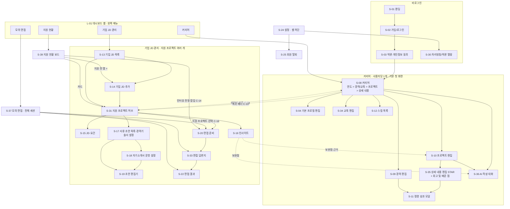

### 1.2 화면 목록

| ID | 화면명 | 메뉴/영역 | 관련 기능 | 우선순위 | v4 변경 |
|----|--------|-----------|-----------|----------|---------|
| L-01 | 대시보드 셸 (왼쪽 메뉴) | 공통 | F-COM-10 | Must | **신설** |
| S-01 | 랜딩 | 비로그인 | — | Must | 문구 |
| S-02 | 가입/로그인 | 비로그인 | F-COM-01 | Must | 로그인 후 S-08 |
| S-03 | 약관·개인정보 동의 | 가입 직후 | F-COM-02, F-COM-03 | Must | 다음 화면 S-08, 고지에 AI 작성 대화 추가 |
| S-04 | 기본 프로필 편집 | 커리어 | F-P1-01 | Must | |
| ~~S-05~~, ~~S-06~~ | (v3 폐기 유지) | — | — | — | |
| ~~S-07~~ | ~~홈~~ | — | — | — | **폐기**. 첫 화면은 S-08. 이어하기 항목은 S-08·S-37·S-39로 분산 |
| S-08 | 커리어 | 커리어 (기본 첫 화면) | F-P1-01~05, F-P1-09, F-P1-13, F-COM-04 | Must | **연도 계층 보기로 재설계** |
| S-09 | 경력 편집 | 커리어 | F-P1-02, F-P1-04, F-P1-06 | Must | 경력 단위 성과만 |
| S-10 | 프로젝트 편집 | 커리어 | F-P1-03, F-P1-05, F-P1-06, F-P1-15 | Must | **기여 내용·팀·배경 삭제**, 소속에 교육 추가, 상세 내용 목록 |
| S-11 | 정량 성과 (모달) | 커리어 | F-P1-04 | Must | 연결 대상 = 상세 내용의 결과 또는 경력 |
| S-12 | 스킬 목록 | 커리어 | F-P1-05 | Must | |
| S-13 | 기업 JD 목록 | 기업 JD 관리 | F-AP-02, F-AP-05 | Must | 메뉴 라벨, **전형 단계 열** |
| S-14 | 기업 JD 추가 | 기업 JD 관리 / 지원 현황 | F-AP-01, F-P2-01 | Must | 보드에서도 진입, 새 단계 "지원 전" |
| S-15 | JD·요건 | 기업 JD 관리 | F-P2-02 | Must | |
| S-16 | 인사이트 | 기업 JD 관리 | F-P2-04, 05, 09, F-AP-06 | Must | STAR 단위 근거, 보완점 → 대화 작성 선택지 |
| S-17 | 서류 초안 목록·경력기술서 설정 | 기업 JD 관리 | F-DOC-01, 04, F-AP-06 | Must | 교육 소속 프로젝트도 선택 |
| S-18 | 자기소개서 문항 설정 | 기업 JD 관리 | F-DOC-02, 09 | Must | |
| S-19 | 초안 편집기 | 기업 JD 관리 | F-DOC-01~04, 08 | Must | |
| S-20 | 면접 준비 | 기업 JD 관리 (모의 면접·지원 현황에서도 진입) | F-P3-01, 07, 13, F-AP-06 | Must | **유형 미리 선택 진입** |
| ~~S-21~~ | (v3 폐기 유지) | — | — | — | |
| S-22 | 면접 결과 | 기업 JD 관리 | F-P3-06, 07 | Must | 점수 슬롯 컬럼 확정 |
| ~~S-23~~ | (v3 폐기 유지) | — | — | — | 전체 세션 목록은 S-37로 새로 정의 |
| S-24 | 설정 | 셸 하단 | F-COM-02, 03, 05 | Must | |
| S-25 | 회원 탈퇴 | 설정 | F-COM-05 | Must | 삭제 범위에 교육·상세 내용·AI 작성 대화·전형 이력 |
| S-26, S-27, S-29, S-32 | (예약) 커리어 채팅 / 완성도 / 사용량 / 지원 프로젝트 정보 편집 | | Should | | |
| S-28 | 오류·접근 불가 | 공통 | F-COM-01, NFR-PRV-07 | Must | |
| S-30 | 처리방침·약관 열람 | 공통 | NFR-PRV-10 | Must | |
| S-31 | 지원 프로젝트 허브 | 기업 JD 관리 | F-AP-03, 05, 06, F-ST-01 | Must | 헤더에 전형 단계·결과 |
| S-33 | 면접 답변지 | 기업 JD 관리 | F-P3-02~04 | Must | 편집 가능 조건 확정 |
| **S-34** | **교육 편집** | 커리어 | F-P1-14 | Must | **신설** |
| **S-35** | **상세 내용 편집 (STAR + 회고 및 배운 점)** | 커리어 | F-P1-15, F-P1-04 | Must | **신설** |
| **S-36** | **AI 작성 대화** | 커리어 | F-P1-13, F-P1-06 | Must | **신설** |
| **S-37** | **모의 면접 (전체 세션)** | 모의 면접 | F-P3-15 | Must | **신설** |
| S-38 | (예약) 전형 이력 타임라인 | 기업 JD 관리 | F-ST-06 | Should | |
| **S-39** | **지원 현황 보드** | 지원 현황 | F-ST-01~05 | Must | **신설** |

### 1.3 L-01 대시보드 셸 (F-COM-10)

| 요소 | 내용 | 비고 |
|------|------|------|
| 왼쪽 메뉴 | 순서 고정: **커리어 · 기업 JD 관리 · 모의 면접 · 지원 현황**. 현재 메뉴 강조. 지원 프로젝트 하위 화면(S-14~S-22, S-31, S-33)에 있으면 "기업 JD 관리"를 강조하되, 모의 면접(S-37)·지원 현황(S-39)에서 들어온 경우 이동 경로에 출발 메뉴를 남긴다(아래) | F-COM-10 |
| 메뉴 배지 | 모의 면접: 작성 중 세션 수 / 새 채점 결과 수. 기업 JD 관리: 진행 중 AI 작업 수. 커리어: 작성 중 AI 대화가 있으면 점 표시 `[가정]` | |
| 메뉴 하단 | 계정(이메일 앞부분), 설정(S-24), 처리방침 링크 | |
| 상단 이동 경로 | 지원 프로젝트 하위 화면: "기업 JD 관리 › {회사명 – 포지션명} › 자기소개서". S-39·S-37에서 들어오면 첫 마디가 "지원 현황" / "모의 면접"으로 바뀌어 원래 메뉴로 돌아갈 수 있다 | |
| 전역 알림 | AI 작업 완료 인앱 토스트(C-03), 복귀 배너(C-10, 커리어 안에서만), AI 장애 배너(S-28) | |
| 좁은 화면 | 메뉴를 접는다: 상단 바 + 메뉴 버튼 → 서랍(drawer)으로 4개 메뉴 `[가정]`. 현재 메뉴 이름은 상단 바에 항상 보인다 | F-COM-10 "UX 결정" |
| 첫 화면 | 로그인·가입 후 항상 S-08(마지막 메뉴를 기억하지 않음, PRD 3.1 `[가정]`). 단 로그인 전 요청한 URL이 있으면 그 URL | |

### 1.4 Should 이하 확장 자리

| 기능 | 배치 예정 | MVP 처리 |
|------|-----------|----------|
| F-P1-07 완성도 | S-27, S-08 상단 | S-08 규칙 기반 안내 1줄 (STAR 빈 결과 등 포함, PRD 5.3 확정) |
| F-P1-08 폼 STAR 필드 다듬기 | S-35 필드 옆 | 없음 |
| F-P1-12 숙련도, F-P1-16 경력·교육 대화 작성 | S-12 / S-09·S-34 | 없음 |
| F-AP-04 정보 편집 | S-32, S-31 헤더 | S-31 헤더 이름·마감일 인라인 수정 (PRD 5.3 확정) |
| F-AP-09 복제 | S-13·S-39 카드 메뉴 | 없음 |
| F-ST-06 전형 이력 | S-38, S-31 | 없음 (기록은 MVP부터, F-ST-05) |
| F-ST-07 통계, F-ST-08 서류 전형 팝업 | S-39 | 없음 |
| F-P2-03, 07, 08 | S-15 / S-31·S-16 / S-26 | F-P2-07 "데이터 변경됨" 상태 표시만 (PRD 5.3 확정) |
| F-DOC-05, 06, 10 | S-19 / S-18 | 없음 |
| F-P3-08, 09, 10 | S-22 / S-33 / S-37 | 없음 |
| F-COM-06, 07 | S-16·S-19·S-22 / S-29 | 실행 버튼 옆 "이번 달 N회 남음"은 MVP (PRD 5.3 확정) |

---

## 2. 핵심 플로우

플로우 ID는 바꾸지 않는다. FL-01·FL-02는 v3에서 폐기됐다. v4 신설은 FL-14부터.

| ID | 플로우 | PRD 핵심 작업 | v4 상태 |
|----|--------|---------------|---------|
| FL-03 | 서류 초안 | J-4 | 유지(소속 키·근거 선택 이름 정렬) |
| FL-04 | 면접 답변지 이어쓰기 | J-5 | 개정(진입점: S-37·S-39) |
| FL-05 | 커리어 정리 (폼) | J-1 | **개정**(연도 계층·교육·상세 내용) |
| FL-06 | 지원 프로젝트 삭제 | J-2 | 개정(전형 이력 포함, 보드에서도) |
| FL-07 | 회원 탈퇴 | — | 개정(삭제 범위) |
| FL-08 | AI 실패·재시도 | — | 개정(`error_category`) |
| FL-09 | 가입 → 커리어 | — | **개정**(홈 → 커리어) |
| FL-10 | 지원 프로젝트 만들기 | J-2 | 개정(보드 진입) |
| FL-11 | 인사이트 | J-3 | 유지 |
| FL-12 | 모의 면접 (일괄) | J-5 | 개정(진입점 3곳, 유형 미리 선택) |
| FL-13 | 데이터 부족 → 커리어 → 복귀 | — | 개정(대화 작성 바로가기) |
| **FL-14** | AI 작성 대화로 프로젝트 정리 | J-1 | **신설** |
| **FL-15** | 지원 현황 보드에서 단계 이동 | J-6 | **신설** |
| **FL-16** | 인터뷰 전형 이동 → 면접 준비 | J-6 → J-5 | **신설** |
| **FL-17** | 모의 면접 메뉴에서 새 면접 시작 | J-5 | **신설** |

### FL-09 가입 → 커리어

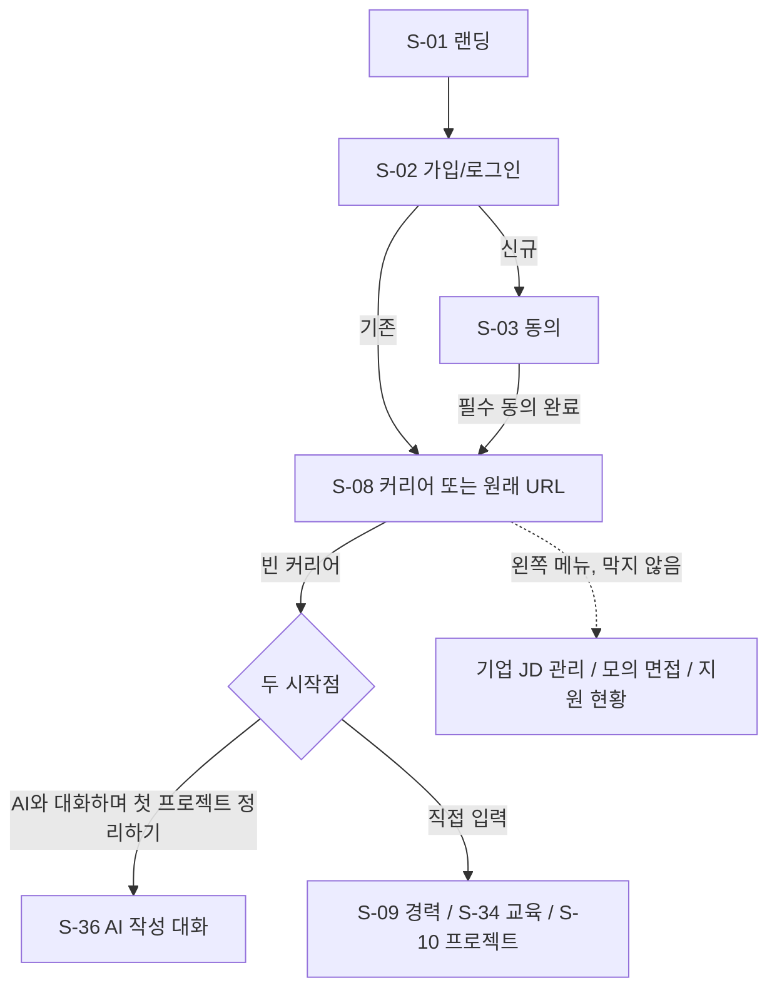

- 화면 단계 수: 가입부터 커리어까지 **3화면**(S-02 → S-03 → S-08). 강제 입력 없음.
- 관련 기능: F-COM-01, F-COM-02, F-COM-03, F-COM-10.

### FL-05 커리어 정리 — 폼 (J-1)

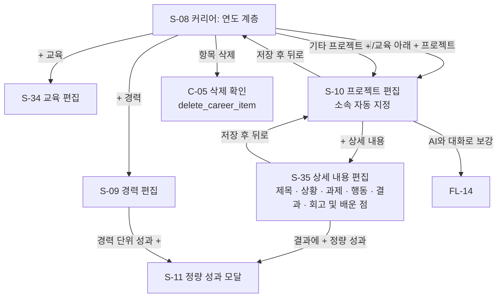

- 화면 단계 수: 첫 경력 + 첫 완료 프로젝트까지 **4화면**(S-08 → S-09 → S-10 → S-35), 돌아와 S-08에서 연도 계층으로 본다(F-P1-09 완료 지점).
- 완료 판정(PRD 확정, T-16): 프로젝트 = 이름 + 역할 + **완료된 상세 내용 1개 이상**. 상세 내용 = 제목 + 상황 + 행동. 미완료 항목은 "작성 중 — AI 미반영".
- 자동 저장(디바운스 1~2초 `[가정]`). 서버가 `status`(draft / complete)를 다시 계산한다.

### FL-14 AI 작성 대화로 프로젝트 정리 (F-P1-13)

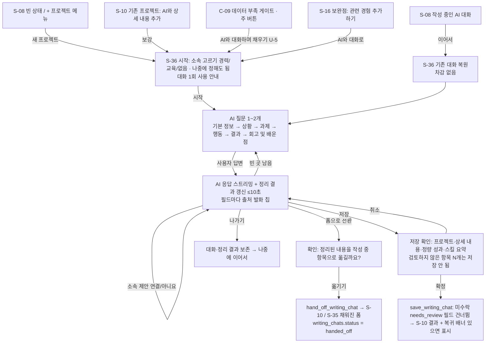

- 화면 단계 수: 시작점에서 저장까지 **1화면**(S-36) + 저장 확인 1회.
- 관련 기능: F-P1-13, F-P1-06, F-AP-06, F-P2-09.
- 저장 전에는 커리어 데이터가 바뀌지 않는다. 저장은 사용자 세션 RPC `save_writing_chat(writing_chat_id)`이다. 수락 상태는 `structured_draft` 필드 객체의 `review = 'accepted'` + `reviewed_at`으로 저장된다(R-27, 데이터 모델 v3.2). 저장과 폼 전환 모두 **수락하지 않은 `needs_review` 필드는 건너뛴다**. 소속은 사용자가 확정한 `writing_chats.experience_id` / `education_id`만 쓰인다(R-28).
- "폼으로 전환"은 사용자가 옮기기를 확인한 순간 RPC `hand_off_writing_chat(writing_chat_id)`가 정리 결과를 커리어 테이블에 쓰고(완료 판정대로, 대부분 `draft`) `writing_chats.status = 'handed_off'`가 된다. 이후는 폼 자동 저장 규칙(D-UX-11 (a)). 수락하지 않은 `needs_review` 필드는 옮기지 않는다(R-27).
- 사용량: 프로젝트 1건 대화 시작 시 1회, 같은 대화를 이어 하면 무차감, 메시지 상한 40 `[가정]`(D-17 v3).

### FL-10 지원 프로젝트 만들기 (J-2)

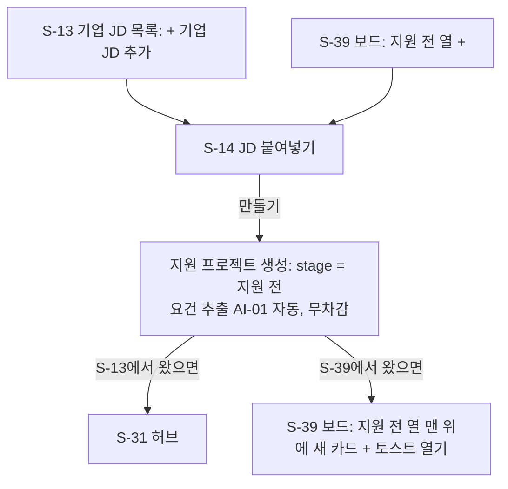

- 화면 단계 수: **2화면**(S-13/S-39 → S-14 → S-31/S-39).
- 관련 기능: F-AP-01, F-P2-01, F-P2-02, F-ST-01 (4).

### FL-11 인사이트 (J-3)

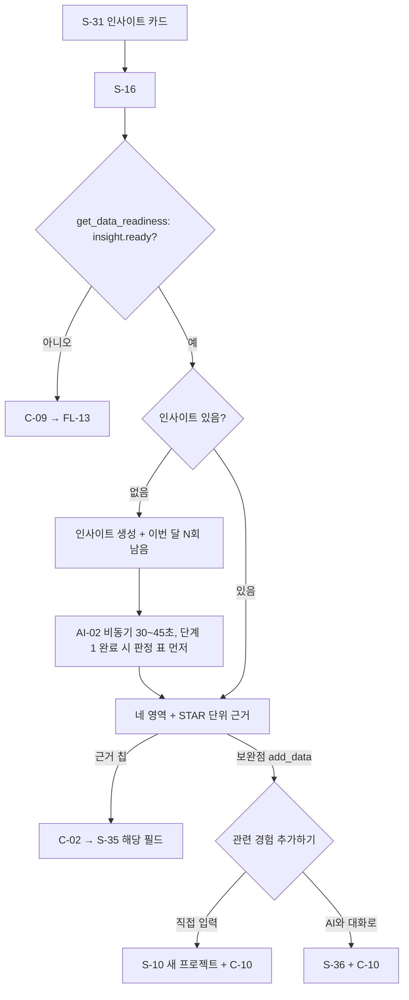

- 화면 단계 수: **2화면**(S-31 → S-16) + 버튼 1회. 관련 기능: F-P2-04, 05, 09, F-AP-06.

### FL-03 서류 초안 (J-4)

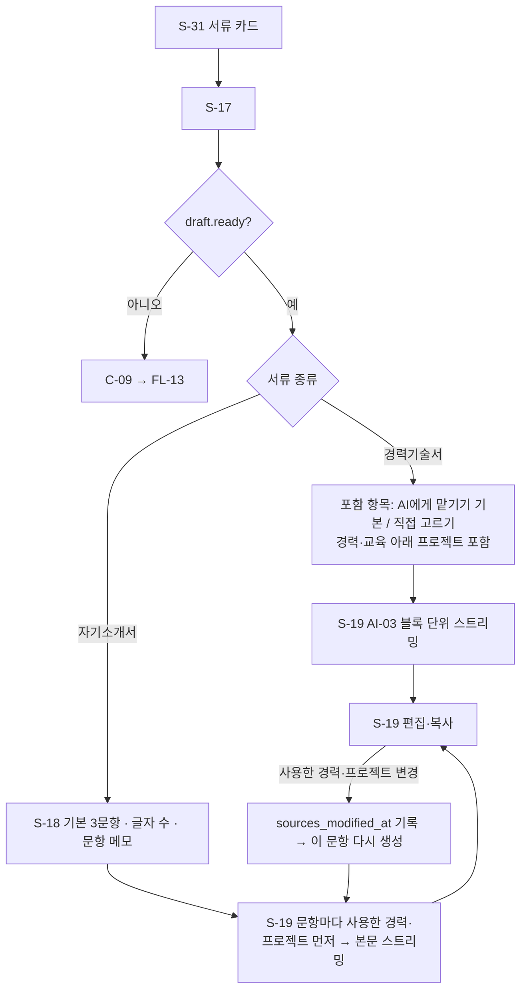

- 화면 단계 수: 경력기술서 **3화면**(S-31 → S-17 → S-19), 자기소개서 **4화면**(S-31 → S-17 → S-18 → S-19). 관련 기능: F-DOC-01~04, 08, 09.

### FL-12 모의 면접 — 일괄 방식 (J-5)

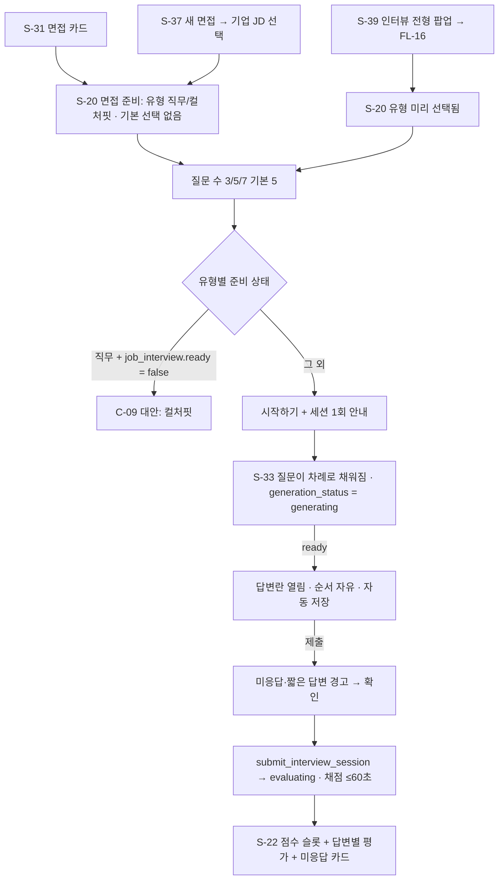

- 화면 단계 수: 진입 화면에서 결과까지 **4화면**(S-31/S-37/S-39 → S-20 → S-33 → S-22). 관련 기능: F-P3-01~04, 06, 07, 13, 15, F-ST-04.

### FL-17 모의 면접 메뉴에서 새 면접 시작 (F-P3-15)

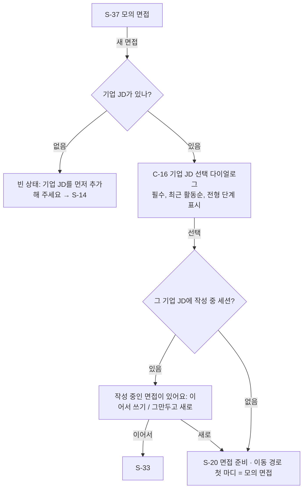

- 화면 단계 수: S-37 → 다이얼로그 → S-20 (**2화면** + 선택 1회).

### FL-15 지원 현황 보드에서 단계 이동 (F-ST-01~03, 05)

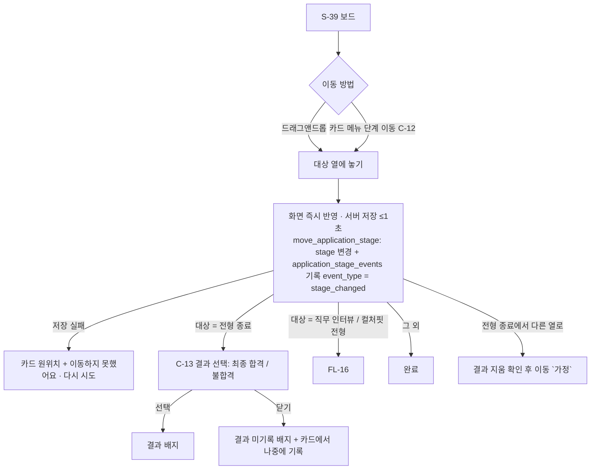

- 관련 기능: F-ST-01, 02, 03, 05. 어느 열로든, 어느 방향으로든 이동 가능(단계 건너뛰기·되돌리기 허용).

### FL-16 인터뷰 전형 이동 → 면접 준비 (F-ST-04)

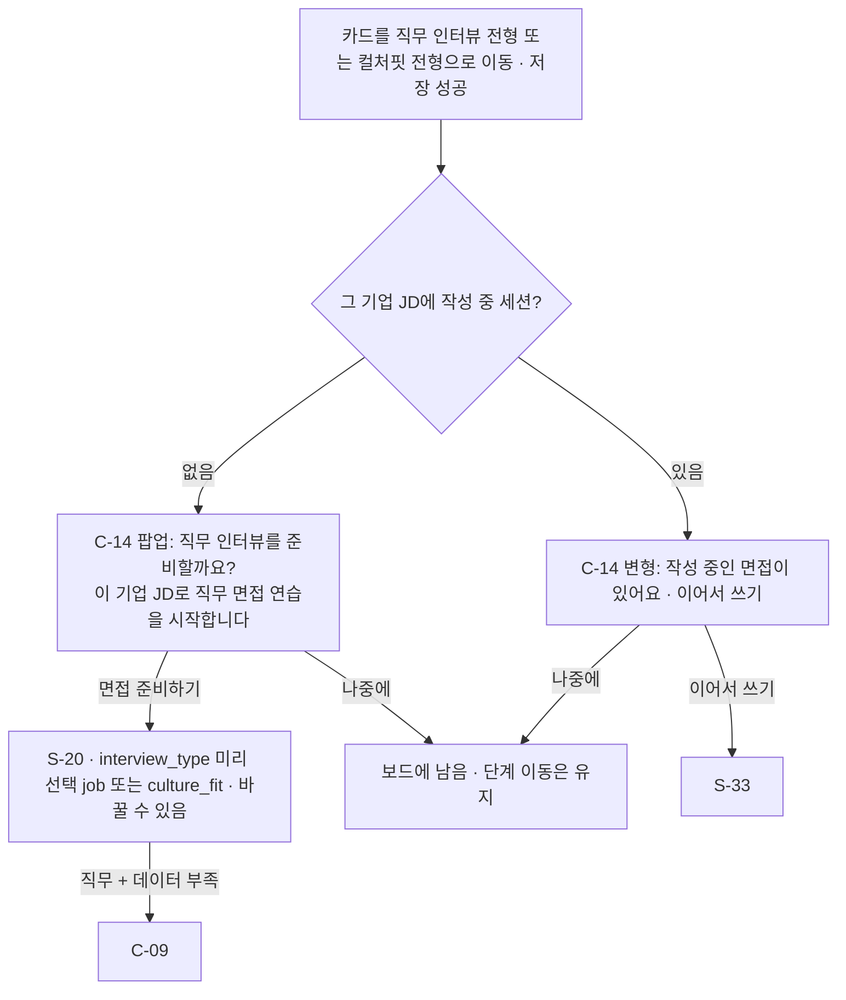

- 팝업은 AI를 실행하지 않고 사용량을 차감하지 않는다. 이동 저장이 실패하면 팝업을 띄우지 않는다.

### FL-04 면접 답변지 이어쓰기

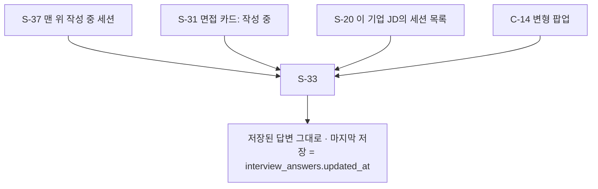

- 지원 프로젝트당 작성 중 세션은 1개(`unique (application_project_id) where status = 'in_progress'`).

### FL-13 데이터 부족 → AI 작성 대화로 채우기 → 복귀 (F-AP-06, U-5)

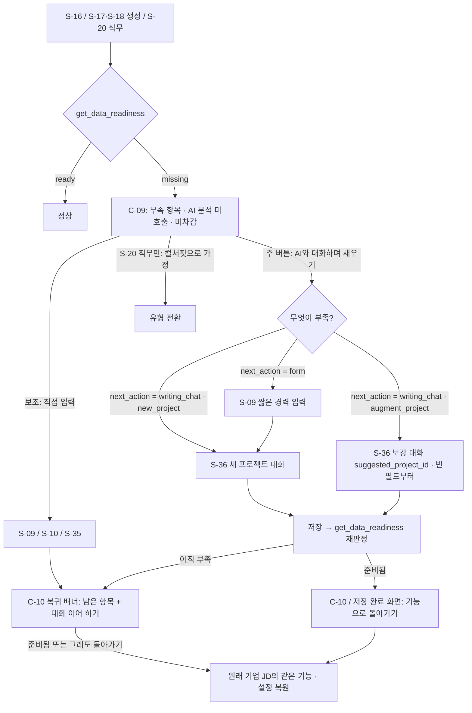

- 화면 단계 수: 기능 화면 → S-36 → 기능 화면(**3화면**, 경력이 없으면 S-09가 1개 더).
- U-5: 단순 차단·안내 대신 그 자리에서 AI 작성 대화로 부족한 커리어 데이터를 채우게 하고 원래 기능으로 돌려보낸다. AI 분석 결과는 여전히 근거 데이터가 있어야 만들어진다. 컬처핏 예외는 `[가정]` 유지.
- 복귀 대상: AI 작성 대화로 넘어가면 `writing_chats.return_target`에 저장되어 기기를 바꾸거나 나중에 이어 해도 복귀 배너가 나온다. 돌아가면 지운다. 폼(S-09 등)으로만 넘어간 경우는 브라우저 세션 저장. URL에는 지원 프로젝트 ID와 기능 이름만.

### FL-06 지원 프로젝트 삭제

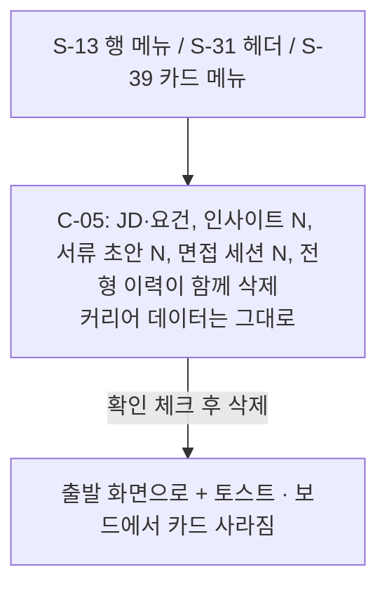

- 관련 기능: F-AP-05. 진행 중 AI 작업은 취소(`ai_jobs.cancel_requested_at`), 사용량 `released`.

### FL-07 회원 탈퇴

- S-24 → S-25(삭제 범위: 커리어 전체 + 기업 JD 전체 + AI 작성 대화 + 전형 이력) → 확인 문구 → 즉시 로그아웃 → S-01. 관련: F-COM-05, D-11.

### FL-08 AI 실패·재시도 (공통)

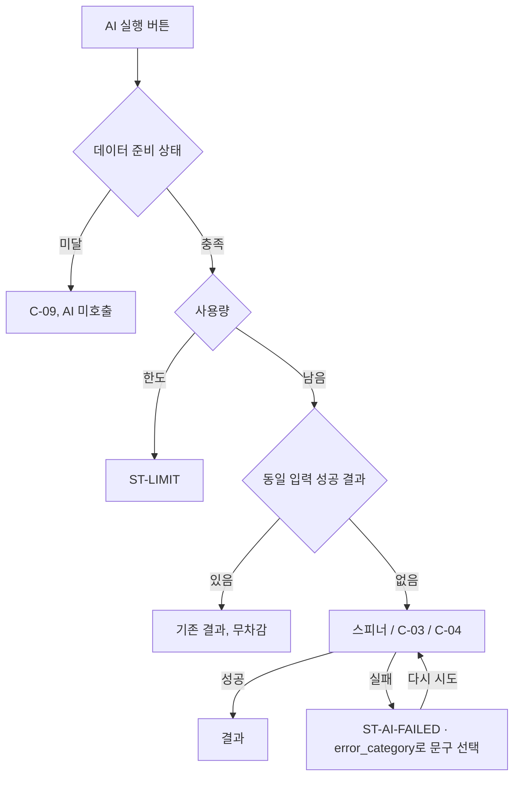

---

## 3. 화면 명세

### 3.0 공통 컴포넌트·상태

#### C-01 근거 칩 (Evidence Chip)

데이터: `evidence_links`(`owner_type`, `owner_id`, `item_key`, `sort_order`). `item_key`는 초안이면 `block_id`, 그 밖은 점 경로(`requirement_matches.{id}`, `strengths.{n}`, `gaps.{n}`, `gaps.{n}.actions.{m}`, `strategy.positioning`, `strategy.project_priorities.{rank}`, `criteria.{key}`, `improvements.{n}`, `model_answer`, `overall_strengths.{n}`, `sources.{n}`).

| 요소 | 표시 데이터 | 동작 | 비고 |
|------|-------------|------|------|
| 칩 라벨 | 종류 + `source_label`. profile "기본 프로필", experience "경력", **education "교육"**, project "프로젝트", **project_detail "상세 내용 · {필드}"**(`source_field` = situation 상황 / task 과제 / action 행동 / result 결과 / learnings 회고 및 배운 점), achievement "정량 성과", skill "스킬", jd_requirement "JD 요건", jd_sentence "공고 원문", interview_answer "내 답변", user_note "내 메모" | 클릭 → C-02 | 데이터 모델 v3 확정(`source_field`에 STAR 5개 + `title`) |
| 회고 구분 | `source_field = learnings`인 칩은 "회고 및 배운 점" 라벨만 쓴다(별도 표식 없음). 사실 근거와 다른 종류라는 것은 라벨로 구분된다 | | NFR-AI-06, U-2, PRD v3.2 |
| 상태 | 정상 / **변경됨**(원본 `updated_at` > `source_snapshot_at`, `jd_sentence`는 JD `created_at` 기준이라 항상 정상) / **원본 삭제됨**(`source_deleted_at`) | | |

#### C-02 근거 패널

| 요소 | 표시 데이터 | 동작 | 비고 |
|------|-------------|------|------|
| 근거 카드 | 라벨, `source_label`, `quote`(있을 때), 경로 "연도 › 회사명/기관명 › 프로젝트명 › 상세 내용 제목 › 필드" | | `quote` 없는 근거는 원본 현재 값(생성 당시 값 미보관, 원본 삭제 시 값 없음) |
| 원본으로 이동 | 상세 내용 근거 → S-35의 해당 필드에 포커스, 정량 성과 → S-11, 교육 → S-34, 그 밖은 v3와 같음. 커리어로 가는 이동은 C-10 함께 | | |
| 변경됨 / 원본 삭제됨 | v3와 같음("원본 삭제됨 — 이 근거의 원본과 인용문은 삭제되었습니다", 인용문·이동 없음) | | D-AI-04 (b) |
| 고지 | "입력된 데이터 기준 판단입니다" | | |

#### C-03 AI 작업 상태 (비동기)

| 요소 | 표시 데이터 | 비고 |
|------|-------------|------|
| 진행 | `ai_jobs.job_type`, `ai_jobs.progress.stage` → 문구, `progress.done` / `total` | 10초 안에 첫 진행 |
| 단계 문구 | `match` 요건 대조 중 / `synthesize` 강점·지원 방향 정리 중 / `validate` 근거 확인 중 / `rank` 쓸 경력·프로젝트 고르는 중 / `generate` 작성 중 / `adjust_length` 글자 수 맞추는 중 / `evaluate` 답변 채점 중 / `summarize` 종합 평가 정리 중 / `score` 점수 계산 중 | 데이터 모델 v3.x 확정 키 |
| 부분 결과 | 인사이트 단계 1 판정 표, 채점 완료 답변 카드 | |
| 이탈 허용·완료 알림 | 인앱 토스트 "{회사명 – 포지션명} 면접 채점이 끝났어요 [보기]" + 메뉴 배지 | 이메일·푸시 없음 `[가정]` |

#### C-04 스트리밍 출력

경력기술서(블록), 자기소개서(문항, 근거 선택 먼저), 면접 질문(차례로 채움), **AI 작성 대화 응답(첫 글자 3초, 완료 10초)**. 중단은 `ai_jobs.cancel_requested_at`. 이탈 시 서버가 끝까지 생성·저장 `[가정]`.

#### C-05 삭제 확인 다이얼로그

| 대상 | 표시 데이터 | 선택지 | 처리 |
|------|-------------|--------|------|
| 커리어 항목(경력·교육·프로젝트·상세 내용·정량 성과·스킬) | `get_deletion_impact(entity_type, entity_id, affiliation_mode)` (`entity_type`: experience / education / project / project_detail / achievement / skill / writing_chat): `cascade`(projects, project_details, achievements, project_skills, writing_chats 개수), `affected_results.by_application_project[]`(기업 JD별 insights·drafts·draft_sections·interview_sessions 수) | ① 결과 처리 `result_mode`: **"결과는 남기고 근거만 '원본 삭제됨'으로"**(`keep_results`, 기본값) / **"관련 결과도 함께 삭제"**(`delete_results`) ② 경력·교육 삭제 시 소속 프로젝트 `affiliation_mode`: "독립 프로젝트로 남기기"(`keep_projects`, 기본) / "함께 삭제"(`delete_projects`) | RPC `delete_career_item(entity_type, entity_id, affiliation_mode, result_mode)` |
| `delete_results` 범위 설명 | "인사이트는 해당 버전, 경력기술서는 문서 전체, 자기소개서는 **해당 문항의 생성 결과만**(문항·글자 수·메모는 남음), 모의 면접은 **세션 전체**가 삭제돼요" | | 데이터 모델 4.2 결과 단위 |
| 공통 안내 | "어느 쪽이든 인용문은 지워져요. 결과를 남기면 AI가 쓴 본문에는 내용이 남을 수 있어요" | | |
| 상세 내용 삭제 | "붙어 있는 정량 성과 N건도 삭제돼요" | | F-COM-04 |
| 프로젝트 삭제 | "상세 내용 N건, 정량 성과 N건이 함께 삭제돼요. 이 프로젝트의 AI 작성 대화도 삭제돼요" (`cascade.writing_chats`) | | D-27 (a). `writing_chats.project_id` 연쇄 |
| AI 작성 대화만 삭제 (`entity_type = 'writing_chat'`) | "대화 메시지 {message_count}개와 저장 전 정리 결과가 삭제돼요. 저장한 프로젝트는 그대로예요(출처 대화 연결만 끊겨요)" | `result_mode` 없음 | 커리어 행의 `source_writing_chat_id` → null |
| 기업 JD(지원 프로젝트) | "JD·요건, 인사이트 N, 서류 초안 N, 면접 세션 N, 전형 이력이 함께 삭제돼요. 커리어 데이터는 그대로예요" + 확인 체크 | | F-AP-05 |
| 초안 / 면접 세션 | 하위 개수 | | |

#### C-06 저장 상태 · C-07 입력 가이드

- C-06: "저장 중… / 저장됨 HH:MM / 저장 실패 — 다시 시도" + 커리어 항목 `status = 'draft'`면 "작성 중 — 필수 항목을 채우면 AI 분석에 반영돼요".
- C-07 가이드:

| 가이드 | 위치 | 내용 |
|--------|------|------|
| G-1 본인 행동 | **S-35 행동(A) 필드** | "'우리 팀은'보다 '저는'으로 써 주세요. 팀이 한 일·배경은 상황(S)에 써 주세요" |
| G-2 민감정보·기밀 | 모든 자유 서술 필드, S-36 입력창 | "건강·종교·노조 활동 같은 민감정보, 동료·고객의 개인정보, 회사 기밀은 쓰지 마세요" |
| G-3 정량 성과 권유 | S-35 결과(R)에 숫자가 있는데 정량 성과가 0건일 때 | "수치를 정량 성과로 정리하면 AI가 숫자를 정확히 써요 [+ 정량 성과]" |
| G-4 STAR 권유 | S-35 과제·결과·회고 및 배운 점이 비었을 때 | 필드별 한 줄 예시 |

#### C-08 자리 표시·검증 배지

v3와 같음. "커리어에 추가하기"는 상세 내용이 근거인 블록이면 S-35 해당 필드로 이동.

#### C-09 데이터 부족 게이트 (F-AP-06)

데이터: RPC `get_data_readiness()` → `counts`, `draft_item_ids`, `features.{insight | draft | job_interview | culture_fit_interview}.ready / missing / data_sufficiency`.

| 요소 | 표시 데이터 | 동작 | 비고 |
|------|-------------|------|------|
| 제목 | "{기능}을 만들려면 커리어가 조금 더 필요해요. AI와 대화하며 바로 채워 볼까요?" | | U-5 |
| 부족 항목 (`missing`) | `complete_experience` "완료된 경력 1건이 필요해요(교육만으로는 부족해요)", `complete_project` "완료된 프로젝트 1건이 필요해요" + 현재 개수(`counts.complete_experiences`, `counts.complete_projects`) | — | 데이터 모델 v3 6장. 교육 아래 프로젝트도 셈 |
| 보조 안내 (`hints`) | `complete_project_detail` → "프로젝트는 있지만 완료된 상세 내용이 없어요(제목·상황·행동)" + `counts.projects_without_complete_detail` | — | `hints`는 문구 분기용, 판정은 `missing`만 |
| **주 버튼** (`features.{기능}.next_action`) | `next_action = 'writing_chat'` → **"AI와 대화하며 채우기"**: `suggested_mode = 'new_project'`면 새 프로젝트 대화(완료 경력이 있으면 소속 미리 선택), `'augment_project'`면 `suggested_project_id`의 보강 대화(작성 중 상세 내용의 빈 필드부터). 인사이트 보완점에서 왔으면 관련 요건을 대화 시작 맥락으로 표시 / `next_action = 'form'`(완료 경력이 부족할 때) → **"경력 먼저 입력하기"**(S-09) | → S-36(또는 S-09) + 복귀 대상을 `writing_chats.return_target`에 저장(돌아가면 지움) | **U-5 확정: 데이터 부족은 AI 작성 대화로 풀어 간다.** 대화 1회 사용 안내(월 10회) |
| 경력이 없을 때 | `next_action = 'form'`: AI 작성 대화는 경력을 만들지 않으므로(F-P1-16 Could) 짧은 경력 입력(S-09, 필수 3개)을 먼저 열고, 저장 후 다시 판정해 `next_action = 'writing_chat'`이면 S-36 새 프로젝트 대화로 넘긴다 | S-09 → S-36 → 복귀 | 데이터 모델 v3.2 `next_action = 'form'`, PRD 확인 완료 |
| AI 작성 대화 한도 소진 | 이번 달 AI 작성 대화 10회를 다 썼으면 주 버튼을 **"직접 입력하기"**(작성 중 항목 편집 또는 새 폼, 복귀 대상은 브라우저 세션)로 바꾸고 "이번 달 AI 작성 대화를 모두 사용했어요. 직접 입력으로 채울 수 있어요" 안내. 이미 진행 중인 대화가 있으면 "이어서 대화하기"는 그대로 제공(이어 하기는 무차감) | | R-32, U-8 |
| 보조 링크: 직접 입력 | 작성 중 항목(`draft_item_ids`)이 있으면 그 편집, 없으면 새 폼 | 복귀 대상 기억 | |
| (S-20 직무) 대안 | "컬처핏 면접은 지금 바로 연습할 수 있어요" | 유형 전환 | `culture_fit_interview.ready`는 항상 true — 컬처핏 예외는 `[가정]`(U-5) |
| 안내 | "AI 분석은 실행하지 않았고 사용량도 차감되지 않았어요. 커리어를 채우면 이 화면으로 다시 돌아와요" | | AI 결과는 여전히 근거 데이터가 있어야 생성 |

#### C-10 복귀 배너

커리어 안 모든 화면(S-04, S-08~S-12, S-34~S-36) 상단. "{회사명 – 포지션명} · {기능}으로 돌아가기" + 준비 상태(저장마다 `get_data_readiness()` 재판정). AI 작성 대화에서 "저장"한 직후에도 다시 판정하고, 준비되면 S-36 저장 완료 화면에 "{기능}으로 돌아가기" 주 버튼을 띄운다. 돌아가면 원래 화면의 진행 중 설정(면접 유형·질문 수, 자소서 문항, 경력기술서 포함 항목 등)을 복원한다(U-5).

#### C-11 사용한 경력·프로젝트 (F-DOC-08 / F-DOC-01)

| 요소 | 표시 데이터 | 동작 | 비고 |
|------|-------------|------|------|
| 자소서 문항별 목록 | `draft_section_sources`: `experience_id` 또는 `education_id` + `project_id` + `project_detail_ids`(→ "회사명 또는 기관명 › 프로젝트명 › 사용한 상세 내용 제목", 원본 삭제 시 `source_label`), `role`(primary 주 근거 / supporting 보조), `origin`(ai AI 선택 / user 내가 추가), `rationale`, `requirement_ids`(관련 요건), `reuse_reason`(다른 문항과 같은 프로젝트일 때), `source_deleted_at` | | |
| 변경 | 완료 상태 경력·교육·프로젝트 체크 트리(프로젝트를 펼치면 완료된 상세 내용을 골라 `project_detail_ids`로 지정 가능, 기본은 AI 선택) | 추가/제외 → `draft_sections.source_selection_mode = 'user'`, `sources_modified_at` 기록 → "변경 사항으로 다시 생성" 활성 | |
| 다시 생성 | "초안 1회 차감" + 편집본 덮어씀 확인 | 성공 시 `generation_no + 1`, `sources_modified_at = null` | 이전 생성본 보관 없음(D-DM-06) |
| 모두 제외 | "근거 없이 메모·공고 내용만으로 작성돼요" 경고 후 허용 | | 데이터 모델 확정 동작 |
| 경력기술서 | `drafts.options.included_experience_ids` / `included_education_ids` / `included_project_ids` / `project_order` + 출처 `drafts.options.selection_origin`(insight "인사이트 우선순위" / ai_ranking "AI가 고름" / user "직접 고름") | 변경 → 전체 다시 생성 | AI 기본 선택 단계 = AI-11, 진행 `rank` |

#### C-12 단계 이동 메뉴 (신설, F-ST-02 (3))

보드 카드 메뉴(⋯)와 S-31 헤더 전형 단계 칩에서 연다.

| 요소 | 표시 데이터 | 동작 | 비고 |
|------|-------------|------|------|
| 단계 목록 | 6단계, 현재 단계 체크 | 선택 → 드래그와 같은 처리(FL-15) | 키보드: 카드에 포커스 후 Enter로 메뉴, 화살표로 단계 선택 |
| 단축 동작 | "다음 단계로" | 다음 열로 이동 | `[가정]` 편의 |
| 스크린 리더 | 이동 후 "{카드}를 {단계}로 옮겼어요" 알림 | | |

#### C-13 전형 결과 선택 창 (신설, F-ST-03)

| 요소 | 표시 데이터 | 동작 | 비고 |
|------|-------------|------|------|
| 제목 | "전형 결과를 기록할까요?" | | |
| 선택지 | **최종 합격** / **불합격** → `application_projects.stage_outcome` = `passed` / `failed` (RPC `set_application_outcome`, 이력 `event_type = 'outcome_changed'`) | 선택 → 저장, 카드 배지 | D-25 (a) 사용자 확정(U-3). 지원 철회 등은 추가하지 않음 |
| 닫기 | — | `stage_outcome = null` → 카드 "결과 미기록" 배지 + 카드 메뉴 "결과 기록" | |

#### C-14 인터뷰 전형 팝업 (신설, F-ST-04)

| 요소 | 표시 데이터 | 동작 | 비고 |
|------|-------------|------|------|
| 직무 인터뷰 전형으로 이동 시 | "직무 인터뷰를 준비할까요? {회사명 – 포지션명}으로 직무 면접 연습을 시작합니다" | **면접 준비하기** → S-20 `?type=job` / **나중에** → 닫기 | 쿼리에는 유형 값만 |
| 컬처핏 전형으로 이동 시 | "컬처핏 면접을 준비할까요? …" | → S-20 `?type=culture_fit` | |
| 작성 중 세션이 있을 때 | "이 기업 JD에 작성 중인 면접이 있어요({유형}, n/N 작성)" | **이어서 쓰기** → S-33 / **나중에** | 유형이 달라도 이어 쓰기를 먼저 안내(세션은 기업 JD당 1개) — 리뷰 T-12 권고로 UX 결정 |
| 공통 | 사용량 안내 없음(AI 실행 안 함). 닫아도 단계 이동은 유지 | | |
| 반복 | 같은 카드를 같은 인터뷰 열로 다시 옮기면 다시 뜬다. "다시 보지 않기"는 두지 않음(리뷰 T-12 권고로 UX 결정) | | |

#### C-15 출처 발화 칩 (신설, F-P1-13 (3))

S-36 정리 결과 미리보기의 필드마다 붙는다. C-01과 같은 모양.

| 요소 | 표시 데이터 | 동작 | 비고 |
|------|-------------|------|------|
| 데이터 | 필드 객체 `{value, origin, source_message_ids, source_quotes, review, reviewed_at}` (`review` = `ok` / `needs_review` / `accepted`) — 경로 `structured_draft.project.{field}`, `structured_draft.details[].fields.{field}`, `structured_draft.details[].achievements[].{field}`, `structured_draft.skills[]` | | 데이터 모델 v3 2.5 |
| 상태 ① 출처 있음 (`origin = 'ai'`, `review = 'ok'`) | "내 답변 #n" 칩(`source_message_ids` → `writing_chat_messages.sequence`, 사용자 메시지만 다시 번호) | 칩 클릭 → 대화의 해당 발화로 스크롤·`source_quotes` 구간 강조 | |
| 상태 ② 직접 수정 (`origin = 'user_edit'`) | "직접 수정" 표식(출처 칩 대신) | | AI 패치가 덮어쓰지 않음 |
| 상태 ③ **검토 필요** (`review = 'needs_review'`) | 값 + "AI가 정리한 표현이 원래 말과 달라요. 확인해 주세요" + 출처 칩 + **[수락] / [거절(비우기)]** | 수락 → 그 필드를 `review = 'accepted'`, `reviewed_at` 기록(사용자 세션 쓰기) → "수락함" 표식과 출처 칩으로 표시, 이후 AI가 덮어쓰지 않음. 대화를 나갔다가 이어 하면 그대로 복원된다. 거절 → 값을 비우고 `review = 'ok'` → AI가 그 부분을 다시 물어본다. 직접 고치면 `origin = 'user_edit'`가 되어 검토 완료로 본다 `[가정]` | R-03, R-27. 수락하지 않은 필드는 저장·폼 전환 모두에서 건너뛴다 |
| 상태 ④ 아직 없음 | 빈 칸 + "아직 없음" | | 출처 없는 값은 표시하지 않는다(NFR-AI-02) |
| 보조 배지: 본인 역할 확인 중 | `structured_draft.clarifications[]`에 `kind = 'actor_ambiguous'`가 있는 필드(주로 `action`, `detail_key`로 상세 내용 지정) → "본인 역할 확인 중 — 팀이 한 일과 본인이 한 일을 AI가 묻고 있어요" | 클릭 → 대화의 해당 질문으로 이동 | R-03. 질문에 답해 해소되면 배지 사라짐 |

#### C-16 기업 JD 선택 다이얼로그 (신설, F-P3-15 (2))

| 요소 | 표시 데이터 | 동작 | 비고 |
|------|-------------|------|------|
| 목록 | `application_projects.name`(회사명 – 포지션명), 전형 단계, 마감일, 작성 중 세션 여부 | 하나 선택(필수) → FL-17 | 최근 활동순, 검색 |
| 빈 상태 | "기업 JD를 먼저 추가해 주세요" | → S-14 | |

#### 공통 상태

| 상태 ID | 표준 표시 |
|---------|-----------|
| ST-EMPTY / ST-LOADING | v3와 같음 |
| ST-AI-SYNC / PENDING / STREAM | 스피너 / C-03 / C-04 |
| ST-AI-FAILED | 문구는 **`ai_jobs.error_category`**로 고른다: `transient` "잠시 후 다시 시도해 주세요" / `input` "입력 내용을 확인해 주세요"(+ 입력 화면 링크, 예: JD가 아닌 텍스트) / `timeout` "시간이 오래 걸려 중단됐어요" / `canceled` 실패로 표시하지 않음. 모두 "사용량은 차감되지 않았습니다" + 다시 시도 |
| ST-LIMIT | "이번 달 {기능} 한도({N}회)를 모두 사용했어요. 매월 1일(KST)에 다시 쓸 수 있어요". AI 작성 대화는 N = 10(U-8)이며 "진행 중인 대화는 이어서 쓰고 저장할 수 있어요"를 덧붙인다 |
| ST-INSUFFICIENT | C-09 |
| ST-WAIT-JD | "공고 분석이 끝나면 시작할 수 있어요" |
| ST-MOVE-FAILED | (보드) 카드 원위치 + "이동하지 못했어요" + 다시 시도 |
| ST-UNAUTH / NOTFOUND / SAVE-FAILED | v3와 같음 |

#### 실행 버튼 사용량 안내

"이번 달 {N}회 남음 · 이 작업으로 {k}회 사용". 단위(D-17 v3): 인사이트 1, 경력기술서 1, 자소서 문항당 1, 면접 세션 1(채점 포함, 질문 생성 성공 시 확정), **AI 작성 대화 = 대화 시작 1(이어 하기 0), 월 한도 10회(U-8)**, 요건 추출·경력기술서 기본 선택·글자 수 보정·채점·남은 질문 재생성 0. 남은 횟수는 `usage_events`(`feature = 'writing_chat'` 포함, 첫 턴 성공 시 차감)에서.

---

### S-01 랜딩 · S-02 가입/로그인 · S-03 동의

- S-01: 가치 제안 문구를 "커리어를 정리하고(AI와 대화로도) / 기업 JD마다 인사이트·서류·면접 / 지원 현황 보드로 관리"로 바꾼다. 나머지 v3와 같음.
- S-02: v3와 같음(매직 링크 + 재발송, Google). 로그인 후 **S-08** 또는 원래 URL.
- S-03: v3와 같음. AI 처리 고지에 "AI 작성 대화 내용"을 추가(D-10). 동의 완료 후 **S-08**.

### S-04 기본 프로필 편집

- v3와 같음. 진입: S-08 프로필 카드, S-24, C-02. 데이터: `profiles.display_name`, `desired_job_title`, `total_years_of_experience`, `interested_industries`.

### S-08 커리어 (기본 첫 화면)

- 목적: 커리어를 **연도 > 경력/교육 > 프로젝트 > 상세 내용** 계층으로 한눈에 보고, 어디서든 폼 또는 AI 대화로 입력한다. J-1의 완료 지점(F-P1-09).
- 관련: F-P1-01~05, F-P1-09, F-P1-13, F-P1-14, F-P1-15, F-COM-04. 진입: 로그인, L-01 메뉴, C-09, C-02 / 이탈: S-04, S-09~S-12, S-34~S-36

**연도 묶음 규칙 (D-22 (b) 권고)**
- 경력·교육은 활동한 **모든 연도**에 나타난다(`start_month`~`end_month`, 재직·재학 중이면 올해까지). 데이터는 하나, 표시만 반복.
- 각 연도 아래에는 그 해에 **시작한** 프로젝트만 보인다(`projects.start_month`의 연도). 프로젝트 기간이 비어 있으면 소속 경력·교육의 시작 연도에 둔다 `[가정]`.
- 그 해에 시작한 프로젝트가 없는 경력·교육은 **접힌 머리**만 보인다(회사명·기간).
- 독립 프로젝트(소속 없음)는 해당 연도의 **"기타 프로젝트"** 묶음에 둔다. 기간도 없으면 맨 아래 "연도 미정" 묶음 `[가정]`.
- 최신 연도가 위. 연도·경력/교육·프로젝트·상세 내용 각 단계를 접고 펼 수 있다. 접힘 상태는 브라우저에 기억 `[가정]`.

| 컴포넌트 | 표시/입력 데이터 | 동작 | 비고 |
|----------|------------------|------|------|
| 복귀 배너 | C-10 | | |
| 상단 요약 | 기본 프로필(`desired_job_title`, `total_years_of_experience`), 완료 개수(경력·교육·프로젝트·상세 내용), 규칙 기반 안내 1줄(예: "결과가 빈 상세 내용 3건", "상세 내용 없는 프로젝트 1건") | 프로필 → S-04, 안내 → 해당 항목 | F-P1-07 축소판 `[가정]` |
| 시작 버튼 | **"AI와 대화하며 프로젝트 정리하기"**(→ S-36 새 대화) / "+ 경력" / "+ 교육" / "+ 프로젝트" | | 항상 상단에 |
| 작성 중인 AI 대화 | `writing_chats` where `status = 'active'`: 대상(`mode` new_project 새 프로젝트 / augment_project 기존 프로젝트명), `last_activity_at`, `message_count` / 40. 프로젝트와 연결되지 않은 대화는 "{N}일 뒤 자동 삭제" 표시(마지막 활동 후 90일 `[가정]`, U-9) | 이어서 → S-36, 메뉴: 대화 삭제(C-05) | 차감 없음 |
| 연도 묶음 (반복) | 연도 머리 "2024" | 접기/펴기 | |
| └ 경력 머리 | `experiences.company_name`, `job_rank`/`job_position`, `start_month`~`end_month`/`is_current` | → S-09, "+ 프로젝트"(소속 지정), 메뉴: 삭제(C-05) | |
| └ 교육 머리 | `educations.institution_name`, `education_type`(학위 과정 / 교육 과정), `program_name`, 기간, `enrollment_status` | → S-34, "+ 프로젝트", 삭제 | |
| └ └ 프로젝트 행 | `projects.name`, `role`, `summary`(한 줄 요약), 기간, 스킬 태그 최대 3개, 상세 내용 수 | → S-10, "+ 상세 내용"(→ S-35), "AI와 상세 내용 추가"(→ S-36 보강) | |
| └ └ └ 상세 내용 행 | `project_details.title`, STAR 채움 표시(상황·과제·행동·결과·회고 및 배운 점 각각 채움/빔), 정량 성과 수 | → S-35 | |
| └ 기타 프로젝트 | `projects` where 소속 없음 | 동일 | |
| 작성 중 배지 | `status = 'draft'` 항목(경력·교육·프로젝트·상세 내용) "작성 중 — AI 미반영" | → 편집 | |
| 스킬 보기 | 스킬 수 | → S-12 | |

- AI: 해당 없음(목록).
- 상태: **빈 상태**(PRD 3.1): "커리어를 정리해 두면 기업 JD마다 인사이트·서류·면접에 바로 쓸 수 있어요" + 두 시작점 **"AI와 대화하며 첫 프로젝트 정리하기"** / **"직접 입력"**(→ + 경력 / + 교육 선택). 다른 메뉴 이동은 막지 않음 / 로딩 / 정상.

### S-09 경력 편집

| 컴포넌트 | 표시/입력 데이터 | 동작 | 비고 |
|----------|------------------|------|------|
| 복귀 배너 | C-10 | | |
| 필수 | `experiences.company_name`, `start_month`, `end_month`/`is_current`, `job_rank`/`job_position`(둘 중 하나) | 입력 | |
| 선택 | `department`, `employment_type`, `summary` | | G-2 |
| 소속 프로젝트 | `projects.name`, 상세 내용 수 | → S-10, + 추가 | |
| 경력 단위 성과 | `achievements` where `experience_id` = 이 경력 (예: 연간 평가, 수상) | + 추가 → S-11 | F-P1-04 (v3) |
| 저장 / 삭제 | C-06 / C-05(소속 프로젝트 처리 + 결과 처리) | | |

- 관련: F-P1-02, F-P1-04, F-P1-06. 상태: v3와 같음.

### S-34 교육 편집 (신설)

- 목적: 학위 과정·교육 과정 등록. 관련: F-P1-14. 진입: S-08 "+ 교육", C-02 / 이탈: S-08, S-10

| 컴포넌트 | 표시/입력 데이터 | 동작 | 비고 |
|----------|------------------|------|------|
| 복귀 배너 | C-10 | | |
| 기관명 * | `educations.institution_name` | 입력 | |
| 구분 * | `educations.education_type`: `degree` 학위 과정 / `course` 교육 과정(부트캠프·사내외 교육) | 선택 | |
| 전공/과정명 | `educations.program_name` | 입력 | |
| 기간 | `educations.start_month` *(필수), `end_month` | 입력 | |
| 상태 | `educations.enrollment_status`: `enrolled` 재학·수강 중 / `graduated` 졸업 / `completed` 수료 / `dropped_out` 중퇴 / `on_leave` 휴학 | 선택. `enrolled`면 종료월 비활성 | `[가정]` 값 목록 |
| 설명 | `educations.description` | 입력 | G-2 |
| 소속 프로젝트 | `projects` where `education_id` = 이 교육 | → S-10, + 추가 | |
| 저장 / 삭제 | C-06(`educations.status` draft / complete) / C-05(소속 프로젝트 처리 = 경력과 같은 선택) | | |

- 상태: 신규 / 수정 / 재진입 복원 / 검증 오류 / 저장 실패.
- 자격증은 범위 밖(`[보류]`).

### S-10 프로젝트 편집 (개정)

- 목적: 프로젝트 기본 정보와 상세 내용 목록. **v4: 기여 내용·팀·배경 필드 삭제**(상세 내용 STAR로 이동).
- 관련: F-P1-03, F-P1-05, F-P1-06, F-P1-15. 진입: S-08, S-09, S-34, C-02, C-08, C-09, S-16 보완점, S-36 저장 후 / 이탈: S-08, S-35, S-36

| 컴포넌트 | 표시/입력 데이터 | 동작 | 비고 |
|----------|------------------|------|------|
| 복귀 배너 | C-10 | | |
| 소속 | `projects.experience_id` 또는 `projects.education_id` 또는 없음(기타 프로젝트) — 셋 중 하나 | 선택 | 둘 다 동시에는 불가 |
| 필수 | `projects.name`, `projects.role` | 입력 | |
| 한 줄 요약 | `projects.summary`(≤ 200자) | 입력 | |
| 선택 | `start_month`, `end_month`, `team_size` | | |
| 사용 기술 | `project_skills` 태그 | | F-P1-05 |
| **상세 내용 목록** | `project_details`: `title`, STAR 채움 표시, 정량 성과 수, `status`, `sort_order` | 클릭 → S-35, "+ 상세 내용" → S-35 신규, 순서 변경 | 완료 조건 안내: "완료된 상세 내용이 1개 이상 있어야 AI 분석에 쓰여요" |
| AI로 보강 | "AI와 대화하며 상세 내용 추가" | → S-36(보강 모드, 이 프로젝트 데이터를 맥락으로) | F-P1-13 (1) |
| AI 작성 대화 기록 | 이 프로젝트에 묶인 대화(`writing_chats.project_id`): `mode`, `status`(saved / handed_off / active), `last_activity_at`. 상세 내용·정량 성과 행에는 "출처 대화 보기"(`source_writing_chat_id`) | 열기(active면 이어 하기, 그 외 읽기 전용), **대화만 삭제**(C-05, `entity_type = 'writing_chat'`) | D-27 (a) 사용자 확정(U-9): 프로젝트에 묶인 대화는 계속 보관, 대화만 삭제 가능 |
| 저장 / 삭제 | C-06(`projects.status`) / C-05 | | |

- 상태: 신규 / 수정 / 재진입 복원 / 상세 내용 0개(완료 불가 안내) / 저장 실패. S-16 보완점에서 열면 "관련 요건: {요건 content}" 참고 문구.

### S-35 상세 내용 편집 — STAR + 회고 및 배운 점 (신설)

- 목적: 프로젝트의 에피소드 하나를 STAR와 회고 및 배운 점으로 쓴다. 한 프로젝트에 여러 개(D-23 (b)).
- 관련: F-P1-15, F-P1-04, F-P1-06. 진입: S-10, S-08, C-02(필드 포커스), C-08, C-09 / 이탈: S-10

| 컴포넌트 | 표시/입력 데이터 | 동작 | 비고 |
|----------|------------------|------|------|
| 복귀 배너 | C-10 | | |
| 상단 | 소속 경로 "경력/교육 › 프로젝트명", C-06(`project_details.status`) | | |
| 제목 * | `project_details.title` (예: "결제 API 응답 속도 개선") | 입력 | |
| 상황 (S) * | `project_details.situation` — 안내: "배경, 팀 구성, 문제 상황" | 입력 | 기존 "팀·배경"을 대신함 |
| 과제 (T) | `project_details.task` — "본인이 맡은 목표·책임" | 입력 | 비면 G-4 |
| 행동 (A) * | `project_details.action` — "본인이 직접 한 일" | 입력 | **G-1** |
| 결과 (R) | 서술 `project_details.result` + **정량 성과 목록**(`achievements` where `project_detail_id` = 이 상세 내용: `metric_name`, `value_before` → `value_after` `unit`) | 서술 입력, "+ 정량 성과" → S-11 | D-24 (b). 숫자 있는데 정량 0건이면 G-3 |
| 회고 및 배운 점 | `project_details.learnings` — 안내: "이 경험에서 얻은 교훈·인사이트를 본인 말로 써 주세요. AI는 이 내용을 사실이 아니라 본인의 회고로 다뤄요" | 입력 | D-21 확정(U-2), NFR-AI-06 |
| 완료 조건 표시 | "제목·상황·행동을 채우면 완료돼요" | | PRD 확정(T-16) |
| 다음 상세 내용 | "+ 같은 프로젝트에 상세 내용 추가" | → 새 S-35 | |
| 삭제 | C-05(정량 성과 N건 함께, 결과 영향) | | |

- 상태: 신규 / 수정 / 재진입 복원 / 검증 오류 / 저장 실패. 필드마다 글자 수 상한 표시(각 2,000자 `[가정]`).
- (Should) F-P1-08 필드별 "AI 다듬기" 자리.

### S-11 정량 성과 (모달, 개정)

| 컴포넌트 | 표시/입력 데이터 | 동작 | 비고 |
|----------|------------------|------|------|
| 연결 대상 | **상세 내용(`achievements.project_detail_id`) 또는 경력(`achievements.experience_id`)** 중 하나, 진입 화면으로 고정 | | v4: `project_id` 연결 대체(데이터 모델 v3) |
| 정량 | `metric_name`, `value_before`, `value_after`, `unit` | 입력 | |
| 서술 | `description` (경력 단위 성과의 정성 기록용) | 입력 | 상세 내용에 붙일 때는 결과 서술이 있으므로 선택 |
| 유형 | `achievements.kind`(자동) | | |
| 저장 / 삭제 | C-06 / C-05 | | |

### S-12 스킬 목록

- v3와 같음(`skills.name`, 연결 프로젝트 수, `is_manual`).

### S-36 AI 작성 대화 (신설, F-P1-13)

- 목적: AI가 질문하고 사용자의 답을 프로젝트 정보와 STAR 상세 내용으로 정리한다. 사용자가 확인한 뒤 저장한다.
- 관련: F-P1-13, F-P1-06, F-AP-06, F-P2-09. 진입: S-08(빈 상태·시작 버튼·작성 중 대화), S-10(보강), C-09, S-16 보완점 / 이탈: S-10(저장 후), S-10·S-35(폼 전환), S-08(나가기)
- 레이아웃: 데스크톱 2단(왼쪽 대화 / 오른쪽 정리 결과 미리보기). 모바일은 대화가 기본이고 "정리 결과" 탭으로 전환 `[가정]`.
- 데이터 (데이터 모델 v3 2.5): `writing_chats`(`mode`(`new_project` / `augment_project`), `project_id`(보강 대상, 또는 저장·전환으로 만들어진 프로젝트), `experience_id` / `education_id`(정해 둔 소속), `status`(`active` / `saved` / `handed_off` / `abandoned`), `structured_draft` jsonb, `message_count`(사용자 + AI 합계, 상한 40), `usage_event_id`(null = 차감 전), `last_activity_at`, `saved_at`), `writing_chat_messages`(`writing_chat_id`, `sequence`, `role`(user / assistant), `content`, `status`(`streaming` / `done` / `failed`), `ai_job_id`). 메시지 추가는 RPC `append_writing_chat_message`, 미리보기 수정은 RPC `apply_structured_draft_patch`(`user_edit` 필드는 AI가 덮어쓰지 않음).

**게이트 진입 배너 (C-09에서 들어온 경우, `writing_chats.return_target` 있음)**

| 컴포넌트 | 표시/입력 데이터 | 동작 | 비고 |
|----------|------------------|------|------|
| 상단 배너 | "**{원래 기능}을 위해 필요한 내용**: {남은 부족 항목}" — 기능명은 `return_target.feature`(인사이트 / 경력기술서 / 자기소개서 / 직무 면접) + 기업 JD 이름, 부족 항목은 `get_data_readiness()`의 `missing`·`hints` 문구(C-09와 같음) | 정리 결과가 바뀔 때마다 예상 충족 여부 갱신 | 대화 내내 고정 |
| 저장하고 돌아가기 | 지금 정리 결과를 저장하면 D-01이 충족될 것으로 보이면(`ready_to_return`) "**저장하고 돌아가기**"를 주 버튼으로 강조 | 저장 확인 → `save_writing_chat` → 재판정 → 충족이면 원래 기능 화면으로 복귀(설정 복원, `return_target` 비움). 미충족이면 배너에 남은 항목 | R-32 |
| 미충족 상태 | 강조 없이 일반 "저장" + "아직 필요: {항목}" | | |

**시작 영역 (새 대화)**

| 컴포넌트 | 표시/입력 데이터 | 동작 | 비고 |
|----------|------------------|------|------|
| 안내 | "질문에 답하면 AI가 프로젝트와 상세 내용(상황·과제·행동·결과·회고 및 배운 점)으로 정리해요. 말하지 않은 내용은 쓰지 않아요. 저장 전에 직접 확인하고 고칠 수 있어요" + 보관 안내 "저장한 대화는 프로젝트와 함께 계속 보관돼요. 대화만 따로 삭제할 수 있어요. 저장하지 않은 대화는 마지막 활동 후 90일 뒤 자동 삭제돼요" | | NFR-AI-02, U-9. 90일은 `[가정]` |
| 소속 선택 | 경력 / 교육 / 없음 / "대화하면서 정할게요" → RPC `set_writing_chat_affiliation`(`writing_chats.experience_id` / `education_id`) | 선택(새 프로젝트 모드만) | F-P1-13 (1). 여기서 고른 소속은 사용자가 확정한 것으로 본다 |
| 시작 | "대화 시작(1회 사용, 이번 달 {N}/10회 남음)" | → 첫 질문. 첫 턴 성공 시 차감(`usage_event_id` 채움) | 보강 대화도 대화마다 1회(리뷰 T-10 권고) |

**대화 영역**

| 컴포넌트 | 표시/입력 데이터 | 동작 | 비고 |
|----------|------------------|------|------|
| 진행 단계 표시 | 기본 정보 → 상황 → 과제 → 행동 → 결과 → 회고 및 배운 점 (현재 단계 강조, 채운 단계 체크) | 단계를 눌러 "이 부분부터 다시 물어봐 줘" → 고정 문구 메시지를 보내고 AI 입력 `requested_slot`으로 전달(AI 명세 v3.1) | 질문 순서 F-P1-13 (2) |
| 메시지 목록 | `writing_chat_messages`: AI 질문(한 번에 1~2개), 사용자 답변(사용자 메시지만 #n 번호) | 사용자 발화 클릭 → 그 발화를 출처로 가진 필드 강조 | |
| AI 되묻기 | 팀 성과와 본인 기여가 섞이면 "그중 본인이 직접 한 부분은 무엇인가요?" + 미리보기 해당 필드에 "본인 역할 확인 중" 배지(C-15, `clarifications.kind = 'actor_ambiguous'`) | | F-P1-13 (4), R-03 |
| 민감정보 안내 | `structured_draft.sensitive_flags_count`가 늘면 "이 부분은 민감한 정보로 보여 정리 결과에 옮기지 않았어요. 대화 기록에는 남아 있어요. 필요하면 대화를 삭제하세요" | 대화 삭제(C-05) 바로가기 | NFR-PRV-05 v3.1 |
| 입력창 | 텍스트, G-2 1줄, 메시지 수 "`message_count` / 40"(사용자 + AI 합계. "물어봐 줘" 버튼이 보내는 고정 문구 메시지도 포함) | 보내기 | 상한 도달 시 입력 비활성 + "저장하거나 폼으로 옮겨 이어서 써 주세요" |
| 빠른 응답 | "잘 모르겠어요" / "건너뛸게요" | 해당 필드 빈칸 유지 | AI가 채우지 않음 |
| 실패한 턴 | `writing_chat_messages.status = 'failed'`인 AI 메시지 자리 | "답을 받지 못했어요 · 다시 보내기" | 대화는 유지. 다시 보내기는 **사용량 차감 없음**, **메시지 수(n / 40)도 늘지 않음** `[가정]`(AI 명세 v3.2 요청) |

**정리 결과 미리보기**

| 컴포넌트 | 표시/입력 데이터 | 동작 | 비고 |
|----------|------------------|------|------|
| 소속 칸 | 시작 때 정한 소속(`writing_chats.experience_id` / `education_id`) 또는 비어 있음. AI 제안이 있으면(`structured_draft.affiliation_suggestion`: `type` experience / education, `id`) **"'{회사명/기관명}' {경력/교육}에 연결할까요? [연결] [아니요]"** | [연결] / [아니요] / 직접 고르기 → RPC `set_writing_chat_affiliation`: 연결·직접 고르기는 `writing_chats.experience_id` / `education_id`를 채우고 `affiliation_suggestion`을 지움, 아니요는 제안만 지움. **보강 모드에서는 소속 칸을 읽기 전용**(기존 프로젝트의 소속은 바꾸지 않음) | R-03, R-28. 확정 소속의 원천은 이 컬럼 하나(`structured_draft.project`에는 소속 키 없음). AI 제안만으로는 저장되지 않는다 |
| 프로젝트 기본 정보 | 이름, 역할, 기간, 팀 규모, 한 줄 요약 — `structured_draft.project.{field}.value`, 사용 기술 — `structured_draft.skills[].value` | 필드 직접 수정(→ `origin = 'user_edit'`) | 새 프로젝트 모드. 보강 모드는 기존 프로젝트 값 표시(읽기 전용) |
| 상세 내용 카드 — 새로 | 제목, 상황, 과제, 행동, 결과, 정량 성과, 회고 및 배운 점 — `structured_draft.details[].fields.{field}.value`, 정량 성과 `details[].achievements[].{metric_name, value_before, value_after, unit}.value`. `existing_detail_id = null` | 필드 직접 수정, 카드 추가는 대화로 | |
| **상세 내용 카드 — 기존 (보강 모드)** | 이 프로젝트의 기존 상세 내용(`project_details`)을 카드로 표시. **채워진 필드는 읽기 전용**, **빈 필드**는 대화로 채워지면 출처 칩과 함께 표시되고 수정 가능(`details[].existing_detail_id` = 그 상세 내용 ID) | 빈 필드만 편집 | R-06. `save_writing_chat`은 기존 행의 빈 필드에만 쓴다 |
| 필드별 상태 | C-15 네 상태(출처 있음 / 직접 수정 / **검토 필요 [수락][거절]** / 아직 없음) + "본인 역할 확인 중" 배지 | | R-03 |
| 검토 필요 요약 | 상단 "검토가 필요한 항목 N개" | 클릭 → 첫 항목으로 이동 | |
| 자리 표시 | 필수·권유 필드가 비어 있을 때 화면이 그리는 표시(저장값 없음) | 클릭 → 직접 입력, 또는 "AI에게 물어봐 줘"(고정 문구 메시지 + `requested_slot`, 메시지 상한에 포함) | AI 명세 v3.1 |
| 완료 조건 표시 | 프로젝트: 이름·역할 / 상세 내용: 제목·상황·행동 — 채움 여부 | | 미충족이어도 저장 가능 → `draft`로 저장 |
| **저장** | — | 저장 확인 다이얼로그: "프로젝트 1건(새로 / 기존 '{이름}'에 추가), 새 상세 내용 N건, **기존 상세 내용 '{제목}'의 빈 칸 N개 채움**, 정량 성과 N건, **스킬 N개(새 스킬 M개)**가 저장돼요. 작성 중으로 저장되는 항목: … / **검토하지 않은 항목 N개는 저장되지 않아요**" → 확정 → RPC `save_writing_chat(writing_chat_id)`(`review = 'needs_review'` 필드는 건너뜀, 소속은 `writing_chats.experience_id`/`education_id`) → `projects`·`project_details`·`achievements`·`skills`·`project_skills` 쓰기(각 행 `source_writing_chat_id`), `writing_chats.status = 'saved'`, `project_id`, `saved_at` | F-P1-13 (5), R-03, R-06, R-17. 확정 전 커리어 데이터 불변 |
| **폼으로 전환** | — | 확인 "정리된 내용을 작성 중 항목으로 옮겨 폼에서 이어 쓸까요? (검토하지 않은 항목 N개는 옮기지 않아요)" → RPC `hand_off_writing_chat` → `writing_chats.status = 'handed_off'`, `project_id` → S-10(+ S-35) 채워진 상태 | F-P1-13 (7), D-UX-11 (a) |
| 나가기 | — | 자동 보존(`status = 'active'`) → S-08 "작성 중인 AI 대화" | F-P1-13 (6) |

- AI 응답 방식: **스트리밍**(대화 응답 첫 글자 3초, 완료 10초). 정리 결과는 응답과 함께 또는 직후 갱신(발화 후 10초 이내), 갱신된 필드를 잠깐 강조 `[가정]`.
- 상태:
  - 새 대화 시작 전 / 진행 중 / AI 응답 중(`status = 'streaming'`, 입력 비활성) / 정리 결과 갱신 중(미리보기 "정리 중").
  - 응답 실패: 해당 턴만 다시 보내기. 문구는 `error_category`.
  - 메시지 상한 도달.
  - 이어 하기 진입: 기록·정리 결과·수락 상태(`structured_draft`에 저장됨)·확정 소속 복원, 차감 없음.
  - 저장 완료(`saved`) / 폼 전환 완료(`handed_off`): 대화 읽기 전용, "이 프로젝트에 상세 내용 더 추가하기"(새 보강 대화, 1회 차감) 안내.
  - 저장 실패: 정리 결과 유지, 다시 저장.
  - 한도: ST-LIMIT — AI 작성 대화 **월 10회**(사용자 결정 U-8). 새 대화 시작만 막고, 이어 하기·저장·폼 전환은 허용(PRD 확정).
- (Should 아님, 연결 정보) S-10의 "AI 작성 대화 기록"에서 커리어 행의 `source_writing_chat_id`로 "출처 대화 보기"를 연다(R-07 함께 결정: 둔다).

### S-13 기업 JD 목록 (메뉴: 기업 JD 관리)

| 컴포넌트 | 표시/입력 데이터 | 동작 | 비고 |
|----------|------------------|------|------|
| 행 | `application_projects.name`(회사명 – 포지션명), `job_descriptions.company_name`/`position_title`, `application_projects.deadline`(D-day), **전형 단계** `application_projects.stage` + 종료 시 결과 `stage_outcome`, `last_activity_at` | → S-31 | 최근 활동순(기본) / 마감일순, 전형 단계로 거르기 `[가정]` |
| 기능 진행 | 인사이트(없음/생성 중/있음), 서류 초안 수, 면접 세션 수·작성 중 | | |
| 행 메뉴 | 단계 이동(C-12), 삭제(C-05) | | |
| + 기업 JD 추가 | | → S-14 | |
| 보드로 보기 | | → S-39 | |

- 상태: 빈 상태("지원하려는 공고를 붙여넣어 첫 기업 JD를 추가해 보세요. 커리어 정리 전에도 추가할 수 있어요") / 로딩 / 정상.

### S-14 기업 JD 추가

- v3와 같음 + 다음:
  - `application_projects.name_source`: user / ai / **default**(추출 실패 시 "지원 프로젝트 YYYY-MM-DD" — 화면에는 "새 기업 JD (날짜)"로 표시 `[가정]`), null(추출 대기, "새 기업 JD").
  - `application_projects.deadline`.
  - 새 지원 프로젝트의 `stage = 'before_apply'`(지원 전).
  - 진입이 S-39면 저장 후 S-39로 돌아가 "지원 전" 열 맨 위에 카드 + "열기" 토스트.

### S-31 지원 프로젝트 허브

v3와 같음 + 다음(소속 키는 모두 `application_project_id`):

| 컴포넌트 | 표시/입력 데이터 | 동작 | 비고 |
|----------|------------------|------|------|
| 헤더 | 이름(`name_source = 'ai'`면 "AI 추출"), 회사명·포지션명, `deadline`, **전형 단계 칩**(`stage` + `stage_outcome`) | 단계 칩 → C-12 (인터뷰 열 선택 시 C-14, 종료 시 C-13), 이름·마감일 인라인 수정(PRD 5.3 확정), 삭제 | F-ST-02와 같은 처리 |
| 면접 카드 | 세션 수, 최근 세션 유형·점수(`score_status`·`score_value`/`score_max`), 작성 중 세션(`answered_count`/`question_count`) | | |
| (Should) 전형 이력 | — | S-38 | F-ST-06 |

### S-15 JD·요건 · S-16 인사이트 · S-17 서류 초안 목록 · S-18 자소서 문항 설정 · S-19 초안 편집기

v3 명세를 유지하고 다음만 바꾼다.

- **공통 소속 키**: `insights`, `drafts`, `ai_jobs`, `evidence_links`는 `application_project_id`(v3의 `job_description_id`).
- **S-15**: 원문 패널 라벨은 "공고 원문"(D-UX-10). JD 판별 경고는 `extraction.is_likely_jd`; 추출 실패가 `error_category = 'input'`(`not_a_jd`)이면 "채용 공고가 아닌 텍스트로 보여요" 문구.
- **S-16**:
  - 근거 칩이 STAR 필드 단위(C-01 "상세 내용 · 행동").
  - 보완점 `add_data` "관련 경험이 있다면 추가하기" → **선택지 2개**: "AI와 대화하며 추가"(S-36 + C-10) / "직접 입력"(S-10 + C-10). F-P2-09 (v3).
  - 지원 방향 `strategy.project_priorities[]`의 프로젝트명 → S-10.
- **S-17**:
  - 경력기술서 포함 항목 트리에 **교육 아래 프로젝트** 포함.
  - 출처 표시 `drafts.options.selection_origin`(C-11). "AI에게 맡기기" 선택 시 진행 단계 `rank`(AI-11, 무차감) → 생성.
- **S-18**: v3와 같음(`template_key` = `motivation` / `job_competency` / `future_plan` 시드 확정). 입사 후 포부 문항 메모 힌트에 "회고 및 배운 점이 있으면 AI가 참고해요" 추가.
- **S-19**: C-11 필드명 확정(`experience_id` + `project_id`, `role`, `origin`, `rationale`, `requirement_ids`, `reuse_reason`, `source_label`, `source_deleted_at`, `draft_sections.source_selection_mode`, `sources_modified_at`, `generation_no`). 문항 다시 생성은 같은 섹션 덮어쓰기(이전 생성본 보관 없음, 편집본 초기화 확인).

### S-20 면접 준비 (개정)

- 목적: 한 기업 JD의 면접 유형·질문 수를 정하고 시작한다. 이 기업 JD의 지난 세션 목록.
- 관련: F-P3-01, F-P3-07, F-P3-13, F-AP-06. 진입: S-31 면접 카드, **S-37(C-16 선택 후)**, **S-39(C-14 팝업, 유형 미리 선택)**, C-10 / 이탈: S-33, S-22

| 컴포넌트 | 표시/입력 데이터 | 동작 | 비고 |
|----------|------------------|------|------|
| 진입 안내 | S-39에서 왔으면 "지원 현황에서 {직무 인터뷰 / 컬처핏} 전형으로 옮겼어요. {직무 면접 / 컬처핏 면접}이 선택돼 있어요" | | F-ST-04 (2) |
| 작성 중 세션 배너 | `status = 'in_progress'`, `interview_type`, `answered_count`/`question_count`, `last_activity_at` | 이어서 쓰기 / 그만두기(`abandoned`) | |
| ① 면접 유형 * | `interview_sessions.interview_type`: `job` 직무 면접 / `culture_fit` 컬처핏 면접 | 직접 들어오면 **기본 선택 없음**. `?type=` 진입이면 미리 선택, 바꿀 수 있음 | F-P3-01 (v3) |
| ② 질문 수 | `question_count` 3/5/7(기본 5) | | |
| 데이터 상태 | 직무 + `features.job_interview.ready = false` → C-09(대안 컬처핏) / 컬처핏 + `features.culture_fit_interview.data_sufficiency` = `thin`·`none` → "입력된 커리어가 적어 일반 질문 비중이 높아요" | | 세션 생성 시 `interview_sessions.data_sufficiency`로 저장 |
| 시작하기 | 사용량 안내 | → S-33 | |
| 이 기업 JD의 세션 목록 | `created_at`, `interview_type`, `question_count`, `status`(in_progress 작성 중 / evaluating 채점 중 / completed 완료 / evaluation_failed 채점 실패 / abandoned 그만둠), 점수(C-17), 새 결과(`result_viewed_at is null`) | → S-22 / S-33, 삭제 | |

- 이동 경로 첫 마디는 출발 메뉴(기업 JD 관리 / 모의 면접 / 지원 현황).

### S-33 면접 답변지

v3와 같음 + 다음:

- **답변 편집 가능 조건**(데이터 모델 RLS): `interview_answers.status = 'draft'` **그리고** 세션 `submitted_at is null` **그리고** 세션 `generation_status = 'ready'`. 화면은 이 조건이 아닐 때 답변란을 읽기 전용으로 보여 준다(생성 중: "질문을 준비하고 있어요", 제출 후: S-22로).
- 질문 유형 라벨은 세션 `interview_type`에서 가져온다(`interview_questions.question_type` 삭제).
- 질문 저장 시 빈 답변 행이 함께 생기므로 질문마다 답변란이 항상 있다.
- 제출은 RPC `submit_interview_session` → 서버가 공백만 있는 답변을 `unanswered`로 확정, `interview_sessions.submitted_at`, `unanswered_count` 기록.
- 남은 질문 다시 만들기(일부 생성 실패 시)는 무차감(D-DM-07).

### S-22 면접 결과

v3 구조 유지 + 점수 슬롯 컬럼 확정:

#### C-17 점수 표시 규칙 (신설)

| `score_status` | 세션(`interview_sessions`) | 질문별(`interview_answers`) |
|----------------|---------------------------|-----------------------------|
| null | (제출 전) 표시 안 함 | 표시 안 함 |
| `pending_method` | "점수 산정 방식 준비 중" | "점수 준비 중" |
| `scored` | `score_value` / `score_max` + `score_rationale`(펼치기) + "반영 질문 {score_counted_count}개" | `score_value` / `score_max` + `score_rationale` |
| `unanswered` | (세션에는 없음) | "미응답" |
| `not_scored` | "점수를 계산하지 못했어요". 단 `unanswered_count = question_count`(응답 0개)이면 **"답변이 없어 평가할 내용이 없어요"** + "새 면접 시작하기" | "채점 실패" + 다시 채점 |

- 점수 근처에 고정 고지: "입력한 답변 기준 연습 점수예요. 합격 가능성을 뜻하지 않아요"(NFR-AI-03).
- `score_method_version`은 화면에 직접 표시하지 않고, 지난 세션과 방식이 다르면 "다른 산정 방식으로 계산된 점수예요" 안내 `[가정]`.
- 세션 헤더에 `unanswered_count`, "다룬 보완 요건"(`weak_requirement_ids` → 요건 `content`), 데이터 부족 시 `data_sufficiency` 안내.
- 답변별 카드의 질문 유형 라벨은 세션 `interview_type`.
- 항목별 등급(`answer_evaluations.result.criteria[]`)과 다음 연습은 D-14 결과에 따라 표시(v3와 같음).

### S-37 모의 면접 — 전체 세션 (신설, F-P3-15)

- 목적: 모든 기업 JD의 면접 세션을 모아 보고, 기업 JD를 골라 새 면접을 시작한다. 세션은 계속 지원 프로젝트에 속한다.
- 진입: L-01 메뉴 / 이탈: S-33, S-22, C-16 → S-20

| 컴포넌트 | 표시/입력 데이터 | 동작 | 비고 |
|----------|------------------|------|------|
| 새 면접 | — | C-16 기업 JD 선택 → FL-17 | 기업 JD 0개면 빈 상태 안내 |
| 작성 중 (맨 위 고정) | `interview_sessions.status = 'in_progress'`: 기업 JD 이름, 유형, `answered_count`/`question_count`, `last_activity_at` | 이어서 쓰기 → S-33 | F-P3-15 (3) |
| 필터 | 기업 JD(`application_project_id`), 유형(`interview_type`), 상태 | | |
| 세션 목록 | 기업 JD 이름(`application_projects.name`), 유형, `created_at`, 상태(작성 중 / 채점 중 / 완료 / 채점 실패 / 그만둠), 세션 점수(C-17), 새 결과 표식 | → S-22 / S-33, 행 메뉴: 삭제(C-05), 기업 JD로 가기(S-31) | 최신순. **그만둠(`abandoned`) 세션은 목록 아래쪽 "그만둔 면접" 묶음**에 남기고 삭제할 수 있다(PRD F-P3-15 v3.1) |

- AI: 해당 없음. 채점 중 세션은 C-03 진행 표시를 행에 축약.
- 상태: 빈 상태 두 종류 — 기업 JD 없음("기업 JD를 먼저 추가하면 그 공고에 맞춘 면접을 연습할 수 있어요" → S-14) / 기업 JD는 있고 세션 없음("새 면접으로 첫 연습을 시작해 보세요") / 로딩 / 정상.

### S-39 지원 현황 보드 (신설, F-ST-01~05)

- 목적: 기업 JD(지원 프로젝트) 카드를 전형 단계별 칸반으로 보고 옮긴다.
- 진입: L-01 메뉴, S-13 "보드로 보기" / 이탈: S-31(카드), S-14(지원 전 열 +), S-20·S-33(C-14)
- 데이터 (데이터 모델 v3 2.6): `application_projects.stage`(`before_apply` 지원 전 / `document` 서류 전형 / `assignment` 과제 전형 / `job_interview` 직무 인터뷰 전형 / `culture_fit_interview` 컬처핏 전형 / `closed` 전형 종료, 기본 `before_apply`), `application_projects.stage_outcome`(`passed` / `failed` / null), `application_projects.stage_changed_at`, 이력 `application_stage_events`(`application_project_id`, `event_type`(`created` / `stage_changed` / `outcome_changed`), `from_stage`, `to_stage`, `from_outcome`, `to_outcome`, `created_at`). 이동은 RPC `move_application_stage`(종료에서 나가면 결과 null, 이전 결과는 `from_outcome`에 보존), 결과 기록은 `set_application_outcome`.

| 컴포넌트 | 표시/입력 데이터 | 동작 | 비고 |
|----------|------------------|------|------|
| 열 6개 (고정 순서) | 지원 전 / 서류 전형 / 과제 전형 / 직무 인터뷰 전형 / 컬처핏 전형 / 전형 종료. 열 머리에 카드 수 | — | 열 추가·숨김 없음(F-ST-09 `[보류]`) |
| 카드 | 회사명, 포지션명(`application_projects.name` 또는 JD 값), 마감일 D-day(`deadline`, 지나면 "마감"), 진행 표시: 인사이트 있음 여부 · 서류 초안 수 · 면접 횟수(작성 중이면 표시), 전형 종료 카드는 결과 배지(최종 합격 / 불합격 / 결과 미기록) | 클릭 → S-31(이동 경로 "지원 현황 › …"), 드래그 손잡이, 메뉴(⋯) | F-ST-01 (2)(3) |
| 열 안 정렬 | `stage_changed_at desc`(최근 이동순) | | D-26 (a) |
| 드래그앤드롭 | 카드를 다른 열에 놓기, 놓을 수 있는 열 강조 | 놓으면 FL-15 | 어느 방향으로든 |
| 카드 메뉴 | 단계 이동(C-12), 결과 기록(종료 카드, C-13), 기업 JD 열기, 삭제(C-05) | | 키보드·터치 대안 |
| 지원 전 열 "+" | — | → S-14(보드에서 왔음 기억) | F-ST-01 (4) |
| 마감 임박 표시 | D-3 이내 카드 강조 `[가정]` | | 알림은 `[보류]` |

- AI: 해당 없음. 이동 저장 목표: 화면 즉시, 서버 1초.
- 상태:
  - 빈 상태(카드 0): "기업 JD를 추가하면 여기서 전형 단계를 관리할 수 있어요" + "기업 JD 추가"(→ S-14) / "기업 JD 관리로"(→ S-13). F-ST-01 (5).
  - 이동 중(낙관적 반영) / 이동 실패(ST-MOVE-FAILED, 원위치) / 로딩 / 정상.
  - 전형 종료에서 다른 열로 옮기면 "기록한 결과({최종 합격})를 지울까요?" 확인 후 `stage_outcome = null`, 이전 결과는 이력 `from_outcome`에 남음 (D-UX-12 확정).
- 좁은 화면: 열을 가로 탭(6개 단계 이름 + 카드 수)으로 바꾸고 한 번에 한 열만 보여 준다. 이동은 카드 메뉴 "단계 이동"으로 한다(드래그 비활성) `[가정]`. 페이지 가로 스크롤 없음.
- 접근성: 열은 목록, 카드는 목록 항목. 드래그 시작·놓기·취소를 키보드로도(카드 포커스 → Space로 집기 → 좌우 화살표로 열 이동 → Space로 놓기 / Esc 취소) `[가정]` — C-12와 함께 제공.

### S-24 설정 · S-25 회원 탈퇴 · S-28 · S-30

- S-24: v3와 같음(설정은 L-01 메뉴 하단에서 진입).
- S-25 삭제 범위: **커리어** — 경력 N, 교육 N, 프로젝트 N, 상세 내용 N, 정량 성과 N, 스킬 N, AI 작성 대화 N / **기업 JD** N개 — 인사이트 N, 초안 N, 면접 세션 N, 전형 이력 — `get_account_deletion_summary()`.
- S-28: AI 장애 배너 문구 "AI 기능이 일시적으로 불안정해요. 커리어 입력과 열람, 지원 현황 보드는 정상이에요".
- S-30: v3와 같음.

---

## 4. 기능 ↔ 화면 매트릭스

### 4.1 Must (PRD v3 5.1)

| 기능 ID | 화면 ID |
|---------|---------|
| F-P1-01 | S-04, S-08(요약) |
| F-P1-02 | S-08, S-09 |
| F-P1-03 | S-08, S-10, S-36 |
| F-P1-04 | S-35(결과), S-09(경력 단위), S-11 |
| F-P1-05 | S-10, S-12 |
| F-P1-06 | S-09, S-10, S-11, S-34, S-35, S-36(대화 이어 하기), C-06 |
| F-P1-09 | S-08 |
| F-P1-13 | S-36, C-15, 시작점 S-08·S-10·C-09·S-16 |
| F-P1-14 | S-34, S-08 |
| F-P1-15 | S-35, S-10(목록), S-08 |
| F-AP-01 | S-14 |
| F-AP-02 | S-13 |
| F-AP-03 | S-31 |
| F-AP-05 | S-13, S-31, S-39, C-05 |
| F-AP-06 | C-09, C-10 |
| F-ST-01 | S-39 |
| F-ST-02 | S-39, C-12, S-13·S-31(단계 이동) |
| F-ST-03 | C-13, S-39 |
| F-ST-04 | C-14, S-20(미리 선택) |
| F-ST-05 | FL-15(기록, 화면 없음) |
| F-P2-01 | S-14 |
| F-P2-02 | S-15, S-31 |
| F-P2-04 | S-16 |
| F-P2-05 | S-16, C-01, C-02 |
| F-P2-09 | S-16 → S-10 / S-36, C-10 |
| F-DOC-01 | S-17, S-19, C-11 |
| F-DOC-02 | S-18, S-19 |
| F-DOC-03 | S-19, C-01, C-02, C-08 |
| F-DOC-04 | S-17, S-19 |
| F-DOC-08 | S-19, C-11 |
| F-DOC-09 | S-18, S-19 |
| F-P3-01 | S-20 |
| F-P3-02 | S-33 |
| F-P3-03 | S-33 |
| F-P3-04 | S-33, S-20, S-31, S-37 |
| F-P3-06 | S-22, C-17 |
| F-P3-07 | S-20, S-22 |
| F-P3-13 | S-20, C-09 |
| F-P3-15 | S-37, C-16 |
| F-COM-01 | S-02, S-28 |
| F-COM-02 | S-03, S-24 |
| F-COM-03 | S-01, S-03, S-24 |
| F-COM-04 | C-05 (S-08~S-12, S-34~S-36, S-17, S-19, S-20, S-22, S-37) |
| F-COM-05 | S-24, S-25 |
| F-COM-10 | L-01 |

모든 Must 기능이 1개 이상 화면(또는 F-ST-05처럼 기록 플로우)에 매핑됨. 폐기 F-P2-06, F-AP-07은 매핑하지 않는다.

### 4.2 Should 이하

| 기능 ID | 예정 | MVP 노출 |
|---------|------|----------|
| F-P1-07 | S-27, S-08 1줄 | 1줄 |
| F-P1-08 | S-35 | 없음 |
| F-P1-12, 16 | S-12 / S-09·S-34 | 없음 |
| F-AP-04 | S-32, S-31 헤더 | 인라인 수정 |
| F-AP-09 | S-13·S-39 메뉴 | 없음 |
| F-ST-06, 07, 08 | S-38 / S-39 | 없음 |
| F-P2-03, 07, 08 | S-15 / S-31·S-16 / S-26 | 상태 표시만 |
| F-DOC-05, 06, 10 | S-19 / S-18 | 없음 |
| F-P3-08, 09, 10 | S-22 / S-33 / S-37 | 없음 |
| F-COM-06, 07 | 결과 하단 / S-29 | 버튼 옆 안내 |

---

## 5. 결정 필요

### 5.1 UX 결정 항목

| ID | 질문 | 선택지 | 권고와 이유 | 상태 |
|----|------|--------|-------------|------|
| D-UX-01~06 | (v3에서 해소) | | | 해소 |
| D-UX-07 | 면접 답변란을 언제 열까 | (a) 질문 모두 생성 후 (b) 생성된 것부터 | (a) | **UX 결정 (a)** — 리뷰 T-9 권고와 일치, 데이터 모델 RLS로 반영(`generation_status = 'ready'`) |
| D-UX-08 | 커리어 항목 삭제 시 결과 기본값 | (a) 유지 + 원본 삭제됨 (b) 함께 삭제 | (a) | PRD v3 F-COM-04 권고 반영, 해소 |
| D-UX-09 | D-14 전 점수 자리 표시 | (a) "준비 중" 문구 (b) 숨김 | (a) | **UX 결정 (a)** — 리뷰 T-9 권고와 일치, `score_status = 'pending_method'`로 반영 |
| **D-UX-10** (신규) | 화면 문구에서 지원 프로젝트를 뭐라고 부를까 (D-20 위임) | (a) **"기업 JD"** (메뉴 라벨과 같은 말: "기업 JD 추가", "이 기업 JD를 삭제할까요?", "기업 JD 선택") (b) "지원 건" (c) "지원 프로젝트" | **(a)**. 사용자가 메뉴에서 보는 말과 같아 따로 배울 말이 없다. 카드·목록은 "회사명 – 포지션명"이라 개체 이름이 드러나는 곳은 추가·삭제·선택 문구 정도다. (c)는 커리어의 "프로젝트"와 화면에서 바로 겹친다. JD 원문은 화면에서 "공고 원문"으로 불러 "기업 JD"(지원 건)와 구분한다(리뷰 T-1) | **UX 결정 (a)** — 리뷰 T-1 권고와 일치. PRD 용어집에 화면 표기로 등록은 product-planner(R-13) |
| **D-UX-11** (신규) | AI 작성 대화에서 "폼으로 전환"할 때 정리 결과를 언제 커리어 데이터로 옮길까 | (a) 전환 확인 시 `status = 'draft'` 항목으로 저장하고 폼 자동 저장 규칙을 따름 (b) 저장하지 않은 임시 폼으로 열고 폼에 별도 "저장" 버튼 | **(a)**. 폼은 자동 저장이 원칙(F-P1-06)이라 (b)는 폼 화면에 저장 방식이 두 가지가 된다. 전환 확인 다이얼로그가 F-P1-13 (5)의 "사용자 확정"을 대신하며, `draft`라 AI 근거에도 바로 쓰이지 않는다. 데이터 모델 RPC `hand_off_writing_chat`이 지원 | **UX 결정 (a)** — 리뷰 T-6 권고와 일치 |
| **D-UX-12** (신규) | 전형 종료 카드를 다른 열로 옮길 때 기록한 결과 처리 | (a) 확인 후 결과를 지움 (b) 결과를 유지 | **(a)**. 종료가 아닌 단계에 "최종 합격" 배지가 남으면 보드가 모순된다. 이전 결과는 `application_stage_events.from_outcome`에 남는다(데이터 모델 v3 확정) | **UX 결정 (a)** — 리뷰 T-7 권고와 일치 |
| **D-UX-13** (신규) | 좁은 화면의 보드 | (a) 열 탭 + 카드 메뉴로만 이동 (b) 가로 스크롤 보드 + 드래그 | **(a)**. 긴 터치 드래그는 스크롤과 충돌하고, 페이지 가로 스크롤을 피한다. 모든 이동은 C-12로 가능 | **UX 결정 (a)** — 리뷰 T-8 권고, PRD 6.5와 일치 |

### 5.1a 사용자 결정 반영 (2026-10-24)

| 결정 | 화면 반영 |
|------|-----------|
| U-1 점수 산식 대기 | C-17 `pending_method` "점수 산정 방식 준비 중" 유지. 미응답 처리(D-16 (b))는 `[가정]` |
| U-2 "회고 및 배운 점" | S-35 필드 라벨, S-36 단계 표시·상세 내용 카드, C-01 칩, S-18 메모 힌트 등 화면 문구 전체 |
| U-3 최종 합격 / 불합격 | C-13 확정 |
| U-4 왼쪽 메뉴 4개 | L-01 확정 |
| U-5 데이터 부족은 AI 채팅으로 | C-09 주 버튼 = AI 작성 대화, FL-13 개정, C-10 복귀 시 설정 복원. 컬처핏 예외 `[가정]` |
| U-6 JD 필수·교체 불가 | S-14 안내 확정 |
| U-7 직무 / 컬처핏 2종 | S-20 확정 |
| U-8 AI 작성 대화 월 10회 | S-36 시작 버튼 "{N}/10회", ST-LIMIT, 실행 버튼 안내 |
| U-9 계속 보관 + 대화만 삭제 | S-36 보관 안내, S-10 대화 기록, C-05. 저장 전 대화 90일 자동 삭제 `[가정]` |
| U-10 일괄 승인 | 화면 변경 없음(기존 권고 그대로 설계됨) |

D-UX-07·09~13은 리뷰 2차 기준 PRD v3.1에 확정 기록됨(T-1·T-6~T-9·T-12). D-UX-01~08 포함 UX 결정 항목은 모두 닫혔다.

### 5.2 화면이 다른 결정에 달린 항목

| 결정 | 영향 화면 |
|------|-----------|
| D-14 점수 산정 | S-22·S-20·S-37·S-31 점수(C-17) |
| D-21 → U-2 확정 "회고 및 배운 점" | S-35 필드 라벨, C-01 칩, S-36 단계 표시 (반영 완료) |
| D-22 연도 묶음 | S-08 |
| D-23 상세 내용 복수 | S-10 목록, S-35, S-36 상세 내용 카드 |
| D-24 결과 + 정량 성과 | S-35 결과, S-11 연결 대상 |
| D-25 → U-3 확정 최종 합격 / 불합격 | C-13 (반영 완료) |
| D-26 보드 정렬 | S-39 |
| D-27 → U-9 확정 계속 보관 + 대화만 삭제 | S-10 대화 기록, C-05 대화만 삭제, S-25, S-36 보관 안내 (반영 완료). 저장 전 대화 90일 자동 삭제는 `[가정]` |
| PRD 완료 조건 확정(T-16, 프로젝트·상세 내용) | S-10, S-35, C-09 문구 (반영 완료) |

---

## 6. 변경 이력

| 버전 | 날짜 | 변경 내용 |
|------|------|-----------|
| v1 | 2026-10-23 | 최초 작성 |
| v2 | 2026-10-23 | 데이터 모델·AI 명세 v1 정합 |
| v3 | 2026-10-23 | PRD v2 반영: 커리어 정리 / 지원 프로젝트 두 영역, S-31·S-33 신설, S-05·06·21·23 폐기, C-09~C-11, 일괄 면접 |
| v3.1 | 2026-10-23 | (v4에 통합) 데이터 모델 v2 rename U3-1~U3-20 반영: 소속 키 `application_project_id`(insights·drafts·interview_sessions·ai_jobs·evidence_links), `name_source` default, 점수 슬롯 `score_status`/`score_value`/`score_max`/`score_method_version`/`score_rationale`(세션·답변) + `score_counted_count`·`unanswered_count`·`data_sufficiency`·`weak_requirement_ids`, `draft_section_sources`(`experience_id`+`project_id`, `origin`, `rationale`, `role`, `requirement_ids`, `reuse_reason`, `source_label`, `source_deleted_at`), `drafts.options.selection_origin`, `draft_sections.source_selection_mode`/`sources_modified_at`/`generation_no`, `question_type` 삭제, `submitted_at`은 세션에만, 단계 키(`evaluate` 등 9개), `error_category`, `item_key` 점 경로, `application_projects.deadline`. 회신 반영: `delete_career_item(..., result_mode)` + 결과 단위, `get_data_readiness()` 반환 형식, 답변 편집 가능 조건, 복귀 대상 브라우저 저장 확정 |
| v4 | 2026-10-23 | **PRD v3 반영.** (1) IA: L-01 왼쪽 메뉴 셸(커리어 / 기업 JD 관리 / 모의 면접 / 지원 현황), 첫 화면 S-08, **S-07 홈 폐기**. (2) 커리어: S-08 연도 계층(D-22 (b)), **S-34 교육**, **S-35 상세 내용(STAR + 배운 점)** 신설, S-10에서 기여 내용·팀·배경 삭제·소속에 교육 추가, S-11 연결 대상 = 상세 내용 / 경력. (3) **S-36 AI 작성 대화** 신설(질문 순서, 정리 결과 미리보기, C-15 출처 발화 칩, 저장 확인, 이어 하기, 폼 전환). (4) **S-39 지원 현황 보드** 신설(6열, 드래그 + C-12 단계 이동, C-13 결과 선택, C-14 인터뷰 팝업, 좁은 화면 열 탭). (5) **S-37 모의 면접 전체 세션** + C-16 기업 JD 선택, S-20 유형 미리 선택 진입. (6) C-05 삭제 대상 확장(교육·상세 내용·대화), C-09 대화 작성 바로가기, C-17 점수 표시 규칙. (7) 플로우 FL-14~17 신설, FL-03~13 개정. (8) 결정 D-UX-10~13 신설, D-UX-08 해소. (9) 화면 문구 "기업 JD", 회고 필드 "배운 점" |
| v4.1 | 2026-10-24 | **리뷰 1차 반영.** R-03: C-15에 상태 4종(출처 있음 / 직접 수정 `origin = 'user_edit'` / **검토 필요 [수락][거절]** → `accepted_review_paths` / 아직 없음) + `actor_ambiguous` "본인 역할 확인 중" 배지, S-36 소속 칸에 `affiliation_suggestion` 연결 확인, 저장 확인에 "검토하지 않은 항목 N개는 저장되지 않아요". R-06: 보강 모드 기존 상세 내용 카드(채워진 필드 읽기 전용, 빈 필드만 대화로 채움, `existing_detail_id`), 저장 요약에 "빈 칸 N개 채움". R-07: `augment_project`, `writing_chats.experience_id`/`education_id`, 상태 `handed_off`, `last_activity_at`, 필드 객체 경로, `source_writing_chat_id`, `writing_chat_messages.status`, `usage_event_id`, "출처 대화 보기" 진입점 유지. R-08: `affiliation_mode`(`keep_projects`/`delete_projects`), `get_account_deletion_summary()`, C-09 `hints`(`complete_project_detail`) 행. R-15: `application_stage_events.event_type`/`from_outcome`/`to_outcome`, `move_application_stage`·`set_application_outcome`, `application_status` 언급 삭제, 확정된 `[확인 필요]` 표식 전부 삭제. R-16: C-11에 `education_id`, `project_detail_ids`, `included_education_ids`. R-17: 저장 대상에 `skills`·`project_skills`·`writing_chats.project_id`, 저장 요약에 스킬 수. R-05 연동: C-17 응답 0개 세션 문구. 팀 해결 결정 T-1·T-6·T-7·T-8·T-9·T-12를 UX 결정으로 기록(D-UX-07·09~13). FL-14 저장·전환 RPC 반영 |
| v4.2 | 2026-10-24 | **리뷰 2차·사용자 결정 반영.** R-30 7곳: 머리글 데이터 모델 v3.x, `requested_slot` 지원으로 S-36 "물어봐 줘" 두 상호작용 `[가정]` 제거, C-01 `jd_sentence` 칩 "공고 원문", 민감정보 안내에 "대화 기록에는 남아 있어요. 필요하면 대화를 삭제하세요", S-37 그만둔 세션 아래쪽 묶음, 1.4·4.2 Should `[가정]` 제거(PRD 5.3 확정), 고정 문구 메시지도 40 상한에 포함. R-27: 검토 수락 상태를 `structured_draft`에 저장·이어 하기 때 복원, 저장·폼 전환 모두 미수락 `needs_review` 건너뜀(C-15·S-36·FL-14). R-28: 확정 소속 = `writing_chats.experience_id`/`education_id`, [연결]은 컬럼 채움 + 제안 삭제. U-2 "회고 및 배운 점" 라벨 전체 적용, U-5 C-09 주 버튼을 AI 작성 대화로 바꾸고 FL-13 재작성(경력 없을 때 S-09 → S-36), C-10 복귀 시 설정 복원, U-8 대화 월 10회, U-9 보관 안내, U-3·U-4·U-6·U-7 확정 표시. 5.1a 사용자 결정 표 추가, UX 결정 항목 모두 닫음. 데이터 모델 v3.2 11.4: `review` = ok / needs_review / accepted + `reviewed_at`(거절 = 값 비움 + ok, 수락 필드는 AI가 덮어쓰지 않음), `save_writing_chat(writing_chat_id)`, 소속 RPC `set_writing_chat_affiliation`(보강 모드 소속 읽기 전용), C-09 `next_action`/`suggested_mode`/`suggested_project_id`, 복귀 대상 `writing_chats.return_target` |
| v4.2a | 2026-10-24 | PRD v3.2 정렬: 회고 근거 칩은 "회고 및 배운 점" 라벨만("본인 회고" 표식 삭제), 완료 경력 없을 때 경력 폼 → AI 작성 대화 경로 확정, 남은 요청 없음 |
| v4.2b | 2026-10-24 | R-32: S-36 게이트 진입 배너("{원래 기능}을 위해 필요한 내용" + 남은 부족 항목)와 D-01 충족 예상 시 "저장하고 돌아가기" 강조, C-09 AI 작성 대화 한도(10회) 소진 시 주 버튼을 직접 입력으로, 실패 턴 다시 보내기 무차감·메시지 수 미증가. 머리글 기준을 PRD v3.2 / AI v3.2 / 데이터 v3.2로, 제목 v4.2b. D-21·완료 조건의 남은 `[가정]` 제거(확정) |

---

