# Resumate 유저 플로우 & 화면 명세 v5.5

> 작성: ux-planner / 기준 입력: `_workspace/01_product-planner_prd.md` (**PRD v4.3**, BYOK), `_workspace/00_input/brief.md` (추가 수정 피드백 2차, 사용자 결정 2026-10-24, **기획 변경 3차: BYOK**), **`_workspace/00_input/brief-2026-11-05.md`·`planning-decisions-2026-11-05.md`·`spec-gaps-summary.md`(백엔드 구현 반영)**, `product-context.md`, `_workspace/02_data-architect_data-model.md` (**데이터 모델 v4.2**), `_workspace/02_ai-feature-designer_ai-spec.md` (**AI 명세 v4.3**). **v5.5 기준: PRD v4.5 · 데이터 모델 v4.4 · AI 명세 v4.5**(`docs/planning/`), `_workspace/00_input/planning-decisions-career-redesign.md`, `_workspace/career-redesign/dm_replies.md`
> 상태: 초안 v5.5. **커리어 화면 재설계(2026-11-02)**: 피그마 커리어 프레임 대조 후 사용자 결정 CR-1~CR-14(`_workspace/00_input/planning-decisions-career-redesign.md`, 확정 2026-11-02 (사용자))를 IA·L-01·S-08 재설계(2단 목록 + 상세), S-09·S-34 패널 재정의, S-10 프로젝트 상세 페이지 재정의(STAR 1개 + Resumate AI 패널, S-35·S-36 흡수), S-43 독립 프로젝트 상세·S-44 산출물 편집 신설, S-11 폐기·S-12 보류, C-22~C-25 신설, C-01·C-02·C-05·C-07~C-11·C-15·C-18~C-20, FL-05·FL-09·FL-11·FL-13·FL-14, 매트릭스·결정 표에 반영했다. 새 필드 이름은 데이터 모델 v4.4에서 확정됐다(`project_type`·`experience_type`·`competencies`·`link_url`·`description`·`project_deliverables`·`writing_chats.status` `active`/`closed`·`apply_writing_chat_proposal`). 남은 `[가정]`은 화면 동작·문구·값 목록이다.
> 이전 상태(v5.4a). **요건 0개로 성공한 JD의 공고 원문 수정(2026-11-01, Q53-11, S-15).** v5.4: **UI QA 결정 반영(2026-10-30)**: 사용자 결정 Q53-1~10(`_workspace/00_input/planning-decisions-v53-qa.md`, 근거 `_workspace/ui/13_ui-qa_v53_integration_review.md` A절, Q53-10은 리뷰 `_workspace/03_spec-reviewer_review_q53.md`의 결정 필요 항목에 대한 답)를 S-14·S-15·S-16·S-17·S-19·S-20·S-22·S-33·S-37, C-04·C-09·C-11·C-17·C-18·C-20, FL-03·FL-10·FL-12·FL-21에 반영했다. 사용자 확정은 "확정 2026-10-30 (사용자, Q53-n)"로 적는다. 공고 원문 수정의 컬럼·RPC 이름은 데이터 모델 A.6이 정한다. 이번에 새로 쓴 문구는 `[가정]`이다.
> 이전 상태(v5.3). **백엔드 구현 반영(2026-11-05)**: 사용자 확정 A1~A24 중 화면에 닿는 항목(A2·A4~A9·A12·A13·A17·A18·A21·A23, 문구 정합용 A1·A14·A20. A1은 사용자 후속 변경(2026-11-05) 반영: 모든 다시 시도·재실행 = 활성 공급자), 구현이 정한 내용의 문서 반영(spec-gaps B의 UX 항목, AI-04 이벤트 순서, 진행 단계 값 `prepare`·`synthesize_regen`·`complete`), 구현이 정한 화면 값(C, `[가정]` 유지)을 반영했다. 이름의 기준은 **데이터 모델 v4.2**. 사용자 확정은 "확정 2026-11-05 (사용자)"로 적는다. 남은 `[가정]`은 공급자 약관·Gemini 무료 정책 문구, 구현이 정한 길이·개수 값, 이번에 새로 정한 화면 동작(대화 그만두기 진입점 등)이다.
> 범위: 시각 디자인은 다루지 않는다. 구조·흐름·데이터·상태만 정의한다.
> 표기: 문서·데이터에서 지원 건 단위는 항상 **"지원 프로젝트"**(`application_projects`). 화면 문구에서는 메뉴 라벨 **"자기소개서 관리"**(v5.5, CR-12. v5.4까지 "기업 JD 관리")와 카드 제목 "회사명 – 포지션명"을 쓰고, 개체 이름이 꼭 필요한 곳은 **"자기소개서"**로 쓴다(v5.5 CR-23·D-UX-20. v5.4까지 "기업 JD", D-UX-10). 그 안의 개별 서류(`cover_letter`)는 **"자소서 문항 답변"**(D-UX-23 `[가정]`). "프로젝트"를 단독으로 쓰면 커리어의 업무 단위(`projects`)다. STAR 화면 문구는 **상황 / 역할 / 행동 / 결과·성과 / 배운 점**(CR-2. v5.4까지 "과제"·"결과"·"회고 및 배운 점"(U-2)), "인사이트"는 JD 분석 결과에만 쓴다.

---

## 0. 설계 원칙 요약

| # | 원칙 | 적용 |
|---|------|------|
| UX-1 | **왼쪽 메뉴 대시보드** | 모든 로그인 화면은 왼쪽 메뉴 4개(**커리어 / 자기소개서 관리 / 모의 면접 / 지원 현황**, CR-12)를 가진 셸(L-01) 안에 있다. **예외: S-10 프로젝트 상세는 왼쪽 메뉴 없는 전체 페이지**(CR-3). 로그인 후 첫 화면은 항상 커리어(S-08). v3의 홈(S-07)은 폐기 |
| UX-2 | **데이터는 두 곳에만 산다** | 커리어(사용자당 1개)와 지원 프로젝트(여러 개). "모의 면접" 메뉴와 "지원 현황" 메뉴는 지원 프로젝트 데이터를 다르게 보여 주는 **보기이자 진입점**이다. 면접 세션은 항상 지원 프로젝트에 속하고, 전형 단계는 지원 프로젝트의 속성이다 |
| UX-3 | **순서를 강제하지 않는다** | 어느 메뉴·기능도 다른 것의 완료를 요구하지 않는다. 인사이트는 선행 조건이 아니다. 연결은 데이터와 복귀 경로뿐이다(C-09·C-10) |
| UX-4 | **커리어 입력은 두 길** | 상세의 **섹션 단위 직접 수정**(C-24: S-09·S-34·S-43·S-10·S-44) 또는 S-10 프로젝트 상세의 **Resumate AI 패널**(AI 작성 대화, F-P1-13). 어느 쪽이든 결과는 같은 커리어 데이터다. 두 길이 한 화면에 나란히 있어 따로 "전환"할 필요가 없다(v5.5). AI는 사용자가 말하지 않은 사실을 쓰지 않고, **AI는 제안만 하고 사용자가 [반영]해야** 커리어 데이터가 바뀐다 |
| UX-5 | **근거 표시는 하나의 패턴** | 인사이트·서류·면접 평가 모두 C-01 근거 칩 + C-02 근거 패널. 근거 단위는 STAR 필드까지 내려간다("프로젝트 · 행동", v5.5). 산출물도 근거다(CR-8). Resumate AI 패널의 STAR 제안은 같은 모양의 **출처 발화 칩**(C-15)을 쓴다 |
| UX-6 | **AI는 사용자가 누를 때만 실행** | 요건 추출만 키가 있을 때 JD 생성 직후 자동(D-30). 인사이트·초안·면접·AI 작성 대화는 버튼으로 시작하고, 버튼 옆에 **지금 쓰는 공급자·등급 배지**(C-19)를 둔다. 서비스 횟수 안내는 없다(BYOK, D-34). 지원 현황 팝업은 AI를 실행하지 않는다. 키를 연결한 순간 일괄 실행하지 않는다 |
| UX-10 | **AI는 선택 확장 기능 (BYOK)** | 커리어(폼), 자기소개서 등록·관리(공고 원문), 지원 현황 보드는 **키 없이 완결**된다. AI 진입점은 키가 없으면 하나의 잠금 패턴(C-18)을 보이고, 거기서 설정 > AI 연결로 갔다가 원래 화면으로 돌아온다. 가입·온보딩에는 키 단계를 넣지 않는다(D-35) |
| UX-11 | **비용·한도는 공급자 것** | Resumate는 서비스 한도·남은 횟수를 보여 주지 않는다. 대신 사용량 미터(S-42, 예상치)와 공급자 한도·오류 안내(C-20)만 둔다. 품질·안전 목적 제한(AI 작성 대화 메시지 40개 등, D-34)은 유지한다 |
| UX-7 | **입력은 잃지 않는다** | 섹션 편집 중 입력은 브라우저에 임시 보존하고 이탈 시 확인(C-24, v5.5: 섹션 "저장" 방식), 자소서 문항·면접 답변지는 자동 저장, AI 대화는 기록을 프로젝트에 보존해 이어 한다. 필수 필드가 덜 찬 커리어 항목은 `status = 'draft'`로 저장되고 AI 근거에서 빠진다. **화면에 "작성 중" 배지는 두지 않는다**(CR-11). 미완료가 근거에서 빠진다는 사실은 C-09에서 알린다 |
| UX-8 | **드래그 없이도 모든 조작 가능** | 지원 현황 보드는 드래그앤드롭과 같은 일을 카드 메뉴 "단계 이동"으로도 할 수 있다(키보드·터치·스크린 리더) |
| UX-9 | **데스크톱 우선** | 모바일은 열람, 면접 답변, 보드 단계 이동, AI 대화(S-10 패널을 전체 화면 시트로)까지 완결 가능해야 한다. S-08 2단은 목록 → 상세 두 화면으로 나뉜다 |

---

## 1. IA (정보 구조)

### 1.1 사이트맵

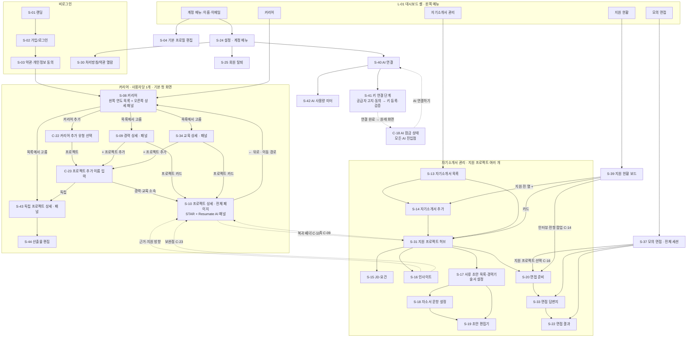

- (v5.5) S-11·S-35·S-36은 폐기, S-12는 `[보류]`라 사이트맵에서 뺐다. S-09·S-34는 별도 화면이 아니라 S-08의 패널 상태다(ID 유지).

### 1.2 화면 목록

| ID | 화면명 | 메뉴/영역 | 관련 기능 | 우선순위 | v4 변경 |
|----|--------|-----------|-----------|----------|---------|
| L-01 | 대시보드 셸 (왼쪽 메뉴) | 공통 | F-COM-10 | Must | **신설** |
| S-01 | 랜딩 | 비로그인 | — | Must | 문구 |
| S-02 | 가입/로그인 | 비로그인 | F-COM-01 | Must | 로그인 후 S-08 |
| S-03 | 약관·개인정보 동의 | 가입 직후 | F-COM-02, F-COM-03 | Must | 다음 화면 S-08, 고지에 AI 작성 대화 추가 |
| S-04 | 기본 프로필 편집 | 커리어 (v5.5: L-01 계정 메뉴에서 진입) | F-P1-01 | Must | v5.5: S-08 상단 요약이 없어져 진입점을 계정 메뉴로 `[가정]` |
| ~~S-05~~, ~~S-06~~ | (v3 폐기 유지) | — | — | — | |
| ~~S-07~~ | ~~홈~~ | — | — | — | **폐기**. 첫 화면은 S-08. 이어하기 항목은 S-08·S-37·S-39로 분산 |
| S-08 | 커리어 | 커리어 (기본 첫 화면) | F-P1-02, 03, 06, 09, 14, 17, F-COM-04 | Must | **v5.5: 왼쪽 연도 목록 + 오른쪽 상세 패널 2단으로 재설계**(CR-3·CR-4·CR-14). v4: 연도 계층 보기 |
| S-09 | 경력 상세 (S-08 패널) | 커리어 | F-P1-02, F-P1-03, F-P1-06 | Must | **v5.5: 별도 편집 화면 → S-08 경력 상세 패널(섹션 수정)으로 재정의.** 경력 단위 성과 삭제(CR-11) |
| S-10 | 프로젝트 상세 (전체 페이지) | 커리어 | F-P1-03, F-P1-06, F-P1-13, F-P1-15, F-P1-19 | Must | **v5.5: 경력·교육 안 프로젝트의 전체 페이지(왼쪽 메뉴 없음). 머리(이름·경험 유형·역량) + STAR 1개 + Resumate AI 패널. S-35·S-36 흡수**(CR-2·CR-3·CR-5·CR-10) |
| ~~S-11~~ | ~~정량 성과 (모달)~~ | — | ~~F-P1-04~~ | — | **v5.5 폐기**(CR-11) |
| S-12 | 스킬 목록 | — | F-P1-05 | `[보류]` | **v5.5: 보류(CR-16)**. 사용 기술은 S-43 태그로만(CR-10) |
| S-13 | 자기소개서 목록 | 자기소개서 관리 | F-AP-02, F-AP-05 | Must | 메뉴 라벨, **전형 단계 열** |
| S-14 | 자기소개서 추가 | 자기소개서 관리 / 지원 현황 | F-AP-01, F-P2-01 | Must | 보드에서도 진입, 새 단계 "지원 전" |
| S-15 | JD·요건 | 자기소개서 관리 | F-P2-02 | Must | |
| S-16 | 인사이트 | 자기소개서 관리 | F-P2-04, 05, 09, F-AP-06 | Must | STAR 단위 근거, 보완점 → C-23 → S-10(v5.5) |
| S-17 | 서류 초안 목록·경력기술서 설정 | 자기소개서 관리 | F-DOC-01, 04, F-AP-06 | Must | 교육 소속 프로젝트도 선택 |
| S-18 | 자소서 문항 설정 | 자기소개서 관리 | F-DOC-02, 09 | Must | |
| S-19 | 초안 편집기 | 자기소개서 관리 | F-DOC-01~04, 08 | Must | |
| S-20 | 면접 준비 | 자기소개서 관리 (모의 면접·지원 현황에서도 진입) | F-P3-01, 07, 13, F-AP-06 | Must | **유형 미리 선택 진입** |
| ~~S-21~~ | (v3 폐기 유지) | — | — | — | |
| S-22 | 면접 결과 | 자기소개서 관리 | F-P3-06, 07 | Must | 점수 슬롯 컬럼 확정 |
| ~~S-23~~ | (v3 폐기 유지) | — | — | — | 전체 세션 목록은 S-37로 새로 정의 |
| S-24 | 설정 | 셸 하단 | F-COM-02, 03, 05 | Must | |
| S-25 | 회원 탈퇴 | 설정 | F-COM-05 | Must | 삭제 범위에 교육·AI 작성 대화·전형 이력. v5.5: 상세 내용·정량 성과 → 산출물 |
| S-26, S-32 | (예약) 커리어 채팅 / 지원 프로젝트 정보 편집 | | Should | | |
| ~~S-27~~ | ~~(예약) 완성도~~ | — | ~~F-P1-07~~ | — | **v5.5 폐기**(F-P1-07 폐기, CR-11). ID 재사용 금지 |
| ~~S-29~~ | ~~(예약) 사용량~~ | — | — | — | **폐기**. F-COM-07(남은 횟수) 폐기. 사용량은 S-42 사용량 미터로 새로 정의 |
| S-28 | 오류·접근 불가 | 공통 | F-COM-01, NFR-PRV-07 | Must | |
| S-30 | 처리방침·약관 열람 | 공통 | NFR-PRV-10 | Must | |
| S-31 | 지원 프로젝트 허브 | 자기소개서 관리 | F-AP-03, 05, 06, F-ST-01 | Must | 헤더에 전형 단계·결과 |
| S-33 | 면접 답변지 | 자기소개서 관리 | F-P3-02~04 | Must | 편집 가능 조건 확정 |
| S-34 | 교육 상세 (S-08 패널) | 커리어 | F-P1-14 | Must | v4 신설(교육 편집). **v5.5: S-08 교육 상세 패널(섹션 수정)로 재정의** |
| ~~S-35~~ | ~~상세 내용 편집 (STAR + 회고 및 배운 점)~~ | — | — | — | **v5.5 폐기** → S-10 STAR(CR-2) |
| ~~S-36~~ | ~~AI 작성 대화~~ | — | — | — | **v5.5 폐기** → S-10 Resumate AI 패널(CR-5) |
| **S-37** | **모의 면접 (전체 세션)** | 모의 면접 | F-P3-15 | Must | **신설** |
| S-38 | (예약) 전형 이력 타임라인 | 자기소개서 관리 | F-ST-06 | Should | |
| **S-39** | **지원 현황 보드** | 지원 현황 | F-ST-01~05 | Must | **신설** |
| **S-40** | **AI 연결** (설정) | 설정(계정 영역) | F-AI-01~05, F-AI-09 | Must | **v5 신설** |
| **S-41** | **키 연결 단계** (공급자별 고지·동의 → 키 등록·검증, Gemini 무료 키 가이드 포함) | 설정 > AI 연결 | F-AI-01, 04, 05 | Must | **v5 신설**. S-40 위 전체 화면 단계(좁은 화면은 페이지) |
| **S-42** | **AI 사용량 미터** | 설정 > AI 연결 | F-AI-07 | Must | **v5 신설** |
| **S-43** | **독립 프로젝트 상세** (S-08 패널) | 커리어 | F-P1-17, F-P1-18, F-P1-05 | Must | **v5.5 신설**(CR-7). 프로젝트 정보·프로젝트 내용·산출물, STAR 없음 |
| **S-44** | **산출물 편집** | 커리어 | F-P1-18, F-P1-06 | Must | **v5.5 신설**(CR-8). 제목 + 마크다운 본문, AI 근거 |

### 1.3 L-01 대시보드 셸 (F-COM-10)

| 요소 | 내용 | 비고 |
|------|------|------|
| 왼쪽 메뉴 | 순서 고정: **커리어 · 자기소개서 관리 · 모의 면접 · 지원 현황**(CR-12: 두 번째 메뉴 이름만 바꿈, 화면·구조는 기업 JD 관리 그대로). 현재 메뉴 강조. 지원 프로젝트 하위 화면(S-14~S-22, S-31, S-33)에 있으면 "자기소개서 관리"를 강조하되, 모의 면접(S-37)·지원 현황(S-39)에서 들어온 경우 이동 경로에 출발 메뉴를 남긴다(아래). **S-10 프로젝트 상세에서는 왼쪽 메뉴를 보이지 않는다**(CR-3) | F-COM-10 |
| 메뉴 배지 | 모의 면접: 작성 중 세션 수 / 새 채점 결과 수(S-37 "새 결과 표식"과 같은 규칙, Q53-10 포함). 자기소개서 관리: 진행 중 AI 작업 수. 커리어: 배지 없음(v5.5: 작성 중 AI 대화 묶음이 없어짐) `[가정]` | |
| 메뉴 하단 | **계정 블록**(사용자 이름·이메일 + 펼침 아이콘, 피그마) → 계정 메뉴: 기본 프로필(S-04), 설정(S-24), AI 연결(S-40), 처리방침, 로그아웃 `[가정]`. 계정 블록 위에 **AI 연결 상태 한 줄**(연결 전: "AI 연결 안 됨" → S-40 / 연결 후: C-19 공급자·등급 배지, 키 무효면 경고 표시) 유지(확정 2026-11-02 (사용자, CR-24). 피그마에 이 줄을 추가해야 한다) | F-AI-09. 메뉴 4개와 별도(PRD 3.1) |
| 상단 바·이동 경로 | 본문 위 상단 바: **사이드바 접기 아이콘 + 현재 메뉴 이름**(피그마). 지원 프로젝트 하위 화면은 메뉴 이름 대신 이동 경로 "**자기소개서 관리** › {회사명 – 포지션명} › {하위 화면}"(예: "… › 자소서 문항 답변", "… › 인사이트", "… › 면접 준비"). 허브(S-31) 제목은 "{회사명 – 포지션명} 자기소개서" `[가정]`. S-39·S-37에서 들어오면 첫 마디가 "지원 현황" / "모의 면접"으로 바뀌어 원래 메뉴로 돌아갈 수 있다. 커리어: S-08은 "커리어", S-44는 "커리어 › {프로젝트명} › 산출물", S-10은 셸 밖 상단 바 "← {회사명/기관명} › {프로젝트명} › 프로젝트 상세" | 화면 안의 개체 이름은 "자기소개서"(CR-23, D-UX-20), 개별 서류는 "자소서 문항 답변"(D-UX-23) |
| 전역 알림 | AI 작업 완료 인앱 토스트(C-03), 복귀 배너(C-10, 커리어 안에서만), AI 장애 배너(S-28) | |
| 좁은 화면 | 메뉴를 접는다: 상단 바 + 메뉴 버튼 → 서랍(drawer)으로 4개 메뉴 `[가정]`. 현재 메뉴 이름은 상단 바에 항상 보인다. 넓은 화면의 사이드바 접기 상태는 브라우저에 기억 `[가정]` | F-COM-10 "UX 결정" |
| 첫 화면 | 로그인·가입 후 항상 S-08(마지막 메뉴를 기억하지 않음, PRD 3.1 `[가정]`). 단 로그인 전 요청한 URL이 있으면 그 URL. **예외: 탈퇴가 끝나지 않은 계정(데이터는 지워졌고 계정 정보 삭제만 남음)으로 로그인하면 동의 게이트·원래 URL보다 먼저 S-25 "탈퇴 마무리"로 보낸다**(A7, 확정 2026-11-05 (사용자)) | |

### 1.4 Should 이하 확장 자리

| 기능 | 배치 예정 | MVP 처리 |
|------|-----------|----------|
| ~~F-P1-07 완성도~~ | — | **폐기**(PRD v4.5, CR-11: S-08 상단 요약·안내 1줄 삭제) |
| F-P1-08 STAR 섹션 다듬기 | S-10 STAR 섹션 편집 안 | 없음 |
| F-P1-12 숙련도, F-P1-16 경력·교육 대화 작성 | S-12 / S-09·S-34 | 없음 |
| F-AP-04 정보 편집 | S-32, S-31 헤더 | S-31 헤더 이름·마감일 인라인 수정 (PRD 5.3 확정) |
| F-AP-09 복제 | S-13·S-39 카드 메뉴 | 없음 |
| F-ST-06 전형 이력 | S-38, S-31 | 없음 (기록은 MVP부터, F-ST-05) |
| F-ST-07 통계, F-ST-08 서류 전형 팝업 | S-39 | 없음 |
| F-P2-03, 07, 08 | S-15 / S-31·S-16 / S-26 | F-P2-07 "데이터 변경됨" 상태 표시만 (PRD 5.3 확정) |
| F-DOC-05, 06, 10 | S-19 / S-18 | 없음 |
| F-P3-08, 09, 10 | S-22 / S-33 / S-37 | 없음 |
| F-COM-06 | S-16·S-19·S-22 | 없음 |
| ~~F-COM-07~~ | — | **폐기**(v4). 사용량 미터 F-AI-07(S-42)로 대체 |
| F-AI-10 모델 직접 선택, F-AI-11 기능별 공급자 | S-40 | 없음 (Won't) |
| F-AI-12 예산 상한, F-AI-13 실시간 분당 한도, F-AI-14 관리자 키 잔액 조회 | — | **명시적 제외**. 화면 자리도 두지 않는다 |

---

## 2. 핵심 플로우

플로우 ID는 바꾸지 않는다. FL-01·FL-02는 v3에서 폐기됐다. v4 신설은 FL-14부터.

| ID | 플로우 | PRD 핵심 작업 | v4 상태 |
|----|--------|---------------|---------|
| FL-03 | 서류 초안 | J-4 | 유지(소속 키·근거 선택 이름 정렬). v5.4: 요건 없는 JD 순서·중단(Q53-4·7). v5.3: 요건 선행 추출(A13)·실패 시 새 초안(A4)·AI-11 실패 시 직접 고르기(A23) |
| FL-04 | 면접 답변지 이어쓰기 | J-5 | 개정(진입점: S-37·S-39) |
| FL-05 | 커리어 정리 (직접 입력) | J-1 | **v5.5 개정**(2단 목록·섹션 수정·C-22·C-23·독립 프로젝트·산출물). v4: 연도 계층·교육·상세 내용 |
| FL-06 | 지원 프로젝트 삭제 | J-2 | 개정(전형 이력 포함, 보드에서도) |
| FL-07 | 회원 탈퇴 | — | 개정(삭제 범위). v5.3: 확인 체크·오류 2종·탈퇴 마무리 재진입(A7) |
| FL-08 | AI 실패·재시도 | — | 개정(`error_category`) |
| FL-09 | 가입 → 커리어 | — | **개정**(홈 → 커리어). v5.5: 빈 커리어 시작점 = "커리어 추가" 1개 |
| FL-10 | 지원 프로젝트 만들기 | J-2 | 개정(보드 진입). v5.4: 동의 필요·키 무효는 만들기 전에 막음(Q53-1) |
| FL-11 | 인사이트 | J-3 | 유지. v5.5: 근거 이동 S-10·S-44, 보완점 → C-23 |
| FL-12 | 모의 면접 (일괄) | J-5 | 개정(진입점 3곳, 유형 미리 선택). v5.4: 입력 원인 실패 이동, 종합만 실패(Q53-3·5·9) |
| FL-13 | 데이터 부족 → 커리어 → 복귀 | — | 개정(대화 작성 바로가기). v5.3: `project_fields` → S-10(A18). **v5.5: 이동 대상 S-10 프로젝트 상세·C-23·S-09 새 경력** |
| **FL-14** | Resumate AI 패널로 프로젝트 STAR 채우기 | J-1 | v4 신설. **v5.5 개정**: S-36 → S-10 패널, 모든 대화는 프로젝트에 묶임, 제안 [반영] 방식(CR-5·CR-6). v5.3의 그만둔 대화 재개(A6)는 없어짐, 상한에서 인사 제외(A5)는 유지 |
| **FL-15** | 지원 현황 보드에서 단계 이동 | J-6 | **신설** |
| **FL-16** | 인터뷰 전형 이동 → 면접 준비 | J-6 → J-5 | **신설** |
| **FL-17** | 모의 면접 메뉴에서 새 면접 시작 | J-5 | **신설** |
| **FL-18** | AI 연결 (공급자 고지·동의 → 키 등록·검증) | J-0 | **v5 신설** |
| **FL-19** | AI 잠금 상태 → AI 연결 → 원래 화면 복귀 | J-0 | **v5 신설** |
| **FL-20** | 키 교체·다시 확인·삭제·활성 공급자 변경 | J-0 | **v5 신설** |
| **FL-21** | 공급자 한도·오류 안내 → 복구 | J-7 | **v5 신설** |

### FL-09 가입 → 커리어

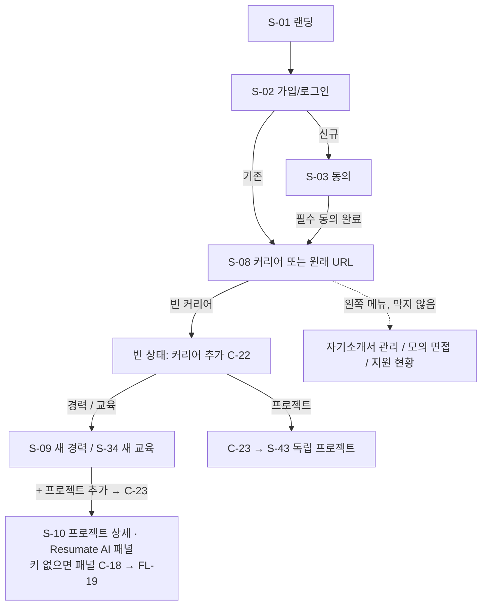

- 화면 단계 수: 가입부터 커리어까지 **3화면**(S-02 → S-03 → S-08). 강제 입력 없음. **키 연결 단계 없음**(D-35).
- (v5.5, CR-14) 빈 커리어의 시작점은 **"커리어 추가" 하나**다(C-22에서 경력 / 교육 / 프로젝트를 고름). v5.4의 두 번째 시작점 "AI와 대화하며 첫 프로젝트 정리하기"는 없다 — 모든 AI 대화는 프로젝트에 묶이므로(CR-6) 경력·교육 아래 프로젝트를 만든 뒤 S-10 패널에서 시작한다. 키가 없으면 그 패널이 C-18이다(FL-19).
- 관련 기능: F-COM-01, F-COM-02, F-COM-03, F-COM-10, F-AI-06.

### FL-05 커리어 정리 — 직접 입력 (J-1, v5.5 개정)

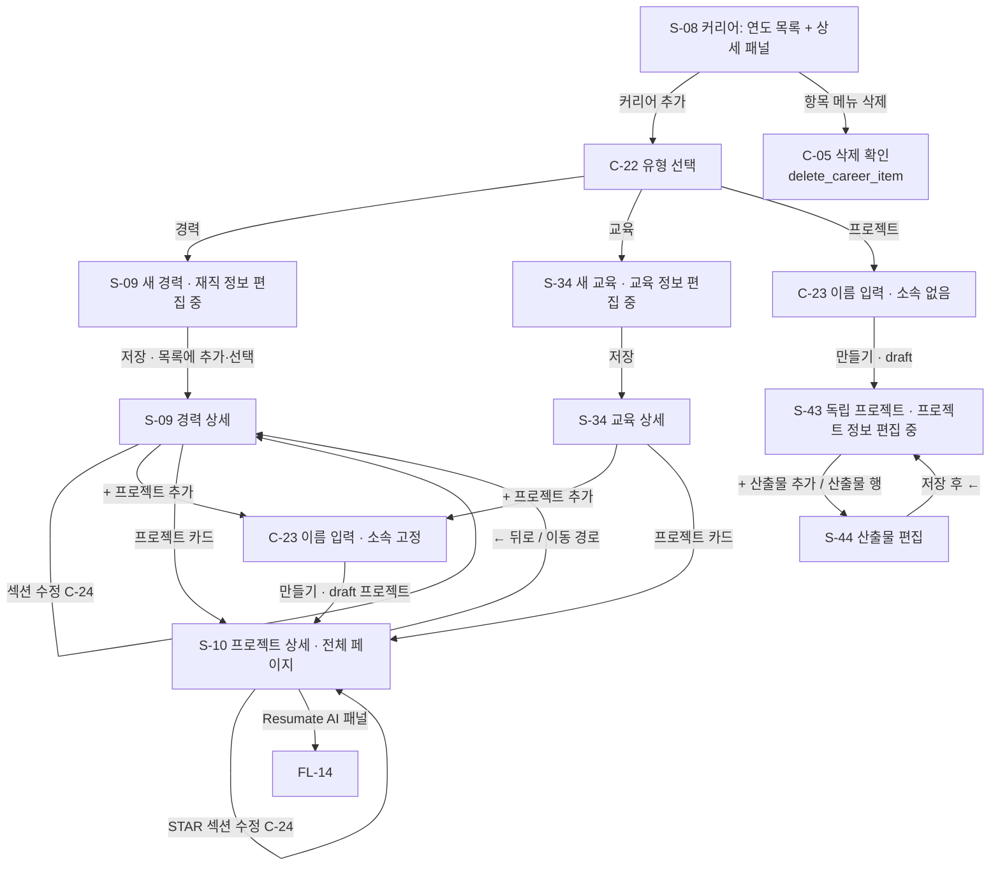

- 화면 단계 수: 첫 경력 + 첫 프로젝트 STAR까지 **2화면 + 다이얼로그 2개**(S-08 → C-22 → S-09 저장 → C-23 → S-10). 돌아와 S-08 연도 목록에서 본다(F-P1-09 완료 지점).
- 편집 방식(D-UX-19): 별도 편집 화면 없이 상세의 섹션마다 "수정"으로 그 자리에서 고친다(C-24). 경력·교육은 처음 저장할 때 행이 생기고, 프로젝트는 이름을 넣고 "만들기"를 누를 때 `draft`로 생긴다(CR-6).
- 완료 판정(PRD v4.5 · DM v4.4): 경력·교육은 v4와 같음 / 경력·교육 안 프로젝트 = 이름 + 상황 + 행동(STAR 1개, CR-2. `role` 조건 제거, CR-10) / 독립 프로젝트 = 이름 + 프로젝트 내용 / 산출물 = 제목 + 본문. **화면에는 "작성 중" 배지가 없다**(CR-11). 미완료 항목이 AI 근거에서 빠진다는 사실은 C-09 게이트에서 알린다.
- 저장: 섹션 "저장"마다 서버 저장, 서버가 `status`(draft / complete)를 다시 계산한다. 편집 중 입력은 브라우저에 임시 보존(C-24, UX-7).

### FL-14 Resumate AI 패널로 프로젝트 STAR 채우기 (F-P1-13, v5.5 개정)

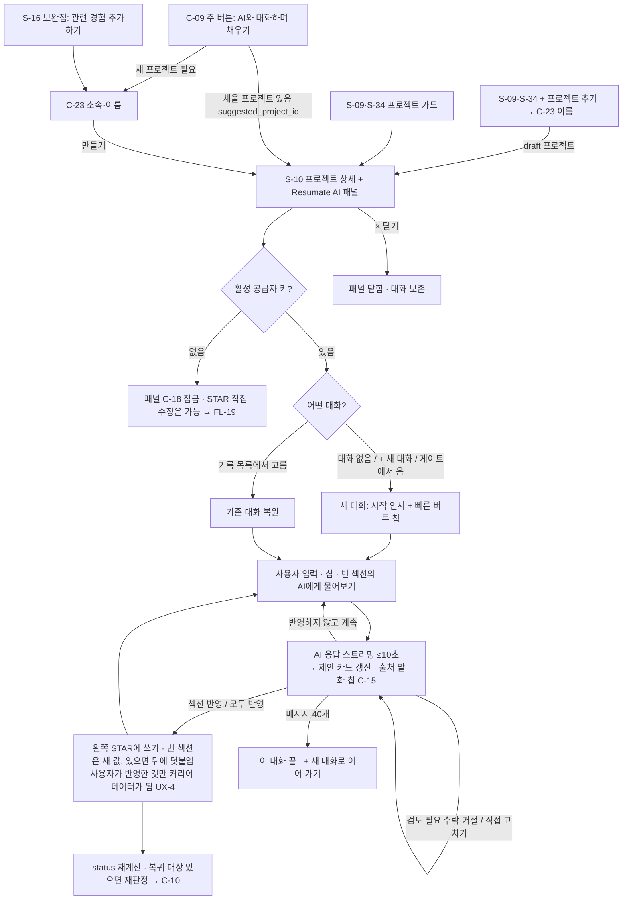

- 화면 단계 수: 시작점에서 STAR 반영까지 **1화면**(S-10). 새 프로젝트면 C-23 다이얼로그 1회가 앞에 붙는다.
- 관련 기능: F-P1-13, F-P1-15, F-P1-06, F-AP-06, F-P2-09.
- **모든 대화는 프로젝트에 묶인다**(CR-6, 확정 2026-11-02 (사용자)). 새 프로젝트를 대화로 시작하려면 C-23에서 이름만 넣어 `draft` 프로젝트를 먼저 만든다. 그래서 `new_project` 모드, 소속 고르기·소속 제안(`affiliation_suggestion`), 정리 결과 일괄 "저장"(`save_writing_chat`), "폼으로 전환"(`hand_off_writing_chat`), "대화 그만두기"·"다시 이어 하기"(A6), 프로젝트에 묶이지 않은 대화의 90일 자동 삭제(U-9 일부)가 없다. 대화 기록은 프로젝트와 함께 남고, 대화만 따로 지울 수 있다(U-9의 나머지는 유지).
- **반영 = 사용자 확정**(UX-4 유지): 제안 카드의 [반영]·[모두 반영]만 커리어 데이터를 바꾼다(검토 필요 섹션은 수락 후). 반영 규칙은 S-10 "반영 규칙". 반영은 사용자 세션의 동기 쓰기(AI 호출 없음) RPC `apply_writing_chat_proposal`이다.
- 키 필요(F-P1-13): 새 대화·메시지 보내기는 활성 공급자 키를 먼저 확인한다(C-18). 키가 무효·삭제돼도 대화 기록과 처리 안 한 제안은 보존·열람되고, 반영은 키 없이 할 수 있다 `[가정]`. 새 메시지를 보낼 때 C-20(D-36).
- 서비스 횟수 제한 없음(D-34). **메시지 상한 40개**(사용자 + AI, 시작 인사 제외, A5)는 **대화마다** 유지하고, 닿으면 새 대화로 이어 간다. 새 대화는 이전 대화 기록을 이어받지 않고 지금 STAR 값만 맥락으로 받는다(AI 명세).

### FL-10 지원 프로젝트 만들기 (J-2)

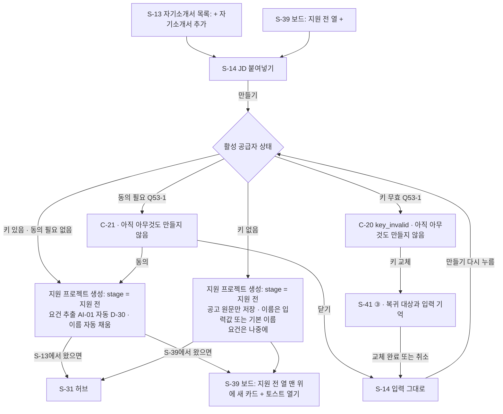

- 화면 단계 수: **2화면**(S-13/S-39 → S-14 → S-31/S-39). 키 없이도 완결(J-2). "키 없이"는 활성 공급자가 없는 경우(`active_provider = null`)를 말하며 이 흐름은 그대로다(추출 없이 저장, D-30).
- **동의 필요·키 무효 (확정 2026-10-30 (사용자, Q53-1))**: "만들기"를 누른 시점에 `consent_required = true`이거나 `key_status = 'invalid'`이면 **행을 만들기 전에 막는다**. 동의 필요 → C-21 → 동의하면 그 "만들기"를 이어서 보내 생성과 요건 추출을 한 번에 한다. 키 무효 → C-20 `key_invalid` → 키 교체. 두 경우 모두 입력은 보존하고, JD 없는 행이 남지 않는다. 추출 없이 저장하는 우회 버튼은 두지 않는다. 키 교체 뒤에는 FL-19처럼 자동 실행하지 않고, 입력이 복원된 S-14에서 다시 누른다. 상세는 S-14.
- 키 없이 만든 JD의 요건은 사용자가 S-15 "요건 정리하기"를 누르거나, 그 JD로 첫 AI 기능(인사이트·서류·면접)을 시작할 때 먼저 추출한다(D-30). 키를 연결해도 기존 JD를 일괄 추출하지 않는다.
- 관련 기능: F-AP-01, F-P2-01, F-P2-02, F-ST-01 (4).

### FL-11 인사이트 (J-3)

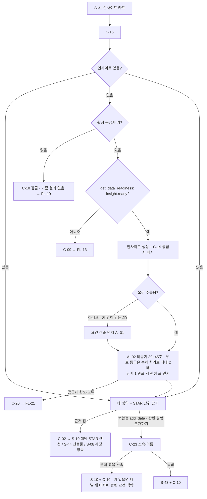

- 화면 단계 수: **2화면**(S-31 → S-16) + 버튼 1회. 관련 기능: F-P2-04, 05, 09, F-AP-06.

### FL-03 서류 초안 (J-4)

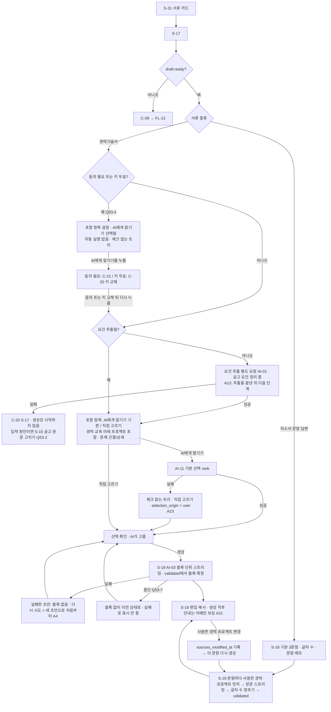

- 화면 단계 수: 경력기술서 **3화면**(S-31 → S-17 → S-19), 자소서 문항 답변 **4화면**(S-31 → S-17 → S-18 → S-19). 관련 기능: F-DOC-01~04, 08, 09.
- 키 필요: 키가 없으면 S-17의 "새 경력기술서 생성"과 S-18·S-19의 생성·다시 생성 버튼이 C-18 잠금으로 바뀐다. 자소서 문항 설정(S-18)과 **기존 초안 열람·편집·복사는 키 없이 가능**하다(D-36).
- **요건 선행 추출 (A13, 확정 2026-11-05 (사용자))**: 요건이 아직 없으면(키 없이 만든 JD) 화면이 먼저 요건 추출(AI-01, 별도 요청)을 부르고, **추출이 끝난 뒤에** AI 기본 선택(AI-11)·생성 요청을 보낸다. 생성 요청 안에서는 추출하지 않는다. 사용자가 "새 경력기술서"를 누르면 추출이 먼저 돌고("공고 요건 정리 중"), 끝나면 포함 항목 설정으로 이어진다. 추출이 실패하면 S-17(자소서는 S-18)에 C-20을 보이고 생성은 시작하지 않는다(초안 행을 만들지 않음). 실패가 입력 원인(`not_a_jd`·`input_too_long`·`safety_blocked`)이면 C-20 버튼은 S-15 공고 원문 수정으로 간다(확정 2026-10-30 (사용자, Q53-2)). 자소서 문항 답변·AI-11도 같은 순서를 따른다(확정 (2026-11-05, 팀), PRD D-30, R-52). 인사이트·면접은 작업 첫 단계 `prepare`에서 추출한다(확정 (2026-11-05, 팀)).
- **요건 없는 JD의 순서와 기본 선택 (확정 2026-10-30 (사용자, Q53-4))**: 요건 없는 JD에서 "새 경력기술서"를 누르면 **추출 먼저 → 포함 항목 설정**이고, 기본 선택은 **"AI에게 맡기기"**다. 정상이면 추출이 끝난 뒤 설정 화면에서 AI-11이 진입 자동 1회로 돈다(사용자가 누른 "새 경력기술서"의 연속이라 D-30의 자동 추출 금지에 걸리지 않는다). **동의 필요·키 무효면 추출도 AI-11도 자동으로 돌리지 않고** 설정 화면을 먼저 보인다("AI에게 맡기기" 선택됨, 체크 없는 트리). "AI에게 맡기기"를 누를 때 C-21 / 키 교체를 거치고, 그 뒤 추출 → AI-11 순서로 간다. 요건이 있는 JD에서 동의 필요·키 무효일 때도 진입 자동 AI-11을 보내지 않는다. 이때 "직접 고르기"로 고른 뒤 "생성"을 누르면 그 자리에서 같은 게이트를 거치고, 요건이 없으면 추출 → 생성 순서로 간다(A13). 상세는 S-17·C-11.
- **경력기술서 생성 중단 (확정 2026-10-30 (사용자, Q53-7))**: "중단"하면 블록을 남기지 않고 이전 상태로 돌아간다. 실패가 아니므로 "생성 실패" 행과 C-20이 나오지 않는다(A4와 일관). 상세는 C-04.
- **경력기술서 생성 실패 (A4, 확정 2026-11-05 (사용자))**: 실패한 초안은 블록 없이 "생성 실패"로 남고, "다시 시도"는 **새 초안 행**으로 처음부터 다시 만든다(실패한 초안의 블록을 이어 쓰지 않음). 다른 다시 시도와 같이 **현재 활성 공급자**로 돈다(C-20 "다시 시도의 공급자", A1 변경). 요건 추출·자소서 문항 답변 실패 문항의 다시 시도도 같다.

### FL-12 모의 면접 — 일괄 방식 (J-5)

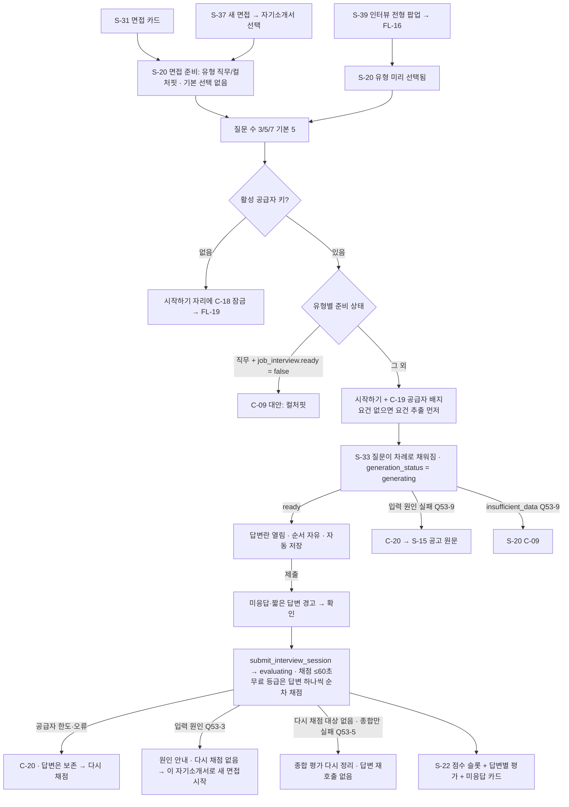

- 화면 단계 수: 진입 화면에서 결과까지 **4화면**(S-31/S-37/S-39 → S-20 → S-33 → S-22). 관련 기능: F-P3-01~04, 06, 07, 13, 15, F-ST-04, F-AI-06, F-AI-08.
- 지난 세션 열람(S-22)과 작성 중 답변 이어 쓰기(S-33)는 키 없이 가능하다. **제출(채점)은 키가 있어야** 한다. 키가 없거나 무효면 제출 버튼 자리에 C-18 / C-20을 보이고 답변은 그대로 보존한다(D-36, F-P3-04).
- **다시 채점 (A9, 확정 2026-11-05 (사용자))**: 평가에 실패한 답변만 다시 평가하고, 종합 평가(`session_feedbacks`)는 **항상 다시** 만든다. 다시 채점을 시작하면 세션 점수·완료 시각을 비우고 `result_viewed_at`을 null로 되돌린다(채점 중에는 표식을 보이지 않다가, 끝나면 "새 결과"로 보인다). 다시 채점은 **현재 활성 공급자**로 돈다(C-20 "다시 시도의 공급자", A1 변경). 진행 단계는 `prepare`(채점 준비 중) → `evaluate`(실패했던 답변 수만큼) → `summarize` → `score` → `complete`(AI 명세 v4.3 C-6).
- **그만둔 세션 (A8, 확정 2026-11-05 (사용자))**: `abandoned` 세션의 답변은 제출 전이어도 고칠 수 없다(읽기 전용). 이어 쓰려면 새 면접을 시작한다.
- **질문 생성 입력 원인 실패 (확정 2026-10-30 (사용자, Q53-9))**: `not_a_jd`·`input_too_long`·`safety_blocked`는 **S-15**(공고 원문을 고칠 수 있는 곳)로 보낸다. `insufficient_data`만 S-20의 C-09로 보낸다. 수정 가능 범위와 그 밖의 경우는 S-15.
- **입력 원인 채점 실패 (확정 2026-10-30 (사용자, Q53-3))**: 제출한 답변은 고칠 수 없으므로 다시 채점 버튼을 두지 않는다. 원인 + "이 자기소개서로 새 면접 시작"(→ S-20).
- **종합만 실패 (확정 2026-10-30 (사용자, Q53-5))**: 다시 채점 대상이 없고 종합만 실패하면 "종합 평가 다시 정리". 답변 평가는 다시 부르지 않는다. 상세는 S-22.

### FL-17 모의 면접 메뉴에서 새 면접 시작 (F-P3-15)

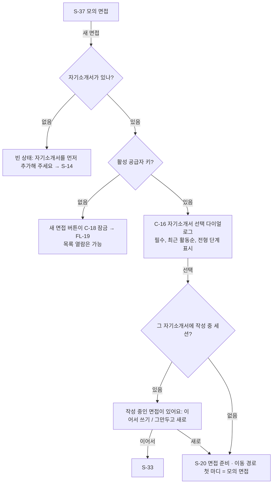

- 화면 단계 수: S-37 → 다이얼로그 → S-20 (**2화면** + 선택 1회).

### FL-15 지원 현황 보드에서 단계 이동 (F-ST-01~03, 05)

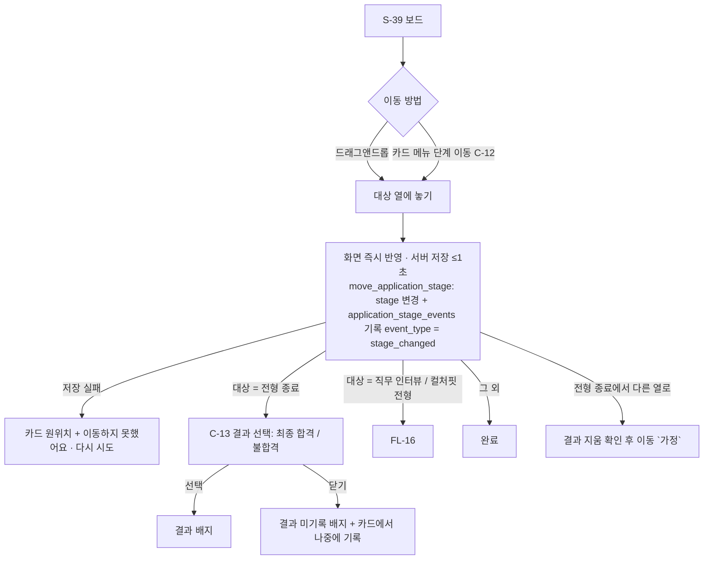

- 관련 기능: F-ST-01, 02, 03, 05. 어느 열로든, 어느 방향으로든 이동 가능(단계 건너뛰기·되돌리기 허용).

### FL-16 인터뷰 전형 이동 → 면접 준비 (F-ST-04)

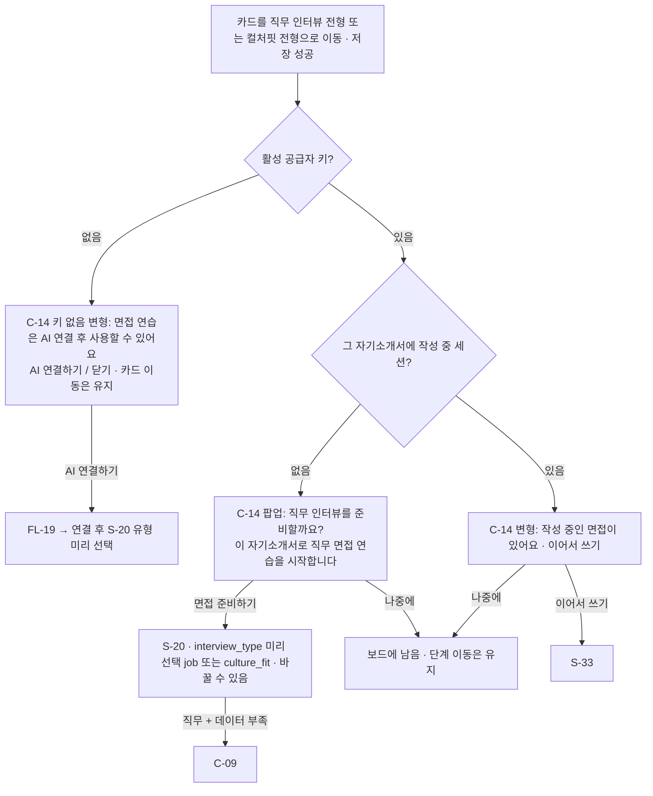

- 팝업은 AI를 실행하지 않는다(토큰을 쓰지 않는다). 이동 저장이 실패하면 팝업을 띄우지 않는다.
- 키가 무효인 경우도 "있음" 경로로 가고, 면접 준비 화면(S-20)에서 시작할 때 C-20을 보인다(PRD 3.3).

### FL-04 면접 답변지 이어쓰기

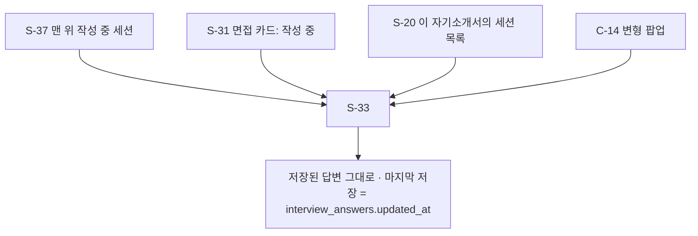

- 지원 프로젝트당 작성 중 세션은 1개(`unique (application_project_id) where status = 'in_progress'`).

### FL-13 데이터 부족 → Resumate AI(또는 직접 입력)로 채우기 → 복귀 (F-AP-06, U-5, v5.5 개정)

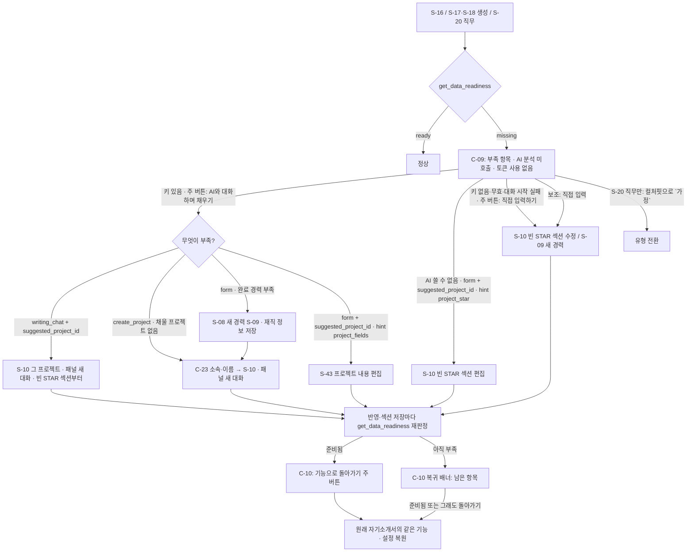

- 화면 단계 수: 기능 화면 → S-10 → 기능 화면(**3화면**). 새 프로젝트가 필요하면 C-23 다이얼로그 1회, 완료된 경력이 없으면 S-08(S-09 새 경력) 1화면이 더 붙는다.
- U-5: 그 자리에서 Resumate AI 패널로 부족한 커리어 데이터를 채우게 하고 원래 기능으로 돌려보낸다. 키가 없거나 대화 시작이 공급자 오류로 실패하면 주 버튼은 "직접 입력하기"(S-10 섹션 수정)다(PRD F-AP-06, 3.3). 컬처핏 예외는 `[가정]` 유지.
- **`form` + `suggested_project_id`의 이동 (A18 대상 변경, 2026-11-02, DM v4.4 6장)**: v5.3은 이름·역할이 빈 프로젝트를 S-10 폼으로 보냈다. v4.4에서 `projects.name`은 not null이고 역할은 소속 프로젝트에 없어(CR-10) 그런 행이 없다. 이제 화면은 `hints`로 나눈다: **`project_star`**(STAR 상황·행동이 빈 소속 프로젝트, v5.4 `complete_project_detail` 대체) → **S-10 빈 STAR 섹션 편집** / **`project_fields`**(프로젝트 내용이 빈 `draft` 독립 프로젝트) → **S-43 "프로젝트 내용" 섹션 편집**.
- 복귀 대상: 패널에서 새 대화를 시작하면 그 대화 행의 `writing_chats.return_target`에 저장되어 기기를 바꾸거나 나중에 다시 열어도 C-10 배너가 나온다. 돌아가면 지운다. 직접 입력(섹션 수정)으로만 간 경우는 브라우저 세션 저장. URL에는 지원 프로젝트 ID와 기능 이름만.
- v5.3의 "저장하고 돌아가기"(일괄 저장 후 재판정)는 없어졌다. 반영·섹션 저장마다 재판정하고, 준비되면 C-10 배너의 "{기능}으로 돌아가기"를 주 버튼으로 강조한다.

### FL-06 지원 프로젝트 삭제

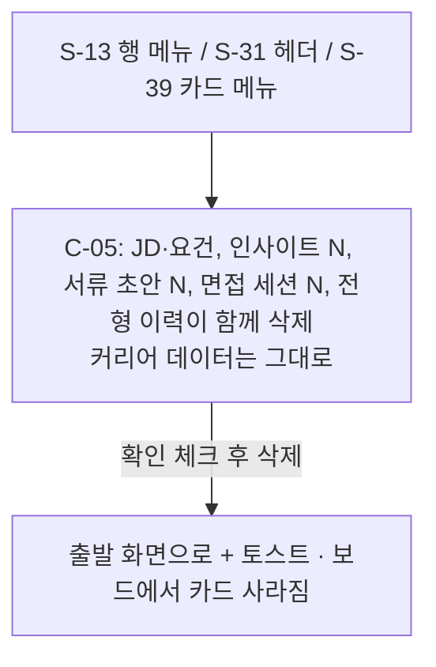

- 관련 기능: F-AP-05. 진행 중 AI 작업은 취소(`ai_jobs.cancel_requested_at`). **토큰 사용 기록은 삭제되지 않는다**(대상 참조만 비움, PRD F-AP-05 `[가정]`).

### FL-07 회원 탈퇴

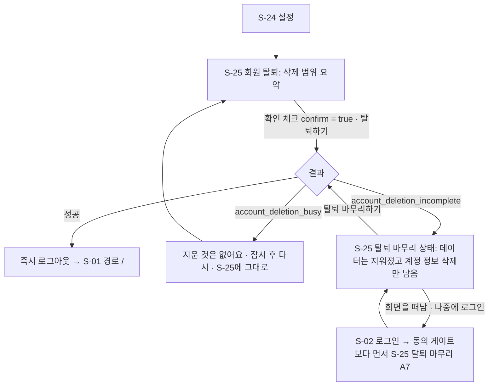

- 삭제 범위: 커리어 전체 + 자기소개서 전체 + AI 작성 대화 + 전형 이력 + **등록한 API 키 전부 + 토큰 사용 기록**, AI 연결 동의 이력은 D-DM-02 정책. 관련: F-COM-05, D-11, NFR-KEY-06.
- 확인 방식: 문구 입력 대신 **확인 체크**("모든 데이터가 즉시 삭제되고 되돌릴 수 없다는 것을 이해했어요")를 켜야 "탈퇴하기"가 활성된다. 요청은 체크 플래그 `confirm: true`로 보낸다(구현 반영).
- 탈퇴 후 이동: 공개 랜딩 S-01(`/`).
- **탈퇴 미완료 재진입 (A7, 확정 2026-11-05 (사용자))**: S-25는 **약관 동의 게이트 밖**에 둔다(동의 기록이 이미 지워진 상태에서도 열린다). 미완료 상태로 로그인하면 S-08·원래 URL·S-03보다 먼저 S-25 "탈퇴 마무리"로 보낸다. 이 상태에서는 다른 메뉴로 갈 수 없고, 할 수 있는 일은 "탈퇴 마무리하기"(같은 요청을 다시 보냄, 멱등)와 로그아웃뿐이다 `[가정]`.

### FL-08 AI 실행 공통 (키 확인 → 데이터 → 실행 → 실패)

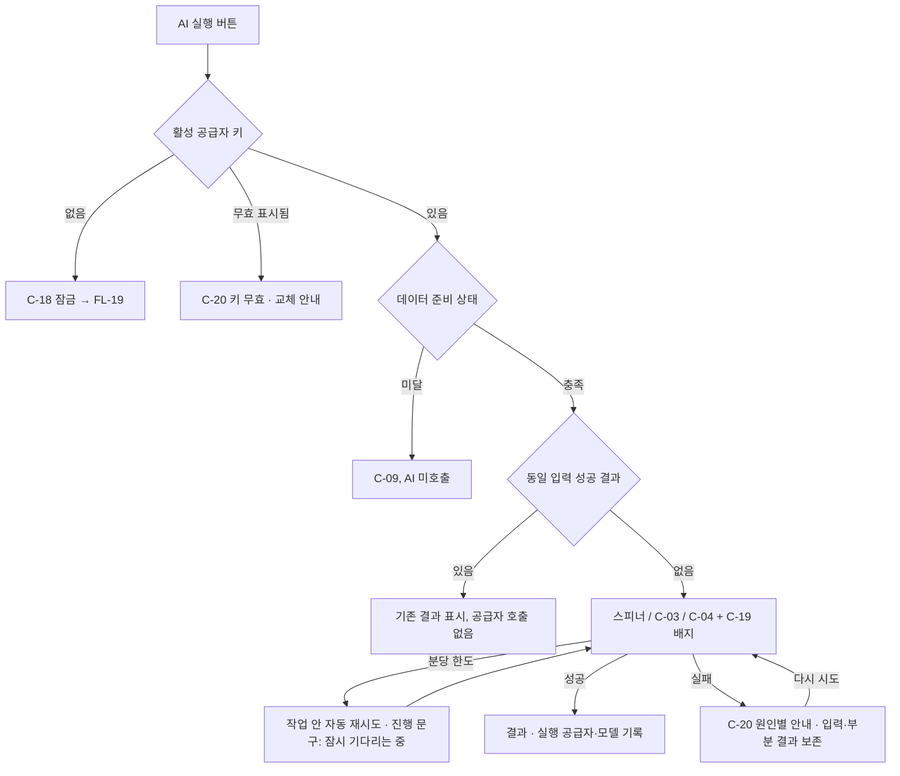

- 서비스 한도 확인 단계는 없다(D-34). 키 확인은 클라이언트 표시용이고, 서버가 실행 시점에 키를 복호화해 다시 확인한다(NFR-KEY-03).

### FL-18 AI 연결 — 공급자 고지·동의 → 키 등록·검증 (F-AI-01, 04, 05)

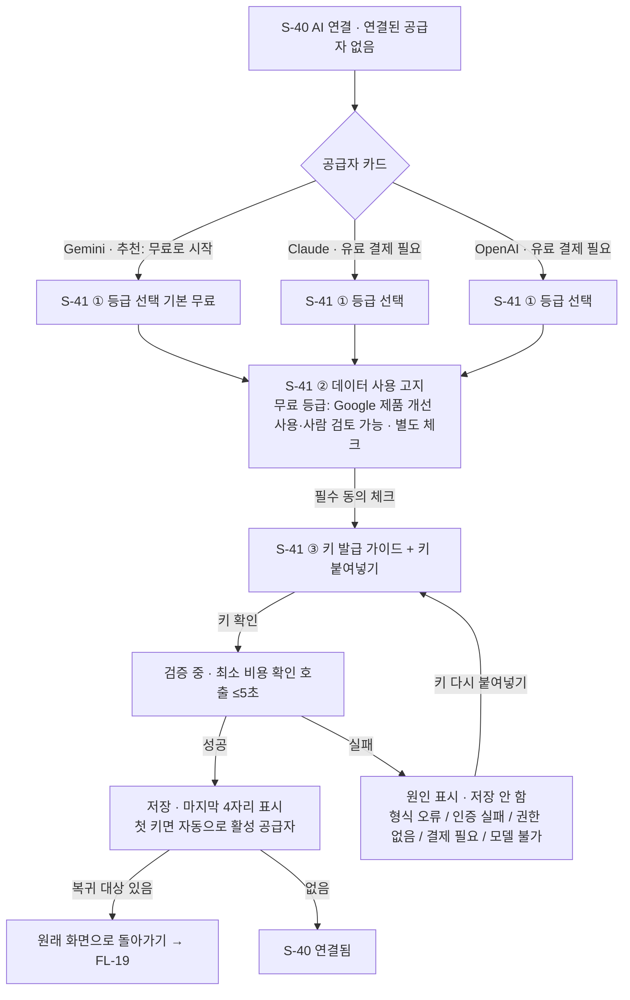

- 화면 단계 수: S-40 → S-41(3단계) → S-40 또는 원래 화면. 고지·동의 없이 키 입력 단계로 갈 수 없다(F-AI-04 (4)).
- 키 원문은 저장 후 다시 보이지 않는다(NFR-KEY-01, 05). 검증 호출의 토큰은 사용량 미터에 "연결 확인"으로 집계된다(NFR-KEY-04 `[가정]`).

### FL-19 AI 잠금 상태 → AI 연결 → 원래 화면 복귀 (F-AI-06)

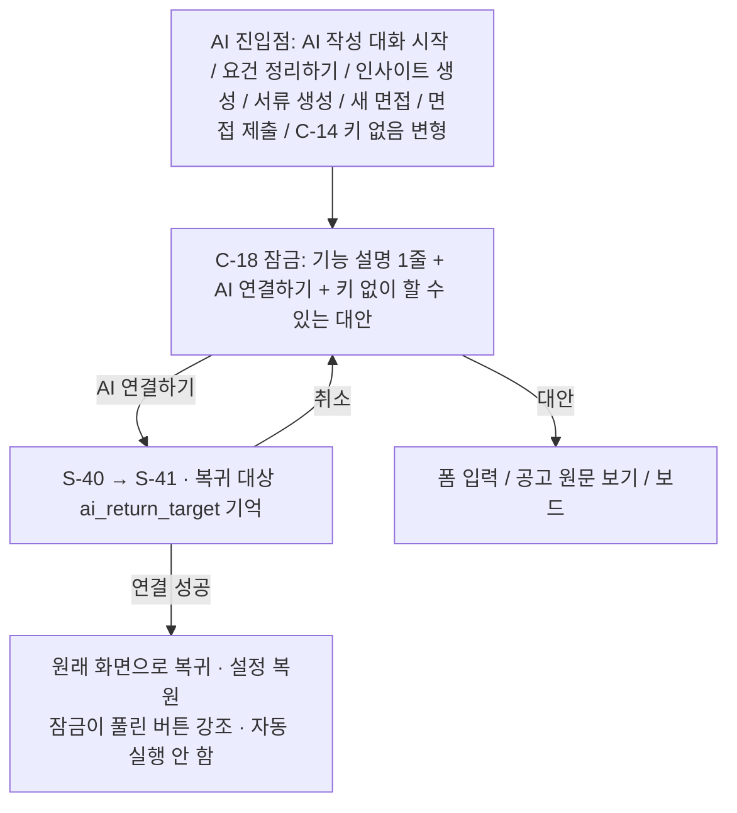

- 연결을 마쳐도 AI를 자동으로 실행하지 않는다(사용자가 누를 때만, NFR-AI-08). 복귀 화면에서 방금 풀린 버튼을 강조만 한다.
- 복귀 대상은 브라우저 세션 저장 `[가정]`(키 연결은 보통 같은 기기에서 끝난다). 데이터 부족 게이트의 `writing_chats.return_target`과는 별개다.

### FL-20 키 교체·다시 확인·삭제·활성 공급자 변경 (F-AI-02, 03)

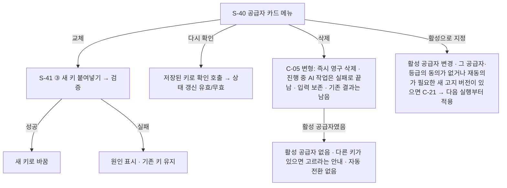

- 재동의 판정(A20, 확정 2026-11-05 (사용자)): 키 등록과 AI 실행 모두 같은 규칙이다. 동의한 뒤 시행된 고지 버전 중 `requires_reconsent = true`인 버전이 있을 때만 C-21을 다시 보인다. 문구만 고친 새 버전은 다시 묻지 않는다.
- 진행 중(running) 작업만 시작할 때의 공급자로 끝까지 간다. **다시 시도를 포함한 모든 재실행은 바꾼 활성 공급자로 돈다**: 실패한 비동기 작업 행의 "다시 시도"(인사이트, 면접 질문 생성), 요건 추출·서류 3종의 다시 시도·다시 생성, 인사이트 다시 생성, 면접 다시 채점·남은 질문 다시 만들기 모두 같다. 같은 작업 행 다시 시도에서 활성 공급자·등급이 작업에 기록된 것과 다르면 처음 단계부터 다시 한다. 활성 공급자 키가 없으면 "AI 연결 필요", 활성 공급자·등급의 동의가 필요하면 활성 공급자·등급으로 C-21을 연다(C-20 "다시 시도 거부" 행, DM 2.11.7 경로 ②)(A1, 확정 2026-11-05 (사용자, A1 변경)). 동의 필요는 `get_data_readiness().ai_connection.consent_required`로 실행 전에 알고, 요청 범위 작업(경로 ⑤)·AI 작성 대화 턴을 포함한 모든 실행 시작 전에 C-21을 먼저 연다. 서버가 동의 원인을 `key_missing`으로 돌려준 경우(경로 ③④⑤)도 readiness를 다시 읽어 `consent_required = true`면 C-21로 보낸다(C-18·C-20, R-67 사용자 확정 2026-11-06). 진행 중인 AI 작성 대화는 다음 메시지부터 새 공급자로 이어 간다(F-AI-03 (2) `[가정]`).

### FL-21 공급자 한도·오류 안내 → 복구 (F-AI-08)

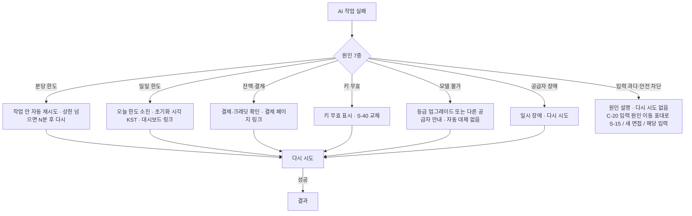

- 모든 경우 입력과 부분 결과는 보존된다. 자동 충전·결제 유도·서비스 내 결제는 없다(F-AI-08).

---

## 3. 화면 명세

### 3.0 공통 컴포넌트·상태

#### C-01 근거 칩 (Evidence Chip)

데이터: `evidence_links`(`owner_type`, `owner_id`, `item_key`, `sort_order`). `item_key`는 초안이면 `block_id`, 그 밖은 점 경로(`requirement_matches.{id}`, `strengths.{n}`, `gaps.{n}`, `gaps.{n}.actions.{m}`, `strategy.positioning`, `strategy.project_priorities.{rank}`, `criteria.{key}`, `improvements.{n}`, `model_answer`, `overall_strengths.{n}`, `sources.{n}`).

| 요소 | 표시 데이터 | 동작 | 비고 |
|------|-------------|------|------|
| 칩 라벨 | 종류 + `source_label`. profile "기본 프로필", experience "경력", **education "교육"**, project "프로젝트", **STAR 필드 "프로젝트 · {필드}"**(`source_field` = situation 상황 / task 역할 / action 행동 / result 결과·성과 / learnings 배운 점, v5.5 CR-2), **산출물 "산출물 › {산출물 제목}"**(v5.5 CR-8, 누르면 S-44 본문에서 `source_locator` 구간 강조. 근거 종류 `project_deliverable`, 별칭 `DLV-n`, 강조 구간 = 원문 마크다운 문자 범위 `{start, end}`, DM v4.4). 분류 3종(종류·경험 유형·역량)은 근거 칩으로 나오지 않는다, ~~achievement "정량 성과"~~(v5.5 폐기, CR-11), skill "스킬", jd_requirement "JD 요건", jd_sentence "공고 원문", interview_answer "내 답변", user_note "내 메모" | 클릭 → C-02 | v5.5: STAR가 프로젝트당 1개가 되어 `title` 칩 없음. STAR 근거는 `source_type = 'project'` + `source_field`(DM v4.4, `project_detail`·`achievement` 종류 삭제) |
| 회고 구분 | `source_field = learnings`인 칩은 "배운 점" 라벨만 쓴다(v5.5, CR-2)(별도 표식 없음). 사실 근거와 다른 종류라는 것은 라벨로 구분된다 | | NFR-AI-06, U-2, PRD v3.2 |
| 상태 | 정상 / **변경됨**(원본 기준 시각 > `source_snapshot_at`. 기준 시각: `project`는 `projects.content_updated_at`(분류·Link만 바꾸면 변경됨 아님), `project_deliverable`은 산출물 `updated_at`, 그 밖은 원본 `updated_at`. 판정은 서버 값을 따른다(DM v4.4 2.8), `jd_sentence`는 JD `created_at` 기준이라 항상 정상) / **원본 삭제됨**(`source_deleted_at`) | | |

#### C-02 근거 패널

| 요소 | 표시 데이터 | 동작 | 비고 |
|------|-------------|------|------|
| 근거 카드 | 라벨, `source_label`, `quote`(있을 때), 경로 "회사명/기관명 › 프로젝트명 › 필드"(독립 프로젝트는 "프로젝트명 › 필드", 산출물은 "프로젝트명 › 산출물 제목") (v5.5) | | `quote` 없는 근거는 원본 현재 값(생성 당시 값 미보관, 원본 삭제 시 값 없음) |
| 원본으로 이동 | (v5.5) STAR 필드 근거 → **S-10 해당 섹션에 포커스**, 프로젝트 근거 → 경력·교육 안이면 S-10 / 독립이면 S-08 `?item=project:` (S-43), 산출물 → **S-44**, 경력 → S-08 `?item=experience:` (S-09), 교육 → S-08 `?item=education:` (S-34), 기본 프로필 → S-04. 커리어로 가는 이동은 C-10 함께 | | 정량 성과 → S-11 이동은 폐기(CR-11) |
| 변경됨 / 원본 삭제됨 | v3와 같음("원본 삭제됨 — 이 근거의 원본과 인용문은 삭제되었습니다", 인용문·이동 없음) | | D-AI-04 (b) |
| 고지 | "입력된 데이터 기준 판단입니다" | | |

#### C-03 AI 작업 상태 (비동기)

| 요소 | 표시 데이터 | 비고 |
|------|-------------|------|
| 진행 | `ai_jobs.job_type`, `ai_jobs.progress.stage` → 문구, `progress.done` / `total` | 10초 안에 첫 진행 |
| 단계 문구 | **`prepare`** — 인사이트·면접 질문 생성: **공고 요건 정리 중**(요건이 이미 있으면 짧게 지나감) / 채점: **채점 준비 중**(AI 호출 없는 시작 준비, 요건 추출 없음) / `match` 요건 대조 중 / `synthesize` 강점·지원 방향 정리 중 / **`synthesize_regen` 강점·지원 방향 정리 중**(`synthesize`와 같은 문구, 숫자 확인 뒤 다시 정리할 때만 나타남) / `validate` 근거 확인 중 / `rank` 쓸 경력·프로젝트 고르는 중 / `generate` 작성 중(면접 질문은 "질문 만드는 중 (n/N)") / `adjust_length` 글자 수 맞추는 중 / `evaluate` 답변 채점 중 / `summarize` 종합 평가 정리 중 / `score` 점수 계산 중 / **`complete` 별도 문구 없음** — 직전 단계 문구를 그대로 둔다(면접 질문 생성은 "질문 만드는 중 (N/N)", 채점은 "점수 계산 중"). 마지막 단계·AI 호출 없음, 곧 완료 화면으로 바뀜 | 데이터 모델 v3.x 확정 키 + v5.3 추가 3개(AI 명세 v4.3 C-6). (R-51) `prepare`(인사이트·질문)·`synthesize_regen`·`complete`는 AI C-6 문구에 맞췄다. 채점 `prepare` "채점 준비 중"만 UX가 따로 정했다 — 채점은 요건을 추출하지 않아 "공고 요건 정리 중"이 틀린 안내가 되기 때문(AI C-6 표에 같은 값 반영 요청) `[가정]` |
| 진행 표시 우선순위 | 목록·카드(S-13·S-31·S-39·S-16)의 기능 상태는 ① 작업이 대기·실행 중이면 이전 결과가 있어도 "생성 중" ② 아니면 최신 결과가 있으면 "있음" ③ 없으면 "없음". 결과가 "생성 중"인데 그 작업이 이미 끝났거나 없으면 **실패로 보인다**(작업 실패면 그 원인, 작업이 없거나 끝났는데 결과가 없으면 `stalled` "시간이 오래 걸려 중단됐어요", 사용자가 취소했으면 표시 없음). 실패 안내는 지금 보이는 결과보다 늦게 끝난 실패만 보인다. 공고 원문 수정(`raw_text_edited_at`) 전에 끝난 실패도 보이지 않는다 | 구현 반영 `[가정]` |
| 부분 결과 | 인사이트 단계 1 판정 표, 채점 완료 답변 카드 | |
| 이탈 허용·완료 알림 | 인앱 토스트 "{회사명 – 포지션명} 면접 채점이 끝났어요 [보기]" + 메뉴 배지 | 이메일·푸시 없음 `[가정]` |
| 공급자 배지 | 진행 표시 옆에 C-19("Gemini · 무료 등급") | F-AI-09 |
| 무료 등급 순차 모드 (D-37) | 활성 공급자가 무료 등급이면: 단계 문구에 처리 단위를 더한다(예: "요건 대조 중 (2/6) — 무료 등급이라 하나씩 처리해요", "답변 채점 중 (3/5)"), 예상 시간 안내를 유료 기준의 **2배**로(예: 인사이트 "1분 30초 정도 걸려요"), 분당 한도로 자동 재시도 중이면 "공급자 요청 한도로 잠시 기다리는 중 (n초)"(n = `ai_jobs.progress.waiting_retry_until` − 지금) — 실패로 표시하지 않음 | 재시도는 AI 명세 v4.3 C-11.3 규칙(아래 C-20 "자동 재시도 규칙"). 상한을 넘으면 C-20. 남은 한도 표시가 아니다(R-44) |

#### C-04 스트리밍 출력

경력기술서(블록), 자소서 문항 답변(문항, 근거 선택 먼저), 면접 질문(차례로 채움), **AI 작성 대화(S-10 Resumate AI 패널) 응답(첫 글자 3초, 완료 10초)**. 중단은 `ai_jobs.cancel_requested_at`. 이탈 시 서버가 끝까지 생성·저장 `[가정]`.

- **서류 스트리밍 이벤트 순서 (AI-04, 구현 반영)**: `sources_selected`(사용한 경력·프로젝트 카드 먼저) → 블록 스트리밍(`block_started` / `block_delta` / `block_completed`) → (글자 수 보정이 필요할 때만) `adjusting_length`("글자 수 맞추는 중", 보정 전 글자 수·제한·기준 표시) → **`validated`** → `done`.
- **블록 확정 시점**: 스트리밍 중 블록은 **임시 표시**다(블록 id가 아직 확정되지 않음). `validated`가 오면 화면은 그 문항(경력기술서는 초안)의 블록을 **통째로 교체**한다. 근거 칩·자리 표시·검증 배지·"생성 직후 안내"(S-19)는 `validated` 뒤에 붙는다. 그 전에는 편집·복사를 막고 "마무리 중"으로 보인다. 경력기술서(AI-03)도 같은 방식이다(블록 id는 `validated`에서 확정).
- **경력기술서 중단 (확정 2026-10-30 (사용자, Q53-7))**: `validated` 전에 "중단"하면 임시 블록을 모두 버리고 **블록 없이 이전 상태로** 돌아간다. 다시 생성 중이었으면 기존 초안의 블록·편집본·상태·`generation_no`가 그대로다. 첫 생성이었으면 초안은 생성 전 상태(`drafts.status = 'composing'`)로 돌아가고 포함 항목·문체 설정을 복원한다 `[가정]`. 어느 쪽이든 `failed`가 아니고 C-20을 보이지 않는다(`canceled` 표시 안 함). `validated`가 먼저 도착하면 완료로 본다 `[가정]`.

#### C-05 삭제 확인 다이얼로그

| 대상 | 표시 데이터 | 선택지 | 처리 |
|------|-------------|--------|------|
| 커리어 항목(경력·교육·프로젝트·산출물) (v5.5) | `get_deletion_impact(entity_type, entity_id, affiliation_mode)` (`entity_type`: experience / education / project / **project_deliverable** / writing_chat. v5.5에서 project_detail·achievement 삭제, skill은 S-12 보류로 화면 진입점 없음): `cascade`(projects, project_skills, writing_chats, **project_deliverables** 개수), `affected_results.by_application_project[]`(자기소개서별 insights·drafts·draft_sections·interview_sessions 수) | ① 결과 처리 `result_mode`: **"결과는 남기고 근거만 '원본 삭제됨'으로"**(`keep_results`, 기본값) / **"관련 결과도 함께 삭제"**(`delete_results`) ② 경력·교육 삭제 시 소속 프로젝트 `affiliation_mode`: **`delete_projects`만**(기본값도 같음, 데이터 모델 v4.4가 `keep_projects`를 `affiliation_mode_not_supported`로 거부). 다이얼로그에 "이 {경력/교육}의 프로젝트 N개와 그 STAR·AI 대화 N개가 함께 삭제돼요"를 보인다(확정 2026-11-02 (사용자, CR-15), D-UX-22) | RPC `delete_career_item(entity_type, entity_id, affiliation_mode, result_mode)` |
| `delete_results` 범위 설명 | "인사이트는 해당 버전, 경력기술서는 문서 전체, 자소서 문항 답변은 **해당 문항의 생성 결과만**(문항·글자 수·메모는 남음), 모의 면접은 **세션 전체**가 삭제돼요" | | 데이터 모델 4.2 결과 단위 |
| 공통 안내 | "어느 쪽이든 인용문은 지워져요. 결과를 남기면 AI가 쓴 본문에는 내용이 남을 수 있어요" | | |
| ~~상세 내용 삭제~~ | v5.5 폐기(상세 내용·정량 성과 없음, CR-2·CR-11) | | |
| 프로젝트 삭제 | 경력·교육 안: "STAR 내용과 이 프로젝트의 AI 대화 {N}개가 함께 삭제돼요" / 독립: "산출물 {N}개가 함께 삭제돼요" (`cascade.writing_chats`, `cascade.project_deliverables`) | | D-27 (a). `writing_chats.project_id` 연쇄 |
| AI 대화만 삭제 (`entity_type = 'writing_chat'`, S-10 패널 ⋯ 메뉴) | "대화 메시지 {message_count}개가 삭제돼요. 이미 반영한 STAR 내용은 그대로예요" | `result_mode` 없음 | v5.5: 저장 전 정리 결과·출처 대화 연결 문구 삭제 |
| 산출물 삭제 (S-44) | "'{산출물 제목}'을 삭제할까요?" + 결과 처리 선택지(위 ①, 산출물이 근거로 쓰인 결과가 있을 때만) | | v5.5 신설, CR-8 |
| 자기소개서(지원 프로젝트) | "JD·요건, 인사이트 N, 서류 초안 N, 면접 세션 N, 전형 이력이 함께 삭제돼요. 커리어 데이터는 그대로예요" + 확인 체크 | | F-AP-05 |
| 초안 / 면접 세션 | 하위 개수 | | |
| **API 키 삭제** (S-40) | "{공급자} 키를 삭제할까요? 즉시 영구 삭제되고 되돌릴 수 없어요. 진행 중인 AI 작업 {N}건은 실패로 끝나고 입력(답변·대화·문항)은 그대로 남아요. 지금까지 만든 AI 결과는 그대로 볼 수 있어요" + 활성 공급자였다면 "삭제하면 AI 기능이 잠겨요. 다른 키가 있으면 활성 공급자를 직접 골라 주세요" + "공급자 사이트에서도 키를 폐기하려면 → 대시보드 링크" | 취소 / 삭제 | D-36, NFR-KEY-06·09. 자동 전환 없음(F-AI-02 (3) `[가정]`) |
| **API 키 교체** (S-41 ③) | "새 키로 확인되면 바꿔요. 확인에 실패하면 기존 키를 그대로 써요. 진행 중 작업은 기존 키로 끝나요" | 확인 | F-AI-02 (1) |

#### C-06 저장 상태 · C-07 입력 가이드

- C-06: "저장 중… / 저장됨 HH:MM / 저장 실패 — 다시 시도". (v5.5) 커리어 섹션 저장(C-24) 뒤에 잠깐 보인다. v5.4의 "작성 중 — 필수 항목을 채우면 AI 분석에 반영돼요" 표시는 CR-11(작성 중 배지 삭제)에 따라 뺀다 `[가정]`(CR-21: 대신 S-10·S-43에 빈 칸일 때만 보이는 도움말 한 줄).
- C-07 가이드:

| 가이드 | 위치 | 내용 |
|--------|------|------|
| G-1 본인 행동 | **S-10 행동(Action) 섹션 편집** | "'우리 팀은'보다 '저는'으로 써 주세요. 팀이 한 일·배경은 상황에 써 주세요" |
| G-2 민감정보·기밀 | 모든 자유 서술 필드(근무 내용·교육 내용·프로젝트 내용·STAR·산출물), S-10 AI 패널 입력창 | "건강·종교·노조 활동 같은 민감정보, 동료·고객의 개인정보, 회사 기밀은 쓰지 마세요" |
| ~~G-3 정량 성과 권유~~ | — | v5.5 폐기(CR-11). 숫자는 결과/성과 안내 문구("숫자가 있으면 함께 써 주세요")로 대신 |
| G-4 STAR 권유 | S-10 역할·결과/성과·배운 점이 비었을 때(편집 중 자리 표시) | 필드별 한 줄 예시 |

#### C-08 자리 표시·검증 배지

v3와 같음. "커리어에 추가하기"는 STAR가 근거인 블록이면 S-10 해당 섹션으로, 산출물이 근거면 S-44로 이동(v5.5).

#### C-09 데이터 부족 게이트 (F-AP-06)

데이터: RPC `get_data_readiness()` → `counts`, `draft_item_ids`, `features.{insight | draft | job_interview | culture_fit_interview}.ready / missing / data_sufficiency`. (v5.5) 이동 대상은 S-10 프로젝트 상세(STAR·Resumate AI 패널)·C-23 프로젝트 추가·S-09 새 경력으로 바뀌었다. `hints`(`project_star`·`project_fields`)·`counts.projects_without_complete_star`·`next_action = 'create_project'`는 데이터 모델 v4.4 6장.

| 요소 | 표시 데이터 | 동작 | 비고 |
|------|-------------|------|------|
| 제목 | 기본: "{기능}을 만들려면 커리어가 조금 더 필요해요. AI와 대화하며 바로 채워 볼까요?" / **`project_fields`**(`next_action = 'form'` + `suggested_project_id`, 프로젝트 내용이 빈 독립 프로젝트): **"한 칸만 채우면 바로 쓸 수 있어요"** | | U-5. `project_fields` 제목은 확정 2026-10-30 (사용자, Q53-8)의 1칸 문구를 따른다 |
| 부족 항목 (`missing`) | `complete_experience` "완료된 경력 1건이 필요해요(교육만으로는 부족해요)", `complete_project` "완료된 프로젝트 1건이 필요해요" + 현재 개수(`counts.complete_experiences`, `counts.complete_projects`) | — | 교육 아래 프로젝트, 완료된 독립 프로젝트도 셈(DM v4.4 D-01) |
| 보조 안내 (`hints`) | `project_star`(v5.5, v5.4 `complete_project_detail` 대체: STAR가 덜 찬 소속 프로젝트) → "프로젝트는 있지만 STAR의 상황·행동이 비어 있어요" + `counts.projects_without_complete_star` / **`project_fields`** → "'{프로젝트명}'의 프로젝트 내용이 비어 있어요"(DM v4.4: `description`이 빈 `draft` 독립 프로젝트) | — | `hints`는 문구 분기용, 판정은 `missing`만. A18 대상 변경(2026-11-02) |
| **`form` + `suggested_project_id`** (키 없음·무효 등 AI를 못 쓸 때, DM 6장 판정 ②·③) | 서버가 `next_action = 'form'` + `suggested_project_id` + `hints`를 준다. 화면은 **`hints`로 이동 대상을 나눈다** | 주 버튼 **"'{프로젝트명}' 마저 채우기"** + 복귀 대상 기억(브라우저 세션), 저장마다 재판정 → C-10: **`project_star`** → **S-10 그 프로젝트, 빈 STAR 섹션(상황 → 행동 순) 편집 열림** / **`project_fields`** → **S-08 `?item=project:{id}`(S-43), "프로젝트 내용" 섹션 편집 열림** | A18 대상 변경(2026-11-02). 대화로 보내지 않는다. 독립 프로젝트를 S-10으로 보내지 않는다 |
| **주 버튼** (`features.{기능}.next_action`) | `next_action = 'writing_chat'` → **"AI와 대화하며 채우기"**: `suggested_project_id`가 있으면 → **S-10 그 프로젝트 + 패널 새 대화**(빈 STAR 섹션부터 묻도록 `requested_slot`), 없으면(`next_action = 'create_project'`) → **C-23**(소속 고르기 — 완료 경력이 있으면 그 경력 미리 선택 — + 이름) → S-10 + 패널 새 대화. 인사이트 보완점에서 왔으면 관련 요건을 대화 시작 맥락으로 표시 / `next_action = 'form'`: `suggested_project_id`가 있으면 "'{프로젝트명}' 마저 채우기"(위 행, `hints`로 S-10 / S-43), 없고 `missing`에 `complete_experience`가 있으면 **"경력 먼저 입력하기"**(S-08 + S-09 새 경력), 그 밖(키 없음·무효)은 "직접 입력하기"(아래 키 행) | 새 대화 행의 `writing_chats.return_target`에 복귀 대상 저장(돌아가면 지움) | **U-5 유지**. 대화 버튼 옆 C-19 배지 |
| 경력이 없을 때 | `next_action = 'form'`: 대화는 경력을 만들지 않으므로(F-P1-16 Could) S-09 새 경력(재직 정보 필수 3개)을 먼저 열고, 저장 후 다시 판정해 `writing_chat`이면 C-23(소속 = 방금 만든 경력 미리 선택) → S-10 | S-09 → C-23 → S-10 → 복귀 | |
| **키가 없거나 무효이거나 대화 시작이 실패할 때** | `active_provider = null` 또는 `key_status = 'invalid'`이면 서버가 `next_action = 'form'`. 대화 첫 턴이 공급자 오류로 실패해도 주 버튼을 **"직접 입력하기"**로 바꾼다: `draft_item_ids`의 프로젝트가 있으면 S-10(빈 STAR 섹션 편집 열림), 없으면 C-23 → S-10. 복귀 대상은 브라우저 세션. C-20 원인 한 줄 + "키를 확인하면 AI와 대화로 채울 수 있어요 [AI 연결 확인]". 이미 이 프로젝트에 대화가 있으면 "이어서 대화하기"는 그대로(새 메시지 전송 시 C-20) | | PRD F-AP-06, 3.3 |
| 키가 없을 때 | 키가 없으면 AI 기능 버튼 자체가 C-18 잠금이라 보통 이 게이트에 오지 않는다. 데이터 부족만 알려야 하는 경우에는 주 버튼을 "직접 입력하기"로 한다 | | PRD 3.3 |
| 보조 링크: 직접 입력 | 작성 중 항목(`draft_item_ids`)이 있으면 그 항목(경력·교육 → S-08 해당 항목, 경력·교육 안 프로젝트 → S-10, 독립 프로젝트 → S-08 S-43), 없으면 C-22 | 복귀 대상 기억 | |
| (S-20 직무) 대안 | "컬처핏 면접은 지금 바로 연습할 수 있어요" | 유형 전환 | 컬처핏 예외 `[가정]`(U-5) |
| 안내 | "AI 분석은 실행하지 않았어요(토큰을 쓰지 않았어요). 커리어를 채우면 이 화면으로 다시 돌아와요" + (v5.5) "덜 채운 항목은 AI 분석에 쓰이지 않아요" | | CR-11로 목록의 "작성 중" 배지가 없어져, 미완료가 근거에서 빠진다는 안내를 여기서 한다 `[가정]` |

#### C-10 복귀 배너

커리어 안 모든 화면(S-04, S-08과 그 패널 S-09·S-34·S-43, S-10, S-44) 상단. "{회사명 – 포지션명} · {기능}으로 돌아가기" + 준비 상태(섹션 저장·STAR 반영마다 `get_data_readiness()` 재판정). 준비되면 "{기능}으로 돌아가기"를 주 버튼으로 강조한다(v5.3 S-36 "저장하고 돌아가기" 대체). 돌아가면 원래 화면의 진행 중 설정(면접 유형·질문 수, 자소서 문항, 경력기술서 포함 항목 등)을 복원한다(U-5). S-10에서는 상단 바 아래, AI 패널을 포함한 페이지 전체 폭에 둔다.

#### C-11 사용한 경력·프로젝트 (F-DOC-08 / F-DOC-01)

| 요소 | 표시 데이터 | 동작 | 비고 |
|------|-------------|------|------|
| 자소서 문항별 목록 | `draft_section_sources`: `experience_id` 또는 `education_id` + `project_id`(→ "회사명 또는 기관명 › 프로젝트명", 원본 삭제 시 `source_label`. v5.5: `project_detail_ids`·"사용한 상세 내용 제목"은 삭제(DM v4.4). 산출물은 근거 선택 단위가 아니며 고른 독립 프로젝트의 산출물이 함께 쓰인다), `role`(primary 주 근거 / supporting 보조), `origin`(ai AI 선택 / user 내가 추가), `rationale`, `requirement_ids`(관련 요건), `reuse_reason`(다른 문항과 같은 프로젝트일 때), `source_deleted_at` | | |
| 변경 | 완료 상태 경력·교육·프로젝트 체크 트리(독립 프로젝트 포함, v5.5: 상세 내용 펼치기 없음) | 추가/제외 → `draft_sections.source_selection_mode = 'user'`, `sources_modified_at` 기록 → "변경 사항으로 다시 생성" 활성 | |
| 다시 생성 | "다시 생성하면 공급자 토큰을 다시 써요" + C-19 배지 + 편집본 덮어씀 확인 | 성공 시 `generation_no + 1`, `sources_modified_at = null` | 이전 생성본 보관 없음(D-DM-06) |
| 모두 제외 | "근거 없이 메모·공고 내용만으로 작성돼요" 경고 후 허용 | | 데이터 모델 확정 동작 |
| 경력기술서 | `drafts.options.included_experience_ids` / `included_education_ids` / `included_project_ids` / `project_order` + 출처 `drafts.options.selection_origin`(insight "인사이트 우선순위" / ai_ranking "AI가 고름" / user "직접 고름") | 변경 → 전체 다시 생성 | AI 기본 선택 단계 = AI-11, 진행 `rank`. 프로젝트는 최대 8개, 프로젝트당 불릿 최대 4개 `[가정]`(구현 값) |
| **AI 기본 선택 실패** (A23, 확정 2026-11-05 (사용자)) | AI-11이 실패하면 **대신 골라 주지 않는다**(최신순 전체 선택 같은 대체 없음). 트리를 **아무것도 체크하지 않은 상태**로 열고 "AI가 포함할 항목을 고르지 못했어요. 직접 골라 주세요" + C-20 원인 한 줄 | 사용자가 체크 → 생성 시 `selection_origin = 'user'`("직접 고름"). 1개 이상 골라야 "생성" 활성 `[가정]`. "AI에게 다시 맡기기"(AI-11 다시 시도, 새 요청이라 현재 활성 공급자, C-19 배지)도 둔다 | 출처 값 목록(insight / ai_ranking / user)은 그대로 |
| **자동 실행이 없는 진입** (확정 2026-10-30 (사용자, Q53-4)) | 동의 필요·키 무효, 연결 직후 복귀(FL-19)처럼 AI-11이 자동으로 돌지 않으면 기본 선택은 그대로 **"AI에게 맡기기"**이고 트리는 체크 없이 연다. 안내: "'AI에게 맡기기'를 누르면 포함할 항목을 골라 드려요" `[가정]`. 요건 없는 JD 정상 진입은 추출이 끝난 뒤 AI-11이 자동으로 돈다(FL-03) | "AI에게 맡기기" 누름 → 동의 필요: C-21 / 키 무효: C-20 `key_invalid` 키 교체 / 정상: (요건 없으면 추출 →) AI-11. "직접 고르기"로 바꾸면 체크해서 생성할 수 있고, 생성을 누를 때 같은 게이트를 거친다 | 선택이 없는 동안 "생성" 비활성(1개 이상 규칙 `[가정]`, A23 행과 같음). 인사이트 우선순위가 있으면 AI-11 없이 그 값이 기본 선택 |
| 자소서 사용자 근거 개수 | 문항당 직접 추가할 수 있는 경력·프로젝트 최대 5개 `[가정]`(구현 값). 넘으면 체크 비활성 + "한 문항에 5개까지 고를 수 있어요" | | |

#### C-12 단계 이동 메뉴 (신설, F-ST-02 (3))

보드 카드 메뉴(⋯)와 S-31 헤더 전형 단계 칩에서 연다.

| 요소 | 표시 데이터 | 동작 | 비고 |
|------|-------------|------|------|
| 단계 목록 | 6단계, 현재 단계 체크 | 선택 → 드래그와 같은 처리(FL-15) | 키보드: 카드에 포커스 후 Enter로 메뉴, 화살표로 단계 선택 |
| 단축 동작 | "다음 단계로" | 다음 열로 이동 | `[가정]` 편의 |
| 스크린 리더 | 이동 후 "{카드}를 {단계}로 옮겼어요" 알림 | | |

#### C-13 전형 결과 선택 창 (신설, F-ST-03)

| 요소 | 표시 데이터 | 동작 | 비고 |
|------|-------------|------|------|
| 제목 | "전형 결과를 기록할까요?" | | |
| 선택지 | **최종 합격** / **불합격** → `application_projects.stage_outcome` = `passed` / `failed` (RPC `set_application_outcome`, 이력 `event_type = 'outcome_changed'`) | 선택 → 저장, 카드 배지 | D-25 (a) 사용자 확정(U-3). 지원 철회 등은 추가하지 않음 |
| 닫기 | — | `stage_outcome = null` → 카드 "결과 미기록" 배지 + 카드 메뉴 "결과 기록" | |

#### C-14 인터뷰 전형 팝업 (신설, F-ST-04)

| 요소 | 표시 데이터 | 동작 | 비고 |
|------|-------------|------|------|
| 직무 인터뷰 전형으로 이동 시 | "직무 인터뷰를 준비할까요? {회사명 – 포지션명}으로 직무 면접 연습을 시작합니다" | **면접 준비하기** → S-20 `?type=job` / **나중에** → 닫기 | 쿼리에는 유형 값만 |
| 컬처핏 전형으로 이동 시 | "컬처핏 면접을 준비할까요? …" | → S-20 `?type=culture_fit` | |
| 작성 중 세션이 있을 때 | "이 자기소개서에 작성 중인 면접이 있어요({유형}, n/N 작성 · 마지막 활동 {상대 시각})". 데이터: `move_application_stage` 반환 `interview_prompt.in_progress_session`(`session_id`, `interview_type`, `answered_count`, `question_count`, `generation_status`, `last_activity_at`). `generation_status = 'generating'`이면 "질문을 만드는 중이에요", `failed`면 "질문 생성이 끝나지 않았어요"를 덧붙인다. **세션 유형이 옮긴 열과 다르면**(예: 컬처핏 전형으로 옮겼는데 작성 중 세션은 직무 면접) "작성 중인 면접은 {직무 면접}이에요. 이어 쓰거나 S-20에서 그만두고 {컬처핏 면접}을 새로 시작할 수 있어요" | **이어서 쓰기** → S-33 / **나중에** | 유형이 달라도 이어 쓰기를 먼저 안내(세션은 자기소개서당 1개, 유형 무관) — 리뷰 T-12 권고로 UX 결정. 세션 상세는 구현 반영(데이터 모델 v4.2) |
| **키가 없을 때 (v5)** | "면접 연습은 AI 연결 후 사용할 수 있어요. 연결하면 {직무 면접 / 컬처핏 면접}이 선택된 면접 준비로 바로 이어져요" | **AI 연결하기** → FL-19(복귀 대상 = S-20 `?type=`) / **닫기** | F-ST-04 (8). 카드 이동은 그대로 유지 |
| 공통 | AI를 실행하지 않는다(토큰 사용 없음). 닫아도 단계 이동은 유지 | | |
| 반복 | 같은 카드를 같은 인터뷰 열로 다시 옮기면 다시 뜬다. "다시 보지 않기"는 두지 않음(리뷰 T-12 권고로 UX 결정) | | |

#### C-15 출처 발화 칩 (F-P1-13 (3), v5.5 개정)

S-10 Resumate AI 패널의 **STAR 제안 카드**(대화당 1개, v4 S-36 정리 결과 미리보기 대체)의 섹션마다 붙는다. C-01과 같은 모양. 데이터는 대화의 정리 결과 `structured_draft.star.{situation,task,action,result,learnings}`(기간은 `structured_draft.project.{start_month,end_month}`, 데이터 모델 v4.4): `value`, `origin`, `source_message_ids`, `source_quotes`, `review`, 반영 여부 `applied_at`.

| 요소 | 표시 데이터 | 동작 | 비고 |
|------|-------------|------|------|
| 상태 ① 출처 있음 (`review = 'ok'`) | "내 답변 #n" 칩(`source_message_ids` → `writing_chat_messages.sequence`, 사용자 메시지만 다시 번호) | 칩 클릭 → 대화의 해당 발화로 스크롤·`source_quotes` 구간 강조 | |
| 상태 ② **검토 필요** (`review = 'needs_review'`) | 값 + "AI가 정리한 표현이 원래 말과 달라요. 확인해 주세요" + 출처 칩 + **[수락] / [거절(비우기)]** | 수락 → `accepted`, 이후 AI가 덮어쓰지 않고 반영 대상이 됨. 거절 → 값을 비우고 AI가 다시 묻는다. 직접 고치면 `user_edit`로 검토 완료 | R-03, R-27 유지. 수락 전에는 [반영]·[모두 반영]에서 빠진다 |
| 상태 ③ 직접 고침 (`origin = 'user_edit'`) | "직접 수정" 표식(출처 칩 대신) | | AI 패치가 덮어쓰지 않음 |
| 상태 ④ 반영됨 | 섹션에 "반영됨" + 출처 칩 유지 | | v5.5 신설 |
| 출처 없는 제안 | 표시하지 않는다 | | NFR-AI-02 |
| 보조 배지: 본인 역할 확인 중 | `kind = 'actor_ambiguous'` 되묻기가 걸린 제안(주로 행동) → "본인 역할 확인 중 — 팀이 한 일과 본인이 한 일을 AI가 묻고 있어요" | 클릭 → 대화의 해당 질문으로 이동 | R-03. 답해서 해소되면 배지 사라짐 |
| 반영 후 STAR 섹션 | 섹션에는 출처 칩을 남기지 않는다(MVP) `[가정]`. 출처는 패널의 "반영함" 카드에서 본다 | | 필드 단위 출처 저장이 필요하면 데이터 모델 요청 |

#### C-16 자기소개서 선택 다이얼로그 (신설, F-P3-15 (2))

| 요소 | 표시 데이터 | 동작 | 비고 |
|------|-------------|------|------|
| 목록 | `application_projects.name`(회사명 – 포지션명), 전형 단계, 마감일, 작성 중 세션 여부 | 하나 선택(필수) → FL-17 | 최근 활동순, 검색 |
| 빈 상태 | "자기소개서를 먼저 추가해 주세요" | → S-14 | |

#### C-18 AI 잠금 상태 (v5 신설, F-AI-06)

**판정 원천: `get_data_readiness().ai_connection`**(`active_provider`, `key_status`, `connection_tier`, **`consent_required`**). `active_provider = null`이면 C-18, `key_status = 'invalid'`면 C-18과 같은 자리에 C-20 `key_invalid`(키 교체), `needs_check`면 잠그지 않고 실행 허용 + C-19 주의 배지, `valid`면 정상. **(R-67, 사용자 확정 2026-11-06) `consent_required = true`**(활성 공급자·등급의 실행 동의가 없거나 `requires_reconsent` 새 고지 버전이 있음, DM 2.11.5 판정)면 실행 버튼은 잠그지 않되, **모든 AI 실행 시작 전**(새 작업, 같은 행 다시 시도, 요청 범위 작업(경로 ⑤: 요건 추출·서류 3종), AI 작성 대화 턴 포함)에 요청을 보내지 않고 활성 공급자·등급으로 C-21을 먼저 연다 → 동의하면 readiness를 다시 읽고 그 실행을 이어서 보낸다(자동 실행이 아니라 사용자가 누른 실행의 연속), 닫으면 아무것도 보내지 않는다. **S-14 "만들기"도 이 판정을 따른다**(요건 추출이 함께 돌기 때문): 동의 필요면 C-21, 키 무효면 C-20 `key_invalid`이고, 이때는 생성 요청도 보내지 않으며 입력을 보존한다. 키 없음(`active_provider = null`)은 S-14에서 잠그지 않는다(확정 2026-10-30 (사용자, Q53-1)). 잠금 상태는 **모든 AI 진입점**에 같은 모양으로 보인다. 버튼 하나를 대신하는 인라인형과, 화면·탭 본문을 대신하는 영역형 두 크기가 있다.

| 요소 | 표시 데이터 | 동작 | 비고 |
|------|-------------|------|------|
| 제목 | "AI 연결하면 사용할 수 있어요" | | |
| 기능 설명 1줄 | 진입점별 고정 문구(아래 표) | | F-AI-06 (3) |
| 주 버튼 | **"AI 연결하기"** | → S-40(연결된 공급자가 하나도 없으면 바로 S-41 공급자 선택) + 복귀 대상 기억 → FL-19 | |
| 추천 한 줄 | "Gemini 무료 키로 결제 없이 시작할 수 있어요" | → S-41 Gemini 단계 | F-AI-05, UB-4 확정 |
| 대안 | 진입점별 키 없이 할 수 있는 일(아래 표) | 링크 | F-AI-06 (4) |
| 기존 결과 | 그 기능의 기존 결과가 있으면 잠금은 **실행 버튼에만** 걸고 결과는 그대로 열람·편집·복사 가능 | | D-36 |

| 진입점 | 형태 | 기능 설명 1줄 | 대안 |
|--------|------|---------------|------|
| AI 작성 대화 (S-10 Resumate AI 패널) | 영역(대화 없음) / 인라인(기존 대화 있음 — 입력창·칩·새 대화 자리) | "질문에 답하면 AI가 STAR(상황·역할·행동·결과/성과·배운 점)에 넣을 내용을 제안해요" | "직접 입력" → 왼쪽 STAR 섹션 수정. 기존 대화 열람·처리 안 한 제안 반영은 가능 |
| 요건 정리하기 (S-15) | 영역 | "공고에서 주요 업무·자격요건·우대사항을 정리해 드려요" | 공고 원문은 그대로 보임 |
| 인사이트 (S-16, S-31 카드) | 영역 | "이 공고와 내 커리어를 비교해 충족 요건·강점·보완점을 정리해요" | "커리어 정리하기" → S-08 |
| 서류 초안 생성 (S-17, S-18, S-19) | 인라인 | "커리어를 바탕으로 경력기술서·자소서 문항 답변 초안을 써 드려요" | 문항 설정·기존 초안 편집은 가능 |
| 새 면접 (S-20 시작하기, S-37 새 면접, S-31 카드) | 인라인 | "공고와 커리어에 맞춘 면접 질문을 만들고 답변을 채점해요" | 지난 세션 보기 |
| 면접 제출 (S-33) | 인라인 | "제출하면 연결한 AI로 채점해요. 작성한 답변은 저장돼 있어요" | 계속 작성 |
| 인터뷰 전형 팝업 (C-14 키 없음 변형) | 팝업 | 위 C-14 문구 | 닫기(보드에 남음) |
| 사용량 미터 (S-42) | 영역 | "AI를 연결하면 Resumate에서 쓴 토큰과 예상 비용을 여기서 볼 수 있어요" | — |

#### C-19 공급자·등급 배지 (v5 신설, F-AI-09)

| 요소 | 표시 데이터 | 동작 | 비고 |
|------|-------------|------|------|
| 배지 | 공급자명 + 등급: "Gemini · 무료 등급" / "Claude · 유료" / "OpenAI · 유료" — `get_data_readiness().ai_connection`(`active_provider`, `connection_tier`, `key_status`) | 클릭 → S-40 | AI 실행 버튼 옆, C-03 진행 표시 옆, S-10 Resumate AI 패널 머리 |
| 결과 배지 | 결과를 만든 공급자·모델 단계(작게): **"Gemini · 기본로 만든 결과"**처럼 "공급자 · 단계 이름"(`provider` + `model_tier` → 경량 / 기본 / 고성능). 모델 원래 ID(`model`)는 **툴팁과 결과 상세 정보**에만 | — | S-16·S-19·S-22 결과 상단, S-37·S-20 세션 목록 "실행 공급자" 열. D-UX-18 |
| 면접 세션의 실행 공급자 | 채점이 시작됐으면 `interview_sessions.evaluation_provider`(`evaluation_model`), 아니면 `question_provider`(`question_model`). 둘이 다르면 "질문 Gemini · 채점 Claude"처럼 둘 다 | — | S-20·S-37 세션 목록, S-22 상단. 데이터 모델 v4.1 |
| 무료 등급 툴팁 | "무료 등급은 입력이 Google 제품 개선에 쓰이고 사람이 검토할 수 있어요. 민감정보·회사 기밀은 넣지 마세요" (등급별 고지 요약) | 마우스 올림 / 탭 | F-AI-04 고지 상기 |
| 경고 상태 | `key_status = 'invalid'`면 경고 모양 + "키를 확인해 주세요" / **`needs_check`면 주의 모양 + "키 상태를 확인하지 못했어요(한도 또는 일시 오류)"** — 실행은 허용 | 클릭 → S-40 해당 카드 | NFR-KEY-09, R-41 |

#### C-20 한도·오류 안내 (v5 신설, F-AI-08 — 기존 ST-AI-FAILED 대체)

AI 작업이 공급자 오류로 끝났을 때 결과 영역(또는 실패한 대화 턴, 실행 버튼 아래)에 보인다. 원인은 `ai_jobs.failure_cause`(공급자 원인 7값, `error_code`에서 생성)이고, 그 밖은 `error_category` 5값(`provider_limit` / `user_account` / `transient` / `input` / `system`) + `error_code`로 문구를 고른다(데이터 모델 v4). 자동 재시도는 아래 "자동 재시도 규칙"(AI 명세 v4.3 C-11.3)을 따른다.

| 원인 (`failure_cause`) | 문구 | 버튼·링크 | 자동 동작 |
|------------------------|------|-----------|-----------|
| `rate_limited` 분당 요청 한도 | (진행 중) "공급자 요청 한도로 잠시 기다리는 중이에요" → (상한 초과) "요청이 몰려 잠시 쉬어야 해요. {N}분 뒤 다시 시도해 주세요"({N} = `ai_jobs.retry_after` 기준) | 다시 시도(`retry_after`까지 비활성), 공급자 대시보드 | 호출당 최대 4회 자동 재시도(D-37). 재시도 중에는 실패로 보이지 않음(C-03) |
| `daily_quota_exhausted` 일일 한도 소진 | "오늘 {공급자} 무료 한도를 다 썼어요. **{초기화 시각} (KST)**에 다시 채워져요"(시각 = `ai_jobs.quota_resets_at`을 KST로) — Gemini 무료: 태평양 시간 자정 = KST 오후 4시, 미국 서머타임이 아닌 기간 오후 5시 `[가정]`. 남은 시간도 함께("약 3시간 뒤") | 공급자 대시보드, "유료 등급·다른 공급자 연결" → S-40 | 없음 |
| `billing_required` 잔액·결제 부족 | "{공급자} 계정의 결제 수단이나 크레딧을 확인해 주세요" | **결제 페이지 링크**(공급자별), 다시 시도 | 없음. Resumate 안 결제 유도 없음 |
| `key_invalid` 키 무효·폐기·권한 없음 | "{공급자} 키가 더 이상 작동하지 않아요. 새 키로 바꿔 주세요" | **키 교체** → S-41 ③, 공급자 대시보드 | 키 상태를 `invalid`로 표시(C-19 경고) |
| `model_not_available` 이 등급에서 쓸 수 없는 모델 | "현재 등급에서 Resumate가 쓰는 모델을 사용할 수 없어요" | "등급 업그레이드 안내"(공급자 링크), "다른 공급자 연결" → S-40 | **자동으로 다른 모델로 바꾸지 않음**(D-31) |
| `provider_unavailable` 공급자 장애·과부하 | "{공급자}에 일시적인 문제가 있어요. 잠시 후 다시 시도해 주세요" | 다시 시도, 공급자 상태 페이지 | 최대 2회 자동 재시도(2초·4초) 후 표시 |
| `input_rejected` 입력이 너무 김(`error_code = 'input_too_long'`) / 안전 필터 차단(`safety_blocked`) | 너무 김: "보낼 내용이 공급자 한도보다 길어요. {줄일 대상}을 줄여 주세요" / 차단: "공급자의 안전 정책으로 응답을 받지 못했어요. 표현을 바꾼 뒤 다시 실행해 주세요". 채점은 답변을 고칠 수 없어 S-22 문구를 쓴다 | 아래 **"입력 원인 실패의 이동"** 표대로. **"다시 시도" 버튼은 두지 않는다** — 같은 행 다시 시도는 같은 입력으로 같은 원인에 걸리므로 서버가 409 `ai_job_not_retryable`로 거부한다(R-69, 구현과 같음) | 없음 |
| **`key_missing` 실행 중 키 삭제** (`error_code`, `error_category = 'user_account'`) | "키가 삭제되어 작업을 끝냈어요. 입력은 저장돼 있어요" | **AI 연결하기**(C-18 → S-40), 입력으로 돌아가기. 단 readiness를 다시 읽어 활성 공급자가 있고 `consent_required = true`면(동의 원인, 경로 ③) 문구 "{공급자}({등급}) 사용 동의가 필요해 작업을 멈췄어요. 입력은 저장돼 있어요" + **C-21(활성 공급자·등급)** → 동의 뒤 "다시 시도"(R-67, 사용자 확정 2026-11-06) | 없음. D-36 |
| **다시 시도 거부** (v5.3, R-49: 같은 행 다시 시도 `POST /api/ai-jobs/{id}/retry`의 HTTP 409 — 데이터 모델 v4.2 2.11.7 경로 ②. 작업 행의 `error_code`가 아니라 요청 응답) | `key_missing`(**활성 공급자**의 키 없음, A1 변경): **"AI 연결 필요" 잠금과 같은 처리** — 다시 시도 버튼 자리를 C-18 인라인형으로 바꾸고 "AI 연결이 필요해요. 작성한 내용은 저장돼 있어요". **`ai_consent_required`(활성 공급자·등급의 실행 동의가 필요함, A20)**: 같은 잠금 자리에서 **활성 공급자·등급으로 C-21을 바로 연다** → 동의하면 다시 시도. `key_invalid`(활성 공급자 키 무효): 위 `key_invalid` 행과 같음. **`ai_connection_changed`**(2026-11-06 추가, 리더 판단: 다시 시도 처리 중에 공급자·등급이 바뀜): "AI 연결이 방금 바뀌었어요. 다시 시도해 주세요." — 다시 시도 버튼을 그대로 둔다(누르면 새 활성 공급자로 돈다). 이때 readiness를 다시 읽어 **버튼 옆 C-19 배지와 "{활성 공급자}로 처음부터 다시 해요" 표시를 새 활성 공급자·등급으로 고친다**(바뀌기 전 공급자를 보인 채 다시 누르지 않게, R-73). **`ai_job_not_retryable`**(R-69, 구현과 같음): 같은 행 다시 시도 대상이 아닌 작업 — 입력 원인 실패(`error_category = 'input'`: `input_too_long`·`safety_blocked`·`insufficient_data`·`not_a_jd`), 요청 범위 작업 유형, `failed`가 아닌 행(`succeeded`·`canceled`). 화면은 이런 행에 "다시 시도"를 두지 않으므로(입력 원인은 위 `input_rejected`·(입력) 행) 보통 나오지 않는다 — 나오면(다른 탭에서 상태가 바뀐 경우 등) "이 작업은 다시 시도할 수 없어요. 입력을 확인한 뒤 새로 실행해 주세요" + 해당 입력·실행 버튼으로. 판정 순서(DM 2.11.7, 구현): 작업 없음 404 → 진행 중이면 그 작업을 따라감(202) → `ai_job_not_retryable` → `key_missing` → `key_invalid` → `ai_consent_required` → `ai_connection_changed` | `key_missing`: **AI 연결하기**(C-18 → S-40) / `ai_consent_required`: C-21(활성 공급자·등급) / `key_invalid`: 키 교체 / `ai_connection_changed`: 다시 시도 | 작업 행은 `failed` 그대로, 입력·부분 결과 보존(D-36). 동의 필요를 별도 코드로 받는 곳은 HTTP 409 경로뿐이다. 새 작업 시작(경로 ①)의 409(`ai_not_connected` → C-18, `ai_consent_required` → 활성 공급자·등급으로 C-21, `key_invalid`)는 일반 실행 버튼과 같은 처리(코드는 DM 2.11.7 `[가정]`). **동의 필요는 보통 실행 전에 막힌다**: readiness `consent_required = true`면 C-18 판정대로 요청 전에 C-21을 연다(R-67, 사용자 확정 2026-11-06). 그래도 실행 중 단계 확인(경로 ③)·AI 작성 대화 턴(경로 ④)·요청 범위 작업 시작(경로 ⑤: 요건 추출·서류 3종)에서 서버가 `key_missing`을 돌려주면(서버는 동의 원인도 `key_missing`으로 보냄), 화면은 **readiness를 다시 읽고** `consent_required = true`면 "AI 연결하기" 대신 **활성 공급자·등급으로 C-21**을 연다(동의하면 그 실행을 다시 보낼 수 있게 버튼을 되살림). `active_provider = null`일 때만 위 `key_missing` 행("AI 연결하기")으로 보인다 — 이미 연결된 공급자에서 "AI 연결하기" → S-40 → 다시 실행 → 또 `key_missing`이 반복되지 않게 한다 |
| (시스템) `error_category = 'system'` | `error_code`로 문구: `timeout`·`stalled` "시간이 오래 걸려 중단됐어요" / `schema_invalid` "결과를 정리하지 못했어요" / `canceled` 표시 안 함 | 다시 시도 | |
| (입력) `error_category = 'input'`의 `not_a_jd`·`insufficient_data` | `not_a_jd`: "채용 공고가 아닌 텍스트로 보여요" / `insufficient_data`: C-09 | 아래 **"입력 원인 실패의 이동"** 표대로("다시 시도" 없음, R-69) | |

- **입력 원인 실패의 이동 (확정 2026-10-30 (사용자, Q53-2·3·9))**: 어디로 보낼지는 작업과 원인으로 정한다.

  | 작업 | `not_a_jd`·`input_too_long`·`safety_blocked` | `insufficient_data` |
  |------|-----------------------------------------------|---------------------|
  | 요건 추출(S-15, S-17·S-18의 선행 추출) | **S-15 공고 원문 수정**. 버튼 "공고 원문 고치기" `[가정]`. {줄일 대상} = "공고 원문" | 해당 없음 |
  | 인사이트(S-16) | 선행 추출이 실패해 요건이 없으면 **S-15 공고 원문 수정**. 요건이 있으면 S-15 "요건이 있는 공고" 안내 `[가정]` | S-16 C-09 |
  | 면접 질문 생성(S-33) | **S-15로 보낸다**(Q53-9). 요건이 없으면 공고 원문 수정, 요건이 있으면 S-15 "요건이 있는 공고" 안내 `[가정]` | **S-20의 C-09**(Q53-9) |
  | 채점(S-22) | 버튼 없음. 원인 + "이 자기소개서로 새 면접 시작"(S-22, Q53-3). `not_a_jd`는 해당 없음 | 해당 없음 |
  | 서류 3종(AI-11·AI-03·AI-04, 요건 있음) | 해당 입력으로 이동 → 고친 뒤 해당 실행 버튼 | S-17·S-18 C-09 |
  | AI 작성 대화(S-10 패널) | 입력을 고친 뒤 다시 보내기 | 해당 없음 |

- **자동 재시도 규칙** (AI 명세 v4.3 C-11.3, 유료·무료 같음): `rate_limited` 호출당 최대 4회(공급자 `retry-after`, 없으면 2·4·8·16초) / `provider_unavailable` 최대 2회(2·4초) / `schema_invalid`·`timeout` 1회 / 그 밖 0회. 한 작업의 재시도 대기 합계는 최대 120초. 스트리밍은 첫 토큰 전에만 재시도한다. 최종 실패 시 `ai_jobs.retry_after`가 채워지고 "다시 시도" 버튼이 그 시각까지 카운트다운한다. 무료 등급은 호출을 간격을 두고 순차로 보낼 뿐 재시도 규칙은 같다.
- **요청 안에서 끝나는 경로의 대기 (AI 명세 v4.3 C-11.3, A14 확정 2026-11-05 (사용자))**: 비동기 작업(인사이트·면접)만 위 대기 재시도를 한다. **AI 작성 대화 턴과 서류 스트리밍**은 첫 토큰 전 즉시 재시도(`schema_invalid`·`timeout`)만 하고, 분당 한도·공급자 장애처럼 기다려야 하는 원인은 **바로 실패**로 보인다 → 대기 시간 안내("{N}초 뒤 다시 보낼 수 있어요") + `retry_after`까지 카운트다운하는 "다시 보내기"/"다시 시도". **요건 추출(동기)**은 5초 이하 대기만 요청 안에서 기다리고, 더 길면 같은 방식으로 실패를 보인다. 무료 등급 호출 간격(약 6초)은 요청 안에서 기다리므로 "조금 느릴 수 있어요" 안내로 충분하다.
- **다시 시도의 공급자 (A1, 확정 2026-11-05 (사용자, A1 변경))**: **다시 시도를 포함한 모든 재실행은 버튼을 누른 시점의 활성 공급자·등급으로 돈다.** 경우를 나누지 않는다(이전의 "같은 작업 행 다시 시도 = 처음 공급자" 해석은 폐기, R-48).

  | 해당 동작 | 공급자 | 버튼 옆 C-19 배지 | 키·동의가 없을 때 |
  |-----------|--------|-------------------|-------------------|
  | 같은 작업 행 다시 시도(`POST /api/ai-jobs/{id}/retry`: 인사이트(S-16) "다시 시도", 면접 질문 생성 전체 실패(S-33) "다시 시도"), 인사이트 "다시 생성"(S-16), 요건 추출(S-15 "요건 정리하기" 다시), 경력기술서 실패 "다시 시도"(새 초안 행, A4), 자소서 문항 답변 실패 문항 "다시 시도"·다시 생성, AI-11 "AI에게 다시 맡기기", 면접 **"다시 채점"**·**"종합 평가 다시 정리"**(S-22·S-37), **"남은 질문 다시 만들기"**(S-33) | **현재 활성 공급자·등급** | 현재 활성 공급자·등급. 같은 작업 행 다시 시도에서 작업 행의 `provider`·`connection_tier`와 다르면 "{활성 공급자}로 처음부터 다시 해요" 한 줄을 붙인다 | 활성 키 없으면 C-18("AI 연결 필요"), 무효면 C-20 `key_invalid`, 동의 필요면 활성 공급자·등급으로 C-21. 같은 행 다시 시도의 409는 위 "다시 시도 거부" 행 |

  - 같은 작업 행 다시 시도: 활성 공급자·등급이 작업에 기록된 것과 **다르면** 완료된 단계 결과를 버리고 처음 단계(`prepare`)부터 다시 한다(한 결과가 두 공급자의 출력으로 섞이지 않게, 리더 판단). **같으면** 완료된 단계를 건너뛰고 이어서 한다. 작업 행·결과 행·면접 세션의 공급자 표시는 새로 실행한 공급자로 바뀐다.
  - 진행 중(running) 작업만 시작한 공급자로 끝까지 간다("공급자 변경은 다음 실행부터" — 다시 시도는 다음 실행이다). 결과 화면에는 각 결과를 실제로 만든 공급자가 C-19 결과 배지로 남는다.
  - 다시 채점으로 채점 공급자가 바뀌면 면접 세션의 실행 공급자 표시(C-19 "면접 세션의 실행 공급자")도 새 `evaluation_provider`를 따른다.
- 공통: 공급자 이름과 등급을 문구에 넣는다. 각 안내에 **공급자 대시보드 링크**. 실패한 작업의 **입력과 부분 결과는 보존**(인사이트 단계 1 판정 표, 채점 끝난 답변 카드, 자소서 문항 답변의 이미 완료된 문항, 대화 기록). **경력기술서는 예외**: 실패하면 블록을 남기지 않고, 다시 시도는 새 초안으로 처음부터 만든다(A4, 확정 2026-11-05 (사용자)). 자동 충전·결제 유도·서비스 내 결제 없음.
- 표시 위치: 인사이트(S-16) 결과 영역 상단 / 채점(S-22) 상단 + 실패한 답변 카드 / 초안(S-19) 실패한 섹션 / AI 작성 대화(S-10 Resumate AI 패널) 실패한 턴 자리 / 요건(S-15) 요건 영역 / 키 검증(S-41 ③) 입력란 아래 / 면접 질문 생성(S-33) 생성 영역.
- 기존 ST-AI-FAILED의 "사용량은 차감되지 않았습니다" 문구는 삭제한다(차감 개념 없음, D-34). 실패해도 공급자가 토큰 수를 돌려주면 사용량 미터에 집계된다(F-AI-07 (7)) — 다시 시도 버튼 아래 작은 글씨로 "다시 시도하면 토큰을 다시 써요".

#### C-21 데이터 사용 고지·동의 (v5 신설, F-AI-04)

S-41 ② 단계의 본문. 공급자·등급 조합마다 문구가 다르다(고지 문구는 D-10에 따라 출시 전 각 공급자 최신 약관으로 확정, `[가정]`).

| 요소 | 표시 데이터 | 동작 | 비고 |
|------|-------------|------|------|
| 전송되는 데이터 | "AI 기능을 쓰면 다음 내용이 {공급자}로 전송돼요: 커리어 데이터, 공고 원문, 자소서 메모, 면접 답변, AI 작성 대화" | | NFR-PRV-03 |
| 공급자·처리 국가 | 공급자명, 처리 국가(국외) | | D-39 `[결정 필요]` 법무 전까지 국외 이전 고지·동의로 처리 |
| 학습 사용·사람 검토·보관 기간 | 공급자·등급별 값 + 공급자 약관 링크 | 펼치기 | NFR-PRV-04 |
| **Gemini 무료 등급 강조 고지** | "무료 등급에서는 입력한 내용이 Google 제품 개선에 쓰이고 사람이 검토할 수 있어요" (눈에 띄는 상자) + 민감정보·회사 기밀 주의 문구 | **별도 체크박스** "무료 등급의 데이터 사용 방식을 이해했어요" | F-AI-04 (3). 별도 동의 방식은 UB-4 확정, 고지 문구는 최신 약관 확인 후 확정(D-10) |
| 필수 동의 | "위 내용을 확인했고 {공급자}({등급})로 데이터를 보내는 데 동의해요" | 체크 → "다음" 활성 | 동의 없이는 키 입력 단계로 갈 수 없다 |
| Resumate 원칙 | "Resumate는 내 데이터를 AI 학습에 쓰지 않아요. 공급자의 데이터 사용은 연결한 공급자·등급의 정책을 따라요" | | F-COM-03 |
| 기록 | `ai_data_use_consents`(`provider`, `connection_tier`, `disclosure_version`, `free_tier_acknowledged`, `agreed_at`, `withdrawn_at`) (데이터 모델 v4, 고지 문구 `ai_disclosures`) | | F-AI-04 (6). 처음 쓰는 공급자·등급이면 동의를 받는다. 같은 공급자·등급의 재동의는 **동의 후 시행된 고지 버전 중 `requires_reconsent = true`인 버전이 있을 때만**(키 등록·AI 실행 같은 규칙, A20 확정 2026-11-05 (사용자)) |

#### C-22 커리어 추가 — 유형 선택 (v5.5 신설, CR-14)

S-08 "⊕ 커리어 추가"와 빈 상태 주 버튼, C-09 보조 링크에서 연다. 작은 다이얼로그(좁은 화면은 아래에서 올라오는 시트) `[가정]`.

| 요소 | 표시 데이터 | 동작 | 비고 |
|------|-------------|------|------|
| 제목 | "어떤 커리어를 추가할까요?" | | |
| 경력 | "경력 — 회사에서 일한 기간" | → S-08 오른쪽 패널이 **S-09 새 경력**(재직 정보 편집 중). 처음 저장할 때 행 생성 | |
| 교육 | "교육 — 학위 과정, 부트캠프·교육 과정" | → **S-34 새 교육**(교육 정보 편집 중) | |
| 프로젝트 | "프로젝트 — 회사·학교에 속하지 않은 개인·사이드 프로젝트" | → C-23(소속 없음) → **S-43** | CR-7. 회사·학교 안 프로젝트는 경력·교육 상세의 "+ 프로젝트 추가"로 만든다는 한 줄 안내 `[가정]` |
| 닫기 | | 아무것도 만들지 않음 | |

#### C-23 프로젝트 추가 — 이름 입력 (v5.5 신설, CR-6)

프로젝트는 **이름만 넣고 먼저 만든다**(`status = 'draft'`). 내용은 만든 뒤 상세에서 직접 쓰거나 Resumate AI와 대화로 채운다.

| 요소 | 표시 데이터 | 동작 | 비고 |
|------|-------------|------|------|
| 진입 | S-09·S-34 "+ 프로젝트 추가"(소속 고정, 다이얼로그 제목에 "{회사명/기관명}의 새 프로젝트") / C-22 "프로젝트"(소속 없음) / C-09·S-16 보완점(소속을 고름) | | |
| 프로젝트명 * | `projects.name`(≤ 100자) | 입력. 비면 "만들기" 비활성 | |
| 소속 (C-09·S-16에서 왔을 때만) | 경력 목록 / 교육 목록 / "소속 없음(독립 프로젝트)" — 완료 경력이 있으면 가장 최근 경력 미리 선택 `[가정]` | 하나 선택(필수) | 독립을 고르면 STAR·AI 패널이 없는 S-43으로 간다는 안내 `[가정]` |
| 만들기 | | `projects` 행 생성(`draft`, `experience_id`/`education_id`/없음) → 경력·교육 소속: **S-10**(키 있으면 AI 패널 열림·시작 영역, C-09에서 왔으면 새 대화 + 복귀 대상 저장) / 독립: **S-08 `?item=project:{id}` (S-43, 프로젝트 정보 편집 중)** | 만든 순간부터 목록·카드에 보인다. AI 근거에서는 완료될 때까지 빠진다 |
| 취소 | | 아무것도 만들지 않음 | |
| 실패 | "프로젝트를 만들지 못했어요 · 다시 시도", 입력 유지 | | |

#### C-24 섹션 편집 (v5.5 신설, CR-3, D-UX-19)

S-09·S-34·S-43 패널과 S-10(머리·STAR 섹션)의 "✎ 수정"에 공통으로 쓴다. S-44는 같은 저장·이탈 규칙을 따른다.

| 요소 | 규칙 | 비고 |
|------|------|------|
| 방식 | "✎ 수정"을 누르면 **그 섹션만 그 자리에서** 입력 폼으로 바뀐다(인라인, 모달 아님) | `[가정]`(CR-3이 ux에 위임) |
| 동시 편집 | 한 화면에서 한 섹션만 편집한다. 다른 섹션의 "수정"을 누를 때 지금 섹션에 저장하지 않은 변경이 있으면 "저장하지 않은 수정이 있어요 · 저장 / 버리기 / 계속 수정" | `[가정]` |
| 저장 / 취소 | 섹션 아래 "저장"·"취소". 저장 → 서버 저장 → 보기로 돌아감 + C-06 "저장됨 HH:MM". 서버가 `status`를 다시 계산. 취소 → 변경 버림(변경이 있으면 확인) | v4 자동 저장(디바운스) 대체 |
| 입력 보존 (UX-7) | 편집 중 입력은 브라우저에 임시 보존. 탭을 닫거나 새로 고친 뒤 다시 열면 "저장하지 않은 수정이 있어요 · 이어서 수정 / 버리기" | `[가정]` |
| 이탈 확인 | 저장하지 않은 변경이 있는 채로 다른 항목·화면으로 가면 확인 | |
| 검증 오류 | 필드 아래 문구, 저장 막음. 필수 칸이 비어 있어도 형식 오류가 아니면 저장한다(`draft`) | 필수 칸 미입력은 오류가 아니다 |
| 저장 실패 | 입력 유지 + "저장하지 못했어요 · 다시 시도"(ST-SAVE-FAILED) | |
| 긴 글 | 근무 내용·교육 내용·프로젝트 내용·STAR·산출물 본문은 마크다운 입력(목록·굵게·링크 정도), 보기는 렌더링 | `[가정]` |
| 빈 섹션 | 보기에 "내용을 입력해주세요"(피그마). 누르면 "수정"과 같음 | |
| 키보드 | "수정" → 첫 입력 칸 포커스, Esc = 취소(변경 있으면 확인), 저장 후 포커스는 그 섹션의 "수정" 버튼 | |
| AI 반영과 충돌 | S-10에서 섹션을 편집 중이면 그 섹션을 대상으로 한 AI 제안 [반영]을 막는다(S-10 반영 규칙) | |

#### C-25 프로젝트 카드 · 기간 표기 규칙 (v5.5 신설, CR-10)

S-09 "프로젝트"·S-34 "진행 프로젝트" 섹션의 2열 카드(좁은 화면 1열).

| 요소 | 표시 데이터 | 동작 | 비고 |
|------|-------------|------|------|
| 종류 태그 | `projects.project_type` 라벨 `[가정]`(S-10 값 목록). 비면 태그 없음 | | CR-9 |
| 이름 | `projects.name` 한 줄, 넘치면 말줄임(전체 이름은 툴팁) | | |
| 기간 | "2023.11 - 2025.09 (1년 11개월)" | | 아래 규칙 |
| 카드 전체 | | 누름 → S-10 | 역할·사용 기술·요약·상세 내용 수·작성 중 배지는 보이지 않는다(CR-10·CR-11) |

- **기간 표기 규칙** `[가정]`(카드, S-10 머리, S-43 프로젝트 기간에 공통):
  - 형식 `YYYY.MM - YYYY.MM (N년 N개월)`.
  - **개월 수는 시작월과 종료월을 모두 센다**: (종료 연 − 시작 연) × 12 + (종료 월 − 시작 월) + 1. 예: 2023.11~2025.09 = 23개월 = "1년 11개월"(피그마와 일치). 같은 달 시작·종료 = "1개월".
  - 12개월 미만은 "N개월", 나머지가 0이면 "N년".
  - 진행 중: 종료월 자리에 **"현재"**, 개월 수는 이번 달(KST)까지 센다 — 예 "2025.03 - 현재 (1년 8개월)". 경력은 `is_current`, 교육은 `enrollment_status = 'enrolled'`, **프로젝트는 `projects.is_current`**(소속·독립 모두, 확정 2026-11-02 (사용자, CR-22). D-DM-11 (a) 대체). 프로젝트 편집에 "진행 중" 체크가 있고, 켜면 종료월이 비활성·비워진다.
  - 프로젝트에서 "진행 중"을 켜지 않았는데 `end_month`가 비면 **"YYYY.MM -"만 쓰고 개월 수를 붙이지 않는다**(진행 중으로 보지 않음).
  - 시작월이 없으면 기간 줄을 생략한다(PRD F-P1-03 (3)).
  - S-09 재직 정보·S-34 교육 정보의 기간은 개월 수 없이 "YYYY.MM - YYYY.MM"(피그마).

#### 공통 상태

| 상태 ID | 표준 표시 |
|---------|-----------|
| ST-EMPTY / ST-LOADING | v3와 같음 |
| ST-AI-SYNC / PENDING / STREAM | 스피너 / C-03 / C-04 |
| ST-AI-FAILED | **C-20으로 대체**(v5). 공급자 원인 7종은 `failure_cause`, 그 밖은 `error_category` 5값(`provider_limit` / `user_account` / `transient` / `input` / `system`) + `error_code` |
| ST-AI-LOCKED | `ai_connection.active_provider = null` → C-18 |
| ST-AI-KEY-MISSING | (v5.1 신설) 실행 중 키가 삭제됨(`error_code = 'key_missing'`) → C-20 `key_missing` 행(입력 보존 + AI 연결하기) |
| ST-AI-KEY-CHECK | (v5.1 신설) `key_status = 'needs_check'` → 실행 허용, C-19 주의 배지, S-40 카드 "다시 확인" 강조 |
| ~~ST-LIMIT~~ | **폐기**(v5, D-34). 서비스 월간 한도가 없다. 공급자 한도는 C-20 |
| ST-INSUFFICIENT | C-09 |
| ST-WAIT-JD | "공고 분석이 끝나면 시작할 수 있어요" |
| ST-MOVE-FAILED | (보드) 카드 원위치 + "이동하지 못했어요" + 다시 시도 |
| ST-UNAUTH / NOTFOUND / SAVE-FAILED | v3와 같음 |

#### 실행 버튼 공통 규칙 (v5)

- 모든 AI 실행 버튼(인사이트 생성, 요건 정리하기, 경력기술서 생성, 자소서 생성·다시 생성, 면접 시작·제출, 다시 채점, AI 작성 대화 시작) 옆에 **C-19 공급자·등급 배지**를 둔다.
- 키가 없으면 버튼 자리가 C-18 잠금(인라인형)으로 바뀐다. 키가 무효면 버튼은 보이되 누르면 C-20 `key_invalid` 안내.
- **횟수·남은 사용량 표시는 없다**(v4.2b의 "이번 달 {N}회 남음 · 이 작업으로 {k}회 사용", AI 작성 대화 "{N}/10회"는 삭제, D-34). 비용 감각은 사용량 미터(S-42)가 맡는다.
- 다시 생성·다시 채점처럼 같은 일을 또 하는 버튼에는 "다시 하면 공급자 토큰을 다시 써요" 한 줄을 붙인다(NFR-AI-08). 동일 입력 결과가 있으면 새로 호출하지 않고 기존 결과를 보여 준다.
- 품질·안전 목적 제한은 유지하고 "한도"라는 말을 쓰지 않는다: AI 작성 대화 메시지 40개, 입력 길이 상한, 같은 대상에 같은 AI 작업 동시 실행 1개("이미 만들고 있어요"), 지원 프로젝트당 작성 중 면접 1개(D-34). 서버 남용 방지 제한에 걸리면 "잠시 후 다시 시도해 주세요"로만 보인다 `[가정]`.

---

### S-01 랜딩 · S-02 가입/로그인 · S-03 동의

- S-01: 가치 제안 문구를 "커리어를 정리하고 / 자기소개서를 모아 지원 현황 보드로 관리하고 / 원하면 내 AI 키를 연결해 인사이트·서류·면접까지"로 바꾼다. "AI는 본인 키(OpenAI·Gemini·Claude)로 쓰고, Gemini는 무료 키로 시작할 수 있어요" 한 줄. 나머지 v3와 같음.
- S-02: v3와 같음(매직 링크 + 재발송, Google). 로그인 후 **S-08** 또는 원래 URL. 탈퇴 미완료 계정이면 동의 확인보다 먼저 **S-25 탈퇴 마무리**(FL-07, A7).
- S-03: 서비스 이용 동의(필수/선택)만 받는다. **AI 공급자 관련 국외 이전·데이터 사용 동의는 여기서 받지 않고 키 연결 시점(C-21)에 받는다**(F-COM-02 v4). 고지 한 줄: "AI 기능은 선택이에요. 쓰려면 나중에 본인 AI 키를 연결하고, 그때 공급자별 데이터 사용에 동의해요". 키 입력 단계 없음(D-35). 동의 완료 후 **S-08**.

### S-04 기본 프로필 편집

- v3와 같음. 진입: S-08 프로필 카드, S-24, C-02. 데이터: `profiles.display_name`, `desired_job_title`, `total_years_of_experience`, `interested_industries`.

### S-08 커리어 (기본 첫 화면, v5.5 재설계)

- 목적: 경력·교육·독립 프로젝트를 **시작 연도별 목록**으로 보고, 하나를 골라 오른쪽 상세에서 보고 섹션 단위로 고친다. 경력·교육 안 프로젝트는 상세의 카드로 보이고, 누르면 프로젝트 상세 페이지(S-10)로 간다. J-1의 완료 지점(F-P1-09).
- 관련: F-P1-02, F-P1-03, F-P1-06, F-P1-09, F-P1-14, F-P1-17, F-P1-18, F-COM-04. 진입: 로그인, L-01 메뉴, C-02, C-09, S-10 뒤로·이동 경로, S-44 뒤로 / 이탈: S-10, S-44
- 레이아웃: L-01 안 **2단**. 왼쪽 **커리어 목록**(좁은 고정 폭) + 오른쪽 **커리어 상세 패널**. 오른쪽 패널은 고른 항목의 종류에 따라 **S-09 경력 상세 / S-34 교육 상세 / S-43 독립 프로젝트 상세** 중 하나다. S-09·S-34·S-43은 별도 페이지가 아니라 S-08 안의 패널이며, 편집은 각 섹션의 "수정"으로 그 자리에서 한다(C-24, D-UX-19).
- v5.5에서 뺀 것 (확정 2026-11-02 (사용자), CR-5·CR-7·CR-11·CR-14): 상단 요약과 규칙 기반 안내 1줄(F-P1-07 축소판), "작성 중" 배지, "작성 중인 AI 대화"·"그만둔 AI 대화" 묶음, "기타 프로젝트" 묶음, 프로젝트 행·상세 내용 행, 연도별 반복 표시, 스킬 보기 바로가기, 시작 버튼 4개("커리어 추가" 1개로).

**연도 묶음 규칙 (CR-4, 확정 2026-11-02 (사용자). D-22 (b) 대체)**
- 경력·교육·독립 프로젝트는 **시작 연도(`start_month`의 연도)에 한 번만** 나온다. 여러 해에 걸쳐도 반복하지 않는다(예: 2023.11~2025.09 경력은 2023 아래에만).
- 연도 아래에는 이 세 종류의 항목 행만 있다. 경력·교육 안 프로젝트는 목록에 나오지 않고 오른쪽 상세의 프로젝트 카드로만 보인다.
- 최신 연도가 위. 같은 연도 안에서는 `start_month` 최신순, 같으면 최근 만든 순이며 종류를 섞어 정렬한다 `[가정]`.
- `start_month`가 없는 항목(기간을 넣지 않은 독립 프로젝트)은 맨 아래 **"연도 미정"** 묶음 `[가정]`. 경력·교육은 처음 저장할 때 시작월을 요구해 여기 오지 않는다(PRD F-P1-09 (3)) `[가정]`.
- 연도 접기는 두지 않는다(피그마에 없고 목록이 짧다) `[가정]`. v4의 접힘 상태 브라우저 기억도 없앤다.

**선택 상태와 URL**
- 기본 선택: URL에 항목이 없으면 **목록 맨 위 항목**(가장 최근에 시작한 항목)을 고른다 `[가정]`.
- 선택은 URL에 남긴다: `/career?item={종류}:{id}`(종류 = `experience` / `education` / `project`) `[가정]`. 새로 고침, 브라우저 뒤로, S-10·S-44에서 돌아오기, C-02 이동이 같은 항목을 연다. URL에는 종류와 ID만 넣는다.
- URL의 항목이 없으면(삭제됨·남의 항목) 기본 선택으로 열고 토스트 "찾을 수 없는 항목이에요" `[가정]`.
- 편집 중인 섹션에 저장하지 않은 변경이 있는데 다른 항목을 누르면 C-24 이탈 확인.

| 컴포넌트 | 표시/입력 데이터 | 동작 | 비고 |
|----------|------------------|------|------|
| 복귀 배너 | C-10 | | |
| 커리어 추가 | "⊕ 커리어 추가" 버튼 1개, 목록 맨 위 | → C-22 유형 선택 | CR-14 |
| 연도 머리 | 연도("2025") / "연도 미정" | — | |
| 항목 행 | 경력: `experiences.company_name` / 교육: `educations.institution_name` / 독립 프로젝트: `projects.name`(where `experience_id`·`education_id` 모두 null). 이름이 비면 "이름 없는 경력"·"이름 없는 교육" `[가정]`. 종류를 작은 표식으로 함께 보인다(경력 / 교육 / 프로젝트) `[가정]` — 피그마는 이름만 있으나 종류가 섞인 목록이라 구분이 필요 | 누름 → 오른쪽 패널 교체 + URL 갱신. 고른 행 강조 | 키보드: 목록은 위아래 화살표로 이동, Enter로 선택 `[가정]` |
| 커리어 상세 패널 | 고른 항목에 따라 S-09 / S-34 / S-43 | | |

- AI: 해당 없음(목록·상세). AI 진입점은 S-10의 Resumate AI 패널뿐이다.
- 상태:
  - **빈 상태**(항목 0개, PRD 3.1): 왼쪽은 "커리어 추가"만. 오른쪽 패널 자리에 "커리어를 정리해 두면 자기소개서마다 인사이트·서류·면접에 바로 쓸 수 있어요" + 주 버튼 **"커리어 추가"**(→ C-22) + 한 줄 "경력·교육 아래에 프로젝트를 만들면 Resumate AI와 대화하며 내용을 채울 수 있어요(AI 연결 필요)". 키 없음 잠금은 여기 두지 않는다(AI 진입점이 아님). 다른 메뉴 이동은 막지 않음.
  - 로딩: 목록 자리 표시(행 모양) + 패널 자리 표시. 목록을 먼저 보이고, 패널은 고른 항목을 읽는 동안 자리 표시.
  - 목록 읽기 실패: "커리어를 불러오지 못했어요 · 다시 시도"(ST-SAVE-FAILED와 같은 모양) `[가정]`.
  - 정상.
  - **좁은 화면**(UX-9): 목록이 한 화면을 차지하고, 항목을 누르면 상세 패널이 전체 화면으로 열리며 상단에 "← 커리어"가 생긴다 `[가정]`. URL 규칙은 같다(URL에 항목이 있으면 상세부터 열림). 프로젝트 카드 그리드는 1열.

### S-09 경력 상세 (v5.5 재정의 — S-08 오른쪽 패널, 섹션 단위 수정)

- v4의 "경력 편집" 별도 화면을 없애고, S-08에서 경력을 골랐을 때의 오른쪽 패널로 재정의한다(CR-3, D-UX-19). ID는 그대로 둔다(다른 문서가 참조).
- 관련: F-P1-02, F-P1-03, F-P1-06. 진입: S-08 목록, C-22 "경력", C-02(경력 근거), C-09 "경력 먼저 입력하기" / 이탈: S-10, C-23
- v5.5에서 뺀 것: 경력 단위 성과(`achievements.experience_id`, S-11 연결)(CR-11).

| 컴포넌트 | 표시/입력 데이터 | 동작 | 비고 |
|----------|------------------|------|------|
| 제목 | `experiences.company_name` | | |
| 머리 메뉴 (⋯) | 경력 삭제 | → C-05 | 피그마에 없음. 삭제 진입점으로 둔다 `[가정]` |
| **재직 정보** 섹션 + "✎ 수정" | 보기: **재직 기간 / 고용 형태** "2023.11 - 2025.09 · 정규직"(`start_month`, `end_month` 또는 `is_current` → "현재", `employment_type`), **부서** `department`, **직급 / 직무** `job_rank` / `job_position`. 기간 옆 개월 수는 붙이지 않는다(피그마) `[가정]`. 편집: 회사명 *(`company_name`), 시작월 *, 종료월 / 재직 중, 직급·직무(둘 중 하나 *), 부서, 고용 형태 | C-24 섹션 편집 | 필수는 v4와 같음. 덜 차도 저장 가능 → `status = 'draft'` |
| **근무 내용** 섹션 + "✎ 수정" | `experiences.summary`(≤ 2,000자, CR-13). 비면 "내용을 입력해주세요" | C-24 | G-2 |
| **프로젝트** 섹션 + "+ 프로젝트 추가" | `projects` where `experience_id` = 이 경력, **2열 카드 그리드**(C-25). 정렬: `start_month` 최신순, 기간 없는 프로젝트는 뒤 `[가정]` | 카드 → S-10. "+ 프로젝트 추가" → C-23(소속 = 이 경력) | 0개면 "이 회사에서 한 프로젝트를 추가해 보세요" `[가정]` |

- 상태: **새 경력**(C-22에서 옴. 재직 정보 섹션이 편집 모드로 열리고 회사명에 포커스. 처음 "저장"할 때 `experiences` 행을 만들고 목록에 추가·선택한다. 저장 전에 취소하면 아무것도 만들지 않고 이전 선택으로 돌아간다 `[가정]`) / 보기 / 섹션 편집 / 검증 오류 / 저장 실패(C-24).

### S-34 교육 상세 (v5.5 재정의 — S-08 오른쪽 패널, 섹션 단위 수정)

- v4의 "교육 편집" 별도 화면을 S-08의 교육 상세 패널로 재정의한다(CR-3). 관련: F-P1-14, F-P1-03, F-P1-06. 진입: S-08 목록, C-22 "교육", C-02(교육 근거) / 이탈: S-10, C-23
- 피그마 섹션 제목 "재직 정보"는 오류로 보고 **"교육 정보"**로 쓴다. 피그마 "교육 직무" 라벨은 `program_name`(전공/과정명)으로 본다 `[가정]`.

| 컴포넌트 | 표시/입력 데이터 | 동작 | 비고 |
|----------|------------------|------|------|
| 제목 | `educations.institution_name` | | |
| 머리 메뉴 (⋯) | 교육 삭제 | → C-05 | `[가정]` |
| **교육 정보** 섹션 + "✎ 수정" | 보기: **교육 기간** "2020.03 - 2024.02"(`start_month`, `end_month`, `enrollment_status = 'enrolled'`면 "현재") + 상태(`enrollment_status`: 재학·수강 중 / 졸업 / 수료 / 중퇴 / 휴학), **구분** `education_type`(학위 과정 / 교육 과정), **전공/과정명** `program_name`. 편집: 기관명 *, 구분 *, 전공/과정명, 시작월 *, 종료월, 상태(`enrolled`면 종료월 비활성) | C-24 | 값 목록은 v4와 같음(`[가정]` 유지) |
| **교육 내용** 섹션 + "✎ 수정" | `educations.description`(≤ 2,000자, CR-13). 비면 "내용을 입력해주세요" | C-24 | G-2 |
| **진행 프로젝트** 섹션 + "+ 프로젝트 추가" | `projects` where `education_id` = 이 교육, 2열 카드 그리드(C-25) | 카드 → S-10. 추가 → C-23(소속 = 이 교육) | |

- 상태: 새 교육(C-22에서, S-09 "새 경력"과 같은 규칙) / 보기 / 섹션 편집 / 검증 오류 / 저장 실패. 자격증은 범위 밖(`[보류]`).

### S-43 독립 프로젝트 상세 (v5.5 신설 — S-08 오른쪽 패널, CR-7·CR-8)

- 목적: 회사·학교에 속하지 않은 프로젝트를 프로젝트 정보·프로젝트 내용·산출물로 정리한다. **STAR와 Resumate AI 패널은 없다**(CR-7).
- 관련: F-P1-17, F-P1-18, F-P1-05(사용 기술), F-P1-06. 진입: S-08 목록, C-22 "프로젝트" → C-23, C-02(독립 프로젝트·산출물 근거) / 이탈: S-44
- "기타 프로젝트" 묶음(v4)을 대체한다. 독립 프로젝트는 경력·교육과 같은 줄의 목록 항목이다.

| 컴포넌트 | 표시/입력 데이터 | 동작 | 비고 |
|----------|------------------|------|------|
| 제목 | `projects.name` | | |
| 머리 메뉴 (⋯) | 프로젝트 삭제 | → C-05 | `[가정]` |
| **프로젝트 정보** 섹션 + "✎ 수정" | 보기: **프로젝트 기간**(`projects.start_month`~`end_month`, C-25 기간 표기 규칙, 진행 중이면 "YYYY.MM - 현재 (N년 N개월)"), **담당 업무** `projects.role`(독립 프로젝트에서만 쓰는 "본인 역할"), **사용 기술** 태그(`project_skills` → `skills.name`), **Link** `projects.link_url`(누르면 새 탭). 편집: 프로젝트명 *, 시작월, 종료월, **"진행 중" 체크**(`projects.is_current`, 켜면 종료월 비활성·비움, CR-22), 담당 업무, 사용 기술(기존 스킬 자동완성 + 새로 입력), Link(URL 형식 검사, `http(s)://`만) | C-24 | Link 컬럼 신설(CR-7, `link_url` ≤ 2,048자, 독립 프로젝트만) |
| **프로젝트 내용** 섹션 + "✎ 수정" | `projects.description`(마크다운, ≤ 5,000자). v4의 `summary`(≤ 200자 한 줄 요약)와 다른 긴 글(CR-7). 비면 "내용을 입력해주세요" | C-24 | G-2. `summary`는 삭제됨(DM v4.4, 독립은 `description`이 대신) |
| **산출물** 섹션 + "+ 산출물 추가" (프로젝트당 50개, DM `deliverable_limit_reached`: 50개면 버튼 비활성 + "산출물은 프로젝트당 50개까지 쓸 수 있어요" `[가정]` 문구) | 산출물 목록: 아이콘 + `project_deliverables.title` 한 줄씩, `sort_order`(없으면 만든 순) | 행 → S-44. "+ 산출물 추가" → S-44 신규 | 피그마 "산출물 업로드" 문구는 "산출물 추가"로(CR-8). 파일 업로드 아님 |

- 산출물 빈 상태: "프로젝트에서 만든 결과물(기획서 요약, 설계 문서, 회고, 발표 내용 등)을 글로 남겨 두면 AI가 근거로 써요" `[가정]`.
- 상태: 새 독립 프로젝트(C-23에서 이름으로 만든 직후. 프로젝트 정보 섹션이 편집 모드로 열림) / 보기 / 섹션 편집 / 저장 실패.
- 완료 판정(PRD F-P1-17 (4) · DM v4.4): 이름 + 프로젝트 내용. 산출물은 완료 조건이 아니다. 화면에는 완료 여부를 표시하지 않는다(CR-11).

### S-44 산출물 편집 (v5.5 신설, CR-8)

- 목적: 독립 프로젝트의 산출물 하나를 제목 + 마크다운 본문으로 쓴다. 사용자가 직접 쓰는 글이며 파일 업로드가 아니다. **AI 근거로 쓰인다**(CR-8).
- 관련: F-P1-18, F-P1-06, F-COM-04. 진입: S-43 산출물 행·"+ 산출물 추가", C-02(산출물 근거) / 이탈: S-43(뒤로)
- 레이아웃: L-01 안 한 화면(왼쪽 메뉴 유지). 상단 "← {프로젝트명}" + 이동 경로 "커리어 › {프로젝트명} › 산출물" `[가정]`. 긴 글을 쓰므로 S-08 패널이 아니라 본문 전체 폭을 쓴다. URL `/career/deliverables/{id}`, 신규는 `/career/projects/{project_id}/deliverables/new` `[가정]`.

| 컴포넌트 | 표시/입력 데이터 | 동작 | 비고 |
|----------|------------------|------|------|
| 제목 * | `project_deliverables.title`(≤ 100자) | 입력 | |
| 본문 | `project_deliverables.body`(마크다운, ≤ 20,000자). 보기 모드는 렌더링, 편집 모드는 마크다운 입력 | 입력 | G-2 |
| 안내 1줄 | "산출물은 인사이트·서류·면접에서 AI가 근거로 써요. 민감정보·회사 기밀·다른 사람의 개인정보는 쓰지 마세요" | | CR-8, G-2 |
| 저장 / 취소 | C-24와 같은 규칙(신규는 처음 저장할 때 행 생성, 저장 전 뒤로 가면 이탈 확인) | | |
| 삭제 (메뉴) | → C-05(`entity_type = 'project_deliverable'`) | 삭제 후 S-43 | |

- 상태: 신규 / 보기 / 편집 / 검증 오류(제목 없음) / 저장 실패 / 찾을 수 없음(ST-NOTFOUND → S-43).
- 좁은 화면: 같은 구성, 이동 경로 대신 "← {프로젝트명}"만 `[가정]`.

### S-10 프로젝트 상세 (v5.5 재정의 — 경력·교육 안 프로젝트, 전체 페이지. S-35·S-36 흡수)

- 목적: 경력·교육 안 프로젝트 하나의 **STAR 1개**(상황 / 역할 / 행동 / 결과·성과 / 배운 점)를 보고 섹션 단위로 고치며, 오른쪽 **Resumate AI 패널**과 대화해 STAR를 채울 제안을 받아 **사용자가 반영을 정한다**(UX-4).
- v4의 S-10 프로젝트 편집, S-35 상세 내용 편집, S-36 AI 작성 대화를 이 페이지 하나로 합친다(CR-2·CR-3·CR-5). 프로젝트당 STAR는 1개다(CR-2, D-23 폐기). ID S-10은 그대로 둔다.
- 관련: F-P1-03, F-P1-06, F-P1-13, F-P1-15, F-P1-19, F-AP-06, F-P2-09. 진입: S-09·S-34 프로젝트 카드, C-23 만들기 직후, C-02(STAR 근거 → 해당 섹션 포커스), C-08, C-09, S-16 보완점·지원 방향 / 이탈: "←"·이동 경로(→ S-08, 소속 경력·교육 선택), C-10 복귀
- 레이아웃: **L-01 왼쪽 메뉴 없음**(전체 페이지, CR-3). 상단 바: "←" 뒤로 + 이동 경로 **"{회사명 / 기관명} › {프로젝트명} › 프로젝트 상세"**. 그 아래 머리, 구분선, 본문 2단: 왼쪽(넓음) STAR | 세로 손잡이(너비 조절) | 오른쪽 Resumate AI 패널.
- URL: `/career/projects/{id}` `[가정]`. 연 대화는 `?chat={writing_chat_id}` `[가정]`. **독립 프로젝트 ID로 열면** 이 페이지가 아니라 S-08 `?item=project:{id}`(S-43)로 보낸다(독립 프로젝트에는 STAR·AI 패널이 없음, CR-7).
- "←": 브라우저 기록에 S-08이 있으면 뒤로, 없으면 S-08 `?item=experience:{소속 id}`(교육이면 `education:`) `[가정]`. 이동 경로의 회사명/기관명도 같은 곳으로, 프로젝트명은 현재 페이지(누름 없음).

**머리**

| 컴포넌트 | 표시/입력 데이터 | 동작 | 비고 |
|----------|------------------|------|------|
| 복귀 배너 | C-10(C-09·S-16에서 온 경우) | | 상단 바 바로 아래 |
| 프로젝트명 | `projects.name` | | |
| 종류·기간 (작게) | "{프로젝트 종류} · 2023.11 - 2025.09 (1년 11개월)" — `projects.project_type`, `start_month`~`end_month`(C-25 규칙) | | 피그마 머리에는 없으나 카드에 보이는 값을 여기서 확인·수정하게 둔다 `[가정]` |
| 경험 유형 | `projects.experience_type` — 정해진 값 중 **하나**(값 목록 아래) | | CR-9 |
| 역량 | `projects.competencies` — 정해진 값 중 **여러 개(최대 3)**, 칩으로 | | CR-9, CR-17 |
| 머리 "✎ 수정" | 편집: 프로젝트명 *, 프로젝트 종류, 시작월, 종료월, **"진행 중" 체크**(`projects.is_current`, 켜면 종료월 비활성·비움, CR-22), 경험 유형, 역량, 소속(경력·교육 목록만 보이고 "소속 없음"은 목록에 없다. 서버는 `project_scope_change_not_allowed`로 거부, PRD F-P1-03 (7)) | C-24 | 역할(`role`)·사용 기술·팀 규모·한 줄 요약은 두지 않는다(CR-10) |
| 머리 메뉴 (⋯) | 프로젝트 삭제 | → C-05 → 삭제 후 S-08(소속 선택) | |

- **분류 값 목록**은 PRD F-P1-19 목록으로 확정(확정 2026-11-02 (사용자, CR-17). CR-9, 셋은 서로 다른 필드, 모두 선택 사항이며 완료 조건이 아님). 화면은 라벨만 쓰고 영문 키는 데이터 모델이 정한다:
  - 프로젝트 종류(단일, 카드 태그): 신규 구축 / 개선·고도화 / 운영·유지보수 / 분석·리서치 / 마케팅·캠페인 / 프로세스·조직 개선 / 전환·마이그레이션 / 교육·학습 과제 / 기타
  - 경험 유형(단일): 성과 창출 / 문제 해결 / 협업·갈등 조정 / 주도·리딩 / 실패·극복 / 새로운 시도 / 고객·사용자 대응
  - 역량(복수, 최대 3): 문제 해결력 / 분석력 / 기획력 / 실행력 / 커뮤니케이션 / 협업 / 리더십 / 기술 전문성 / 고객 이해 / 학습 민첩성
  - 입력: 종류·경험 유형은 단일 선택 목록, 역량은 칩 다중 선택(3개를 고르면 나머지 비활성 + "최대 3개까지 고를 수 있어요")
  - 비어 있으면 머리에 "경험 유형 미선택"·"역량 미선택"을 흐리게 보이고, 카드 태그 자리는 비운다 `[가정]`.

**STAR (왼쪽)**

| 컴포넌트 | 표시/입력 데이터 | 동작 | 비고 |
|----------|------------------|------|------|
| 상황 Situation | `situation` — 안내 "배경, 팀 구성, 문제 상황" | 섹션 "✎ 수정"(C-24) | `projects.situation`(DM v4.4 DM-19: STAR는 `projects` 컬럼, `project_details` 폐기). 다섯 섹션 같음 |
| 역할 Task | `task` — "본인이 맡은 목표·책임" | 〃 | 화면 문구 "과제" → **"역할"**(CR-2). 비면 G-4 |
| 행동 Action | `action` — "본인이 직접 한 일" | 〃 | **G-1** |
| 결과/성과 Result | `result` — "결과와 성과. 숫자가 있으면 함께 써 주세요" | 〃 | "결과" → **"결과/성과"**(CR-2). 정량 성과 목록·"+ 정량 성과" 없음(CR-11) |
| 배운 점 Insights | `learnings` — "이 경험에서 얻은 교훈을 본인 말로 써 주세요. AI는 이 내용을 사실이 아니라 본인의 회고로 다뤄요" | 〃 | "회고 및 배운 점" → **"배운 점"**(CR-2, U-2 문구 대체). NFR-AI-06 |
| 본문 형식 | 각 섹션은 마크다운(여러 단계 글머리표, 피그마). 보기는 렌더링, 편집은 마크다운 입력. 각 2,000자 `[가정]` | | |
| 빈 섹션 | "내용을 입력해주세요" + (키 있음) "AI에게 물어보기" 작은 버튼 | 누르면 섹션 편집 / "AI에게 물어보기"는 패널에 그 섹션 요청(고정 문구 메시지 + `requested_slot`)을 보냄. 패널이 닫혀 있으면 연다 | 키 없으면 "AI에게 물어보기"를 숨긴다 |
| 반영 안 한 AI 제안 | 연 대화의 제안 카드에 이 섹션의 반영 안 한 값이 있으면 섹션 제목 옆 "AI 제안 있음" 표식 | 누르면 패널의 제안 카드 그 섹션으로 스크롤(패널이 닫혀 있으면 연다) | `[가정]` |
| 반영 강조 | 패널에서 "반영"하면 해당 섹션을 잠깐 강조하고 스크린 리더에 "{섹션}에 반영했어요" | | |

- 제목 필드는 없다. v4 상세 내용의 `title`은 프로젝트명이 대신한다(CR-2).
- **AI 근거 도움말** (확정 2026-11-02 (사용자, CR-21)): 상황 또는 행동이 비어 있는 동안에만 STAR 영역 맨 위에 한 줄 "상황과 행동을 채우면 인사이트·서류·면접에서 AI가 이 프로젝트를 근거로 써요"를 보인다. 둘 다 채우면 사라진다. 배지가 아니라 도움말이며 목록·카드에는 보이지 않는다(CR-11). S-43은 프로젝트 내용이 빌 때 같은 문장("프로젝트 내용을 채우면 …").
- 완료 판정(PRD F-P1-15 · DM v4.4): **이름 + 상황 + 행동**(역할 `role` 조건 제거, CR-10). 화면에는 완료·작성 중 표시를 하지 않는다(CR-11). 미완료는 C-09 게이트에서만 드러난다.

**Resumate AI 패널 (오른쪽) — v4 S-36 AI 작성 대화 대체 (CR-5)**

- 데이터: `writing_chats` where `project_id` = 이 프로젝트(**프로젝트당 여러 개**, CR-5), `writing_chat_messages`. 모든 대화는 프로젝트에 묶인다(CR-6). `writing_chats.status` ∈ `active` / `closed`(상한 도달, 열람·반영만), 정리 결과는 `structured_draft.star.{field}`, 반영은 `apply_writing_chat_proposal(p_writing_chat_id, p_fields)`(사용자 세션, AI·키 불필요). 대화는 **경력·교육 소속 프로젝트에만** 만들 수 있다(데이터 모델 v4.4).
- 열림·닫힘: 데스크톱 기본 열림 `[가정]`. "×" → 패널 닫힘(대화는 보존), 상단 바 오른쪽 "Resumate AI" 버튼으로 다시 연다. 열림 상태·너비는 브라우저에 기억 `[가정]`.
- 너비 조절: 세로 손잡이 드래그. 키보드는 손잡이에 포커스 후 좌우 화살표 `[가정]`. 왼쪽 STAR 최소 폭을 보장하고 패널 최소·최대 폭을 둔다(값은 디자인 시스템).

| 컴포넌트 | 표시/입력 데이터 | 동작 | 비고 |
|----------|------------------|------|------|
| 패널 머리 | "Resumate AI" + C-19 공급자·등급 배지 + 대화 기록 목록 아이콘 + "+ 새 대화" + "⋯" 메뉴 + "×" 닫기 | | 피그마 |
| 대화 기록 목록 | 이 프로젝트의 대화: `writing_chats.title`(서버가 첫 사용자 메시지 앞 30자로 채움, null이면 "새 대화"), `last_activity_at`, `message_count` / 40, 상한 도달이면 "끝난 대화" 표시. 최근 활동순 | 누르면 그 대화를 연다(키 없어도 열람 가능) | 목록 아이콘을 누르면 패널 안에서 목록 보기로 바뀐다 `[가정]` |
| + 새 대화 | 새 `writing_chats` 행(이 프로젝트) + 시작 인사(고정 문구, AI 호출 없음, 메시지 수에 세지 않음, A5) | | 키 없으면 C-18. 활성 키가 무료 등급이면 시작 인사에 한 줄을 덧붙인다: "무료 등급에서는 입력한 내용이 {공급자} 제품 개선에 쓰이고 사람이 검토할 수 있어요. 민감정보·회사 기밀은 쓰지 마세요"(C-19 툴팁·C-21과 같은 문장, D-10 약관 확인 후 확정) `[가정]`. 시작 인사는 메시지 수에 세지 않고 번호도 붙이지 않는다(A5) |
| ⋯ 메뉴 | "이 대화 삭제" → C-05(`entity_type = 'writing_chat'`) | | 대화 이름 바꾸기·그만두기는 두지 않는다 `[가정]` |
| 시작 영역 (대화가 없거나 새 대화) | 시작 인사(AI 명세 AI-12의 4가지: STAR 비어 있음 / 일부만 / 다 채워짐 / 게이트 진입, + 민감정보 주의, 무료 등급 안내) + 고정 안내 "AI는 내가 말한 내용만으로 제안하고, 반영은 내가 정해요" + 빠른 버튼 칩 3개 | | NFR-AI-02. 시작 인사 최종 문구는 ux가 AI 명세 초안을 다듬어 정한다 `[가정]` |
| **빠른 버튼 칩** | 3개. **문구·`requested_slot`·노출 상태는 AI 명세 AI-12 "빠른 버튼 칩 3개" 표가 원천**이고 서버가 `turn_done`(시작 인사 때는 대화 조회)으로 내려 준다. 화면은 받은 3개를 그대로 보인다(화면 쪽 예시 문구를 따로 두지 않는다. 바꾸려면 AI-12 표를 고친다). 참고(AI v4.5): 필수 빔 → "비어 있는 항목부터 물어봐 줘"(첫 빈 필수 슬롯)·"결과/성과도 정리하고 싶어요"(`result`)·"배운 점도 정리하고 싶어요"(`learnings`) / 선택만 빔 → "남은 항목 채우기"(첫 빈 슬롯)·"본인이 한 일을 더 구체적으로"(`action`)·"결과/성과에 수치 더하기"(`result`) / 다 채워짐 → "행동 보강하기"(`action`)·"결과/성과 보강하기"(`result`)·"배운 점 보강하기"(`learnings`) | 누르면 칩 문구가 사용자 메시지로 가고 그 칩의 `requested_slot`을 붙인다. 메시지 수에 포함 | 시작 영역과 입력창 위. **`message_count` ≥ 36이면 숨긴다**(UX 노출 규칙) `[가정]`. 슬롯 없는 칩은 두지 않는다 |
| 메시지 목록 | `writing_chat_messages`: AI 질문(한 번에 1~2개), 사용자 답변(사용자 메시지만 #n 번호), 스트리밍 | 사용자 발화 클릭 → 그 발화를 출처로 가진 제안 카드 강조 | |
| **STAR 제안 카드** (대화당 1개) | 대화마다 하나, **턴마다 갱신**되는 정리 결과 카드(대화 목록 아래 고정, 접기 가능). 다섯 섹션(상황 / 역할 / 행동 / 결과·성과 / 배운 점)과 **분류 추천**(CR-20, 아래) 묶음. 섹션마다: **빈 섹션 = 새 값**, **내용이 있는 섹션 = "현재 내용 뒤에 붙어요" + 덧붙일 문장 강조**(AI 명세 덧붙임 규칙), C-15 출처 칩·상태, "반영됨" 표시. 바뀐 섹션은 갱신 때 잠깐 강조 | 섹션별 **[반영]**, 카드 아래 **[모두 반영]**(반영할 수 있는 섹션 전부), 섹션별 **직접 고치기**(→ `user_edit`), 검토 필요 섹션의 **[수락] / [거절(비우기)]** | **UX-4: 반영 전에는 커리어 데이터가 바뀌지 않는다.** 반영은 일반 동기 요청(AI 호출 없음, 키 없이도 가능). 반영 규칙은 아래 |
| AI 되묻기 | 팀 성과와 본인 기여가 섞이면 "그중 본인이 직접 한 부분은 무엇인가요?" + 관련 제안 카드에 "본인 역할 확인 중" 배지(C-15) | | F-P1-13 (4) |
| 민감정보 안내 | 민감정보로 보이는 내용은 제안에 넣지 않고 "이 부분은 민감한 정보로 보여 제안에 넣지 않았어요. 대화 기록에는 남아 있어요. 필요하면 대화를 삭제하세요" | 대화 삭제(C-05) 바로가기 | NFR-PRV-05 |
| 입력창 | "Resumate AI에게 물어보세요" + 보내기, G-2 1줄, "`message_count` / 40" | 보내기 | 상한(A5): `message_count`는 사용자 + AI 메시지(시작 인사 제외, 칩 메시지 포함). 사용자 메시지는 `message_count` ≤ 38일 때만 보낼 수 있어 그 답이 40번째가 되고, 40에 닿으면 입력 비활성(아래 "메시지 상한") |
| 빠른 응답 | "잘 모르겠어요" / "건너뛸게요" | 해당 섹션 제안을 만들지 않음 | |
| 실패한 턴 | 실패한 AI 메시지 자리에 C-20(원인 7종). 분당 한도·공급자 장애는 바로 실패로 보이고 대기 시간 안내 | "다시 보내기"(`retry_after`까지 비활성) | 메시지 수를 늘리지 않음 `[가정]` 유지. A14 |
| 전송이 막힐 때 | 키 없음·동의 필요 / 키 무효로 막히면 사용자 메시지를 저장하지 않고 입력창 내용을 그대로 둔다 + C-20 해당 행 | AI 연결하기 / C-21 / 키 교체 | |

- **반영 규칙** (AI 명세 덧붙임 규칙에 맞춤, 세부 `[가정]`):
  - 빈 섹션에 반영하면 제안 값을 쓰고, 내용이 있는 섹션에 반영하면 **현재 내용 뒤에 덧붙인다**(기존 내용을 지우지 않음). 바꾸고 싶으면 사용자가 섹션을 직접 고친다.
  - 대화 중 사용자가 왼쪽 섹션을 직접 고쳐도 제안은 남고, 반영하면 **그 시점의 현재 내용 뒤에** 붙는다. 카드에 "현재 내용 뒤에 붙어요"를 늘 보인다.
  - 그 섹션을 편집 중(C-24)이면 [반영]을 막고 "수정을 먼저 저장하거나 취소해 주세요".
  - 검토 필요(`needs_review`, V-9e) 섹션은 [수락]하기 전에는 [반영]·[모두 반영]에서 빠진다(카드에 "검토하지 않은 섹션 N개는 반영되지 않아요"). 거절하면 값을 비우고 AI가 다시 묻는다(v4 R-27과 같음).
  - 반영한 값은 카드에서 "반영됨"이 되고 같은 값을 다시 반영할 수 없다. 이후 턴에서 새로 정리된 문장만 다시 반영 대상이 된다 `[가정]`.
  - **반영 결과 안내** (`apply_writing_chat_proposal` 반환 `skipped[].reason`, DM 3.3) `[가정]` 문구: `needs_review` "검토하지 않은 섹션은 반영하지 않았어요" / `already_applied` "이미 반영한 섹션이에요" / `empty` "반영할 내용이 없는 섹션은 건너뛰었어요" / `period_already_set` "기간은 이미 입력돼 있어 바꾸지 않았어요". 건너뛴 섹션이 있으면 카드 아래 한 줄로 모아 보인다.
  - **`field_too_long`(409)**: 덧붙인 결과가 섹션 상한(2,000자)을 넘으면 **요청 전체가 거부**된다 → "'{섹션}'에 붙이면 2,000자를 넘어 반영하지 못했어요. 섹션을 줄인 뒤 다시 반영해 주세요" + 해당 섹션 "수정" 바로가기. 아무 섹션도 반영되지 않았음을 함께 알린다.
  - 반영된 필드를 카드에서 고치려 하면(`field_already_applied`) 직접 고치기를 막고 "이미 반영했어요. 왼쪽 섹션에서 고쳐 주세요".
  - 닫힌 대화(`closed`)에 보내기를 시도하면(`writing_chat_closed`, 다른 탭 등) 입력을 유지하고 "이 대화는 끝났어요. 새 대화에서 이어 가세요" + [새 대화].
  - 이름·기간(빈 기간만 제외)은 AI가 제안하지 않는다. **분류 3종은 추천한다**(아래 "분류 추천", CR-20). 분류는 AI의 사실 근거가 아니다.
  - 반영할 때마다 서버가 프로젝트 `status`를 다시 계산하고, 복귀 대상이 있으면 재판정한다. 준비되면(`ready_to_return`) 패널 입력창 위와 C-10 배너에 "{기능}으로 돌아가기"를 강조한다(원래 기능은 사용자가 다시 눌러 실행).
- **분류 추천 (확정 2026-11-02 (사용자, CR-20))** — 제안 카드 STAR 다섯 섹션 아래 "분류 추천" 묶음. 데이터 `structured_draft.classification.{project_type, experience_type, competencies}`(필드 객체 = 값 + `source_message_ids`·`review`·`applied_at`, AI 명세·데이터 모델과 같음). 값은 CR-17 목록 안에서만(밖이면 서버가 버림):
  | 항목 | 추천 조건 | 표시·동작 |
  |------|-----------|-----------|
  | 프로젝트 종류·경험 유형 (단일) | **지금 값이 비어 있을 때만** | "추천: {값}" + 출처 칩 + **[반영]**. 이미 값이 있으면 추천하지 않는다(바꾸기 제안 없음) |
  | 역량 (최대 3) | **고른 역량이 하나도 없을 때만** | 추천 칩 최대 3개, 각각 체크(기본 모두 체크) + **[반영]**. 하나라도 골라져 있으면 추천하지 않는다(남은 자리 추가 없음) |
  - 추천이 나온 뒤 사용자가 그 분류를 직접 정했으면 반영 때 건너뛴다(`skipped[].reason = 'classification_already_set'`, 안내 "이미 직접 고른 분류는 바꾸지 않았어요"). [모두 반영]은 STAR와 분류 추천을 함께 포함한다. 반영은 `apply_writing_chat_proposal`의 `p_fields`에 `project_type`·`experience_type`·`competencies`를 넣어 보낸다. **역량 칩을 일부만 체크한 경우**도 같은 호출이다: 카드의 [반영]·[모두 반영]은 `apply_writing_chat_proposal`의 `p_fields`에 `competencies` = **체크한 값만** 담아 보내고, 체크를 뺀 값은 버린다(별도 RPC나 체크 변경의 사전 저장 없음, R-CR-16). 체크를 모두 빼면 역량은 반영 대상에서 빠진다.
  - **진행 중(`is_current`)은 AI가 제안하지 않는다.** 분류 추천·기간 제안 어디에도 진행 중 항목이 없고, 사용자가 S-10 머리 수정·S-43 프로젝트 정보에서만 켠다(CR-22).
  - 반영하면 머리의 경험 유형·역량(과 카드의 종류 태그)이 바로 바뀌고 잠깐 강조된다. 머리를 편집 중이면 반영을 막는다(C-24).
  - 분류 추천은 매 턴이 아니라 STAR가 어느 정도 채워진 뒤 나온다(시점은 AI 명세 AI-12) `[가정]`.
- AI 응답 방식: **SSE 스트리밍**(첫 글자 3초, 완료 10초). 이벤트 순서는 AI 명세 AI-12(`turn_started` → `reply_delta` → `reply_done` → `draft_patch` → `draft_flags` → `turn_done`(다음 빠른 버튼, `ready_to_return`) / `error`). 답이 끝난 뒤 제안 카드가 갱신되는 동안 카드에 "정리 중". 무료 등급은 순차 처리로 조금 느릴 수 있음(D-37).
- 키·연결 상태 (C-18·C-20·C-21):
  - 키 없음(`active_provider = null`): 대화가 하나도 없으면 패널 본문이 **C-18 영역형**. 기존 대화가 있으면 기록 열람은 가능하고 입력창·칩·"+ 새 대화" 자리만 C-18 인라인형. 반영 안 한 제안의 [반영]·[수락]·직접 고치기는 **키 없이 가능**(커리어 쓰기는 AI 호출이 아님, AI 명세와 같음).
  - 키 무효: 보내기를 누르면 C-20 `key_invalid`. 동의 필요: 보내기 전에 C-21.
  - STAR 섹션 직접 수정은 키와 무관하게 항상 된다(UX-10).
- 메시지 상한 40(A5 유지, 대화마다): 마지막 AI 메시지가 반영 안 한 제안을 요약하고, 입력 비활성 + "이 대화가 길어졌어요. 반영할 내용을 반영하고 새 대화에서 이어 가세요" + [모두 반영] / [새 대화]. 그 대화는 닫힌 상태(열람·반영만, AI 명세 `closed`). 새 대화는 이전 대화 기록을 이어받지 않고 지금 STAR만 읽는다(AI 명세). 저장·폼 전환 단계는 없다(반영이 저장을 대신함).
- 활성 공급자가 바뀌면 다음 메시지부터 새 공급자, 패널 머리 배지 변경(F-AI-03 (2) `[가정]`). 턴별 공급자는 `writing_chat_messages.provider`.
- 상태(페이지): 로딩(머리·STAR 자리 표시, 패널은 기록 목록 자리 표시) / 정상 / 섹션 편집 / 저장 실패 / 찾을 수 없음(ST-NOTFOUND → S-08) / 독립 프로젝트 ID(→ S-43).
- 상태(패널): 시작 영역 / 대화 중 / AI 응답 중(입력 비활성) / 제안 정리 중 / 실패한 턴 / 상한 도달 / 잠금(C-18) / 닫힘.
- **좁은 화면**(UX-9): 상단 바·머리·STAR가 한 열. AI 패널은 화면 아래 "Resumate AI" 버튼 → 전체 화면 시트로 열리고, 시트 머리에 "×"와 "STAR 보기"가 있다 `[가정]`. 손잡이는 없다. 제안 카드의 [반영] 뒤에는 "STAR에서 보기" 링크.
- (Should) F-P1-08 섹션별 "AI 다듬기" 자리는 STAR 섹션 편집 안에 둔다.

### ~~S-35~~ 상세 내용 편집 · ~~S-36~~ AI 작성 대화 · ~~S-11~~ 정량 성과 (v5.5 폐기)

- **S-35 폐기**(CR-2·CR-3, 확정 2026-11-02 (사용자)): 프로젝트당 STAR 1개가 되어 상세 내용 목록·제목·"+ 같은 프로젝트에 상세 내용 추가"가 없다. STAR 편집은 S-10의 섹션 수정으로 옮겼다.
- **S-36 폐기**(CR-5·CR-6): AI 작성 대화는 S-10의 Resumate AI 패널이다. 소속 고르기·새 프로젝트 대화(`new_project`)·정리 결과 미리보기의 일괄 "저장"(`save_writing_chat`)·"폼으로 전환"(`hand_off_writing_chat`)·"대화 그만두기"·"그만둔 대화 다시 이어 하기"·저장하지 않은 대화의 90일 자동 삭제가 없어진다. 게이트 진입 배너·"저장하고 돌아가기"는 S-10 상단 C-10 배너로 옮겼다.
- **S-11 폐기**(CR-11): 정량 성과(구조화된 수치)와 경력 단위 성과를 기획에서 뺀다. 숫자는 "결과/성과" 서술에 쓴다.

### S-12 스킬 목록 (v5.5 `[보류]`)

- S-08의 "스킬 보기" 바로가기가 없어지고(피그마), 경력·교육 안 프로젝트에서 사용 기술이 빠져(CR-10) 스킬은 **독립 프로젝트의 "사용 기술" 태그**(S-43)로만 입력된다. 별도 스킬 목록 화면·직접 추가는 MVP에 두지 않고 `[보류]`한다(확정 2026-11-02 (사용자, CR-16)). `skills`는 사용 기술 입력의 자동완성 사전으로만 쓴다. F-P1-05는 독립 프로젝트 "사용 기술" 태그로 범위가 줄었다(CR-16).

### S-13 자기소개서 목록 (메뉴: 자기소개서 관리)

| 컴포넌트 | 표시/입력 데이터 | 동작 | 비고 |
|----------|------------------|------|------|
| 행 | `application_projects.name`(회사명 – 포지션명), `job_descriptions.company_name`/`position_title`, `application_projects.deadline`(D-day), **전형 단계** `application_projects.stage` + 종료 시 결과 `stage_outcome`, `last_activity_at` | → S-31 | 최근 활동순(기본) / 마감일순, 전형 단계로 거르기 `[가정]` |
| 기능 진행 | 인사이트(없음/생성 중/있음), 서류 초안 수, 면접 세션 수·작성 중 | | 서류 초안 수는 경력기술서 `composing` 제외(S-17), 면접 세션 수는 질문 0개인 그만둔 세션 제외 `[가정]` |
| 행 메뉴 | 단계 이동(C-12), 삭제(C-05) | | |
| + 자기소개서 추가 | | → S-14 | |
| 보드로 보기 | | → S-39 | |

- 상태: 빈 상태("지원하려는 공고를 붙여넣어 첫 자기소개서를 추가해 보세요. 커리어 정리 전에도 추가할 수 있어요") / 로딩 / 정상.

### S-14 자기소개서 추가

- v3와 같음 + 다음:
  - **키가 없을 때 (v5)**: 공고 원문 + **회사명·포지션명 입력란을 펼쳐서** 보여 준다(선택). 안내 한 줄: "AI를 연결하면 공고에서 회사명·포지션명·요건을 자동으로 정리해 드려요"(C-18 인라인, 막지는 않음). 만들기 후 요건 추출은 하지 않는다(D-30).
  - **키가 있을 때**: v4와 같음(입력란은 접어 두고 비우면 AI 추출값, 생성 직후 요건 추출 자동). 만들기 버튼 옆 C-19 배지.
  - **동의 필요·키 무효일 때 (확정 2026-10-30 (사용자, Q53-1))**: "만들기"는 보이고, 누르면 **행을 만들기 전에 막는다**. 판정은 C-18과 같고 키 없음 경로는 위 그대로다.

    | 상태 | "만들기"를 누르면 | 그 뒤 |
    |------|-------------------|-------|
    | `consent_required = true` | 요청을 보내지 않고 활성 공급자·등급으로 C-21 | 동의 → readiness 다시 읽기 → 그 "만들기"를 이어서 보내 **생성과 요건 추출을 함께** 한다. 닫기 → 아무것도 만들지 않고 입력 그대로 |
    | `key_status = 'invalid'` | 요청을 보내지 않고 버튼 아래 C-20 `key_invalid`(C-19 경고 배지) | "키 교체" → S-41 ③. 끝나면 S-14로 돌아와 입력 복원, 자동 실행 없음(FL-19), 다시 "만들기". 새 키의 공급자·등급에 동의가 필요하면 위 행 |
    | `needs_check` | 막지 않음(C-18) | 평소처럼 생성 + 추출 |

    - **입력 보존**: 공고 원문·회사명·포지션명·마감일과 진입 출처(S-13 / S-39)를 C-21과 키 교체를 거쳐도 유지한다. 키 교체로 화면을 떠날 때는 브라우저 세션에 저장하고 URL에는 넣지 않으며, 돌아오거나 만들기가 성공하면 지운다 `[가정]`. 입력 중 경고(공고 길이)는 복원 뒤 다시 계산한다.
    - **행을 남기지 않음**: 화면 판정과 요청 사이에 상태가 바뀌어도 서버는 행을 추가하기 전에 동의·키를 확인해 거부하고, 화면은 위 표대로 처리한다. JD 없는 `application_projects` 행은 생기지 않는다.
    - 생성이 받아들여진 뒤 추출이 실패하면(공급자 오류, 실행 중 드러난 키 무효 포함) 지금과 같다: 행은 남고 S-15 C-20, 이름은 아래 규칙.
  - **공고 원문 안내 (U-6, 예외 Q53-2)**: "공고 원문은 만든 뒤에 바꿀 수 없어요. 요건 정리에 실패한 공고만 고칠 수 있어요. 다른 공고는 새 자기소개서로 추가해 주세요" `[가정]`.
  - **이름 규칙 (v5.3, 구현 값 `[가정]`)**: 회사명·포지션명을 **둘 다** 입력했으면 "회사명 – 포지션명"(`name_source = 'user'`), 아니면 기본 이름 **"새 자기소개서 (YYYY-MM-DD)"**(날짜는 자기소개서를 만든 날, KST. `name_source = 'default'`). 요건 추출이 실패해도 같은 규칙으로 채운다. 기본 이름은 나중에 추출이 성공하면 AI 추출 이름(`ai`)으로 바뀌고, 사용자가 S-31 헤더에서 고친 이름(`user`)은 바뀌지 않는다.
  - `application_projects.name_source`: user / ai / default / null(추출 대기, "새 자기소개서").
  - **입력 검사 (구현 값 `[가정]`)**: 공고 원문이 200자 미만이면 "공고가 짧아요. 전체 공고를 붙여넣으면 요건을 더 정확히 정리해요", 24,000자를 넘으면 "공고가 길어요. 공고와 관계없는 부분은 빼 주세요"(둘 다 경고만, 만들기는 막지 않음). 회사명·포지션명은 각 200자까지.
  - `application_projects.deadline`.
  - 새 지원 프로젝트의 `stage = 'before_apply'`(지원 전).
  - 진입이 S-39면 저장 후 S-39로 돌아가 "지원 전" 열 맨 위에 카드 + "열기" 토스트.

### S-31 지원 프로젝트 허브

v3와 같음 + 다음(소속 키는 모두 `application_project_id`):

| 컴포넌트 | 표시/입력 데이터 | 동작 | 비고 |
|----------|------------------|------|------|
| 헤더 | 이름(`name_source = 'ai'`면 "AI 추출"), 회사명·포지션명, `deadline`, **전형 단계 칩**(`stage` + `stage_outcome`) | 단계 칩 → C-12 (인터뷰 열 선택 시 C-14, 종료 시 C-13), 이름·마감일 인라인 수정(PRD 5.3 확정), 삭제 | F-ST-02와 같은 처리 |
| 면접 카드 | 세션 수, 최근 세션 유형·점수(`score_status`·`score_value`/`score_max`), 작성 중 세션(`answered_count`/`question_count`) | | 세션 수는 질문 0개인 그만둔 세션 제외 `[가정]` |
| AI 카드 공통 (v5) | 키가 없으면 JD(요건)·인사이트·서류·면접 카드에 "AI 연결 필요" 표식. **기존 결과가 있으면 그대로 요약 표시**하고 표식은 "새로 만들려면 AI 연결"로. JD 카드의 공고 원문 보기는 항상 가능 | 카드 → 해당 화면(그 안에서 C-18) | PRD 3.3, F-AP-03 |
| 요건 상태 (v5) | 키 없이 만든 JD: "요건 정리 전"(`job_descriptions.extraction_status = 'pending'`) | → S-15 | D-30 |
| (Should) 전형 이력 | — | S-38 | F-ST-06 |

### S-15 JD·요건 · S-16 인사이트 · S-17 서류 초안 목록 · S-18 자소서 문항 설정 · S-19 초안 편집기

v3 명세를 유지하고 다음만 바꾼다.

- **공통 소속 키**: `insights`, `drafts`, `ai_jobs`, `evidence_links`는 `application_project_id`(v3의 `job_description_id`).
- **S-15 (v5)**: 키가 없으면 요건 영역이 C-18 영역형("공고에서 주요 업무·자격요건·우대사항을 정리해 드려요"), **공고 원문 패널은 그대로**. 키가 있고 요건이 아직 없으면(키 없이 만든 JD) **"요건 정리하기"** 버튼 + C-19 배지(누르면 AI-01, 사용량 미터 "요건 추출"). 추출 실패는 C-20. 키를 연결해도 자동 추출하지 않는다(D-30).
- **S-15**: 원문 패널 라벨은 "공고 원문"(D-UX-10). JD 판별 경고는 `extraction.is_likely_jd`; 추출 실패가 `error_category = 'input'`(`not_a_jd`)이면 "채용 공고가 아닌 텍스트로 보여요" 문구. "요건 정리하기"는 동기 요청(최대 30초 `[가정]`)이라 진행 중에는 버튼 자리에 "공고 요건 정리 중" 스피너, 이미 다른 경로로 추출 중이면 "이미 정리하고 있어요". 대기가 필요한 공급자 오류는 C-20 "요청 안에서 끝나는 경로" 규칙.
- **S-15 공고 원문 수정 (확정 2026-10-30 (사용자, Q53-2))**: U-6·D-19 "JD 교체 불가"의 **유일한 예외**다. 요건 추출이 입력 원인으로 실패해 요건이 없는 JD와, 추출은 성공했는데 요건이 0개인 JD(Q53-11)만 원문을 고칠 수 있다. 컬럼·RPC 이름은 데이터 모델 A.6이 정하고, 여기서는 동작만 정한다.

  | 항목 | 표시/동작 | 비고 |
  |------|-----------|------|
  | 수정 가능 조건 | 모두 만족: ① 요건 추출의 마지막 실패 원인이 `not_a_jd`·`input_too_long`·`safety_blocked`(요건 0개로 `not_a_jd` 처리된 경우 포함) ② 요건 0개 ③ 이 자기소개서의 요건 추출·인사이트·면접 질문 생성 작업이 대기·실행 중이 아님 | 서버도 저장 때 같은 조건을 검사한다. `insufficient_data`, 공급자·시스템 원인 실패, 추출 전(`pending`), 요건이 있는 추출 성공 JD는 대상이 아니다 |
  | **요건 0개로 성공 (확정 2026-11-01 (사용자, Q53-11))** | 요건 영역에 `not_a_jd` 문구 + "공고 원문 고치기". "요건 정리하기"는 저장 뒤에 보인다. 이 원문으로 만든 결과가 있으면 수정할 수 없다: "이 공고로 만든 결과가 있어 원문을 고칠 수 없어요. 공고가 원인이면 새 자기소개서로 추가해 주세요" + "새 자기소개서 추가"(S-14) `[가정]` | AI-01 정상 경로에서는 생기지 않는 안전망(DM 2.6.1). 저장 뒤 동작은 아래 행과 같다 |
  | 진입 | 요건 영역의 C-20 안 "공고 원문 고치기" `[가정]`, 공고 원문 패널 머리의 같은 버튼. S-16·S-17·S-18·S-33의 C-20 버튼으로 오면 S-15를 수정 상태로 연다 `[가정]` | 조건 밖이면 버튼 없음. **AI 실행이 아니므로 키 없이도 된다**(요건 영역이 C-18이어도 패널 버튼은 보임) `[가정]` |
  | 수정 중 | 공고 원문 패널이 입력란으로 바뀌고 현재 원문이 채워져 있다. "저장" / "취소". 자동 저장 없음. 저장하지 않고 떠나면 확인 `[가정]`. 수정 중에는 "요건 정리하기" 비활성 + "저장한 뒤 정리할 수 있어요" `[가정]` | 실패 원인 줄은 저장 전까지 그대로 보인다 |
  | 경고 | S-14 입력 검사와 같다: 200자 미만 / 24,000자 초과 경고(저장은 막지 않음). 비어 있거나 데이터 모델 상한(50,000자)을 넘으면, 또는 바뀐 내용이 없으면 "저장" 비활성 `[가정]` | 같은 원문으로는 같은 원인으로 실패하므로 |
  | 저장 성공 | 원문 교체, 서버가 문장을 다시 나눈다. 요건 상태는 **추출 전**으로 돌아가고 실패 안내를 치운다. "저장했어요. '요건 정리하기'를 누르면 고친 공고로 다시 정리해요" `[가정]`. **AI는 자동 실행하지 않고 토큰도 쓰지 않는다**(D-30) | 패널은 읽기 전용으로 돌아간다. 추출 전 상태라 다시 수정하려면 재추출 실패 뒤에 가능 |
  | 저장 실패 | 입력 유지 + "저장하지 못했어요. 다시 시도해 주세요" `[가정]`. 조건에서 벗어났으면(다른 탭에서 추출 중·성공) "이 공고는 지금 고칠 수 없어요" + 최신 상태 다시 읽기 `[가정]` | |
  | 재추출 | 기존 **"요건 정리하기"** + C-19 배지(AI-01). 키 없음 C-18, 동의 필요 C-21, 키 무효 C-20 `key_invalid`, 진행 표시와 대기 규칙은 위와 같다 | 새 실행이라 현재 활성 공급자 |
  | 재추출 결과 | 성공: 요건 표시, 수정 버튼이 사라지고 **이후 원문은 다시 고정**. 입력 원인 재실패: 다시 고칠 수 있다. 그 밖의 원인: C-20 "다시 시도"(같은 원문, 수정 버튼 없음) | |
  | 이름 | 저장만으로는 이름이 바뀌지 않는다. 재추출이 성공하면 S-14 이름 규칙대로: `name_source = 'default'`면 AI 추출 이름(`ai`)으로 바뀌고, `user`는 그대로다. 사용자가 입력한 회사명·포지션명도 유지한다 | S-14 이름 규칙 |
  | 상태 | 전형 단계(`stage`·`stage_outcome`)·`deadline`은 바뀌지 않아 S-13·S-39 위치가 그대로다. S-31 요건 상태는 저장 뒤 "요건 정리 전"(`extraction_status = 'pending'`) | 요건이 없었으므로 지우거나 다시 만들 AI 결과가 없다(데이터 모델이 확인) |
  | 이전 실패 안내 | 저장한 시점부터 그 전에 끝난 실패는 안내하지 않는다(DM 2.6.1). **S-16**: 보통의 "없음" 상태 + 생성 버튼 + "공고를 고쳤어요. 생성하면 요건부터 다시 정리해요" `[가정]`(`extraction_status = 'pending'`일 때만. 재추출 성공 뒤에는 문구 없이 생성 버튼만).  재추출 전에 "생성"을 누르면 `prepare`에서 추출한다. 재추출이 다시 입력 원인으로 실패하면 S-15·해당 실행의 C-20을 따른다. **S-33(질문 생성 실패 세션)**: `generation_status = 'failed'`이고 `raw_text_edited_at`이 있으며 실패 작업의 `finished_at`이 그보다 이르면 C-20 대신 "공고를 고쳤어요. 이 면접은 질문을 만들지 못했어요" + "면접 준비로"(S-20, 그곳의 "그만두고 새로 시작"으로 새 면접) `[가정]`. 작업이 없어 비교할 수 없으면 "질문을 만들지 못했어요" + "면접 준비로" `[가정]`. **S-37**: 행의 실패 원인 표시 없이 작성 중 행으로 둔다 | 저장 뒤에는 원문이 다시 잠겨 옛 안내의 "공고 원문 고치기"가 동작하지 않는다 |
  | 돌아가기 | S-16·S-17·S-18에서 왔으면 재추출 성공 뒤 "{기능}으로 돌아가기", S-33에서 왔으면 "면접 준비로"(S-20 "그만두고 새로 시작") `[가정]`. 원래 작업을 자동 실행하지 않는다 | |
  | 원인을 알 수 없는 실패 | 실패 기록이 정리되어 원인이 없으면(DM 2.6.1) 수정 버튼 없음. "요건을 정리하지 못했어요. 다시 정리해 보세요" + "요건 정리하기". 입력 원인으로 다시 실패하면 고칠 수 있다 `[가정]` | |
  | **요건이 있는 공고** | 질문 생성·인사이트의 입력 원인 실패(`input_too_long`·`safety_blocked`)로 왔는데 요건이 있으면 **수정할 수 없다**. 패널은 읽기 전용, 원인 줄 + "이 공고는 요건이 정리되어 있어 원문을 고칠 수 없어요. 공고가 원인이면 새 자기소개서로 추가하고, 커리어가 길면 줄인 뒤 다시 실행해 주세요" + "새 자기소개서 추가"(S-14), "커리어 정리하기"(S-08) `[가정]` | Q53-2 범위 밖. Q53-9가 S-15로 보내므로 막다른 길을 두지 않는다 |
- **S-15 요건 편집과 인사이트 생성 (A2, 확정 2026-11-05 (사용자))**: 요건 수정(F-P2-03)은 Could라 MVP 화면에는 없다. **그 기능이 생기면** 이 자기소개서의 인사이트가 생성 중(`ai_jobs` 대기·실행 중)인 동안 요건 추가·수정·삭제를 막는다: 편집 동작 비활성 + "인사이트를 만드는 동안에는 요건을 고칠 수 없어요. 끝나면 고칠 수 있어요". 편집 기능 구현 시 함께 적용한다. 요건 길이는 500자, 자기소개서당 200개까지 `[가정]`(구현 값).
- **S-16**:
  - (v5) 키 없음 + 인사이트 없음 → 본문 C-18 영역형. 키 없음 + 기존 인사이트 있음 → 결과 그대로 열람, "다시 생성" 자리만 C-18 인라인. 생성 버튼·결과 상단에 C-19(결과는 만든 공급자·모델). 요건이 없으면 생성 시 요건 추출 먼저(D-30). 실패는 C-20. 무료 등급 순차 모드 진행 문구(C-03).
  - 근거 칩이 STAR 필드 단위(C-01 "프로젝트 · 행동", v5.5).
  - 보완점 `add_data` "관련 경험이 있다면 추가하기" → **C-23**(소속·이름) → S-10 + C-10(키 있으면 패널 새 대화의 시작 맥락에 관련 요건 표시, 없으면 STAR 직접 수정) / 독립을 고르면 S-43 + C-10. F-P2-09. v5.5: v4의 선택지 2개(대화 / 직접 입력)는 S-10 한 화면에 두 길이 다 있어 하나로 합쳤다.
  - 지원 방향 `strategy.project_priorities[]`의 프로젝트명 → S-10(독립 프로젝트면 S-08 S-43).
  - (v5.3) 진행 단계: `prepare`(공고 요건 정리 중, 키 없이 만든 JD면 여기서 요건 추출) → `match` → `synthesize` → (필요할 때만) `synthesize_regen` → `validate`. 선행 요건 추출이 실패하면 인사이트도 같은 원인으로 실패하고(입력 원인 실패 `not_a_jd`·`insufficient_data`·`input_too_long`·`safety_blocked`는 다시 시도 없이 C-20 "입력 원인 실패의 이동" 표대로 — 요건이 없으면 S-15에서 원문을 고치고 "요건 정리하기"로 다시 정리한 뒤 "생성", 확정 2026-10-30 (사용자, Q53-2). `insufficient_data`는 C-09, R-76), 그 밖의 원인이면 "다시 시도"는 같은 작업 행을 `prepare`부터 다시 하며 **현재 활성 공급자**로 돈다(작업 행의 공급자·등급과 다르면 버튼 옆에 "{활성 공급자}로 처음부터 다시 해요". `ai_connection_changed` 뒤에는 C-19 배지와 이 표시가 새 활성 공급자를 다시 읽는다). 인사이트 "다시 생성"도 활성 공급자다(C-20 "다시 시도의 공급자", A1 변경). 추출은 됐는데 요건이 0개면 `not_a_jd` 문구.
  - (v5.3) 상태 표시는 C-03 "진행 표시 우선순위" 규칙(생성 중이 우선, 끝났는데 결과가 없으면 실패). 저장 문장에는 내부 별칭(예: PRJ-3)이 보이지 않고 프로젝트·요건 이름으로 보인다(AI 명세 v4.3 C-3).
  - (v5.3) 인사이트 작업 도중 커리어 데이터가 바뀌면 결과는 저장 직후부터 "데이터 변경됨"(F-P2-07)으로 보인다(판정 기준 해시는 작업 시작 시점 값). 요건은 A2에 따라 생성 중 편집을 막으므로 이 경우에 해당하지 않는다.
- **S-17**:
  - 경력기술서 포함 항목 트리에 **교육 아래 프로젝트** 포함.
  - 출처 표시 `drafts.options.selection_origin`(C-11). "AI에게 맡기기" 선택 시 진행 단계 `rank`(AI-11) → 생성.
  - (v5) 키 없음 → "새 경력기술서"·"새 자소서 문항 답변 생성"이 C-18 인라인. **초안 목록·열람·편집·복사는 가능.** 새 자소서 문항 설정(S-18)은 키 없이 할 수 있다.
  - (v5.3) **요건 선행 추출 (A13)**: 요건이 없는 자기소개서에서 "새 경력기술서"를 누르면 먼저 요건 추출(별도 요청, "공고 요건 정리 중")을 끝내고 포함 항목 설정으로 넘어간다. 추출 실패는 S-17에 C-20, 초안은 만들지 않는다(FL-03). 입력 원인 실패의 C-20 버튼은 S-15 공고 원문 수정으로 간다(Q53-2).
  - **요건 없는 JD의 순서·기본 선택 (확정 2026-10-30 (사용자, Q53-4))**: 추출 먼저 → 설정 화면, 기본 선택 **"AI에게 맡기기"**. **동의 필요·키 무효면 추출과 AI-11을 자동으로 돌리지 않고** 설정 화면을 먼저 보인다. "AI에게 맡기기"를 누를 때 C-21 / 키 교체를 거친다(FL-03, C-11 "자동 실행이 없는 진입"). 진입 때 C-21을 먼저 열지 않는다. 키 교체 뒤에는 설정을 복원하고 자동 실행하지 않는다(FL-19).
  - (v5.3) **문체 (A17, 확정 2026-11-05 (사용자))**: 경력기술서 설정에 "문체" 선택 **간결**(`drafts.options.tone = 'concise'`) / **상세**(`'detailed'`). **화면 기본 선택은 간결**이고, 화면은 생성 요청에 항상 값을 보낸다. DB는 null을 허용하며 null(값이 없는 이전 초안)은 간결로 처리한다(리더 판단 2026-11-05, R-54). 바꾸면 전체 다시 생성 대상.
  - (v5.3) **AI 기본 선택 실패 (A23)**: C-11 "AI 기본 선택 실패" 행. 체크 없는 트리 + 직접 고르기, `selection_origin = 'user'`.
  - (v5.3) **초안 목록 상태** `drafts.status`: `composing` 작성 중(문항 설정 중·생성 전) / `generating` 생성 중 / `ready` 완료 / `partially_failed` 일부 실패("{n}개 문항 생성 실패") / `failed` 생성 실패. 자소서 초안 상태 계산(구현 반영 `[가정]`): 생성 중인 문항이 있으면 `generating` → 모든 문항이 `ready`면 `ready` → `ready`와 `failed`가 섞이면 `partially_failed` → `failed`(와 생성 전)만 있으면 `failed` → 그 밖(생성 전만, 또는 완료 + 생성 전)은 `composing`. 완료된 초안에 문항을 추가하면 `composing`으로 돌아간다.
  - (v5.3) **경력기술서 실패 초안 (A4)**: 목록에 "생성 실패" 행으로 남고 블록·열기 없음, [다시 시도] → 같은 설정으로 **새 초안 행**을 만들어 처음부터 생성, [삭제]. 실패한 초안을 자동으로 지우지는 않는다 `[가정]`.
  - **경력기술서 `composing` 행 (Q53-7 `[가정]`)**: 첫 생성을 중단하면 남는다. 목록에 "작성 중"으로 보이고 블록·복사 없음. 열면 포함 항목 설정을 `options`로 복원하고 AI-11을 자동 실행하지 않는다. [삭제] 가능. 프로젝트당 1개라 "새 경력기술서"도 이 설정을 복원한다. 생성이 시작되면 행은 사라진다. 설정 복원 때 `options`의 항목이 삭제됐으면 체크에서 뺀다.
    - "서류 초안 수"(S-13·S-31·S-39)와 C-05 N에서는 경력기술서 `composing`을 뺀다. 지원 프로젝트 삭제 때는 함께 지워지지만 사용자 콘텐츠가 없어 수에 넣지 않는다 `[가정]`. 자소서 `composing`은 사용자가 쓴 문항이므로 지금처럼 센다.
  - (v5.3) 초안 결과 배지: 자소서는 문항마다 공급자가 다를 수 있어 목록·S-19 상단 배지는 **마지막으로 생성 완료된 문항**의 공급자·모델(`drafts.provider`·`model`·`model_tier`), 문항별 배지는 `draft_sections`의 같은 컬럼.
- **S-18**: (v5) 생성 버튼("전체 문항 생성" / "이 문항만 생성")만 키 필요(C-18 인라인 / C-19 배지). 문항 편집·메모는 키 없이 가능. 서비스 횟수 안내 삭제. v3와 같음(`template_key` = `motivation` / `job_competency` / `future_plan` 시드 확정). 입사 후 포부 문항 메모 힌트에 "회고 및 배운 점이 있으면 AI가 참고해요" 추가.
  - (v5.3) **글자 수 범위 (A12, 확정 2026-11-05 (사용자))**: 글자 수 제한 입력란 옆 안내 "AI는 제한의 90~110% 안으로 맞춰요. **최대 10%까지 넘을 수 있으니** 제출 전에 글자 수를 확인해 주세요". 즉 제한의 90~110%면 보정하지 않는다.
  - (v5.3) 문항은 초안당 최대 10개, 문항 문장 1,000자(공백 포함) `[가정]`(구현 값). 10개면 "+ 문항 추가" 비활성.
  - (v5.3) 요건이 없는 자기소개서에서 생성하면 먼저 요건 추출을 끝낸 뒤 문항 생성을 시작한다(FL-03, PRD D-30 확정 (2026-11-05, 팀)).
- **S-19**: C-11 필드명 확정(`experience_id` + `project_id`, `role`, `origin`, `rationale`, `requirement_ids`, `reuse_reason`, `source_label`, `source_deleted_at`, `draft_sections.source_selection_mode`, `sources_modified_at`, `generation_no`). 문항 다시 생성은 같은 섹션 덮어쓰기(이전 생성본 보관 없음, 편집본 초기화 확인). (v5) 편집·복사는 키 없이 가능, 생성·다시 생성만 키 필요. 상단 C-19 결과 배지(`drafts.provider`, `model`, `model_tier` — 자소서는 마지막으로 생성 완료된 문항 값, S-17 참고).
  - (v5.3) **스트리밍 표시 (AI-04 이벤트 순서)**: C-04 "서류 스트리밍 이벤트 순서" 그대로. 블록은 `validated`에서 통째로 교체되고, 그 전에는 편집·복사·근거 칩이 없다. `adjusting_length`가 오면 "글자 수 맞추는 중 (현재 {n}자 / 제한 {limit}자)".
  - (v5.3) **실패 처리**: 자소서 문항 답변은 실패한 문항만 C-20, 완료된 문항은 보존(초안 상태 `partially_failed`). **경력기술서는 실패하면 블록을 남기지 않는다**: 편집기 본문 대신 C-20 + "생성에 실패했어요. 다시 시도하면 새 초안으로 처음부터 만들어요" + [다시 시도](새 초안 행, 같은 설정·문체·포함 항목, 현재 활성 공급자 — C-20 "다시 시도의 공급자", A1 변경) — A4, 확정 2026-11-05 (사용자).
  - **경력기술서 중단 (확정 2026-10-30 (사용자, Q53-7))**: 블록을 남기지 않고 이전 상태로 돌아간다(C-04). 다시 생성 중이었으면 기존 초안을 그대로 보이고, 첫 생성이었으면 S-17 포함 항목 설정으로 돌아간다 `[가정]`. "생성 실패"가 아니므로 위 실패 처리를 보이지 않는다.
  - (v5.3) **생성 직후 안내 (A21, 확정 2026-11-05 (사용자))**: `validated`와 함께 오는 안내를 편집기 상단 접이식 상자로 보인다. 경력기술서: "포함하지 않은 항목"(`omitted`, 항목 + 이유)과 "확인해 주세요"(`notes_for_user`). 자소서 문항: "확인해 주세요"(`notes_for_user`)와 "글자 수를 맞추지 못했어요"(`char_adjust_needed`). 이 안내는 **저장되지 않아** 화면을 떠나거나 다시 열면 사라진다 — 상자에 "이 안내는 지금만 보여요. 필요하면 메모해 두세요" 한 줄. 단 글자 수 경고는 `draft_sections.validation_report`에 남으므로 다시 열어도 문항 글자 수 옆 경고로 계속 보인다.
  - (v5.3) **글자 수 표시 (A12)**: 문항마다 "현재 {n}자 / 제한 {limit}자({공백 포함·제외})". 제한을 넘었지만 110% 이내라 보정하지 않은 경우 "제한보다 {n − limit}자 많아요. AI 보정 범위(최대 10% 초과) 안이라 그대로 두었어요. 제출처 제한을 확인해 주세요". 편집본(`edited_content`) 기준으로 실시간 다시 센다.
  - (v5.3) 숫자 확인: 근거 없는 숫자는 다시 만들지 않고 `[수치 확인 필요]` 자리 표시 + 검증 배지(C-08)로 보인다(AI 명세 v4.3 C-3 V-5 예외). 경력기술서 블록은 초안당 최대 500개·블록당 5,000자, 섹션 최대 30개 `[가정]`(구현 값).

### S-20 면접 준비 (개정)

- 목적: 한 자기소개서의 면접 유형·질문 수를 정하고 시작한다. 이 자기소개서의 지난 세션 목록.
- 관련: F-P3-01, F-P3-07, F-P3-13, F-AP-06. 진입: S-31 면접 카드, **S-37(C-16 선택 후)**, **S-39(C-14 팝업, 유형 미리 선택)**, C-10 / 이탈: S-33, S-22

| 컴포넌트 | 표시/입력 데이터 | 동작 | 비고 |
|----------|------------------|------|------|
| 진입 안내 | S-39에서 왔으면 "지원 현황에서 {직무 인터뷰 / 컬처핏} 전형으로 옮겼어요. {직무 면접 / 컬처핏 면접}이 선택돼 있어요" | | F-ST-04 (2) |
| 작성 중 세션 배너 | `status = 'in_progress'`, `interview_type`, `answered_count`/`question_count`, `last_activity_at` | 이어서 쓰기 / 그만두기(`abandoned`) | 실효 `generation_status = 'failed'`(원인 무관, `generating`인데 작업이 끝난 행 포함)이면 이어서 쓰기(→ S-33. 그곳에서 다시 시도·남은 질문 다시 만들기 또는 원인 안내)와 함께 "질문을 만들지 못한 면접이 있어요"(일부 질문이 저장된 세션은 "질문을 다 만들지 못한 면접이 있어요") + "그만두고 새로 시작" `[가정]`. 그 밖의 작성 중 세션은 이어서 쓰기 / 그만두기. "그만두고 새로 시작": ①② 선택값을 쓰고, 선택이 없으면 실패 세션의 `interview_type`·`question_count`로 미리 채운다 `[가정]`. **세션을 그만두기 전에** 시작하기와 같은 판정(C-09 데이터 부족, C-18, C-21, C-20 `key_invalid`)을 거쳐, 걸리면 세션을 그대로 둔다. 통과하면 그만두기 → 새 세션 → S-33. 뒤 호출이 실패하면 "시작하기"가 있는 S-20으로 돌아온다. 작성 중 세션이 있는 동안 "시작하기"는 숨긴다 `[가정]` |
| ① 면접 유형 * | `interview_sessions.interview_type`: `job` 직무 면접 / `culture_fit` 컬처핏 면접 | 직접 들어오면 **기본 선택 없음**. `?type=` 진입이면 미리 선택, 바꿀 수 있음 | F-P3-01 (v3) |
| ② 질문 수 | `question_count` 3/5/7(기본 5) | | |
| 데이터 상태 | 직무 + `features.job_interview.ready = false` → C-09(대안 컬처핏) / 컬처핏 + `features.culture_fit_interview.data_sufficiency` = `thin`·`none` → "입력된 커리어가 적어 일반 질문 비중이 높아요" | | 세션 생성 시 `interview_sessions.data_sufficiency`로 저장 |
| 시작하기 | 키 있음: C-19 배지 + (무료 등급) "질문을 하나씩 만들어 조금 더 걸려요" / 키 없음: C-18 인라인 | → S-33 | 요건이 없으면 질문 생성 전 요건 추출(D-30). 서비스 횟수 안내 삭제(D-34) |
| 이 자기소개서의 세션 목록 | `created_at`, `interview_type`, `question_count`, `status`(in_progress 작성 중 / evaluating 채점 중 / completed 완료 / evaluation_failed 채점 실패 / abandoned 그만둠), 점수(C-17), 새 결과(S-37 "새 결과 표식" 규칙, A9·Q53-10), 질문 0개인 그만둔 세션은 점수·공급자 자리에 "질문을 만들지 못함" `[가정]`, **실행 공급자**(C-19 "면접 세션의 실행 공급자" 규칙: 채점이 시작됐으면 `evaluation_provider`·`evaluation_model`, 아니면 `question_provider`·`question_model`, 둘이 다르면 둘 다 — 데이터 모델 v4.1, 구현 반영) | → S-22 / S-33, 삭제 | 키 없어도 열람 가능 |

- 이동 경로 첫 마디는 출발 메뉴(자기소개서 관리 / 모의 면접 / 지원 현황).
- (v5.3) 질문 생성 진행: `prepare`(공고 요건 정리 중, 요건이 없으면 여기서 추출) → `generate`("질문 만드는 중 (n/N)", 질문이 하나씩 S-33에 채워짐) → `complete`(별도 문구 없이 "질문 만드는 중 (N/N)" 유지). 생성이 통째로 실패하면(입력 원인 실패는 다시 시도 없이 — `not_a_jd`·`input_too_long`·`safety_blocked`는 **S-15**, `insufficient_data`는 **S-20의 C-09**, 확정 2026-10-30 (사용자, Q53-9), R-76) 그 밖의 원인일 때 "다시 시도"는 같은 작업 행을 **현재 활성 공급자**로 다시 돌린다(작업 행의 공급자·등급과 다르면 처음부터, C-20 "다시 시도의 공급자", A1 변경. `ai_connection_changed` 뒤에는 C-19 배지와 "처음부터 다시" 표시가 새 활성 공급자를 다시 읽는다). 검사에 걸린 질문은 버리고 그만큼 1회 다시 만들므로 n이 잠시 멈출 수 있다. 데이터 부족 안내의 보완 요건은 최대 50개 `[가정]`.

### S-33 면접 답변지

v3와 같음 + 다음:

- **답변 편집 가능 조건**(데이터 모델 RLS): `interview_answers.status = 'draft'` **그리고** 세션 `submitted_at is null` **그리고** 세션 `generation_status = 'ready'` **그리고 세션 `status = 'in_progress'`**. 화면은 이 조건이 아닐 때 답변란을 읽기 전용으로 보여 준다(생성 중: "질문을 준비하고 있어요", 제출 후: S-22로).
- **그만둔 세션 (A8, 확정 2026-11-05 (사용자))**: `status = 'abandoned'`면 제출 전이어도 답변을 고칠 수 없다. 상단 "그만둔 면접이에요. 답변은 볼 수만 있어요" + "이 자기소개서로 새 면접 시작"(→ S-20). 제출 버튼 없음. 질문이 0개면 "질문을 만들지 못한 면접이에요" + 같은 버튼 `[가정]`.
- 질문 근거: 질문마다 근거 칩(C-01, `evidence_links` owner `interview_question`)을 제출 전에도 보인다. 질문 의도·좋은 답 신호는 제출 후 S-22에서만(구현 반영).
- 질문 유형 라벨은 세션 `interview_type`에서 가져온다(`interview_questions.question_type` 삭제).
- 질문 저장 시 빈 답변 행이 함께 생기므로 질문마다 답변란이 항상 있다.
- 제출은 RPC `submit_interview_session` → 서버가 공백만 있는 답변을 `unanswered`로 확정, `interview_sessions.submitted_at`, `unanswered_count` 기록.
- 남은 질문 다시 만들기(일부 생성 실패 시): **현재 활성 공급자**로 돈다(C-20 "다시 시도의 공급자", A1 변경), 버튼 옆 C-19 배지는 활성 공급자. 공급자 토큰을 다시 쓴다는 한 줄. (D-DM-07 무차감 규칙은 차감 개념 폐기로 삭제, D-34)
- **(v5) 키와 제출**: 답변 작성·자동 저장은 키 없이 가능. **제출은 채점(AI)이므로 키 필요** — 키가 없으면 제출 버튼 자리에 C-18 인라인("제출하면 연결한 AI로 채점해요. 작성한 답변은 저장돼 있어요"), 키가 무효면 C-20 `key_invalid`. 질문 생성 중 키 문제로 실패하면 C-20을 생성 영역에 보이고 이미 저장된 질문·답변은 보존(D-36).
- **질문 생성 입력 원인 실패 (확정 2026-10-30 (사용자, Q53-9))**: 생성 영역에 C-20 + 이동 버튼 하나. `not_a_jd`·`input_too_long`·`safety_blocked` → **"공고 원문 고치기"**(S-15, 요건이 있으면 "공고 확인하기") `[가정]`. `insufficient_data` → "면접 준비로"(**S-20의 C-09**). "다시 시도"는 두지 않는다.

### S-22 면접 결과

v3 구조 유지 + 점수 슬롯 컬럼 확정. (v5) 결과 상단에 C-19 결과 배지(채점한 공급자·모델). 채점 실패 답변의 "다시 채점"은 키 필요(없으면 C-18 인라인), "다시 채점하면 공급자 토큰을 다시 써요" 한 줄. 공급자 원인 실패는 C-20(채점 끝난 답변 카드는 보존). 결과 열람은 키 없이 가능.

**다시 채점 (v5.3, A9, 확정 2026-11-05 (사용자))**

| 요소 | 표시/동작 | 비고 |
|------|-----------|------|
| 버튼 | (다시 채점 대상이 있을 때) 세션 상단 하나: **"실패한 답변 {n}개 다시 채점"** + C-19 배지(**현재 활성 공급자**) + "다시 채점하면 공급자 토큰을 다시 써요". 답변 카드의 "다시 채점"도 같은 동작(세션 단위) | 평가 성공이 없는 응답 답변만 다시 평가한다. 이미 채점된 답변은 다시 부르지 않는다. 다시 채점은 현재 활성 공급자로 돌고 `evaluation_provider`·`evaluation_model`을 덮어쓴다(C-20 "다시 시도의 공급자", A1 변경). 이 화면에는 같은 행 다시 시도 버튼을 따로 두지 않는다 |
| 종합 평가 | 다시 채점하면 **종합 평가(`session_feedbacks`)는 항상 다시** 만든다. 진행 중에는 이전 종합을 흐리게 두고 "종합 평가를 다시 정리하는 중" | 답변 평가가 바뀌면 종합도 바뀌므로 |
| 진행 중 | 세션 `status = 'evaluating'`, 점수·완료 시각을 비우고 C-03(`prepare` 채점 준비 중 → `evaluate` n/N → `summarize` → `score` → `complete`(문구 없음, `score` 문구 유지)) | 단계 순서는 AI 명세 v4.3 C-6 |
| **종합만 실패** (확정 2026-10-30 (사용자, Q53-5)) | 세션 `evaluation_failed` + **다시 채점 대상 0개**(제출 답변 중 평가 성공이 없고 입력 원인도 아닌 답변, DM 2.7.1) + 평가 성공 1개 이상 + 종합 실패 원인이 입력 원인 아님이면 세션 상단 버튼 **"종합 평가 다시 정리"** + C-19 배지(**현재 활성 공급자**) + "다시 정리하면 공급자 토큰을 다시 써요" `[가정]`. **답변 평가는 다시 부르지 않는다**. 진행은 `prepare` → `summarize` → `score` → `complete`(`evaluate` 건너뜀). 원인은 C-20 | 다시 채점과 같은 작업(`evaluation_provider`·`evaluation_model` 덮어씀, `result_viewed_at` 되돌림). 종합이 입력 원인으로 실패했으면 아래 행(버튼 없음). 입력 원인 답변이 섞인 세션도 이 행을 따르고, 그 답변 카드는 원인만 보인다 `[가정]`(Q53-5 문구를 넘는 확장. 답변 재호출이 없어 결정 취지와 맞음) |
| **입력 원인 실패** (확정 2026-10-30 (사용자, Q53-3)) | 채점 실패 원인이 `input_too_long`·`safety_blocked`면 **다시 채점 버튼 없음**. 원인 + **"이 자기소개서로 새 면접 시작"**(→ S-20). 너무 김: "채점할 내용이 공급자 한도보다 길어요. 제출한 답변은 고칠 수 없으니 새 면접에서 다시 답해 주세요" / 차단: "공급자의 안전 정책으로 채점 결과를 받지 못했어요. 제출한 답변은 고칠 수 없으니 새 면접에서 다시 답해 주세요" `[가정]`. 답변 카드에도 다시 채점 없음 | 같은 답변이면 같은 원인으로 실패하고 S-33은 제출 후 읽기 전용이다. 입력 원인 답변과 다른 원인 답변이 섞이면 `{n}`은 다시 채점 대상 수(`pending` 포함)이고 그것만 다시 평가한다 `[가정]` |
| 버튼이 없을 때 | `completed`이고 실패한 답변이 없으면 버튼을 보이지 않는다. 남은 실패가 모두 입력 원인이어도 보이지 않는다(Q53-3) | 서버 거부(HTTP 409): 실패가 없으면 `interview_evaluation_not_retryable`(RPC 직접 호출은 `interview_evaluation_not_needed`), 입력 원인만 남으면 `interview_evaluation_input_only`(details에 원인). 버튼·메뉴가 낡은 상태에서 눌렸을 때 화면은 세션을 다시 읽어 버튼을 치우고, `input_only`면 S-22 "입력 원인 실패" 행의 문구를 보인다 `[가정]` |
| 결과 | 종합까지 성공하면 `completed` + "새 결과" 표식이 다시 켜진다. 종합이 실패하면 `evaluation_failed`(저장된 답변 평가는 보존) | 표식 규칙은 S-37 |
| 첫 열람 | `completed` 세션을 처음 열면 "새 결과" 표식을 지운다(`result_viewed_at` 기록). **입력 원인 채점 실패로 다시 할 것이 없는 세션도 첫 열람에 지운다**(확정 2026-10-30 (사용자, Q53-10)). 채점 중 화면과, 다시 채점·종합 평가 다시 정리가 가능한 채점 실패 화면은 열어도 지우지 않는다(A9) | Q53-10 대상은 DM 2.7.1 판정표에서 `evaluation_failed` + 버튼 없음인 두 행 |

버튼 판정은 DM 2.7.1 판정표(세션 `status`, 다시 채점 대상 수, 평가 성공 수, 종합 실패 원인)를 따른다. S-37 메뉴도 같은 판정이다.

#### C-17 점수 표시 규칙 (신설)

| `score_status` | 세션(`interview_sessions`) | 질문별(`interview_answers`) |
|----------------|---------------------------|-----------------------------|
| null | (제출 전) 표시 안 함 | 표시 안 함 |
| `pending_method` | "점수 산정 방식 준비 중" | "점수 준비 중" |
| `scored` | `score_value` / `score_max` + `score_rationale`(펼치기) + "반영 질문 {score_counted_count}개" | `score_value` / `score_max` + `score_rationale` |
| `unanswered` | (세션에는 없음) | "미응답" |
| `not_scored` | "점수를 계산하지 못했어요". 단 `unanswered_count = question_count`(응답 0개)이면 **"답변이 없어 평가할 내용이 없어요"** + "새 면접 시작하기" | "채점 실패" + 다시 채점. 입력 원인 실패면 다시 채점 없음(S-22, Q53-3) |

- 점수 근처에 고정 고지: "입력한 답변 기준 연습 점수예요. 합격 가능성을 뜻하지 않아요"(NFR-AI-03).
- `score_method_version`은 화면에 직접 표시하지 않고, 지난 세션과 방식이 다르면 "다른 산정 방식으로 계산된 점수예요" 안내 `[가정]`.
- 세션 헤더에 `unanswered_count`, "다룬 보완 요건"(`weak_requirement_ids` → 요건 `content`), 데이터 부족 시 `data_sufficiency` 안내.
- 답변별 카드의 질문 유형 라벨은 세션 `interview_type`.
- 항목별 등급(`answer_evaluations.result.criteria[]`)과 다음 연습은 D-14 결과에 따라 표시(v3와 같음).

### S-37 모의 면접 — 전체 세션 (신설, F-P3-15)

- 목적: 모든 자기소개서의 면접 세션을 모아 보고, 자기소개서를 골라 새 면접을 시작한다. 세션은 계속 지원 프로젝트에 속한다.
- 진입: L-01 메뉴 / 이탈: S-33, S-22, C-16 → S-20

| 컴포넌트 | 표시/입력 데이터 | 동작 | 비고 |
|----------|------------------|------|------|
| 새 면접 | 키 있음: 버튼 + C-19 배지 / **키 없음: C-18 인라인**(목록 열람은 그대로) | C-16 자기소개서 선택 → FL-17 | 자기소개서 0개면 빈 상태 안내. F-P3-15 (v4) |
| 작성 중 (맨 위 고정) | `interview_sessions.status = 'in_progress'`: 자기소개서 이름, 유형, `answered_count`/`question_count`, `last_activity_at` | 이어서 쓰기 → S-33 | F-P3-15 (3) |
| 필터 | 자기소개서(`application_project_id`), 유형(`interview_type`), 상태, 실행 공급자 `[가정]` | | |
| 세션 목록 | 자기소개서 이름(`application_projects.name`), 유형, `created_at`, 상태(작성 중 / 채점 중 / 완료 / 채점 실패 / 그만둠), 세션 점수(C-17), 새 결과 표식, **실행 공급자**(C-19 "면접 세션의 실행 공급자" 규칙) | → S-22 / S-33, 행 메뉴: 삭제(C-05), 자기소개서로 가기(S-31), **채점 실패 행 + 완료인데 실패 답변이 남은 행 모두** "실패한 답변 다시 채점"(확정 2026-10-30 (사용자, Q53-6). S-22와 같은 동작·같은 판정(DM 2.7.1 판정표)이라 S-22에 버튼이 없는 입력 원인 행에는 메뉴도 없고(Q53-3), 다시 채점 대상 없이 종합만 실패한 행은 "종합 평가 다시 정리"(Q53-5). 현재 활성 공급자. 채점 중 행의 진행은 S-22와 같이 `prepare` 채점 준비 중 → `evaluate` → `summarize` → `score` → `complete`) | 최신순. **그만둠(`abandoned`) 세션은 목록 아래쪽 "그만둔 면접" 묶음**에 남기고 삭제할 수 있다(PRD F-P3-15 v3.1). 그만둔 세션은 열면 읽기 전용(S-33, A8). 질문 0개인 그만둔 세션은 점수·공급자 자리에 "질문을 만들지 못함" `[가정]` |
| **새 결과 표식** (A9, 확정 2026-11-05 (사용자)) | 표시 조건: 제출됨(`submitted_at` 있음) + 상태가 완료 또는 채점 실패 + `result_viewed_at is null`. **완료 세션을 처음 열 때 지운다**. 다시 채점이나 종합 평가 다시 정리가 가능한 채점 실패 세션은 열어도 표식이 남고 "채점 실패"와 함께 보인다. **입력 원인 채점 실패로 다시 할 것이 없는 세션은 첫 열람에 지운다**(확정 2026-10-30 (사용자, Q53-10)). 다시 채점을 시작하면 `result_viewed_at`을 null로 되돌리고, 채점 중(`evaluating`)에는 표시 조건에 맞지 않아 표식이 보이지 않다가 끝나면 다시 보인다 | — | L-01 "새 채점 결과 수" 배지·S-20 목록도 같은 규칙(Q53-10 포함) |

- AI: 해당 없음. 채점 중 세션은 C-03 진행 표시를 행에 축약.
- 상태: 빈 상태 두 종류 — 자기소개서 없음("자기소개서를 먼저 추가하면 그 공고에 맞춘 면접을 연습할 수 있어요" → S-14) / 자기소개서는 있고 세션 없음("새 면접으로 첫 연습을 시작해 보세요") / 로딩 / 정상.

### S-39 지원 현황 보드 (신설, F-ST-01~05)

- 목적: 자기소개서(지원 프로젝트) 카드를 전형 단계별 칸반으로 보고 옮긴다.
- 진입: L-01 메뉴, S-13 "보드로 보기" / 이탈: S-31(카드), S-14(지원 전 열 +), S-20·S-33(C-14)
- 데이터 (데이터 모델 v3 2.6): `application_projects.stage`(`before_apply` 지원 전 / `document` 서류 전형 / `assignment` 과제 전형 / `job_interview` 직무 인터뷰 전형 / `culture_fit_interview` 컬처핏 전형 / `closed` 전형 종료, 기본 `before_apply`), `application_projects.stage_outcome`(`passed` / `failed` / null), `application_projects.stage_changed_at`, 이력 `application_stage_events`(`application_project_id`, `event_type`(`created` / `stage_changed` / `outcome_changed`), `from_stage`, `to_stage`, `from_outcome`, `to_outcome`, `created_at`). 이동은 RPC `move_application_stage`(종료에서 나가면 결과 null, 이전 결과는 `from_outcome`에 보존), 결과 기록은 `set_application_outcome`.

| 컴포넌트 | 표시/입력 데이터 | 동작 | 비고 |
|----------|------------------|------|------|
| 열 6개 (고정 순서) | 지원 전 / 서류 전형 / 과제 전형 / 직무 인터뷰 전형 / 컬처핏 전형 / 전형 종료. 열 머리에 카드 수 | — | 열 추가·숨김 없음(F-ST-09 `[보류]`) |
| 카드 | 회사명, 포지션명(`application_projects.name` 또는 JD 값), 마감일 D-day(`deadline`, 지나면 "마감"), 진행 표시: 인사이트 있음 여부 · 서류 초안 수(경력기술서 `composing` 제외, S-17) · 면접 횟수(작성 중이면 표시, 질문 0개인 그만둔 세션 제외 `[가정]`), 전형 종료 카드는 결과 배지(최종 합격 / 불합격 / 결과 미기록) | 클릭 → S-31(이동 경로 "지원 현황 › …"), 드래그 손잡이, 메뉴(⋯) | F-ST-01 (2)(3) |
| 열 안 정렬 | `stage_changed_at desc`(최근 이동순) | | D-26 (a) |
| 드래그앤드롭 | 카드를 다른 열에 놓기, 놓을 수 있는 열 강조 | 놓으면 FL-15 | 어느 방향으로든 |
| 카드 메뉴 | 단계 이동(C-12), 결과 기록(종료 카드, C-13), 자기소개서 열기, 삭제(C-05) | | 키보드·터치 대안 |
| 지원 전 열 "+" | — | → S-14(보드에서 왔음 기억) | F-ST-01 (4) |
| 마감 임박 표시 | D-3 이내 카드 강조 `[가정]` | | 알림은 `[보류]` |

- AI: 해당 없음. 이동 저장 목표: 화면 즉시, 서버 1초.
- 상태:
  - 빈 상태(카드 0): "자기소개서를 추가하면 여기서 전형 단계를 관리할 수 있어요" + "자기소개서 추가"(→ S-14) / "자기소개서 관리로"(→ S-13). F-ST-01 (5).
  - 이동 중(낙관적 반영) / 이동 실패(ST-MOVE-FAILED, 원위치) / 로딩 / 정상.
  - 전형 종료에서 다른 열로 옮기면 "기록한 결과({최종 합격})를 지울까요?" 확인 후 `stage_outcome = null`, 이전 결과는 이력 `from_outcome`에 남음 (D-UX-12 확정).
- 좁은 화면: 열을 가로 탭(6개 단계 이름 + 카드 수)으로 바꾸고 한 번에 한 열만 보여 준다. 이동은 카드 메뉴 "단계 이동"으로 한다(드래그 비활성) `[가정]`. 페이지 가로 스크롤 없음.
- 접근성: 열은 목록, 카드는 목록 항목. 드래그 시작·놓기·취소를 키보드로도(카드 포커스 → Space로 집기 → 좌우 화살표로 열 이동 → Space로 놓기 / Esc 취소) `[가정]` — C-12와 함께 제공.

### S-24 설정 · S-25 회원 탈퇴 · S-28 · S-30

- S-24: v3와 같음(설정은 L-01 메뉴 하단에서 진입) + **(v5) "AI 연결" 항목**(현재 상태 한 줄: "연결 안 됨" / C-19 배지 + 마지막 4자리) → S-40, **"AI 사용량"** → S-42. 개인정보 섹션의 AI 학습 고지는 "Resumate는 AI 학습에 쓰지 않음 + 공급자 데이터 사용은 연결한 공급자·등급 정책을 따름"(F-COM-03 v4)으로 바꾸고 S-40 고지 다시 보기 링크.
- S-25 삭제 범위: **커리어** — 경력 N, 교육 N, 프로젝트 N(STAR 포함), 산출물 N, 스킬 N, AI 작성 대화 N(v5.5: 상세 내용·정량 성과 → 산출물) / **자기소개서** N개 — 인사이트 N, 초안 N, 면접 세션 N, 전형 이력 / **(v5) AI 연결** — 등록한 API 키 N개(즉시 파기), 토큰 사용 기록, AI 연결 동의 이력(D-DM-02 보관 정책에 따름) — `get_account_deletion_summary()`(데이터 모델 v4: 키·동의·사용 기록 포함). 안내: "공급자 사이트에서도 키를 폐기하는 것을 권해요"(NFR-KEY-09).
- **S-25 (v5.3, 구현 반영 + A7)**:

| 컴포넌트 | 표시/입력 데이터 | 동작 | 비고 |
|----------|------------------|------|------|
| 위치 | **약관 동의 게이트 밖** 경로. 동의 기록이 없는 상태에서도 열린다 | | A7, 확정 2026-11-05 (사용자) |
| 삭제 범위 | 위 `get_account_deletion_summary()` 요약 | | |
| 확인 체크 | "모든 데이터가 즉시 삭제되고 되돌릴 수 없다는 것을 이해했어요" | 체크해야 "탈퇴하기" 활성. 요청은 `confirm: true` | 문구 입력 방식은 쓰지 않는다 |
| 탈퇴하기 | — | 성공 → 즉시 로그아웃 → S-01(`/`) | |
| 오류: `account_deletion_busy` | "다른 작업과 겹쳐 탈퇴를 마치지 못했어요. **지운 것은 없어요.** 잠시 후 다시 시도해 주세요." | 다시 시도(같은 화면) | 데이터 그대로 |
| 오류: `account_deletion_incomplete` → **탈퇴 마무리 상태** | "데이터는 모두 지웠지만 계정 정보 삭제를 마치지 못했어요. 잠시 후 다시 시도해 주세요." + "탈퇴 마무리하기" | 탈퇴 마무리하기 → 같은 요청 다시(멱등) → 성공 시 로그아웃 → S-01. 로그아웃 | 이 상태에서는 삭제 범위 요약·확인 체크를 보이지 않는다(지울 데이터가 없음) |
| 재진입 | 탈퇴 마무리 상태로 로그인하면 S-08·원래 URL·S-03 대신 **바로 이 화면의 탈퇴 마무리 상태** | 다른 메뉴 이동 없음 `[가정]` | A7. 판정 방법은 데이터 모델 확인 요청 |
| 그 밖 오류 | "탈퇴를 처리하지 못했어요. 잠시 후 다시 시도해 주세요" | 다시 시도 | |
- S-28: AI 장애 배너는 **공급자별**("{공급자}에 일시적인 문제가 있어요. 커리어 입력과 열람, 자기소개서, 지원 현황 보드는 정상이에요"), 활성 공급자가 영향을 받을 때만 보인다(v5). 개별 실패는 C-20.
- S-30: v3와 같음.

### S-40 AI 연결 (v5 신설, 설정 > AI 연결)

- 목적: 공급자 키를 연결·관리하고 활성 공급자를 고른다. 사용량 미터로 가는 입구.
- 관련: F-AI-01~05, F-AI-09, F-COM-03. 진입: L-01 메뉴 하단, S-24, C-18 "AI 연결하기", C-19 배지, C-20(키 교체·다른 공급자) / 이탈: S-41, S-42, 복귀 대상 화면(FL-19)
- 데이터 (데이터 모델 v4): 뷰 `ai_provider_keys_public`(`id`, `provider`(`gemini` / `anthropic` / `openai`), `connection_tier`(`free` / `paid`), `key_last4`, `status`(`valid` / `invalid` / `needs_check`), `last_verified_at`, `last_failure_cause`(`failure_cause` 7값), `last_failure_at`, `created_at` — 암호 컬럼은 화면에 오지 않음), `profiles.active_ai_provider`, `ai_data_use_consents`, **`get_data_readiness().ai_connection.consent_required`**(활성 공급자·등급의 동의 필요 여부, R-67, 사용자 확정 2026-11-06), 공급자 출시 상태 `ai_providers.is_available`(D-38). 쓰기는 RPC `save_provider_key` / `record_provider_key_check` / `delete_provider_key` / `set_active_ai_provider`. (v5.3) 키 저장·확인은 서버만 실행한다(브라우저가 직접 부르지 않음, A19). 화면 동작은 같다.

| 컴포넌트 | 표시/입력 데이터 | 동작 | 비고 |
|----------|------------------|------|------|
| 복귀 배너 | C-18에서 왔으면 "{원래 기능}으로 돌아가려면 AI를 연결해 주세요" | 연결 후 자동으로 "돌아가기" 강조 | FL-19 |
| 안내 | "AI 기능은 선택이에요. 본인 AI 키를 연결하면 인사이트·서류 초안·모의 면접·AI 작성 대화를 쓸 수 있어요. 비용은 연결한 공급자에 직접 내요" | | BYOK |
| 공급자 카드 3개 (순서 고정) | ① **Google Gemini** — "추천: 무료로 시작" 표식, "결제 등록 없이 무료 키 발급" / ② **Anthropic Claude** — "유료 결제 필요" / ③ **OpenAI** — "유료 결제 필요". 카드마다 상태: 미연결 / 연결됨(`key_last4` "••••1a2b", 등급, 마지막 확인 시각) / **무효**(경고, `last_failure_cause` 문구 + `last_failure_at`) / **확인 필요**(`needs_check`, 주의: "키는 인증됐지만 한도 때문에 확인을 끝내지 못했어요. 그대로 쓸 수 있어요" + 다시 확인) / **일시 중지**(출시 후 운영상 그 공급자 연결을 잠시 막을 때만, `ai_providers.is_available = false` `[가정]`: "{공급자} 연결을 잠시 멈췄어요. 이미 연결한 키는 계속 보관돼요") / **동의 필요**(활성 카드만, `consent_required = true`, R-67 사용자 확정 2026-11-06: "{공급자}({등급})의 데이터 사용 고지가 바뀌어 다시 동의해야 AI를 쓸 수 있어요" + **"동의하기"** 버튼. 키 상태 표시와 함께 보임) — 출시 시점에는 세 공급자 모두 열린다(UB-3) | 미연결 → S-41(해당 공급자) / 연결됨 → 카드 메뉴 / 동의 필요 "동의하기" → **C-21(활성 공급자·등급)** → 동의 저장 뒤 readiness 다시 읽기 → 카드 "연결됨", 복귀 대상이 있으면 "돌아가기" 강조(FL-19) | F-AI-05 (1), UB-3·UB-4 확정, D-38 |
| 활성 공급자 선택 | 연결된 카드에 "활성" 라디오(하나만). 현재 활성 카드 강조 + C-19 배지 | 다른 카드 선택 → 확인 "다음 실행부터 {공급자}({등급})로 실행돼요. 다시 시도·다시 생성·다시 채점도 {공급자}로 해요. 진행 중인 작업만 원래 공급자로 끝까지 해요"(A1, 확정 2026-11-05 (사용자, A1 변경), C-20 "다시 시도의 공급자") → (그 공급자·등급 동의가 없거나 `requires_reconsent` 새 고지 버전이 있으면 C-21, A20) → 저장 | F-AI-03, D-28. 기능별 공급자 지정 없음(F-AI-11 Won't) |
| 카드 메뉴 | 키 교체 / 다시 확인 / 등급 변경 / 데이터 사용 고지 다시 보기 / 키 삭제 | 교체 → S-41 ③ / 다시 확인 → `record_provider_key_check`: 성공 → `valid`, `key_invalid` → `invalid`, 그 밖의 실패 → `needs_check`(유료 ≤5초, 무료 ≤10초) / 등급 변경 → C-21 재동의 / 삭제 → C-05 키 삭제 | F-AI-02, FL-20 |
| 활성 공급자 없음 경고 | 키는 있는데 활성이 없을 때(활성 키를 지운 경우) "AI 기능이 잠겨 있어요. 사용할 공급자를 골라 주세요" | 라디오로 선택 | F-AI-02 (3) `[가정]` |
| 사용량 입구 | 이번 달 예상 비용 합계 한 줄 "이번 달 Resumate에서 약 $0.42 (예상치)" | → S-42 | |
| Resumate 원칙 | "Resumate는 내 데이터를 AI 학습에 쓰지 않아요. 키는 서버에 암호화해 저장하고 화면에는 마지막 4자리만 보여요" | | F-COM-03, NFR-KEY |

- AI 응답 방식: 해당 없음(키 확인 호출만 동기 ≤5초).
- 상태: 미연결(공급자 카드 3개 + 안내, Gemini 강조) / 연결됨 / 키 무효(카드 경고 + "교체" 강조) / 확인 필요(`needs_check`, 실행 허용) / **동의 필요**(활성 카드 "동의하기" 강조, C-21로 진입, R-67) / 다시 확인 중 / 확인 실패(원인 문구, C-20 분류) / 로딩 / 저장 실패.

### S-41 키 연결 단계 (v5 신설, F-AI-01, 04, 05)

- 목적: 한 공급자에 대해 등급 선택 → 데이터 사용 고지·동의 → 키 발급 가이드·붙여넣기·검증을 차례로 한다. 데스크톱은 S-40 위 전체 화면 단계, 좁은 화면은 페이지.
- 진입: S-40 공급자 카드, C-18 "AI 연결하기"(연결된 공급자가 없으면 공급자 선택부터), C-20 키 교체 / 이탈: S-40, 복귀 대상 화면
- 진행 표시: ① 등급 → ② 데이터 사용 동의 → ③ 키 등록 (교체는 ③만, 등급 변경은 ①②만)

| 단계·컴포넌트 | 표시/입력 데이터 | 동작 | 비고 |
|---------------|------------------|------|------|
| (공급자가 정해지지 않았을 때) 공급자 선택 | S-40과 같은 카드 3개, Gemini 추천 | 선택 → ① | |
| ① 등급 선택 | "이 키는 어떤 등급인가요?" 무료 / 유료 + 설명(무료: 낮은 분당·일일 한도, 데이터 사용 정책이 다름 / 유료: 사용한 만큼 공급자에 청구). **Gemini 기본값 "무료"**(UB-4 확정). OpenAI·Claude는 기본 "유료" `[가정]` | 선택 → `ai_provider_keys.connection_tier` | 등급 자동 판별 불가 전제(D-32 `[가정]`) |
| ② 데이터 사용 고지·동의 | C-21 (공급자·등급별 문구, Gemini 무료는 강조 상자 + 별도 체크) | 필수 체크 → 다음 | 동의 없이 ③으로 못 감 |
| ③ 키 발급 가이드 | **Gemini 무료 키 가이드**(단계별 3~5개): 공급자 키 발급 페이지 링크(새 탭) → 로그인 → 키 만들기 → 복사 → 아래에 붙여넣기. 무료 등급 제약 요약(분당·일일 한도 낮음, 하루 한도는 KST 오후 4~5시에 초기화 `[가정]`). 가이드 버전·최종 확인일 표시 / Claude·OpenAI: 짧은 발급 안내 + "결제 수단 등록이 필요해요" | 링크 | F-AI-05 (2)~(4). 가이드 문구는 버전 관리 `[가정]` |
| ③ 키 입력 | 비밀번호형 입력란(붙여넣기, 보기 토글 없음 `[가정]`), "키는 서버에 암호화해 저장하고 다시 보여 주지 않아요" | [키 확인] | NFR-KEY-01·05 |
| ③ 검증 중 | "키를 확인하고 있어요" + 예상 시간(유료 등급 "최대 5초", **무료 등급 "최대 10초 정도"**) — 최소 비용 확인 호출 | | NFR-KEY-04. 확인 토큰은 사용량 미터 "연결 확인" `[가정]` |
| ③ 성공 | "연결됐어요 · ••••{마지막 4자리}" + 첫 키면 "활성 공급자로 지정했어요" + 복귀 대상이 있으면 **"{원래 기능}으로 돌아가기"** 주 버튼 | → 복귀 / S-40 | F-AI-01 (5), FL-19 |
| ③ 실패 (저장 안 함) | 키 형식 오류("{공급자} 키 형식이 아니에요"), 인증 실패·권한 없음(`key_invalid`), 결제 필요(`billing_required`, 결제 페이지 링크), 모델 불가(`model_not_available`) | 키 다시 붙여넣기 / 공급자 대시보드 | **저장하지 않음**(F-AI-01 (2), R-38). 교체 중 실패면 기존 키 유지 |
| ③ 확인 보류 (저장함, R-38) | 인증은 됐지만 확인 호출이 분당 한도(`rate_limited`)·일일 한도(`daily_quota_exhausted`)·공급자 장애(`provider_unavailable`)로 끝나면 `save_provider_key(..., verification_result = limited)` → `status = needs_check`, `last_verified_at = null`. 문구: "키는 연결됐어요. 지금은 {공급자} 사정으로 확인을 끝내지 못했어요" + 일일 한도면 "{quota_resets_at KST}에 다시 채워져요" | 확인 / 나중에 S-40 "다시 확인" | 활성 공급자로 지정 가능, 실행 허용(ST-AI-KEY-CHECK). 성공 검증은 `verification_result = valid` |

- 상태: 단계별 진행 / 검증 중 / 성공 / 실패 / 중단(입력한 키는 버림, 동의 기록만 남음 `[가정]`).

### S-42 AI 사용량 미터 (v5 신설, F-AI-07)

- 목적: 이번 달 Resumate를 통해 쓴 토큰과 예상 비용을 기능별·공급자별로 본다. **공급자 청구서가 아니다.**
- 진입: S-40 사용량 입구, S-24 "AI 사용량" / 이탈: 공급자 대시보드(외부), S-40
- 데이터 (데이터 모델 v4 2.9): 토큰 사용 기록 `ai_usage_records`(`feature`(`jd_extraction` 요건 추출 / `insight` 인사이트 / `career_description` 경력기술서 / `cover_letter` 자소서 문항 답변 / `interview_questions` 면접 질문 / `interview_evaluation` 면접 채점 / `writing_chat` AI 작성 대화 / `key_verification` 연결 확인), `provider`, `model`, `model_tier`, `connection_tier`, `job_type`, `input_tokens`, `output_tokens`, `cached_input_tokens`, `cache_write_tokens`, `reasoning_tokens`, `usage_source`, `estimated_cost_usd`, `price_table_version`, `outcome`(`succeeded` / `failed`) + `error_code`, `period_month`(KST 달력 월), `application_project_id`(null 허용), `ai_job_id`, `call_key`, `occurred_at`), 가격표 `ai_price_tables`(`provider`, `model`, `version`, `input_usd_per_mtok`, `output_usd_per_mtok`, `cached_input_usd_per_mtok`, `cache_write_usd_per_mtok`, `long_context_*`, `effective_from`, `source_checked_at`). 화면은 RPC `get_ai_usage_summary(period_month, include_previous = false)`의 `by_feature`, `by_provider`를 읽는다(이번 달만, 교차 집계 없음).

| 컴포넌트 | 표시/입력 데이터 | 동작 | 비고 |
|----------|------------------|------|------|
| **상시 고지** (상단 고정) | "**예상치이며 공급자 청구서가 아니에요.** 실제 청구는 공급자 대시보드에서 확인하세요" + 공급자별 대시보드 링크 | 링크(새 탭) | F-AI-07 (4). 숨기거나 닫을 수 없음 |
| 기간 | **이번 달만**(KST 달력 월, 예: "2026년 10월 1일 ~ 오늘") | — | UB-2 확정: 지난달 비교 없음 |
| 합계 카드 | 이번 달 예상 비용 합계(USD, 소수 2자리) + 입력·출력 토큰 합계 | | 지난달 대비 없음(UB-2 확정) |
| 기능별 표 (`by_feature`) | 행 = 기능 8개(위 `feature`), 열 = 입력 토큰 / 출력 토큰 / 예상 비용 / 호출 수. 0인 기능은 흐리게 | 정렬 | F-AI-07 (2) |
| 공급자별 표 (`by_provider`) | 행 = 이번 달 쓴 공급자(활성 공급자를 바꿨으면 여러 개), 열 = 등급(`connection_tier`) / 토큰 / 예상 비용. **무료 등급 행: "무료 등급: 청구되지 않을 수 있어요(유료 단가로 환산한 예상치)"** | — (행 클릭 필터 없음, R-41) | F-AI-07 (5) |
| 가격표 정보 | "가격표 {version} · 기준일 {source_checked_at}" + "공급자 가격이 바뀌면 갱신해요. 지난 기록은 당시 가격표로 계산돼요" | 가격표 펼쳐 보기 `[가정]` | F-AI-07 (3), PRD 6.5 |
| 포함 범위 안내 | "Resumate 밖에서 같은 키로 쓴 사용량은 포함되지 않아요. 실패한 호출도 공급자가 토큰을 알려 주면 포함돼요" | | F-AI-07 (6)(7) |
| 반영 지연 | "AI 사용 후 1분 안에 반영돼요" | | PRD 6.4 |

- 제외(명시): 예산 상한 설정, 실시간 분당 한도·남은 요청 수, 공급자 계정 잔액·청구액 조회(F-AI-12~14). 원화 환산 없음(D-33, Could).
- 상태: **연결 전 빈 상태**(C-18 영역형: "AI를 연결하면 Resumate에서 쓴 토큰과 예상 비용을 여기서 볼 수 있어요" + AI 연결하기) / 연결했지만 이번 달 기록 없음("이번 달에는 아직 AI를 쓰지 않았어요") / 키를 지웠어도 **기록된 사용량은 계속 보임** / 로딩 / 오류(다시 불러오기).

---

## 4. 기능 ↔ 화면 매트릭스

### 4.1 Must (PRD v4 5.1)

| 기능 ID | 화면 ID |
|---------|---------|
| F-P1-01 | S-04(L-01 계정 메뉴에서 진입, v5.5) |
| F-P1-02 | S-08, S-09(패널), C-22 |
| F-P1-03 | S-09·S-34 프로젝트 카드(C-25), C-23, S-10 |
| ~~F-P1-04~~ | **v5.5 폐기**(CR-11). 매핑 없음 |
| F-P1-05 | S-43 사용 기술 태그. 전체 스킬 목록 S-12 `[보류]`(CR-16) |
| F-P1-06 | C-24 섹션 편집 임시 보존(S-09, S-34, S-43, S-10, S-44), S-10 AI 패널 대화 기록, C-06 |
| F-P1-09 | S-08(시작 연도 목록, CR-4) |
| F-P1-13 | S-10 Resumate AI 패널, C-15, 시작점 S-10·C-23·C-09·S-16 (키 없으면 C-18) |
| F-P1-14 | S-34(패널), S-08, C-22 |
| F-P1-15 | S-10 STAR(1개, CR-2) |
| F-P1-17 | S-43, C-22, C-23, S-08 |
| F-P1-18 | S-43 산출물 섹션, S-44, C-01, C-02 |
| F-P1-19 | S-10 머리, C-25 종류 태그 |
| F-AP-01 | S-14 (키 없는 생성 경로 포함) |
| F-AP-02 | S-13 |
| F-AP-03 | S-31 |
| F-AP-05 | S-13, S-31, S-39, C-05 |
| F-AP-06 | C-09(키 없음·대화 실패 → 폼), C-10 |
| F-ST-01 | S-39 |
| F-ST-02 | S-39, C-12, S-13·S-31(단계 이동) |
| F-ST-03 | C-13, S-39 |
| F-ST-04 | C-14(키 없음 변형 포함), S-20(미리 선택) |
| F-ST-05 | FL-15(기록, 화면 없음) |
| F-P2-01 | S-14 |
| F-P2-02 | S-15(요건 정리하기·잠금·입력 원인 실패 시 공고 원문 수정), S-31 |
| F-P2-04 | S-16 |
| F-P2-05 | S-16, C-01, C-02 |
| F-P2-09 | S-16 → C-23 → S-10 / S-43, C-10 |
| F-DOC-01 | S-17, S-19, C-11 |
| F-DOC-02 | S-18, S-19 |
| F-DOC-03 | S-19, C-01, C-02, C-08 |
| F-DOC-04 | S-17, S-19 |
| F-DOC-08 | S-19, C-11 |
| F-DOC-09 | S-18, S-19 |
| F-P3-01 | S-20 |
| F-P3-02 | S-33 |
| F-P3-03 | S-33 |
| F-P3-04 | S-33, S-20, S-31, S-37 |
| F-P3-06 | S-22, C-17 |
| F-P3-07 | S-20, S-22 |
| F-P3-13 | S-20, C-09 |
| F-P3-15 | S-37(실행 공급자, 새 면접 잠금), C-16 |
| F-COM-01 | S-02, S-28 |
| F-COM-02 | S-03, S-24 |
| F-COM-03 | S-01, S-03, S-24 |
| F-COM-04 | C-05 (S-08~S-10, S-34, S-43, S-44, S-17, S-19, S-20, S-22, S-37) |
| F-COM-05 | S-24, S-25 |
| F-COM-10 | L-01 |
| F-AI-01 | S-40, S-41 ③ |
| F-AI-02 | S-40 카드 메뉴, S-41 ③, C-05(키 삭제·교체) |
| F-AI-03 | S-40 활성 공급자, C-19 결과 배지 |
| F-AI-04 | S-41 ①②, C-21 |
| F-AI-05 | S-40 Gemini 카드, S-41 ③ 가이드 |
| F-AI-06 | C-18 (S-10 AI 패널, S-14, S-15, S-16, S-17, S-18, S-19, S-20, S-22, S-31, S-33, S-37, S-42, C-14) |
| F-AI-07 | S-42, S-40 입구 |
| F-AI-08 | C-20 (S-15, S-16, S-19, S-22, S-33, S-10 AI 패널, S-41), C-03 자동 재시도 표시 |
| F-AI-09 | C-19 (실행 버튼, C-03, 결과 화면, 세션 목록, L-01 하단) |

모든 Must 기능이 1개 이상 화면(또는 F-ST-05처럼 기록 플로우)에 매핑됨. 폐기 F-P2-06, F-AP-07, **F-P1-04·F-P1-07(v5.5)**은 매핑하지 않는다. F-P1-05의 "전체 스킬 목록"은 S-12 `[보류]`로 화면이 없다(CR-16).

### 4.2 Should 이하

| 기능 ID | 예정 | MVP 노출 |
|---------|------|----------|
| ~~F-P1-07~~ | — | **폐기**(PRD v4.5, CR-11) |
| F-P1-08 | S-10 STAR 섹션 편집 | 없음 |
| F-P1-12, 16 | S-12 / S-09·S-34 | 없음 |
| F-AP-04 | S-32, S-31 헤더 | 인라인 수정 |
| F-AP-09 | S-13·S-39 메뉴 | 없음 |
| F-ST-06, 07, 08 | S-38 / S-39 | 없음 |
| F-P2-03, 07, 08 | S-15 / S-31·S-16 / S-26 | 상태 표시만 |
| F-DOC-05, 06, 10 | S-19 / S-18 | 없음 |
| F-P3-08, 09, 10 | S-22 / S-33 / S-37 | 없음 |
| F-COM-06 | 결과 하단 | 없음 |
| ~~F-COM-07~~ | — | 폐기(v4) → F-AI-07 |
| F-AI-10, 11 | S-40 | 없음 (Won't) |
| F-AI-12, 13, 14 | — | 명시적 제외 |

---

## 5. 결정 필요

### 5.1 UX 결정 항목

| ID | 질문 | 선택지 | 권고와 이유 | 상태 |
|----|------|--------|-------------|------|
| D-UX-01~06 | (v3에서 해소) | | | 해소 |
| D-UX-07 | 면접 답변란을 언제 열까 | (a) 질문 모두 생성 후 (b) 생성된 것부터 | (a) | **UX 결정 (a)** — 리뷰 T-9 권고와 일치, 데이터 모델 RLS로 반영(`generation_status = 'ready'`) |
| D-UX-08 | 커리어 항목 삭제 시 결과 기본값 | (a) 유지 + 원본 삭제됨 (b) 함께 삭제 | (a) | PRD v3 F-COM-04 권고 반영, 해소 |
| D-UX-09 | D-14 전 점수 자리 표시 | (a) "준비 중" 문구 (b) 숨김 | (a) | **UX 결정 (a)** — 리뷰 T-9 권고와 일치, `score_status = 'pending_method'`로 반영 |
| **D-UX-10** (신규) | 화면 문구에서 지원 프로젝트를 뭐라고 부를까 (D-20 위임) | (a) **"기업 JD"** (메뉴 라벨과 같은 말: "기업 JD 추가", "이 기업 JD를 삭제할까요?", "기업 JD 선택") (b) "지원 건" (c) "지원 프로젝트" | **(a)**. 사용자가 메뉴에서 보는 말과 같아 따로 배울 말이 없다. 카드·목록은 "회사명 – 포지션명"이라 개체 이름이 드러나는 곳은 추가·삭제·선택 문구 정도다. (c)는 커리어의 "프로젝트"와 화면에서 바로 겹친다. JD 원문은 화면에서 "공고 원문"으로 불러 "기업 JD"(지원 건)와 구분한다(리뷰 T-1) | ~~UX 결정 (a)~~ **대체됨(2026-11-02, CR-23)**: 화면 이름 "자기소개서"(D-UX-20) — 이전: **UX 결정 (a)** — 리뷰 T-1 권고와 일치. PRD 용어집에 화면 표기로 등록은 product-planner(R-13) |
| **D-UX-11** (신규) | AI 작성 대화에서 "폼으로 전환"할 때 정리 결과를 언제 커리어 데이터로 옮길까 | (a) 전환 확인 시 `status = 'draft'` 항목으로 저장하고 폼 자동 저장 규칙을 따름 (b) 저장하지 않은 임시 폼으로 열고 폼에 별도 "저장" 버튼 | **(a)**. 폼은 자동 저장이 원칙(F-P1-06)이라 (b)는 폼 화면에 저장 방식이 두 가지가 된다. 전환 확인 다이얼로그가 F-P1-13 (5)의 "사용자 확정"을 대신하며, `draft`라 AI 근거에도 바로 쓰이지 않는다. 데이터 모델 RPC `hand_off_writing_chat`이 지원 | ~~UX 결정 (a)~~ **대체됨(2026-11-02, CR-5·CR-6)** — 폼 전환 없음, D-UX-21 |
| **D-UX-12** (신규) | 전형 종료 카드를 다른 열로 옮길 때 기록한 결과 처리 | (a) 확인 후 결과를 지움 (b) 결과를 유지 | **(a)**. 종료가 아닌 단계에 "최종 합격" 배지가 남으면 보드가 모순된다. 이전 결과는 `application_stage_events.from_outcome`에 남는다(데이터 모델 v3 확정) | **UX 결정 (a)** — 리뷰 T-7 권고와 일치 |
| **D-UX-13** (신규) | 좁은 화면의 보드 | (a) 열 탭 + 카드 메뉴로만 이동 (b) 가로 스크롤 보드 + 드래그 | **(a)**. 긴 터치 드래그는 스크롤과 충돌하고, 페이지 가로 스크롤을 피한다. 모든 이동은 C-12로 가능 | **UX 결정 (a)** — 리뷰 T-8 권고, PRD 6.5와 일치 |

### 5.1a 사용자 결정 반영 (2026-10-24)

| 결정 | 화면 반영 |
|------|-----------|
| U-1 점수 산식 대기 | C-17 `pending_method` "점수 산정 방식 준비 중" 유지. 미응답 처리(D-16 (b))는 `[가정]` |
| U-2 "회고 및 배운 점" | ~~S-35·S-36 문구~~ → **v5.5: "배운 점"으로 대체(CR-2, 2026-11-02)**. S-10 STAR, C-01 칩 |
| U-3 최종 합격 / 불합격 | C-13 확정 |
| U-4 왼쪽 메뉴 4개 | L-01 확정 |
| U-5 데이터 부족은 AI 채팅으로 | C-09 주 버튼 = AI 작성 대화(v5.5: S-10 Resumate AI 패널, C-23), FL-13 개정, C-10 복귀 시 설정 복원. 컬처핏 예외 `[가정]` |
| U-6 JD 필수·교체 불가 (PRD D-19) | S-14 안내 확정. **예외 (확정 2026-10-30 (사용자, Q53-2))**: 요건 추출이 입력 원인(`not_a_jd`·`input_too_long`·`safety_blocked`)으로 실패해 요건이 없는 JD는 S-15에서 공고 원문을 고칠 수 있다. 다른 JD로 바꾸는 기능은 아니며 지원 프로젝트 1개 = JD 1개는 그대로다 |
| U-7 직무 / 컬처핏 2종 | S-20 확정 |
| ~~U-8 AI 작성 대화 월 10회~~ | **v5에서 폐기**(사용자 BYOK 결정 2026-10-26, D-34). "{N}/10회", ST-LIMIT, 실행 버튼 횟수 안내 모두 삭제. 메시지 상한 40은 유지 |
| U-9 계속 보관 + 대화만 삭제 | S-10 AI 패널 ⋯ 메뉴 대화 삭제, C-05. 저장 전 대화 90일 자동 삭제는 **v5.5에서 대상 없음**(CR-6, 2026-11-02) |
| U-10 일괄 승인 | 화면 변경 없음(기존 권고 그대로 설계됨) |

D-UX-07·09~13은 리뷰 2차 기준 PRD v3.1에 확정 기록됨(T-1·T-6~T-9·T-12). D-UX-01~08 포함 UX 결정 항목은 모두 닫혔다.

### 5.1b BYOK 결정 반영 (PRD v4, 2026-10-26)

| 결정 | 화면 반영 |
|------|-----------|
| BYOK 전용, AI는 선택 확장 | UX-10, C-18 잠금을 모든 AI 진입점에, 키 없이 J-1·J-2·J-6 완결(S-08 기본 "직접 입력", S-14 이름 입력, S-15 공고 원문) |
| D-28 활성 공급자 1개 | S-40 활성 라디오, C-19 배지 |
| D-29 서버 암호화 저장 | S-41 ③ 안내 문구, 마지막 4자리만 표시 |
| D-30 요건 추출 시점 | FL-10 키 없는 생성, S-15 "요건 정리하기", 첫 AI 기능 때 선행 추출, 키 연결 시 일괄 추출 없음 |
| D-31 고정 모델 매핑 | 모델 선택 UI 없음, C-20 `model_not_available` 자동 대체 없음 |
| D-32 고지·동의 | S-41 ①②, C-21, Gemini 무료 별도 체크, 재동의 조건 |
| D-33 사용량 미터 | S-42 |
| D-34 운영비 통제 폐기 / 품질 제한 유지 | 횟수·남은 사용량·ST-LIMIT 삭제, 메시지 상한 40·동시 실행 1개 등 유지(실행 버튼 공통 규칙) |
| D-35 온보딩에 키 없음 | FL-09, S-03 |
| D-36 키 삭제·무효 시 결과 유지 | C-05 키 삭제, C-18 "기존 결과" 행, S-33·S-10 AI 패널 입력 보존 |
| D-37 무료 등급 순차 | C-03 무료 등급 순차 모드, S-20·S-10 AI 패널 안내 |
| D-38 공급자 출시 게이트 → UB-3 확정: 세 공급자 모두 평가 세트 통과가 출시 조건 | S-40 출시 시점 "준비 중" 상태 없음. 운영상 "일시 중지" 상태만 `[가정]` |
| D-39 법적 성격 (법무 대기) | C-21은 국외 이전 고지·동의로 보수적으로 처리 |

| ID | 질문 | 선택지 | 권고와 이유 | 상태 |
|----|------|--------|-------------|------|
| **D-UX-14** (신규) | 키 연결 화면 형태 | (a) S-40 목록 + S-41 단계형(등급 → 동의 → 키) (b) S-40 카드 안 펼침 입력 한 화면 | **(a)**. 고지·동의를 키 입력보다 먼저, 건너뛸 수 없게 해야 한다(F-AI-04 (4)). Gemini 가이드처럼 공급자 사이트를 오가는 동안 단계 위치가 유지돼야 한다 | UX 결정 |
| **D-UX-15** (신규) | AI 잠금 상태를 기능 화면 전체에 걸지, 실행 버튼에만 걸지 | (a) 기존 결과가 없으면 영역형(본문 대체), 있으면 실행 버튼에만 인라인형 (b) 항상 화면 전체 잠금 | **(a)**. D-36 "기존 결과는 키 없이 열람·편집·복사"와 맞고, 키를 지운 사용자가 작업물을 잃은 것처럼 보이지 않는다 | UX 결정 |
| **D-UX-16** (신규) | AI 연결 후 원래 화면으로 돌아왔을 때 자동 실행 여부 | (a) 자동 실행 없이 풀린 버튼만 강조 (b) 원래 누른 기능을 바로 실행 | **(a)**. 사용자가 요청하지 않은 호출 금지(NFR-AI-08), 무료 등급 일일 한도 보호. 한 번 더 누르는 비용이 작다 | UX 결정 |
| ~~D-UX-17~~ | 사용량 미터 기간 | — | — | **닫음**: 사용자 결정 UB-2(이번 달만, 기능별·공급자별)로 대체 |
| **D-UX-18** (신규) | 결과 배지의 모델 표시 | (a) "공급자 · 단계 이름"(예: "Gemini · 기본"), 모델 원래 ID는 툴팁·결과 상세 (b) 모델 원래 ID를 배지에 | **(a)**. 모델 ID는 길고 자주 바뀌어 사용자에게 의미가 적다. 단계 이름은 Resumate 모델 매핑(D-31)과 같은 말이다. 확인이 필요한 사람은 툴팁에서 본다 — 리뷰 R-46 권고 | UX 결정 |

### 5.1c 백엔드 구현 반영 결정 (2026-11-05) · UI QA 결정 (2026-10-30)

사용자 확정 A1~A24(`_workspace/00_input/planning-decisions-2026-11-05.md`) 중 화면에 닿는 것은 **확정 2026-11-05 (사용자)**. 표 아래쪽 묶음 Q53-1~10(`_workspace/00_input/planning-decisions-v53-qa.md`)는 **확정 2026-10-30 (사용자, Q53-n)**.

| 결정 | 화면 반영 |
|------|-----------|
| A1 (사용자 후속 변경, 2026-11-05) 다시 시도를 포함한 모든 재실행은 활성 공급자. 같은 행 다시 시도에서 공급자가 다르면 처음 단계부터. 진행 중 작업만 시작 공급자로 끝까지 | C-20 "다시 시도의 공급자"·"다시 시도 거부" 행, FL-03, FL-12, FL-20, S-16, S-22, S-33, S-37, S-40 활성 변경 확인 문구 |
| A2 인사이트 생성 중 요건 편집 금지 (편집 기능이 생길 때 적용) | S-15 |
| A4 경력기술서 실패 시 블록 보존 없음, 새 초안으로 처음부터 | FL-03, S-17 실패 초안 행, S-19 실패 처리, C-20 공통 |
| A5 메시지 상한 40 = 사용자 + AI, 시작 인사 제외 | S-10 AI 패널 시작 인사·입력창(대화마다), FL-14 (v5.5) |
| A6 그만둔 대화 재개(`abandoned → active`, 자동 정리 전까지) | **대체됨(2026-11-02, CR-5·CR-6)**: 그만두기·재개 없음. S-10 대화 기록 목록에서 다시 열기 |
| A7 S-25를 동의 게이트 밖에, 미완료 로그인은 바로 탈퇴 마무리 | FL-07, S-25, S-02, L-01 첫 화면 |
| A8 그만둔 면접 세션 답변 편집 불가 | S-33, S-37, FL-12 |
| A9 실패한 답변만 다시 채점, 종합은 항상 다시, 새 결과 표식 | S-22 "다시 채점", S-37 "새 결과 표식", S-20, FL-12 |
| A12 자소서 최대 10% 초과까지 통과 | S-18 안내, S-19 글자 수 표시 |
| A13 요건 추출은 화면이 먼저(별도 요청) 끝낸 뒤 생성 (경력기술서 사용자 확정, 자소서·AI-11은 확정 (2026-11-05, 팀), PRD D-30) | FL-03, S-17, S-18 |
| A14 대화 턴은 첫 토큰 전 즉시 재시도만 | C-20 "요청 안에서 끝나는 경로의 대기", S-10 AI 패널 실패한 턴 |
| A17 문체 `concise` 간결 / `detailed` 상세 | S-17 |
| A18 hint `project_fields` → `form` + `suggested_project_id` → S-10 | C-09, FL-13, S-10. **v5.5 대상 변경**: `project_fields` = 독립 프로젝트 내용 → S-43, `project_star` → S-10 STAR 섹션(DM v4.4) |
| A20 재동의는 `requires_reconsent` 새 버전이 있을 때만 | C-21 기록 행, FL-20, S-40 |
| A21 `omitted`·`notes_for_user`·`char_adjust_needed`는 저장 안 함 | S-19 "생성 직후 안내" |
| A23 AI-11 실패 시 대체 없음, 직접 고르기(`user`) | C-11, S-17, FL-03 |
| **UI QA 결정 Q53 (v5.4) — 확정 2026-10-30 (사용자, Q53-n)** | |
| Q53-1 동의 필요·키 무효에서 S-14 "만들기"는 만들기 전에 막음(C-21, 키 교체), 입력 보존. 키 없음 흐름은 그대로 | S-14, FL-10, C-18 |
| Q53-2 입력 원인 실패(요건 없는 JD)에서 공고 원문 수정 허용. U-6·D-19의 예외 | S-15 "공고 원문 수정", S-14 안내, S-16, C-20 "입력 원인 실패의 이동", FL-03, 5.1a U-6 |
| Q53-3 입력 원인 채점 실패는 다시 채점 없음, "이 자기소개서로 새 면접 시작" | S-22, C-17, C-20, FL-12, FL-21 |
| Q53-4 요건 없는 JD의 새 경력기술서: 추출 먼저 → 설정, 기본 "AI에게 맡기기". 동의 필요·키 무효는 자동 실행 없이 누를 때 C-21 / 키 교체 | FL-03, S-17, C-11 |
| Q53-5 종합만 실패하면 "종합 평가 다시 정리", 답변 재호출 없음 | S-22, C-20 "다시 시도의 공급자", S-37, FL-12 |
| Q53-6 S-37 메뉴는 채점 실패 행 + 완료인데 실패 답변이 남은 행 모두 | S-37 |
| Q53-7 경력기술서 생성 중단은 블록 없이 이전 상태로 | C-04, S-19, FL-03 |
| Q53-8 `project_fields`일 때 C-09 제목 변경 | C-09 |
| Q53-9 질문 생성 입력 원인 실패는 S-15로, `insufficient_data`만 S-20의 C-09 | C-20, S-33, S-20, FL-12 |
| Q53-10 입력 원인 채점 실패로 다시 할 것이 없는 세션은 첫 열람에 "새 결과" 표식을 지움. 다시 할 수 있는 실패 세션은 A9 그대로 | S-22 첫 열람, S-37 "새 결과 표식", L-01 배지, S-20 |

화면 변화가 없는 확정: A3(DM), A10·A11·A15·A16(AI 판정 규칙), A19(키 RPC 실행 주체 — S-40 데이터 줄에 한 줄만), A22·A24(DM 저장·권한).

구현 반영(spec-gaps B·C, 사용자 결정 아님): S-20 실행 공급자 규칙, S-25 확인 체크·오류 2종·이동 경로, S-36 시작 인사 무료 등급 문구(v5.5: S-10 AI 패널 시작 인사), C-14 작성 중 세션 상세, S-17·S-19 초안 상태·배지, C-03 진행 단계 3개·진행 표시 우선순위, C-04 서류 이벤트 순서, S-14 기본 이름·공고 길이 경고, 각종 길이·개수 상한(`[가정]`).

### 5.1d 커리어 화면 재설계 결정 반영 (2026-11-02)

사용자 결정 CR-1~CR-14(`_workspace/00_input/planning-decisions-career-redesign.md`)는 모두 **확정 2026-11-02 (사용자)**.

| 결정 | 화면 반영 |
|------|-----------|
| CR-1 경력·교육 > 프로젝트 계층 유지, 보여 주는 방식만 바뀜 | S-09·S-34 프로젝트 카드 = `projects`, S-10 |
| CR-2 프로젝트당 STAR 1개, 문구 상황 / 역할 / 행동 / 결과·성과 / 배운 점 (D-23 폐기) | S-10 STAR, C-01 칩 라벨, C-02 경로, C-07 G-1·G-4, C-11, S-35 폐기 |
| CR-3 S-08 2단(목록 + 상세), 섹션 단위 수정, 경력·교육 안 프로젝트는 전체 페이지 | S-08, S-09·S-34 패널 재정의, C-24, S-10 전체 페이지, UX-1 예외, D-UX-19 |
| CR-4 시작 연도에 한 번만 (D-22 개정) | S-08 연도 묶음 규칙, "연도 미정" `[가정]` |
| CR-5 AI 작성 대화 = S-10 오른쪽 Resumate AI 패널, 프로젝트마다 여러 대화, S-08 대화 묶음 삭제, UX-4 유지 | S-10 패널, C-15, C-18·C-19·C-20 위치, FL-14, S-36 폐기 |
| CR-6 프로젝트 추가 = 이름만 넣어 draft 생성 → 상세에서 대화. 모든 대화는 프로젝트에 묶임 | C-23, FL-05·FL-13·FL-14, `new_project`·미연결 대화·90일 자동 삭제 없음 |
| CR-7 독립 프로젝트 = 목록 항목, 프로젝트 정보·프로젝트 내용·산출물, STAR 없음 | S-43, C-22, "기타 프로젝트" 폐기 |
| CR-8 산출물 = 제목 + 마크다운 본문, 여러 개, 직접 작성, AI 근거 | S-43 산출물 섹션, S-44, C-01·C-02·C-05·C-08 |
| CR-9 프로젝트 종류·경험 유형·역량은 서로 다른 분류 필드 | S-10 머리·값 목록 `[가정]`, C-25 태그 |
| CR-10 경력·교육 안 프로젝트에서 역할(`role`)·사용 기술 제외, 카드 = 종류 + 이름 + 기간(개월 수) | C-25 카드·기간 표기 규칙 `[가정]`, S-10 머리, S-12 보류 |
| CR-11 상단 요약·규칙 기반 안내·작성 중 배지·경력 단위 성과·정량 성과(S-11) 삭제 | S-08, S-09, S-11 폐기, C-05, C-06, C-07 G-3, 1.4 F-P1-07, UX-7 |
| CR-12 두 번째 메뉴 이름 "자기소개서 관리" | L-01, UX-1, 사이트맵, 화면 목록, 이동 경로, S-13·S-39 문구. 화면 안 "기업 JD"는 CR-23으로 "자기소개서"로 바뀜 |
| CR-13 근무 내용 = `experiences.summary`, 교육 내용 = `educations.description` | S-09·S-34 섹션 |
| CR-14 "커리어 추가" 하나 → 유형 선택 | S-08, C-22, FL-09 빈 상태 |

| ID | 질문 | 선택지 | 권고와 이유 | 상태 |
|----|------|--------|-------------|------|
| **D-UX-19** (신규) | S-09·S-34·S-10(v4 편집 화면)을 어떻게 다룰까. 섹션 편집은 인라인인가 모달인가 | (a) ID를 유지하고 S-08 패널(S-09·S-34)과 S-10 프로젝트 상세로 **재정의**, 섹션 편집은 **인라인 + 저장/취소**(C-24) (b) 세 화면을 폐기하고 S-08 상태로 흡수, 편집은 모달 | **(a)**. 다른 문서(AI·데이터·UI 코드)가 S-09·S-10·S-34를 참조해 ID를 유지하는 편이 연결이 덜 끊긴다. 인라인은 보던 자리에서 바로 고쳐 맥락을 잃지 않고, 피그마의 섹션별 "수정"과 맞는다. 긴 글(STAR·산출물)도 같은 폭에서 쓸 수 있다 | UX 결정 `[가정]` (CR-3 위임) |
| **D-UX-20** (신규) | 메뉴 이름이 "자기소개서 관리"로 바뀐 뒤 화면 안의 "기업 JD" 용어 | (a) 유지 (b) 함께 바꿈 | — | **확정 2026-11-02 (사용자, CR-23): (b) 화면 안 지원 건 이름을 "자기소개서"로**(예: "새 자기소개서", "{회사명 – 포지션명} 자기소개서"). 그 안의 개별 서류 "자기소개서"는 **"자소서 문항 답변"**으로 부른다 `[가정]`(D-UX-23). 내부 이름(지원 프로젝트, `application_projects`, `job_descriptions`)은 그대로 |
| **D-UX-23** (신규) | 지원 건이 "자기소개서"가 되면서 그 안의 개별 서류(`drafts.type = 'cover_letter'`)를 뭐라고 부를까 | (a) "자소서 문항 답변" (b) "자기소개서 초안" (c) "자소서" | **(a)**. (b)는 상위 이름 "자기소개서"를 그대로 품어 이동 경로("자기소개서 관리 › 토스 – PM 자기소개서 › 자기소개서 초안")가 겹친다. (c)는 줄임말일 뿐 같은 말이다. 실제 내용이 문항별 답변이라 (a)가 뜻도 정확하다. 문항 설정 화면(S-18)은 "자소서 문항 설정", 서류 묶음은 "서류 초안"(경력기술서 · 자소서 문항 답변) | UX 결정 `[가정]` |
| **D-UX-21** (신규) | AI 제안을 커리어 데이터로 옮기는 방식 | (a) 대화당 제안 카드 1개, 섹션별 [반영]·[모두 반영], 있는 섹션은 뒤에 덧붙임 (b) v4처럼 정리 결과를 모아 일괄 "저장" | **(a)**. STAR가 패널 옆에 늘 보여 결과 미리보기가 따로 필요 없고, 섹션 하나씩 확인하는 편이 UX-4(사용자 확정)에 더 가깝다. 일괄 저장·폼 전환 두 경로가 하나로 준다 | UX 결정 — AI 명세 v4.5 AI-12·데이터 모델 v4.4 `apply_writing_chat_proposal`과 일치 |
| **D-UX-22** (신규) | 경력·교육 삭제 시 소속 프로젝트 처리 | (a) "함께 삭제"만 (b) "독립 프로젝트로 남기기" (c) 남기되 STAR를 "프로젝트 내용"으로 옮김 | (a) | **확정 2026-11-02 (사용자, CR-15): (a)** 함께 삭제, 확인 창에 프로젝트 수·대화 수 표시 |

**v5.5로 대체된 기존 결정** (2026-11-02)

| 기존 | 대체 내용 |
|------|-----------|
| D-UX-11 폼으로 전환 시 draft 저장 | **대체됨(2026-11-02, CR-5·CR-6)**: "폼으로 전환"이 없어졌다. 직접 수정과 AI 제안 반영이 S-10 한 화면에 있다(D-UX-21) |
| D-22 (b) 경력·교육은 활동한 모든 연도에, 프로젝트는 시작 연도에 | **대체됨(2026-11-02, CR-4)**: 경력·교육·독립 프로젝트를 시작 연도에 한 번만. 경력·교육 안 프로젝트는 목록에 없음 |
| D-23 (b) 프로젝트당 상세 내용 여러 개 | **폐기(2026-11-02, CR-2)**: STAR 1개 |
| D-24 (b) 결과 서술 + 정량 성과 | **폐기(2026-11-02, CR-11)**: 결과/성과 서술만 |
| U-2 "회고 및 배운 점" | **문구 대체(2026-11-02, CR-2)**: "배운 점". 회고로 다루는 원칙(NFR-AI-06)은 유지 |
| U-9 계속 보관 + 대화만 삭제, 저장 전 대화 90일 자동 삭제 `[가정]` | **일부 대체(2026-11-02, CR-6)**: 모든 대화가 프로젝트에 묶여 90일 자동 삭제 대상이 없다. 계속 보관 + 대화만 삭제는 유지 |
| A6 그만둔 대화 재개 | **대체됨(2026-11-02, CR-5·CR-6)**: "대화 그만두기"가 없다. 대화 기록 목록에서 아무 대화나 다시 연다(상한 40 전까지 이어 쓰기) `[가정]` |
| A18 `project_fields` → S-10 폼(이름·역할) | **대상 변경(2026-11-02, CR-10)**: `project_fields` = 프로젝트 내용이 빈 독립 프로젝트 → S-43 "프로젝트 내용" 편집. STAR 미완 소속 프로젝트는 `project_star` → S-10 STAR 섹션(DM v4.4) |
| T-16 완료 조건(프로젝트 = 이름 + 역할 + 완료 상세 내용, 상세 내용 = 제목 + 상황 + 행동) | **재정의됨(PRD v4.5 · DM v4.4)**: 경력·교육 안 프로젝트 = 이름 + 상황 + 행동 / 독립 = 이름 + 프로젝트 내용 |
| "대화 그만두기 진입점 `[가정]`" | **해소(폐기)**: 그만두기 없음 |

### 5.1e 커리어 재설계 후속 결정 반영 (2026-11-02)

사용자 결정 CR-15~CR-24(`_workspace/00_input/planning-decisions-career-redesign.md` "후속 결정")는 모두 **확정 2026-11-02 (사용자)**. 이로써 Q-UX-1~4는 닫혔다. Q-UX-5(D-UX-19 섹션 인라인 수정, D-UX-21 제안 카드 반영)는 후속 결정에 따로 없고 이의가 없어 UX 결정대로 진행한다.

| 결정 | 화면 반영 |
|------|-----------|
| CR-15 경력·교육 삭제 시 소속 프로젝트 함께 삭제 (D-UX-22, Q-UX-1) | C-05 ②, 확인 창에 프로젝트 수·대화 수 |
| CR-16 전체 스킬 목록·직접 추가 보류 (Q-UX-4) | S-12 `[보류]` 확정, F-P1-05 = 독립 프로젝트 사용 기술 태그 |
| CR-17 분류 값 목록 확정(종류 9 단일, 경험 유형 7 단일, 역량 10 중 최대 3, 모두 선택) | S-10 머리·값 목록, C-25 태그 |
| CR-18 소속 프로젝트에 기술 정보 없음 유지 | 화면 변경 없음 |
| CR-19 독립 프로젝트 AI 대화 MVP 없음 | S-43(패널 없음) 확정 |
| CR-20 AI가 분류 3종을 추천, 사용자가 반영 | S-10 제안 카드 "분류 추천" 묶음(빈 값에만 추천 + [반영], 이미 정한 값은 `classification_already_set`으로 건너뜀) |
| CR-21 "작성 중" 배지 대신 빈 STAR 도움말 한 줄 | S-10·S-43 AI 근거 도움말 확정 |
| CR-22 프로젝트 "진행 중" 체크(`projects.is_current`) | S-10 머리 수정·S-43 프로젝트 정보 편집 체크, C-25 "YYYY.MM - 현재 (N년 N개월)" |
| CR-23 화면 안 "기업 JD" → "자기소개서" (D-UX-20, Q-UX-2) | 전 화면 문구·이동 경로·C-09·C-10·C-14·C-16·S-13~S-20·S-22·S-31·S-33·S-37·S-39. 개별 서류는 "자소서 문항 답변"(D-UX-23 `[가정]`) |
| CR-24 메뉴 아래 AI 연결 상태 줄 유지 (Q-UX-3) | L-01 메뉴 하단. 피그마에 추가 필요 |

### 5.2 화면이 다른 결정에 달린 항목

| 결정 | 영향 화면 |
|------|-----------|
| D-14 점수 산정 | S-22·S-20·S-37·S-31 점수(C-17) |
| D-21 → U-2 확정 "회고 및 배운 점" → **CR-2 "배운 점"** | S-10 STAR, C-01 칩 (v5.5 반영 완료) |
| D-22 연도 묶음 → **CR-4 시작 연도에 한 번만** | S-08 (v5.5 반영 완료). 기간 없는 항목 "연도 미정" `[가정]` |
| ~~D-23 상세 내용 복수~~ | **폐기(CR-2)**: S-10 STAR 1개 |
| ~~D-24 결과 + 정량 성과~~ | **폐기(CR-11)**: S-11 폐기 |
| D-25 → U-3 확정 최종 합격 / 불합격 | C-13 (반영 완료) |
| D-26 보드 정렬 | S-39 |
| D-32 등급 사용자 선택 `[가정]`, Gemini 무료 별도 동의(UB-4 확정), 고지 문구(약관 확인 전) | S-41 ①②, C-21, C-19 툴팁 |
| F-AI-05 Gemini 기본 추천 — UB-4 확정 | S-40 카드 순서, C-18 추천 한 줄 (반영 완료) |
| F-AI-02 (3) 활성 키 삭제 시 자동 전환 없음 `[가정]` | S-40 활성 공급자 없음 경고, C-05 키 삭제 |
| F-AI-03 (2) 진행 중 대화의 공급자 전환 `[가정]` | S-10 AI 패널 머리 배지 전환 |
| D-39 법무 | C-21 문구 |
| D-27 → U-9 확정 계속 보관 + 대화만 삭제 | S-10 AI 패널 대화 삭제, C-05, S-25 (v5.5: 90일 자동 삭제 대상 없음, CR-6) |
| PRD 완료 조건(T-16) → **재정의 완료**(PRD v4.5 · DM v4.4) | S-10, S-43, C-09 문구 (반영 완료) |
| F-P2-03 요건 편집(Could) 구현 시점 | S-15 생성 중 편집 금지(A2)를 그때 함께 적용 |
| ~~대화 그만두기 진입점 `[가정]`~~ | **해소(폐기, 2026-11-02)** |
| 탈퇴 미완료 판정 방법(데이터 모델) | S-25 재진입, L-01 첫 화면 |
| D-10 공급자 고지 문구 | S-10 AI 패널 시작 인사 무료 등급 문장, C-19 툴팁, C-21 |
| 데이터 모델 v4.4(CR-1~CR-14) | S-08, S-10, S-43, S-44, C-01, C-05, C-09, C-11, C-15 (반영 완료, v5.5) |
| AI 명세 개정(빠른 버튼 칩, 제안 → STAR 매핑, 산출물 근거) | S-10 AI 패널, C-15 |
| Q53-2 공고 원문 수정의 백엔드 후속(`job_descriptions.raw_text` 변경 불가 해제, 데이터 모델 A.6) | S-15 공고 원문 수정 |

---

## 6. 변경 이력

| 버전 | 날짜 | 변경 내용 |
|------|------|-----------|
| v1 | 2026-10-23 | 최초 작성 |
| v2 | 2026-10-23 | 데이터 모델·AI 명세 v1 정합 |
| v3 | 2026-10-23 | PRD v2 반영: 커리어 정리 / 지원 프로젝트 두 영역, S-31·S-33 신설, S-05·06·21·23 폐기, C-09~C-11, 일괄 면접 |
| v3.1 | 2026-10-23 | (v4에 통합) 데이터 모델 v2 rename U3-1~U3-20 반영: 소속 키 `application_project_id`(insights·drafts·interview_sessions·ai_jobs·evidence_links), `name_source` default, 점수 슬롯 `score_status`/`score_value`/`score_max`/`score_method_version`/`score_rationale`(세션·답변) + `score_counted_count`·`unanswered_count`·`data_sufficiency`·`weak_requirement_ids`, `draft_section_sources`(`experience_id`+`project_id`, `origin`, `rationale`, `role`, `requirement_ids`, `reuse_reason`, `source_label`, `source_deleted_at`), `drafts.options.selection_origin`, `draft_sections.source_selection_mode`/`sources_modified_at`/`generation_no`, `question_type` 삭제, `submitted_at`은 세션에만, 단계 키(`evaluate` 등 9개), `error_category`, `item_key` 점 경로, `application_projects.deadline`. 회신 반영: `delete_career_item(..., result_mode)` + 결과 단위, `get_data_readiness()` 반환 형식, 답변 편집 가능 조건, 복귀 대상 브라우저 저장 확정 |
| v4 | 2026-10-23 | **PRD v3 반영.** (1) IA: L-01 왼쪽 메뉴 셸(커리어 / 기업 JD 관리 / 모의 면접 / 지원 현황), 첫 화면 S-08, **S-07 홈 폐기**. (2) 커리어: S-08 연도 계층(D-22 (b)), **S-34 교육**, **S-35 상세 내용(STAR + 배운 점)** 신설, S-10에서 기여 내용·팀·배경 삭제·소속에 교육 추가, S-11 연결 대상 = 상세 내용 / 경력. (3) **S-36 AI 작성 대화** 신설(질문 순서, 정리 결과 미리보기, C-15 출처 발화 칩, 저장 확인, 이어 하기, 폼 전환). (4) **S-39 지원 현황 보드** 신설(6열, 드래그 + C-12 단계 이동, C-13 결과 선택, C-14 인터뷰 팝업, 좁은 화면 열 탭). (5) **S-37 모의 면접 전체 세션** + C-16 기업 JD 선택, S-20 유형 미리 선택 진입. (6) C-05 삭제 대상 확장(교육·상세 내용·대화), C-09 대화 작성 바로가기, C-17 점수 표시 규칙. (7) 플로우 FL-14~17 신설, FL-03~13 개정. (8) 결정 D-UX-10~13 신설, D-UX-08 해소. (9) 화면 문구 "기업 JD", 회고 필드 "배운 점" |
| v4.1 | 2026-10-24 | **리뷰 1차 반영.** R-03: C-15에 상태 4종(출처 있음 / 직접 수정 `origin = 'user_edit'` / **검토 필요 [수락][거절]** → `accepted_review_paths` / 아직 없음) + `actor_ambiguous` "본인 역할 확인 중" 배지, S-36 소속 칸에 `affiliation_suggestion` 연결 확인, 저장 확인에 "검토하지 않은 항목 N개는 저장되지 않아요". R-06: 보강 모드 기존 상세 내용 카드(채워진 필드 읽기 전용, 빈 필드만 대화로 채움, `existing_detail_id`), 저장 요약에 "빈 칸 N개 채움". R-07: `augment_project`, `writing_chats.experience_id`/`education_id`, 상태 `handed_off`, `last_activity_at`, 필드 객체 경로, `source_writing_chat_id`, `writing_chat_messages.status`, `usage_event_id`, "출처 대화 보기" 진입점 유지. R-08: `affiliation_mode`(`keep_projects`/`delete_projects`), `get_account_deletion_summary()`, C-09 `hints`(`complete_project_detail`) 행. R-15: `application_stage_events.event_type`/`from_outcome`/`to_outcome`, `move_application_stage`·`set_application_outcome`, `application_status` 언급 삭제, 확정된 `[확인 필요]` 표식 전부 삭제. R-16: C-11에 `education_id`, `project_detail_ids`, `included_education_ids`. R-17: 저장 대상에 `skills`·`project_skills`·`writing_chats.project_id`, 저장 요약에 스킬 수. R-05 연동: C-17 응답 0개 세션 문구. 팀 해결 결정 T-1·T-6·T-7·T-8·T-9·T-12를 UX 결정으로 기록(D-UX-07·09~13). FL-14 저장·전환 RPC 반영 |
| v4.2 | 2026-10-24 | **리뷰 2차·사용자 결정 반영.** R-30 7곳: 머리글 데이터 모델 v3.x, `requested_slot` 지원으로 S-36 "물어봐 줘" 두 상호작용 `[가정]` 제거, C-01 `jd_sentence` 칩 "공고 원문", 민감정보 안내에 "대화 기록에는 남아 있어요. 필요하면 대화를 삭제하세요", S-37 그만둔 세션 아래쪽 묶음, 1.4·4.2 Should `[가정]` 제거(PRD 5.3 확정), 고정 문구 메시지도 40 상한에 포함. R-27: 검토 수락 상태를 `structured_draft`에 저장·이어 하기 때 복원, 저장·폼 전환 모두 미수락 `needs_review` 건너뜀(C-15·S-36·FL-14). R-28: 확정 소속 = `writing_chats.experience_id`/`education_id`, [연결]은 컬럼 채움 + 제안 삭제. U-2 "회고 및 배운 점" 라벨 전체 적용, U-5 C-09 주 버튼을 AI 작성 대화로 바꾸고 FL-13 재작성(경력 없을 때 S-09 → S-36), C-10 복귀 시 설정 복원, U-8 대화 월 10회, U-9 보관 안내, U-3·U-4·U-6·U-7 확정 표시. 5.1a 사용자 결정 표 추가, UX 결정 항목 모두 닫음. 데이터 모델 v3.2 11.4: `review` = ok / needs_review / accepted + `reviewed_at`(거절 = 값 비움 + ok, 수락 필드는 AI가 덮어쓰지 않음), `save_writing_chat(writing_chat_id)`, 소속 RPC `set_writing_chat_affiliation`(보강 모드 소속 읽기 전용), C-09 `next_action`/`suggested_mode`/`suggested_project_id`, 복귀 대상 `writing_chats.return_target` |
| v4.2a | 2026-10-24 | PRD v3.2 정렬: 회고 근거 칩은 "회고 및 배운 점" 라벨만("본인 회고" 표식 삭제), 완료 경력 없을 때 경력 폼 → AI 작성 대화 경로 확정, 남은 요청 없음 |
| v4.2b | 2026-10-24 | R-32: S-36 게이트 진입 배너("{원래 기능}을 위해 필요한 내용" + 남은 부족 항목)와 D-01 충족 예상 시 "저장하고 돌아가기" 강조, C-09 AI 작성 대화 한도(10회) 소진 시 주 버튼을 직접 입력으로, 실패 턴 다시 보내기 무차감·메시지 수 미증가. 머리글 기준을 PRD v3.2 / AI v3.2 / 데이터 v3.2로, 제목 v4.2b. D-21·완료 조건의 남은 `[가정]` 제거(확정) |
| v5 | 2026-10-26 | **BYOK 반영 (PRD v4).** (1) 신설: S-40 AI 연결, S-41 키 연결 단계(등급 → 데이터 사용 동의 → 키 가이드·등록·검증), S-42 AI 사용량 미터, C-18 AI 잠금 상태, C-19 공급자·등급 배지, C-20 한도·오류 안내(원인 7종, ST-AI-FAILED 대체), C-21 데이터 사용 고지·동의, 플로우 FL-18~21. S-29 폐기. (2) 모든 AI 진입점에 C-18 적용(AI 작성 대화 시작, 요건 정리하기, 인사이트, 서류 생성, 새 면접·제출·다시 채점, 인터뷰 팝업 키 없음 변형, 사용량 미터), 기존 결과는 키 없이 열람·편집(D-36). (3) 키 없는 흐름: S-08 기본 시작점 직접 입력, S-14 이름 입력·기본 이름, S-15 공고 원문 + 요건 정리하기(D-30), C-09 키 무효·대화 실패 시 폼 경로. 온보딩·S-03에 키 단계 없음(D-35). (4) 서비스 한도 UI 삭제: "이번 달 N회 남음", "{N}/10회", ST-LIMIT, 차감 문구 전부(D-34). 메시지 상한 40·동시 실행 1개 등은 유지. (5) 무료 등급 순차 모드 진행·시간 문구(D-37), 결과·세션 목록에 실행 공급자. (6) S-24·S-25·L-01 하단에 AI 연결·키·사용 기록 반영. (7) 결정 5.1b 표, D-UX-14~17 신설, U-8 폐기 표시 |
| v5.1 | 2026-10-26 | BYOK 리뷰 1차 + 데이터 모델 v4.1. R-36: U5-1~U5-14 반영(`connection_tier`, 사용 기록 `outcome`·`occurred_at`·`cache_write_tokens`·`reasoning_tokens`·`usage_source`·`job_type`·`call_key`·`model_tier`, 가격표 기준일 `source_checked_at`, 결과 메타 `provider`/`model`/`model_tier`, 원인 값 `key_invalid`·`model_not_available`, `usage_event_id` 삭제, `error_category` 5값, `last_failure_at`, `ai_provider_keys_public`, 활성 공급자는 `profiles.active_ai_provider`만), `key_missing` 상태 추가. R-41: C-18·C-09·C-19를 `get_data_readiness().ai_connection`에 연결, `needs_check`는 실행 허용 + 주의 배지, `waiting_retry_until`·`retry_after`·`quota_resets_at` 명시, 키 검증 무료 등급 최대 10초, S-42 이번 달만·공급자 행 필터 제거(UB-2 (b) `[가정]`, D-UX-17 변경). R-38: 검증 결과 `limited`(분당·일일 한도·공급자 장애)면 `needs_check`로 저장·활성화 가능, `key_invalid`·`billing_required`·`model_not_available`은 저장 안 함. 자동 재시도는 AI C-12 단일 규칙. 데이터 v4.1: 면접 세션 `question_provider`·`evaluation_provider`로 실행 공급자 표시, `get_ai_usage_summary(include_previous = false)`, 자동 재시도 규칙 AI v4.1 C-11.3 |
| v5.1a | 2026-10-27 | R-46: D-UX-18 결과 배지는 "공급자 · 단계 이름"(예: "Gemini · 기본"), 모델 원래 ID는 툴팁·결과 상세. AI 요청(모델 표시명) 닫음. S-36 데이터 줄 기준을 데이터 모델 v4.1로 |
| v5.2 | 2026-10-28 | 사용자 결정(BYOK) 반영. UB-3: 출시 시점 세 공급자 모두 개방, S-40 "준비 중" 카드 상태를 출시 후 운영용 "일시 중지"로 바꿈 `[가정]`. UB-2: 사용량 미터 이번 달만·기능별·공급자별 확정, D-UX-17 닫음. UB-4: Gemini 무료 기본 추천·별도 동의 확정, 관련 `[가정]` 제거(고지 문구는 약관 확인 후) |
| v5.3 | 2026-11-05 | **백엔드 구현 반영(2026-11-05).** 기준 PRD v4.3 / AI v4.3 / DM v4.2. (1) 사용자 확정(2026-11-05) 반영: A2 S-15 생성 중 요건 편집 금지(편집 기능 생길 때), A4 경력기술서 실패 = 블록 없음·새 초안(FL-03·S-17·S-19·C-20), A5 상한 40에서 시작 인사 제외(S-36·S-08·FL-14), A6 그만둔 대화 재개(S-08 그만둔 대화 묶음·S-10·S-36·FL-14, 그만두기 진입점 `[가정]`), A7 S-25 동의 게이트 밖·탈퇴 마무리 재진입(FL-07 플로우도 신설·S-02·L-01), A8 그만둔 면접 읽기 전용(S-33·S-37), A9 다시 채점 범위·새 결과 표식(S-22 표·S-37·S-20·FL-12), A12 최대 10% 초과 통과(S-18·S-19), A13 요건 선행 추출(FL-03·S-17·S-18), A17 문체 간결/상세(S-17), A18 hint `project_fields` → S-10(C-09·FL-13·S-10), A21 생성 직후 안내는 저장 안 함(S-19), A23 AI-11 실패 시 직접 고르기(C-11·S-17), 문구 정합 A1(다시 시도 공급자)·A14(대화 턴 대기)·A20(재동의). (2) 구현 반영: C-03 진행 단계 `prepare`·`synthesize_regen`·`complete` + 진행 표시 우선순위, C-04 서류 이벤트 순서(`adjusting_length` → `validated`, 블록은 `validated`에서 통째 교체), S-20 실행 공급자 규칙(`[확인 필요]` 해소), S-25 확인 체크·오류 `account_deletion_busy`·`account_deletion_incomplete`·이동 `/`, S-36 시작 인사·무료 등급 문장·전송 차단, C-14 작성 중 세션 상세, S-17·S-19 초안 상태 계산·결과 배지, S-16 진행·실패·별칭 표시, S-33 질문 근거 칩. (3) 구현 값 `[가정]`: S-14 기본 이름 "새 기업 JD (YYYY-MM-DD)"·"회사명 – 포지션명", 공고 200자 미만·24,000자 초과 경고, 요건·문항·근거·블록·대화 필드 길이·개수. (4) 5.1c 결정 표 신설, 5.2 항목 추가. (5) **리뷰 R-48·R-49·R-51·R-52·R-54·R-55·R-58 반영**: C-20 "다시 시도의 공급자"를 (가) 같은 작업 행 다시 시도 = 처음 공급자 / (나) 새 작업(요건 추출·서류 3종 다시 시도·다시 생성, 다시 채점, 남은 질문 다시 만들기) = 활성 공급자로 나눔(PRD F-AI-03 (2), FL-12·FL-20·S-16·S-22·S-33·S-37·S-40 문구), C-20 "다시 시도 거부" 행(DM 2.11.7 경로 ②: `key_missing` → AI 연결 필요 잠금, `ai_consent_required` → 작업의 공급자·등급으로 C-21, `key_invalid`, `ai_job_not_retryable`), C-03 진행 문구를 AI C-6에 맞춤(`prepare` "공고 요건 정리 중", 채점 `prepare` "채점 준비 중", `complete` 문구 없음)·S-22·FL-12·S-37 채점 순서에 `prepare`, 자소서·AI-11 선행 추출 팀 확정으로 `[가정]` 정리, 문체 기본 간결·null은 간결 처리, FL-12·S-37 `result_viewed_at` 문장 정정, 옛 버전 참조(AI v4.1 C-11.3 → v4.3, DM v4.1 2.5 → v4.2). (6) **A1 변경(사용자, 2026-11-05 후속) 반영**: (5)의 (가)/(나) 구분을 없애고 모든 다시 시도·재실행 = 활성 공급자(같은 행 다시 시도에서 공급자가 다르면 처음부터, 배지 옆 "{활성 공급자}로 처음부터 다시 해요"), C-20 "다시 시도 거부" 행을 활성 공급자·등급 기준으로, S-40 확인 문구에서 "실패한 작업의 다시 시도는 원래 공급자로" 삭제, FL-03·FL-12·FL-20·S-16·S-22·S-33·5.1c·5.2 정렬. 인사이트 다시 생성도 표에 넣어 R-59의 UX 몫을 닫음. (7) **2026-11-06 추가(사용자가 판단 위임 → 리더 판단)**: C-20 "다시 시도 거부" 행에 `ai_connection_changed`("AI 연결이 방금 바뀌었어요. 다시 시도해 주세요.")와 판정 순서, 요청 범위 작업 시작(DM 2.11.7 경로 ⑤)의 동의 필요 = `key_missing`. (8) **2026-11-06 재검토 반영**: R-67(리더 판단 (a) `[가정]`, 사용자 확인 권장) C-18 판정 원천에 `ai_connection.consent_required` — true면 모든 실행 시작 전(경로 ⑤·AI 작성 대화 턴 포함) 활성 공급자·등급으로 C-21, 동의 원인 `key_missing`(경로 ③④⑤)은 readiness 다시 읽기 → C-21, S-40 활성 카드 "동의 필요" 상태·"동의하기", FL-20·C-20 `key_missing` 행 정렬 / R-69 C-20 `input_rejected`·(입력) 행의 "다시 시도" → 입력 고친 뒤 새 실행, "다시 시도 거부" 행 `ai_job_not_retryable` 범위(입력 원인·요청 범위·`failed` 아닌 행)와 전체 판정 순서 / R-73 S-16·S-33 "처음과 다르면" → "작업 행의 공급자·등급과 다르면", `ai_connection_changed` 뒤 C-19 배지·"처음부터 다시" 표시 다시 읽기 (9) **R-67 사용자 확정 2026-11-06**: `[가정]`·사용자 확인 권장 표시를 확정으로 바꿈 |
| v5.4a | 2026-11-01 | **Q53-11**: 요건 0개로 성공한 JD도 공고 원문 수정 허용(S-15) |
| v5.4 | 2026-10-30 | **UI QA 결정 Q53-1~10 반영** (전부 확정 2026-10-30 (사용자, Q53-n)). Q53-1: S-14 동의 필요·키 무효 = 만들기 전에 막음(C-21 / 키 교체), 입력 보존, 고아 행 없음(S-14·FL-10·C-18). Q53-2: 요건 추출 입력 원인 실패 + 요건 없는 JD의 공고 원문 수정(S-15 상태 표, S-14 안내, S-16 문구, C-20 `input_rejected`·(입력) 행과 "입력 원인 실패의 이동" 표, FL-03, 5.1a U-6 예외). Q53-3: 입력 원인 채점 실패 버튼 없음 + 새 면접(S-22·C-17·FL-12·FL-21). Q53-4: 요건 없는 JD 추출 먼저 → 설정, 기본 "AI에게 맡기기", 동의 필요·키 무효는 자동 실행 없음(FL-03·S-17·C-11). Q53-5: "종합 평가 다시 정리"(S-22·C-20·S-37·FL-12). Q53-6: S-37 메뉴 대상 확대. Q53-7: 경력기술서 중단 = 블록 없이 이전 상태(C-04·S-19·FL-03). Q53-8: `project_fields` C-09 제목. Q53-9: 질문 생성 입력 원인 실패 → S-15, `insufficient_data`만 S-20 C-09(C-20·S-33·S-20·FL-12). Q53-10: 입력 원인 채점 실패로 다시 할 것이 없는 세션은 첫 열람에 표식 지움(S-22·S-37·L-01·S-20). 5.1c 묶음, 5.2 후속 추가. `[가정]`: 새 문구 전부, S-15 "요건이 있는 공고" 안내(Q53-2 범위 밖 경로), S-20 "그만두고 새로 시작", 섞인 채점 실패의 `{n}` 계산, 첫 생성 중단의 복귀 상태, 수정 화면 동작 세부. **리뷰 라운드 1 반영**(`_workspace/03_spec-reviewer_review_q53.md`): R-78 S-22 거부 코드(`not_retryable`·`input_only`), R-79 "종합 평가 다시 정리"·`{n}`·FL-12를 다시 채점 대상 기준(DM 2.7.1 판정표)으로, 입력 원인 답변이 섞인 경우 `[가정]`, R-84 실패 안내는 원문 저장 시점부터 숨김(S-15·C-03, S-16·S-33·S-37 그 뒤 상태), R-85 S-20 "그만두고 새로 시작" 조건·동작, R-86 S-17 경력기술서 `composing` 행·초안 수 제외, R-89 질문 0개 그만둔 세션(S-33·S-37·S-20, 면접 수 제외는 S-31·S-39에 더해 같은 수를 보이는 S-13에도), R-93 C-09 칸 수 계산, R-94 S-15 원인 모름 |
| v5.5 | 2026-11-02 | **커리어 화면 재설계 반영** (사용자 결정 CR-1~CR-14, 전부 확정 2026-11-02 (사용자), 피그마 `GagTxDayknEFEa6qdSqQCc` 커리어 프레임). (1) IA: 두 번째 메뉴 "자기소개서 관리"(CR-12, 화면 안 "기업 JD"는 유지 D-UX-20), L-01 계정 블록·상단 바, S-04 진입을 계정 메뉴로. (2) **S-08 재설계**: 왼쪽 시작 연도 목록(경력·교육·독립 프로젝트를 한 번만, CR-4) + 오른쪽 상세 패널, "커리어 추가" 1개(C-22), 선택 기본값·URL·빈 상태·좁은 화면 정의. 상단 요약·작성 중 배지·AI 대화 묶음·기타 프로젝트·스킬 바로가기 삭제. (3) **S-09·S-34를 S-08 패널로 재정의**, 섹션 단위 인라인 수정(C-24, D-UX-19). (4) **S-10을 프로젝트 상세 전체 페이지로 재정의**: 왼쪽 메뉴 없음, 이동 경로, 머리(이름·종류·기간·경험 유형·역량, 값 목록 `[가정]`), STAR 1개(상황 / 역할 / 행동 / 결과·성과 / 배운 점), Resumate AI 패널(대화 기록 목록·새 대화·메뉴·닫기·빠른 버튼 칩·입력, 너비 조절, 대화당 제안 카드 1개·섹션별 [반영]·[모두 반영]·있는 섹션은 덧붙임(AI 명세와 맞춤), D-UX-21). **S-35·S-36 흡수·폐기.** (5) 신설: S-43 독립 프로젝트 상세(프로젝트 정보·프로젝트 내용·산출물), S-44 산출물 편집, C-22 커리어 추가, C-23 프로젝트 추가(이름 → draft, CR-6), C-24 섹션 편집, C-25 프로젝트 카드·기간 표기 규칙(개월 수는 양 끝 달 포함, 진행 중 "현재" `[가정]`). (6) 폐기: S-11 정량 성과·경력 단위 성과(CR-11), G-3, C-05 상세 내용·정량 성과 대상, C-06 작성 중 문구. S-12 `[보류]`. (7) 연결 재설정: C-01 칩("프로젝트 · 필드", 산출물), C-02 원본 이동, C-08, C-09·C-10·FL-13(A18 대상 변경), C-11, C-15(제안 카드), C-18·C-19·C-20 위치, FL-05·FL-09·FL-11·FL-14, S-16 보완점(C-23), S-25 삭제 범위, 매트릭스. (8) 대체 표기: D-UX-11, D-22, D-23, D-24, U-2 문구, U-9 일부, A6, A18, 대화 그만두기 진입점(5.1d). 새 `[결정 필요]` D-UX-22(경력·교육 삭제 시 프로젝트) (9) **데이터 모델 v4.4 이름 반영**: `project_deliverable(s)`(entity_type·cascade), `structured_draft.star.{field}`, hint `project_star`·`counts.projects_without_complete_star`, `writing_chats.status` `active`/`closed`·`title`(서버가 채움)·`apply_writing_chat_proposal`, 대화는 소속 프로젝트만, 경력·교육 삭제 = `delete_projects`만(D-UX-22 사용자 답 대기), 프로젝트 기간에 "현재" 없음(D-DM-11). 확정된 필드 이름의 `[가정]` 해제 (10) **리뷰 반영(R-CR-1·2·4·5·6·7)**: C-09·FL-13 `form` 분기를 `hints`로(`project_star` → S-10 STAR 섹션, `project_fields` → S-43 프로젝트 내용), A18 행 수정 / S-10 칩은 AI-12 표가 원천 / 반영 결과 `skipped` 사유·`field_too_long`·`field_already_applied`·`writing_chat_closed`·산출물 50개·소속 변경 거부 문구 / C-01 변경됨 기준 `content_updated_at` / 기준 입력 PRD v4.5·DM v4.4·AI v4.5, 확정된 "결정 대기" 문구 정리 / S-36 참조 대신 시작 인사·상한 규칙 직접 기술, S-27 폐기 (11) **후속 결정 CR-15~CR-24 반영**(5.1e): D-UX-22·D-UX-20 확정, Q-UX-1~4 닫음, 분류 값 확정, 제안 카드에 분류 추천(빈 값에만, [반영]), 프로젝트 "진행 중" 체크·"현재" 표기, 화면 용어 "기업 JD" → "자기소개서" 전역(개별 서류는 "자소서 문항 답변", D-UX-23 `[가정]`), AI 연결 상태 줄 유지 (12) R-CR-16: 역량 일부 체크 반영 = `apply_writing_chat_proposal` `p_fields.competencies`에 체크한 값만, `is_current`는 AI 제안 없음 |

---
