# Resumate 유저 플로우 & 화면 명세 v5.3

> 작성: ux-planner / 기준 입력: `_workspace/01_product-planner_prd.md` (**PRD v4.3**, BYOK), `_workspace/00_input/brief.md` (추가 수정 피드백 2차, 사용자 결정 2026-10-24, **기획 변경 3차: BYOK**), **`_workspace/00_input/brief-2026-11-05.md`·`planning-decisions-2026-11-05.md`·`spec-gaps-summary.md`(백엔드 구현 반영)**, `product-context.md`, `_workspace/02_data-architect_data-model.md` (**데이터 모델 v4.2**), `_workspace/02_ai-feature-designer_ai-spec.md` (**AI 명세 v4.3**)
> 상태: 초안 v5.3. **백엔드 구현 반영(2026-11-05)**: 사용자 확정 A1~A24 중 화면에 닿는 항목(A2·A4~A9·A12·A13·A17·A18·A21·A23, 문구 정합용 A1·A14·A20. A1은 사용자 후속 변경(2026-11-05) 반영: 모든 다시 시도·재실행 = 활성 공급자), 구현이 정한 내용의 문서 반영(spec-gaps B의 UX 항목, AI-04 이벤트 순서, 진행 단계 값 `prepare`·`synthesize_regen`·`complete`), 구현이 정한 화면 값(C, `[가정]` 유지)을 반영했다. 이름의 기준은 **데이터 모델 v4.2**. 사용자 확정은 "확정 2026-11-05 (사용자)"로 적는다. 남은 `[가정]`은 공급자 약관·Gemini 무료 정책 문구, 구현이 정한 길이·개수 값, 이번에 새로 정한 화면 동작(대화 그만두기 진입점 등)이다.
> 범위: 시각 디자인은 다루지 않는다. 구조·흐름·데이터·상태만 정의한다.
> 표기: 문서·데이터에서 지원 건 단위는 항상 **"지원 프로젝트"**(`application_projects`). 화면 문구에서는 메뉴 라벨 **"기업 JD 관리"**와 카드 제목 "회사명 – 포지션명"을 쓰고, 개체 이름이 꼭 필요한 곳은 **"기업 JD"**로 쓴다(D-UX-10). "프로젝트"를 단독으로 쓰면 커리어의 업무 단위(`projects`)다. 사용자 회고 필드는 **"회고 및 배운 점"**(사용자 결정 U-2), "인사이트"는 JD 분석 결과에만 쓴다.

---

## 0. 설계 원칙 요약

| # | 원칙 | 적용 |
|---|------|------|
| UX-1 | **왼쪽 메뉴 대시보드** | 모든 로그인 화면은 왼쪽 메뉴 4개(커리어 / 기업 JD 관리 / 모의 면접 / 지원 현황)를 가진 셸(L-01) 안에 있다. 로그인 후 첫 화면은 항상 커리어(S-08). v3의 홈(S-07)은 폐기 |
| UX-2 | **데이터는 두 곳에만 산다** | 커리어(사용자당 1개)와 지원 프로젝트(여러 개). "모의 면접" 메뉴와 "지원 현황" 메뉴는 지원 프로젝트 데이터를 다르게 보여 주는 **보기이자 진입점**이다. 면접 세션은 항상 지원 프로젝트에 속하고, 전형 단계는 지원 프로젝트의 속성이다 |
| UX-3 | **순서를 강제하지 않는다** | 어느 메뉴·기능도 다른 것의 완료를 요구하지 않는다. 인사이트는 선행 조건이 아니다. 연결은 데이터와 복귀 경로뿐이다(C-09·C-10) |
| UX-4 | **커리어 입력은 두 길** | 폼 직접 입력(S-09·S-10·S-34·S-35) 또는 AI 작성 대화(S-36). 어느 쪽이든 결과는 같은 커리어 데이터다. 대화에서 폼으로 언제든 바꿀 수 있다. AI는 사용자가 말하지 않은 사실을 쓰지 않고, **사용자가 확정해야** 커리어 데이터가 바뀐다 |
| UX-5 | **근거 표시는 하나의 패턴** | 인사이트·서류·면접 평가 모두 C-01 근거 칩 + C-02 근거 패널. v4부터 근거 단위가 STAR 필드까지 내려간다("상세 내용 · 행동"). AI 작성 대화의 정리 결과는 같은 모양의 **출처 발화 칩**(C-15)을 쓴다 |
| UX-6 | **AI는 사용자가 누를 때만 실행** | 요건 추출만 키가 있을 때 JD 생성 직후 자동(D-30). 인사이트·초안·면접·AI 작성 대화는 버튼으로 시작하고, 버튼 옆에 **지금 쓰는 공급자·등급 배지**(C-19)를 둔다. 서비스 횟수 안내는 없다(BYOK, D-34). 지원 현황 팝업은 AI를 실행하지 않는다. 키를 연결한 순간 일괄 실행하지 않는다 |
| UX-10 | **AI는 선택 확장 기능 (BYOK)** | 커리어(폼), 기업 JD 등록·관리(공고 원문), 지원 현황 보드는 **키 없이 완결**된다. AI 진입점은 키가 없으면 하나의 잠금 패턴(C-18)을 보이고, 거기서 설정 > AI 연결로 갔다가 원래 화면으로 돌아온다. 가입·온보딩에는 키 단계를 넣지 않는다(D-35) |
| UX-11 | **비용·한도는 공급자 것** | Resumate는 서비스 한도·남은 횟수를 보여 주지 않는다. 대신 사용량 미터(S-42, 예상치)와 공급자 한도·오류 안내(C-20)만 둔다. 품질·안전 목적 제한(AI 작성 대화 메시지 40개 등, D-34)은 유지한다 |
| UX-7 | **입력은 잃지 않는다** | 폼·상세 내용·자소서 문항·면접 답변지 자동 저장, AI 작성 대화는 기록과 정리 결과를 보존해 이어 한다. 필수 필드가 덜 찬 커리어 항목은 `status = 'draft'`로 저장되고 AI 근거에서 빠진다 |
| UX-8 | **드래그 없이도 모든 조작 가능** | 지원 현황 보드는 드래그앤드롭과 같은 일을 카드 메뉴 "단계 이동"으로도 할 수 있다(키보드·터치·스크린 리더) |
| UX-9 | **데스크톱 우선** | 모바일은 열람, 면접 답변, 보드 단계 이동, AI 작성 대화까지 완결 가능해야 한다 |

---

## 1. IA (정보 구조)

### 1.1 사이트맵

```mermaid
graph TD
  subgraph 비로그인
    S01[S-01 랜딩]
    S02[S-02 가입/로그인]
    S03[S-03 약관·개인정보 동의]
    S30[S-30 처리방침/약관 열람]
  end
  S01 --> S02 --> S03 --> S08

  subgraph L01[L-01 대시보드 셸 · 왼쪽 메뉴]
    direction TB
    M1[커리어]
    M2[기업 JD 관리]
    M3[모의 면접]
    M4[지원 현황]
  end

  subgraph 커리어[커리어 · 사용자당 1개 · 기본 첫 화면]
    S08[S-08 커리어<br/>연도 > 경력/교육 > 프로젝트 > 상세 내용]
    S04[S-04 기본 프로필 편집]
    S09[S-09 경력 편집]
    S34[S-34 교육 편집]
    S10[S-10 프로젝트 편집]
    S35[S-35 상세 내용 편집 STAR + 회고 및 배운 점]
    S11[S-11 정량 성과 모달]
    S12[S-12 스킬 목록]
    S36[S-36 AI 작성 대화]
  end

  subgraph 기업JD[기업 JD 관리 · 지원 프로젝트 여러 개]
    S13[S-13 기업 JD 목록]
    S14[S-14 기업 JD 추가]
    S31[S-31 지원 프로젝트 허브]
    S15[S-15 JD·요건]
    S16[S-16 인사이트]
    S17[S-17 서류 초안 목록·경력기술서 설정]
    S18[S-18 자기소개서 문항 설정]
    S19[S-19 초안 편집기]
    S20[S-20 면접 준비]
    S33[S-33 면접 답변지]
    S22[S-22 면접 결과]
  end

  S37[S-37 모의 면접 · 전체 세션]
  S39[S-39 지원 현황 보드]

  M1 --> S08
  M2 --> S13
  M3 --> S37
  M4 --> S39

  S08 --> S04
  S08 --> S09
  S08 --> S34
  S08 --> S10
  S08 --> S36
  S10 --> S35 --> S11
  S09 --> S11
  S10 --> S36
  S08 --> S12

  S13 --> S14 --> S31
  S13 --> S31
  S31 --> S15
  S31 --> S16
  S31 --> S17
  S31 --> S20
  S17 --> S18 --> S19
  S17 --> S19
  S20 --> S33 --> S22

  S37 -->|지원 프로젝트 선택 C-16| S20
  S37 --> S22
  S37 --> S33
  S39 -->|카드| S31
  S39 -->|지원 전 열 +| S14
  S39 -->|인터뷰 전형 팝업 C-14| S20

  S16 -.보완점·근거.-> S10
  S16 -.보완점.-> S36
  S31 -.데이터 부족 C-09.-> S08
  S08 -.복귀 배너 C-10.-> S31

  S24[S-24 설정 · 셸 하단]
  S24 --> S25[S-25 회원 탈퇴]
  S24 --> S30
  S24 --> S40[S-40 AI 연결]
  S40 --> S41[S-41 키 연결 단계<br/>공급자 고지·동의 → 키 등록·검증]
  S40 --> S42[S-42 AI 사용량 미터]
  C18[C-18 AI 잠금 상태<br/>모든 AI 진입점] -.AI 연결하기.-> S40
  S41 -.연결 완료 → 원래 화면.-> C18
```

### 1.2 화면 목록

| ID | 화면명 | 메뉴/영역 | 관련 기능 | 우선순위 | v4 변경 |
|----|--------|-----------|-----------|----------|---------|
| L-01 | 대시보드 셸 (왼쪽 메뉴) | 공통 | F-COM-10 | Must | **신설** |
| S-01 | 랜딩 | 비로그인 | — | Must | 문구 |
| S-02 | 가입/로그인 | 비로그인 | F-COM-01 | Must | 로그인 후 S-08 |
| S-03 | 약관·개인정보 동의 | 가입 직후 | F-COM-02, F-COM-03 | Must | 다음 화면 S-08, 고지에 AI 작성 대화 추가 |
| S-04 | 기본 프로필 편집 | 커리어 | F-P1-01 | Must | |
| ~~S-05~~, ~~S-06~~ | (v3 폐기 유지) | — | — | — | |
| ~~S-07~~ | ~~홈~~ | — | — | — | **폐기**. 첫 화면은 S-08. 이어하기 항목은 S-08·S-37·S-39로 분산 |
| S-08 | 커리어 | 커리어 (기본 첫 화면) | F-P1-01~05, F-P1-09, F-P1-13, F-COM-04 | Must | **연도 계층 보기로 재설계** |
| S-09 | 경력 편집 | 커리어 | F-P1-02, F-P1-04, F-P1-06 | Must | 경력 단위 성과만 |
| S-10 | 프로젝트 편집 | 커리어 | F-P1-03, F-P1-05, F-P1-06, F-P1-15 | Must | **기여 내용·팀·배경 삭제**, 소속에 교육 추가, 상세 내용 목록 |
| S-11 | 정량 성과 (모달) | 커리어 | F-P1-04 | Must | 연결 대상 = 상세 내용의 결과 또는 경력 |
| S-12 | 스킬 목록 | 커리어 | F-P1-05 | Must | |
| S-13 | 기업 JD 목록 | 기업 JD 관리 | F-AP-02, F-AP-05 | Must | 메뉴 라벨, **전형 단계 열** |
| S-14 | 기업 JD 추가 | 기업 JD 관리 / 지원 현황 | F-AP-01, F-P2-01 | Must | 보드에서도 진입, 새 단계 "지원 전" |
| S-15 | JD·요건 | 기업 JD 관리 | F-P2-02 | Must | |
| S-16 | 인사이트 | 기업 JD 관리 | F-P2-04, 05, 09, F-AP-06 | Must | STAR 단위 근거, 보완점 → 대화 작성 선택지 |
| S-17 | 서류 초안 목록·경력기술서 설정 | 기업 JD 관리 | F-DOC-01, 04, F-AP-06 | Must | 교육 소속 프로젝트도 선택 |
| S-18 | 자기소개서 문항 설정 | 기업 JD 관리 | F-DOC-02, 09 | Must | |
| S-19 | 초안 편집기 | 기업 JD 관리 | F-DOC-01~04, 08 | Must | |
| S-20 | 면접 준비 | 기업 JD 관리 (모의 면접·지원 현황에서도 진입) | F-P3-01, 07, 13, F-AP-06 | Must | **유형 미리 선택 진입** |
| ~~S-21~~ | (v3 폐기 유지) | — | — | — | |
| S-22 | 면접 결과 | 기업 JD 관리 | F-P3-06, 07 | Must | 점수 슬롯 컬럼 확정 |
| ~~S-23~~ | (v3 폐기 유지) | — | — | — | 전체 세션 목록은 S-37로 새로 정의 |
| S-24 | 설정 | 셸 하단 | F-COM-02, 03, 05 | Must | |
| S-25 | 회원 탈퇴 | 설정 | F-COM-05 | Must | 삭제 범위에 교육·상세 내용·AI 작성 대화·전형 이력 |
| S-26, S-27, S-32 | (예약) 커리어 채팅 / 완성도 / 지원 프로젝트 정보 편집 | | Should | | |
| ~~S-29~~ | ~~(예약) 사용량~~ | — | — | — | **폐기**. F-COM-07(남은 횟수) 폐기. 사용량은 S-42 사용량 미터로 새로 정의 |
| S-28 | 오류·접근 불가 | 공통 | F-COM-01, NFR-PRV-07 | Must | |
| S-30 | 처리방침·약관 열람 | 공통 | NFR-PRV-10 | Must | |
| S-31 | 지원 프로젝트 허브 | 기업 JD 관리 | F-AP-03, 05, 06, F-ST-01 | Must | 헤더에 전형 단계·결과 |
| S-33 | 면접 답변지 | 기업 JD 관리 | F-P3-02~04 | Must | 편집 가능 조건 확정 |
| **S-34** | **교육 편집** | 커리어 | F-P1-14 | Must | **신설** |
| **S-35** | **상세 내용 편집 (STAR + 회고 및 배운 점)** | 커리어 | F-P1-15, F-P1-04 | Must | **신설** |
| **S-36** | **AI 작성 대화** | 커리어 | F-P1-13, F-P1-06 | Must | **신설** |
| **S-37** | **모의 면접 (전체 세션)** | 모의 면접 | F-P3-15 | Must | **신설** |
| S-38 | (예약) 전형 이력 타임라인 | 기업 JD 관리 | F-ST-06 | Should | |
| **S-39** | **지원 현황 보드** | 지원 현황 | F-ST-01~05 | Must | **신설** |
| **S-40** | **AI 연결** (설정) | 설정(계정 영역) | F-AI-01~05, F-AI-09 | Must | **v5 신설** |
| **S-41** | **키 연결 단계** (공급자별 고지·동의 → 키 등록·검증, Gemini 무료 키 가이드 포함) | 설정 > AI 연결 | F-AI-01, 04, 05 | Must | **v5 신설**. S-40 위 전체 화면 단계(좁은 화면은 페이지) |
| **S-42** | **AI 사용량 미터** | 설정 > AI 연결 | F-AI-07 | Must | **v5 신설** |

### 1.3 L-01 대시보드 셸 (F-COM-10)

| 요소 | 내용 | 비고 |
|------|------|------|
| 왼쪽 메뉴 | 순서 고정: **커리어 · 기업 JD 관리 · 모의 면접 · 지원 현황**. 현재 메뉴 강조. 지원 프로젝트 하위 화면(S-14~S-22, S-31, S-33)에 있으면 "기업 JD 관리"를 강조하되, 모의 면접(S-37)·지원 현황(S-39)에서 들어온 경우 이동 경로에 출발 메뉴를 남긴다(아래) | F-COM-10 |
| 메뉴 배지 | 모의 면접: 작성 중 세션 수 / 새 채점 결과 수. 기업 JD 관리: 진행 중 AI 작업 수. 커리어: 작성 중 AI 대화가 있으면 점 표시 `[가정]` | |
| 메뉴 하단 | 계정(이메일 앞부분), 설정(S-24), **AI 연결 상태 한 줄**(연결 전: "AI 연결 안 됨" → S-40 / 연결 후: C-19 공급자·등급 배지, 키 무효면 경고 표시), 처리방침 링크 | F-AI-09. 메뉴 4개와 별도(PRD 3.1) |
| 상단 이동 경로 | 지원 프로젝트 하위 화면: "기업 JD 관리 › {회사명 – 포지션명} › 자기소개서". S-39·S-37에서 들어오면 첫 마디가 "지원 현황" / "모의 면접"으로 바뀌어 원래 메뉴로 돌아갈 수 있다 | |
| 전역 알림 | AI 작업 완료 인앱 토스트(C-03), 복귀 배너(C-10, 커리어 안에서만), AI 장애 배너(S-28) | |
| 좁은 화면 | 메뉴를 접는다: 상단 바 + 메뉴 버튼 → 서랍(drawer)으로 4개 메뉴 `[가정]`. 현재 메뉴 이름은 상단 바에 항상 보인다 | F-COM-10 "UX 결정" |
| 첫 화면 | 로그인·가입 후 항상 S-08(마지막 메뉴를 기억하지 않음, PRD 3.1 `[가정]`). 단 로그인 전 요청한 URL이 있으면 그 URL. **예외: 탈퇴가 끝나지 않은 계정(데이터는 지워졌고 계정 정보 삭제만 남음)으로 로그인하면 동의 게이트·원래 URL보다 먼저 S-25 "탈퇴 마무리"로 보낸다**(A7, 확정 2026-11-05 (사용자)) | |

### 1.4 Should 이하 확장 자리

| 기능 | 배치 예정 | MVP 처리 |
|------|-----------|----------|
| F-P1-07 완성도 | S-27, S-08 상단 | S-08 규칙 기반 안내 1줄 (STAR 빈 결과 등 포함, PRD 5.3 확정) |
| F-P1-08 폼 STAR 필드 다듬기 | S-35 필드 옆 | 없음 |
| F-P1-12 숙련도, F-P1-16 경력·교육 대화 작성 | S-12 / S-09·S-34 | 없음 |
| F-AP-04 정보 편집 | S-32, S-31 헤더 | S-31 헤더 이름·마감일 인라인 수정 (PRD 5.3 확정) |
| F-AP-09 복제 | S-13·S-39 카드 메뉴 | 없음 |
| F-ST-06 전형 이력 | S-38, S-31 | 없음 (기록은 MVP부터, F-ST-05) |
| F-ST-07 통계, F-ST-08 서류 전형 팝업 | S-39 | 없음 |
| F-P2-03, 07, 08 | S-15 / S-31·S-16 / S-26 | F-P2-07 "데이터 변경됨" 상태 표시만 (PRD 5.3 확정) |
| F-DOC-05, 06, 10 | S-19 / S-18 | 없음 |
| F-P3-08, 09, 10 | S-22 / S-33 / S-37 | 없음 |
| F-COM-06 | S-16·S-19·S-22 | 없음 |
| ~~F-COM-07~~ | — | **폐기**(v4). 사용량 미터 F-AI-07(S-42)로 대체 |
| F-AI-10 모델 직접 선택, F-AI-11 기능별 공급자 | S-40 | 없음 (Won't) |
| F-AI-12 예산 상한, F-AI-13 실시간 분당 한도, F-AI-14 관리자 키 잔액 조회 | — | **명시적 제외**. 화면 자리도 두지 않는다 |

---

## 2. 핵심 플로우

플로우 ID는 바꾸지 않는다. FL-01·FL-02는 v3에서 폐기됐다. v4 신설은 FL-14부터.

| ID | 플로우 | PRD 핵심 작업 | v4 상태 |
|----|--------|---------------|---------|
| FL-03 | 서류 초안 | J-4 | 유지(소속 키·근거 선택 이름 정렬). v5.3: 요건 선행 추출(A13)·실패 시 새 초안(A4)·AI-11 실패 시 직접 고르기(A23) |
| FL-04 | 면접 답변지 이어쓰기 | J-5 | 개정(진입점: S-37·S-39) |
| FL-05 | 커리어 정리 (폼) | J-1 | **개정**(연도 계층·교육·상세 내용) |
| FL-06 | 지원 프로젝트 삭제 | J-2 | 개정(전형 이력 포함, 보드에서도) |
| FL-07 | 회원 탈퇴 | — | 개정(삭제 범위). v5.3: 확인 체크·오류 2종·탈퇴 마무리 재진입(A7) |
| FL-08 | AI 실패·재시도 | — | 개정(`error_category`) |
| FL-09 | 가입 → 커리어 | — | **개정**(홈 → 커리어) |
| FL-10 | 지원 프로젝트 만들기 | J-2 | 개정(보드 진입) |
| FL-11 | 인사이트 | J-3 | 유지 |
| FL-12 | 모의 면접 (일괄) | J-5 | 개정(진입점 3곳, 유형 미리 선택) |
| FL-13 | 데이터 부족 → 커리어 → 복귀 | — | 개정(대화 작성 바로가기). v5.3: `project_fields` → S-10(A18) |
| **FL-14** | AI 작성 대화로 프로젝트 정리 | J-1 | **신설**. v5.3: 그만둔 대화 재개(A6), 상한에서 인사 제외(A5) |
| **FL-15** | 지원 현황 보드에서 단계 이동 | J-6 | **신설** |
| **FL-16** | 인터뷰 전형 이동 → 면접 준비 | J-6 → J-5 | **신설** |
| **FL-17** | 모의 면접 메뉴에서 새 면접 시작 | J-5 | **신설** |
| **FL-18** | AI 연결 (공급자 고지·동의 → 키 등록·검증) | J-0 | **v5 신설** |
| **FL-19** | AI 잠금 상태 → AI 연결 → 원래 화면 복귀 | J-0 | **v5 신설** |
| **FL-20** | 키 교체·다시 확인·삭제·활성 공급자 변경 | J-0 | **v5 신설** |
| **FL-21** | 공급자 한도·오류 안내 → 복구 | J-7 | **v5 신설** |

### FL-09 가입 → 커리어

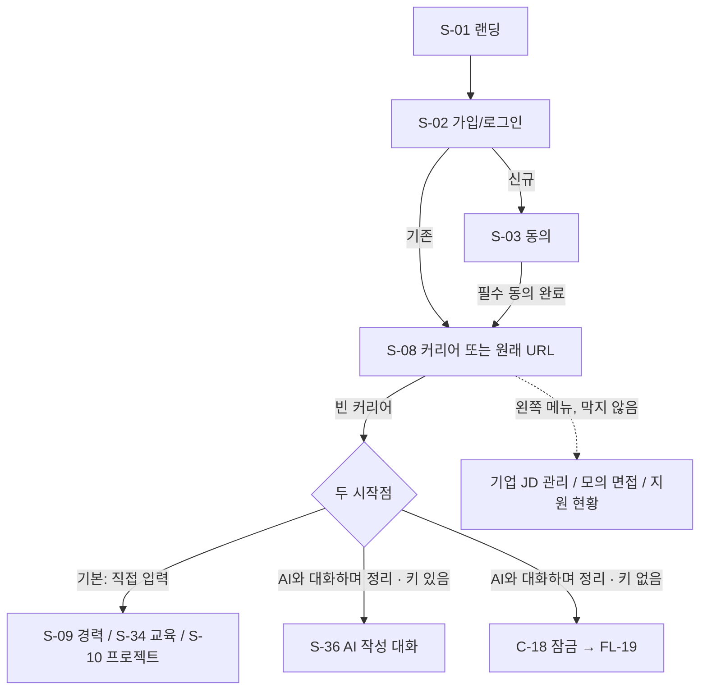

- 화면 단계 수: 가입부터 커리어까지 **3화면**(S-02 → S-03 → S-08). 강제 입력 없음. **키 연결 단계 없음**(D-35).
- 빈 커리어의 기본 시작점은 **"직접 입력"**이다. "AI와 대화하며 첫 프로젝트 정리하기"는 키가 있으면 바로 시작, 없으면 C-18 잠금 상태(→ FL-19)로 보인다(PRD 3.1).
- 관련 기능: F-COM-01, F-COM-02, F-COM-03, F-COM-10, F-AI-06.

### FL-05 커리어 정리 — 폼 (J-1)

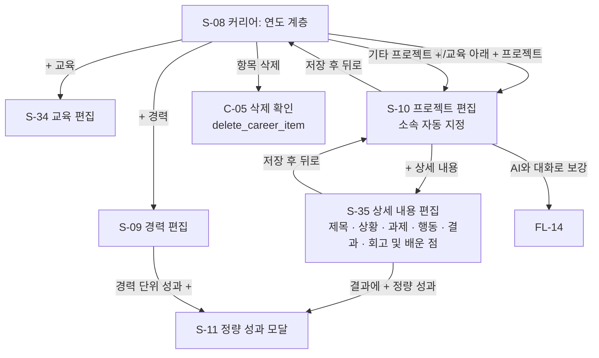

- 화면 단계 수: 첫 경력 + 첫 완료 프로젝트까지 **4화면**(S-08 → S-09 → S-10 → S-35), 돌아와 S-08에서 연도 계층으로 본다(F-P1-09 완료 지점).
- 완료 판정(PRD 확정, T-16): 프로젝트 = 이름 + 역할 + **완료된 상세 내용 1개 이상**. 상세 내용 = 제목 + 상황 + 행동. 미완료 항목은 "작성 중 — AI 미반영".
- 자동 저장(디바운스 1~2초 `[가정]`). 서버가 `status`(draft / complete)를 다시 계산한다.

### FL-14 AI 작성 대화로 프로젝트 정리 (F-P1-13)

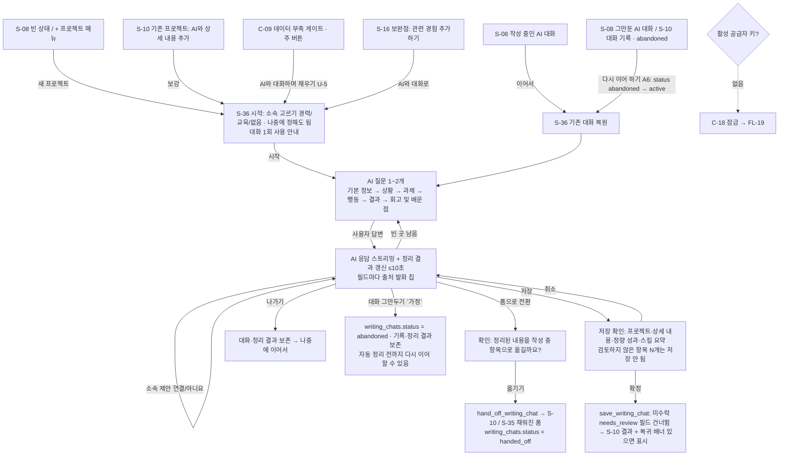

- 화면 단계 수: 시작점에서 저장까지 **1화면**(S-36) + 저장 확인 1회.
- 관련 기능: F-P1-13, F-P1-06, F-AP-06, F-P2-09.
- 저장 전에는 커리어 데이터가 바뀌지 않는다. 저장은 사용자 세션 RPC `save_writing_chat(writing_chat_id)`이다. 수락 상태는 `structured_draft` 필드 객체의 `review = 'accepted'` + `reviewed_at`으로 저장된다(R-27, 데이터 모델 v3.2). 저장과 폼 전환 모두 **수락하지 않은 `needs_review` 필드는 건너뛴다**. 소속은 사용자가 확정한 `writing_chats.experience_id` / `education_id`만 쓰인다(R-28).
- "폼으로 전환"은 사용자가 옮기기를 확인한 순간 RPC `hand_off_writing_chat(writing_chat_id)`가 정리 결과를 커리어 테이블에 쓰고(완료 판정대로, 대부분 `draft`) `writing_chats.status = 'handed_off'`가 된다. 이후는 폼 자동 저장 규칙(D-UX-11 (a)). 수락하지 않은 `needs_review` 필드는 옮기지 않는다(R-27).
- 키 필요(F-P1-13). 모든 시작점은 먼저 활성 공급자 키를 확인하고, 없으면 C-18 잠금을 보인다. 키가 무효·삭제돼도 진행 중 대화와 정리 결과는 보존·열람되고, 새 메시지를 보낼 때 C-20 안내가 나온다(D-36).
- 서비스 횟수 제한은 없다(D-34). **메시지 상한 40개(사용자 + AI 합계, 시작 인사는 제외)**는 품질·안전 목적으로 유지되며, 닿으면 저장 또는 새 대화로 이어 가게 한다(A5, 확정 2026-11-05 (사용자)). 토큰은 사용량 미터의 "AI 작성 대화"로 집계된다.
- **그만둔 대화 재개 (A6, 확정 2026-11-05 (사용자))**: `abandoned` 대화는 사용자가 "다시 이어 하기"를 누르면 `active`로 돌아가 기록·정리 결과·수락 상태·확정 소속이 그대로 복원된다. 자동 정리(프로젝트에 묶이지 않은 대화는 마지막 활동 후 90일 `[가정]`) 전까지만 가능하다. 재개는 사용자 동작으로만 일어나고, 재개 자체는 AI를 부르지 않는다(키 없이도 재개·열람 가능, 새 메시지만 키 필요). 대화를 `abandoned`로 만드는 진입점은 S-36·S-08의 "대화 그만두기"(사용자 전이 `active → abandoned`, 데이터 모델 v4.2 2.5)로 둔다. 진입점 위치는 `[가정]`.

### FL-10 지원 프로젝트 만들기 (J-2)

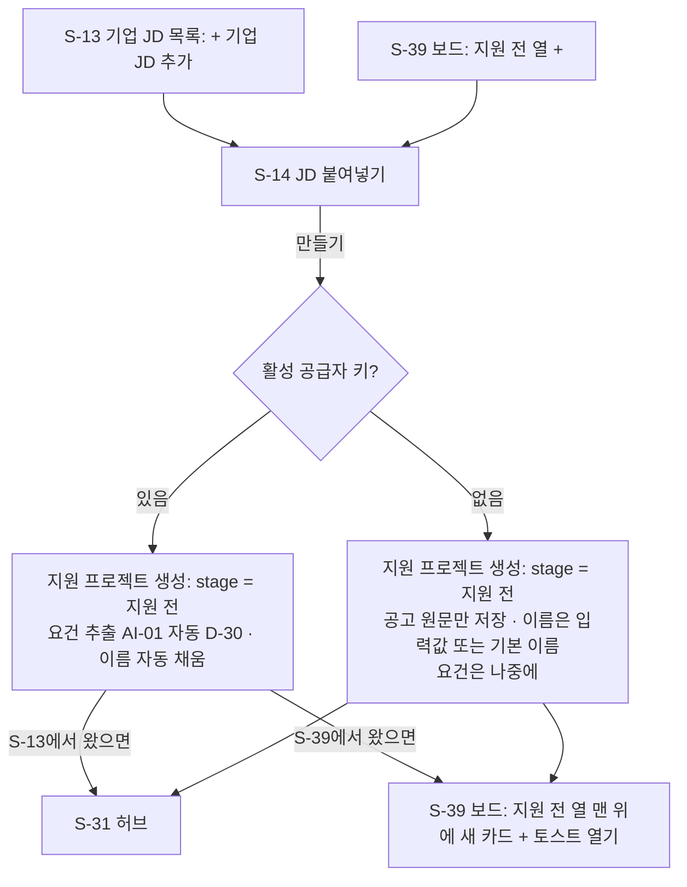

- 화면 단계 수: **2화면**(S-13/S-39 → S-14 → S-31/S-39). 키 없이도 완결(J-2).
- 키 없이 만든 JD의 요건은 사용자가 S-15 "요건 정리하기"를 누르거나, 그 JD로 첫 AI 기능(인사이트·서류·면접)을 시작할 때 먼저 추출한다(D-30). 키를 연결해도 기존 JD를 일괄 추출하지 않는다.
- 관련 기능: F-AP-01, F-P2-01, F-P2-02, F-ST-01 (4).

### FL-11 인사이트 (J-3)

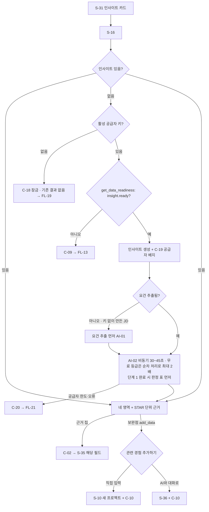

- 화면 단계 수: **2화면**(S-31 → S-16) + 버튼 1회. 관련 기능: F-P2-04, 05, 09, F-AP-06.

### FL-03 서류 초안 (J-4)

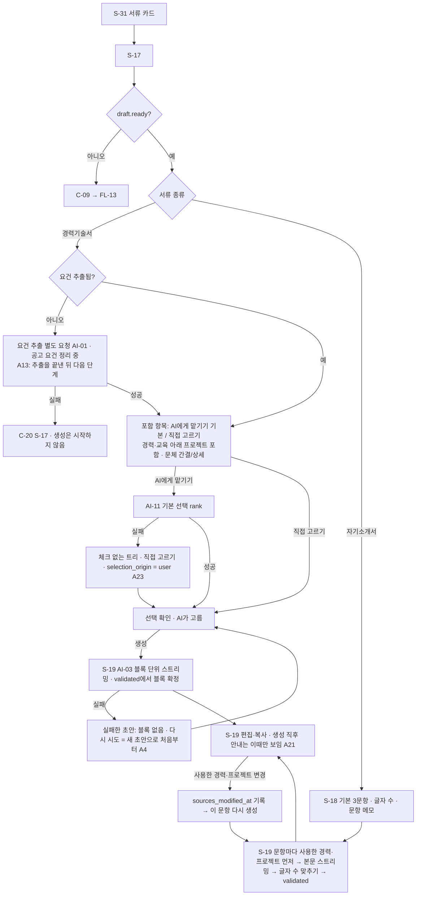

- 화면 단계 수: 경력기술서 **3화면**(S-31 → S-17 → S-19), 자기소개서 **4화면**(S-31 → S-17 → S-18 → S-19). 관련 기능: F-DOC-01~04, 08, 09.
- 키 필요: 키가 없으면 S-17의 "새 경력기술서 생성"과 S-18·S-19의 생성·다시 생성 버튼이 C-18 잠금으로 바뀐다. 자소서 문항 설정(S-18)과 **기존 초안 열람·편집·복사는 키 없이 가능**하다(D-36).
- **요건 선행 추출 (A13, 확정 2026-11-05 (사용자))**: 요건이 아직 없으면(키 없이 만든 JD) 화면이 먼저 요건 추출(AI-01, 별도 요청)을 부르고, **추출이 끝난 뒤에** AI 기본 선택(AI-11)·생성 요청을 보낸다. 생성 요청 안에서는 추출하지 않는다. 사용자가 "새 경력기술서"를 누르면 추출이 먼저 돌고("공고 요건 정리 중"), 끝나면 포함 항목 설정으로 이어진다. 추출이 실패하면 S-17(자소서는 S-18)에 C-20을 보이고 생성은 시작하지 않는다(초안 행을 만들지 않음). 자기소개서·AI-11도 같은 순서를 따른다(확정 (2026-11-05, 팀), PRD D-30, R-52). 인사이트·면접은 작업 첫 단계 `prepare`에서 추출한다(확정 (2026-11-05, 팀)).
- **경력기술서 생성 실패 (A4, 확정 2026-11-05 (사용자))**: 실패한 초안은 블록 없이 "생성 실패"로 남고, "다시 시도"는 **새 초안 행**으로 처음부터 다시 만든다(실패한 초안의 블록을 이어 쓰지 않음). 다른 다시 시도와 같이 **현재 활성 공급자**로 돈다(C-20 "다시 시도의 공급자", A1 변경). 요건 추출·자기소개서 실패 문항의 다시 시도도 같다.

### FL-12 모의 면접 — 일괄 방식 (J-5)

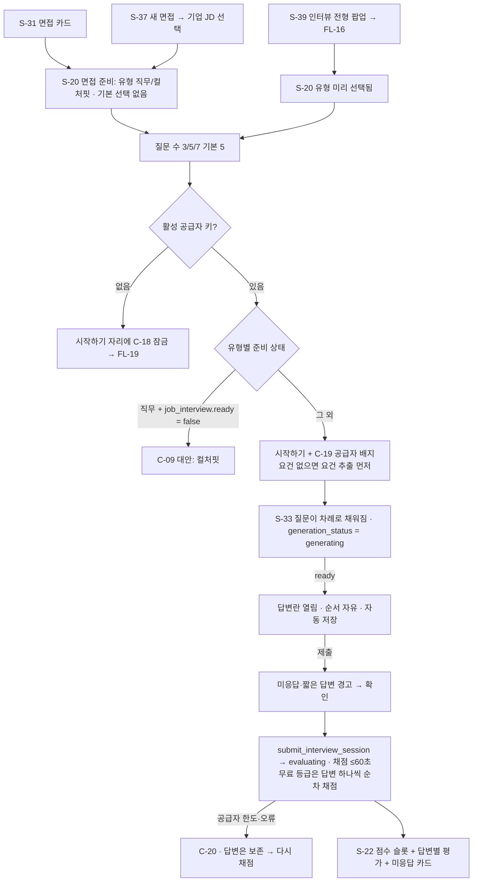

- 화면 단계 수: 진입 화면에서 결과까지 **4화면**(S-31/S-37/S-39 → S-20 → S-33 → S-22). 관련 기능: F-P3-01~04, 06, 07, 13, 15, F-ST-04, F-AI-06, F-AI-08.
- 지난 세션 열람(S-22)과 작성 중 답변 이어 쓰기(S-33)는 키 없이 가능하다. **제출(채점)은 키가 있어야** 한다. 키가 없거나 무효면 제출 버튼 자리에 C-18 / C-20을 보이고 답변은 그대로 보존한다(D-36, F-P3-04).
- **다시 채점 (A9, 확정 2026-11-05 (사용자))**: 평가에 실패한 답변만 다시 평가하고, 종합 평가(`session_feedbacks`)는 **항상 다시** 만든다. 다시 채점을 시작하면 세션 점수·완료 시각을 비우고 `result_viewed_at`을 null로 되돌린다(채점 중에는 표식을 보이지 않다가, 끝나면 "새 결과"로 보인다). 다시 채점은 **현재 활성 공급자**로 돈다(C-20 "다시 시도의 공급자", A1 변경). 진행 단계는 `prepare`(채점 준비 중) → `evaluate`(실패했던 답변 수만큼) → `summarize` → `score` → `complete`(AI 명세 v4.3 C-6).
- **그만둔 세션 (A8, 확정 2026-11-05 (사용자))**: `abandoned` 세션의 답변은 제출 전이어도 고칠 수 없다(읽기 전용). 이어 쓰려면 새 면접을 시작한다.

### FL-17 모의 면접 메뉴에서 새 면접 시작 (F-P3-15)

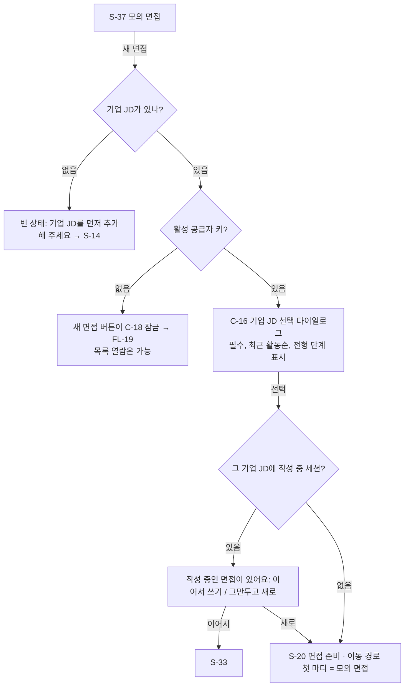

- 화면 단계 수: S-37 → 다이얼로그 → S-20 (**2화면** + 선택 1회).

### FL-15 지원 현황 보드에서 단계 이동 (F-ST-01~03, 05)

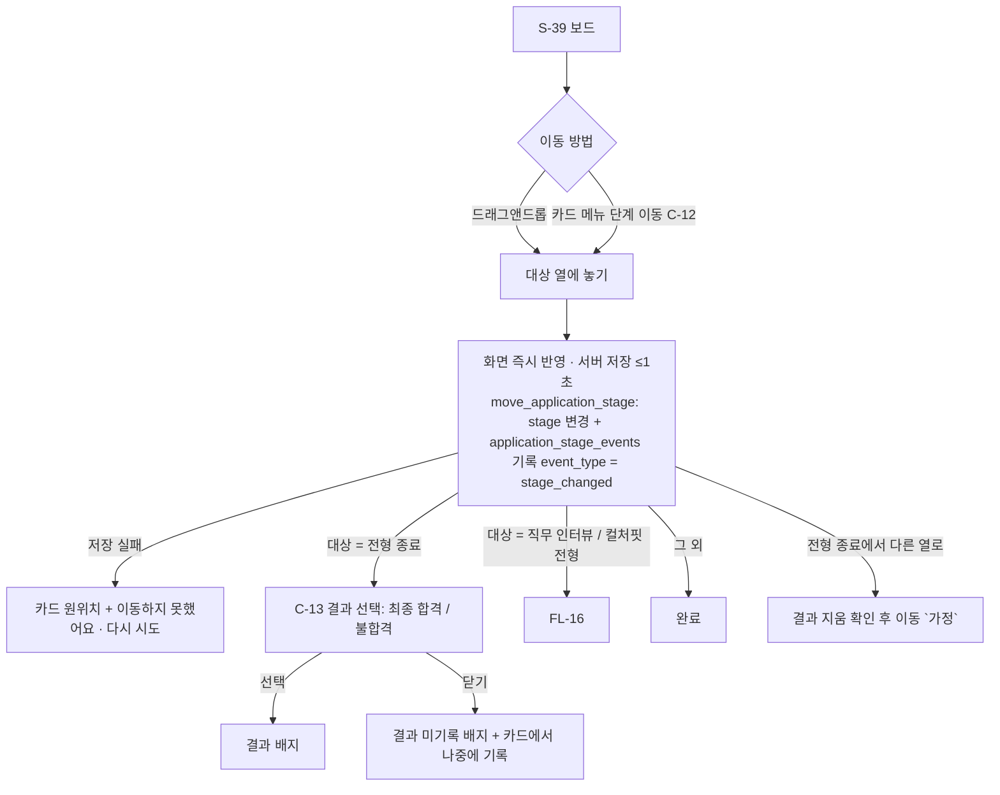

- 관련 기능: F-ST-01, 02, 03, 05. 어느 열로든, 어느 방향으로든 이동 가능(단계 건너뛰기·되돌리기 허용).

### FL-16 인터뷰 전형 이동 → 면접 준비 (F-ST-04)

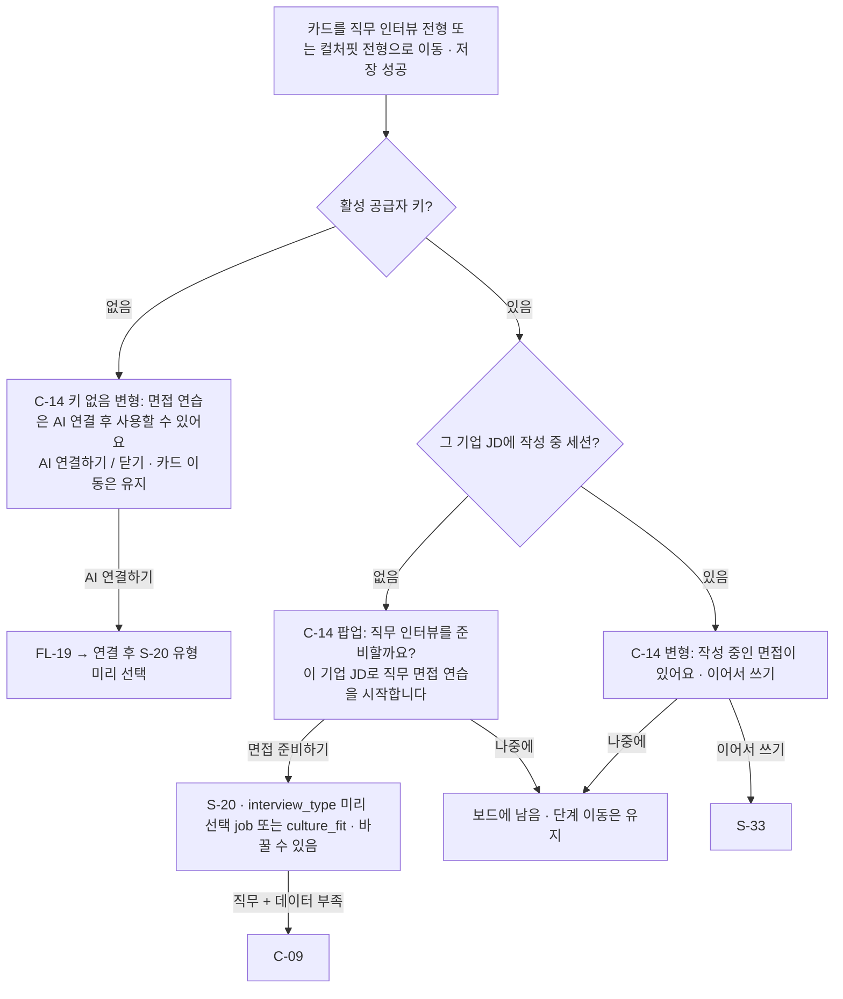

- 팝업은 AI를 실행하지 않는다(토큰을 쓰지 않는다). 이동 저장이 실패하면 팝업을 띄우지 않는다.
- 키가 무효인 경우도 "있음" 경로로 가고, 면접 준비 화면(S-20)에서 시작할 때 C-20을 보인다(PRD 3.3).

### FL-04 면접 답변지 이어쓰기

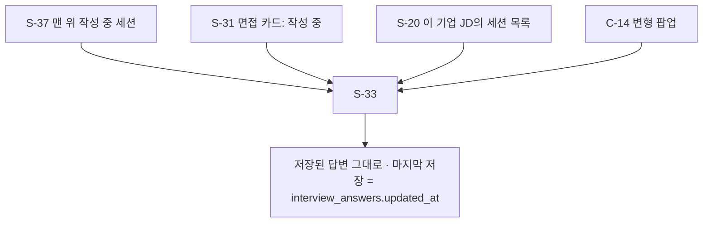

- 지원 프로젝트당 작성 중 세션은 1개(`unique (application_project_id) where status = 'in_progress'`).

### FL-13 데이터 부족 → AI 작성 대화(또는 폼)로 채우기 → 복귀 (F-AP-06, U-5)

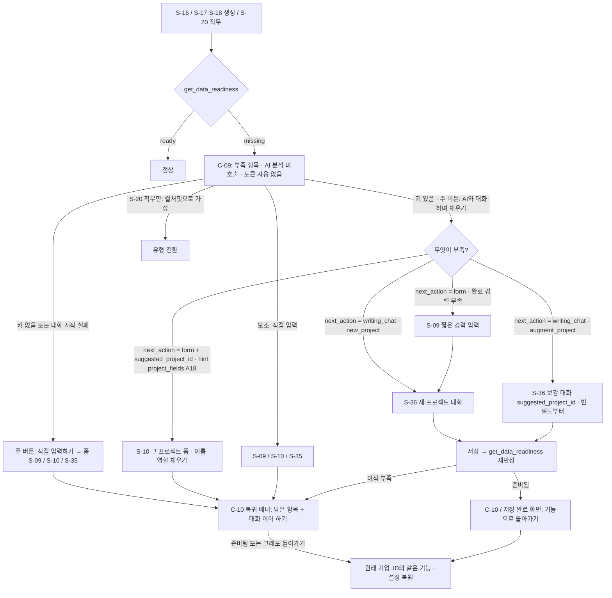

- 화면 단계 수: 기능 화면 → S-36 → 기능 화면(**3화면**, 경력이 없으면 S-09가 1개 더). 이름·역할만 빠진 프로젝트(`hints`에 `project_fields`)는 기능 화면 → S-10 → 기능 화면(**3화면**, A18, 확정 2026-11-05 (사용자)).
- U-5: 단순 차단·안내 대신 그 자리에서 AI 작성 대화로 부족한 커리어 데이터를 채우게 하고 원래 기능으로 돌려보낸다. **(v5) 키가 없거나 대화 시작이 공급자 오류로 실패하면 주 버튼은 "직접 입력하기"(폼)**다(PRD F-AP-06, 3.3). 키가 없으면 대부분 이 게이트 이전에 C-18 잠금이 먼저 보이므로, 이 경로는 키가 무효가 된 경우와 대화 시작 실패 때 주로 쓰인다. AI 분석 결과는 여전히 근거 데이터가 있어야 만들어진다. 컬처핏 예외는 `[가정]` 유지.
- 복귀 대상: AI 작성 대화로 넘어가면 `writing_chats.return_target`에 저장되어 기기를 바꾸거나 나중에 이어 해도 복귀 배너가 나온다. 돌아가면 지운다. 폼(S-09 등)으로만 넘어간 경우는 브라우저 세션 저장. URL에는 지원 프로젝트 ID와 기능 이름만.

### FL-06 지원 프로젝트 삭제

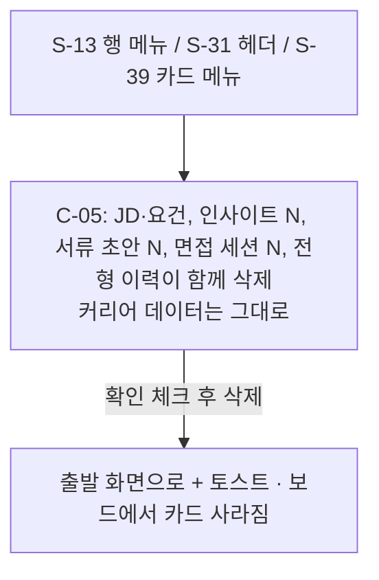

- 관련 기능: F-AP-05. 진행 중 AI 작업은 취소(`ai_jobs.cancel_requested_at`). **토큰 사용 기록은 삭제되지 않는다**(대상 참조만 비움, PRD F-AP-05 `[가정]`).

### FL-07 회원 탈퇴

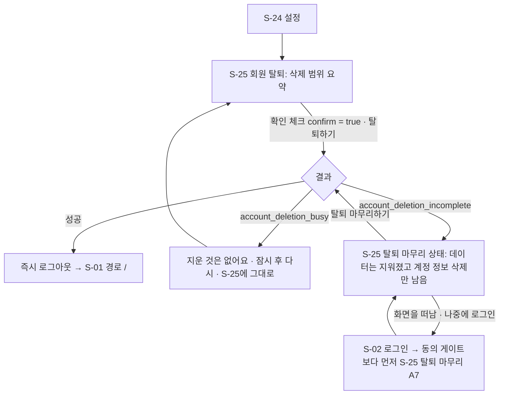

- 삭제 범위: 커리어 전체 + 기업 JD 전체 + AI 작성 대화 + 전형 이력 + **등록한 API 키 전부 + 토큰 사용 기록**, AI 연결 동의 이력은 D-DM-02 정책. 관련: F-COM-05, D-11, NFR-KEY-06.
- 확인 방식: 문구 입력 대신 **확인 체크**("모든 데이터가 즉시 삭제되고 되돌릴 수 없다는 것을 이해했어요")를 켜야 "탈퇴하기"가 활성된다. 요청은 체크 플래그 `confirm: true`로 보낸다(구현 반영).
- 탈퇴 후 이동: 공개 랜딩 S-01(`/`).
- **탈퇴 미완료 재진입 (A7, 확정 2026-11-05 (사용자))**: S-25는 **약관 동의 게이트 밖**에 둔다(동의 기록이 이미 지워진 상태에서도 열린다). 미완료 상태로 로그인하면 S-08·원래 URL·S-03보다 먼저 S-25 "탈퇴 마무리"로 보낸다. 이 상태에서는 다른 메뉴로 갈 수 없고, 할 수 있는 일은 "탈퇴 마무리하기"(같은 요청을 다시 보냄, 멱등)와 로그아웃뿐이다 `[가정]`.

### FL-08 AI 실행 공통 (키 확인 → 데이터 → 실행 → 실패)

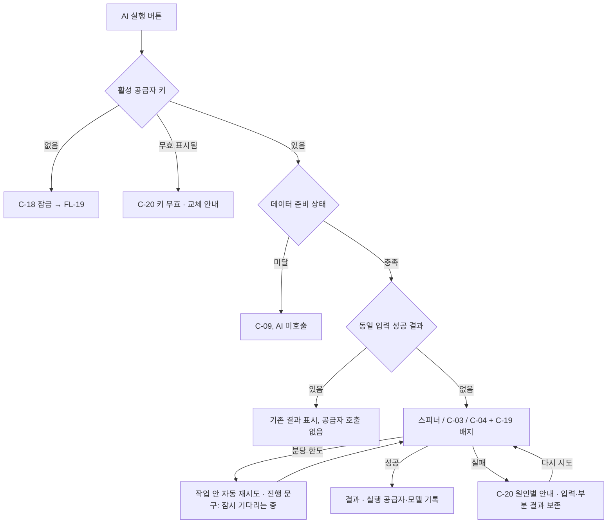

- 서비스 한도 확인 단계는 없다(D-34). 키 확인은 클라이언트 표시용이고, 서버가 실행 시점에 키를 복호화해 다시 확인한다(NFR-KEY-03).

### FL-18 AI 연결 — 공급자 고지·동의 → 키 등록·검증 (F-AI-01, 04, 05)

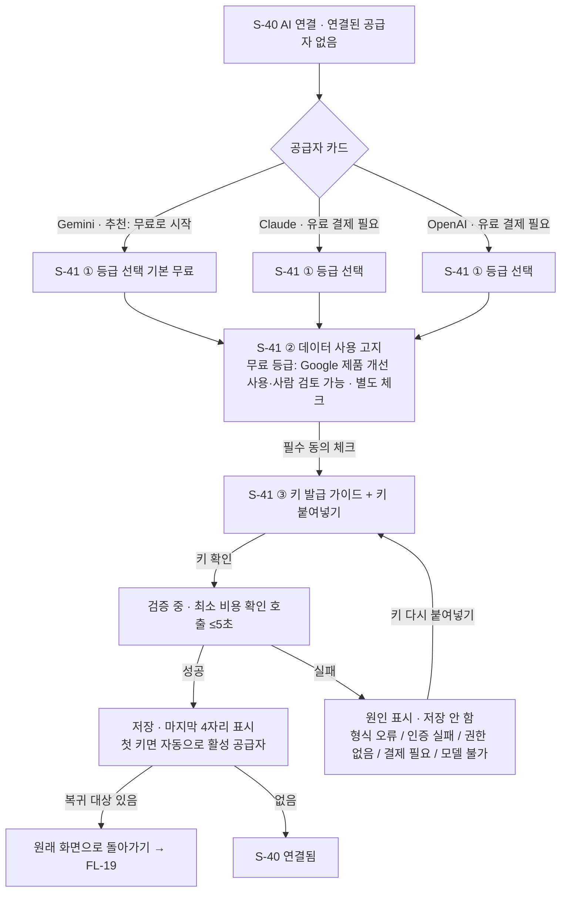

- 화면 단계 수: S-40 → S-41(3단계) → S-40 또는 원래 화면. 고지·동의 없이 키 입력 단계로 갈 수 없다(F-AI-04 (4)).
- 키 원문은 저장 후 다시 보이지 않는다(NFR-KEY-01, 05). 검증 호출의 토큰은 사용량 미터에 "연결 확인"으로 집계된다(NFR-KEY-04 `[가정]`).

### FL-19 AI 잠금 상태 → AI 연결 → 원래 화면 복귀 (F-AI-06)

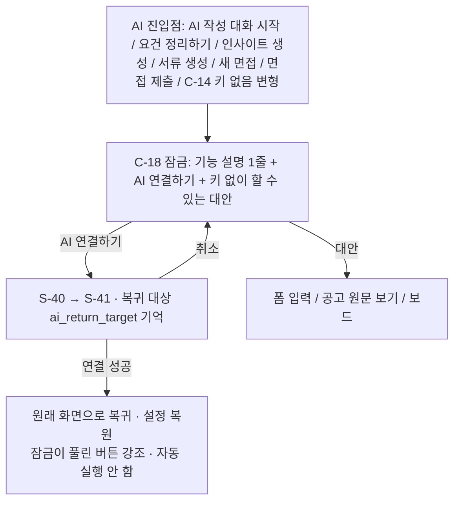

- 연결을 마쳐도 AI를 자동으로 실행하지 않는다(사용자가 누를 때만, NFR-AI-08). 복귀 화면에서 방금 풀린 버튼을 강조만 한다.
- 복귀 대상은 브라우저 세션 저장 `[가정]`(키 연결은 보통 같은 기기에서 끝난다). 데이터 부족 게이트의 `writing_chats.return_target`과는 별개다.

### FL-20 키 교체·다시 확인·삭제·활성 공급자 변경 (F-AI-02, 03)

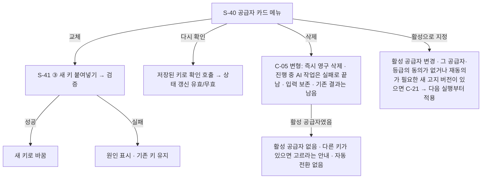

- 재동의 판정(A20, 확정 2026-11-05 (사용자)): 키 등록과 AI 실행 모두 같은 규칙이다. 동의한 뒤 시행된 고지 버전 중 `requires_reconsent = true`인 버전이 있을 때만 C-21을 다시 보인다. 문구만 고친 새 버전은 다시 묻지 않는다.
- 진행 중(running) 작업만 시작할 때의 공급자로 끝까지 간다. **다시 시도를 포함한 모든 재실행은 바꾼 활성 공급자로 돈다**: 실패한 비동기 작업 행의 "다시 시도"(인사이트, 면접 질문 생성), 요건 추출·서류 3종의 다시 시도·다시 생성, 인사이트 다시 생성, 면접 다시 채점·남은 질문 다시 만들기 모두 같다. 같은 작업 행 다시 시도에서 활성 공급자·등급이 작업에 기록된 것과 다르면 처음 단계부터 다시 한다. 활성 공급자 키가 없으면 "AI 연결 필요", 활성 공급자·등급의 동의가 필요하면 활성 공급자·등급으로 C-21을 연다(C-20 "다시 시도 거부" 행, DM 2.11.7 경로 ②)(A1, 확정 2026-11-05 (사용자, A1 변경)). 진행 중인 AI 작성 대화는 다음 메시지부터 새 공급자로 이어 간다(F-AI-03 (2) `[가정]`).

### FL-21 공급자 한도·오류 안내 → 복구 (F-AI-08)

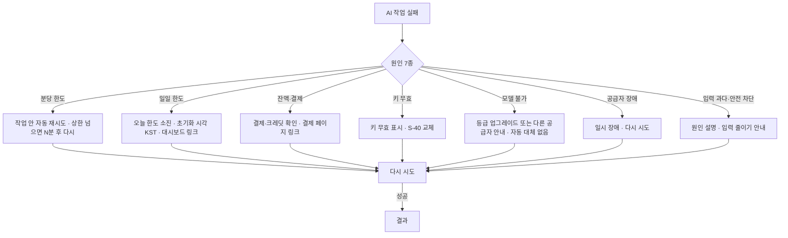

- 모든 경우 입력과 부분 결과는 보존된다. 자동 충전·결제 유도·서비스 내 결제는 없다(F-AI-08).

---

## 3. 화면 명세

### 3.0 공통 컴포넌트·상태

#### C-01 근거 칩 (Evidence Chip)

데이터: `evidence_links`(`owner_type`, `owner_id`, `item_key`, `sort_order`). `item_key`는 초안이면 `block_id`, 그 밖은 점 경로(`requirement_matches.{id}`, `strengths.{n}`, `gaps.{n}`, `gaps.{n}.actions.{m}`, `strategy.positioning`, `strategy.project_priorities.{rank}`, `criteria.{key}`, `improvements.{n}`, `model_answer`, `overall_strengths.{n}`, `sources.{n}`).

| 요소 | 표시 데이터 | 동작 | 비고 |
|------|-------------|------|------|
| 칩 라벨 | 종류 + `source_label`. profile "기본 프로필", experience "경력", **education "교육"**, project "프로젝트", **project_detail "상세 내용 · {필드}"**(`source_field` = situation 상황 / task 과제 / action 행동 / result 결과 / learnings 회고 및 배운 점), achievement "정량 성과", skill "스킬", jd_requirement "JD 요건", jd_sentence "공고 원문", interview_answer "내 답변", user_note "내 메모" | 클릭 → C-02 | 데이터 모델 v3 확정(`source_field`에 STAR 5개 + `title`) |
| 회고 구분 | `source_field = learnings`인 칩은 "회고 및 배운 점" 라벨만 쓴다(별도 표식 없음). 사실 근거와 다른 종류라는 것은 라벨로 구분된다 | | NFR-AI-06, U-2, PRD v3.2 |
| 상태 | 정상 / **변경됨**(원본 `updated_at` > `source_snapshot_at`, `jd_sentence`는 JD `created_at` 기준이라 항상 정상) / **원본 삭제됨**(`source_deleted_at`) | | |

#### C-02 근거 패널

| 요소 | 표시 데이터 | 동작 | 비고 |
|------|-------------|------|------|
| 근거 카드 | 라벨, `source_label`, `quote`(있을 때), 경로 "연도 › 회사명/기관명 › 프로젝트명 › 상세 내용 제목 › 필드" | | `quote` 없는 근거는 원본 현재 값(생성 당시 값 미보관, 원본 삭제 시 값 없음) |
| 원본으로 이동 | 상세 내용 근거 → S-35의 해당 필드에 포커스, 정량 성과 → S-11, 교육 → S-34, 그 밖은 v3와 같음. 커리어로 가는 이동은 C-10 함께 | | |
| 변경됨 / 원본 삭제됨 | v3와 같음("원본 삭제됨 — 이 근거의 원본과 인용문은 삭제되었습니다", 인용문·이동 없음) | | D-AI-04 (b) |
| 고지 | "입력된 데이터 기준 판단입니다" | | |

#### C-03 AI 작업 상태 (비동기)

| 요소 | 표시 데이터 | 비고 |
|------|-------------|------|
| 진행 | `ai_jobs.job_type`, `ai_jobs.progress.stage` → 문구, `progress.done` / `total` | 10초 안에 첫 진행 |
| 단계 문구 | **`prepare`** — 인사이트·면접 질문 생성: **공고 요건 정리 중**(요건이 이미 있으면 짧게 지나감) / 채점: **채점 준비 중**(AI 호출 없는 시작 준비, 요건 추출 없음) / `match` 요건 대조 중 / `synthesize` 강점·지원 방향 정리 중 / **`synthesize_regen` 강점·지원 방향 정리 중**(`synthesize`와 같은 문구, 숫자 확인 뒤 다시 정리할 때만 나타남) / `validate` 근거 확인 중 / `rank` 쓸 경력·프로젝트 고르는 중 / `generate` 작성 중(면접 질문은 "질문 만드는 중 (n/N)") / `adjust_length` 글자 수 맞추는 중 / `evaluate` 답변 채점 중 / `summarize` 종합 평가 정리 중 / `score` 점수 계산 중 / **`complete` 별도 문구 없음** — 직전 단계 문구를 그대로 둔다(면접 질문 생성은 "질문 만드는 중 (N/N)", 채점은 "점수 계산 중"). 마지막 단계·AI 호출 없음, 곧 완료 화면으로 바뀜 | 데이터 모델 v3.x 확정 키 + v5.3 추가 3개(AI 명세 v4.3 C-6). (R-51) `prepare`(인사이트·질문)·`synthesize_regen`·`complete`는 AI C-6 문구에 맞췄다. 채점 `prepare` "채점 준비 중"만 UX가 따로 정했다 — 채점은 요건을 추출하지 않아 "공고 요건 정리 중"이 틀린 안내가 되기 때문(AI C-6 표에 같은 값 반영 요청) `[가정]` |
| 진행 표시 우선순위 | 목록·카드(S-13·S-31·S-39·S-16)의 기능 상태는 ① 작업이 대기·실행 중이면 이전 결과가 있어도 "생성 중" ② 아니면 최신 결과가 있으면 "있음" ③ 없으면 "없음". 결과가 "생성 중"인데 그 작업이 이미 끝났거나 없으면 **실패로 보인다**(작업 실패면 그 원인, 작업이 없거나 끝났는데 결과가 없으면 `stalled` "시간이 오래 걸려 중단됐어요", 사용자가 취소했으면 표시 없음). 실패 안내는 지금 보이는 결과보다 늦게 끝난 실패만 보인다 | 구현 반영 `[가정]` |
| 부분 결과 | 인사이트 단계 1 판정 표, 채점 완료 답변 카드 | |
| 이탈 허용·완료 알림 | 인앱 토스트 "{회사명 – 포지션명} 면접 채점이 끝났어요 [보기]" + 메뉴 배지 | 이메일·푸시 없음 `[가정]` |
| 공급자 배지 | 진행 표시 옆에 C-19("Gemini · 무료 등급") | F-AI-09 |
| 무료 등급 순차 모드 (D-37) | 활성 공급자가 무료 등급이면: 단계 문구에 처리 단위를 더한다(예: "요건 대조 중 (2/6) — 무료 등급이라 하나씩 처리해요", "답변 채점 중 (3/5)"), 예상 시간 안내를 유료 기준의 **2배**로(예: 인사이트 "1분 30초 정도 걸려요"), 분당 한도로 자동 재시도 중이면 "공급자 요청 한도로 잠시 기다리는 중 (n초)"(n = `ai_jobs.progress.waiting_retry_until` − 지금) — 실패로 표시하지 않음 | 재시도는 AI 명세 v4.3 C-11.3 규칙(아래 C-20 "자동 재시도 규칙"). 상한을 넘으면 C-20. 남은 한도 표시가 아니다(R-44) |

#### C-04 스트리밍 출력

경력기술서(블록), 자기소개서(문항, 근거 선택 먼저), 면접 질문(차례로 채움), **AI 작성 대화 응답(첫 글자 3초, 완료 10초)**. 중단은 `ai_jobs.cancel_requested_at`. 이탈 시 서버가 끝까지 생성·저장 `[가정]`.

- **서류 스트리밍 이벤트 순서 (AI-04, 구현 반영)**: `sources_selected`(사용한 경력·프로젝트 카드 먼저) → 블록 스트리밍(`block_started` / `block_delta` / `block_completed`) → (글자 수 보정이 필요할 때만) `adjusting_length`("글자 수 맞추는 중", 보정 전 글자 수·제한·기준 표시) → **`validated`** → `done`.
- **블록 확정 시점**: 스트리밍 중 블록은 **임시 표시**다(블록 id가 아직 확정되지 않음). `validated`가 오면 화면은 그 문항(경력기술서는 초안)의 블록을 **통째로 교체**한다. 근거 칩·자리 표시·검증 배지·"생성 직후 안내"(S-19)는 `validated` 뒤에 붙는다. 그 전에는 편집·복사를 막고 "마무리 중"으로 보인다. 경력기술서(AI-03)도 같은 방식이다(블록 id는 `validated`에서 확정).

#### C-05 삭제 확인 다이얼로그

| 대상 | 표시 데이터 | 선택지 | 처리 |
|------|-------------|--------|------|
| 커리어 항목(경력·교육·프로젝트·상세 내용·정량 성과·스킬) | `get_deletion_impact(entity_type, entity_id, affiliation_mode)` (`entity_type`: experience / education / project / project_detail / achievement / skill / writing_chat): `cascade`(projects, project_details, achievements, project_skills, writing_chats 개수), `affected_results.by_application_project[]`(기업 JD별 insights·drafts·draft_sections·interview_sessions 수) | ① 결과 처리 `result_mode`: **"결과는 남기고 근거만 '원본 삭제됨'으로"**(`keep_results`, 기본값) / **"관련 결과도 함께 삭제"**(`delete_results`) ② 경력·교육 삭제 시 소속 프로젝트 `affiliation_mode`: "독립 프로젝트로 남기기"(`keep_projects`, 기본) / "함께 삭제"(`delete_projects`) | RPC `delete_career_item(entity_type, entity_id, affiliation_mode, result_mode)` |
| `delete_results` 범위 설명 | "인사이트는 해당 버전, 경력기술서는 문서 전체, 자기소개서는 **해당 문항의 생성 결과만**(문항·글자 수·메모는 남음), 모의 면접은 **세션 전체**가 삭제돼요" | | 데이터 모델 4.2 결과 단위 |
| 공통 안내 | "어느 쪽이든 인용문은 지워져요. 결과를 남기면 AI가 쓴 본문에는 내용이 남을 수 있어요" | | |
| 상세 내용 삭제 | "붙어 있는 정량 성과 N건도 삭제돼요" | | F-COM-04 |
| 프로젝트 삭제 | "상세 내용 N건, 정량 성과 N건이 함께 삭제돼요. 이 프로젝트의 AI 작성 대화도 삭제돼요" (`cascade.writing_chats`) | | D-27 (a). `writing_chats.project_id` 연쇄 |
| AI 작성 대화만 삭제 (`entity_type = 'writing_chat'`) | "대화 메시지 {message_count}개와 저장 전 정리 결과가 삭제돼요. 저장한 프로젝트는 그대로예요(출처 대화 연결만 끊겨요)" | `result_mode` 없음 | 커리어 행의 `source_writing_chat_id` → null |
| 기업 JD(지원 프로젝트) | "JD·요건, 인사이트 N, 서류 초안 N, 면접 세션 N, 전형 이력이 함께 삭제돼요. 커리어 데이터는 그대로예요" + 확인 체크 | | F-AP-05 |
| 초안 / 면접 세션 | 하위 개수 | | |
| **API 키 삭제** (S-40) | "{공급자} 키를 삭제할까요? 즉시 영구 삭제되고 되돌릴 수 없어요. 진행 중인 AI 작업 {N}건은 실패로 끝나고 입력(답변·대화·문항)은 그대로 남아요. 지금까지 만든 AI 결과는 그대로 볼 수 있어요" + 활성 공급자였다면 "삭제하면 AI 기능이 잠겨요. 다른 키가 있으면 활성 공급자를 직접 골라 주세요" + "공급자 사이트에서도 키를 폐기하려면 → 대시보드 링크" | 취소 / 삭제 | D-36, NFR-KEY-06·09. 자동 전환 없음(F-AI-02 (3) `[가정]`) |
| **API 키 교체** (S-41 ③) | "새 키로 확인되면 바꿔요. 확인에 실패하면 기존 키를 그대로 써요. 진행 중 작업은 기존 키로 끝나요" | 확인 | F-AI-02 (1) |

#### C-06 저장 상태 · C-07 입력 가이드

- C-06: "저장 중… / 저장됨 HH:MM / 저장 실패 — 다시 시도" + 커리어 항목 `status = 'draft'`면 "작성 중 — 필수 항목을 채우면 AI 분석에 반영돼요".
- C-07 가이드:

| 가이드 | 위치 | 내용 |
|--------|------|------|
| G-1 본인 행동 | **S-35 행동(A) 필드** | "'우리 팀은'보다 '저는'으로 써 주세요. 팀이 한 일·배경은 상황(S)에 써 주세요" |
| G-2 민감정보·기밀 | 모든 자유 서술 필드, S-36 입력창 | "건강·종교·노조 활동 같은 민감정보, 동료·고객의 개인정보, 회사 기밀은 쓰지 마세요" |
| G-3 정량 성과 권유 | S-35 결과(R)에 숫자가 있는데 정량 성과가 0건일 때 | "수치를 정량 성과로 정리하면 AI가 숫자를 정확히 써요 [+ 정량 성과]" |
| G-4 STAR 권유 | S-35 과제·결과·회고 및 배운 점이 비었을 때 | 필드별 한 줄 예시 |

#### C-08 자리 표시·검증 배지

v3와 같음. "커리어에 추가하기"는 상세 내용이 근거인 블록이면 S-35 해당 필드로 이동.

#### C-09 데이터 부족 게이트 (F-AP-06)

데이터: RPC `get_data_readiness()` → `counts`, `draft_item_ids`, `features.{insight | draft | job_interview | culture_fit_interview}.ready / missing / data_sufficiency`.

| 요소 | 표시 데이터 | 동작 | 비고 |
|------|-------------|------|------|
| 제목 | "{기능}을 만들려면 커리어가 조금 더 필요해요. AI와 대화하며 바로 채워 볼까요?" | | U-5 |
| 부족 항목 (`missing`) | `complete_experience` "완료된 경력 1건이 필요해요(교육만으로는 부족해요)", `complete_project` "완료된 프로젝트 1건이 필요해요" + 현재 개수(`counts.complete_experiences`, `counts.complete_projects`) | — | 데이터 모델 v3 6장. 교육 아래 프로젝트도 셈 |
| 보조 안내 (`hints`) | `complete_project_detail` → "프로젝트는 있지만 완료된 상세 내용이 없어요(제목·상황·행동)" + `counts.projects_without_complete_detail` / **`project_fields`** → "'{프로젝트명, 비어 있으면 '이름 없는 프로젝트'}'에 이름이나 역할이 비어 있어요. 채우면 바로 쓸 수 있어요"(완료된 상세 내용은 있는데 `projects.name`·`role`이 빠진 `draft` 프로젝트) | — | `hints`는 문구 분기용, 판정은 `missing`만. `project_fields`는 A18, 확정 2026-11-05 (사용자) |
| **이름·역할만 빠졌을 때** (`project_fields`) | 서버가 `next_action = 'form'` + `suggested_project_id` = 그 프로젝트를 준다 | 주 버튼 **"'{프로젝트명}' 마저 채우기"** → **S-10 그 프로젝트 폼**(이름·역할 칸에 포커스) + 복귀 대상 기억. 저장(자동 저장)마다 재판정 → C-10 | A18. AI 작성 대화로 보내지 않는다(역할 한 칸만 채우면 되므로) |
| **주 버튼** (`features.{기능}.next_action`) | `next_action = 'writing_chat'` → **"AI와 대화하며 채우기"**: `suggested_mode = 'new_project'`면 새 프로젝트 대화(완료 경력이 있으면 소속 미리 선택), `'augment_project'`면 `suggested_project_id`의 보강 대화(작성 중 상세 내용의 빈 필드부터). 인사이트 보완점에서 왔으면 관련 요건을 대화 시작 맥락으로 표시 / `next_action = 'form'`: `suggested_project_id`가 있으면 → **"'{프로젝트명}' 마저 채우기"**(S-10, 아래 `project_fields` 행), 없고 `missing`에 `complete_experience`가 있으면 → **"경력 먼저 입력하기"**(S-09), 그 밖(키 없음·무효)은 → "직접 입력하기"(아래 키 행) | → S-36(또는 S-09·S-10) + 복귀 대상을 `writing_chats.return_target`에 저장(돌아가면 지움) | **U-5 확정: 데이터 부족은 AI 작성 대화로 풀어 간다.** 대화 버튼 옆 C-19 배지 |
| 경력이 없을 때 | `next_action = 'form'`: AI 작성 대화는 경력을 만들지 않으므로(F-P1-16 Could) 짧은 경력 입력(S-09, 필수 3개)을 먼저 열고, 저장 후 다시 판정해 `next_action = 'writing_chat'`이면 S-36 새 프로젝트 대화로 넘긴다 | S-09 → S-36 → 복귀 | 데이터 모델 v3.2 `next_action = 'form'`, PRD 확인 완료 |
| **키가 없거나 무효이거나 대화 시작이 실패할 때** (v5) | `ai_connection.active_provider = null` 또는 `key_status = 'invalid'`이면 서버가 `next_action = 'form'`을 준다(데이터 모델 v4 6장). `needs_check`는 `writing_chat` 그대로. 활성 공급자 키가 무효로 표시돼 있거나 대화 첫 턴이 공급자 오류로 실패하면 주 버튼을 **"직접 입력하기"**(작성 중 항목 편집 또는 새 폼, 복귀 대상은 브라우저 세션)로 바꾸고, C-20 원인 한 줄 + "키를 확인하면 AI와 대화로 채울 수 있어요 [AI 연결 확인]". 이미 진행 중인 대화가 있으면 "이어서 대화하기"는 그대로(새 메시지 전송 시 C-20) | | PRD F-AP-06 (v4), 3.3. v4.2b의 "월 10회 한도 소진" 행은 서비스 한도 폐기(D-34)로 삭제 |
| 키가 없을 때 | 키가 없으면 AI 기능 버튼 자체가 C-18 잠금이라 보통 이 게이트에 오지 않는다. 데이터 부족만 알려야 하는 경우(예: 잠금 화면에서 "연결 전 준비 상태 보기")에는 주 버튼을 "직접 입력하기"로 한다 | | PRD 3.3 |
| 보조 링크: 직접 입력 | 작성 중 항목(`draft_item_ids`)이 있으면 그 편집, 없으면 새 폼 | 복귀 대상 기억 | |
| (S-20 직무) 대안 | "컬처핏 면접은 지금 바로 연습할 수 있어요" | 유형 전환 | `culture_fit_interview.ready`는 항상 true — 컬처핏 예외는 `[가정]`(U-5) |
| 안내 | "AI 분석은 실행하지 않았어요(토큰을 쓰지 않았어요). 커리어를 채우면 이 화면으로 다시 돌아와요" | | AI 결과는 여전히 근거 데이터가 있어야 생성 |

#### C-10 복귀 배너

커리어 안 모든 화면(S-04, S-08~S-12, S-34~S-36) 상단. "{회사명 – 포지션명} · {기능}으로 돌아가기" + 준비 상태(저장마다 `get_data_readiness()` 재판정). AI 작성 대화에서 "저장"한 직후에도 다시 판정하고, 준비되면 S-36 저장 완료 화면에 "{기능}으로 돌아가기" 주 버튼을 띄운다. 돌아가면 원래 화면의 진행 중 설정(면접 유형·질문 수, 자소서 문항, 경력기술서 포함 항목 등)을 복원한다(U-5).

#### C-11 사용한 경력·프로젝트 (F-DOC-08 / F-DOC-01)

| 요소 | 표시 데이터 | 동작 | 비고 |
|------|-------------|------|------|
| 자소서 문항별 목록 | `draft_section_sources`: `experience_id` 또는 `education_id` + `project_id` + `project_detail_ids`(→ "회사명 또는 기관명 › 프로젝트명 › 사용한 상세 내용 제목", 원본 삭제 시 `source_label`), `role`(primary 주 근거 / supporting 보조), `origin`(ai AI 선택 / user 내가 추가), `rationale`, `requirement_ids`(관련 요건), `reuse_reason`(다른 문항과 같은 프로젝트일 때), `source_deleted_at` | | |
| 변경 | 완료 상태 경력·교육·프로젝트 체크 트리(프로젝트를 펼치면 완료된 상세 내용을 골라 `project_detail_ids`로 지정 가능, 기본은 AI 선택) | 추가/제외 → `draft_sections.source_selection_mode = 'user'`, `sources_modified_at` 기록 → "변경 사항으로 다시 생성" 활성 | |
| 다시 생성 | "다시 생성하면 공급자 토큰을 다시 써요" + C-19 배지 + 편집본 덮어씀 확인 | 성공 시 `generation_no + 1`, `sources_modified_at = null` | 이전 생성본 보관 없음(D-DM-06) |
| 모두 제외 | "근거 없이 메모·공고 내용만으로 작성돼요" 경고 후 허용 | | 데이터 모델 확정 동작 |
| 경력기술서 | `drafts.options.included_experience_ids` / `included_education_ids` / `included_project_ids` / `project_order` + 출처 `drafts.options.selection_origin`(insight "인사이트 우선순위" / ai_ranking "AI가 고름" / user "직접 고름") | 변경 → 전체 다시 생성 | AI 기본 선택 단계 = AI-11, 진행 `rank`. 프로젝트는 최대 8개, 프로젝트당 불릿 최대 4개 `[가정]`(구현 값) |
| **AI 기본 선택 실패** (A23, 확정 2026-11-05 (사용자)) | AI-11이 실패하면 **대신 골라 주지 않는다**(최신순 전체 선택 같은 대체 없음). 트리를 **아무것도 체크하지 않은 상태**로 열고 "AI가 포함할 항목을 고르지 못했어요. 직접 골라 주세요" + C-20 원인 한 줄 | 사용자가 체크 → 생성 시 `selection_origin = 'user'`("직접 고름"). 1개 이상 골라야 "생성" 활성 `[가정]`. "AI에게 다시 맡기기"(AI-11 다시 시도, 새 요청이라 현재 활성 공급자, C-19 배지)도 둔다 | 출처 값 목록(insight / ai_ranking / user)은 그대로 |
| 자소서 사용자 근거 개수 | 문항당 직접 추가할 수 있는 경력·프로젝트 최대 5개 `[가정]`(구현 값). 넘으면 체크 비활성 + "한 문항에 5개까지 고를 수 있어요" | | |

#### C-12 단계 이동 메뉴 (신설, F-ST-02 (3))

보드 카드 메뉴(⋯)와 S-31 헤더 전형 단계 칩에서 연다.

| 요소 | 표시 데이터 | 동작 | 비고 |
|------|-------------|------|------|
| 단계 목록 | 6단계, 현재 단계 체크 | 선택 → 드래그와 같은 처리(FL-15) | 키보드: 카드에 포커스 후 Enter로 메뉴, 화살표로 단계 선택 |
| 단축 동작 | "다음 단계로" | 다음 열로 이동 | `[가정]` 편의 |
| 스크린 리더 | 이동 후 "{카드}를 {단계}로 옮겼어요" 알림 | | |

#### C-13 전형 결과 선택 창 (신설, F-ST-03)

| 요소 | 표시 데이터 | 동작 | 비고 |
|------|-------------|------|------|
| 제목 | "전형 결과를 기록할까요?" | | |
| 선택지 | **최종 합격** / **불합격** → `application_projects.stage_outcome` = `passed` / `failed` (RPC `set_application_outcome`, 이력 `event_type = 'outcome_changed'`) | 선택 → 저장, 카드 배지 | D-25 (a) 사용자 확정(U-3). 지원 철회 등은 추가하지 않음 |
| 닫기 | — | `stage_outcome = null` → 카드 "결과 미기록" 배지 + 카드 메뉴 "결과 기록" | |

#### C-14 인터뷰 전형 팝업 (신설, F-ST-04)

| 요소 | 표시 데이터 | 동작 | 비고 |
|------|-------------|------|------|
| 직무 인터뷰 전형으로 이동 시 | "직무 인터뷰를 준비할까요? {회사명 – 포지션명}으로 직무 면접 연습을 시작합니다" | **면접 준비하기** → S-20 `?type=job` / **나중에** → 닫기 | 쿼리에는 유형 값만 |
| 컬처핏 전형으로 이동 시 | "컬처핏 면접을 준비할까요? …" | → S-20 `?type=culture_fit` | |
| 작성 중 세션이 있을 때 | "이 기업 JD에 작성 중인 면접이 있어요({유형}, n/N 작성 · 마지막 활동 {상대 시각})". 데이터: `move_application_stage` 반환 `interview_prompt.in_progress_session`(`session_id`, `interview_type`, `answered_count`, `question_count`, `generation_status`, `last_activity_at`). `generation_status = 'generating'`이면 "질문을 만드는 중이에요", `failed`면 "질문 생성이 끝나지 않았어요"를 덧붙인다. **세션 유형이 옮긴 열과 다르면**(예: 컬처핏 전형으로 옮겼는데 작성 중 세션은 직무 면접) "작성 중인 면접은 {직무 면접}이에요. 이어 쓰거나 S-20에서 그만두고 {컬처핏 면접}을 새로 시작할 수 있어요" | **이어서 쓰기** → S-33 / **나중에** | 유형이 달라도 이어 쓰기를 먼저 안내(세션은 기업 JD당 1개, 유형 무관) — 리뷰 T-12 권고로 UX 결정. 세션 상세는 구현 반영(데이터 모델 v4.2) |
| **키가 없을 때 (v5)** | "면접 연습은 AI 연결 후 사용할 수 있어요. 연결하면 {직무 면접 / 컬처핏 면접}이 선택된 면접 준비로 바로 이어져요" | **AI 연결하기** → FL-19(복귀 대상 = S-20 `?type=`) / **닫기** | F-ST-04 (8). 카드 이동은 그대로 유지 |
| 공통 | AI를 실행하지 않는다(토큰 사용 없음). 닫아도 단계 이동은 유지 | | |
| 반복 | 같은 카드를 같은 인터뷰 열로 다시 옮기면 다시 뜬다. "다시 보지 않기"는 두지 않음(리뷰 T-12 권고로 UX 결정) | | |

#### C-15 출처 발화 칩 (신설, F-P1-13 (3))

S-36 정리 결과 미리보기의 필드마다 붙는다. C-01과 같은 모양.

| 요소 | 표시 데이터 | 동작 | 비고 |
|------|-------------|------|------|
| 데이터 | 필드 객체 `{value, origin, source_message_ids, source_quotes, review, reviewed_at}` (`review` = `ok` / `needs_review` / `accepted`) — 경로 `structured_draft.project.{field}`, `structured_draft.details[].fields.{field}`, `structured_draft.details[].achievements[].{field}`, `structured_draft.skills[]` | | 데이터 모델 v3 2.5 |
| 상태 ① 출처 있음 (`origin = 'ai'`, `review = 'ok'`) | "내 답변 #n" 칩(`source_message_ids` → `writing_chat_messages.sequence`, 사용자 메시지만 다시 번호) | 칩 클릭 → 대화의 해당 발화로 스크롤·`source_quotes` 구간 강조 | |
| 상태 ② 직접 수정 (`origin = 'user_edit'`) | "직접 수정" 표식(출처 칩 대신) | | AI 패치가 덮어쓰지 않음 |
| 상태 ③ **검토 필요** (`review = 'needs_review'`) | 값 + "AI가 정리한 표현이 원래 말과 달라요. 확인해 주세요" + 출처 칩 + **[수락] / [거절(비우기)]** | 수락 → 그 필드를 `review = 'accepted'`, `reviewed_at` 기록(사용자 세션 쓰기) → "수락함" 표식과 출처 칩으로 표시, 이후 AI가 덮어쓰지 않음. 대화를 나갔다가 이어 하면 그대로 복원된다. 거절 → 값을 비우고 `review = 'ok'` → AI가 그 부분을 다시 물어본다. 직접 고치면 `origin = 'user_edit'`가 되어 검토 완료로 본다 `[가정]` | R-03, R-27. 수락하지 않은 필드는 저장·폼 전환 모두에서 건너뛴다 |
| 상태 ④ 아직 없음 | 빈 칸 + "아직 없음" | | 출처 없는 값은 표시하지 않는다(NFR-AI-02) |
| 보조 배지: 본인 역할 확인 중 | `structured_draft.clarifications[]`에 `kind = 'actor_ambiguous'`가 있는 필드(주로 `action`, `detail_key`로 상세 내용 지정) → "본인 역할 확인 중 — 팀이 한 일과 본인이 한 일을 AI가 묻고 있어요" | 클릭 → 대화의 해당 질문으로 이동 | R-03. 질문에 답해 해소되면 배지 사라짐 |

#### C-16 기업 JD 선택 다이얼로그 (신설, F-P3-15 (2))

| 요소 | 표시 데이터 | 동작 | 비고 |
|------|-------------|------|------|
| 목록 | `application_projects.name`(회사명 – 포지션명), 전형 단계, 마감일, 작성 중 세션 여부 | 하나 선택(필수) → FL-17 | 최근 활동순, 검색 |
| 빈 상태 | "기업 JD를 먼저 추가해 주세요" | → S-14 | |

#### C-18 AI 잠금 상태 (v5 신설, F-AI-06)

**판정 원천: `get_data_readiness().ai_connection`**(`active_provider`, `key_status`, `connection_tier`). `active_provider = null`이면 C-18, `key_status = 'invalid'`면 C-18과 같은 자리에 C-20 `key_invalid`(키 교체), `needs_check`면 잠그지 않고 실행 허용 + C-19 주의 배지, `valid`면 정상. 잠금 상태는 **모든 AI 진입점**에 같은 모양으로 보인다. 버튼 하나를 대신하는 인라인형과, 화면·탭 본문을 대신하는 영역형 두 크기가 있다.

| 요소 | 표시 데이터 | 동작 | 비고 |
|------|-------------|------|------|
| 제목 | "AI 연결하면 사용할 수 있어요" | | |
| 기능 설명 1줄 | 진입점별 고정 문구(아래 표) | | F-AI-06 (3) |
| 주 버튼 | **"AI 연결하기"** | → S-40(연결된 공급자가 하나도 없으면 바로 S-41 공급자 선택) + 복귀 대상 기억 → FL-19 | |
| 추천 한 줄 | "Gemini 무료 키로 결제 없이 시작할 수 있어요" | → S-41 Gemini 단계 | F-AI-05, UB-4 확정 |
| 대안 | 진입점별 키 없이 할 수 있는 일(아래 표) | 링크 | F-AI-06 (4) |
| 기존 결과 | 그 기능의 기존 결과가 있으면 잠금은 **실행 버튼에만** 걸고 결과는 그대로 열람·편집·복사 가능 | | D-36 |

| 진입점 | 형태 | 기능 설명 1줄 | 대안 |
|--------|------|---------------|------|
| AI 작성 대화 시작 (S-08, S-10, S-16 보완점) | 인라인 | "질문에 답하면 AI가 프로젝트와 상세 내용으로 정리해 줘요" | "직접 입력" → S-10 / S-35 |
| 요건 정리하기 (S-15) | 영역 | "공고에서 주요 업무·자격요건·우대사항을 정리해 드려요" | 공고 원문은 그대로 보임 |
| 인사이트 (S-16, S-31 카드) | 영역 | "이 공고와 내 커리어를 비교해 충족 요건·강점·보완점을 정리해요" | "커리어 정리하기" → S-08 |
| 서류 초안 생성 (S-17, S-18, S-19) | 인라인 | "커리어를 바탕으로 경력기술서·자기소개서 초안을 써 드려요" | 문항 설정·기존 초안 편집은 가능 |
| 새 면접 (S-20 시작하기, S-37 새 면접, S-31 카드) | 인라인 | "공고와 커리어에 맞춘 면접 질문을 만들고 답변을 채점해요" | 지난 세션 보기 |
| 면접 제출 (S-33) | 인라인 | "제출하면 연결한 AI로 채점해요. 작성한 답변은 저장돼 있어요" | 계속 작성 |
| 인터뷰 전형 팝업 (C-14 키 없음 변형) | 팝업 | 위 C-14 문구 | 닫기(보드에 남음) |
| 사용량 미터 (S-42) | 영역 | "AI를 연결하면 Resumate에서 쓴 토큰과 예상 비용을 여기서 볼 수 있어요" | — |

#### C-19 공급자·등급 배지 (v5 신설, F-AI-09)

| 요소 | 표시 데이터 | 동작 | 비고 |
|------|-------------|------|------|
| 배지 | 공급자명 + 등급: "Gemini · 무료 등급" / "Claude · 유료" / "OpenAI · 유료" — `get_data_readiness().ai_connection`(`active_provider`, `connection_tier`, `key_status`) | 클릭 → S-40 | AI 실행 버튼 옆, C-03 진행 표시 옆, S-36 대화 상단 |
| 결과 배지 | 결과를 만든 공급자·모델 단계(작게): **"Gemini · 기본로 만든 결과"**처럼 "공급자 · 단계 이름"(`provider` + `model_tier` → 경량 / 기본 / 고성능). 모델 원래 ID(`model`)는 **툴팁과 결과 상세 정보**에만 | — | S-16·S-19·S-22 결과 상단, S-37·S-20 세션 목록 "실행 공급자" 열. D-UX-18 |
| 면접 세션의 실행 공급자 | 채점이 시작됐으면 `interview_sessions.evaluation_provider`(`evaluation_model`), 아니면 `question_provider`(`question_model`). 둘이 다르면 "질문 Gemini · 채점 Claude"처럼 둘 다 | — | S-20·S-37 세션 목록, S-22 상단. 데이터 모델 v4.1 |
| 무료 등급 툴팁 | "무료 등급은 입력이 Google 제품 개선에 쓰이고 사람이 검토할 수 있어요. 민감정보·회사 기밀은 넣지 마세요" (등급별 고지 요약) | 마우스 올림 / 탭 | F-AI-04 고지 상기 |
| 경고 상태 | `key_status = 'invalid'`면 경고 모양 + "키를 확인해 주세요" / **`needs_check`면 주의 모양 + "키 상태를 확인하지 못했어요(한도 또는 일시 오류)"** — 실행은 허용 | 클릭 → S-40 해당 카드 | NFR-KEY-09, R-41 |

#### C-20 한도·오류 안내 (v5 신설, F-AI-08 — 기존 ST-AI-FAILED 대체)

AI 작업이 공급자 오류로 끝났을 때 결과 영역(또는 실패한 대화 턴, 실행 버튼 아래)에 보인다. 원인은 `ai_jobs.failure_cause`(공급자 원인 7값, `error_code`에서 생성)이고, 그 밖은 `error_category` 5값(`provider_limit` / `user_account` / `transient` / `input` / `system`) + `error_code`로 문구를 고른다(데이터 모델 v4). 자동 재시도는 아래 "자동 재시도 규칙"(AI 명세 v4.3 C-11.3)을 따른다.

| 원인 (`failure_cause`) | 문구 | 버튼·링크 | 자동 동작 |
|------------------------|------|-----------|-----------|
| `rate_limited` 분당 요청 한도 | (진행 중) "공급자 요청 한도로 잠시 기다리는 중이에요" → (상한 초과) "요청이 몰려 잠시 쉬어야 해요. {N}분 뒤 다시 시도해 주세요"({N} = `ai_jobs.retry_after` 기준) | 다시 시도(`retry_after`까지 비활성), 공급자 대시보드 | 호출당 최대 4회 자동 재시도(D-37). 재시도 중에는 실패로 보이지 않음(C-03) |
| `daily_quota_exhausted` 일일 한도 소진 | "오늘 {공급자} 무료 한도를 다 썼어요. **{초기화 시각} (KST)**에 다시 채워져요"(시각 = `ai_jobs.quota_resets_at`을 KST로) — Gemini 무료: 태평양 시간 자정 = KST 오후 4시, 미국 서머타임이 아닌 기간 오후 5시 `[가정]`. 남은 시간도 함께("약 3시간 뒤") | 공급자 대시보드, "유료 등급·다른 공급자 연결" → S-40 | 없음 |
| `billing_required` 잔액·결제 부족 | "{공급자} 계정의 결제 수단이나 크레딧을 확인해 주세요" | **결제 페이지 링크**(공급자별), 다시 시도 | 없음. Resumate 안 결제 유도 없음 |
| `key_invalid` 키 무효·폐기·권한 없음 | "{공급자} 키가 더 이상 작동하지 않아요. 새 키로 바꿔 주세요" | **키 교체** → S-41 ③, 공급자 대시보드 | 키 상태를 `invalid`로 표시(C-19 경고) |
| `model_not_available` 이 등급에서 쓸 수 없는 모델 | "현재 등급에서 Resumate가 쓰는 모델을 사용할 수 없어요" | "등급 업그레이드 안내"(공급자 링크), "다른 공급자 연결" → S-40 | **자동으로 다른 모델로 바꾸지 않음**(D-31) |
| `provider_unavailable` 공급자 장애·과부하 | "{공급자}에 일시적인 문제가 있어요. 잠시 후 다시 시도해 주세요" | 다시 시도, 공급자 상태 페이지 | 최대 2회 자동 재시도(2초·4초) 후 표시 |
| `input_rejected` 입력이 너무 김(`error_code = 'input_too_long'`) / 안전 필터 차단(`safety_blocked`) | 너무 김: "보낼 내용이 공급자 한도보다 길어요. {줄일 대상}을 줄여 주세요" / 차단: "공급자의 안전 정책으로 응답을 받지 못했어요. 표현을 바꿔 다시 시도해 주세요" | 해당 입력으로 이동, 다시 시도 | 없음 |
| **`key_missing` 실행 중 키 삭제** (`error_code`, `error_category = 'user_account'`) | "키가 삭제되어 작업을 끝냈어요. 입력은 저장돼 있어요" | **AI 연결하기**(C-18 → S-40), 입력으로 돌아가기 | 없음. D-36 |
| **다시 시도 거부** (v5.3, R-49: 같은 행 다시 시도 `POST /api/ai-jobs/{id}/retry`의 HTTP 409 — 데이터 모델 v4.2 2.11.7 경로 ②. 작업 행의 `error_code`가 아니라 요청 응답) | `key_missing`(**활성 공급자**의 키 없음, A1 변경): **"AI 연결 필요" 잠금과 같은 처리** — 다시 시도 버튼 자리를 C-18 인라인형으로 바꾸고 "AI 연결이 필요해요. 작성한 내용은 저장돼 있어요". **`ai_consent_required`(활성 공급자·등급의 실행 동의가 필요함, A20)**: 같은 잠금 자리에서 **활성 공급자·등급으로 C-21을 바로 연다** → 동의하면 다시 시도. `key_invalid`(활성 공급자 키 무효): 위 `key_invalid` 행과 같음. **`ai_connection_changed`**(2026-11-06 추가, 리더 판단: 다시 시도 처리 중에 공급자·등급이 바뀜): "AI 연결이 방금 바뀌었어요. 다시 시도해 주세요." — 다시 시도 버튼을 그대로 둔다(누르면 새 활성 공급자로 돈다). 판정 순서는 `key_missing` → `key_invalid` → `ai_consent_required` → `ai_connection_changed`(DM 2.11.7). `ai_job_not_retryable`: 화면은 요청 범위 작업에 이 경로를 쓰지 않으므로 보통 나오지 않는다 — 나오면 "다시 시도할 수 없는 작업이에요. 처음부터 다시 실행해 주세요" + 해당 실행 버튼으로 | `key_missing`: **AI 연결하기**(C-18 → S-40) / `ai_consent_required`: C-21(활성 공급자·등급) / `key_invalid`: 키 교체 / `ai_connection_changed`: 다시 시도 | 작업 행은 `failed` 그대로, 입력·부분 결과 보존(D-36). 동의 필요를 별도 코드로 받는 곳은 HTTP 409 경로뿐이다. 실행 중 단계 확인(경로 ③)·AI 작성 대화 턴(경로 ④)의 동의 필요는 `key_missing`으로 오고 위 `key_missing` 행("AI 연결하기")으로 보인다. 새 작업 시작(경로 ①)의 409(`ai_not_connected` → C-18, `ai_consent_required` → 활성 공급자·등급으로 C-21, `key_invalid`)는 일반 실행 버튼과 같은 처리(코드는 DM 2.11.7 `[가정]`). 요청 범위 작업 시작(경로 ⑤: 요건 추출·서류 3종)은 동의 필요도 `key_missing`으로 와서 "AI 연결하기"로 보인다 |
| (시스템) `error_category = 'system'` | `error_code`로 문구: `timeout`·`stalled` "시간이 오래 걸려 중단됐어요" / `schema_invalid` "결과를 정리하지 못했어요" / `canceled` 표시 안 함 | 다시 시도 | |
| (입력) `error_category = 'input'`의 `not_a_jd`·`insufficient_data` | "채용 공고가 아닌 텍스트로 보여요" / C-09 | 입력 화면으로 | |

- **자동 재시도 규칙** (AI 명세 v4.3 C-11.3, 유료·무료 같음): `rate_limited` 호출당 최대 4회(공급자 `retry-after`, 없으면 2·4·8·16초) / `provider_unavailable` 최대 2회(2·4초) / `schema_invalid`·`timeout` 1회 / 그 밖 0회. 한 작업의 재시도 대기 합계는 최대 120초. 스트리밍은 첫 토큰 전에만 재시도한다. 최종 실패 시 `ai_jobs.retry_after`가 채워지고 "다시 시도" 버튼이 그 시각까지 카운트다운한다. 무료 등급은 호출을 간격을 두고 순차로 보낼 뿐 재시도 규칙은 같다.
- **요청 안에서 끝나는 경로의 대기 (AI 명세 v4.3 C-11.3, A14 확정 2026-11-05 (사용자))**: 비동기 작업(인사이트·면접)만 위 대기 재시도를 한다. **AI 작성 대화 턴과 서류 스트리밍**은 첫 토큰 전 즉시 재시도(`schema_invalid`·`timeout`)만 하고, 분당 한도·공급자 장애처럼 기다려야 하는 원인은 **바로 실패**로 보인다 → 대기 시간 안내("{N}초 뒤 다시 보낼 수 있어요") + `retry_after`까지 카운트다운하는 "다시 보내기"/"다시 시도". **요건 추출(동기)**은 5초 이하 대기만 요청 안에서 기다리고, 더 길면 같은 방식으로 실패를 보인다. 무료 등급 호출 간격(약 6초)은 요청 안에서 기다리므로 "조금 느릴 수 있어요" 안내로 충분하다.
- **다시 시도의 공급자 (A1, 확정 2026-11-05 (사용자, A1 변경))**: **다시 시도를 포함한 모든 재실행은 버튼을 누른 시점의 활성 공급자·등급으로 돈다.** 경우를 나누지 않는다(이전의 "같은 작업 행 다시 시도 = 처음 공급자" 해석은 폐기, R-48).

  | 해당 동작 | 공급자 | 버튼 옆 C-19 배지 | 키·동의가 없을 때 |
  |-----------|--------|-------------------|-------------------|
  | 같은 작업 행 다시 시도(`POST /api/ai-jobs/{id}/retry`: 인사이트(S-16) "다시 시도", 면접 질문 생성 전체 실패(S-33) "다시 시도"), 인사이트 "다시 생성"(S-16), 요건 추출(S-15 "요건 정리하기" 다시), 경력기술서 실패 "다시 시도"(새 초안 행, A4), 자기소개서 실패 문항 "다시 시도"·다시 생성, AI-11 "AI에게 다시 맡기기", 면접 **"다시 채점"**(S-22·S-37), **"남은 질문 다시 만들기"**(S-33) | **현재 활성 공급자·등급** | 현재 활성 공급자·등급. 같은 작업 행 다시 시도에서 작업 행의 `provider`·`connection_tier`와 다르면 "{활성 공급자}로 처음부터 다시 해요" 한 줄을 붙인다 | 활성 키 없으면 C-18("AI 연결 필요"), 무효면 C-20 `key_invalid`, 동의 필요면 활성 공급자·등급으로 C-21. 같은 행 다시 시도의 409는 위 "다시 시도 거부" 행 |

  - 같은 작업 행 다시 시도: 활성 공급자·등급이 작업에 기록된 것과 **다르면** 완료된 단계 결과를 버리고 처음 단계(`prepare`)부터 다시 한다(한 결과가 두 공급자의 출력으로 섞이지 않게, 리더 판단). **같으면** 완료된 단계를 건너뛰고 이어서 한다. 작업 행·결과 행·면접 세션의 공급자 표시는 새로 실행한 공급자로 바뀐다.
  - 진행 중(running) 작업만 시작한 공급자로 끝까지 간다("공급자 변경은 다음 실행부터" — 다시 시도는 다음 실행이다). 결과 화면에는 각 결과를 실제로 만든 공급자가 C-19 결과 배지로 남는다.
  - 다시 채점으로 채점 공급자가 바뀌면 면접 세션의 실행 공급자 표시(C-19 "면접 세션의 실행 공급자")도 새 `evaluation_provider`를 따른다.
- 공통: 공급자 이름과 등급을 문구에 넣는다. 각 안내에 **공급자 대시보드 링크**. 실패한 작업의 **입력과 부분 결과는 보존**(인사이트 단계 1 판정 표, 채점 끝난 답변 카드, 자기소개서의 이미 완료된 문항, 대화 기록). **경력기술서는 예외**: 실패하면 블록을 남기지 않고, 다시 시도는 새 초안으로 처음부터 만든다(A4, 확정 2026-11-05 (사용자)). 자동 충전·결제 유도·서비스 내 결제 없음.
- 표시 위치: 인사이트(S-16) 결과 영역 상단 / 채점(S-22) 상단 + 실패한 답변 카드 / 초안(S-19) 실패한 섹션 / AI 작성 대화(S-36) 실패한 턴 자리 / 요건(S-15) 요건 영역 / 키 검증(S-41 ③) 입력란 아래 / 면접 질문 생성(S-33) 생성 영역.
- 기존 ST-AI-FAILED의 "사용량은 차감되지 않았습니다" 문구는 삭제한다(차감 개념 없음, D-34). 실패해도 공급자가 토큰 수를 돌려주면 사용량 미터에 집계된다(F-AI-07 (7)) — 다시 시도 버튼 아래 작은 글씨로 "다시 시도하면 토큰을 다시 써요".

#### C-21 데이터 사용 고지·동의 (v5 신설, F-AI-04)

S-41 ② 단계의 본문. 공급자·등급 조합마다 문구가 다르다(고지 문구는 D-10에 따라 출시 전 각 공급자 최신 약관으로 확정, `[가정]`).

| 요소 | 표시 데이터 | 동작 | 비고 |
|------|-------------|------|------|
| 전송되는 데이터 | "AI 기능을 쓰면 다음 내용이 {공급자}로 전송돼요: 커리어 데이터, 공고 원문, 자소서 메모, 면접 답변, AI 작성 대화" | | NFR-PRV-03 |
| 공급자·처리 국가 | 공급자명, 처리 국가(국외) | | D-39 `[결정 필요]` 법무 전까지 국외 이전 고지·동의로 처리 |
| 학습 사용·사람 검토·보관 기간 | 공급자·등급별 값 + 공급자 약관 링크 | 펼치기 | NFR-PRV-04 |
| **Gemini 무료 등급 강조 고지** | "무료 등급에서는 입력한 내용이 Google 제품 개선에 쓰이고 사람이 검토할 수 있어요" (눈에 띄는 상자) + 민감정보·회사 기밀 주의 문구 | **별도 체크박스** "무료 등급의 데이터 사용 방식을 이해했어요" | F-AI-04 (3). 별도 동의 방식은 UB-4 확정, 고지 문구는 최신 약관 확인 후 확정(D-10) |
| 필수 동의 | "위 내용을 확인했고 {공급자}({등급})로 데이터를 보내는 데 동의해요" | 체크 → "다음" 활성 | 동의 없이는 키 입력 단계로 갈 수 없다 |
| Resumate 원칙 | "Resumate는 내 데이터를 AI 학습에 쓰지 않아요. 공급자의 데이터 사용은 연결한 공급자·등급의 정책을 따라요" | | F-COM-03 |
| 기록 | `ai_data_use_consents`(`provider`, `connection_tier`, `disclosure_version`, `free_tier_acknowledged`, `agreed_at`, `withdrawn_at`) (데이터 모델 v4, 고지 문구 `ai_disclosures`) | | F-AI-04 (6). 처음 쓰는 공급자·등급이면 동의를 받는다. 같은 공급자·등급의 재동의는 **동의 후 시행된 고지 버전 중 `requires_reconsent = true`인 버전이 있을 때만**(키 등록·AI 실행 같은 규칙, A20 확정 2026-11-05 (사용자)) |

#### 공통 상태

| 상태 ID | 표준 표시 |
|---------|-----------|
| ST-EMPTY / ST-LOADING | v3와 같음 |
| ST-AI-SYNC / PENDING / STREAM | 스피너 / C-03 / C-04 |
| ST-AI-FAILED | **C-20으로 대체**(v5). 공급자 원인 7종은 `failure_cause`, 그 밖은 `error_category` 5값(`provider_limit` / `user_account` / `transient` / `input` / `system`) + `error_code` |
| ST-AI-LOCKED | `ai_connection.active_provider = null` → C-18 |
| ST-AI-KEY-MISSING | (v5.1 신설) 실행 중 키가 삭제됨(`error_code = 'key_missing'`) → C-20 `key_missing` 행(입력 보존 + AI 연결하기) |
| ST-AI-KEY-CHECK | (v5.1 신설) `key_status = 'needs_check'` → 실행 허용, C-19 주의 배지, S-40 카드 "다시 확인" 강조 |
| ~~ST-LIMIT~~ | **폐기**(v5, D-34). 서비스 월간 한도가 없다. 공급자 한도는 C-20 |
| ST-INSUFFICIENT | C-09 |
| ST-WAIT-JD | "공고 분석이 끝나면 시작할 수 있어요" |
| ST-MOVE-FAILED | (보드) 카드 원위치 + "이동하지 못했어요" + 다시 시도 |
| ST-UNAUTH / NOTFOUND / SAVE-FAILED | v3와 같음 |

#### 실행 버튼 공통 규칙 (v5)

- 모든 AI 실행 버튼(인사이트 생성, 요건 정리하기, 경력기술서 생성, 자소서 생성·다시 생성, 면접 시작·제출, 다시 채점, AI 작성 대화 시작) 옆에 **C-19 공급자·등급 배지**를 둔다.
- 키가 없으면 버튼 자리가 C-18 잠금(인라인형)으로 바뀐다. 키가 무효면 버튼은 보이되 누르면 C-20 `key_invalid` 안내.
- **횟수·남은 사용량 표시는 없다**(v4.2b의 "이번 달 {N}회 남음 · 이 작업으로 {k}회 사용", AI 작성 대화 "{N}/10회"는 삭제, D-34). 비용 감각은 사용량 미터(S-42)가 맡는다.
- 다시 생성·다시 채점처럼 같은 일을 또 하는 버튼에는 "다시 하면 공급자 토큰을 다시 써요" 한 줄을 붙인다(NFR-AI-08). 동일 입력 결과가 있으면 새로 호출하지 않고 기존 결과를 보여 준다.
- 품질·안전 목적 제한은 유지하고 "한도"라는 말을 쓰지 않는다: AI 작성 대화 메시지 40개, 입력 길이 상한, 같은 대상에 같은 AI 작업 동시 실행 1개("이미 만들고 있어요"), 지원 프로젝트당 작성 중 면접 1개(D-34). 서버 남용 방지 제한에 걸리면 "잠시 후 다시 시도해 주세요"로만 보인다 `[가정]`.

---

### S-01 랜딩 · S-02 가입/로그인 · S-03 동의

- S-01: 가치 제안 문구를 "커리어를 정리하고 / 기업 JD를 모아 지원 현황 보드로 관리하고 / 원하면 내 AI 키를 연결해 인사이트·서류·면접까지"로 바꾼다. "AI는 본인 키(OpenAI·Gemini·Claude)로 쓰고, Gemini는 무료 키로 시작할 수 있어요" 한 줄. 나머지 v3와 같음.
- S-02: v3와 같음(매직 링크 + 재발송, Google). 로그인 후 **S-08** 또는 원래 URL. 탈퇴 미완료 계정이면 동의 확인보다 먼저 **S-25 탈퇴 마무리**(FL-07, A7).
- S-03: 서비스 이용 동의(필수/선택)만 받는다. **AI 공급자 관련 국외 이전·데이터 사용 동의는 여기서 받지 않고 키 연결 시점(C-21)에 받는다**(F-COM-02 v4). 고지 한 줄: "AI 기능은 선택이에요. 쓰려면 나중에 본인 AI 키를 연결하고, 그때 공급자별 데이터 사용에 동의해요". 키 입력 단계 없음(D-35). 동의 완료 후 **S-08**.

### S-04 기본 프로필 편집

- v3와 같음. 진입: S-08 프로필 카드, S-24, C-02. 데이터: `profiles.display_name`, `desired_job_title`, `total_years_of_experience`, `interested_industries`.

### S-08 커리어 (기본 첫 화면)

- 목적: 커리어를 **연도 > 경력/교육 > 프로젝트 > 상세 내용** 계층으로 한눈에 보고, 어디서든 폼 또는 AI 대화로 입력한다. J-1의 완료 지점(F-P1-09).
- 관련: F-P1-01~05, F-P1-09, F-P1-13, F-P1-14, F-P1-15, F-COM-04. 진입: 로그인, L-01 메뉴, C-09, C-02 / 이탈: S-04, S-09~S-12, S-34~S-36

**연도 묶음 규칙 (D-22 (b) 권고)**
- 경력·교육은 활동한 **모든 연도**에 나타난다(`start_month`~`end_month`, 재직·재학 중이면 올해까지). 데이터는 하나, 표시만 반복.
- 각 연도 아래에는 그 해에 **시작한** 프로젝트만 보인다(`projects.start_month`의 연도). 프로젝트 기간이 비어 있으면 소속 경력·교육의 시작 연도에 둔다 `[가정]`.
- 그 해에 시작한 프로젝트가 없는 경력·교육은 **접힌 머리**만 보인다(회사명·기간).
- 독립 프로젝트(소속 없음)는 해당 연도의 **"기타 프로젝트"** 묶음에 둔다. 기간도 없으면 맨 아래 "연도 미정" 묶음 `[가정]`.
- 최신 연도가 위. 연도·경력/교육·프로젝트·상세 내용 각 단계를 접고 펼 수 있다. 접힘 상태는 브라우저에 기억 `[가정]`.

| 컴포넌트 | 표시/입력 데이터 | 동작 | 비고 |
|----------|------------------|------|------|
| 복귀 배너 | C-10 | | |
| 상단 요약 | 기본 프로필(`desired_job_title`, `total_years_of_experience`), 완료 개수(경력·교육·프로젝트·상세 내용), 규칙 기반 안내 1줄(예: "결과가 빈 상세 내용 3건", "상세 내용 없는 프로젝트 1건") | 프로필 → S-04, 안내 → 해당 항목 | F-P1-07 축소판 `[가정]` |
| 시작 버튼 | "+ 경력" / "+ 교육" / "+ 프로젝트" / **"AI와 대화하며 프로젝트 정리하기"**(키 있음 → S-36 새 대화 + C-19 배지 / 키 없음 → C-18 인라인 잠금) | | 항상 상단에 |
| 작성 중인 AI 대화 | (키가 없어도 보임, 열람·저장·폼 전환 가능, 새 메시지는 키 필요) `writing_chats` where `status = 'active'`: 대상(`mode` new_project 새 프로젝트 / augment_project 기존 프로젝트명), `last_activity_at`, `message_count` / 40(시작 인사 제외, A5). 프로젝트와 연결되지 않은 대화는 "{N}일 뒤 자동 삭제" 표시(마지막 활동 후 90일 `[가정]`, U-9) | 이어서 → S-36, 메뉴: **대화 그만두기**(→ `abandoned`, `[가정]`), 대화 삭제(C-05) | D-36 |
| **그만둔 AI 대화** (A6, 확정 2026-11-05 (사용자)) | `writing_chats` where `status = 'abandoned'`(아직 자동 정리되지 않은 것): 대상, `last_activity_at`, `message_count` / 40, 프로젝트와 연결되지 않은 대화는 "{N}일 뒤 자동 삭제". 작성 중 대화 아래 **접힌 묶음** "그만둔 대화 N개" `[가정]` | **다시 이어 하기** → `writing_chats.status = 'active'`로 되돌린 뒤 S-36(기록·정리 결과 복원), 메뉴: 대화 삭제(C-05) | 재개는 사용자 동작으로만. 재개는 AI 호출 없음(키 없이 가능) |
| 연도 묶음 (반복) | 연도 머리 "2024" | 접기/펴기 | |
| └ 경력 머리 | `experiences.company_name`, `job_rank`/`job_position`, `start_month`~`end_month`/`is_current` | → S-09, "+ 프로젝트"(소속 지정), 메뉴: 삭제(C-05) | |
| └ 교육 머리 | `educations.institution_name`, `education_type`(학위 과정 / 교육 과정), `program_name`, 기간, `enrollment_status` | → S-34, "+ 프로젝트", 삭제 | |
| └ └ 프로젝트 행 | `projects.name`, `role`, `summary`(한 줄 요약), 기간, 스킬 태그 최대 3개, 상세 내용 수 | → S-10, "+ 상세 내용"(→ S-35), "AI와 상세 내용 추가"(→ S-36 보강) | |
| └ └ └ 상세 내용 행 | `project_details.title`, STAR 채움 표시(상황·과제·행동·결과·회고 및 배운 점 각각 채움/빔), 정량 성과 수 | → S-35 | |
| └ 기타 프로젝트 | `projects` where 소속 없음 | 동일 | |
| 작성 중 배지 | `status = 'draft'` 항목(경력·교육·프로젝트·상세 내용) "작성 중 — AI 미반영" | → 편집 | |
| 스킬 보기 | 스킬 수 | → S-12 | |

- AI: 해당 없음(목록).
- 상태: **빈 상태**(PRD 3.1): "커리어를 정리해 두면 기업 JD마다 인사이트·서류·면접에 바로 쓸 수 있어요" + 두 시작점 **"직접 입력"**(기본, → + 경력 / + 교육 선택) / "AI와 대화하며 첫 프로젝트 정리하기"(키 없으면 C-18 인라인 잠금 + "AI 연결하기"). 다른 메뉴 이동은 막지 않음 / 로딩 / 정상. (PRD 3.1 v4)

### S-09 경력 편집

| 컴포넌트 | 표시/입력 데이터 | 동작 | 비고 |
|----------|------------------|------|------|
| 복귀 배너 | C-10 | | |
| 필수 | `experiences.company_name`, `start_month`, `end_month`/`is_current`, `job_rank`/`job_position`(둘 중 하나) | 입력 | |
| 선택 | `department`, `employment_type`, `summary` | | G-2 |
| 소속 프로젝트 | `projects.name`, 상세 내용 수 | → S-10, + 추가 | |
| 경력 단위 성과 | `achievements` where `experience_id` = 이 경력 (예: 연간 평가, 수상) | + 추가 → S-11 | F-P1-04 (v3) |
| 저장 / 삭제 | C-06 / C-05(소속 프로젝트 처리 + 결과 처리) | | |

- 관련: F-P1-02, F-P1-04, F-P1-06. 상태: v3와 같음.

### S-34 교육 편집 (신설)

- 목적: 학위 과정·교육 과정 등록. 관련: F-P1-14. 진입: S-08 "+ 교육", C-02 / 이탈: S-08, S-10

| 컴포넌트 | 표시/입력 데이터 | 동작 | 비고 |
|----------|------------------|------|------|
| 복귀 배너 | C-10 | | |
| 기관명 * | `educations.institution_name` | 입력 | |
| 구분 * | `educations.education_type`: `degree` 학위 과정 / `course` 교육 과정(부트캠프·사내외 교육) | 선택 | |
| 전공/과정명 | `educations.program_name` | 입력 | |
| 기간 | `educations.start_month` *(필수), `end_month` | 입력 | |
| 상태 | `educations.enrollment_status`: `enrolled` 재학·수강 중 / `graduated` 졸업 / `completed` 수료 / `dropped_out` 중퇴 / `on_leave` 휴학 | 선택. `enrolled`면 종료월 비활성 | `[가정]` 값 목록 |
| 설명 | `educations.description` | 입력 | G-2 |
| 소속 프로젝트 | `projects` where `education_id` = 이 교육 | → S-10, + 추가 | |
| 저장 / 삭제 | C-06(`educations.status` draft / complete) / C-05(소속 프로젝트 처리 = 경력과 같은 선택) | | |

- 상태: 신규 / 수정 / 재진입 복원 / 검증 오류 / 저장 실패.
- 자격증은 범위 밖(`[보류]`).

### S-10 프로젝트 편집 (개정)

- 목적: 프로젝트 기본 정보와 상세 내용 목록. **v4: 기여 내용·팀·배경 필드 삭제**(상세 내용 STAR로 이동).
- 관련: F-P1-03, F-P1-05, F-P1-06, F-P1-15. 진입: S-08, S-09, S-34, C-02, C-08, C-09, S-16 보완점, S-36 저장 후 / 이탈: S-08, S-35, S-36

| 컴포넌트 | 표시/입력 데이터 | 동작 | 비고 |
|----------|------------------|------|------|
| 복귀 배너 | C-10 | | |
| 소속 | `projects.experience_id` 또는 `projects.education_id` 또는 없음(기타 프로젝트) — 셋 중 하나 | 선택 | 둘 다 동시에는 불가 |
| 필수 | `projects.name`, `projects.role` | 입력 | |
| 한 줄 요약 | `projects.summary`(≤ 200자) | 입력 | |
| 선택 | `start_month`, `end_month`, `team_size` | | |
| 사용 기술 | `project_skills` 태그 | | F-P1-05 |
| **상세 내용 목록** | `project_details`: `title`, STAR 채움 표시, 정량 성과 수, `status`, `sort_order` | 클릭 → S-35, "+ 상세 내용" → S-35 신규, 순서 변경 | 완료 조건 안내: "완료된 상세 내용이 1개 이상 있어야 AI 분석에 쓰여요" |
| AI로 보강 | "AI와 대화하며 상세 내용 추가" | → S-36(보강 모드, 이 프로젝트 데이터를 맥락으로) | F-P1-13 (1) |
| AI 작성 대화 기록 | 이 프로젝트에 묶인 대화(`writing_chats.project_id`): `mode`, `status`(saved / handed_off / active / **abandoned 그만둠**), `last_activity_at`. 상세 내용·정량 성과 행에는 "출처 대화 보기"(`source_writing_chat_id`) | 열기(active면 이어 하기, **abandoned면 "다시 이어 하기"**(→ `active`, A6), saved·handed_off는 읽기 전용), **대화만 삭제**(C-05, `entity_type = 'writing_chat'`) | D-27 (a) 사용자 확정(U-9): 프로젝트에 묶인 대화는 계속 보관, 대화만 삭제 가능 |
| 저장 / 삭제 | C-06(`projects.status`) / C-05 | | |

- 상태: 신규 / 수정 / 재진입 복원 / 상세 내용 0개(완료 불가 안내) / 저장 실패. S-16 보완점에서 열면 "관련 요건: {요건 content}" 참고 문구. **C-09 `project_fields`에서 열면**(A18) 비어 있는 이름·역할 칸에 포커스·강조 + "이름과 역할을 채우면 {기능}에 바로 쓸 수 있어요"(C-10 배너가 저장마다 재판정).
### S-35 상세 내용 편집 — STAR + 회고 및 배운 점 (신설)

- 목적: 프로젝트의 에피소드 하나를 STAR와 회고 및 배운 점으로 쓴다. 한 프로젝트에 여러 개(D-23 (b)).
- 관련: F-P1-15, F-P1-04, F-P1-06. 진입: S-10, S-08, C-02(필드 포커스), C-08, C-09 / 이탈: S-10

| 컴포넌트 | 표시/입력 데이터 | 동작 | 비고 |
|----------|------------------|------|------|
| 복귀 배너 | C-10 | | |
| 상단 | 소속 경로 "경력/교육 › 프로젝트명", C-06(`project_details.status`) | | |
| 제목 * | `project_details.title` (예: "결제 API 응답 속도 개선") | 입력 | |
| 상황 (S) * | `project_details.situation` — 안내: "배경, 팀 구성, 문제 상황" | 입력 | 기존 "팀·배경"을 대신함 |
| 과제 (T) | `project_details.task` — "본인이 맡은 목표·책임" | 입력 | 비면 G-4 |
| 행동 (A) * | `project_details.action` — "본인이 직접 한 일" | 입력 | **G-1** |
| 결과 (R) | 서술 `project_details.result` + **정량 성과 목록**(`achievements` where `project_detail_id` = 이 상세 내용: `metric_name`, `value_before` → `value_after` `unit`) | 서술 입력, "+ 정량 성과" → S-11 | D-24 (b). 숫자 있는데 정량 0건이면 G-3 |
| 회고 및 배운 점 | `project_details.learnings` — 안내: "이 경험에서 얻은 교훈·인사이트를 본인 말로 써 주세요. AI는 이 내용을 사실이 아니라 본인의 회고로 다뤄요" | 입력 | D-21 확정(U-2), NFR-AI-06 |
| 완료 조건 표시 | "제목·상황·행동을 채우면 완료돼요" | | PRD 확정(T-16) |
| 다음 상세 내용 | "+ 같은 프로젝트에 상세 내용 추가" | → 새 S-35 | |
| 삭제 | C-05(정량 성과 N건 함께, 결과 영향) | | |

- 상태: 신규 / 수정 / 재진입 복원 / 검증 오류 / 저장 실패. 필드마다 글자 수 상한 표시(각 2,000자 `[가정]`).
- (Should) F-P1-08 필드별 "AI 다듬기" 자리.

### S-11 정량 성과 (모달, 개정)

| 컴포넌트 | 표시/입력 데이터 | 동작 | 비고 |
|----------|------------------|------|------|
| 연결 대상 | **상세 내용(`achievements.project_detail_id`) 또는 경력(`achievements.experience_id`)** 중 하나, 진입 화면으로 고정 | | v4: `project_id` 연결 대체(데이터 모델 v3) |
| 정량 | `metric_name`, `value_before`, `value_after`, `unit` | 입력 | |
| 서술 | `description` (경력 단위 성과의 정성 기록용) | 입력 | 상세 내용에 붙일 때는 결과 서술이 있으므로 선택 |
| 유형 | `achievements.kind`(자동) | | |
| 저장 / 삭제 | C-06 / C-05 | | |

### S-12 스킬 목록

- v3와 같음(`skills.name`, 연결 프로젝트 수, `is_manual`).

### S-36 AI 작성 대화 (신설, F-P1-13)

- 목적: AI가 질문하고 사용자의 답을 프로젝트 정보와 STAR 상세 내용으로 정리한다. 사용자가 확인한 뒤 저장한다.
- 관련: F-P1-13, F-P1-06, F-AP-06, F-P2-09. 진입: S-08(빈 상태·시작 버튼·작성 중 대화), S-10(보강), C-09, S-16 보완점 / 이탈: S-10(저장 후), S-10·S-35(폼 전환), S-08(나가기)
- 레이아웃: 데스크톱 2단(왼쪽 대화 / 오른쪽 정리 결과 미리보기). 모바일은 대화가 기본이고 "정리 결과" 탭으로 전환 `[가정]`.
- 데이터 (데이터 모델 v4.2 2.5): `writing_chats`(`mode`(`new_project` / `augment_project`), `project_id`(보강 대상, 또는 저장·전환으로 만들어진 프로젝트), `experience_id` / `education_id`(정해 둔 소속), `status`(`active` / `saved` / `handed_off` / `abandoned`), `structured_draft` jsonb, `message_count`(사용자 + AI 합계, **시작 인사 제외**, 상한 40 — A5), `last_activity_at`, `saved_at`; 상태 전이에 `abandoned → active`(재개, A6) 추가), `writing_chat_messages`(`writing_chat_id`, `sequence`, `role`(user / assistant), `content`, `status`(`streaming` / `done` / `failed`), `ai_job_id`). 메시지 추가는 RPC `append_writing_chat_message`, 미리보기 수정은 RPC `apply_structured_draft_patch`(`user_edit` 필드는 AI가 덮어쓰지 않음).

**게이트 진입 배너 (C-09에서 들어온 경우, `writing_chats.return_target` 있음)**

| 컴포넌트 | 표시/입력 데이터 | 동작 | 비고 |
|----------|------------------|------|------|
| 상단 배너 | "**{원래 기능}을 위해 필요한 내용**: {남은 부족 항목}" — 기능명은 `return_target.feature`(인사이트 / 경력기술서 / 자기소개서 / 직무 면접) + 기업 JD 이름, 부족 항목은 `get_data_readiness()`의 `missing`·`hints` 문구(C-09와 같음) | 정리 결과가 바뀔 때마다 예상 충족 여부 갱신 | 대화 내내 고정 |
| 저장하고 돌아가기 | 지금 정리 결과를 저장하면 D-01이 충족될 것으로 보이면(`ready_to_return`) "**저장하고 돌아가기**"를 주 버튼으로 강조 | 저장 확인 → `save_writing_chat` → 재판정 → 충족이면 원래 기능 화면으로 복귀(설정 복원, `return_target` 비움). 미충족이면 배너에 남은 항목 | R-32 |
| 미충족 상태 | 강조 없이 일반 "저장" + "아직 필요: {항목}" | | |

**시작 영역 (새 대화)**

| 컴포넌트 | 표시/입력 데이터 | 동작 | 비고 |
|----------|------------------|------|------|
| 안내 | "질문에 답하면 AI가 프로젝트와 상세 내용(상황·과제·행동·결과·회고 및 배운 점)으로 정리해요. 말하지 않은 내용은 쓰지 않아요. 저장 전에 직접 확인하고 고칠 수 있어요" + 보관 안내 "저장한 대화는 프로젝트와 함께 계속 보관돼요. 대화만 따로 삭제할 수 있어요. 저장하지 않은 대화는 마지막 활동 후 90일 뒤 자동 삭제돼요" | | NFR-AI-02, U-9. 90일은 `[가정]` |
| 소속 선택 | 경력 / 교육 / 없음 / "대화하면서 정할게요" → RPC `set_writing_chat_affiliation`(`writing_chats.experience_id` / `education_id`) | 선택(새 프로젝트 모드만) | F-P1-13 (1). 여기서 고른 소속은 사용자가 확정한 것으로 본다 |
| 시작 | "대화 시작" + C-19 공급자·등급 배지 (무료 등급이면 "무료 등급은 응답이 조금 느릴 수 있어요") | → 시작 인사 → 첫 질문 | 키 없음 → 이 영역 전체가 C-18. 서비스 횟수 제한 없음(D-34). (`writing_chats.usage_event_id`는 데이터 모델 v4에서 삭제) |
| **시작 인사** | 대화를 시작하면 서버가 넣는 **고정 문구 AI 메시지 1개**(모드별 2종: 새 프로젝트 / 기존 프로젝트 보강, AI 호출 없음). 활성 키가 무료 등급이면 한 줄을 덧붙인다: "무료 등급에서는 입력한 내용이 {공급자} 제품 개선에 쓰이고 사람이 검토할 수 있어요. 민감정보·회사 기밀은 쓰지 마세요"(C-19 툴팁·C-21 고지 요약과 같은 문장) `[가정]` | — | **메시지 수(n / 40)에 세지 않고 번호도 붙이지 않는다**(A5, 확정 2026-11-05 (사용자)). 무료 등급 문장은 공급자 약관 확인 후 C-21과 함께 확정(D-10). 구현의 고정 문구("공급자의 서비스 개선에 쓰일 수 있어요")를 이 문장으로 맞춰야 한다 |

**대화 영역**

| 컴포넌트 | 표시/입력 데이터 | 동작 | 비고 |
|----------|------------------|------|------|
| 진행 단계 표시 | 기본 정보 → 상황 → 과제 → 행동 → 결과 → 회고 및 배운 점 (현재 단계 강조, 채운 단계 체크) | 단계를 눌러 "이 부분부터 다시 물어봐 줘" → 고정 문구 메시지를 보내고 AI 입력 `requested_slot`으로 전달(AI 명세 v3.1) | 질문 순서 F-P1-13 (2) |
| 메시지 목록 | `writing_chat_messages`: AI 질문(한 번에 1~2개), 사용자 답변(사용자 메시지만 #n 번호) | 사용자 발화 클릭 → 그 발화를 출처로 가진 필드 강조 | |
| AI 되묻기 | 팀 성과와 본인 기여가 섞이면 "그중 본인이 직접 한 부분은 무엇인가요?" + 미리보기 해당 필드에 "본인 역할 확인 중" 배지(C-15, `clarifications.kind = 'actor_ambiguous'`) | | F-P1-13 (4), R-03 |
| 민감정보 안내 | `structured_draft.sensitive_flags_count`가 늘면 "이 부분은 민감한 정보로 보여 정리 결과에 옮기지 않았어요. 대화 기록에는 남아 있어요. 필요하면 대화를 삭제하세요" | 대화 삭제(C-05) 바로가기 | NFR-PRV-05 v3.1 |
| 입력창 | 텍스트, G-2 1줄, 메시지 수 "`message_count` / 40"(사용자 + AI 합계, **시작 인사 제외**. "물어봐 줘" 버튼이 보내는 고정 문구 메시지는 포함) | 보내기 | 사용자 메시지는 `message_count` ≤ 38일 때 보낼 수 있다(답할 자리 1개를 남김). 그 답(40번째)이 마지막 안내를 겸하고, 40에 닿으면 입력 비활성 + "저장하거나 폼으로 옮겨 이어서 써 주세요". 즉 표시 상한 40과 실제 최대가 같다(A5) |
| 빠른 응답 | "잘 모르겠어요" / "건너뛸게요" | 해당 필드 빈칸 유지 | AI가 채우지 않음 |
| 실패한 턴 | `writing_chat_messages.status = 'failed'`인 AI 메시지 자리에 C-20(원인 7종). 분당 한도·공급자 장애는 자동으로 기다려 재시도하지 않고 바로 실패로 보이며, 기다릴 시간을 안내한다("{N}초 뒤 다시 보낼 수 있어요", `retry_after` 기준) | "다시 보내기"(`retry_after`까지 비활성·카운트다운) | 대화는 유지. 다시 보내기는 **메시지 수(n / 40)를 늘리지 않음** `[가정]`. 공급자 토큰은 다시 쓴다. 대기 재시도 규칙은 A14, 확정 2026-11-05 (사용자) |
| 전송이 막힐 때 | 키 없음·동의 필요(`key_missing`) / 키 무효(`key_invalid`)로 막히면 사용자 메시지는 **저장하지 않고 입력창 내용을 그대로 둔다** + C-20 해당 행 | AI 연결하기 / 키 교체 | 구현 반영 |
| 입력 길이 | 정리 결과 필드: 프로젝트 이름·역할 각 100자, 정량 성과 지표명 200자, 단위 50자 `[가정]`(구현 값). 넘으면 직접 수정 칸에서 글자 수 경고 | | |

**정리 결과 미리보기**

| 컴포넌트 | 표시/입력 데이터 | 동작 | 비고 |
|----------|------------------|------|------|
| 소속 칸 | 시작 때 정한 소속(`writing_chats.experience_id` / `education_id`) 또는 비어 있음. AI 제안이 있으면(`structured_draft.affiliation_suggestion`: `type` experience / education, `id`) **"'{회사명/기관명}' {경력/교육}에 연결할까요? [연결] [아니요]"** | [연결] / [아니요] / 직접 고르기 → RPC `set_writing_chat_affiliation`: 연결·직접 고르기는 `writing_chats.experience_id` / `education_id`를 채우고 `affiliation_suggestion`을 지움, 아니요는 제안만 지움. **보강 모드에서는 소속 칸을 읽기 전용**(기존 프로젝트의 소속은 바꾸지 않음) | R-03, R-28. 확정 소속의 원천은 이 컬럼 하나(`structured_draft.project`에는 소속 키 없음). AI 제안만으로는 저장되지 않는다 |
| 프로젝트 기본 정보 | 이름, 역할, 기간, 팀 규모, 한 줄 요약 — `structured_draft.project.{field}.value`, 사용 기술 — `structured_draft.skills[].value` | 필드 직접 수정(→ `origin = 'user_edit'`) | 새 프로젝트 모드. 보강 모드는 기존 프로젝트 값 표시(읽기 전용) |
| 상세 내용 카드 — 새로 | 제목, 상황, 과제, 행동, 결과, 정량 성과, 회고 및 배운 점 — `structured_draft.details[].fields.{field}.value`, 정량 성과 `details[].achievements[].{metric_name, value_before, value_after, unit}.value`. `existing_detail_id = null` | 필드 직접 수정, 카드 추가는 대화로 | |
| **상세 내용 카드 — 기존 (보강 모드)** | 이 프로젝트의 기존 상세 내용(`project_details`)을 카드로 표시. **채워진 필드는 읽기 전용**, **빈 필드**는 대화로 채워지면 출처 칩과 함께 표시되고 수정 가능(`details[].existing_detail_id` = 그 상세 내용 ID) | 빈 필드만 편집 | R-06. `save_writing_chat`은 기존 행의 빈 필드에만 쓴다 |
| 필드별 상태 | C-15 네 상태(출처 있음 / 직접 수정 / **검토 필요 [수락][거절]** / 아직 없음) + "본인 역할 확인 중" 배지 | | R-03 |
| 검토 필요 요약 | 상단 "검토가 필요한 항목 N개" | 클릭 → 첫 항목으로 이동 | |
| 자리 표시 | 필수·권유 필드가 비어 있을 때 화면이 그리는 표시(저장값 없음) | 클릭 → 직접 입력, 또는 "AI에게 물어봐 줘"(고정 문구 메시지 + `requested_slot`, 메시지 상한에 포함) | AI 명세 v3.1 |
| 완료 조건 표시 | 프로젝트: 이름·역할 / 상세 내용: 제목·상황·행동 — 채움 여부 | | 미충족이어도 저장 가능 → `draft`로 저장 |
| **저장** | — | 저장 확인 다이얼로그: "프로젝트 1건(새로 / 기존 '{이름}'에 추가), 새 상세 내용 N건, **기존 상세 내용 '{제목}'의 빈 칸 N개 채움**, 정량 성과 N건, **스킬 N개(새 스킬 M개)**가 저장돼요. 작성 중으로 저장되는 항목: … / **검토하지 않은 항목 N개는 저장되지 않아요**" → 확정 → RPC `save_writing_chat(writing_chat_id)`(`review = 'needs_review'` 필드는 건너뜀, 소속은 `writing_chats.experience_id`/`education_id`) → `projects`·`project_details`·`achievements`·`skills`·`project_skills` 쓰기(각 행 `source_writing_chat_id`), `writing_chats.status = 'saved'`, `project_id`, `saved_at` | F-P1-13 (5), R-03, R-06, R-17. 확정 전 커리어 데이터 불변 |
| **폼으로 전환** | — | 확인 "정리된 내용을 작성 중 항목으로 옮겨 폼에서 이어 쓸까요? (검토하지 않은 항목 N개는 옮기지 않아요)" → RPC `hand_off_writing_chat` → `writing_chats.status = 'handed_off'`, `project_id` → S-10(+ S-35) 채워진 상태 | F-P1-13 (7), D-UX-11 (a) |
| 나가기 | — | 자동 보존(`status = 'active'`) → S-08 "작성 중인 AI 대화" | F-P1-13 (6) |
| 대화 그만두기 (메뉴) | — | 확인 "이 대화를 그만둘까요? 기록과 정리 결과는 남고, 나중에 다시 이어 할 수 있어요{프로젝트와 연결되지 않은 대화면: (마지막 활동 후 90일 뒤 자동 삭제)}" → `writing_chats.status = 'abandoned'` → S-08 "그만둔 대화" 묶음 | 진입점은 `[가정]`(A6은 재개만 정함). 커리어 데이터는 바뀌지 않는다 |

- AI 응답 방식: **스트리밍**(대화 응답 첫 글자 3초, 완료 10초). 정리 결과는 응답과 함께 또는 직후 갱신(발화 후 10초 이내), 갱신된 필드를 잠깐 강조 `[가정]`.
- 상태:
  - 새 대화 시작 전 / 진행 중 / AI 응답 중(`status = 'streaming'`, 입력 비활성) / 정리 결과 갱신 중(미리보기 "정리 중").
  - 응답 실패: 해당 턴 자리에 C-20(원인 7종). 다시 보내기. 키가 무효·삭제돼도 대화와 정리 결과는 보존되고 열람·직접 수정·저장·폼 전환은 키 없이 가능(PRD 3.3, D-36).
  - 활성 공급자가 바뀐 경우: 다음 메시지부터 새 공급자로 이어 가고 대화 상단 배지가 바뀐다(F-AI-03 (2) `[가정]`). 메시지 기록에 턴별 공급자 표시 `writing_chat_messages.provider`.
  - 무료 등급 순차 모드(D-37): 턴당 응답 + 정리 갱신을 순차로 처리, "정리 중" 표시가 조금 길어질 수 있음.
  - 메시지 상한 도달.
  - 이어 하기 진입: 기록·정리 결과·수락 상태(`structured_draft`에 저장됨)·확정 소속 복원.
  - **그만둔 대화 재개**(A6, 확정 2026-11-05 (사용자)): S-08 "그만둔 대화"·S-10 대화 기록의 "다시 이어 하기" → `abandoned → active` → 위 이어 하기와 같이 복원. 이미 자동 정리된 대화는 목록에 없다. 재개한 대화의 메시지 수는 이어서 센다(상한 40 그대로).
  - 저장 완료(`saved`) / 폼 전환 완료(`handed_off`): 대화 읽기 전용, "이 프로젝트에 상세 내용 더 추가하기"(새 보강 대화) 안내.
  - 저장 실패: 정리 결과 유지, 다시 저장.
  - 메시지 상한 40개(D-34 유지, 시작 인사 제외 — A5): 닿으면 "대화가 길어져 정리 정확도가 떨어질 수 있어요. 지금까지 내용을 저장하거나 새 대화로 이어 가세요" + [저장] / [폼으로 전환] / [새 보강 대화]. 월간 횟수 한도(v4.2b U-8 "월 10회")는 **폐기**(BYOK, D-34).
- (Should 아님, 연결 정보) S-10의 "AI 작성 대화 기록"에서 커리어 행의 `source_writing_chat_id`로 "출처 대화 보기"를 연다(R-07 함께 결정: 둔다).

### S-13 기업 JD 목록 (메뉴: 기업 JD 관리)

| 컴포넌트 | 표시/입력 데이터 | 동작 | 비고 |
|----------|------------------|------|------|
| 행 | `application_projects.name`(회사명 – 포지션명), `job_descriptions.company_name`/`position_title`, `application_projects.deadline`(D-day), **전형 단계** `application_projects.stage` + 종료 시 결과 `stage_outcome`, `last_activity_at` | → S-31 | 최근 활동순(기본) / 마감일순, 전형 단계로 거르기 `[가정]` |
| 기능 진행 | 인사이트(없음/생성 중/있음), 서류 초안 수, 면접 세션 수·작성 중 | | |
| 행 메뉴 | 단계 이동(C-12), 삭제(C-05) | | |
| + 기업 JD 추가 | | → S-14 | |
| 보드로 보기 | | → S-39 | |

- 상태: 빈 상태("지원하려는 공고를 붙여넣어 첫 기업 JD를 추가해 보세요. 커리어 정리 전에도 추가할 수 있어요") / 로딩 / 정상.

### S-14 기업 JD 추가

- v3와 같음 + 다음:
  - **키가 없을 때 (v5)**: 공고 원문 + **회사명·포지션명 입력란을 펼쳐서** 보여 준다(선택). 안내 한 줄: "AI를 연결하면 공고에서 회사명·포지션명·요건을 자동으로 정리해 드려요"(C-18 인라인, 막지는 않음). 만들기 후 요건 추출은 하지 않는다(D-30).
  - **키가 있을 때**: v4와 같음(입력란은 접어 두고 비우면 AI 추출값, 생성 직후 요건 추출 자동). 만들기 버튼 옆 C-19 배지.
  - **이름 규칙 (v5.3, 구현 값 `[가정]`)**: 회사명·포지션명을 **둘 다** 입력했으면 "회사명 – 포지션명"(`name_source = 'user'`), 아니면 기본 이름 **"새 기업 JD (YYYY-MM-DD)"**(날짜는 기업 JD를 만든 날, KST. `name_source = 'default'`). 요건 추출이 실패해도 같은 규칙으로 채운다. 기본 이름은 나중에 추출이 성공하면 AI 추출 이름(`ai`)으로 바뀌고, 사용자가 S-31 헤더에서 고친 이름(`user`)은 바뀌지 않는다.
  - `application_projects.name_source`: user / ai / default / null(추출 대기, "새 기업 JD").
  - **입력 검사 (구현 값 `[가정]`)**: 공고 원문이 200자 미만이면 "공고가 짧아요. 전체 공고를 붙여넣으면 요건을 더 정확히 정리해요", 24,000자를 넘으면 "공고가 길어요. 공고와 관계없는 부분은 빼 주세요"(둘 다 경고만, 만들기는 막지 않음). 회사명·포지션명은 각 200자까지.
  - `application_projects.deadline`.
  - 새 지원 프로젝트의 `stage = 'before_apply'`(지원 전).
  - 진입이 S-39면 저장 후 S-39로 돌아가 "지원 전" 열 맨 위에 카드 + "열기" 토스트.

### S-31 지원 프로젝트 허브

v3와 같음 + 다음(소속 키는 모두 `application_project_id`):

| 컴포넌트 | 표시/입력 데이터 | 동작 | 비고 |
|----------|------------------|------|------|
| 헤더 | 이름(`name_source = 'ai'`면 "AI 추출"), 회사명·포지션명, `deadline`, **전형 단계 칩**(`stage` + `stage_outcome`) | 단계 칩 → C-12 (인터뷰 열 선택 시 C-14, 종료 시 C-13), 이름·마감일 인라인 수정(PRD 5.3 확정), 삭제 | F-ST-02와 같은 처리 |
| 면접 카드 | 세션 수, 최근 세션 유형·점수(`score_status`·`score_value`/`score_max`), 작성 중 세션(`answered_count`/`question_count`) | | |
| AI 카드 공통 (v5) | 키가 없으면 JD(요건)·인사이트·서류·면접 카드에 "AI 연결 필요" 표식. **기존 결과가 있으면 그대로 요약 표시**하고 표식은 "새로 만들려면 AI 연결"로. JD 카드의 공고 원문 보기는 항상 가능 | 카드 → 해당 화면(그 안에서 C-18) | PRD 3.3, F-AP-03 |
| 요건 상태 (v5) | 키 없이 만든 JD: "요건 정리 전"(`job_descriptions.extraction_status = 'pending'`) | → S-15 | D-30 |
| (Should) 전형 이력 | — | S-38 | F-ST-06 |

### S-15 JD·요건 · S-16 인사이트 · S-17 서류 초안 목록 · S-18 자소서 문항 설정 · S-19 초안 편집기

v3 명세를 유지하고 다음만 바꾼다.

- **공통 소속 키**: `insights`, `drafts`, `ai_jobs`, `evidence_links`는 `application_project_id`(v3의 `job_description_id`).
- **S-15 (v5)**: 키가 없으면 요건 영역이 C-18 영역형("공고에서 주요 업무·자격요건·우대사항을 정리해 드려요"), **공고 원문 패널은 그대로**. 키가 있고 요건이 아직 없으면(키 없이 만든 JD) **"요건 정리하기"** 버튼 + C-19 배지(누르면 AI-01, 사용량 미터 "요건 추출"). 추출 실패는 C-20. 키를 연결해도 자동 추출하지 않는다(D-30).
- **S-15**: 원문 패널 라벨은 "공고 원문"(D-UX-10). JD 판별 경고는 `extraction.is_likely_jd`; 추출 실패가 `error_category = 'input'`(`not_a_jd`)이면 "채용 공고가 아닌 텍스트로 보여요" 문구. "요건 정리하기"는 동기 요청(최대 30초 `[가정]`)이라 진행 중에는 버튼 자리에 "공고 요건 정리 중" 스피너, 이미 다른 경로로 추출 중이면 "이미 정리하고 있어요". 대기가 필요한 공급자 오류는 C-20 "요청 안에서 끝나는 경로" 규칙.
- **S-15 요건 편집과 인사이트 생성 (A2, 확정 2026-11-05 (사용자))**: 요건 수정(F-P2-03)은 Could라 MVP 화면에는 없다. **그 기능이 생기면** 이 기업 JD의 인사이트가 생성 중(`ai_jobs` 대기·실행 중)인 동안 요건 추가·수정·삭제를 막는다: 편집 동작 비활성 + "인사이트를 만드는 동안에는 요건을 고칠 수 없어요. 끝나면 고칠 수 있어요". 편집 기능 구현 시 함께 적용한다. 요건 길이는 500자, 기업 JD당 200개까지 `[가정]`(구현 값).
- **S-16**:
  - (v5) 키 없음 + 인사이트 없음 → 본문 C-18 영역형. 키 없음 + 기존 인사이트 있음 → 결과 그대로 열람, "다시 생성" 자리만 C-18 인라인. 생성 버튼·결과 상단에 C-19(결과는 만든 공급자·모델). 요건이 없으면 생성 시 요건 추출 먼저(D-30). 실패는 C-20. 무료 등급 순차 모드 진행 문구(C-03).
  - 근거 칩이 STAR 필드 단위(C-01 "상세 내용 · 행동").
  - 보완점 `add_data` "관련 경험이 있다면 추가하기" → **선택지 2개**: "AI와 대화하며 추가"(S-36 + C-10) / "직접 입력"(S-10 + C-10). F-P2-09 (v3).
  - 지원 방향 `strategy.project_priorities[]`의 프로젝트명 → S-10.
  - (v5.3) 진행 단계: `prepare`(공고 요건 정리 중, 키 없이 만든 JD면 여기서 요건 추출) → `match` → `synthesize` → (필요할 때만) `synthesize_regen` → `validate`. 선행 요건 추출이 실패하면 인사이트도 같은 원인으로 실패하고, "다시 시도"는 같은 작업 행을 `prepare`부터 다시 하며 **현재 활성 공급자**로 돈다(공급자가 처음과 다르면 버튼 옆에 "{활성 공급자}로 처음부터 다시 해요"). 인사이트 "다시 생성"도 활성 공급자다(C-20 "다시 시도의 공급자", A1 변경). 추출은 됐는데 요건이 0개면 `not_a_jd` 문구.
  - (v5.3) 상태 표시는 C-03 "진행 표시 우선순위" 규칙(생성 중이 우선, 끝났는데 결과가 없으면 실패). 저장 문장에는 내부 별칭(예: PRJ-3)이 보이지 않고 프로젝트·요건 이름으로 보인다(AI 명세 v4.3 C-3).
  - (v5.3) 인사이트 작업 도중 커리어 데이터가 바뀌면 결과는 저장 직후부터 "데이터 변경됨"(F-P2-07)으로 보인다(판정 기준 해시는 작업 시작 시점 값). 요건은 A2에 따라 생성 중 편집을 막으므로 이 경우에 해당하지 않는다.
- **S-17**:
  - 경력기술서 포함 항목 트리에 **교육 아래 프로젝트** 포함.
  - 출처 표시 `drafts.options.selection_origin`(C-11). "AI에게 맡기기" 선택 시 진행 단계 `rank`(AI-11) → 생성.
  - (v5) 키 없음 → "새 경력기술서"·"새 자기소개서 생성"이 C-18 인라인. **초안 목록·열람·편집·복사는 가능.** 새 자기소개서 문항 설정(S-18)은 키 없이 할 수 있다.
  - (v5.3) **요건 선행 추출 (A13)**: 요건이 없는 기업 JD에서 "새 경력기술서"를 누르면 먼저 요건 추출(별도 요청, "공고 요건 정리 중")을 끝내고 포함 항목 설정으로 넘어간다. 추출 실패는 S-17에 C-20, 초안은 만들지 않는다(FL-03).
  - (v5.3) **문체 (A17, 확정 2026-11-05 (사용자))**: 경력기술서 설정에 "문체" 선택 **간결**(`drafts.options.tone = 'concise'`) / **상세**(`'detailed'`). **화면 기본 선택은 간결**이고, 화면은 생성 요청에 항상 값을 보낸다. DB는 null을 허용하며 null(값이 없는 이전 초안)은 간결로 처리한다(리더 판단 2026-11-05, R-54). 바꾸면 전체 다시 생성 대상.
  - (v5.3) **AI 기본 선택 실패 (A23)**: C-11 "AI 기본 선택 실패" 행. 체크 없는 트리 + 직접 고르기, `selection_origin = 'user'`.
  - (v5.3) **초안 목록 상태** `drafts.status`: `composing` 작성 중(문항 설정 중·생성 전) / `generating` 생성 중 / `ready` 완료 / `partially_failed` 일부 실패("{n}개 문항 생성 실패") / `failed` 생성 실패. 자소서 초안 상태 계산(구현 반영 `[가정]`): 생성 중인 문항이 있으면 `generating` → 모든 문항이 `ready`면 `ready` → `ready`와 `failed`가 섞이면 `partially_failed` → `failed`(와 생성 전)만 있으면 `failed` → 그 밖(생성 전만, 또는 완료 + 생성 전)은 `composing`. 완료된 초안에 문항을 추가하면 `composing`으로 돌아간다.
  - (v5.3) **경력기술서 실패 초안 (A4)**: 목록에 "생성 실패" 행으로 남고 블록·열기 없음, [다시 시도] → 같은 설정으로 **새 초안 행**을 만들어 처음부터 생성, [삭제]. 실패한 초안을 자동으로 지우지는 않는다 `[가정]`.
  - (v5.3) 초안 결과 배지: 자소서는 문항마다 공급자가 다를 수 있어 목록·S-19 상단 배지는 **마지막으로 생성 완료된 문항**의 공급자·모델(`drafts.provider`·`model`·`model_tier`), 문항별 배지는 `draft_sections`의 같은 컬럼.
- **S-18**: (v5) 생성 버튼("전체 문항 생성" / "이 문항만 생성")만 키 필요(C-18 인라인 / C-19 배지). 문항 편집·메모는 키 없이 가능. 서비스 횟수 안내 삭제. v3와 같음(`template_key` = `motivation` / `job_competency` / `future_plan` 시드 확정). 입사 후 포부 문항 메모 힌트에 "회고 및 배운 점이 있으면 AI가 참고해요" 추가.
  - (v5.3) **글자 수 범위 (A12, 확정 2026-11-05 (사용자))**: 글자 수 제한 입력란 옆 안내 "AI는 제한의 90~110% 안으로 맞춰요. **최대 10%까지 넘을 수 있으니** 제출 전에 글자 수를 확인해 주세요". 즉 제한의 90~110%면 보정하지 않는다.
  - (v5.3) 문항은 초안당 최대 10개, 문항 문장 1,000자(공백 포함) `[가정]`(구현 값). 10개면 "+ 문항 추가" 비활성.
  - (v5.3) 요건이 없는 기업 JD에서 생성하면 먼저 요건 추출을 끝낸 뒤 문항 생성을 시작한다(FL-03, PRD D-30 확정 (2026-11-05, 팀)).
- **S-19**: C-11 필드명 확정(`experience_id` + `project_id`, `role`, `origin`, `rationale`, `requirement_ids`, `reuse_reason`, `source_label`, `source_deleted_at`, `draft_sections.source_selection_mode`, `sources_modified_at`, `generation_no`). 문항 다시 생성은 같은 섹션 덮어쓰기(이전 생성본 보관 없음, 편집본 초기화 확인). (v5) 편집·복사는 키 없이 가능, 생성·다시 생성만 키 필요. 상단 C-19 결과 배지(`drafts.provider`, `model`, `model_tier` — 자소서는 마지막으로 생성 완료된 문항 값, S-17 참고).
  - (v5.3) **스트리밍 표시 (AI-04 이벤트 순서)**: C-04 "서류 스트리밍 이벤트 순서" 그대로. 블록은 `validated`에서 통째로 교체되고, 그 전에는 편집·복사·근거 칩이 없다. `adjusting_length`가 오면 "글자 수 맞추는 중 (현재 {n}자 / 제한 {limit}자)".
  - (v5.3) **실패 처리**: 자기소개서는 실패한 문항만 C-20, 완료된 문항은 보존(초안 상태 `partially_failed`). **경력기술서는 실패하면 블록을 남기지 않는다**: 편집기 본문 대신 C-20 + "생성에 실패했어요. 다시 시도하면 새 초안으로 처음부터 만들어요" + [다시 시도](새 초안 행, 같은 설정·문체·포함 항목, 현재 활성 공급자 — C-20 "다시 시도의 공급자", A1 변경) — A4, 확정 2026-11-05 (사용자).
  - (v5.3) **생성 직후 안내 (A21, 확정 2026-11-05 (사용자))**: `validated`와 함께 오는 안내를 편집기 상단 접이식 상자로 보인다. 경력기술서: "포함하지 않은 항목"(`omitted`, 항목 + 이유)과 "확인해 주세요"(`notes_for_user`). 자기소개서 문항: "확인해 주세요"(`notes_for_user`)와 "글자 수를 맞추지 못했어요"(`char_adjust_needed`). 이 안내는 **저장되지 않아** 화면을 떠나거나 다시 열면 사라진다 — 상자에 "이 안내는 지금만 보여요. 필요하면 메모해 두세요" 한 줄. 단 글자 수 경고는 `draft_sections.validation_report`에 남으므로 다시 열어도 문항 글자 수 옆 경고로 계속 보인다.
  - (v5.3) **글자 수 표시 (A12)**: 문항마다 "현재 {n}자 / 제한 {limit}자({공백 포함·제외})". 제한을 넘었지만 110% 이내라 보정하지 않은 경우 "제한보다 {n − limit}자 많아요. AI 보정 범위(최대 10% 초과) 안이라 그대로 두었어요. 제출처 제한을 확인해 주세요". 편집본(`edited_content`) 기준으로 실시간 다시 센다.
  - (v5.3) 숫자 확인: 근거 없는 숫자는 다시 만들지 않고 `[수치 확인 필요]` 자리 표시 + 검증 배지(C-08)로 보인다(AI 명세 v4.3 C-3 V-5 예외). 경력기술서 블록은 초안당 최대 500개·블록당 5,000자, 섹션 최대 30개 `[가정]`(구현 값).

### S-20 면접 준비 (개정)

- 목적: 한 기업 JD의 면접 유형·질문 수를 정하고 시작한다. 이 기업 JD의 지난 세션 목록.
- 관련: F-P3-01, F-P3-07, F-P3-13, F-AP-06. 진입: S-31 면접 카드, **S-37(C-16 선택 후)**, **S-39(C-14 팝업, 유형 미리 선택)**, C-10 / 이탈: S-33, S-22

| 컴포넌트 | 표시/입력 데이터 | 동작 | 비고 |
|----------|------------------|------|------|
| 진입 안내 | S-39에서 왔으면 "지원 현황에서 {직무 인터뷰 / 컬처핏} 전형으로 옮겼어요. {직무 면접 / 컬처핏 면접}이 선택돼 있어요" | | F-ST-04 (2) |
| 작성 중 세션 배너 | `status = 'in_progress'`, `interview_type`, `answered_count`/`question_count`, `last_activity_at` | 이어서 쓰기 / 그만두기(`abandoned`) | |
| ① 면접 유형 * | `interview_sessions.interview_type`: `job` 직무 면접 / `culture_fit` 컬처핏 면접 | 직접 들어오면 **기본 선택 없음**. `?type=` 진입이면 미리 선택, 바꿀 수 있음 | F-P3-01 (v3) |
| ② 질문 수 | `question_count` 3/5/7(기본 5) | | |
| 데이터 상태 | 직무 + `features.job_interview.ready = false` → C-09(대안 컬처핏) / 컬처핏 + `features.culture_fit_interview.data_sufficiency` = `thin`·`none` → "입력된 커리어가 적어 일반 질문 비중이 높아요" | | 세션 생성 시 `interview_sessions.data_sufficiency`로 저장 |
| 시작하기 | 키 있음: C-19 배지 + (무료 등급) "질문을 하나씩 만들어 조금 더 걸려요" / 키 없음: C-18 인라인 | → S-33 | 요건이 없으면 질문 생성 전 요건 추출(D-30). 서비스 횟수 안내 삭제(D-34) |
| 이 기업 JD의 세션 목록 | `created_at`, `interview_type`, `question_count`, `status`(in_progress 작성 중 / evaluating 채점 중 / completed 완료 / evaluation_failed 채점 실패 / abandoned 그만둠), 점수(C-17), 새 결과(S-37 "새 결과 표식" 규칙, A9), **실행 공급자**(C-19 "면접 세션의 실행 공급자" 규칙: 채점이 시작됐으면 `evaluation_provider`·`evaluation_model`, 아니면 `question_provider`·`question_model`, 둘이 다르면 둘 다 — 데이터 모델 v4.1, 구현 반영) | → S-22 / S-33, 삭제 | 키 없어도 열람 가능 |

- 이동 경로 첫 마디는 출발 메뉴(기업 JD 관리 / 모의 면접 / 지원 현황).
- (v5.3) 질문 생성 진행: `prepare`(공고 요건 정리 중, 요건이 없으면 여기서 추출) → `generate`("질문 만드는 중 (n/N)", 질문이 하나씩 S-33에 채워짐) → `complete`(별도 문구 없이 "질문 만드는 중 (N/N)" 유지). 생성이 통째로 실패하면 "다시 시도"는 같은 작업 행을 **현재 활성 공급자**로 다시 돌린다(공급자가 처음과 다르면 처음부터, C-20 "다시 시도의 공급자", A1 변경). 검사에 걸린 질문은 버리고 그만큼 1회 다시 만들므로 n이 잠시 멈출 수 있다. 데이터 부족 안내의 보완 요건은 최대 50개 `[가정]`.

### S-33 면접 답변지

v3와 같음 + 다음:

- **답변 편집 가능 조건**(데이터 모델 RLS): `interview_answers.status = 'draft'` **그리고** 세션 `submitted_at is null` **그리고** 세션 `generation_status = 'ready'` **그리고 세션 `status = 'in_progress'`**. 화면은 이 조건이 아닐 때 답변란을 읽기 전용으로 보여 준다(생성 중: "질문을 준비하고 있어요", 제출 후: S-22로).
- **그만둔 세션 (A8, 확정 2026-11-05 (사용자))**: `status = 'abandoned'`면 제출 전이어도 답변을 고칠 수 없다. 상단 "그만둔 면접이에요. 답변은 볼 수만 있어요" + "이 기업 JD로 새 면접 시작"(→ S-20). 제출 버튼 없음.
- 질문 근거: 질문마다 근거 칩(C-01, `evidence_links` owner `interview_question`)을 제출 전에도 보인다. 질문 의도·좋은 답 신호는 제출 후 S-22에서만(구현 반영).
- 질문 유형 라벨은 세션 `interview_type`에서 가져온다(`interview_questions.question_type` 삭제).
- 질문 저장 시 빈 답변 행이 함께 생기므로 질문마다 답변란이 항상 있다.
- 제출은 RPC `submit_interview_session` → 서버가 공백만 있는 답변을 `unanswered`로 확정, `interview_sessions.submitted_at`, `unanswered_count` 기록.
- 남은 질문 다시 만들기(일부 생성 실패 시): **현재 활성 공급자**로 돈다(C-20 "다시 시도의 공급자", A1 변경), 버튼 옆 C-19 배지는 활성 공급자. 공급자 토큰을 다시 쓴다는 한 줄. (D-DM-07 무차감 규칙은 차감 개념 폐기로 삭제, D-34)
- **(v5) 키와 제출**: 답변 작성·자동 저장은 키 없이 가능. **제출은 채점(AI)이므로 키 필요** — 키가 없으면 제출 버튼 자리에 C-18 인라인("제출하면 연결한 AI로 채점해요. 작성한 답변은 저장돼 있어요"), 키가 무효면 C-20 `key_invalid`. 질문 생성 중 키 문제로 실패하면 C-20을 생성 영역에 보이고 이미 저장된 질문·답변은 보존(D-36).

### S-22 면접 결과

v3 구조 유지 + 점수 슬롯 컬럼 확정. (v5) 결과 상단에 C-19 결과 배지(채점한 공급자·모델). 채점 실패 답변의 "다시 채점"은 키 필요(없으면 C-18 인라인), "다시 채점하면 공급자 토큰을 다시 써요" 한 줄. 공급자 원인 실패는 C-20(채점 끝난 답변 카드는 보존). 결과 열람은 키 없이 가능.

**다시 채점 (v5.3, A9, 확정 2026-11-05 (사용자))**

| 요소 | 표시/동작 | 비고 |
|------|-----------|------|
| 버튼 | 세션 상단 하나: **"실패한 답변 {n}개 다시 채점"** + C-19 배지(**현재 활성 공급자**) + "다시 채점하면 공급자 토큰을 다시 써요". 답변 카드의 "다시 채점"도 같은 동작(세션 단위) | 평가 성공이 없는 응답 답변만 다시 평가한다. 이미 채점된 답변은 다시 부르지 않는다. 다시 채점은 현재 활성 공급자로 돌고 `evaluation_provider`·`evaluation_model`을 덮어쓴다(C-20 "다시 시도의 공급자", A1 변경). 이 화면에는 같은 행 다시 시도 버튼을 따로 두지 않는다 |
| 종합 평가 | 다시 채점하면 **종합 평가(`session_feedbacks`)는 항상 다시** 만든다. 진행 중에는 이전 종합을 흐리게 두고 "종합 평가를 다시 정리하는 중" | 답변 평가가 바뀌면 종합도 바뀌므로 |
| 진행 중 | 세션 `status = 'evaluating'`, 점수·완료 시각을 비우고 C-03(`prepare` 채점 준비 중 → `evaluate` n/N → `summarize` → `score` → `complete`(문구 없음, `score` 문구 유지)) | 단계 순서는 AI 명세 v4.3 C-6 |
| 버튼이 없을 때 | `completed`이고 실패한 답변이 없으면 버튼을 보이지 않는다 | 서버도 `interview_evaluation_not_needed`로 거절 |
| 결과 | 종합까지 성공하면 `completed` + "새 결과" 표식이 다시 켜진다. 종합이 실패하면 `evaluation_failed`(저장된 답변 평가는 보존) | 표식 규칙은 S-37 |
| 첫 열람 | `completed` 세션을 처음 열면 "새 결과" 표식을 지운다(`result_viewed_at` 기록). 채점 중·채점 실패 화면을 열어도 지우지 않는다 | |

#### C-17 점수 표시 규칙 (신설)

| `score_status` | 세션(`interview_sessions`) | 질문별(`interview_answers`) |
|----------------|---------------------------|-----------------------------|
| null | (제출 전) 표시 안 함 | 표시 안 함 |
| `pending_method` | "점수 산정 방식 준비 중" | "점수 준비 중" |
| `scored` | `score_value` / `score_max` + `score_rationale`(펼치기) + "반영 질문 {score_counted_count}개" | `score_value` / `score_max` + `score_rationale` |
| `unanswered` | (세션에는 없음) | "미응답" |
| `not_scored` | "점수를 계산하지 못했어요". 단 `unanswered_count = question_count`(응답 0개)이면 **"답변이 없어 평가할 내용이 없어요"** + "새 면접 시작하기" | "채점 실패" + 다시 채점 |

- 점수 근처에 고정 고지: "입력한 답변 기준 연습 점수예요. 합격 가능성을 뜻하지 않아요"(NFR-AI-03).
- `score_method_version`은 화면에 직접 표시하지 않고, 지난 세션과 방식이 다르면 "다른 산정 방식으로 계산된 점수예요" 안내 `[가정]`.
- 세션 헤더에 `unanswered_count`, "다룬 보완 요건"(`weak_requirement_ids` → 요건 `content`), 데이터 부족 시 `data_sufficiency` 안내.
- 답변별 카드의 질문 유형 라벨은 세션 `interview_type`.
- 항목별 등급(`answer_evaluations.result.criteria[]`)과 다음 연습은 D-14 결과에 따라 표시(v3와 같음).

### S-37 모의 면접 — 전체 세션 (신설, F-P3-15)

- 목적: 모든 기업 JD의 면접 세션을 모아 보고, 기업 JD를 골라 새 면접을 시작한다. 세션은 계속 지원 프로젝트에 속한다.
- 진입: L-01 메뉴 / 이탈: S-33, S-22, C-16 → S-20

| 컴포넌트 | 표시/입력 데이터 | 동작 | 비고 |
|----------|------------------|------|------|
| 새 면접 | 키 있음: 버튼 + C-19 배지 / **키 없음: C-18 인라인**(목록 열람은 그대로) | C-16 기업 JD 선택 → FL-17 | 기업 JD 0개면 빈 상태 안내. F-P3-15 (v4) |
| 작성 중 (맨 위 고정) | `interview_sessions.status = 'in_progress'`: 기업 JD 이름, 유형, `answered_count`/`question_count`, `last_activity_at` | 이어서 쓰기 → S-33 | F-P3-15 (3) |
| 필터 | 기업 JD(`application_project_id`), 유형(`interview_type`), 상태, 실행 공급자 `[가정]` | | |
| 세션 목록 | 기업 JD 이름(`application_projects.name`), 유형, `created_at`, 상태(작성 중 / 채점 중 / 완료 / 채점 실패 / 그만둠), 세션 점수(C-17), 새 결과 표식, **실행 공급자**(C-19 "면접 세션의 실행 공급자" 규칙) | → S-22 / S-33, 행 메뉴: 삭제(C-05), 기업 JD로 가기(S-31), 채점 실패 행은 "실패한 답변 다시 채점"(S-22와 같은 동작, 현재 활성 공급자. 채점 중 행의 진행은 S-22와 같이 `prepare` 채점 준비 중 → `evaluate` → `summarize` → `score` → `complete`) | 최신순. **그만둠(`abandoned`) 세션은 목록 아래쪽 "그만둔 면접" 묶음**에 남기고 삭제할 수 있다(PRD F-P3-15 v3.1). 그만둔 세션은 열면 읽기 전용(S-33, A8) |
| **새 결과 표식** (A9, 확정 2026-11-05 (사용자)) | 표시 조건: 제출됨(`submitted_at` 있음) + 상태가 완료 또는 채점 실패 + `result_viewed_at is null`. **완료 세션을 처음 열 때만 지운다**. 채점 실패 세션은 열어도 표식이 남고 "채점 실패"와 함께 보인다. 다시 채점을 시작하면 `result_viewed_at`을 null로 되돌리고, 채점 중(`evaluating`)에는 표시 조건에 맞지 않아 표식이 보이지 않다가 끝나면 다시 보인다 | — | L-01 "새 채점 결과 수" 배지·S-20 목록도 같은 규칙 |

- AI: 해당 없음. 채점 중 세션은 C-03 진행 표시를 행에 축약.
- 상태: 빈 상태 두 종류 — 기업 JD 없음("기업 JD를 먼저 추가하면 그 공고에 맞춘 면접을 연습할 수 있어요" → S-14) / 기업 JD는 있고 세션 없음("새 면접으로 첫 연습을 시작해 보세요") / 로딩 / 정상.

### S-39 지원 현황 보드 (신설, F-ST-01~05)

- 목적: 기업 JD(지원 프로젝트) 카드를 전형 단계별 칸반으로 보고 옮긴다.
- 진입: L-01 메뉴, S-13 "보드로 보기" / 이탈: S-31(카드), S-14(지원 전 열 +), S-20·S-33(C-14)
- 데이터 (데이터 모델 v3 2.6): `application_projects.stage`(`before_apply` 지원 전 / `document` 서류 전형 / `assignment` 과제 전형 / `job_interview` 직무 인터뷰 전형 / `culture_fit_interview` 컬처핏 전형 / `closed` 전형 종료, 기본 `before_apply`), `application_projects.stage_outcome`(`passed` / `failed` / null), `application_projects.stage_changed_at`, 이력 `application_stage_events`(`application_project_id`, `event_type`(`created` / `stage_changed` / `outcome_changed`), `from_stage`, `to_stage`, `from_outcome`, `to_outcome`, `created_at`). 이동은 RPC `move_application_stage`(종료에서 나가면 결과 null, 이전 결과는 `from_outcome`에 보존), 결과 기록은 `set_application_outcome`.

| 컴포넌트 | 표시/입력 데이터 | 동작 | 비고 |
|----------|------------------|------|------|
| 열 6개 (고정 순서) | 지원 전 / 서류 전형 / 과제 전형 / 직무 인터뷰 전형 / 컬처핏 전형 / 전형 종료. 열 머리에 카드 수 | — | 열 추가·숨김 없음(F-ST-09 `[보류]`) |
| 카드 | 회사명, 포지션명(`application_projects.name` 또는 JD 값), 마감일 D-day(`deadline`, 지나면 "마감"), 진행 표시: 인사이트 있음 여부 · 서류 초안 수 · 면접 횟수(작성 중이면 표시), 전형 종료 카드는 결과 배지(최종 합격 / 불합격 / 결과 미기록) | 클릭 → S-31(이동 경로 "지원 현황 › …"), 드래그 손잡이, 메뉴(⋯) | F-ST-01 (2)(3) |
| 열 안 정렬 | `stage_changed_at desc`(최근 이동순) | | D-26 (a) |
| 드래그앤드롭 | 카드를 다른 열에 놓기, 놓을 수 있는 열 강조 | 놓으면 FL-15 | 어느 방향으로든 |
| 카드 메뉴 | 단계 이동(C-12), 결과 기록(종료 카드, C-13), 기업 JD 열기, 삭제(C-05) | | 키보드·터치 대안 |
| 지원 전 열 "+" | — | → S-14(보드에서 왔음 기억) | F-ST-01 (4) |
| 마감 임박 표시 | D-3 이내 카드 강조 `[가정]` | | 알림은 `[보류]` |

- AI: 해당 없음. 이동 저장 목표: 화면 즉시, 서버 1초.
- 상태:
  - 빈 상태(카드 0): "기업 JD를 추가하면 여기서 전형 단계를 관리할 수 있어요" + "기업 JD 추가"(→ S-14) / "기업 JD 관리로"(→ S-13). F-ST-01 (5).
  - 이동 중(낙관적 반영) / 이동 실패(ST-MOVE-FAILED, 원위치) / 로딩 / 정상.
  - 전형 종료에서 다른 열로 옮기면 "기록한 결과({최종 합격})를 지울까요?" 확인 후 `stage_outcome = null`, 이전 결과는 이력 `from_outcome`에 남음 (D-UX-12 확정).
- 좁은 화면: 열을 가로 탭(6개 단계 이름 + 카드 수)으로 바꾸고 한 번에 한 열만 보여 준다. 이동은 카드 메뉴 "단계 이동"으로 한다(드래그 비활성) `[가정]`. 페이지 가로 스크롤 없음.
- 접근성: 열은 목록, 카드는 목록 항목. 드래그 시작·놓기·취소를 키보드로도(카드 포커스 → Space로 집기 → 좌우 화살표로 열 이동 → Space로 놓기 / Esc 취소) `[가정]` — C-12와 함께 제공.

### S-24 설정 · S-25 회원 탈퇴 · S-28 · S-30

- S-24: v3와 같음(설정은 L-01 메뉴 하단에서 진입) + **(v5) "AI 연결" 항목**(현재 상태 한 줄: "연결 안 됨" / C-19 배지 + 마지막 4자리) → S-40, **"AI 사용량"** → S-42. 개인정보 섹션의 AI 학습 고지는 "Resumate는 AI 학습에 쓰지 않음 + 공급자 데이터 사용은 연결한 공급자·등급 정책을 따름"(F-COM-03 v4)으로 바꾸고 S-40 고지 다시 보기 링크.
- S-25 삭제 범위: **커리어** — 경력 N, 교육 N, 프로젝트 N, 상세 내용 N, 정량 성과 N, 스킬 N, AI 작성 대화 N / **기업 JD** N개 — 인사이트 N, 초안 N, 면접 세션 N, 전형 이력 / **(v5) AI 연결** — 등록한 API 키 N개(즉시 파기), 토큰 사용 기록, AI 연결 동의 이력(D-DM-02 보관 정책에 따름) — `get_account_deletion_summary()`(데이터 모델 v4: 키·동의·사용 기록 포함). 안내: "공급자 사이트에서도 키를 폐기하는 것을 권해요"(NFR-KEY-09).
- **S-25 (v5.3, 구현 반영 + A7)**:

| 컴포넌트 | 표시/입력 데이터 | 동작 | 비고 |
|----------|------------------|------|------|
| 위치 | **약관 동의 게이트 밖** 경로. 동의 기록이 없는 상태에서도 열린다 | | A7, 확정 2026-11-05 (사용자) |
| 삭제 범위 | 위 `get_account_deletion_summary()` 요약 | | |
| 확인 체크 | "모든 데이터가 즉시 삭제되고 되돌릴 수 없다는 것을 이해했어요" | 체크해야 "탈퇴하기" 활성. 요청은 `confirm: true` | 문구 입력 방식은 쓰지 않는다 |
| 탈퇴하기 | — | 성공 → 즉시 로그아웃 → S-01(`/`) | |
| 오류: `account_deletion_busy` | "다른 작업과 겹쳐 탈퇴를 마치지 못했어요. **지운 것은 없어요.** 잠시 후 다시 시도해 주세요." | 다시 시도(같은 화면) | 데이터 그대로 |
| 오류: `account_deletion_incomplete` → **탈퇴 마무리 상태** | "데이터는 모두 지웠지만 계정 정보 삭제를 마치지 못했어요. 잠시 후 다시 시도해 주세요." + "탈퇴 마무리하기" | 탈퇴 마무리하기 → 같은 요청 다시(멱등) → 성공 시 로그아웃 → S-01. 로그아웃 | 이 상태에서는 삭제 범위 요약·확인 체크를 보이지 않는다(지울 데이터가 없음) |
| 재진입 | 탈퇴 마무리 상태로 로그인하면 S-08·원래 URL·S-03 대신 **바로 이 화면의 탈퇴 마무리 상태** | 다른 메뉴 이동 없음 `[가정]` | A7. 판정 방법은 데이터 모델 확인 요청 |
| 그 밖 오류 | "탈퇴를 처리하지 못했어요. 잠시 후 다시 시도해 주세요" | 다시 시도 | |
- S-28: AI 장애 배너는 **공급자별**("{공급자}에 일시적인 문제가 있어요. 커리어 입력과 열람, 기업 JD, 지원 현황 보드는 정상이에요"), 활성 공급자가 영향을 받을 때만 보인다(v5). 개별 실패는 C-20.
- S-30: v3와 같음.

### S-40 AI 연결 (v5 신설, 설정 > AI 연결)

- 목적: 공급자 키를 연결·관리하고 활성 공급자를 고른다. 사용량 미터로 가는 입구.
- 관련: F-AI-01~05, F-AI-09, F-COM-03. 진입: L-01 메뉴 하단, S-24, C-18 "AI 연결하기", C-19 배지, C-20(키 교체·다른 공급자) / 이탈: S-41, S-42, 복귀 대상 화면(FL-19)
- 데이터 (데이터 모델 v4): 뷰 `ai_provider_keys_public`(`id`, `provider`(`gemini` / `anthropic` / `openai`), `connection_tier`(`free` / `paid`), `key_last4`, `status`(`valid` / `invalid` / `needs_check`), `last_verified_at`, `last_failure_cause`(`failure_cause` 7값), `last_failure_at`, `created_at` — 암호 컬럼은 화면에 오지 않음), `profiles.active_ai_provider`, `ai_data_use_consents`, 공급자 출시 상태 `ai_providers.is_available`(D-38). 쓰기는 RPC `save_provider_key` / `record_provider_key_check` / `delete_provider_key` / `set_active_ai_provider`. (v5.3) 키 저장·확인은 서버만 실행한다(브라우저가 직접 부르지 않음, A19). 화면 동작은 같다.

| 컴포넌트 | 표시/입력 데이터 | 동작 | 비고 |
|----------|------------------|------|------|
| 복귀 배너 | C-18에서 왔으면 "{원래 기능}으로 돌아가려면 AI를 연결해 주세요" | 연결 후 자동으로 "돌아가기" 강조 | FL-19 |
| 안내 | "AI 기능은 선택이에요. 본인 AI 키를 연결하면 인사이트·서류 초안·모의 면접·AI 작성 대화를 쓸 수 있어요. 비용은 연결한 공급자에 직접 내요" | | BYOK |
| 공급자 카드 3개 (순서 고정) | ① **Google Gemini** — "추천: 무료로 시작" 표식, "결제 등록 없이 무료 키 발급" / ② **Anthropic Claude** — "유료 결제 필요" / ③ **OpenAI** — "유료 결제 필요". 카드마다 상태: 미연결 / 연결됨(`key_last4` "••••1a2b", 등급, 마지막 확인 시각) / **무효**(경고, `last_failure_cause` 문구 + `last_failure_at`) / **확인 필요**(`needs_check`, 주의: "키는 인증됐지만 한도 때문에 확인을 끝내지 못했어요. 그대로 쓸 수 있어요" + 다시 확인) / **일시 중지**(출시 후 운영상 그 공급자 연결을 잠시 막을 때만, `ai_providers.is_available = false` `[가정]`: "{공급자} 연결을 잠시 멈췄어요. 이미 연결한 키는 계속 보관돼요") — 출시 시점에는 세 공급자 모두 열린다(UB-3) | 미연결 → S-41(해당 공급자) / 연결됨 → 카드 메뉴 | F-AI-05 (1), UB-3·UB-4 확정, D-38 |
| 활성 공급자 선택 | 연결된 카드에 "활성" 라디오(하나만). 현재 활성 카드 강조 + C-19 배지 | 다른 카드 선택 → 확인 "다음 실행부터 {공급자}({등급})로 실행돼요. 다시 시도·다시 생성·다시 채점도 {공급자}로 해요. 진행 중인 작업만 원래 공급자로 끝까지 해요"(A1, 확정 2026-11-05 (사용자, A1 변경), C-20 "다시 시도의 공급자") → (그 공급자·등급 동의가 없거나 `requires_reconsent` 새 고지 버전이 있으면 C-21, A20) → 저장 | F-AI-03, D-28. 기능별 공급자 지정 없음(F-AI-11 Won't) |
| 카드 메뉴 | 키 교체 / 다시 확인 / 등급 변경 / 데이터 사용 고지 다시 보기 / 키 삭제 | 교체 → S-41 ③ / 다시 확인 → `record_provider_key_check`: 성공 → `valid`, `key_invalid` → `invalid`, 그 밖의 실패 → `needs_check`(유료 ≤5초, 무료 ≤10초) / 등급 변경 → C-21 재동의 / 삭제 → C-05 키 삭제 | F-AI-02, FL-20 |
| 활성 공급자 없음 경고 | 키는 있는데 활성이 없을 때(활성 키를 지운 경우) "AI 기능이 잠겨 있어요. 사용할 공급자를 골라 주세요" | 라디오로 선택 | F-AI-02 (3) `[가정]` |
| 사용량 입구 | 이번 달 예상 비용 합계 한 줄 "이번 달 Resumate에서 약 $0.42 (예상치)" | → S-42 | |
| Resumate 원칙 | "Resumate는 내 데이터를 AI 학습에 쓰지 않아요. 키는 서버에 암호화해 저장하고 화면에는 마지막 4자리만 보여요" | | F-COM-03, NFR-KEY |

- AI 응답 방식: 해당 없음(키 확인 호출만 동기 ≤5초).
- 상태: 미연결(공급자 카드 3개 + 안내, Gemini 강조) / 연결됨 / 키 무효(카드 경고 + "교체" 강조) / 확인 필요(`needs_check`, 실행 허용) / 다시 확인 중 / 확인 실패(원인 문구, C-20 분류) / 로딩 / 저장 실패.

### S-41 키 연결 단계 (v5 신설, F-AI-01, 04, 05)

- 목적: 한 공급자에 대해 등급 선택 → 데이터 사용 고지·동의 → 키 발급 가이드·붙여넣기·검증을 차례로 한다. 데스크톱은 S-40 위 전체 화면 단계, 좁은 화면은 페이지.
- 진입: S-40 공급자 카드, C-18 "AI 연결하기"(연결된 공급자가 없으면 공급자 선택부터), C-20 키 교체 / 이탈: S-40, 복귀 대상 화면
- 진행 표시: ① 등급 → ② 데이터 사용 동의 → ③ 키 등록 (교체는 ③만, 등급 변경은 ①②만)

| 단계·컴포넌트 | 표시/입력 데이터 | 동작 | 비고 |
|---------------|------------------|------|------|
| (공급자가 정해지지 않았을 때) 공급자 선택 | S-40과 같은 카드 3개, Gemini 추천 | 선택 → ① | |
| ① 등급 선택 | "이 키는 어떤 등급인가요?" 무료 / 유료 + 설명(무료: 낮은 분당·일일 한도, 데이터 사용 정책이 다름 / 유료: 사용한 만큼 공급자에 청구). **Gemini 기본값 "무료"**(UB-4 확정). OpenAI·Claude는 기본 "유료" `[가정]` | 선택 → `ai_provider_keys.connection_tier` | 등급 자동 판별 불가 전제(D-32 `[가정]`) |
| ② 데이터 사용 고지·동의 | C-21 (공급자·등급별 문구, Gemini 무료는 강조 상자 + 별도 체크) | 필수 체크 → 다음 | 동의 없이 ③으로 못 감 |
| ③ 키 발급 가이드 | **Gemini 무료 키 가이드**(단계별 3~5개): 공급자 키 발급 페이지 링크(새 탭) → 로그인 → 키 만들기 → 복사 → 아래에 붙여넣기. 무료 등급 제약 요약(분당·일일 한도 낮음, 하루 한도는 KST 오후 4~5시에 초기화 `[가정]`). 가이드 버전·최종 확인일 표시 / Claude·OpenAI: 짧은 발급 안내 + "결제 수단 등록이 필요해요" | 링크 | F-AI-05 (2)~(4). 가이드 문구는 버전 관리 `[가정]` |
| ③ 키 입력 | 비밀번호형 입력란(붙여넣기, 보기 토글 없음 `[가정]`), "키는 서버에 암호화해 저장하고 다시 보여 주지 않아요" | [키 확인] | NFR-KEY-01·05 |
| ③ 검증 중 | "키를 확인하고 있어요" + 예상 시간(유료 등급 "최대 5초", **무료 등급 "최대 10초 정도"**) — 최소 비용 확인 호출 | | NFR-KEY-04. 확인 토큰은 사용량 미터 "연결 확인" `[가정]` |
| ③ 성공 | "연결됐어요 · ••••{마지막 4자리}" + 첫 키면 "활성 공급자로 지정했어요" + 복귀 대상이 있으면 **"{원래 기능}으로 돌아가기"** 주 버튼 | → 복귀 / S-40 | F-AI-01 (5), FL-19 |
| ③ 실패 (저장 안 함) | 키 형식 오류("{공급자} 키 형식이 아니에요"), 인증 실패·권한 없음(`key_invalid`), 결제 필요(`billing_required`, 결제 페이지 링크), 모델 불가(`model_not_available`) | 키 다시 붙여넣기 / 공급자 대시보드 | **저장하지 않음**(F-AI-01 (2), R-38). 교체 중 실패면 기존 키 유지 |
| ③ 확인 보류 (저장함, R-38) | 인증은 됐지만 확인 호출이 분당 한도(`rate_limited`)·일일 한도(`daily_quota_exhausted`)·공급자 장애(`provider_unavailable`)로 끝나면 `save_provider_key(..., verification_result = limited)` → `status = needs_check`, `last_verified_at = null`. 문구: "키는 연결됐어요. 지금은 {공급자} 사정으로 확인을 끝내지 못했어요" + 일일 한도면 "{quota_resets_at KST}에 다시 채워져요" | 확인 / 나중에 S-40 "다시 확인" | 활성 공급자로 지정 가능, 실행 허용(ST-AI-KEY-CHECK). 성공 검증은 `verification_result = valid` |

- 상태: 단계별 진행 / 검증 중 / 성공 / 실패 / 중단(입력한 키는 버림, 동의 기록만 남음 `[가정]`).

### S-42 AI 사용량 미터 (v5 신설, F-AI-07)

- 목적: 이번 달 Resumate를 통해 쓴 토큰과 예상 비용을 기능별·공급자별로 본다. **공급자 청구서가 아니다.**
- 진입: S-40 사용량 입구, S-24 "AI 사용량" / 이탈: 공급자 대시보드(외부), S-40
- 데이터 (데이터 모델 v4 2.9): 토큰 사용 기록 `ai_usage_records`(`feature`(`jd_extraction` 요건 추출 / `insight` 인사이트 / `career_description` 경력기술서 / `cover_letter` 자기소개서 / `interview_questions` 면접 질문 / `interview_evaluation` 면접 채점 / `writing_chat` AI 작성 대화 / `key_verification` 연결 확인), `provider`, `model`, `model_tier`, `connection_tier`, `job_type`, `input_tokens`, `output_tokens`, `cached_input_tokens`, `cache_write_tokens`, `reasoning_tokens`, `usage_source`, `estimated_cost_usd`, `price_table_version`, `outcome`(`succeeded` / `failed`) + `error_code`, `period_month`(KST 달력 월), `application_project_id`(null 허용), `ai_job_id`, `call_key`, `occurred_at`), 가격표 `ai_price_tables`(`provider`, `model`, `version`, `input_usd_per_mtok`, `output_usd_per_mtok`, `cached_input_usd_per_mtok`, `cache_write_usd_per_mtok`, `long_context_*`, `effective_from`, `source_checked_at`). 화면은 RPC `get_ai_usage_summary(period_month, include_previous = false)`의 `by_feature`, `by_provider`를 읽는다(이번 달만, 교차 집계 없음).

| 컴포넌트 | 표시/입력 데이터 | 동작 | 비고 |
|----------|------------------|------|------|
| **상시 고지** (상단 고정) | "**예상치이며 공급자 청구서가 아니에요.** 실제 청구는 공급자 대시보드에서 확인하세요" + 공급자별 대시보드 링크 | 링크(새 탭) | F-AI-07 (4). 숨기거나 닫을 수 없음 |
| 기간 | **이번 달만**(KST 달력 월, 예: "2026년 10월 1일 ~ 오늘") | — | UB-2 확정: 지난달 비교 없음 |
| 합계 카드 | 이번 달 예상 비용 합계(USD, 소수 2자리) + 입력·출력 토큰 합계 | | 지난달 대비 없음(UB-2 확정) |
| 기능별 표 (`by_feature`) | 행 = 기능 8개(위 `feature`), 열 = 입력 토큰 / 출력 토큰 / 예상 비용 / 호출 수. 0인 기능은 흐리게 | 정렬 | F-AI-07 (2) |
| 공급자별 표 (`by_provider`) | 행 = 이번 달 쓴 공급자(활성 공급자를 바꿨으면 여러 개), 열 = 등급(`connection_tier`) / 토큰 / 예상 비용. **무료 등급 행: "무료 등급: 청구되지 않을 수 있어요(유료 단가로 환산한 예상치)"** | — (행 클릭 필터 없음, R-41) | F-AI-07 (5) |
| 가격표 정보 | "가격표 {version} · 기준일 {source_checked_at}" + "공급자 가격이 바뀌면 갱신해요. 지난 기록은 당시 가격표로 계산돼요" | 가격표 펼쳐 보기 `[가정]` | F-AI-07 (3), PRD 6.5 |
| 포함 범위 안내 | "Resumate 밖에서 같은 키로 쓴 사용량은 포함되지 않아요. 실패한 호출도 공급자가 토큰을 알려 주면 포함돼요" | | F-AI-07 (6)(7) |
| 반영 지연 | "AI 사용 후 1분 안에 반영돼요" | | PRD 6.4 |

- 제외(명시): 예산 상한 설정, 실시간 분당 한도·남은 요청 수, 공급자 계정 잔액·청구액 조회(F-AI-12~14). 원화 환산 없음(D-33, Could).
- 상태: **연결 전 빈 상태**(C-18 영역형: "AI를 연결하면 Resumate에서 쓴 토큰과 예상 비용을 여기서 볼 수 있어요" + AI 연결하기) / 연결했지만 이번 달 기록 없음("이번 달에는 아직 AI를 쓰지 않았어요") / 키를 지웠어도 **기록된 사용량은 계속 보임** / 로딩 / 오류(다시 불러오기).

---

## 4. 기능 ↔ 화면 매트릭스

### 4.1 Must (PRD v4 5.1)

| 기능 ID | 화면 ID |
|---------|---------|
| F-P1-01 | S-04, S-08(요약) |
| F-P1-02 | S-08, S-09 |
| F-P1-03 | S-08, S-10, S-36 |
| F-P1-04 | S-35(결과), S-09(경력 단위), S-11 |
| F-P1-05 | S-10, S-12 |
| F-P1-06 | S-09, S-10, S-11, S-34, S-35, S-36(대화 이어 하기·그만둔 대화 재개), S-08(그만둔 대화), C-06 |
| F-P1-09 | S-08 |
| F-P1-13 | S-36, C-15, 시작점 S-08·S-10·C-09·S-16 (키 없으면 C-18) |
| F-P1-14 | S-34, S-08 |
| F-P1-15 | S-35, S-10(목록), S-08 |
| F-AP-01 | S-14 (키 없는 생성 경로 포함) |
| F-AP-02 | S-13 |
| F-AP-03 | S-31 |
| F-AP-05 | S-13, S-31, S-39, C-05 |
| F-AP-06 | C-09(키 없음·대화 실패 → 폼), C-10 |
| F-ST-01 | S-39 |
| F-ST-02 | S-39, C-12, S-13·S-31(단계 이동) |
| F-ST-03 | C-13, S-39 |
| F-ST-04 | C-14(키 없음 변형 포함), S-20(미리 선택) |
| F-ST-05 | FL-15(기록, 화면 없음) |
| F-P2-01 | S-14 |
| F-P2-02 | S-15(요건 정리하기·잠금), S-31 |
| F-P2-04 | S-16 |
| F-P2-05 | S-16, C-01, C-02 |
| F-P2-09 | S-16 → S-10 / S-36, C-10 |
| F-DOC-01 | S-17, S-19, C-11 |
| F-DOC-02 | S-18, S-19 |
| F-DOC-03 | S-19, C-01, C-02, C-08 |
| F-DOC-04 | S-17, S-19 |
| F-DOC-08 | S-19, C-11 |
| F-DOC-09 | S-18, S-19 |
| F-P3-01 | S-20 |
| F-P3-02 | S-33 |
| F-P3-03 | S-33 |
| F-P3-04 | S-33, S-20, S-31, S-37 |
| F-P3-06 | S-22, C-17 |
| F-P3-07 | S-20, S-22 |
| F-P3-13 | S-20, C-09 |
| F-P3-15 | S-37(실행 공급자, 새 면접 잠금), C-16 |
| F-COM-01 | S-02, S-28 |
| F-COM-02 | S-03, S-24 |
| F-COM-03 | S-01, S-03, S-24 |
| F-COM-04 | C-05 (S-08~S-12, S-34~S-36, S-17, S-19, S-20, S-22, S-37) |
| F-COM-05 | S-24, S-25 |
| F-COM-10 | L-01 |
| F-AI-01 | S-40, S-41 ③ |
| F-AI-02 | S-40 카드 메뉴, S-41 ③, C-05(키 삭제·교체) |
| F-AI-03 | S-40 활성 공급자, C-19 결과 배지 |
| F-AI-04 | S-41 ①②, C-21 |
| F-AI-05 | S-40 Gemini 카드, S-41 ③ 가이드 |
| F-AI-06 | C-18 (S-08, S-10, S-14, S-15, S-16, S-17, S-18, S-19, S-20, S-22, S-31, S-33, S-36, S-37, S-42, C-14) |
| F-AI-07 | S-42, S-40 입구 |
| F-AI-08 | C-20 (S-15, S-16, S-19, S-22, S-33, S-36, S-41), C-03 자동 재시도 표시 |
| F-AI-09 | C-19 (실행 버튼, C-03, 결과 화면, 세션 목록, L-01 하단) |

모든 Must 기능이 1개 이상 화면(또는 F-ST-05처럼 기록 플로우)에 매핑됨. 폐기 F-P2-06, F-AP-07은 매핑하지 않는다.

### 4.2 Should 이하

| 기능 ID | 예정 | MVP 노출 |
|---------|------|----------|
| F-P1-07 | S-27, S-08 1줄 | 1줄 |
| F-P1-08 | S-35 | 없음 |
| F-P1-12, 16 | S-12 / S-09·S-34 | 없음 |
| F-AP-04 | S-32, S-31 헤더 | 인라인 수정 |
| F-AP-09 | S-13·S-39 메뉴 | 없음 |
| F-ST-06, 07, 08 | S-38 / S-39 | 없음 |
| F-P2-03, 07, 08 | S-15 / S-31·S-16 / S-26 | 상태 표시만 |
| F-DOC-05, 06, 10 | S-19 / S-18 | 없음 |
| F-P3-08, 09, 10 | S-22 / S-33 / S-37 | 없음 |
| F-COM-06 | 결과 하단 | 없음 |
| ~~F-COM-07~~ | — | 폐기(v4) → F-AI-07 |
| F-AI-10, 11 | S-40 | 없음 (Won't) |
| F-AI-12, 13, 14 | — | 명시적 제외 |

---

## 5. 결정 필요

### 5.1 UX 결정 항목

| ID | 질문 | 선택지 | 권고와 이유 | 상태 |
|----|------|--------|-------------|------|
| D-UX-01~06 | (v3에서 해소) | | | 해소 |
| D-UX-07 | 면접 답변란을 언제 열까 | (a) 질문 모두 생성 후 (b) 생성된 것부터 | (a) | **UX 결정 (a)** — 리뷰 T-9 권고와 일치, 데이터 모델 RLS로 반영(`generation_status = 'ready'`) |
| D-UX-08 | 커리어 항목 삭제 시 결과 기본값 | (a) 유지 + 원본 삭제됨 (b) 함께 삭제 | (a) | PRD v3 F-COM-04 권고 반영, 해소 |
| D-UX-09 | D-14 전 점수 자리 표시 | (a) "준비 중" 문구 (b) 숨김 | (a) | **UX 결정 (a)** — 리뷰 T-9 권고와 일치, `score_status = 'pending_method'`로 반영 |
| **D-UX-10** (신규) | 화면 문구에서 지원 프로젝트를 뭐라고 부를까 (D-20 위임) | (a) **"기업 JD"** (메뉴 라벨과 같은 말: "기업 JD 추가", "이 기업 JD를 삭제할까요?", "기업 JD 선택") (b) "지원 건" (c) "지원 프로젝트" | **(a)**. 사용자가 메뉴에서 보는 말과 같아 따로 배울 말이 없다. 카드·목록은 "회사명 – 포지션명"이라 개체 이름이 드러나는 곳은 추가·삭제·선택 문구 정도다. (c)는 커리어의 "프로젝트"와 화면에서 바로 겹친다. JD 원문은 화면에서 "공고 원문"으로 불러 "기업 JD"(지원 건)와 구분한다(리뷰 T-1) | **UX 결정 (a)** — 리뷰 T-1 권고와 일치. PRD 용어집에 화면 표기로 등록은 product-planner(R-13) |
| **D-UX-11** (신규) | AI 작성 대화에서 "폼으로 전환"할 때 정리 결과를 언제 커리어 데이터로 옮길까 | (a) 전환 확인 시 `status = 'draft'` 항목으로 저장하고 폼 자동 저장 규칙을 따름 (b) 저장하지 않은 임시 폼으로 열고 폼에 별도 "저장" 버튼 | **(a)**. 폼은 자동 저장이 원칙(F-P1-06)이라 (b)는 폼 화면에 저장 방식이 두 가지가 된다. 전환 확인 다이얼로그가 F-P1-13 (5)의 "사용자 확정"을 대신하며, `draft`라 AI 근거에도 바로 쓰이지 않는다. 데이터 모델 RPC `hand_off_writing_chat`이 지원 | **UX 결정 (a)** — 리뷰 T-6 권고와 일치 |
| **D-UX-12** (신규) | 전형 종료 카드를 다른 열로 옮길 때 기록한 결과 처리 | (a) 확인 후 결과를 지움 (b) 결과를 유지 | **(a)**. 종료가 아닌 단계에 "최종 합격" 배지가 남으면 보드가 모순된다. 이전 결과는 `application_stage_events.from_outcome`에 남는다(데이터 모델 v3 확정) | **UX 결정 (a)** — 리뷰 T-7 권고와 일치 |
| **D-UX-13** (신규) | 좁은 화면의 보드 | (a) 열 탭 + 카드 메뉴로만 이동 (b) 가로 스크롤 보드 + 드래그 | **(a)**. 긴 터치 드래그는 스크롤과 충돌하고, 페이지 가로 스크롤을 피한다. 모든 이동은 C-12로 가능 | **UX 결정 (a)** — 리뷰 T-8 권고, PRD 6.5와 일치 |

### 5.1a 사용자 결정 반영 (2026-10-24)

| 결정 | 화면 반영 |
|------|-----------|
| U-1 점수 산식 대기 | C-17 `pending_method` "점수 산정 방식 준비 중" 유지. 미응답 처리(D-16 (b))는 `[가정]` |
| U-2 "회고 및 배운 점" | S-35 필드 라벨, S-36 단계 표시·상세 내용 카드, C-01 칩, S-18 메모 힌트 등 화면 문구 전체 |
| U-3 최종 합격 / 불합격 | C-13 확정 |
| U-4 왼쪽 메뉴 4개 | L-01 확정 |
| U-5 데이터 부족은 AI 채팅으로 | C-09 주 버튼 = AI 작성 대화, FL-13 개정, C-10 복귀 시 설정 복원. 컬처핏 예외 `[가정]` |
| U-6 JD 필수·교체 불가 | S-14 안내 확정 |
| U-7 직무 / 컬처핏 2종 | S-20 확정 |
| ~~U-8 AI 작성 대화 월 10회~~ | **v5에서 폐기**(사용자 BYOK 결정 2026-10-26, D-34). "{N}/10회", ST-LIMIT, 실행 버튼 횟수 안내 모두 삭제. 메시지 상한 40은 유지 |
| U-9 계속 보관 + 대화만 삭제 | S-36 보관 안내, S-10 대화 기록, C-05. 저장 전 대화 90일 자동 삭제 `[가정]` |
| U-10 일괄 승인 | 화면 변경 없음(기존 권고 그대로 설계됨) |

D-UX-07·09~13은 리뷰 2차 기준 PRD v3.1에 확정 기록됨(T-1·T-6~T-9·T-12). D-UX-01~08 포함 UX 결정 항목은 모두 닫혔다.

### 5.1b BYOK 결정 반영 (PRD v4, 2026-10-26)

| 결정 | 화면 반영 |
|------|-----------|
| BYOK 전용, AI는 선택 확장 | UX-10, C-18 잠금을 모든 AI 진입점에, 키 없이 J-1·J-2·J-6 완결(S-08 기본 "직접 입력", S-14 이름 입력, S-15 공고 원문) |
| D-28 활성 공급자 1개 | S-40 활성 라디오, C-19 배지 |
| D-29 서버 암호화 저장 | S-41 ③ 안내 문구, 마지막 4자리만 표시 |
| D-30 요건 추출 시점 | FL-10 키 없는 생성, S-15 "요건 정리하기", 첫 AI 기능 때 선행 추출, 키 연결 시 일괄 추출 없음 |
| D-31 고정 모델 매핑 | 모델 선택 UI 없음, C-20 `model_not_available` 자동 대체 없음 |
| D-32 고지·동의 | S-41 ①②, C-21, Gemini 무료 별도 체크, 재동의 조건 |
| D-33 사용량 미터 | S-42 |
| D-34 운영비 통제 폐기 / 품질 제한 유지 | 횟수·남은 사용량·ST-LIMIT 삭제, 메시지 상한 40·동시 실행 1개 등 유지(실행 버튼 공통 규칙) |
| D-35 온보딩에 키 없음 | FL-09, S-03 |
| D-36 키 삭제·무효 시 결과 유지 | C-05 키 삭제, C-18 "기존 결과" 행, S-33·S-36 입력 보존 |
| D-37 무료 등급 순차 | C-03 무료 등급 순차 모드, S-20·S-36 안내 |
| D-38 공급자 출시 게이트 → UB-3 확정: 세 공급자 모두 평가 세트 통과가 출시 조건 | S-40 출시 시점 "준비 중" 상태 없음. 운영상 "일시 중지" 상태만 `[가정]` |
| D-39 법적 성격 (법무 대기) | C-21은 국외 이전 고지·동의로 보수적으로 처리 |

| ID | 질문 | 선택지 | 권고와 이유 | 상태 |
|----|------|--------|-------------|------|
| **D-UX-14** (신규) | 키 연결 화면 형태 | (a) S-40 목록 + S-41 단계형(등급 → 동의 → 키) (b) S-40 카드 안 펼침 입력 한 화면 | **(a)**. 고지·동의를 키 입력보다 먼저, 건너뛸 수 없게 해야 한다(F-AI-04 (4)). Gemini 가이드처럼 공급자 사이트를 오가는 동안 단계 위치가 유지돼야 한다 | UX 결정 |
| **D-UX-15** (신규) | AI 잠금 상태를 기능 화면 전체에 걸지, 실행 버튼에만 걸지 | (a) 기존 결과가 없으면 영역형(본문 대체), 있으면 실행 버튼에만 인라인형 (b) 항상 화면 전체 잠금 | **(a)**. D-36 "기존 결과는 키 없이 열람·편집·복사"와 맞고, 키를 지운 사용자가 작업물을 잃은 것처럼 보이지 않는다 | UX 결정 |
| **D-UX-16** (신규) | AI 연결 후 원래 화면으로 돌아왔을 때 자동 실행 여부 | (a) 자동 실행 없이 풀린 버튼만 강조 (b) 원래 누른 기능을 바로 실행 | **(a)**. 사용자가 요청하지 않은 호출 금지(NFR-AI-08), 무료 등급 일일 한도 보호. 한 번 더 누르는 비용이 작다 | UX 결정 |
| ~~D-UX-17~~ | 사용량 미터 기간 | — | — | **닫음**: 사용자 결정 UB-2(이번 달만, 기능별·공급자별)로 대체 |
| **D-UX-18** (신규) | 결과 배지의 모델 표시 | (a) "공급자 · 단계 이름"(예: "Gemini · 기본"), 모델 원래 ID는 툴팁·결과 상세 (b) 모델 원래 ID를 배지에 | **(a)**. 모델 ID는 길고 자주 바뀌어 사용자에게 의미가 적다. 단계 이름은 Resumate 모델 매핑(D-31)과 같은 말이다. 확인이 필요한 사람은 툴팁에서 본다 — 리뷰 R-46 권고 | UX 결정 |

### 5.1c 백엔드 구현 반영 결정 (2026-11-05)

사용자 확정 A1~A24(`_workspace/00_input/planning-decisions-2026-11-05.md`) 중 화면에 닿는 것. 모두 **확정 2026-11-05 (사용자)**.

| 결정 | 화면 반영 |
|------|-----------|
| A1 (사용자 후속 변경, 2026-11-05) 다시 시도를 포함한 모든 재실행은 활성 공급자. 같은 행 다시 시도에서 공급자가 다르면 처음 단계부터. 진행 중 작업만 시작 공급자로 끝까지 | C-20 "다시 시도의 공급자"·"다시 시도 거부" 행, FL-03, FL-12, FL-20, S-16, S-22, S-33, S-37, S-40 활성 변경 확인 문구 |
| A2 인사이트 생성 중 요건 편집 금지 (편집 기능이 생길 때 적용) | S-15 |
| A4 경력기술서 실패 시 블록 보존 없음, 새 초안으로 처음부터 | FL-03, S-17 실패 초안 행, S-19 실패 처리, C-20 공통 |
| A5 메시지 상한 40 = 사용자 + AI, 시작 인사 제외 | S-36 시작 인사·입력창, S-08, FL-14 |
| A6 그만둔 대화 재개(`abandoned → active`, 자동 정리 전까지) | S-08 "그만둔 AI 대화", S-10 대화 기록, S-36 그만두기·재개, FL-14. 그만두기 진입점은 `[가정]` |
| A7 S-25를 동의 게이트 밖에, 미완료 로그인은 바로 탈퇴 마무리 | FL-07, S-25, S-02, L-01 첫 화면 |
| A8 그만둔 면접 세션 답변 편집 불가 | S-33, S-37, FL-12 |
| A9 실패한 답변만 다시 채점, 종합은 항상 다시, 새 결과 표식 | S-22 "다시 채점", S-37 "새 결과 표식", S-20, FL-12 |
| A12 자소서 최대 10% 초과까지 통과 | S-18 안내, S-19 글자 수 표시 |
| A13 요건 추출은 화면이 먼저(별도 요청) 끝낸 뒤 생성 (경력기술서 사용자 확정, 자소서·AI-11은 확정 (2026-11-05, 팀), PRD D-30) | FL-03, S-17, S-18 |
| A14 대화 턴은 첫 토큰 전 즉시 재시도만 | C-20 "요청 안에서 끝나는 경로의 대기", S-36 실패한 턴 |
| A17 문체 `concise` 간결 / `detailed` 상세 | S-17 |
| A18 hint `project_fields` → `form` + `suggested_project_id` → S-10 | C-09, FL-13, S-10 |
| A20 재동의는 `requires_reconsent` 새 버전이 있을 때만 | C-21 기록 행, FL-20, S-40 |
| A21 `omitted`·`notes_for_user`·`char_adjust_needed`는 저장 안 함 | S-19 "생성 직후 안내" |
| A23 AI-11 실패 시 대체 없음, 직접 고르기(`user`) | C-11, S-17, FL-03 |

화면 변화가 없는 확정: A3(DM), A10·A11·A15·A16(AI 판정 규칙), A19(키 RPC 실행 주체 — S-40 데이터 줄에 한 줄만), A22·A24(DM 저장·권한).

구현 반영(spec-gaps B·C, 사용자 결정 아님): S-20 실행 공급자 규칙, S-25 확인 체크·오류 2종·이동 경로, S-36 시작 인사 무료 등급 문구, C-14 작성 중 세션 상세, S-17·S-19 초안 상태·배지, C-03 진행 단계 3개·진행 표시 우선순위, C-04 서류 이벤트 순서, S-14 기본 이름·공고 길이 경고, 각종 길이·개수 상한(`[가정]`).

### 5.2 화면이 다른 결정에 달린 항목

| 결정 | 영향 화면 |
|------|-----------|
| D-14 점수 산정 | S-22·S-20·S-37·S-31 점수(C-17) |
| D-21 → U-2 확정 "회고 및 배운 점" | S-35 필드 라벨, C-01 칩, S-36 단계 표시 (반영 완료) |
| D-22 연도 묶음 | S-08 |
| D-23 상세 내용 복수 | S-10 목록, S-35, S-36 상세 내용 카드 |
| D-24 결과 + 정량 성과 | S-35 결과, S-11 연결 대상 |
| D-25 → U-3 확정 최종 합격 / 불합격 | C-13 (반영 완료) |
| D-26 보드 정렬 | S-39 |
| D-32 등급 사용자 선택 `[가정]`, Gemini 무료 별도 동의(UB-4 확정), 고지 문구(약관 확인 전) | S-41 ①②, C-21, C-19 툴팁 |
| F-AI-05 Gemini 기본 추천 — UB-4 확정 | S-40 카드 순서, C-18 추천 한 줄 (반영 완료) |
| F-AI-02 (3) 활성 키 삭제 시 자동 전환 없음 `[가정]` | S-40 활성 공급자 없음 경고, C-05 키 삭제 |
| F-AI-03 (2) 진행 중 대화의 공급자 전환 `[가정]` | S-36 배지 전환 |
| D-39 법무 | C-21 문구 |
| D-27 → U-9 확정 계속 보관 + 대화만 삭제 | S-10 대화 기록, C-05 대화만 삭제, S-25, S-36 보관 안내 (반영 완료). 저장 전 대화 90일 자동 삭제는 `[가정]` |
| PRD 완료 조건 확정(T-16, 프로젝트·상세 내용) | S-10, S-35, C-09 문구 (반영 완료) |
| F-P2-03 요건 편집(Could) 구현 시점 | S-15 생성 중 편집 금지(A2)를 그때 함께 적용 |
| 대화 그만두기 진입점 `[가정]`(A6은 재개만 확정) | S-08, S-36 |
| 탈퇴 미완료 판정 방법(데이터 모델) | S-25 재진입, L-01 첫 화면 |
| D-10 공급자 고지 문구 | S-36 시작 인사 무료 등급 문장, C-19 툴팁, C-21 |

---

## 6. 변경 이력

| 버전 | 날짜 | 변경 내용 |
|------|------|-----------|
| v1 | 2026-10-23 | 최초 작성 |
| v2 | 2026-10-23 | 데이터 모델·AI 명세 v1 정합 |
| v3 | 2026-10-23 | PRD v2 반영: 커리어 정리 / 지원 프로젝트 두 영역, S-31·S-33 신설, S-05·06·21·23 폐기, C-09~C-11, 일괄 면접 |
| v3.1 | 2026-10-23 | (v4에 통합) 데이터 모델 v2 rename U3-1~U3-20 반영: 소속 키 `application_project_id`(insights·drafts·interview_sessions·ai_jobs·evidence_links), `name_source` default, 점수 슬롯 `score_status`/`score_value`/`score_max`/`score_method_version`/`score_rationale`(세션·답변) + `score_counted_count`·`unanswered_count`·`data_sufficiency`·`weak_requirement_ids`, `draft_section_sources`(`experience_id`+`project_id`, `origin`, `rationale`, `role`, `requirement_ids`, `reuse_reason`, `source_label`, `source_deleted_at`), `drafts.options.selection_origin`, `draft_sections.source_selection_mode`/`sources_modified_at`/`generation_no`, `question_type` 삭제, `submitted_at`은 세션에만, 단계 키(`evaluate` 등 9개), `error_category`, `item_key` 점 경로, `application_projects.deadline`. 회신 반영: `delete_career_item(..., result_mode)` + 결과 단위, `get_data_readiness()` 반환 형식, 답변 편집 가능 조건, 복귀 대상 브라우저 저장 확정 |
| v4 | 2026-10-23 | **PRD v3 반영.** (1) IA: L-01 왼쪽 메뉴 셸(커리어 / 기업 JD 관리 / 모의 면접 / 지원 현황), 첫 화면 S-08, **S-07 홈 폐기**. (2) 커리어: S-08 연도 계층(D-22 (b)), **S-34 교육**, **S-35 상세 내용(STAR + 배운 점)** 신설, S-10에서 기여 내용·팀·배경 삭제·소속에 교육 추가, S-11 연결 대상 = 상세 내용 / 경력. (3) **S-36 AI 작성 대화** 신설(질문 순서, 정리 결과 미리보기, C-15 출처 발화 칩, 저장 확인, 이어 하기, 폼 전환). (4) **S-39 지원 현황 보드** 신설(6열, 드래그 + C-12 단계 이동, C-13 결과 선택, C-14 인터뷰 팝업, 좁은 화면 열 탭). (5) **S-37 모의 면접 전체 세션** + C-16 기업 JD 선택, S-20 유형 미리 선택 진입. (6) C-05 삭제 대상 확장(교육·상세 내용·대화), C-09 대화 작성 바로가기, C-17 점수 표시 규칙. (7) 플로우 FL-14~17 신설, FL-03~13 개정. (8) 결정 D-UX-10~13 신설, D-UX-08 해소. (9) 화면 문구 "기업 JD", 회고 필드 "배운 점" |
| v4.1 | 2026-10-24 | **리뷰 1차 반영.** R-03: C-15에 상태 4종(출처 있음 / 직접 수정 `origin = 'user_edit'` / **검토 필요 [수락][거절]** → `accepted_review_paths` / 아직 없음) + `actor_ambiguous` "본인 역할 확인 중" 배지, S-36 소속 칸에 `affiliation_suggestion` 연결 확인, 저장 확인에 "검토하지 않은 항목 N개는 저장되지 않아요". R-06: 보강 모드 기존 상세 내용 카드(채워진 필드 읽기 전용, 빈 필드만 대화로 채움, `existing_detail_id`), 저장 요약에 "빈 칸 N개 채움". R-07: `augment_project`, `writing_chats.experience_id`/`education_id`, 상태 `handed_off`, `last_activity_at`, 필드 객체 경로, `source_writing_chat_id`, `writing_chat_messages.status`, `usage_event_id`, "출처 대화 보기" 진입점 유지. R-08: `affiliation_mode`(`keep_projects`/`delete_projects`), `get_account_deletion_summary()`, C-09 `hints`(`complete_project_detail`) 행. R-15: `application_stage_events.event_type`/`from_outcome`/`to_outcome`, `move_application_stage`·`set_application_outcome`, `application_status` 언급 삭제, 확정된 `[확인 필요]` 표식 전부 삭제. R-16: C-11에 `education_id`, `project_detail_ids`, `included_education_ids`. R-17: 저장 대상에 `skills`·`project_skills`·`writing_chats.project_id`, 저장 요약에 스킬 수. R-05 연동: C-17 응답 0개 세션 문구. 팀 해결 결정 T-1·T-6·T-7·T-8·T-9·T-12를 UX 결정으로 기록(D-UX-07·09~13). FL-14 저장·전환 RPC 반영 |
| v4.2 | 2026-10-24 | **리뷰 2차·사용자 결정 반영.** R-30 7곳: 머리글 데이터 모델 v3.x, `requested_slot` 지원으로 S-36 "물어봐 줘" 두 상호작용 `[가정]` 제거, C-01 `jd_sentence` 칩 "공고 원문", 민감정보 안내에 "대화 기록에는 남아 있어요. 필요하면 대화를 삭제하세요", S-37 그만둔 세션 아래쪽 묶음, 1.4·4.2 Should `[가정]` 제거(PRD 5.3 확정), 고정 문구 메시지도 40 상한에 포함. R-27: 검토 수락 상태를 `structured_draft`에 저장·이어 하기 때 복원, 저장·폼 전환 모두 미수락 `needs_review` 건너뜀(C-15·S-36·FL-14). R-28: 확정 소속 = `writing_chats.experience_id`/`education_id`, [연결]은 컬럼 채움 + 제안 삭제. U-2 "회고 및 배운 점" 라벨 전체 적용, U-5 C-09 주 버튼을 AI 작성 대화로 바꾸고 FL-13 재작성(경력 없을 때 S-09 → S-36), C-10 복귀 시 설정 복원, U-8 대화 월 10회, U-9 보관 안내, U-3·U-4·U-6·U-7 확정 표시. 5.1a 사용자 결정 표 추가, UX 결정 항목 모두 닫음. 데이터 모델 v3.2 11.4: `review` = ok / needs_review / accepted + `reviewed_at`(거절 = 값 비움 + ok, 수락 필드는 AI가 덮어쓰지 않음), `save_writing_chat(writing_chat_id)`, 소속 RPC `set_writing_chat_affiliation`(보강 모드 소속 읽기 전용), C-09 `next_action`/`suggested_mode`/`suggested_project_id`, 복귀 대상 `writing_chats.return_target` |
| v4.2a | 2026-10-24 | PRD v3.2 정렬: 회고 근거 칩은 "회고 및 배운 점" 라벨만("본인 회고" 표식 삭제), 완료 경력 없을 때 경력 폼 → AI 작성 대화 경로 확정, 남은 요청 없음 |
| v4.2b | 2026-10-24 | R-32: S-36 게이트 진입 배너("{원래 기능}을 위해 필요한 내용" + 남은 부족 항목)와 D-01 충족 예상 시 "저장하고 돌아가기" 강조, C-09 AI 작성 대화 한도(10회) 소진 시 주 버튼을 직접 입력으로, 실패 턴 다시 보내기 무차감·메시지 수 미증가. 머리글 기준을 PRD v3.2 / AI v3.2 / 데이터 v3.2로, 제목 v4.2b. D-21·완료 조건의 남은 `[가정]` 제거(확정) |
| v5 | 2026-10-26 | **BYOK 반영 (PRD v4).** (1) 신설: S-40 AI 연결, S-41 키 연결 단계(등급 → 데이터 사용 동의 → 키 가이드·등록·검증), S-42 AI 사용량 미터, C-18 AI 잠금 상태, C-19 공급자·등급 배지, C-20 한도·오류 안내(원인 7종, ST-AI-FAILED 대체), C-21 데이터 사용 고지·동의, 플로우 FL-18~21. S-29 폐기. (2) 모든 AI 진입점에 C-18 적용(AI 작성 대화 시작, 요건 정리하기, 인사이트, 서류 생성, 새 면접·제출·다시 채점, 인터뷰 팝업 키 없음 변형, 사용량 미터), 기존 결과는 키 없이 열람·편집(D-36). (3) 키 없는 흐름: S-08 기본 시작점 직접 입력, S-14 이름 입력·기본 이름, S-15 공고 원문 + 요건 정리하기(D-30), C-09 키 무효·대화 실패 시 폼 경로. 온보딩·S-03에 키 단계 없음(D-35). (4) 서비스 한도 UI 삭제: "이번 달 N회 남음", "{N}/10회", ST-LIMIT, 차감 문구 전부(D-34). 메시지 상한 40·동시 실행 1개 등은 유지. (5) 무료 등급 순차 모드 진행·시간 문구(D-37), 결과·세션 목록에 실행 공급자. (6) S-24·S-25·L-01 하단에 AI 연결·키·사용 기록 반영. (7) 결정 5.1b 표, D-UX-14~17 신설, U-8 폐기 표시 |
| v5.1 | 2026-10-26 | BYOK 리뷰 1차 + 데이터 모델 v4.1. R-36: U5-1~U5-14 반영(`connection_tier`, 사용 기록 `outcome`·`occurred_at`·`cache_write_tokens`·`reasoning_tokens`·`usage_source`·`job_type`·`call_key`·`model_tier`, 가격표 기준일 `source_checked_at`, 결과 메타 `provider`/`model`/`model_tier`, 원인 값 `key_invalid`·`model_not_available`, `usage_event_id` 삭제, `error_category` 5값, `last_failure_at`, `ai_provider_keys_public`, 활성 공급자는 `profiles.active_ai_provider`만), `key_missing` 상태 추가. R-41: C-18·C-09·C-19를 `get_data_readiness().ai_connection`에 연결, `needs_check`는 실행 허용 + 주의 배지, `waiting_retry_until`·`retry_after`·`quota_resets_at` 명시, 키 검증 무료 등급 최대 10초, S-42 이번 달만·공급자 행 필터 제거(UB-2 (b) `[가정]`, D-UX-17 변경). R-38: 검증 결과 `limited`(분당·일일 한도·공급자 장애)면 `needs_check`로 저장·활성화 가능, `key_invalid`·`billing_required`·`model_not_available`은 저장 안 함. 자동 재시도는 AI C-12 단일 규칙. 데이터 v4.1: 면접 세션 `question_provider`·`evaluation_provider`로 실행 공급자 표시, `get_ai_usage_summary(include_previous = false)`, 자동 재시도 규칙 AI v4.1 C-11.3 |
| v5.1a | 2026-10-27 | R-46: D-UX-18 결과 배지는 "공급자 · 단계 이름"(예: "Gemini · 기본"), 모델 원래 ID는 툴팁·결과 상세. AI 요청(모델 표시명) 닫음. S-36 데이터 줄 기준을 데이터 모델 v4.1로 |
| v5.2 | 2026-10-28 | 사용자 결정(BYOK) 반영. UB-3: 출시 시점 세 공급자 모두 개방, S-40 "준비 중" 카드 상태를 출시 후 운영용 "일시 중지"로 바꿈 `[가정]`. UB-2: 사용량 미터 이번 달만·기능별·공급자별 확정, D-UX-17 닫음. UB-4: Gemini 무료 기본 추천·별도 동의 확정, 관련 `[가정]` 제거(고지 문구는 약관 확인 후) |
| v5.3 | 2026-11-05 | **백엔드 구현 반영(2026-11-05).** 기준 PRD v4.3 / AI v4.3 / DM v4.2. (1) 사용자 확정(2026-11-05) 반영: A2 S-15 생성 중 요건 편집 금지(편집 기능 생길 때), A4 경력기술서 실패 = 블록 없음·새 초안(FL-03·S-17·S-19·C-20), A5 상한 40에서 시작 인사 제외(S-36·S-08·FL-14), A6 그만둔 대화 재개(S-08 그만둔 대화 묶음·S-10·S-36·FL-14, 그만두기 진입점 `[가정]`), A7 S-25 동의 게이트 밖·탈퇴 마무리 재진입(FL-07 플로우도 신설·S-02·L-01), A8 그만둔 면접 읽기 전용(S-33·S-37), A9 다시 채점 범위·새 결과 표식(S-22 표·S-37·S-20·FL-12), A12 최대 10% 초과 통과(S-18·S-19), A13 요건 선행 추출(FL-03·S-17·S-18), A17 문체 간결/상세(S-17), A18 hint `project_fields` → S-10(C-09·FL-13·S-10), A21 생성 직후 안내는 저장 안 함(S-19), A23 AI-11 실패 시 직접 고르기(C-11·S-17), 문구 정합 A1(다시 시도 공급자)·A14(대화 턴 대기)·A20(재동의). (2) 구현 반영: C-03 진행 단계 `prepare`·`synthesize_regen`·`complete` + 진행 표시 우선순위, C-04 서류 이벤트 순서(`adjusting_length` → `validated`, 블록은 `validated`에서 통째 교체), S-20 실행 공급자 규칙(`[확인 필요]` 해소), S-25 확인 체크·오류 `account_deletion_busy`·`account_deletion_incomplete`·이동 `/`, S-36 시작 인사·무료 등급 문장·전송 차단, C-14 작성 중 세션 상세, S-17·S-19 초안 상태 계산·결과 배지, S-16 진행·실패·별칭 표시, S-33 질문 근거 칩. (3) 구현 값 `[가정]`: S-14 기본 이름 "새 기업 JD (YYYY-MM-DD)"·"회사명 – 포지션명", 공고 200자 미만·24,000자 초과 경고, 요건·문항·근거·블록·대화 필드 길이·개수. (4) 5.1c 결정 표 신설, 5.2 항목 추가. (5) **리뷰 R-48·R-49·R-51·R-52·R-54·R-55·R-58 반영**: C-20 "다시 시도의 공급자"를 (가) 같은 작업 행 다시 시도 = 처음 공급자 / (나) 새 작업(요건 추출·서류 3종 다시 시도·다시 생성, 다시 채점, 남은 질문 다시 만들기) = 활성 공급자로 나눔(PRD F-AI-03 (2), FL-12·FL-20·S-16·S-22·S-33·S-37·S-40 문구), C-20 "다시 시도 거부" 행(DM 2.11.7 경로 ②: `key_missing` → AI 연결 필요 잠금, `ai_consent_required` → 작업의 공급자·등급으로 C-21, `key_invalid`, `ai_job_not_retryable`), C-03 진행 문구를 AI C-6에 맞춤(`prepare` "공고 요건 정리 중", 채점 `prepare` "채점 준비 중", `complete` 문구 없음)·S-22·FL-12·S-37 채점 순서에 `prepare`, 자소서·AI-11 선행 추출 팀 확정으로 `[가정]` 정리, 문체 기본 간결·null은 간결 처리, FL-12·S-37 `result_viewed_at` 문장 정정, 옛 버전 참조(AI v4.1 C-11.3 → v4.3, DM v4.1 2.5 → v4.2). (6) **A1 변경(사용자, 2026-11-05 후속) 반영**: (5)의 (가)/(나) 구분을 없애고 모든 다시 시도·재실행 = 활성 공급자(같은 행 다시 시도에서 공급자가 다르면 처음부터, 배지 옆 "{활성 공급자}로 처음부터 다시 해요"), C-20 "다시 시도 거부" 행을 활성 공급자·등급 기준으로, S-40 확인 문구에서 "실패한 작업의 다시 시도는 원래 공급자로" 삭제, FL-03·FL-12·FL-20·S-16·S-22·S-33·5.1c·5.2 정렬. 인사이트 다시 생성도 표에 넣어 R-59의 UX 몫을 닫음. (7) **2026-11-06 추가(사용자가 판단 위임 → 리더 판단)**: C-20 "다시 시도 거부" 행에 `ai_connection_changed`("AI 연결이 방금 바뀌었어요. 다시 시도해 주세요.")와 판정 순서, 요청 범위 작업 시작(DM 2.11.7 경로 ⑤)의 동의 필요 = `key_missing` |

---
